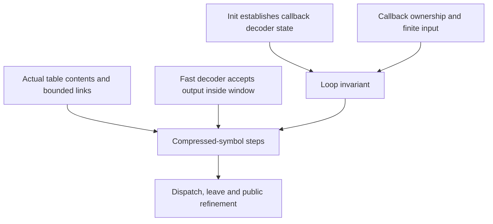

# Callback decoder migration

This record covers `inflateBackInit_`, `inflateBack` and `inflateBackEnd`. It preserves the source
arguments and the callback-domain limits. [Overview](../overview.md) owns the current checkpoint;
[migration rules](README.md) explain what can be reused.

The earlier implementation used tagged cells, a byte-block heap and a fuel loop over a local
record. It supplied entry/exit arguments and some mode steps. It did not close the block loop
or prove a complete `LEN` or `TABLE` function case. That limitation belongs to the source material
and must not be mistaken for a theorem about the complete callback decoder.

## Source families and present adaptation

| Earlier family | Reusable content | Present source family |
| --- | --- | --- |
| Init checks and allocation | Version, size and parameter refusals; memory failure; exact fields stored on success | `infback.c.init` |
| End and entry exits | Invalid stream/state refusals; state free and cleared pointer | `infback.c.end`, `.back` |
| First input exhaustion | No bytes from `in`, buffer error, input fields restored, no output callback | `infback.c.back` |
| Callback contract and witness | Own block sets and local invariants; a concrete initialised example | `infback.c.callbacks` |
| Input macros | Refill/consume bits, callback transition and remaining-input measure | `infback.c.pull`, `.macros` and shared inflate bit lemmas |
| Output room and window writes | Flush a full window to `out`, preserve prior output and extend the output view | `infback.c.room`, `.stored` |
| `TYPE`, fixed tables and bad modes | Last-block decision, block type, fixed-table fields and error messages | `infback.c.inv` and `inflate_fixed_ok` |
| Stored block and length order | Alignment, complement check, bounded piecewise copy; order permutation | `infback.c.pure`, `.stored` |
| Dynamic tables and slow lookup | Counts, repeats, constructor calls and canonical root/subtable agreement | Earlier argument structure to restate against present table semantics |
| Dispatch and leave | Falling loop measure; last output callback; exact result and input writeback | Present loop rule and composition argument |

Present sources are under `ZlibF/Proof/`. Representative declarations include
`inflateBackInit__safe`, `backInit_witness`, `inflateBackEnd_ok`, `inflateBack_eof`,
`inflateBack_eof_witness`, `PULLBYTE_run`, `NEEDBITS_run`, `ROOM_run`, `TYPE_last`, `TYPE_more`
and `stored_run`. The pure module contains the order permutation and stored-length arithmetic.
These declarations supersede the old list that called all pure and stored work unstarted.
They do not establish whole-function safety or public refinement.

## Callback domain and termination

The callback assumptions describe caller-supplied code. They are separate from forbidden
assumptions about library callees. A theorem that calls `inflate_fast` or `inflate_table` still
needs a theorem about that translated function.

| Condition in the migrated arguments | Boundary relative to the API |
| --- | --- |
| Default allocator or a null allocator field that init replaces | Custom allocator implementations are outside this model scope |
| Window represented by a byte block with room for `2^windowBits` bytes from its offset | The caller must supply the valid writable range |
| Callbacks allocate or free no heap blocks | Stronger than the documented lifetime requirement on returned input |
| Input callback alone writes its input blocks | A convenient ownership discipline, not a complete characterisation of every legal callback |
| Callback invariant `R` depends only on its owned blocks | Frames callback effects away from the decoder state |
| `InFinite` bounds input still deliverable | Needed for termination; the API does not promise that a callback eventually ends |

The measure `phi` combines held bits, bytes left and input still deliverable. An indefinitely
productive callback can prevent `inflateBack` from returning without causing C undefined
behaviour. A finite-input theorem must state that premise rather than claim unconditional
termination over every callback allowed by the public interface. All narrower theorem domains
must be explicit and recorded in [deviations](../deviations.md).

## Table and window composition

A constructor return-code theorem does not show that a link entry points inside `codes`.
A fast-path theorem for separate output and history buffers does not automatically cover
`inflateBack`, whose output pointer lies inside its window. Both distinctions affect actual
lookup and copy safety.

The earlier attempt also reported a possible missing-`whave` effect before the fast call.
For this callback API that reading remains **to confirm**. The short-distance experiment in the
[ordinary inflate record](inflate.md) did not exercise `inflateBack` and cannot resolve it.
It is not a confirmed upstream issue. The current investigation inventory belongs in the overview.
