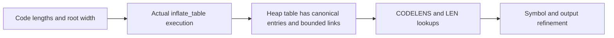

# Inflate table and trailer migration

This record expands the [main inflate record](inflate.md). It maps the dynamic-header loops,
trailer checks and epilogue arguments to the object heap. Current proof work is listed only in
[overview](../overview.md). The [migration guide](README.md) defines acceptance boundaries.

## Source and adaptation

| Earlier source | Reusable argument | Present source family |
| --- | --- | --- |
| `InflateTables` (about 1,161 lines) | `LENLENS` reads `min(ncode - have, available_bits / 3)` groups; order permutation, `lensRead`, `lensZero`, `Good3`; read and zero-fill loops | `inflate.c.main.table` through `.table6` |
| `InflateCheck`, `InflateCheckStep` | Output totals, checksum update and byte-swapped zlib comparison | `inflate.c.main.check0`, `.check` |
| `InflateBits` | Refill and consume bits without changing the represented stream | Shared `inflate.c.main.macros` results |

The memory reasoning is restated with `setI` and record arrays. Exact resulting heaps describe
which state was written. Pure code-length and trailer arguments cannot establish that an actual
heap table has the required contents.

## Statement boundaries

`inflate_TABLE_run` describes the count extraction and the “too many length or distance symbols”
exit. `inflate_LENLENS_run` uses `have <= ncode <= 19` and `Good3 lens have`. `TABLE` establishes
the count bound; earlier loop iterations establish the written-prefix condition. The associated
results `ll1_run`, `lz_run` and `llTail_run` expose the loop structure.

The code-length constructor call uses `inflate_table_safe` and `inflate_table_correct_ret`.
Those results establish execution safety and the return classification. Bounds such as `u <= 128`
and a returned root width `lb` do not yet explain every table entry.

`inflate_CHECK_run` uses `StaticsOK` for checksum tables and `PutAt` for the bytes written during
this call. The one-byte Adler behaviour needs its own relation when the previous checksum is
not canonical. The public domain must not be narrowed to a canonical seed to hide that case.

## Constructor-to-lookup boundary

`CODELENS` reads `codes[BITS(lenbits)]`. Its bit operations require a bounded root width and
bounded entry widths; the earlier analysis used `lenbits <= 10` and entry `bits <= 15`.
Subtable walks also require link offsets inside `codes`. These are properties of the installed
table, not consequences of a successful constructor return alone.

A mode invariant may state those properties. Composition must derive them from the actual
constructor theorem. No proof here may assume an unproved `inflate_table_correct_table` contract.
The epilogue must separately compose register writeback, window update, counters and exact
return-code rules. These distinctions explain the migration boundaries; the live task list is
in the overview.
