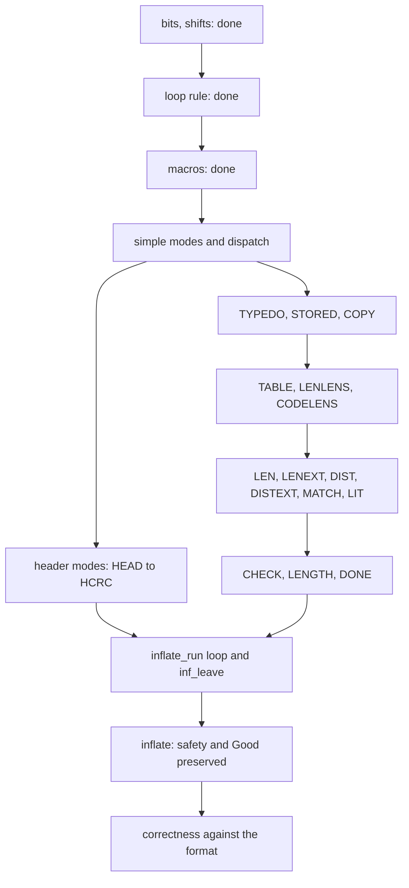

# Migrating the proofs of `inflate()`

This note covers the main function `inflate` of `inflate.c`: the part from the argument checks, through
the mode loop, to `inf_leave`. The management functions (`inflateInit2_`, `inflateReset*`, `inflateEnd`,
`inflateCopy`, the dictionary, sync and window functions) are proved elsewhere and are not repeated here.

The earlier attempt proved safety of `inflate` in about 29,000 lines (113 files), plus a list of
statements about stored blocks, the match copy and the trailer check. It did **not** prove that the
output is what the format says. This note says what each family of old theorems states, how much of it can
be copied, and in which order the rest is re-proved on the object heap and the new translation.

## 1. What changed, and why most proofs must be re-stated

| | earlier attempt | now |
| --- | --- | --- |
| memory | a list of byte blocks and "typed blocks" of untyped cells; pointers into byte blocks | tables of objects: `z_stream`, `inflate_state`, `gz_header` are records in tables; arrays (`lens`, `work`, `codes`, `window`, caller buffers, static tables) are reached through references |
| state | cells read with tags; a "typed view" (`Mach`) had to be rebuilt in every lemma | `inflate_state` is a record; its fields are read by projection |
| translation | one big function over a local-variable record, one mode per match arm | one function per mode, a monad `X` that carries the registers (`next`, `put`, `have`, `left`, `hold`, `bits`, ...) and raises `goto inf_leave` and `return` as exceptions |
| loops | loop rules with a measure over the old monad | `xwhileBrk_run`, one rule for every `while`, `for (;;)`, `break` and `goto` in the modes |
| invariant | `InflatePre` / `InflateInv` over cells | `Good` / `StInv` / `PtrInv` of the base module, over records |
| narrowing | head must be null; input, output and window are distinct objects; `strm->adler` must hold a value; a few more | none wanted: all of `zlib.h` (any chunking, any flush, `next_in` NULL with `avail_in` 0, `inflateGetHeader`) |

Consequence: a theorem that only talks about numbers and bit lists is copied. A theorem that mentions a
heap, a pointer or a cell is re-stated and re-proved; the old proof is a guide to the argument, not text
that can be pasted. The old narrowings are dropped: the new statements are as wide as `zlib.h`.

## 2. Families of old theorems

"Pure" means no heap and no pointer: it is copied (names and namespaces adapted). "Adapt" means the
mathematics is kept and the heap part is replaced. "Memory" means re-stated and re-proved.

### 2.1 Bit and number facts

| family (old files) | states | class | new home | status |
| --- | --- | --- | --- | --- |
| bit-list algebra (`natBits`, `bytesBits`, drop, take, pull; about 110 lines of the old bit file of the fast-path proofs) | the low `k` bits of a number as a list; appending a pulled byte; dropping `j` bits; agreement with the format specification's bit order | pure | `inflate.c.main.bits` | **done**, with the bridge to the specification's `bytesToBits` |
| shift and mask lemmas (old arithmetic lemma files) | when `<<<` and `>>>` of the translation equal multiplication and division; value of `(1U << n) - 1`; `&` with a mask is `mod` | pure | `inflate.c.main.bits` | **done** |
| bit-buffer macros (old `InflateBits`, 363 lines) | `PULLBYTE`, `NEEDBITS`, `BITS`, `DROPBITS`, `BYTEBITS`, `INITBITS` keep the bit stream `bits of hold ++ unread input`; `NEEDBITS` either holds enough bits or has consumed all input and leaves | adapt (pointer facts now come from a readable byte array) | `inflate.c.main.macros` | **done** |
| loop rule (old loop-measure lemmas and `InflateTopLoop`, `InflateLoop`) | a loop with a counter that decreases ends | adapt | `inflate.c.main.xloop` | **done** (general rule with `break`, `goto`, `return`) |

### 2.2 Block format facts

| family | states | class | new home | status |
| --- | --- | --- | --- | --- |
| stored block (old `SpecStored`, `SpecStoredCopy`, the stored-block decoder of the old specification, 270 lines) | the 32 bits after a stored header are `LEN` and its complement; the block is `LEN` bytes copied unchanged; a bad complement is the error "invalid stored block lengths" | pure core, adapt to the new format specification | `inflate.c.main.stored` | next |
| string length (old `InflateName`, the numeric part: `zlenB` and friends, 100 lines of 708) | how many bytes `NAME`/`COMMENT`/`EXTRA` write: the minimum of the field length and the room, and where the terminating zero goes | pure | `inflate.c.main.header` | next |
| dynamic header counts (old `InflateTables`, the numeric part) | `nlen <= 286`, `ndist <= 30`, `nlen + ndist <= 316 <= 320`; the order array of code-length codes; run-length codes 16, 17, 18 and their bounds | pure | `inflate.c.main.table` | next |
| code-length decoding (old `InflateCodeLensDec`, the mathematical step `clDec` and its agreement with canonical Huffman decoding) | the root entry of a table with no subtable decodes the first code of the unread stream | adapt: the new inftrees theorems already give the table as a function of the lengths | `inflate.c.main.table` | later |
| decoding steps (old `InflateLenBridge`, `InflateLenTab`, `InflateMatchSpec`, 700 lines) | one `LEN`/`DIST` step decodes one symbol of the format; a match copies `length` bytes from `offset` back through the window | adapt | `inflate.c.main.len` | later |

### 2.3 Per-mode cases (memory)

Each old case lemma gives the exact result of one mode (or "`goto inf_leave` with the heap unchanged").
They become one theorem per mode function of the new translation. Common frame: the heap changes only in
the state record, the stream record, the output bytes written, the window, the `lens`/`work`/`codes` arrays
(for the table modes) and the gzip header record (for the header modes).

| group | old files | lines | what is re-stated |
| --- | --- | --- | --- |
| dispatch | `InflateCases1`, `InflateLoop`, `InflateLoopInv` | 735 | the dispatch picks the mode function; default and unknown modes give `Z_STREAM_ERROR` |
| simple modes: `TYPE`, `DONE`, `BAD`, `MEM`, `SYNC`, `LEN_`, `COPY_`, `LIT`, `DICT`, `DICTID` | `InflateCases1`, `InflateUpd` | 330 | register and mode changes; `LIT` writes one byte; `DICT` returns `Z_NEED_DICT` |
| need-bits modes: `FLAGS`, `TIME`, `OS`, `EXLEN`, `HCRC`, `LENGTH`, `LENEXT`, `DISTEXT` | `InflateCases2`, `InflateHdr*` | 1,500 | gzip header fields, written to the header record only when one is installed; header CRC over a local four-byte buffer |
| `NAME`, `COMMENT`, `EXTRA` | `InflateName`, `InflateHdrExtra` | 1,050 | copy loops bounded by the caller's buffer lengths; the precondition is what `inflateGetHeader` asks of the caller |
| `HEAD` | `InflateHead`, `InflateHeadStep*` | 900 | zlib header (method, window size, dictionary flag) and gzip magic; sets `wbits`, `check`, mode |
| `TYPEDO`, `STORED`, `COPY` | `InflateCases3`, `Copy*`, `SpecStored*` | 1,500 | block type; stored header; copy of `min(length, have, left)` bytes between two caller buffers (they may be the same object only if zlib.h allows; the new statement says what is required) |
| `TABLE`, `LENLENS`, `CODELENS` | `InflateTable`, `InflateTables`, `InflateCodeLens*` | 4,600 | reading `HLIT`, `HDIST`, `HCLEN`; the loops writing `lens`; the two `inflate_table` calls and what they leave in `codes`; every error message and exit |
| `LEN`, `DIST`, `MATCH`, `LENEXT`, `DISTEXT` | `InflateLen*`, `InflateDist*`, `InflateMatch*` | 3,400 | the slow path table walk with sub-tables; the call to `inflate_fast` and what it may leave; the match copy from the window or from the output, with the "too far back" check |
| `CHECK`, `LENGTH` | `InflateCheck`, `InflateCheckStep` | 500 | trailer; `total_out`, `total`, `adler` updated; check value compared (byte-swapped for zlib) |
| fixed tables | `InflateFixed` | 130 | `inflate_fixed` sets `lencode`, `distcode` to the static read-only tables with 9 and 5 bits |

### 2.4 Top level

| old theorem | states | new theorem (target) |
| --- | --- | --- |
| `inflate_safe_of_steps`, `inflate_safe_full` | every mode step is safe, so a call returns a valid code and keeps the stream shape | `inflate_safe`: under `Good` and the call's buffer conditions, no fault and the return value is one of the codes of `zlib.h` |
| `inflate_inv_full`, `inflate_pre_next` | a call re-establishes the invariant; the caller may then reset the four buffer fields and call again | `inflate_good`: `Good` holds after the call, for any new buffers the caller installs |
| `inflate_seq_safe_all`, `inflate_validW` | a whole sequence of API calls is safe | stays with the API-sequence theorem of the specification; needs the management proofs |
| `infLeave_ok`, `leaveTail_ok`, `updatewindow_frame` | `inf_leave` writes back the registers, calls `updatewindow` with the output of this call, updates `total_in/out` and `adler`, and decides the return code (`Z_BUF_ERROR` rule, `Z_STREAM_END`, `Z_NEED_DICT`) | `inflate_leave_spec`, using the window proof of the management work |
| `StepOK` family | per-mode step obligations | become the per-mode theorems above; no separate predicate is needed any more because the monad `X` runs a mode directly |

## 3. Order of migration

1. **Pure parts first** (done for bits, shifts, loop rule, macros; next: stored-block numerics, string
   lengths, table counts).
2. **Modes that touch only registers and the state record** (dispatch, `TYPE`, `DONE`, `BAD`, `MEM`, `SYNC`,
   `LEN_`, `COPY_`, `LIT`, `LENGTH`, `DICTID`, `DICT`).
3. **Header modes.** Needs the header record and the local four-byte buffer.
4. **Block modes**: `TYPEDO`, `STORED`, `COPY`, then the table modes (needs `inflate_table_safe` and
   `inflate_table_correct_ret`, both in the audited list), then `LEN` to `MATCH` (needs the fast-path proof).
5. **Trailer**: `CHECK` (needs the crc32 and adler32 correctness theorems, both in the audited list).
6. **The loop and `inf_leave`**: combine the modes with `xwhileBrk_run`; needs the window proof.
7. **Safety theorem, then the invariant after the call, then correctness.**

## 4. Callee facts

Used as proved theorems (all in the audited list): `inflate_table_safe`, `inflate_table_correct_ret`,
the crc32 and adler32 safety and correctness theorems, the window update proved by the management work.

Taken as hypotheses until their theorems exist. A hypothesis is named with the ending `_contract`, says what
the callee's own theorem will prove, cites `zlib.h`, and is listed here.

| hypothesis | callee | status |
| --- | --- | --- |
| (none yet) | | |

Expected: the fast-path function `inflate_fast` (its proofs are being written elsewhere): given the state
after `LEN` has chosen it, with `have >= 6` and `left >= 258`, it returns with the registers, the output
and the mode consistent with decoding the same stream symbol by symbol. It will be added here when the
`LEN` mode is stated, with a witness that runs the real translation.

## 5. Gap to the specification goals

The goal `inflate_refines` in the specification of the API says: for every stream that matches a model
state, every operation does not fault and what it returns is allowed by the model, and the stream again
matches. The model state remembers the whole history (all input seen, all output given). The heap does not.
Three things are therefore still missing after the safety work, whatever its form:

1. a relation `Matches` between the object heap and the model state. It must say that the decoder
   configuration in the heap (mode, bit buffer, window, tables) is the one reached by decoding the
   history. This is a ghost-history invariant, and it is stronger than `Good`.
2. for each mode: the bytes it writes are the next bytes of the decoding of the bytes it reads, according to
   the format specification (the layered decoding of the specification, with its dictionary and window
   rules).
3. the end conditions: `Z_STREAM_END` exactly after the trailer of a valid stream; `Z_DATA_ERROR` with the
   message of the format error; `Z_BUF_ERROR` and `Z_NEED_DICT` as the model describes them; `inflate`
   makes progress whenever the caller offers input and room.

The placeholder `HeapApi` in the specification has to be instantiated with the real heap, the `Matches`
relation, and the argument conditions of `zlib.h` (stream live; `next_in` may be NULL only if `avail_in` is 0;
`next_out` not NULL when `avail_out` is not 0; the buffers are readable and writable ranges; the window
and the buffers do not overlap in the way `zlib.h` forbids). Until then the statements proved here are
stepping stones: safety of each mode, and the per-mode relation between bits read and bytes written.

## 6. Status

Done and audited: the bit algebra, the shift lemmas, the loop rule, the bit macros (570 lines of new
proof; the argument and the statement shapes come from about 480 old lines, the proofs are re-written
for the new monad and the object heap).

Not started: everything in section 2.3 and 2.4.
