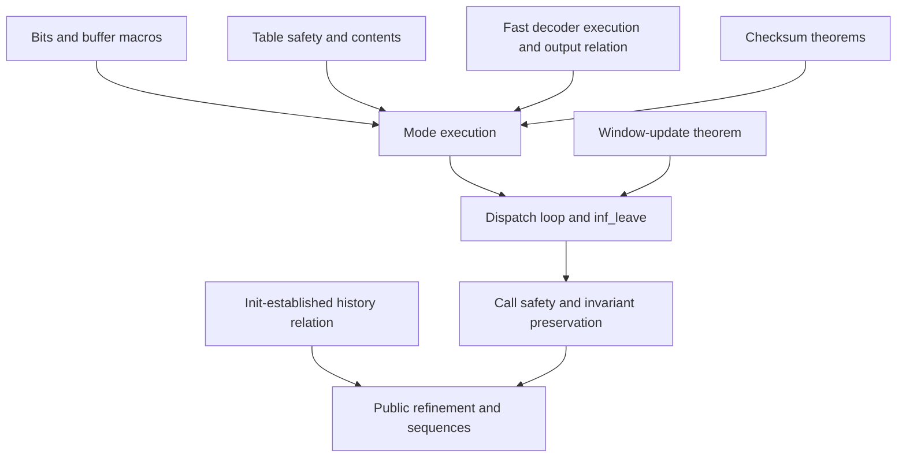

# Inflate migration

This record covers the main `inflate` function: entry checks, mode dispatch, decoding steps and
`inf_leave`. It complements the [table and trailer record](inflate-table-check.md).
[Overview](../overview.md) owns the current checkpoint and blockers; the [migration guide](README.md)
defines the evidence boundary.

The earlier main-decoder effort occupied about 29,000 lines in 113 files. It supplied safety
arguments and local facts about stored blocks, match copies and checksums. It did not establish
that the complete decoder output agrees with the format. Conditional top-level statements from
that effort must also be read with their callee and invariant assumptions.

## Representation changes

| Earlier form | Present form | Proof consequence |
| --- | --- | --- |
| Tagged cells, byte blocks and rebuilt `Mach` views | `z_stream`, `inflate_state` and `gz_header` records | Restate loads, stores and frames |
| One local-variable record for the whole decoder | Mode functions in `X`, with carried registers and leave/return control | Prove mode execution and compose exact control outcomes |
| Loop measures over the old monad | `xwhileBrk_run` and the present exception structure | Rebuild preservation and termination arguments |
| `InflatePre` and `InflateInv` | `Good`, `StInv` and pointer conditions | Connect init, mode steps and across-call buffer changes |
| Null header and separated-buffer restrictions | Public domain fixed by `zlib.h` and explicit representation limits | Do not transfer old narrowings silently |

The intended public domain includes legal chunking, supported flush values, an absent input
pointer when no input is available, and `inflateGetHeader`. Internal results may have narrower
premises; those are obligations for their callers, not permission to narrow the public contract.

## Reusable source families

| Earlier family | Content | Present source family |
| --- | --- | --- |
| `natBits`, `bytesBits`, shift and mask lemmas | Low-bit lists, byte append, bit dropping and format bit order | `inflate.c.main.bits` |
| `InflateBits` | `PULLBYTE`, `NEEDBITS`, `BITS`, `DROPBITS`, `BYTEBITS`, `INITBITS`; preserve held bits followed by unread bytes | `inflate.c.main.macros` |
| `InflateTopLoop`, `InflateLoop` | Decreasing measure and every loop exit | `inflate.c.main.xloop` |
| `SpecStored`, `SpecStoredCopy`, `Copy*` | Stored length/complement check and unchanged copied bytes | `inflate.c.main.stored`, `.stored2` |
| `InflateHead`, `InflateHdr*`, `InflateName` | Header checks, field lengths, optional header writes and CRC | Mode arguments and header arithmetic |
| `InflateTable`, `InflateTables`, `InflateCodeLens*` | Dynamic counts, code-length order, repeats and table installation | `inflate.c.main.table` through `.table6`; see companion record |
| `InflateLen*`, `InflateDist*`, `InflateMatch*` | Slow lookup, subtables, distance checks and window/output copy | Symbol, lookup and copy argument structure |
| `InflateCheck`, `InflateCheckStep` | Totals, checksum update and trailer comparison | `inflate.c.main.check0`, `.check` |
| `InflateCases1`, `InflateUpd`, `InflateFixed` | Simple modes, dispatch, refusals and fixed-table selection | Simple/type modules and fixed-table theorem |
| `infLeave_ok`, `leaveTail_ok`, `updatewindow_frame` | Register writeback, window update, counters and return-code rules | Epilogue composition argument |

Present proof sources are under `ZlibF/Proof/`. The old record's “not started” label for all
mode cases is obsolete: stored, simple, type, table and check modules contain execution results.
Their presence is not a complete main-loop proof or a public correctness result.

## Dependency structure

A table constructor's no-fault theorem and return-code theorem do not establish the entries that
later lookups read. Each table-content premise must be supplied by the translated constructor's
execution theorem. The same rule applies to `inflate_fast`, checksums and `updatewindow`.
A theorem cannot replace them with unproved library-callee contracts.

## From local execution to format refinement

The public relation must connect the heap to a model that remembers input and output history.
A shape invariant such as `Good` does not by itself establish that relation. Three distinct facts
must compose: the decoder configuration reflects the consumed history; each mode emits the next
format-prescribed bytes; and return codes and progress follow the public contract, including
dictionary, error and trailer behaviour.

Instantiating the heap API must retain the actual buffer views and alias rules. A per-mode
bitstream lemma does not establish table installation, across-call history or final sequence
safety. The [proof method](../proof/method.md) explains the common refinement structure.

## Historical short-distance check

The earlier record reported an experiment on a candidate missing-`whave` update before the fast
path. Raw fixed-Huffman streams used one to three literals followed by a length-three match at
distance one to four. The matrix included fast calls with at least six input bytes and 258 output
bytes of room, input split one byte at a time, and two-call decoding with a fresh output buffer.
The record reports agreement between paths, the expected “invalid distance too far back” error,
and no sanitizer finding.

That experiment refuted the candidate only for those ordinary-`inflate` cases. It did not cover
long distances, full or wrapped windows, other window sizes, or the callback decoder. It is
historical test evidence, not a kernel proof or a newly repeated validation run.
