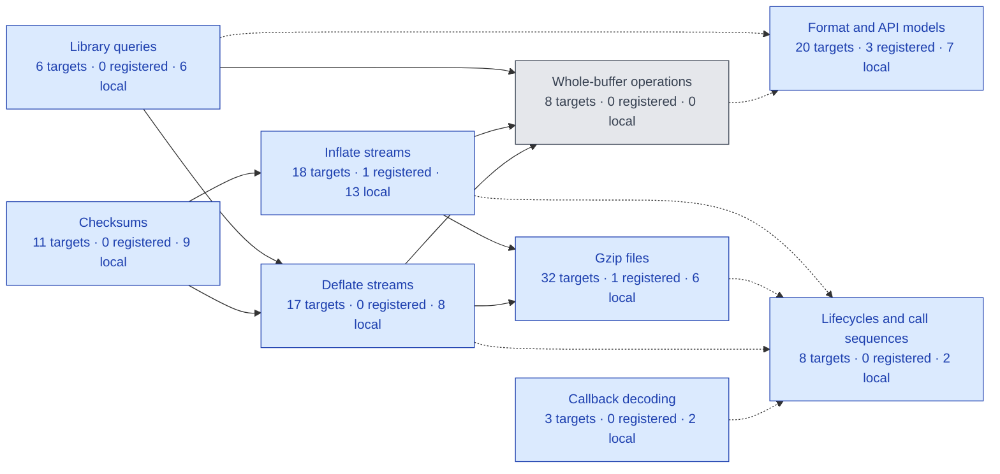

# Project status and remaining work

[Documentation](README.md) · [API](api/README.md) · [Checking](checking/README.md)

**Work in progress. Full zlib verification is not complete.**
This is the single current-status and remaining-work page.
The first target is the default LP64 Linux static build with the default allocator.
Other upstream configurations remain goals. Compiler/OS correctness and performance
are outside the proof.

<!-- proof-progress:start -->
## Proof progress graph

**123 registered targets.** Registered proofs: 5 ·
locally checked but not registered: 53 ·
source candidates: 0 · no exact proof: 65 ·
disallowed dependencies: 0.
These are local snapshot counts, not final verification or a percentage of effort.

[Open the complete coloured graph and proof references](progress.md).
Green = registered; blue = local checked results; amber = source-only candidates;
gray = no exact proof; red = disallowed dependencies. A mixed group uses blue if it has
checked results; the counts do not imply that the whole group is complete.
Final acceptance still requires the full audit and CI on a named commit.

Arrows aggregate actual implementation calls and proof/definition references.
[The detailed graph](progress.md) shows every registered target separately.
Refresh with `python3 scripts/proof-progress.py` after proof changes.
<!-- proof-progress:end -->

## Recorded checkpoint

The inventory has 95 default-build API entries, four lifecycle targets and four
initialisation-domain targets. A proposition's presence is not a proof.
The last recorded registry report recognizes five goals: format determinism,
prefix freedom, a deferred-distance model witness, `gzclearerr`, and
`inflateCodesUsed`. See [the contract review](checking/contract-review.md).
This is a recorded checkpoint, not a fresh audit of each development edit.

Recorded local work also covers version/flags/error/bound/CRC-table queries;
gzip EOF, buffering, offsets and error queries; inflate state, mark and priming
queries; deflate used-bit, tuning, header and pending queries; internal fast-decoder
safety, bit-source composition and token-output refinement; and canonical-code/leaf/heap tree prefixes.
Further local proofs cover `gzrewind`, `inflateGetHeader`, `inflateResetKeep`,
`inflateReset`, `inflateReset2`, `inflateEnd`, `inflateBackEnd`, `deflateEnd` and
`deflateGetDictionary`, `inflateGetDictionary`, `deflateResetKeep` and `deflateReset`.
Their direct source mutants fail the corresponding function proofs.
The `inflateInit_`, `inflateBackInit_` and both corresponding initialization-domain goals
also check in Lean. Seven initialization mutants fail their function proofs.
The `inflateSetDictionary` goal also checks in Lean; seven source mutants fail
its function proofs.
The abstract-model goals `deflate_bound_adequate` and `deflate_completes` also
check in Lean. These model results do not establish refinement of the C translation.
The `adler32_combine` and `adler32_combine64` goals also check in Lean;
three negative-length and entry-point mutants fail their function proofs.
The `adler32` and `adler32_z` update goals check in Lean under the documented
zero-length NULL-query restriction. Five update and wrapper mutants fail their proofs.
Five CRC combination and generated-operator goals also check in Lean; one direct
mutation per entry fails its matching function proof.
Source-order corrections and direct proof mutants accompany their stated scopes.
These results do not complete public inflate/deflate or arbitrary call-sequence
correctness. Registration, reviewed locks and acceptance on a named commit remain
separate. A build count is not a completion percentage.

## Remaining work

### Integration

Review the focused function-manual scopes and regenerate the documentation source-policy lock in a
reviewed audit update. Independently review the new source and kernel-syntax locks and the first
verification baseline. Maintain repository protections for the four checks and protected-path
review. Register newly checked results only after their required checks.

### Public contracts

Independently approve the 103 target statements, caller domains and representation limits before
accepting a verification baseline. Extend the ordinary data-epoch refinement to advanced raw
dictionary replacement and all header/priming/recovery combinations; retain their exact per-entry
effects and unconditional sequence safety. No final correctness claim may silently drop those
obligations.

### Specification review

The current `inflateInit2_` goal is false for an invalid window parameter. Its
`SameObjects` postcondition requires a structurally unchanged state table, but allocation
followed by free expands that table. The [checked counterexample](../tests/verification/counterexamples/inflate-init2-table-shape.lean)
uses a valid caller heap and proves the sizes are four and zero. Review the contract and
model before proving this goal. This is not a confirmed zlib issue.

Review the corrected shared `Uncompress2` relation independently. The deferred-distance and
exact-free corrections have independent counterexamples and checked regression proofs;
implementation refinement remains open. Its former empty-output clause on memory failure and
extension clause on buffer error have been removed using the existing paired counterexample.
Complete the older abstract gz and dictionary models before using them as complete operational
refinements; the concrete public targets do not assume their callee contracts.

### Translation review

Continue the statement-by-statement review beyond the corrected compressor automatic storage. The
compressor slide now checks signed subtraction in source order. Its
[internal-state regression](../tests/regression/deflate-slide/README.md) compares three defined
boundaries and rejects an artificial overflow in both C and Lean. Restoring unchecked subtraction
changes only the overflow observation. Reachability of that artificial state is not claimed;
derive the signed bound from legal call histories. The source-level selected-depth reread in tree merging has been restored with a
[six-case regression](../tests/regression/trees-depth-read/README.md) and a required structural
check that rejects the former cached expression. Prove the temporal initialization history of
internal depth reads. Review scalar-pointer aliasing and the null-minus-null special case in
compressor pointer subtraction (**to confirm**).

### CRC address model

Extend and independently review address/alignment semantics for represented static and embedded byte
objects. The current CRC `addrOf` helper rejects a valid 47-byte read from the static distance
table; a [checked diagnostic](../tests/verification/counterexamples/crc-static-address.lean) records
the counterexample. The broad public checksum domain remains fixed; this is a translation-model
blocker, not a confirmed upstream bug. A fixed gzip execution with 47 output bytes in an embedded
array also reaches this model fault. Its complete public-history/domain witness remains **to confirm**.

### Inflate causal model

Complete the universal output and unknown-dictionary refinement against the C. The earlier
whole-lookahead consistency is false; the supporting-bit-prefix correction is reviewed. The fixed
data-error detection lag of eight bytes also has a counterexample; derive a justified replacement
rather than raising the constant without proof. Register the checked `inflate_decodes` model proof,
then establish these conditions for actual decoder runs. Prove the general negative-value priming
bridge, beyond the checked model witnesses and finite execution matrix.

### Differential harness

Keep the new allocation-failure and negative-prime regressions in automated validation. The
test-owned gz handles, input line and deflate buffers are now released. Normal and unsuppressed
sanitizer runs compare all 47,890 inputs. A cleanup mutation confirms that the harness still reports
library state leaked by a missing end call.

### Proof mutants

Complete the remaining legacy lists. Every newly proved public entry must supply direct translation
mutants in the locked mapping and demonstrate failure in its function proof. Unproved entries
acquire their records with their proofs.

### Decode tables

Connect the proved canonical-code coverage and entry-shape lemmas to the heap written by
`inflate_table`; establish the table predicates used by the decoders.

### Inflate

The locally checked internal fast body now emits one independent literal/copy token, ends the
block, or rejects an invalid length code, invalid distance code or too-far match without output.
The actual distance result preserves exact remaining bits and equates copying with independent
bytewise history copying. The token relation has checked composition, decomposition and rejection
results against the original format grammar. Whole-fast-call bit origin also checks through the
loop, byte rollback and final writeback. All these results retain the original safety conclusions.

Establish table meaning, suffix stability, compatible leaf flags and saved-window history from
actual construction, installation and init. Complete whole-fast-call output composition and cover
all legal buffer views. Finish the other decode modes, across-call composition, copy and recovery.
These remain internal-domain results, not registered public proofs. The public inflate and sequence
goals remain open.

### Inflate back

Finish table construction, compressed blocks, callback composition and the complete function.

### Deflate

Finish initialisation and its failure cleanup, dictionary setting, priming, copying, `fill_window`,
strategy loops and the complete function. The recovered dictionary-query proof builds and rejects
three translation mutants in its own proof; registration remains.

### Trees

Actual `gen_codes`, leaf preparation, heap ordering, and the complete merge/root-storage
prefix have checked internal execution proofs. Node bounds and queue facts derive from the
actual descriptor/reset/scan/repair/order execution. Old heap contents, lengths and depths
remain unrestricted. Each merge executes child selection, tail stores, frequency/depth
updates, parent stores and sift-down in source order. The loop terminates and the final root
store has its exact state effect. Actual callee execution theorems are used.

The actual forest and final root store now establish the bit-length representation premises.
The complete actual `build_tree` executes both code-generation calls under explicit storage
and static-table conditions. The installed literal, distance and bit-length descriptors
discharge the table conditions. Every originally nonzero-frequency symbol receives a positive
limited length and its exact reversed canonical word, which fits that length. No callee
contract is assumed. The actual lengths and stored words now agree with the independent
format's canonical codes and complete-code rule. Its decoder returns each originally used
symbol and preserves every trailing bit suffix.

The constructor's exact frame preserves the caller's output invariant and existing bits.
Actual construction followed by sending one used symbol composes on the same heap, with
independently decodable output. Its fifteen-bit room condition is an explicit internal
obligation; derive it from the block/overlay bound. Initialization and arbitrary legal call
histories remain open. These are internal-state results, not a public deflate theorem.

Actual `scan_tree` terminates, writes its sentinel and records exact wrapping frequency
increments for every run. Actual `build_bl_tree` composes both scans, bit-length-tree
construction, the descending search and the unsigned cost update. Source-code words and
descriptors are preserved. Generic search returns 2..18. Actual block initialization and
source-tree construction establish the stronger 3..18 range, literal/distance count ranges
257..286 and 1..30, and all nineteen bit-length values at most seven. A new call-composition
proof retains the END_BLOCK frequency and unchanged bit-length tree through any list of valid
actual tallies that fits the current block. Actual `init_block`, those tallies and all three
constructors then establish the same header-field ranges on one returned heap. This proves
neither the strategy's input-to-tally history nor preservation across block flushes. Connect
actual tree-description emission and derive the output/symbol overlay bound.

Three code-assignment, eleven scan/reset/repair, five heapify/descriptor, and seventeen
merge/guard/root-store mutants fail their execution proofs. Complete source equality still
checks independently for the synchronized variants. The three code-assignment mutants also
reject with the complete constructor in the build target. Three direct `send_code` mutations
of its length entry, code entry and emitted length fail its emission proof with the complete
build/send composition as the build target. Five scan and eight bit-length-construction
mutants fail their execution proofs while synchronized whole-function equalities still check.
Three tally mutations of the literal index, match index and full-buffer flag fail their
execution proofs while the complete source equality still checks. These results are not
registered or CI-approved. Finish tree-description emission, full bit-cost refinement, block compression
and the overlay bound, including the small memory levels.

### Other APIs

Finish the compression utilities and the gz read/write/open paths.

### End-to-end claims

Instantiate the heap API, connect the history invariant to the format model, and prove sequence
safety, ownership, termination and functional correctness on the supported configurations.

### Historical reports to recheck

Recheck gzip extra-length arithmetic, partial-read recovery, negative-position
seeking, lost parameter changes, failed-finish recovery and forward seek after EOF
against the current pin. Conditional seek fault lemmas do not prove reachability:
establish signed-position and borrowed-pointer conditions from actual call histories.
The `inflateBack` history report remains unconfirmed for that callback API;
ordinary-inflate sanitizer examples do not settle it.
The external string allocator and fixed loop fuel also need review before full
gzip ownership or arbitrary finite callback termination is claimed.
A suspected defect is not permission to exclude a public case.
[Findings](findings.md) records evidence and confidence; current patches are in
[patches/README.md](../patches/README.md). No blanket UB patch is applied.

The [architecture guide](design/architecture.md#design-decisions) records design decisions
D1–D6, including D5's fresh-memory choice cited by the generated schema.

## Objectives

| ID | Required property |
| --- | --- |
| P1 | Safety and no leaks. |
| P2 | Termination without fuel exhaustion. |
| P3 | Frame: only permitted storage changes. |
| P4 | Invariants and ownership across legal call sequences. |
| P5 | Functional correctness against independent specifications. |
| P6 | Coverage of every upstream CI configuration. |
| C1 | Checksum updates and combinations match their definitions. |
| C2 | Decoding produces justified prefixes, completes under stated conditions and safely reports detected invalid data; memory failure and incomplete input remain explicit. |
| C3 | Completed compression encodes accepted input; compatible decoding recovers it across permitted parameters, splits and flushes. |
| C4 | Header capture and dictionary checks have exact API effects; checksum equality is not dictionary byte equality. |
| C5 | Output-bound adequacy under its documented conditions, separately from numeric equality. |
| C6 | Independent copied ownership and matching continuation; specified reset behaviour. |
| C7 | Gzip data, positions and cleanup across read/write/seek/close histories. |

## Working rules

| ID | Rule |
| --- | --- |
| R1 | Prove actual callees; never assume their contracts. |
| R2 | Init establishes the shared invariant; top-level claims also need witnesses. |
| R3 | Carry safety and functional history through the same actual states. |
| R4 | Connect execution, translation and independent specifications by refinement. |
| R5 | Allowed axioms only; no placeholders or unchecked proof shortcuts. |
| R6 | State narrower domains explicitly and record them in deviations. |
| R7 | Correct translation mismatches for fidelity, never to ease a proof. |
| R8 | Retain C naming/source correspondence; separate heap-free mathematics. |

## Acceptance

Fix the questions, review the baseline, prove exact targets with init/non-vacuity
and proof mutants, then pass final checks on a named commit. The
[checking guide](checking/README.md) defines each stage. Tests are finite evidence.
Read [design](design/README.md), [proof method](proof/method.md),
[safety](safety.md), [trusted base](trusted-base.md) and [limits](deviations.md)
for the full requirements.
