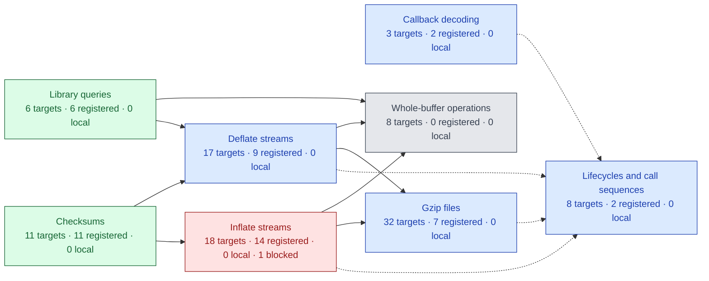
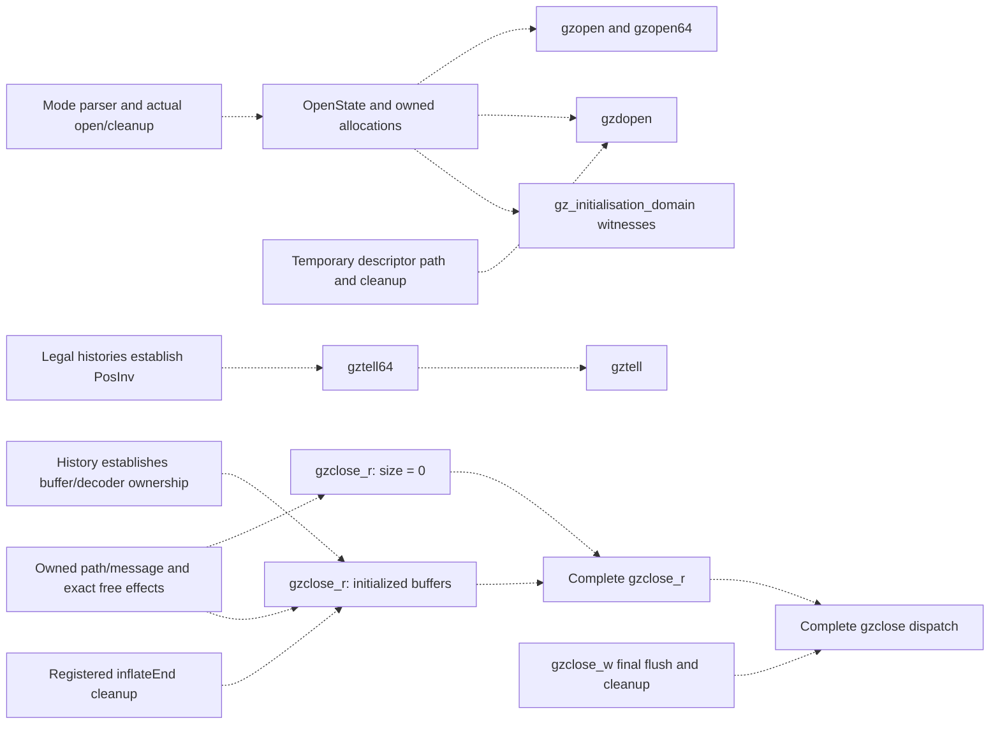
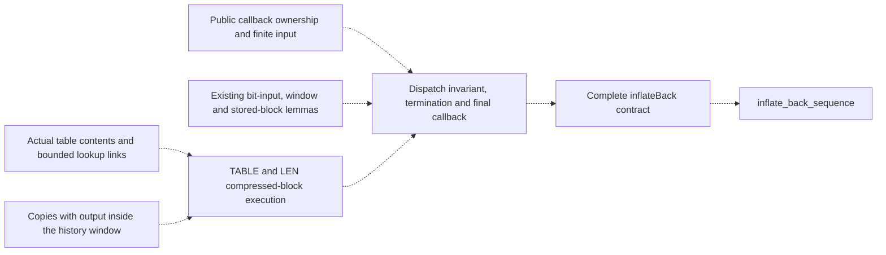

# Project status and remaining work

[Documentation](README.md) · [API](api/README.md) · [Checking](checking/README.md)

**Work in progress. Full zlib verification is not complete.**
This is the single current-status and remaining-work page.
The first target is the default LP64 Linux static build with the default allocator.
Other upstream configurations remain goals. Compiler/OS correctness and performance
are outside the proof.

<!-- proof-progress:start -->
## Proof progress graph

**103 public API targets.** Registered proofs: 51 ·
locally checked but not registered: 0 ·
not proved without a recorded blocker: 51 ·
blocked: 1.
These are local snapshot counts, not final verification or a percentage of effort.

[Open the public API graph and proof references](progress.md).
The scope is the public API manifest, including call sequences and initialization domains.
[Supporting proofs](supporting-proofs.md) lists the other 78 audit targets
and their module dependencies. They do not change the public API counts.
🟩 **Registered proof** · 🟦 **Locally checked, not registered** · ⬜ **Not proved** · 🟥 **Blocked**.
Red groups contain a blocked target. Other mixed groups use blue when they contain
checked results; counts show what remains. Work on other targets can continue.
Solid arrows show calls from the called entry to its caller. Dotted arrows show
proof or target-definition references. [Status details](progress.md#status-key).
Final acceptance still requires the full audit and CI on a named commit.

### Blockers

| Blocked targets | Reason and next step |
| --- | --- |
| [inflateInit2_](./progress.md#target-zlibf-spec-public-goal-inflateinit2) | [Inflate initialization cleanup](./overview.md#inflate-initialization-cleanup) |

Arrows aggregate actual implementation calls and proof/definition references.
An isolated node has no displayed links; it still needs its own proof. Helper and runtime
dependencies are detailed in [Public API proof readiness](./overview.md#public-api-proof-readiness).
Green requires checked, registered proofs for every
target in a group. Readiness labels identify reviewed next work without changing proof
status. Unreviewed prerequisites remain explicit. See the [representation limits](./trusted-base.md).

Click a group to open its specifications. If diagram links are disabled, use the
[group index](progress.md#clickable-index). [The detailed graph](progress.md) shows every
public API target separately, with links to its contract, statement and proof evidence.
Diagram links use the fixed GitHub snapshot `234bfef` and survive merges
and branch deletion. Table links remain relative to this document.
Refresh with `python3 scripts/proof-progress.py` after proof changes.
<!-- proof-progress:end -->

## Recorded checkpoint

The inventory has 95 default-build API entries, four lifecycle targets and four
initialisation-domain targets. A proposition's presence is not a proof.
The latest local declaration audit recognizes 78 registered targets across
398 listed theorems and 20,399 project declarations. The earlier registration batch
covers 59 existing exact proofs: six queries, nine checksum entries, 29 stream or
gzip entries, two initialization-domain goals and 13 abstract model goals.
The [registration review](checking/registration-review.md) records scope and checks.
Earlier format/query and CRC/address/view registrations remain intact.
The audit also tracks 47 internal obligations that were already defined but missing
from the registry. They are internal targets, not additional public APIs.
These are local checks. Final acceptance requires the full audit and CI on a named commit.

The next registration batch has 33 locally checked targets: 31 internal obligations
and the two later dictionary/header model results. Review their exact scopes and
required mutation evidence before registration. Keep mathematical model results
separate from execution/refinement claims about the translated C.

Recorded local work also covers version/flags/error/bound/CRC-table queries;
gzip EOF, buffering, offsets and error queries; inflate state, mark and priming
queries; deflate used-bit, tuning, header and pending queries; internal fast-decoder
safety, bit-source composition and token-output refinement; and canonical-code/leaf/heap tree prefixes.
Further local proofs cover `gzrewind`, `inflateGetHeader`, `inflateResetKeep`,
`inflateReset`, `inflateReset2`, `inflateEnd`, `inflateBackEnd`, `deflateEnd` and
`deflateGetDictionary`, `inflateGetDictionary`, `deflateResetKeep` and `deflateReset`.
Their direct source mutants fail the corresponding function proofs.
The `inflateInit_`, `inflateBackInit_` and both corresponding initialization-domain goals
also check in Lean. Seven initialization mutants fail their function proofs.
The `inflateSetDictionary` goal also checks in Lean; seven source mutants fail
its function proofs.
The abstract-model goals `deflate_bound_adequate` and `deflate_completes` also
check in Lean. These model results do not establish refinement of the C translation.
The abstract `compress_roundtrip` and `gz_roundtrip` goals also check in Lean.
They do not prove the translated buffer or file operations.
The abstract `inflate_completes` goal also checks in Lean, including allocation
failure. It does not establish refinement of translated inflate.
The abstract `deflate_full_flush_resync` goal checks in Lean. It does not establish
refinement of translated deflate.
The abstract `roundtrip` and `roundtrip_completes` goals check in Lean for all
compatible wrappers. Refinement of the C implementation remains open.
The abstract `dict_roundtrip` goal also checks in Lean, including dictionary
identifier mismatches. It does not establish implementation refinement.
The abstract `header_roundtrip` goal also checks in Lean using gzip header
prefix uniqueness. The implementation-level header proof remains open.
The `adler32_combine` and `adler32_combine64` goals also check in Lean;
three negative-length and entry-point mutants fail their function proofs.
The `adler32` and `adler32_z` update goals check in Lean under the documented
zero-length NULL-query restriction. Five update and wrapper mutants fail their proofs.
Five CRC combination and generated-operator goals also check in Lean; one direct
mutation per entry fails its matching function proof.
Source-order corrections and direct proof mutants accompany their stated scopes.
These results do not complete public inflate/deflate or arbitrary call-sequence
correctness. Registration, reviewed locks and acceptance on a named commit remain
separate. A build count is not a completion percentage.

## Remaining work

Red targets have a documented blocker with evidence and a next step below.
A long proof attempt alone does not establish a blocker. Gray targets may be started;
their missing internal lemmas and history invariants are not all drawn in the graph.

### Inflate direct return classification

The literal translated macros, all mode bodies, the complete switch and
`inflate_run` now have checked direct-exit classification. A direct API
return is exactly one of Z_NEED_DICT, Z_MEM_ERROR or Z_STREAM_ERROR.
The proof covers every mode and context on successful modeled executions.
It assumes no representation invariant, input restriction, callee safety
contract or termination fact. Lifted C computations cannot forge the
separate mode-control exception. Ordinary inf_leave return-register values
and fault freedom remain separate obligations of public inflate.

Local checks pass: the full 368-job build, fresh full-root kernel replay,
the declaration audit (20,480 declarations and 398 listed theorems), and
four actual forged-return mutants with a checked full-source baseline.
Regenerated locks add three predicate definitions and fifteen generated or
macro declarations. Existing trusted entries and registrations are unchanged.
The policy lock adds the mutant hash and updates the trusted-lock hash.
Named-commit CI and independent review remain open.

### Public API proof readiness

**Gray means unproved, not blocked. Start independent work now.** Green callees do not
establish the caller's own preconditions, loops, results or memory effects. A directly
callable API can still have a false contract or a confirmed source defect; only evidence
of that kind warrants a red blocker. Do not infer readiness solely from missing arrows.

The [public target graph](progress.md) records observed calls and theorem references.
The separate plans below expose missing proof work. Their arrows are proposed composition
requirements, **to confirm** against the exact targets. They are not new public assumptions,
checked proof references or extra public targets. Plan boxes carry no proof status. Colors in the progress graph keep their
existing meaning. This section is the maintained index of remaining prerequisites.

#### Open, query and close prerequisites

Opening a file does not require the complete engine. Its main work is the common `gz_open`
mode loop, real allocations, string copying, descriptor effects and invariant establishment.
For a tell query, the missing producer is the position invariant over permitted histories.
For close, it is ownership over those histories, including allocation failures.

Local execution proofs now cover:

- [Open entries](../ZlibF/Proof/gzlib.c.open.lean): NULL arguments, negative descriptors
  and first-allocation failure. They give the unchanged file system and exact heap,
  including the allocation-attempt counter.
- [Reader close](../ZlibF/Proof/gzread.c.close.lean): NULL, wrong mode and complete
  unbuffered execution under `GzGood`, including descriptor errors, freeing the message,
  path and handle, and a frame over unrelated allocations.
- [Priming entry](../ZlibF/Proof/deflate.c.prime.lean): refused streams and invalid bit
  counts, before pending-byte compaction.

These are scoped internal results, not proofs of the complete public targets. In particular,
`GzGood` still has to be derived from the permitted public histories. Do not replace a gray
public node with green on the strength of one branch.

#### Callback decoder prerequisites

`inflateBack` need not wait for the complete ordinary `inflate` target. Setup and teardown
are already registered. Existing entry, bit-input, window-flush and stored-block arguments
can be reused. Compressed blocks and the full public callback protocol still need composition.

A fast-path theorem requiring separate output and history buffers does not cover output
inside the window. A table return-code theorem does not establish installed entry contents.
The [callback migration record](migration/infback.md) locates the reusable arguments and
states the limits of their callback domain. These missing premises do not stop independent
work on another block type or error path.

#### Next work for every unfinished public target

"Start" means work can begin without a complete engine theorem. "Compose" names a
prerequisite for full closure; independent branches can still proceed. No row grants
checked status or assumes a callee's specification.

<!-- proof-readiness:start -->
| Public targets | Proof work shown in graph | Next work and missing prerequisite |
| --- | --- | --- |
| `gzopen`, `gzopen64`, `gzdopen`, `gz_initialisation_domain`  | Start: open and cleanup |  **Start:** common mode loop, allocation outcomes, path formatting/copy, descriptor effects, `OpenState` and witnesses. Entry/failure branches are locally checked above. |
| `gztell64`, `gztell`  | Needs: position history |  **Compose:** derive `PosInv` from reads, writes, seeking and pushback; then reuse the existing arithmetic execution proof. |
| `gzclose_r`  | Needs: resource history |  **Start:** initialized-buffer cleanup and its ownership producer over histories. Unbuffered execution and frame are locally checked; `inflateEnd` alone is insufficient. |
| `gzclose_w`, `gzclose`  | Needs: flush and cleanup |  **Compose:** actual zero-fill/final compression and file writes, all cleanup/error paths, then dispatch using both complete close results. |
| `gzseek64`, `gzseek`  | Needs: seek and history |  **Start:** position/pointer history invariants, buffered and transparent paths, exact error frames. Negative-position reachability and historical overflow reports remain **to confirm**. |
| `gzdirect`, `gzread`, `gzfread`, `gzgetc`, `gzgetc_`, `gzgets`, `gzungetc`  | Needs: reader path proofs |  **Start:** common lazy setup, transparent reads and buffer/history invariants. **Compose:** actual decoder execution for compressed paths, then EOF/count/pushback/error clauses. `gzdirect` needs detection and init, not the full data-decoding loop. |
| `gzwrite`, `gzfwrite`, `gzputc`, `gzputs`, `gzvprintf`, `gzprintf`, `gzflush`, `gzsetparams`  | Needs: writer path proofs |  **Start:** buffering, formatting, transparent writes and failures. **Compose:** actual compressor execution for compressed output and parameter changes. |
| `deflateInit2_`, `deflateInit_`, `deflate_initialisation_domain`  | Start: init and allocation |  **Start:** parameter normalization, five allocations, all failure cleanup, actual `DGood`/tree establishment and witnesses. Reset proofs require the invariant; they do not establish it for fresh storage. |
| `deflatePrime`  | Start: compaction and bits |  **Start:** pending-byte compaction, checked shifts, bit insertion/flush and invariant/frame preservation. Refusal branches are locally checked; accepted counts remain open. |
| `deflateBound_z`, `deflateBound`  | Start: bound and header review |  **Start:** connect existing execution formulas to the saturated mathematical bound, including header strings and extra lengths. The historical extra-length report is **to confirm**, not a newly confirmed blocker. |
| `deflateSetDictionary`  | Start: window and hash |  **Start:** window fill, hash-chain insertion, saved-input restoration, then checksum and exact state/frame effects. Green checksum calls cover only that part. |
| `inflateCopy`, `deflateCopy`  | Start: copy and relocation |  **Start:** allocation failures, buffer copies, pointer relocation and independent ownership. Resolve the recorded copy/history investigations before claiming the full domain; do not add silent premises. |
| `deflateParams` | Needs: block flush and parameter state |  **Compose:** actual old-block flushing, return-code handling and canonical tuning-row updates. Check exact state preservation on refusal before full closure. |
| `inflateSync`  | Needs: scan and history |  **Start:** compose existing first/resume scans, held bits, marker search, reset and accounting/frame results. Derive window/reset premises from histories. |
| `compress2_z`, `compress2`, `compress_z`, `compress`  | Needs: compressor execution |  **Start:** arguments, scalar lengths and cleanup. **Compose:** actual init/compress/end with exact output, then wrappers. Abstract roundtrip is insufficient. |
| `uncompress2_z`, `uncompress2`, `uncompress_z`, `uncompress`  | Needs: decoder execution |  **Start:** scalar results, insufficient space and cleanup. **Compose:** actual init/decompress/end, exact consumption/output, then wrappers. |
| `inflate`, `deflate`  | Needs: dispatch invariants |  **Compose:** decoder-table or hash-chain meaning, dispatch invariants, loop termination and output/accounting. Green checksums do not establish these premises. |
| `inflate_sequence`, `deflate_sequence`, `inflate_back_sequence`, `gz_sequence`  | Needs: execution and format |  **Compose:** actual per-call safety, history preservation, independent format refinement and completion across input/output splits. |
| `inflateBack` | Needs: tables, window and callbacks |  **Compose:** compressed TABLE/LEN execution, output inside the window, public callback ownership, loop termination and exact input/output accounting. Existing stored and entry paths can progress independently. |
| `inflateInit2_`  | Blocked: cleanup contract |  The confirmed cleanup-contract counterexample is [recorded below](#inflate-initialization-cleanup). Successful init and independent targets can proceed. |
<!-- proof-readiness:end -->

The immediate order is independent entry/cleanup and arithmetic paths, then common open,
position and ownership invariants, then complete function composition. Callback compressed
blocks can progress alongside these. Record an unknown prerequisite here with its exact
question; do not invent a dependency or treat elapsed time as evidence of a blocker.

### Integration

Review the focused function-manual scopes and regenerate the documentation source-policy lock in a
reviewed audit update. Independently review the new source and kernel-syntax locks and the first
verification baseline. Maintain repository protections for the four checks and protected-path
review. Register newly checked results only after their required checks.

### Public contracts

Independently approve the 103 target statements, caller domains and representation limits before
accepting a verification baseline. Extend the ordinary data-epoch refinement to advanced raw
dictionary replacement and all header/priming/recovery combinations; retain their exact per-entry
effects and unconditional sequence safety. No final correctness claim may silently drop those
obligations.

### Specification review

#### Gzip seek mode
<!-- proof-blocker: ZlibF.Spec.Api.Goal.gz_seek_read -->

The abstract `gz_seek_read` goal is false: `GzSeek` permits the resulting handle
to change from read mode to write mode, so the subsequent modeled read can return no data.
The [checked counterexample](../tests/verification/counterexamples/gz-seek-mode.lean)
uses an opened two-byte reader. Review the seek relation before proving this goal.
This is a model issue, not a confirmed zlib issue.

#### Inflate initialization cleanup
<!-- proof-blocker: ZlibF.Spec.Public.Goal.inflateInit2_ -->

The current `inflateInit2_` goal is false for an invalid window parameter. Its
`SameObjects` postcondition requires a structurally unchanged state table, but allocation
followed by free expands that table. The [checked counterexample](../tests/verification/counterexamples/inflate-init2-table-shape.lean)
uses a valid caller heap and proves the sizes are four and zero. Review the contract and
model before proving this goal. This is not a confirmed zlib issue.

Review the corrected shared `Uncompress2` relation independently. The deferred-distance and
exact-free corrections have independent counterexamples and checked regression proofs;
implementation refinement remains open. Its former empty-output clause on memory failure and
extension clause on buffer error have been removed using the existing paired counterexample.
Complete the older abstract gz and dictionary models before using them as complete operational
refinements; the concrete public targets do not assume their callee contracts.

### Translation review

Continue the statement-by-statement review beyond the corrected compressor automatic storage. The
compressor slide now checks signed subtraction in source order. Its
[internal-state regression](../tests/regression/deflate-slide/README.md) compares three defined
boundaries and rejects an artificial overflow in both C and Lean. Restoring unchecked subtraction
changes only the overflow observation. Reachability of that artificial state is not claimed;
derive the signed bound from legal call histories. The source-level selected-depth reread in tree merging has been restored with a
[six-case regression](../tests/regression/trees-depth-read/README.md) and a required structural
check that rejects the former cached expression. Prove the temporal initialization history of
internal depth reads. Review scalar-pointer aliasing and the null-minus-null special case in
compressor pointer subtraction (**to confirm**).

### CRC address model

The CRC translation now observes a stable origin residue for every represented static or
embedded byte array. Local proofs cover all residues, seeds and readable lengths for both
public CRC update entries, with the same immutable-heap result. The original 47-byte static
input is now a [positive regression](../tests/verification/regressions/crc-static-address.lean).
The public contracts and caller domains are unchanged. Local evidence still needs final
acceptance checks on the integrated commit.

Extend the representation relation to general ABI layout, effective types, scalar-cell aliases
and byte views of other records. The current address abstraction represents only the low
three bits observed by the CRC alignment test; it is not a complete address-space model.

### Inflate causal model

Complete the universal output and unknown-dictionary refinement against the C. The earlier
whole-lookahead consistency is false; the supporting-bit-prefix correction is reviewed. The fixed
data-error detection lag of eight bytes also has a counterexample; derive a justified replacement
rather than raising the constant without proof. Register the checked `inflate_decodes` model proof,
then establish these conditions for actual decoder runs. Prove the general negative-value priming
bridge, beyond the checked model witnesses and finite execution matrix.

### Differential harness

Keep the new allocation-failure and negative-prime regressions in automated validation. The
test-owned gz handles, input line and deflate buffers are now released. Normal and unsuppressed
sanitizer runs compare all 47,890 inputs. A cleanup mutation confirms that the harness still reports
library state leaked by a missing end call.

### Proof mutants

Complete the remaining legacy lists. Every newly proved public entry must supply direct translation
mutants in the locked mapping and demonstrate failure in its function proof. Unproved entries
acquire their records with their proofs.

### Decode tables

Connect the proved canonical-code coverage and entry-shape lemmas to the heap written by
`inflate_table`; establish the table predicates used by the decoders.

### Inflate

The locally checked internal fast body now emits one independent literal/copy token, ends the
block, or rejects an invalid length code, invalid distance code or too-far match without output.
The actual distance result preserves exact remaining bits and equates copying with independent
bytewise history copying. The token relation has checked composition, decomposition and rejection
results against the original format grammar. Whole-fast-call bit origin also checks through the
loop, byte rollback and final writeback. All these results retain the original safety conclusions.

Establish table meaning, suffix stability, compatible leaf flags and saved-window history from
actual construction, installation and init. Complete whole-fast-call output composition and cover
all legal buffer views. Finish the other decode modes, across-call composition, copy and recovery.
These remain internal-domain results, not registered public proofs. The public inflate and sequence
goals remain open.

### Inflate back

Finish table construction, compressed blocks, callback composition and the complete function.

### Deflate

Finish general initialization (`deflateInit2_`), dictionary setting, priming, copying, `fill_window`,
strategy loops and the complete function. The recovered dictionary-query proof builds and rejects
three translation mutants in its own proof; registration remains.

The exact `Goal.deflateInit_` now has a locally checked proof in
`public-deflate-init`. It expands the actual fixed-parameter call at window
15, memory level 8 and strategy 0. Compression level remains arbitrary.
The proof covers version and parameter refusal, all five allocation
outcomes, failure cleanup, the old-object frame and the exact live-object
ledger. Successful execution establishes `DGood`; it is not a caller
premise. A concrete default caller successfully returns that invariant.
The universal `deflateInit2_` theorem remains open and is not a dependency.

The complete root build, full fresh kernel replay, allowed-axiom inspection
and zero-placeholder scan pass locally. Three direct wrapper mutants
reject the original exact public proof in a fresh kernel. Wrong-symbol-limit
and dropped-cleanup mutants retain the synchronized whole-source equality
but fail their execution proofs with type errors. Resource failures are
not counted. The strict entry mutation list also passes.

The exact default-entry proof and its concrete witness are registered.
Generated locks add 72 semantic records and two theorem-type records.
Existing semantic and theorem-type records are unchanged. Acceptance on
a named CI commit remains. These are local results, not CI approval.

### Trees

Actual `gen_codes`, leaf preparation, heap ordering, and the complete merge/root-storage
prefix have checked internal execution proofs. Node bounds and queue facts derive from the
actual descriptor/reset/scan/repair/order execution. Old heap contents, lengths and depths
remain unrestricted. Each merge executes child selection, tail stores, frequency/depth
updates, parent stores and sift-down in source order. The loop terminates and the final root
store has its exact state effect. Actual callee execution theorems are used.

The actual forest and final root store now establish the bit-length representation premises.
The complete actual `build_tree` executes both code-generation calls under explicit storage
and static-table conditions. The installed literal, distance and bit-length descriptors
discharge the table conditions. Every originally nonzero-frequency symbol receives a positive
limited length and its exact reversed canonical word, which fits that length. No callee
contract is assumed. The actual lengths and stored words now agree with the independent
format's canonical codes and complete-code rule. Its decoder returns each originally used
symbol and preserves every trailing bit suffix.

The constructor's exact frame preserves the caller's output invariant and existing bits.
Actual construction followed by sending one used symbol composes on the same heap, with
independently decodable output. Its fifteen-bit room condition is an explicit internal
obligation; derive it from the block/overlay bound. Initialization and arbitrary legal call
histories remain open. These are internal-state results, not a public deflate theorem.

Actual `scan_tree` terminates, writes its sentinel and records exact wrapping frequency
increments for every run. Actual `build_bl_tree` composes both scans, bit-length-tree
construction, the descending search and the unsigned cost update. Source-code words and
descriptors are preserved. Generic search returns 2..18. Actual block initialization and
source-tree construction establish the stronger 3..18 range, literal/distance count ranges
257..286 and 1..30, and all nineteen bit-length values at most seven. A new call-composition
proof retains the END_BLOCK frequency and unchanged bit-length tree through any list of valid
actual tallies that fits the current block. Actual `init_block`, those tallies and all three
constructors then establish the same header-field ranges on one returned heap. This proves
neither the strategy's input-to-tally history nor preservation across block flushes.

The complete actual `send_tree` now terminates and emits exactly the shared run-length
model. The direct-repeat loop includes its final signed decrement. All repetition branches,
the early continue, next-length reads and the final for-loop iteration execute in source
order. The exact heap frame retains both tree arrays and the existing output prefix.
Actual bit-length construction now supplies the two senders' source capacities, length
bounds and fitted words for every positively scanned symbol. Each such word also has its
independent symbol-decoding result on every suffix. These data follow on one returned heap
from actual `init_block`, any legal within-block tally list and all three constructors.
Exact total bit room remains an internal obligation. Finish `send_all_trees`, independent
run-length/header decoding and the output/symbol overlay bound; individual word decoding
does not establish decoding of the complete run-length sequence.

Three code-assignment, eleven scan/reset/repair, five heapify/descriptor, and seventeen
merge/guard/root-store mutants fail their execution proofs. Complete source equality still
checks independently for the synchronized variants. The three code-assignment mutants also
reject with the complete constructor in the build target. Three direct `send_code` mutations
of its length entry, code entry and emitted length fail its emission proof with the complete
build/send composition as the build target. Five scan and eight bit-length-construction
mutants fail their execution proofs while synchronized whole-function equalities still check.
Three tally mutations of the literal index, match index and full-buffer flag fail their
execution proofs while the complete source equality still checks. Eight `send_tree`
mutations of the repeat decrement, first-code decrement, zero-run threshold, extra-bit
width/base, continue guard, next read and final iteration fail their execution proofs.
Their complete synchronized source equalities still check. These results are not registered
or CI-approved. Finish tree-description emission, full bit-cost refinement, block compression
and the overlay bound, including the small memory levels.

### Other APIs

Finish the compression utilities and the gz read/write/open paths.

### End-to-end claims

Instantiate the heap API, connect the history invariant to the format model, and prove sequence
safety, ownership, termination and functional correctness on the supported configurations.

### Historical reports to recheck

Recheck gzip extra-length arithmetic, partial-read recovery, negative-position
seeking, lost parameter changes, failed-finish recovery and forward seek after EOF
against the current pin. Conditional seek fault lemmas do not prove reachability:
establish signed-position and borrowed-pointer conditions from actual call histories.
The `inflateBack` history report remains unconfirmed for that callback API;
ordinary-inflate sanitizer examples do not settle it.
The external string allocator and fixed loop fuel also need review before full
gzip ownership or arbitrary finite callback termination is claimed.
A suspected defect is not permission to exclude a public case.
[Findings](findings.md) records evidence and confidence; current patches are in
[patches/README.md](../patches/README.md). No blanket UB patch is applied.

The [architecture guide](design/architecture.md#design-decisions) records design decisions
D1–D6, including D5's fresh-memory choice cited by the generated schema.

## Objectives

| ID | Required property |
| --- | --- |
| P1 | Safety and no leaks. |
| P2 | Termination without fuel exhaustion. |
| P3 | Frame: only permitted storage changes. |
| P4 | Invariants and ownership across legal call sequences. |
| P5 | Functional correctness against independent specifications. |
| P6 | Coverage of every upstream CI configuration. |
| C1 | Checksum updates and combinations match their definitions. |
| C2 | Decoding produces justified prefixes, completes under stated conditions and safely reports detected invalid data; memory failure and incomplete input remain explicit. |
| C3 | Completed compression encodes accepted input; compatible decoding recovers it across permitted parameters, splits and flushes. |
| C4 | Header capture and dictionary checks have exact API effects; checksum equality is not dictionary byte equality. |
| C5 | Output-bound adequacy under its documented conditions, separately from numeric equality. |
| C6 | Independent copied ownership and matching continuation; specified reset behaviour. |
| C7 | Gzip data, positions and cleanup across read/write/seek/close histories. |

## Working rules

| ID | Rule |
| --- | --- |
| R1 | Prove actual callees; never assume their contracts. |
| R2 | Init establishes the shared invariant; top-level claims also need witnesses. |
| R3 | Carry safety and functional history through the same actual states. |
| R4 | Connect execution, translation and independent specifications by refinement. |
| R5 | Allowed axioms only; no placeholders or unchecked proof shortcuts. |
| R6 | State narrower domains explicitly and record them in deviations. |
| R7 | Correct translation mismatches for fidelity, never to ease a proof. |
| R8 | Retain C naming/source correspondence; separate heap-free mathematics. |

## Acceptance

Fix the questions, review the baseline, prove exact targets with init/non-vacuity
and proof mutants, then pass final checks on a named commit. The
[checking guide](checking/README.md) defines each stage. Tests are finite evidence.
Read [design](design/README.md), [proof method](proof/method.md),
[safety](safety.md), [trusted base](trusted-base.md) and [limits](deviations.md)
for the full requirements.
