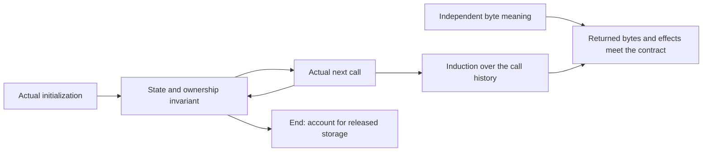

# Understanding and proving zlib

zlib compresses bytes and reconstructs them through stateful interfaces.
Follow one task, then add the capabilities that explain its APIs. Each chapter
connects worked examples and figures to the properties the implementation must
establish. Algorithm behavior and proof reasoning appear together.

The starting scope is the default x86_64 Linux build and default input
configuration. Examples illustrate particular runs; public claims also cover
their specified error cases. Exact ranges are in
[input configurations](spec/input-configurations.md).

## Contents

- [1. Follow a complete task](#1-follow-a-complete-task)
- [2. Understand the encoded bytes](#2-understand-the-encoded-bytes)
- [3. Pause and continue the same task](#3-pause-and-continue-the-same-task)
- [4. Add format headers and integrity checks](#4-add-format-headers-and-integrity-checks)
- [5. Reuse, branch and control a task](#5-reuse-branch-and-control-a-task)
- [6. Choose an application interface](#6-choose-an-application-interface)
- [7. How the arguments become checked claims](#7-how-the-arguments-become-checked-claims)
  - [7.1 Scope and assumptions](#71-scope-and-assumptions)
  - [7.2 Follow the actual implementation](#72-follow-the-actual-implementation)
  - [7.3 Establish, preserve and compose](#73-establish-preserve-and-compose)
  - [7.4 Locate the exact evidence](#74-locate-the-exact-evidence)

## 1. Follow a complete task

[Chapter 1 — A complete task](guide/round-trip.md) follows original bytes
through compression, decompression and cleanup. A compatible decoder must
recover the accepted input. The same example explains why that claim needs
bounds, error and resource arguments as well.

Later chapters expand the mechanisms inside this task. They do not introduce
a second, unrelated proof story.

## 2. Understand the encoded bytes

[Chapter 2 — Repetition, codes and blocks](guide/encoding.md) follows
`ABABABAB` through literals and an overlapping history copy. Byte snapshots
explain why the history must be valid. A small coding example connects
symbols, bits and decoding tables to their correctness conditions.

Window bounds, meaningful table cells and safe block emission appear
alongside the algorithms that need them.

## 3. Pause and continue the same task

[Chapter 3 — Streaming and saved state](guide/streaming.md) shows input
running out and output space filling. The application replaces buffer views
while the codec retains its history and unfinished work.

Why does continuation produce the same logical bytes without losing,
duplicating or accessing unavailable data? The examples explain cursor
accounting and the persistent invariant needed to establish that property.

## 4. Add format headers and integrity checks

[Chapter 4 — Formats and integrity checks](guide/wrappers.md) places the
common DEFLATE body within raw, zlib and gzip formats. Header paths establish
the window, dictionary and input-position conditions that the body uses.
Output feeds the selected integrity check before trailer validation completes
the stream.

These logical stages are distinguished from their placement inside the
actual `inflate` and `deflate` state machines.

## 5. Reuse, branch and control a task

[Chapter 5 — State operations](guide/state-operations.md) introduces each
API when an application needs its effect: Reset for a new task, Copy for a
checkpoint, dictionaries for shared history and flushes for output boundaries.
Special recovery, bit control and queries follow those ordinary uses.

These scenarios explain history, independent ownership and permitted next
calls. Configuration ranges and calling protocols remain separate dimensions.

## 6. Choose an application interface

[Chapter 6 — Application interfaces](guide/interfaces.md) follows whole-buffer
utilities, the separate raw callback decoder, and gzip file handles with
buffering, I/O and positions, including Seek.

Each interface adds obligations: capacity and error mapping, callback storage
and termination, or file effects and cleanup. These reading layers describe
capabilities; they do not assert a complete theorem dependency order.

## 7. How the arguments become checked claims

### 7.1 Scope and assumptions

The [specification reference](spec/README.md) gives the precise safety,
functional and configuration requirements. Each theorem must state its caller
domain and environmental premises. The accepted
[platform assumptions](spec/platform.md) include each represented byte object
having fewer than `2^63` bytes. This is a system premise; executions must
preserve it where required. It does not bound the total stream length.

The [safety reference](spec/safety.md) defines UB, frame, termination and
ownership. [Trusted base](trusted-base.md) and [deviations](deviations.md)
record representation limits, including null arithmetic and fresh pointer
fields. A no-fault model execution needs the stated correspondence argument
before it supports a C safety claim.

### 7.2 Follow the actual implementation

The subject is the pinned `zlib/` plus registered patches, translated
statement by statement into `ZlibF/Zlib/`. The
[model reference](design/README.md) explains memory, integers and control
flow. Differential runs give finite fidelity evidence; they do not prove
correspondence for all inputs.

The chapters' implementation readings are **to confirm** by execution and
refinement proofs. [Implementation arguments](proof/README.md) supply
the detailed reasoning by C component, including tables, fast decoding,
window maintenance and shared output storage.

### 7.3 Establish, preserve and compose

Initialization establishes a representation invariant and ownership.
Each actual call derives its callee premises, executes the translated body,
and preserves the required facts on its returned state. A callee's
specification must itself be proved about that callee; it cannot be an
assumed contract.

Each mechanism chapter explains its part of this argument when an example
needs it. The [proof method](proof/method.md) records the common rules.
A top-level theorem also needs a concrete witness that its domain can occur.

### 7.4 Locate the exact evidence

Follow a chapter's links to the canonical [API contracts](spec/api/README.md),
[format specification](spec/format/README.md) and implementation argument.
Inspect a formal result's exact Lean statement, domain, returned heap and
actual theorem dependencies. A local branch lemma does not establish an
entire public API or its whole configuration range.

Earlier model references use family labels such as `C1` for round trips and
`C7` for gzip files. Their precise mathematical statements remain in the
[heap-free API model goals](../ZlibF/Spec/Api/Goals.lean); they are separate
from concrete implementation targets.

[Checking](checking/README.md) explains kernel replay, the axiom gate,
mutations and acceptance on a named commit. [Progress](progress.md) is the
single record of current evidence and remaining work. Its
[complete target graph](progress.md#proof-progress-graph) distinguishes
theorem dependencies from C calls and specification references.
