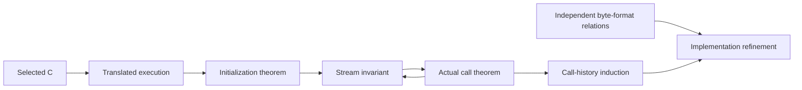

# Proving the zlib implementation

The proof connects the selected C implementation to explicit safety and
functional specifications. This chapter explains the claim, its assumptions
and the argument that links initialization, one call and a stream lifetime.
Exact proof evidence and unfinished work are recorded in [progress](progress.md).

## Contents

- [1. What must be proved](#1-what-must-be-proved)
  - [1.1 The implementation and configurations](#11-the-implementation-and-configurations)
  - [1.2 Safety of calls and lifetimes](#12-safety-of-calls-and-lifetimes)
  - [1.3 Meaning of compressed bytes](#13-meaning-of-compressed-bytes)
- [2. Assumptions and model boundaries](#2-assumptions-and-model-boundaries)
  - [2.1 Platform assumptions](#21-platform-assumptions)
  - [2.2 Caller and external-world obligations](#22-caller-and-external-world-obligations)
  - [2.3 What the kernel trusts](#23-what-the-kernel-trusts)
- [3. How the proof is built](#3-how-the-proof-is-built)
  - [3.1 Translate the actual C execution](#31-translate-the-actual-c-execution)
  - [3.2 Establish an invariant by initialization](#32-establish-an-invariant-by-initialization)
  - [3.3 Preserve it through calls](#33-preserve-it-through-calls)
  - [3.4 Relate executions to byte meaning](#34-relate-executions-to-byte-meaning)
- [4. The inflate argument](#4-the-inflate-argument)
  - [4.1 Construct and interpret decoding tables](#41-construct-and-interpret-decoding-tables)
  - [4.2 Join the slow and fast paths](#42-join-the-slow-and-fast-paths)
  - [4.3 Close the call and its history](#43-close-the-call-and-its-history)
- [5. The deflate argument](#5-the-deflate-argument)
  - [5.1 Window and hash-chain invariants](#51-window-and-hash-chain-invariants)
  - [5.2 Trees, symbols and shared output storage](#52-trees-symbols-and-shared-output-storage)
  - [5.3 Publish blocks and compose calls](#53-publish-blocks-and-compose-calls)
- [6. Reading a formal result](#6-reading-a-formal-result)
  - [6.1 Find its exact statement](#61-find-its-exact-statement)
  - [6.2 Follow its proof and evidence](#62-follow-its-proof-and-evidence)

## 1. What must be proved

### 1.1 The implementation and configurations

The subject is the pinned upstream `zlib/` source with the registered patches
applied in order. It is translated into executable Lean definitions that follow
its C statements. A mathematical compression algorithm alone is insufficient:
the argument concerns this implementation, including its errors and cleanup.

The initial platform is default x86_64 Linux, LP64, a static library and the
default allocator. Within that platform, inputs still vary: compression level,
window size, wrapper, memory level, strategy and caller buffer splits. The
[configuration specification](spec/input-configurations.md) defines the nested
default, common and all-supported input ranges. Other upstream build
configurations belong to the wider project scope.

The stable property identifiers are used by the formal statements:

| ID | Required property |
| --- | --- |
| P1 | Safety and no leaks. |
| P2 | Termination without fuel exhaustion. |
| P3 | Frame: only permitted storage changes. |
| P4 | Invariants and ownership across legal call sequences. |
| P5 | Functional correctness against independent specifications. |
| P6 | Coverage of every upstream CI configuration. |

### 1.2 Safety of calls and lifetimes

For every admitted call, the translated execution must terminate without a
fault. It must retain a legal stream state, change only permitted storage and
account for allocations and frees. Documented parameter refusals and allocation
failures are part of the claim. Malformed compressed input must be handled safely.

A lifetime starts with initialization, permits the documented calls and caller
buffer replacements, and ends with cleanup. Its invariant must hold across
that history. Isolated safe functions do not by themselves establish a safe
lifetime. Read the [safety specification](spec/safety.md) for UB, termination,
frame and ownership, and the [shared stream contracts](spec/api/streams.md)
for legal call sequences.

### 1.3 Meaning of compressed bytes

Safety does not determine whether the output is correct. Decompression must
interpret the admitted byte stream correctly. Compression must emit bytes that
encode the accepted input with the specified wrapper, checksums and flush
behaviour. The argument must account for partial input, partial output and
continuation across calls.

The [format specification](spec/format/README.md) defines byte meaning
independently of C memory. The [API contracts](spec/api/README.md) specify call
results and effects. The [formal format guide](spec/format/model.md) explains
the mathematical relations used to connect those two layers.

The functional property families have these stable identifiers. Each entry
refers to the relevant API and format specifications above.

| ID | Required property |
| --- | --- |
| C1 | Checksum updates and combinations match their definitions. |
| C2 | Decoding produces justified prefixes, completes under stated conditions and safely reports detected invalid data; memory failure and incomplete input remain explicit. |
| C3 | Completed compression encodes accepted input; compatible decoding recovers it across permitted parameters, splits and flushes. |
| C4 | Header capture and dictionary checks have exact API effects; checksum equality is not dictionary byte equality. |
| C5 | Output-bound adequacy under its documented conditions, separately from numeric equality. |
| C6 | Independent copied ownership and matching continuation; specified reset behaviour. |
| C7 | Gzip data, positions and cleanup across read/write/seek/close histories. |

## 2. Assumptions and model boundaries

### 2.1 Platform assumptions

The initial system scope accepts **each represented byte object having fewer
than `2^63` bytes**. This covers caller, static and embedded storage. It is an
environment premise, not a zlib obligation to prove an operating-system limit.
The exact `ByteObjectsFit` definition and its use are explained in
[platform assumptions](spec/platform.md).

The bound is per object. It does not cap the total stream length or total
memory, and it applies throughout the default/common/all input ranges. Proofs
that use it must still establish that actual initialization, allocation and
updates preserve it.

### 2.2 Caller and external-world obligations

The caller supplies the readable and writable ranges required by the operation.
The entry contract distinguishes a clean refusal from an input outside its
stated domain. Separation, aliases, callbacks and borrowed headers need their
actual conditions; an internal helper's restriction cannot silently become a
new public precondition.

Callback and file operations also depend on explicit external-world semantics.
Read the [caller obligations](spec/safety.md#4-caller-obligations), the entry's
[API contract](spec/api/README.md), and [external I/O](design/external-io.md).
The [scope register](deviations.md) records restrictions and representation gaps.

### 2.3 What the kernel trusts

The kernel checks a proof against its Lean statement. Applying the theorem to C
also depends on the translation, runtime and object schema faithfully representing
the source operations. Compiler, operating-system and hardware correctness are
outside that proof.

The runtime deliberately has limits. For example, some null arithmetic is
permitted by the model without establishing C definedness. Fresh pointer fields
also use a weaker representation than a complete uninitialized-memory model.
The [trusted base](trusted-base.md) and [safety model comparison](spec/safety.md#3-faults-undefined-behaviour-and-model-gaps)
state these boundaries. A no-fault model result must be read with them.

## 3. How the proof is built

### 3.1 Translate the actual C execution

`ZlibF/Zlib/` follows the source statements. `ZlibF/Runtime/` supplies the heap,
pointers, checked operations, faults and bounded loops. Each execution theorem
refers to the actual translated definition and its returned heap.

The [architecture](design/architecture.md) explains the layers. The
[translation rules](design/translation.md) explain their correspondence to C.
Differential tests compare finite runs; they supply fidelity evidence, not a
proof of that correspondence.

### 3.2 Establish an invariant by initialization

A stream needs more than well-shaped fields. Its invariant records meaningful
tables, initialized storage, cursor bounds, window history and ownership.
Initialization must establish the invariant from the admitted caller state.
A concrete initialized witness shows that a top-level domain can actually occur.

The invariant is chosen to describe the real implementation. It cannot be
assumed at a public entry merely because a helper needs it. Read the
[one-function proof method](proof/method.md) and the
[internal-call specifications](spec/internal-contracts.md).

### 3.3 Preserve it through calls

A step proof executes the source body, proves termination and establishes the
invariant on the actual returned heap. The caller derives each callee premise
from its current state and the preceding execution. A callee's contract must
be proved about the translated callee; it is not an assumed hypothesis.

The sequence proof then uses initialization as its base case and these
preservation theorems as its induction step. Legal caller rebuffering and
cleanup participate in the same argument.

The arrows show how the argument is constructed. The exact target and
dependency graph is recorded in [progress](progress.md#proof-progress-graph).

### 3.4 Relate executions to byte meaning

The execution proof carries the bits and bytes that the C actually reads and
writes. It connects table entries to decoded symbols, symbols to copied history,
and emitted blocks to their represented input. Cursor and counter equalities
must describe the same returned heap as the memory and format facts.

The [format/API model guide](design/api-model.md) explains this boundary.
Abstract format theorems supply mathematical facts; the implementation proof
must connect those facts to the actual buffers and control flow.

## 4. The inflate argument

### 4.1 Construct and interpret decoding tables

The table constructor must establish initialized cells, valid widths, bounded
links and the returned read extent. A separate semantic relation connects those
cells to canonical symbols and invalid-code behaviour. Safe table access alone
does not determine the symbol's format meaning.

Read [table construction](proof/inftrees.md), then the table clauses in
[the main decoder argument](proof/inflate.md).

### 4.2 Join the slow and fast paths

The main decoder advances through modes while retaining its bit stream, input
cursor, output prefix and valid history. Its fast call requires the real input
and output margins, a bound on bits already buffered and suitable tables. The main proof derives
those conditions at dispatch and composes the fast call's returned state.

A default-configured stream can take either path as buffers change. Both paths
and their transitions therefore participate in the default argument. Read
[fast decoding](proof/inffast.md), then [mode composition](proof/inflate.md).

### 4.3 Close the call and its history

Every exit must restore the correct cursors and counters, update the history
window when required, retain the invariant and perform local cleanup. Direct
returns and the common leave path need compatible results. The lifetime proof
connects these calls to initialization, reset, dictionaries and other admitted
operations under their exact contracts.

The [inflate guide](proof/inflate.md) owns this argument. Return codes, frame,
ownership and lifetime requirements are defined by the
[inflate contracts](spec/api/inflate-stream.md).

## 5. The deflate argument

### 5.1 Window and hash-chain invariants

The compressor must distinguish initialized input from arbitrary fresh integer
contents. Refill, sliding and match search retain meaningful hash links, bounded
positions and a relation to accepted input. The selected strategy loop needs a
rank as well as these memory facts.

Read [window, hash chains and strategy loops](proof/deflate.md). Parameter ranges
remain those of the [input specification](spec/input-configurations.md#deflate-inputs).

### 5.2 Trees, symbols and shared output storage

Tree construction connects frequencies to bounded code lengths and actual code
emission. The pending-output buffer shares storage with unread symbol data.
Each emitted prefix must fit without destroying symbols still needed by the
source execution. Memory level affects the dimensions of that argument.

The [tree and block guide](proof/trees.md) explains these invariants. Their caller
premises are listed in the [internal specifications](spec/internal-contracts.md).

### 5.3 Publish blocks and compose calls

The proof carries accepted input, queued bits, published bytes and remaining
storage through block selection, flushes, headers and trailers. Caller buffer
replacement must preserve private state while allowing output to resume.
History induction combines these steps with initialization and cleanup.

Read [the compressor argument](proof/deflate.md) with the
[deflate contracts](spec/api/deflate-stream.md). The same call history must support
accounting, memory effects and the emitted-byte meaning.

## 6. Reading a formal result

### 6.1 Find its exact statement

Start with the relevant [specification](spec/README.md), then follow the exact
Lean target in the [target index](progress.md#target-evidence). Check its caller
domain, platform premises, result and effects. A helper theorem may have an
internal domain stronger than its public caller's domain.

### 6.2 Follow its proof and evidence

Follow actual theorem references and the derivation of each helper premise.
Keep that dependency separate from a C function call or a reference inside a
specification. The target index records those relationships separately.

The [checking guide](checking/README.md) explains kernel replay, allowed axioms,
locks, mutations, registration and named-commit CI acceptance. The
[progress page](progress.md) records which exact results meet those checks and
what remains; this overview explains how to understand their arguments.
