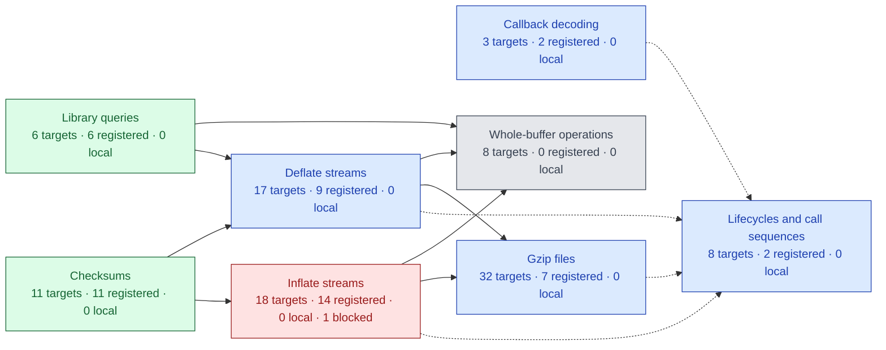
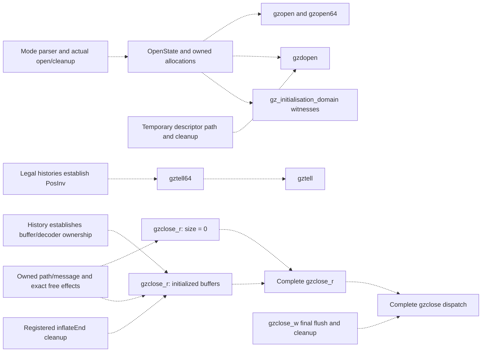
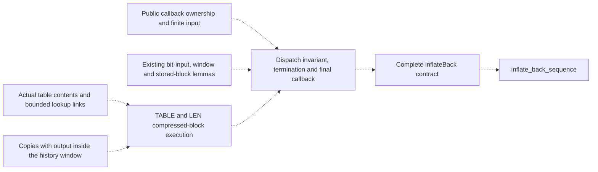
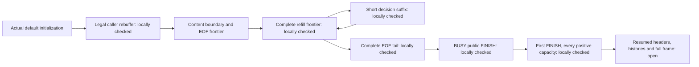

# Project status and remaining work

[Documentation](README.md) · [API](api/README.md) · [Checking](checking/README.md)

**Work in progress. Full zlib verification is not complete.**
This is the single current-status and remaining-work page.
The first target is the default LP64 Linux static build with the default allocator.
Other upstream configurations remain goals. Compiler/OS correctness and performance
are outside the proof.

<!-- proof-progress:start -->
## Proof progress graph

**103 public API targets.** Registered proofs: 51 ·
locally checked but not registered: 0 ·
not proved without a recorded blocker: 51 ·
blocked: 1.
These are local snapshot counts, not final verification or a percentage of effort.

[Open the public API graph and proof references](progress.md).
The scope is the public API manifest, including call sequences and initialization domains.
[Supporting proofs](supporting-proofs.md) lists the other 78 audit targets
and their module dependencies. They do not change the public API counts.
🟩 **Registered proof** · 🟦 **Locally checked, not registered** · ⬜ **Not proved** · 🟥 **Blocked**.
Red groups contain a blocked target. Other mixed groups use blue when they contain
checked results; counts show what remains. Work on other targets can continue.
Solid arrows show calls from the called entry to its caller. Dotted arrows show
proof or target-definition references. [Status details](progress.md#status-key).
Final acceptance still requires the full audit and CI on a named commit.

### Blockers

| Blocked targets | Reason and next step |
| --- | --- |
| [inflateInit2_](./progress.md#target-zlibf-spec-public-goal-inflateinit2) | [Inflate initialization cleanup](./overview.md#inflate-initialization-cleanup) |

Arrows aggregate actual implementation calls and proof/definition references.
An isolated node has no displayed links; it still needs its own proof. Helper and runtime
dependencies are detailed in [Public API proof readiness](./overview.md#public-api-proof-readiness).
Green requires checked, registered proofs for every
target in a group. Readiness labels identify reviewed next work without changing proof
status. Unreviewed prerequisites remain explicit. See the [representation limits](./trusted-base.md).

Click a group to open its specifications. If diagram links are disabled, use the
[group index](progress.md#clickable-index). [The detailed graph](progress.md) shows every
public API target separately, with links to its contract, statement and proof evidence.
Diagram links use the fixed GitHub snapshot `234bfef` and survive merges
and branch deletion. Table links remain relative to this document.
Refresh with `python3 scripts/proof-progress.py` after proof changes.
<!-- proof-progress:end -->

## Recorded checkpoint

The inventory has 95 default-build API entries, four lifecycle targets and four
initialisation-domain targets. A proposition's presence is not a proof.
The latest local declaration audit recognizes 78 registered targets across
398 listed theorems and 20,399 project declarations. The earlier registration batch
covers 59 existing exact proofs: six queries, nine checksum entries, 29 stream or
gzip entries, two initialization-domain goals and 13 abstract model goals.
The [registration review](checking/registration-review.md) records scope and checks.
Earlier format/query and CRC/address/view registrations remain intact.
The audit also tracks 47 internal obligations that were already defined but missing
from the registry. They are internal targets, not additional public APIs.
These are local checks. Final acceptance requires the full audit and CI on a named commit.

The next registration batch has 33 locally checked targets: 31 internal obligations
and the two later dictionary/header model results. Review their exact scopes and
required mutation evidence before registration. Keep mathematical model results
separate from execution/refinement claims about the translated C.

Recorded local work also covers version/flags/error/bound/CRC-table queries;
gzip EOF, buffering, offsets and error queries; inflate state, mark and priming
queries; deflate used-bit, tuning, header and pending queries; internal fast-decoder
safety, bit-source composition and token-output refinement; and canonical-code/leaf/heap tree prefixes.
Further local proofs cover `gzrewind`, `inflateGetHeader`, `inflateResetKeep`,
`inflateReset`, `inflateReset2`, `inflateEnd`, `inflateBackEnd`, `deflateEnd` and
`deflateGetDictionary`, `inflateGetDictionary`, `deflateResetKeep` and `deflateReset`.
Their direct source mutants fail the corresponding function proofs.
The `inflateInit_`, `inflateBackInit_` and both corresponding initialization-domain goals
also check in Lean. Seven initialization mutants fail their function proofs.
The `inflateSetDictionary` goal also checks in Lean; seven source mutants fail
its function proofs.
The abstract-model goals `deflate_bound_adequate` and `deflate_completes` also
check in Lean. These model results do not establish refinement of the C translation.
The abstract `compress_roundtrip` and `gz_roundtrip` goals also check in Lean.
They do not prove the translated buffer or file operations.
The abstract `inflate_completes` goal also checks in Lean, including allocation
failure. It does not establish refinement of translated inflate.
The abstract `deflate_full_flush_resync` goal checks in Lean. It does not establish
refinement of translated deflate.
The abstract `roundtrip` and `roundtrip_completes` goals check in Lean for all
compatible wrappers. Refinement of the C implementation remains open.
The abstract `dict_roundtrip` goal also checks in Lean, including dictionary
identifier mismatches. It does not establish implementation refinement.
The abstract `header_roundtrip` goal also checks in Lean using gzip header
prefix uniqueness. The implementation-level header proof remains open.
The `adler32_combine` and `adler32_combine64` goals also check in Lean;
three negative-length and entry-point mutants fail their function proofs.
The `adler32` and `adler32_z` update goals check in Lean under the documented
zero-length NULL-query restriction. Five update and wrapper mutants fail their proofs.
Five CRC combination and generated-operator goals also check in Lean; one direct
mutation per entry fails its matching function proof.
Source-order corrections and direct proof mutants accompany their stated scopes.
These results do not complete public inflate/deflate or arbitrary call-sequence
correctness. Registration, reviewed locks and acceptance on a named commit remain
separate. A build count is not a completion percentage.

## Remaining work

Red targets have a documented blocker with evidence and a next step below.
A long proof attempt alone does not establish a blocker. Gray targets may be started;
their missing internal lemmas and history invariants are not all drawn in the graph.

### Public API proof readiness

**Gray means unproved, not blocked. Start independent work now.** Green callees do not
establish the caller's own preconditions, loops, results or memory effects. A directly
callable API can still have a false contract or a confirmed source defect; only evidence
of that kind warrants a red blocker. Do not infer readiness solely from missing arrows.

The [public target graph](progress.md) records observed calls and theorem references.
The separate plans below expose missing proof work. Their arrows are proposed composition
requirements, **to confirm** against the exact targets. They are not new public assumptions,
checked proof references or extra public targets. Plan boxes carry no proof status. Colors in the progress graph keep their
existing meaning. This section is the maintained index of remaining prerequisites.

#### Open, query and close prerequisites

Opening a file does not require the complete engine. Its main work is the common `gz_open`
mode loop, real allocations, string copying, descriptor effects and invariant establishment.
For a tell query, the missing producer is the position invariant over permitted histories.
For close, it is ownership over those histories, including allocation failures.

Local execution proofs now cover:

- [Open entries](../ZlibF/Proof/gzlib.c.open.lean): NULL arguments, negative descriptors
  and first-allocation failure. They give the unchanged file system and exact heap,
  including the allocation-attempt counter.
- [Reader close](../ZlibF/Proof/gzread.c.close.lean): NULL, wrong mode and complete
  unbuffered execution under `GzGood`, including descriptor errors, freeing the message,
  path and handle, and a frame over unrelated allocations.
- [Priming entry](../ZlibF/Proof/deflate.c.prime.lean): refused streams and invalid bit
  counts, before pending-byte compaction.

These are scoped internal results, not proofs of the complete public targets. In particular,
`GzGood` still has to be derived from the permitted public histories. Do not replace a gray
public node with green on the strength of one branch.

#### Callback decoder prerequisites

`inflateBack` need not wait for the complete ordinary `inflate` target. Setup and teardown
are already registered. Existing entry, bit-input, window-flush and stored-block arguments
can be reused. Compressed blocks and the full public callback protocol still need composition.

A fast-path theorem requiring separate output and history buffers does not cover output
inside the window. A table return-code theorem does not establish installed entry contents.
The [callback migration record](migration/infback.md) locates the reusable arguments and
states the limits of their callback domain. These missing premises do not stop independent
work on another block type or error path.

#### Next work for every unfinished public target

"Start" means work can begin without a complete engine theorem. "Compose" names a
prerequisite for full closure; independent branches can still proceed. No row grants
checked status or assumes a callee's specification.

<!-- proof-readiness:start -->
| Public targets | Proof work shown in graph | Next work and missing prerequisite |
| --- | --- | --- |
| `gzopen`, `gzopen64`, `gzdopen`, `gz_initialisation_domain`  | Start: open and cleanup |  **Start:** common mode loop, allocation outcomes, path formatting/copy, descriptor effects, `OpenState` and witnesses. Entry/failure branches are locally checked above. |
| `gztell64`, `gztell`  | Needs: position history |  **Compose:** derive `PosInv` from reads, writes, seeking and pushback; then reuse the existing arithmetic execution proof. |
| `gzclose_r`  | Needs: resource history |  **Start:** initialized-buffer cleanup and its ownership producer over histories. Unbuffered execution and frame are locally checked; `inflateEnd` alone is insufficient. |
| `gzclose_w`, `gzclose`  | Needs: flush and cleanup |  **Compose:** actual zero-fill/final compression and file writes, all cleanup/error paths, then dispatch using both complete close results. |
| `gzseek64`, `gzseek`  | Needs: seek and history |  **Start:** position/pointer history invariants, buffered and transparent paths, exact error frames. Negative-position reachability and historical overflow reports remain **to confirm**. |
| `gzdirect`, `gzread`, `gzfread`, `gzgetc`, `gzgetc_`, `gzgets`, `gzungetc`  | Needs: reader path proofs |  **Start:** common lazy setup, transparent reads and buffer/history invariants. **Compose:** actual decoder execution for compressed paths, then EOF/count/pushback/error clauses. `gzdirect` needs detection and init, not the full data-decoding loop. |
| `gzwrite`, `gzfwrite`, `gzputc`, `gzputs`, `gzvprintf`, `gzprintf`, `gzflush`, `gzsetparams`  | Needs: writer path proofs |  **Start:** buffering, formatting, transparent writes and failures. **Compose:** actual compressor execution for compressed output and parameter changes. |
| `deflateInit2_`, `deflateInit_`, `deflate_initialisation_domain`  | Start: init and allocation |  **Start:** parameter normalization, five allocations, all failure cleanup, actual `DGood`/tree establishment and witnesses. Reset proofs require the invariant; they do not establish it for fresh storage. |
| `deflatePrime`  | Start: compaction and bits |  **Start:** pending-byte compaction, checked shifts, bit insertion/flush and invariant/frame preservation. Refusal branches are locally checked; accepted counts remain open. |
| `deflateBound_z`, `deflateBound`  | Start: bound and header review |  **Start:** connect existing execution formulas to the saturated mathematical bound, including header strings and extra lengths. The historical extra-length report is **to confirm**, not a newly confirmed blocker. |
| `deflateSetDictionary`  | Start: window and hash |  **Start:** window fill, hash-chain insertion, saved-input restoration, then checksum and exact state/frame effects. Green checksum calls cover only that part. |
| `inflateCopy`, `deflateCopy`  | Start: copy and relocation |  **Start:** allocation failures, buffer copies, pointer relocation and independent ownership. Resolve the recorded copy/history investigations before claiming the full domain; do not add silent premises. |
| `deflateParams` | Needs: block flush and parameter state |  **Compose:** actual old-block flushing, return-code handling and canonical tuning-row updates. Check exact state preservation on refusal before full closure. |
| `inflateSync`  | Needs: scan and history |  **Start:** compose existing first/resume scans, held bits, marker search, reset and accounting/frame results. Derive window/reset premises from histories. |
| `compress2_z`, `compress2`, `compress_z`, `compress`  | Needs: compressor execution |  **Start:** arguments, scalar lengths and cleanup. **Compose:** actual init/compress/end with exact output, then wrappers. Abstract roundtrip is insufficient. |
| `uncompress2_z`, `uncompress2`, `uncompress_z`, `uncompress`  | Needs: decoder execution |  **Start:** scalar results, insufficient space and cleanup. **Compose:** actual init/decompress/end, exact consumption/output, then wrappers. |
| `inflate`, `deflate`  | Needs: dispatch invariants |  **Compose:** decoder-table or hash-chain meaning, dispatch invariants, loop termination and output/accounting. Green checksums do not establish these premises. |
| `inflate_sequence`, `deflate_sequence`, `inflate_back_sequence`, `gz_sequence`  | Needs: execution and format |  **Compose:** actual per-call safety, history preservation, independent format refinement and completion across input/output splits. |
| `inflateBack` | Needs: tables, window and callbacks |  **Compose:** compressed TABLE/LEN execution, output inside the window, public callback ownership, loop termination and exact input/output accounting. Existing stored and entry paths can progress independently. |
| `inflateInit2_`  | Blocked: cleanup contract |  The confirmed cleanup-contract counterexample is [recorded below](#inflate-initialization-cleanup). Successful init and independent targets can proceed. |
<!-- proof-readiness:end -->

The immediate order is independent entry/cleanup and arithmetic paths, then common open,
position and ownership invariants, then complete function composition. Callback compressed
blocks can progress alongside these. Record an unknown prerequisite here with its exact
question; do not invent a dependency or treat elapsed time as evidence of a blocker.

### Integration

Review the focused function-manual scopes and regenerate the documentation source-policy lock in a
reviewed audit update. Independently review the new source and kernel-syntax locks and the first
verification baseline. Maintain repository protections for the four checks and protected-path
review. Register newly checked results only after their required checks.

### Public contracts

Independently approve the 103 target statements, caller domains and representation limits before
accepting a verification baseline. Extend the ordinary data-epoch refinement to advanced raw
dictionary replacement and all header/priming/recovery combinations; retain their exact per-entry
effects and unconditional sequence safety. No final correctness claim may silently drop those
obligations.

### Specification review

#### Gzip seek mode
<!-- proof-blocker: ZlibF.Spec.Api.Goal.gz_seek_read -->

The abstract `gz_seek_read` goal is false: `GzSeek` permits the resulting handle
to change from read mode to write mode, so the subsequent modeled read can return no data.
The [checked counterexample](../tests/verification/counterexamples/gz-seek-mode.lean)
uses an opened two-byte reader. Review the seek relation before proving this goal.
This is a model issue, not a confirmed zlib issue.

#### Inflate initialization cleanup
<!-- proof-blocker: ZlibF.Spec.Public.Goal.inflateInit2_ -->

The current `inflateInit2_` goal is false for an invalid window parameter. Its
`SameObjects` postcondition requires a structurally unchanged state table, but allocation
followed by free expands that table. The [checked counterexample](../tests/verification/counterexamples/inflate-init2-table-shape.lean)
uses a valid caller heap and proves the sizes are four and zero. Review the contract and
model before proving this goal. This is not a confirmed zlib issue.

Review the corrected shared `Uncompress2` relation independently. The deferred-distance and
exact-free corrections have independent counterexamples and checked regression proofs;
implementation refinement remains open. Its former empty-output clause on memory failure and
extension clause on buffer error have been removed using the existing paired counterexample.
Complete the older abstract gz and dictionary models before using them as complete operational
refinements; the concrete public targets do not assume their callee contracts.

### Translation review

Continue the statement-by-statement review beyond the corrected compressor automatic storage. The
compressor slide now checks signed subtraction in source order. Its
[internal-state regression](../tests/regression/deflate-slide/README.md) compares three defined
boundaries and rejects an artificial overflow in both C and Lean. Restoring unchecked subtraction
changes only the overflow observation. Reachability of that artificial state is not claimed;
derive the signed bound from legal call histories. The source-level selected-depth reread in tree merging has been restored with a
[six-case regression](../tests/regression/trees-depth-read/README.md) and a required structural
check that rejects the former cached expression. Prove the temporal initialization history of
internal depth reads. Review scalar-pointer aliasing and the null-minus-null special case in
compressor pointer subtraction (**to confirm**).

### CRC address model

The CRC translation now observes a stable origin residue for every represented static or
embedded byte array. Local proofs cover all residues, seeds and readable lengths for both
public CRC update entries, with the same immutable-heap result. The original 47-byte static
input is now a [positive regression](../tests/verification/regressions/crc-static-address.lean).
The public contracts and caller domains are unchanged. Local evidence still needs final
acceptance checks on the integrated commit.

Extend the representation relation to general ABI layout, effective types, scalar-cell aliases
and byte views of other records. The current address abstraction represents only the low
three bits observed by the CRC alignment test; it is not a complete address-space model.

### Inflate causal model

Complete the universal output and unknown-dictionary refinement against the C. The earlier
whole-lookahead consistency is false; the supporting-bit-prefix correction is reviewed. The fixed
data-error detection lag of eight bytes also has a counterexample; derive a justified replacement
rather than raising the constant without proof. Register the checked `inflate_decodes` model proof,
then establish these conditions for actual decoder runs. Prove the general negative-value priming
bridge, beyond the checked model witnesses and finite execution matrix.

### Differential harness

Keep the new allocation-failure and negative-prime regressions in automated validation. The
test-owned gz handles, input line and deflate buffers are now released. Normal and unsuppressed
sanitizer runs compare all 47,890 inputs. A cleanup mutation confirms that the harness still reports
library state leaked by a missing end call.

### Proof mutants

Complete the remaining legacy lists. Every newly proved public entry must supply direct translation
mutants in the locked mapping and demonstrate failure in its function proof. Unproved entries
acquire their records with their proofs.

### Decode tables

Connect the proved canonical-code coverage and entry-shape lemmas to the heap written by
`inflate_table`; establish the table predicates used by the decoders.

### Inflate

The locally checked internal fast body now emits one independent literal/copy token, ends the
block, or rejects an invalid length code, invalid distance code or too-far match without output.
The actual distance result preserves exact remaining bits and equates copying with independent
bytewise history copying. The token relation has checked composition, decomposition and rejection
results against the original format grammar. Whole-fast-call bit origin also checks through the
loop, byte rollback and final writeback. All these results retain the original safety conclusions.

Establish table meaning, suffix stability, compatible leaf flags and saved-window history from
actual construction, installation and init. Complete whole-fast-call output composition and cover
all legal buffer views. Finish the other decode modes, across-call composition, copy and recovery.
These remain internal-domain results, not registered public proofs. The public inflate and sequence
goals remain open.

### Inflate back

Finish table construction, compressed blocks, callback composition and the complete function.

### Deflate

Finish general initialization (`deflateInit2_`), dictionary setting, priming, copying, `fill_window`,
strategy loops and the complete function. The recovered dictionary-query proof builds and rejects
three translation mutants in its own proof; registration remains.

The exact `Goal.deflateInit_` is proved in `public-deflate-init`.
CI passed on `7b3a3ac7ddbb1cc2054a667bfc317eaf724672d9`. It expands the actual fixed-parameter call at window
15, memory level 8 and strategy 0. Compression level remains arbitrary.
The proof covers version and parameter refusal, all five allocation
outcomes, failure cleanup, the old-object frame and the exact live-object
ledger. Successful execution establishes `DGood`; it is not a caller
premise. A concrete default caller successfully returns that invariant.
The universal `deflateInit2_` theorem remains open and is not a dependency.

The complete root build, full fresh kernel replay, allowed-axiom inspection
and zero-placeholder scan pass locally. Three direct wrapper mutants
reject the original exact public proof in a fresh kernel. Wrong-symbol-limit
and dropped-cleanup mutants retain the synchronized whole-source equality
but fail their execution proofs with type errors. Resource failures are
not counted. The strict entry mutation list also passes.

The exact default-entry proof and its concrete witness are registered.
Generated locks add 72 semantic records and two theorem-type records.
Existing semantic and theorem-type records are unchanged. The full
[CI run](https://github.com/cla7aye15I4nd/zlib-f/actions/runs/42364774047)
on the named commit passed build, no-sorry, audit and differential tests.
This accepts the default entry and witness, not the later engine increments.
Differential tests are fidelity evidence, not proof.
The first engine boundary is now locally checked in
`deflate.c.engine.initial`. It establishes the actual head/prev/window
hash-chain relation from initialization and connects successful default
initialization to the real reachable-state constructor. The previous
array stays arbitrary. Actual `INSERT_STRING` preserves representation,
chains and the primed rolling hash on the same returned heap.
Rebuffering preserves private state and chains for the default no-header
case; general gzip-header lifetime remains separate.

The symbol ledger is now locally checked from the actual default public
initialization. Stronger execution lemmas retain the initial leaf
frequencies through tree initialization, reset and allocation. Both real
inline tallies append the same symbol to the packed byte buffer and the
natural-number frequency histogram. Their frequency increments cannot
wrap, as derived from the actual symbol capacity. Unused internal tree
nodes remain unrestricted.
The actual literal/length leaf weights now sum to the stored symbol count
plus the end marker. Distance leaf weights sum to at most that count.
Their total budgets follow from B rather than from per-leaf assumptions:
at most B for literal/length and strictly less than B for distance.
The initial Huffman queue and its complete tree-building refinement still
need to carry these budgets into the shared-buffer output argument.
The block-balance lemmas relate represented bytes, the current position
and signed block_start, with explicit intermediate tally credit. The
ledger and balance imply a finite negative block_start bound and safety
of the actual signed slide subtraction. They do not assume that
block_start is nonnegative. Full strategy-loop preservation of this
ledger and balance across input refill and block emission remains open.
These are local supporting proofs, not acceptance of public deflate.
The full builds, fresh kernel replay and allowed-axiom checks pass locally.
Three direct packing/subtraction mutants fail the new semantic proofs;
the packing mutant first passes its synchronized execution proof.

The complete first `fill_window` call now has local execution proofs for
empty and arbitrary nonempty input. The nonempty call reads at most the
65536-byte window room, updates the actual checksum and cursors, primes
the hash, terminates its outer and insertion loops and pads through the
high-water limit. Its exact returned heap satisfies `DGood`, hash chains,
the window range and the next insertion's rolling-hash condition. The
proof admits both stream views and every readable input byte reference.
Resumed nonempty fills without sliding or deferred insertion are now
locally checked at arbitrary current positions. The actual guard supplies
free room; the read, checksum, cursors, lookahead update, re-priming, outer
loop stop and final padding are composed on the exact returned heap.
Nonempty fills with deferred insertion remain open.
A no-input, non-sliding resumption is locally checked when its padding
has already been established. The first-fill result supplies that padding,
and consuming a byte preserves it because the valid-data endpoint stays
unchanged.
Generic high-water execution now covers both zeroing branches and both
no-op branches. It writes only beyond the valid endpoint, preserves H,
and derives the initialized extent from the old mark and window bound.
The resumed call retains DGood, H, window range and the conditional hash
for its next insertion on that same copied and padded heap.

The resumed caller boundary uses StreamBuffers to derive input-array
extent and copy separation; DGood supplies private writability. No new
caller buffer restriction is assumed. Accounting describes exactly the
accepted bytes and unchanged output cursor. The logical input extends
only after the old valid endpoint, retaining earlier lazy-match witnesses.
The actual returned window represents that extension and retains the
deferred-byte bound, so another strategy iteration can use these facts.
These resumed results still require the source's no-slide, insert=0 path.
Six synchronized resumed-read and padding mutants retain the whole source
equality and fail the actual execution proofs. Fresh kernel replay checks
the complete caller boundary. Resource failures do not count as rejections.
Complete taken-slide calls are now locally checked as well. The source
guard derives disjoint same-array copy ranges, non-wrapping counts and
the post-slide room. The actual copy, position updates, signed block
subtraction, insertion clamp and both slide_hash loops preserve DGood,
chains, the symbol ledger, block balance and logical lazy matches.
Their exact returned heap composes with input accounting, checksum,
priming, loop termination and generic high-water padding when insert=0
and wrap=1. The caller's public buffers supply input extent and separation.
The no-input sliding path also completes, including required padding,
for every admitted wrapper and insertion count. It needs no input pointer
or already-padded-window premise. Conditional rolling-hash facts and
logical input views are retained. These theorems still take the internal
ledger/balance/history boundary; strategy-loop and public-history
preservation of that boundary remain open.
Seven synchronized slide mutants pass both complete source equalities
and fail the sliding execution proof. The complete caller paths also
pass fresh kernel replay and allowed-axiom inspection locally. Both full
builds pass; registration and CI approval remain separate.
The first short-input `NO_FLUSH` slow-strategy call also composes the
actual fill and returns `need_more`, retaining its data for later matching.
These are supporting results, not the public deflate theorem.

Initialization CI on `d6a9bec` passes build, no-placeholder and differential
jobs. The audit passes its kernel, declaration and semantic-lock stages,
then rejects the source policy. The main auditor still uses the former
documentation paths; dev already protects the sixteen migrated pages.
Synchronize that reviewed baseline without dropping protected paths.
The matcher bridge now retains the actual old head returned by insertion.
The checked `insert_published_chain` derives candidate order from the old
chain, then reads back the new head and predecessor from the actual heap.
`longest_match_chains` derives comparison room and the chain environment
from those facts and the window range. It preserves representation and H
and returns the existing byte-equality matching result. Position zero is
NIL; arbitrary prev contents at that position are never used as evidence
for candidate order.

The actual slow-search prefix is locally checked as a whole: insertion,
lazy-field preparation, conditional matching and short-match filtering.
Its complete body source equality retains all remaining strategy branches.
The search preserves DGood, H and the length bound on one returned heap.
The source expression `MIN_MATCH - 1` is normalized by a checked equality
before using the record-update model; no translation statement changes.

The actual inline `tally_lit` now has an execution proof. It does not call
`_tr_tally`, so no such call is assumed. Its three symbol stores, frequency
increment, count and full flag are exact. The aligned strict entry count
supplies room. The result retains DGood, the tree invariant and H. A false
full flag supplies the next strict count. The slow strategy's non-flushing
deferred-literal branch composes that real tally and the cursor update,
preserving the window endpoint and honoring the output-full return.
Six direct search/tally/deferred-byte mutants fail their execution proofs;
synchronized strategy mutants retain the complete slow-body source equality. Resource
failures do not count as rejections.

The first slow iteration with enough lookahead now composes actual search
with the deferred-byte branch. A complete first NO_FLUSH strategy call
with exactly 262 arbitrary caller bytes is locally checked: actual first
fill, search, one-byte consumption, resumed fill and need_more return.
Its returned state has strstart 1, lookahead 261 and match_available 1,
with DGood and H on that same heap. This supporting case leaves the
public deflate domain unchanged.

The actual inline tally_dist is now locally checked too. Its UInt16
distance narrowing, pre-decrement and distance-code table reads are
bounded for 1 through 32768. The exact symbol bytes, both frequency
updates, count and full flag are proved. DGood, the tree invariant and H
hold on the real returned heap. The inline macro does not increment
matches; no execution of the separate _tr_tally function is assumed.
Three synchronized match-tally mutants pass the complete source equality
and then fail the corresponding execution proof: omitted distance
pre-decrement, incorrect high byte and wrong distance frequency index.
The logical matching history supplies the caller distance and length
facts. The non-flushing source branch now composes that actual tally
with the complete match-consumption loop.

The search now retains conditional matching evidence, not only safety:
when the selected length improves the previous lazy length, its bytes
really match. A stale match_start at an unchanged length is not used as
that witness. The previous preservation theorem keeps its statement and
is derived from this stronger execution result.

The lazy-match history is now written in Lean. Initialization establishes
it with match_length 2. Window-based witnesses imply logical-input
witnesses. The logical form records a real distance and absolute input
positions, so unsigned match_start subtraction during sliding is allowed.
The two source position updates preserve that logical witness, including
wrapping stored match positions. After lazy-field preparation, the actual
match-emission test and the logical history derive the tally distance,
length and consumption bounds and compose the real inline tally.
Block emission remains open.
The match-emission insertion loop is now locally checked: its real
heap counter decreases to zero in at most 256 iterations. All guarded
insertions have three valid bytes even after lookahead falls below 262.
The loop changes only ins_h, strstart and prev_length in the record.
Its final source reset restores the consumed-data endpoint and the
rolling hash needed at the next engine boundary.

The complete slow loop body is now locally checked when lookahead is at
least 262 and a tally will leave symbol room. All three source decisions
are covered: match emission, pending literal and newly deferred byte.
Their exact returned heap preserves DGood, H, window contents, matching
history, the deferred-byte bound and the next insertion hash. Every
branch advances strstart and reduces lookahead. The literal branch also
retains the source output-full return. DeferredByte is initialized by
actual init and prevents reading strstart - 1 before any byte was consumed.
The full-buffer case, general resumed fill and outer call sequence are
not concluded from this supporting body theorem. Five synchronized
consumption mutants retain the complete source equality and then fail
the actual execution proofs. Together with search and tally checks, all
fourteen current mutants are rejected without counting resource failures.

The stronger slow boundary now connects actual initialization to this
complete body. It includes DGood, H at the current position, window range,
the logical input view and lazy match history, the deferred-byte bound,
the symbol ledger and block balance. Credit is exactly zero or one as
determined by the real match_available field. A concrete default entry
establishes the boundary on the existing caller witness heap.
Actual search and all three non-flushing decisions preserve the same
boundary when lookahead>=262 and one tally will leave symbol room. The
result records the unchanged symbols or the appended literal/match symbol.
An exact record frame also retains every configuration and storage field
that this source path does not write. Stronger insertion and consumption
helpers retain the whole byte heap and leaf-frequency frames. The earlier
helper theorem statements are unchanged and follow from those stronger
execution proofs. The complete NO_FLUSH and FINISH strategy results,
including short-lookahead block output, are connected below. PendingBoundary
extends that boundary with insert<=strstart, H at strstart-insert, and
insert=0 whenever lookahead>=3. Actual default initialization establishes
it, including a concrete witness. Legal caller rebuffering preserves it.
The complete real deferred-insertion loop terminates by the heap counter.
Priming returns exactly min(old insert, 2-lookahead) pending positions.
Complete fill_window calls preserve this stronger boundary with wrap=1,
short lookahead, public caller buffers and the public null-input refusal
already discharged. Empty/nonempty input and both slide branches are
covered without an insert=0 premise. Empty-input calls also retain the
previous unrestricted-wrapper supporting result. The real slide clamps
the pending count and maps its earlier hash frontier. The final result
retains the symbol ledger, block balance, matching history and logical
input prefix. It accounts for accepted bytes and returns enough lookahead
or exhausts input. These are internal execution results, not a public
deflate call-sequence theorem.
The complete Z_NO_FLUSH slow iteration now composes the actual refill
with the search/body result. It returns need_more before search if refill
leaves short lookahead, or advances the absolute input position otherwise.
Its symbol-room premise remains explicit. The returned heap retains the
same pending boundary and accepted-byte accounting. An exact refill
record frame supplies unchanged symbol capacity and configuration fields.
Four source refill/return mutants pass the complete body source equality
and fail the actual ready/wait execution proofs.
A complete resumed deflate_slow call also checks when lookahead plus
caller input is below 262 under Z_NO_FLUSH. The proof composes the real
fill, loop exit and function return. Every caller byte is accepted into
the window and the symbol sequence remains unchanged. This result covers
sliding and pending insertion as well as the first call. A direct strategy
return mutant fails this complete-call execution proof.
The stronger initialization/body/refill chain passes fresh kernel replay
and allowed-axiom inspection locally. Five consumption, six resumed-read
and padding, and seven sliding mutants are rechecked against this
stronger baseline. All eighteen are rejected at their actual execution
proofs after the corresponding source equalities check. Both full builds
and the zero-placeholder scan pass. This is not CI acceptance.

The root build and allowed-axiom/zero-placeholder checks pass locally for
this engine work. Fresh kernel replay checks the complete body and its
actual search, tally, insertion and first-fill dependencies. The new engine
proofs have not been registered or accepted by CI.

The new pending-boundary chain also passes local kernel replay and
allowed-axiom inspection. Six new synchronized insertion mutants pass
source equality and fail the actual step, loop or priming proofs. The
full builds and zero-placeholder scan pass locally. No new engine proof
has CI acceptance.

The new engine work remains local and unregistered. The later strategy
composition includes full loops, short lookahead and block output.
Default public call-sequence composition remains open. ContentBoundary now adds a trace
of the actual stored symbols and their absolute input positions. The
trace expands with the independent format copyBack to exactly the input
prefix before the deferred byte, including overlapping matches. Actual
initialization establishes this boundary and has a concrete witness.
Rebuffering and every supported refill branch preserve it. The full
non-flushing slow body appends the actual literal or retained match with
its incoming source-branch evidence. The complete Z_NO_FLUSH iteration
and short resumed strategy call retain this same content boundary.
The earlier slow_body_with_symbols theorem statement is unchanged and
follows from the stronger emitted-value execution result.
Local fresh replay, allowed-axiom inspection, full builds and the
zero-placeholder scan pass for this chain. Five actual slow-consumption
mutants are rechecked against the complete content-preserving baseline.
Four separate heap-free decoding/trace mutants fail the independent
content bridge; they are not C-source mutations. These are local results,
not registration or CI acceptance. The bit-emission refinement from the
actual packed symbols to the independent format grammar remains open.
The complete actual fill_window result also retains caller-buffer validity.
A byte-storage frame covers raw blocks, static tables and embedded depth
arrays. Public ranges advance to the unread suffix without imposing new
separation requirements. DGood identifies the unchanged five-object
ownership graph. Actual pending insertion, read, padding and sliding
establish the frame on the same heap as the content proof. Empty input,
nonempty input and both slide branches are included for wrap=1 and short
lookahead. All four earlier insertion/priming/call theorem statements
remain unchanged. Local full builds, fresh replay, allowed-axiom checks
and the zero-placeholder scan pass. Six actual insertion mutants are
rechecked against the complete content-and-caller-buffer baseline.
The real slow coding decisions now carry the same external-storage frame.
Actual insertion, match search, the complete match-consumption insertion
loop and both tally branches retain every external byte array and other
state record. The complete Z_NO_FLUSH iteration composes this frame with
the refill result, content trace, accepted-byte accounting and valid
caller buffers on the same returned heap. Its exact iteration record
frame retains every field outside the union of actual refill/coding
writes. Return values are constrained to the old return or need_more.
All nine earlier insertion/search/symbol theorem statements are unchanged.
The complete outer loop now has a scoped execution proof before block
output. Its explicit byte budget derives tally room from the real symbol
ledger on every iteration. A heap-dependent rank uses remaining input and
lookahead; the proof derives its bound below runtime fuel. The returned
heap retains decoded content, caller buffers, cumulative input accounting
and both storage and record frames. A precise stop reason proves that all
caller input is accepted when the caller output count is nonzero. Actual
default initialization supplies a 300-byte witness with a nonempty symbol
trace. This witness calls the internal strategy, not public deflate.
The full-symbol-buffer block-output path, flush tails, remaining public
entry paths and arbitrary call histories remain open. Earlier local full builds, fresh
kernel replay, allowed-axiom inspection and the zero-placeholder scan pass. Fourteen actual search,
consumption and tally mutants are rechecked against the complete
content-and-caller-buffer baseline. This is not CI acceptance.
Seven actual loop/control-flow mutants are rejected with the complete
initialized before-block loop as the baseline. The four earlier theorem
statements retain their exact types. A full isolated build, fresh replay
of all seven affected modules, allowed-axiom checks and zero-placeholder
checks pass locally. Registration and CI acceptance are separate.

Actual flush_pending execution now covers fewer than eight buffered bits
and distinct raw caller-output/pending allocations. Its zero-length branch
leaves the heap unchanged without dereferencing output. The nonempty branch
copies exactly min(pending, avail_out) bytes, advances both pointers, updates
the wrapping output total and resets pending_out exactly when pending is
exhausted. Both stream representations are included. Other output views
and wrapper-header emission on other accepted states remain open.
Six actual pending-copy mutants fail this function's execution proofs.
Source compilation succeeds before each rejection. Fresh kernel replay,
allowed-axiom inspection, the full isolated build and zero-placeholder
checks pass locally. This is not registration or CI acceptance.

The actual first public deflate call now composes entry checks, zlib-header
emission and default slow-strategy dispatch. The exact source equality
retains all other refusal, header and trailer branches. The scoped call
assumes default level six, Z_NO_FLUSH, raw output with at least three bytes
and the explicit before-block byte budget. Empty input is included. The
same returned heap has the content boundary, accepted-byte endpoint,
public buffer validity, exact input/output accounting and the two actual
wrapper bytes 0x78,0x9c. A concrete actual default initialization followed
by public deflate accepts 300 bytes and retains a nonempty symbol trace.
It no longer calls the strategy directly. Logical size transport includes
all caller byte views and disjoint input/output ranges sharing an object.
Six actual public-source mutants fail their affected execution proofs;
the synchronized whole-function source equality still checks. These are
local supporting results, not a proof or registration of Goal.deflate.
Full isolated and shared builds, fresh replay of all eight new modules,
allowed-axiom inspection and zero-placeholder checks pass locally.
No runtime, translation, existing specification or public goal is changed.
The symbol relation is over the constructed logical input. Exposing its
exact extension by each accepted caller byte slice remains required for
independent end-to-end functional correctness. Full block output, finish,
other accepted entry paths and legal histories remain open.

The complete actual flush_pending publishing phase now covers every
legal 0..16 buffered-bit count and arbitrary raw-output capacity, including
zero and partial copies. Actual complete-byte flushing preserves the writer
bit stream and gives exact quotient/remainder counters. Actual copying
retains DGood, public caller ranges and exact input/output accounting.
Written caller bytes followed by the public PendingBits relation equal
the original writer bits. The old-object frame names only the caller stream,
private state, pending block and output block. All allocation identities,
next block and allocation-attempt count are unchanged. The cursor starts
at pending_buf and the writer's complete bit room is explicit. Actual
default initialization followed by real send_bits calls establishes two
publishing witnesses: one byte 0xa5 and two bytes 0xa5,0x3c. Both retain
DGood and valid caller ranges after the flush. Five actual publication and
copy mutants fail their function execution proofs.
Fresh replay of all six publication modules and twelve allowed-axiom
inspections passed. All five mutants were rejected. The full isolated
build and the combined working-copy build passed, with no proof
placeholders in the isolated sources. These are local checks; this
checkpoint has no CI acceptance yet.
This completes the publication consumer, not block selection or encoding.
Its room premise still needs production by every actual block-output path.
The resumed low-bit phase now derives its actual advanced cursor and
pending allocation from DGood. It has no base-cursor or block-room premise.
Legal caller buffer replacement preserves the public PendingBits relation.
A checked composition executes a complete publication, permits an arbitrary
legal replacement, and executes a second flush on its raw output. Both
written byte lists followed by the remaining bits equal the initial stream.
Both copies preserve DGood, caller ranges, allocation identities and frames.
The rebuffer composition assumes no registered gzip header, as established
by default initialization. General caller-output views and phase preservation
over all legal histories remain open. These internal publishing results do
not replace Goal.deflate.
Fresh replay, five allowed-axiom inspections and both advanced-cursor
source mutants passed. The full isolated and combined builds passed.
The isolated source scan found zero proof placeholders. These remain
local checks without CI acceptance for this checkpoint.

The actual public deflate entry now has a checked pending-output path.
Existing pending bytes fill all positive raw caller-output capacity,
starting from any pending cursor admitted by DGood and fewer than eight
residual bits. Every accepted flush flag is covered; FINISH_STATE is
included on Z_FINISH, as required by the source entry check. The actual
call returns Z_OK, sets last_flush to -1 and consumes no input. Written
bytes followed by remaining PendingBits equal the prior pending sequence.
DGood, caller ranges, exact accounting and allocation/frame facts survive
the entry marker, actual flush_pending and returned retry marker.
The actual idle continuation also checks: in BUSY_STATE on Z_NO_FLUSH,
with no input or lookahead, positive pending output drains completely
when caller output has more room. The call continues through the real
header and data checks and returns Z_OK. It leaves output capacity,
resets pending_out to its base and retains exact bit content, ownership
and the normal flush marker. Continuation with new data or finish/trailer
processing remains required.
This supporting public path does not prove Goal.deflate or legal histories.
Fresh replay and seven allowed-axiom inspections passed. Three actual
public-source mutants were rejected in this entry execution proof; the
complete synchronized source equality checked first. Full isolated and
combined builds passed. This checkpoint remains locally checked, without
CI acceptance.
The idle continuation also passed fresh replay, allowed-axiom inspection,
full isolated and combined builds, and its actual premature-return source
mutant. The source equality checked before that execution-proof rejection.

The complete actual fixed-table compress_block payload now includes all
legal literals and matches, empty blocks and END_BLOCK. The source-order
proof executes length lookup/code, conditional length extras, distance
lookup/code and conditional distance extras on one heap. The length-258
entry correctly skips its unused base. At most 31 bits per symbol derive
every unread-symbol boundary and output-room check for the shared buffer.
The actual do-while loop terminates without an output-room premise.
For default memLevel 8, the final pending-byte count is at most 63486
in the 65536-byte allocation. Exact bit content and the full writer frame
are retained. These are execution results under drained block-entry
pending and at most ten buffered bits, including the fixed-block tag.

The actual engine PackedSymbols and SymbolLedger now supply the writer's
original-symbol order and legality. Fixed payload emission followed by
real flush_pending retains DGood, public caller ranges, exact accounting
and allocation identities/frames. Written caller bytes followed by public
PendingBits equal the entry bits plus precisely those packed symbol bits
and END_BLOCK. Publication room is derived from payload execution rather
than assumed. Raw caller output may have zero, partial or full capacity.
The independent payload bridge also checks. Stored fixed code words
agree with independent canonical codes and decode on every trailing
suffix. Length/distance extra fields agree with the independent tables,
including zero-width length 258. The complete actual payload and its
publication produce an independent Body.fixed relation for the exact
logical input prefix. The trace proof includes overlapping matches.
The following results extend the payload through the fixed tag, reset,
alignment, computed fixed choice and wrapper trailer. Dynamic-tree overlay
bounds, other choices and full public composition remain open. This does
not complete or register Goal.deflate.
Fresh replay of the six new modules and 33 allowed-axiom inspections
passed. Five actual match-source mutants and the dropped-literal mutant
were rejected in their execution proofs. Complete source and match-suffix
equalities checked first. Earlier resource failures were inconclusive;
the final width mutant has a type rejection. Full isolated and combined
builds and the zero-placeholder scan passed. These are local checks;
there is no CI acceptance for this checkpoint.

The complete _tr_flush_block source now has an exact checked cut for
its fixed branch and common tail. The actual fixed tag, full payload,
init_block reset and conditional bi_windup compose in source order.
Both final and non-final flags are covered. The reset retains output
and restores the empty real symbol ledger. Final alignment appends the
terminal bits and clears the bit buffer. Every step retains DGood,
public caller ranges, allocation identities and the full old-object frame.
The non-final pending bound is 63486 bytes; the final aligned bound is
63488 bytes. Publication room and a sufficient full-copy capacity follow
from these actual output bounds. Arbitrary raw caller capacity, including
zero and partial copies, retains exact written bytes plus PendingBits.

For a selected final fixed block that starts at a byte boundary, actual
execution followed by full publication produces independent Deflate.Valid
bytes for the exact logical input trace. This includes overlapping matches,
BFINAL/BTYPE, END_BLOCK, real reset and terminal alignment. The conservative
63488-byte caller capacity scopes only this complete-output corollary;
partial output is covered by the preceding execution theorem. The later
preparation, fixed-choice and wrapper proofs extend this branch. Full
stored/selection coverage, public composition and histories remain open.
The constructed dynamic fragment is covered below.
This is a selected source branch, not Goal.deflate or whole-function
_tr_flush_block safety. Existing public targets and their domain are unchanged.
The stronger checked result also retains an exact BlockOutputFrame and
the empty leaf frequencies after publication. Every window, hash, match,
position and configuration field of the state record is unchanged. The
reset counters are zero. These explicit field facts and the heap frame
allow later reachability invariants to be transported without repeating
the payload proof. Earlier theorem statements remain exact wrappers.

Local validation for this fixed-block increment: the full isolated library
build passed with 489 jobs. A fresh replay of thirteen affected modules
and 53 axiom inspections passed with only the allowed axioms. Seven actual
source mutants failed in the corresponding execution proofs. Synchronized
whole-function equality still checked for the four flush-body mutants.
The Lean source scan found no placeholders or forbidden proof shortcuts.
These are local checks. This increment is not registered or CI-approved.

The actual default zlib trailer now has checked execution and publication
proofs. Its two word stores produce the independent big-endian checksum
bytes, without an assumption about unused high machine-word bits. Actual
flush_pending preserves written bytes plus the pending suffix for arbitrary
raw output capacity, and the actual wrapper update changes 1 to -1. A public
Z_FINISH call on an already-finished engine with drained block output
executes these statements and gives the source return code. Further public
calls drain a queued suffix, or return STREAM_END without output once it is
drained. The existing exhausted-capacity path covers the other pending case.
The exact field and heap frames retain representation, ownership and caller
ranges. A pure wrapper composition also relates the default header, final
fixed body, padding and Adler trailer to independent Zlib.Valid.

These are scoped finishing results. The entry needs the reachable phase's
last_flush range -2..5; history must supply it. The final strategy result,
its status transition, output sequence across calls and checksum of accepted
input still need composition. The wrapper format lemma does not itself
execute those phases. None of these results proves the public Goal.deflate.

Local finishing validation passed: the full library build, fresh replay of
five modules, fourteen allowed-axiom inspections and seven source mutants.
For the negative-wrapper mutant, the unchanged positive-wrapper path gets
its elementary guard fact before testing rejection in the finished-path
proof. The complete synchronized public-source equality checks in every
variant. No placeholder or forbidden proof shortcut was found. Registration
and CI acceptance of this increment are still separate.

Each actual installed build_tree call now also preserves the compressor's
DGood, caller ranges and exact allocation/frame ledger. The construction
footprint includes changed tree arrays, descriptor maxima, work arrays and
costs. Embedded depth bytes may change, but their actual extent is retained.
The adjacent literal and distance calls compose on one heap and establish
BLInput for the next constructor while preserving all existing output bits.
Their exact record footprints remain available for stronger engine history
invariants. The BL, computed fixed-choice and dynamic-fragment compositions
are described below. Complete stored/selection coverage remains open.
These are supporting execution results,
not a public compression theorem.

Local validation for this engine bridge passed: the full isolated library
build and combined workspace build, a fresh module replay and four
allowed-axiom inspections. Existing tree-builder execution proofs remain
its dependencies. No source translation, public specification or theorem
statement changed. The new results are not registered or CI-approved.

The complete actual BL call now preserves the same engine and caller
representation through both sentinel scans, BL construction, descending
search and unsigned header-cost update. Its exact frames retain the code
arrays and output history, with the generic index range 2..18. A complete
preparation frame names every changed field and preserves window, hash,
matching, position, configuration and symbol/output fields.

Actual detect_data_type is also checked for termination, all literal-tree
read bounds, unchanged heap and the binary/text return domain. Exact hint
classification is not claimed. The actual conditional stream-hint store
preserves known hints and replaces UNKNOWN with an allowed result. It
composes with all three constructors on one heap. A universal whole-source
equality places this preparation exactly in _tr_flush_block, retaining all
cost computations and all three choices.

The full actual _tr_flush_block now has a checked fixed-choice execution
result. Actual preparation produces its cost state. If the computed static
byte cost is no larger than the computed dynamic cost, and the earlier
stored choice is false, the whole function emits the fixed body, resets the
real ledger and conditionally aligns. Both last flags are included. No
strategy is forced to Z_FIXED. The returned frames preserve the stronger
engine facts and exact logical-input trace. For a final block starting at a
byte boundary, actual whole-function execution followed by full pending
publication produces independent Deflate.Valid bytes. The sufficient output
capacity is 63488, derived from the default-memory payload bound.

This is conditional branch coverage with actual computed costs. It does not
prove that every default block selects fixed coding. Stored and dynamic
selection and short-lookahead strategy composition are connected below.
Public histories remain required. The later construction proof derives dynamic room and the
format's four-code minimum from the original ledger and retained BL-zero
history. These facts still need the complete public loop/caller boundary.
The actual scan, at-most-two dummy writes and heapify now derive the
merge budget from the original leaf frequencies. The live queue weight is
its leaf mass. Every actual merge conserves that natural budget. The full
root-store prefix retains all internal parent sums, exact modular depth
updates, nondecreasing removal weights, positive leaves and their initialized
zero depths. Literal and distance symbol ledgers discharge the budget from
legal buffer capacity. The ancestor-chain Fibonacci argument then bounds
all mathematical levels and actual source depth bytes by 22. Every parent
depth addition fits UInt8. No natural-height or separate queue-budget premise
is assumed. These are internal source-prefix results, not a completed
dynamic branch.

Actual gen_bitlen now has an execution sibling that retains its clamped
first pass, exact repair count and count vector, and actual final
reassignment data. The real repair loop agrees with the pinned pure repair
model. The actual reassignment step, inner scan and outer loop preserve
sorted final leaf lengths in heap-position order. Scanned-count totals
establish that every used leaf was assigned when the outer loop ends.

The actual used leaves now have rank indices and inverse positions. The
source clamped histogram agrees with histR. Actual final repaired lengths
agree with lenOfRank. A proved gen_bitlen execution sibling for the 15-bit
alphabets derives FibPushR in both branches from the input tree's positive
weights, natural parent sums and ordered removals. Those are data already
produced by the actual heap-prefix proof. No callee contract is assumed.

The complete actual build_tree now composes that length result through
canonical-code assignment. Final stored lengths retain FibPushR; the
frequency/code union is no longer used as the weight source after code
assignment. An installed literal/distance constructor on the real compressor
heap derives the leaf budget from its actual symbol ledger, retains the
engine/caller representation and establishes that quantitative result.

Actual dummy-leaf repair now proves exact preservation of every original
positive frequency, using freshness at each actual short-queue step. Scan,
heapify, complete merging and root storage retain those source frequencies
and their used-symbol rank positions. The complete constructor carries
these original-symbol facts alongside its final FibPush data.

The adjacent literal and distance constructors now compose on the actual
compressor heap with both quantitative results and BLInput. Each numeric
budget is obtained from the original symbol ledger before construction.
The literal frame retains the distance frequency data. The distance frame
retains literal final code lengths. The old full SymbolLedger is not assumed
after a frequency union has been reused for code words.

Actual retained leaf ranks now give symbol-level FibPush classes for every
originally used symbol. The finite integer cost certificates use the actual
extra-bit tables. The actual literal/distance constructors derive the whole
positive-excess bound from the original symbol ledger. No separate frequency
budget or callee contract is assumed. Original used symbols are bounded by
the actual descriptor maxima. The complete BL scans, constructor, search
and cost store therefore preserve each stored symbol's cost despite their
unused sentinel writes.

The actual constructed dynamic header has at most 2283 bits. A finished
run costs at most seven bits per represented source length, including its
repeat code and extra bits. The actual three constructors now establish
both that header bound and every unread-symbol prefix bound for default
memLevel 8, retaining fifteen bits of room. Header, payload, end marker
and final alignment also fit the earlier fixed-path caller capacity.
These are actual construction and space results, not yet dynamic writer
execution or independent payload validity.

Actual default initialization now has an execution sibling that retains
all zero BL frequencies and both reset cost counters. Actual block reset
restores those same facts with the empty symbol ledger. Non-flushing slow
and refill record frames preserve them. The full loop/caller boundary still
needs to carry this data through every public transition.

Actual preparation supplies dynamic-header writer and independent reader
data together with its space bound on the same heap. The actual tag and
complete header writer retain packed symbols and establish payload room.
Original used-symbol words are safe and independently decodable through
both source builders, the BL sentinel writes and bit output. The original
ledger and actual packed bytes instantiate the complete dynamic payload
loop, including literals, matches, the empty case and END_BLOCK. No separate
code-fit, header-size or prefix-room premise is assumed in that composition.

Actual source construction, dynamic header and payload now compose through
reset, optional final alignment and pending publication. The independent
Body relation reproduces the exact logical input trace. Arbitrary caller
output capacity retains exact written bytes plus PendingBits. A final block
starting at a byte boundary has an independent Deflate.Valid result when
its derived complete-output capacity is available. This is the internal
dynamic fragment, not proof that the actual selection chooses it or proof
of the complete public deflate target. The source equality retains the
actual selection separately.

Next derive the actual static-cost counter from the original ledger,
including cancellation of temporary unsigned dummy-leaf subtraction. The
stored-copy branch needs its length/room bound from actual selection. The
source reading that static_len bounds the selected byte cost is **to
confirm** in that execution proof. Complete stored-branch coverage,
strategy completion, wrapper/caller accounting and public histories remain
open. The full loop/caller boundary must retain cleared block data and the
existing input/output/history invariants through every admitted transition.

Local checks for the weight/order/depth increment passed: the full isolated
library build and combined workspace build, fresh elaboration of all 22 new
proof/math modules, 45 allowed-axiom inspections and the no-sorry check.
Three source mutants were rejected in the matching selection, frequency
and depth execution proofs. The synchronized frequency/depth variants also
passed the complete build_tree source equality. No translation, runtime,
public specification or audit registration changed. These results are not
registered or CI-approved.

Local validation for this preparation/fixed-choice increment passed: the
full isolated library build and combined workspace build, fresh replay of
four modules and nineteen allowed-axiom inspections. Eight BL mutants,
six detector mutants and five preparation/selection mutants were rejected
in their matching execution proofs. Every applicable complete source
equality still checked. Benign comparison/step-size variants were excluded
from this evidence; final tests use stalled counters, an inflated static
cost and reversed cost preference. The source scan found no placeholders or
forbidden proof shortcuts. These results are not registered or CI-approved.

The later exact gen_bitlen stage/order increment also passed both full
library builds, fresh checks of its six proof modules, fifteen allowed-axiom
inspections and no-sorry. Three synchronized source mutations of the repair
overflow decrement, split count and assigned length were rejected in the
matching execution proofs. Each complete gen_bitlen source equality still
checked. This increment is also unregistered and not CI-approved.

The later rank/FibPush composition passed both full library builds, fresh
checks of ten proof/math modules and 28 allowed-axiom inspections. Three
repair/reassignment mutants and three canonical-code mutants were rejected
with the complete compressor tree/FibPush construction as the positive
caller. Every synchronized complete gen_bitlen or gen_codes source equality
still checked. A cache-copy race was rerun after the base build finished;
it was not counted as a proof rejection. This increment also remains
unregistered and not CI-approved.

The later original-frequency/adjacent-constructor increment passed both
full library builds, fresh checks of its three proof modules, twelve
allowed-axiom inspections and no-sorry. The two counted source mutants
force selection of an already-used leaf and incorrectly run repair with
two live leaves. Both were rejected in the function's execution proof;
the complete synchronized build_tree source equality still checked.
An additional zero-frequency variant is not counted: it produced a local
type error followed by recovery diagnostics that exhausted their budget.
The ineffective single-alternative diagnostic wrapper was removed. This
increment remains unregistered and not CI-approved.

The later symbol-excess/header-space increment passed both full library
builds, fresh elaboration of twelve modules, 46 allowed-axiom inspections
and no-sorry. Five synchronized source mutants were rejected in the
matching dummy-leaf, count-repair or length-reassignment execution proof.
Their complete source equalities still checked. The positive baseline was
the complete actual compressor dynamic-budget caller. Resource failures
were not counted. This increment remains unregistered and not CI-approved.

The later cleared-block/dynamic-header increment passed both full library
builds, fresh elaboration of seven modules, 21 allowed-axiom inspections
and no-sorry. Three synchronized dynamic-tag mutants were rejected in the
header execution proof while complete flush-source equality still checked.
Three actual init_block mutants made BL frequencies or either cost counter
nonzero; each failed its directly unfolded function proof. No resource
failure was counted. This increment remains unregistered and not CI-approved.

The later complete dynamic-payload/body/tail/publication increment passed
both full library builds, fresh elaboration of ten modules, 28 allowed-axiom
inspections and no-sorry. Four actual payload mutants failed the matching
literal/match execution proof while complete and applicable suffix source
equalities still checked. Removing reset or reversing the final-alignment
gate failed the actual dynamic-tail composition with complete synchronized
flush-source equality still checking. Two actual publication/cursor mutants
failed their matching function execution proofs. The positive callers were
the complete constructed dynamic payload, tail and output results. No
resource failure was counted. This increment remains unregistered and
not CI-approved.

The actual static-cost counter now has an exact original-frequency
refinement. Fresh dummy subtraction and its later contribution cancel
modulo the unsigned word, including temporary underflow. Actual scan,
heap ordering, merging, root storage, gen_bitlen and code stores compose
this balance. Both source constructors add their original fixed-code
costs. The BL scans, null-static constructor and final header-cost store
preserve that result. The real hint/preparation prefix therefore has
`static_len ≤ 31 * symbols + 7`, derived from the original symbol ledger
and cleared-block data. Default-memory byte rounding and actual selection
imply `stored bytes + 6 ≤ 63488` when stored wins. The strategy's checked
signed block-length subtraction supplies the required non-wrapping word
bound from the ledger and block balance, including negative block_start.
The complete stored writer now has a local execution result below.
Its window-content refinement and complete flush branch composition remain
open. These are local supporting results, not a public deflate theorem or
CI-approved registration.

The static-counter/selection increment passed both full library builds,
fresh elaboration of eleven modules, 41 allowed-axiom inspections and
no-sorry. Dropping the actual dummy static deduction, with its source,
fragment and exact-state effect synchronized, failed the new static-balance
proof. Dropping the actual leaf static contribution failed its matching
execution proof. Complete synchronized source equalities still checked.
The positive caller included the constructed cost and actual signed
stored-length bound. No resource failure was counted. This increment
remains unregistered and not CI-approved.

The complete actual `_tr_stored_block` now emits its tag, padding,
little-endian length, complement and concrete source bytes in source
order. Both final flags and zero length are covered. The copy reads a
distinct live source allocation, changes only its pending destination
range and advances the unsigned pending count by the natural copied
length. The real output bits equal the exact header followed by those
source bytes. Starting with at most seven held bits uses at most six
header bytes. This local writer result assumes its explicit readable
source range and total pending room. Connect the strategy's actual window
slice to input history, instantiate the derived selection room on that
same heap, and compose reset/publication with complete flush selection.
The actual stored-body grammar is now locally connected below. The public goal remains open.

The stored-writer increment passed both full library builds, fresh
elaboration of three modules, nine allowed-axiom inspections and no-sorry.
Writing LEN twice instead of its complement failed the header execution
proof. Dropping the pending increment failed the actual copy execution
proof. Complete synchronized stored-source equalities still checked.
The positive caller was the complete actual stored writer with exact
source-byte bits. No resource failure was counted. This increment remains
unregistered and not CI-approved.

The stored-format increment connects that real source-byte writer to the
independent stored-body grammar. It proves exact byte reading, the LEN
and NLEN conversions, and the alignment skip for every byte-multiple
trailing suffix. Both final-block and continuation grammar rules follow.
The complete actual writer's emitted body decodes to its concrete copied
source bytes. This still needs the strategy's window/input correspondence,
actual branch selection and caller-history invariant.

Both full library builds, fresh elaboration of two modules, eleven
allowed-axiom inspections and no-sorry passed. Both stored-source mutants
were rejected again with the complete stored-format result as positive
caller. Complete synchronized source equalities checked separately. No
resource failure was counted. This increment remains unregistered and
not CI-approved.

At a zero-credit flush cutpoint, block balance and the accepted-input
count now identify the nonnegative block_start window slice with exactly
the next input prefix. Readability follows from the initialized window
extent and current input range. Actual stored emission on the engine heap
then independently decodes to that prefix and retains DGood, caller
buffers, allocation accounting and the exact output frame. Its size bound
is still an explicit internal premise. Full flush must derive it from
actual preparation/selection on this same state, establish the cutpoint
through every flushing strategy branch, and compose reset/publication.

Both full library builds, fresh elaboration of two modules, five
allowed-axiom inspections and no-sorry passed. Both actual stored-source
mutants were rejected again with the complete engine/input-prefix caller
as positive baseline. Complete synchronized source equalities checked
separately. No resource failure was counted. This increment remains
unregistered and not CI-approved.

The complete actual `_tr_flush_block` now has a stored-choice result.
Hint handling, all three constructors, both rounded-cost choices, the
real stored comparison, stored emission, reset and optional final windup
execute on the same heap. The original ledger and cleared data derive
`static_len ≤ 31 * symbols + 7`; actual stored selection then supplies
pending room without a separate size premise. The output independently
decodes to the next accepted input prefix. Reset restores the empty
ledger and cleared BL/cost data for either final flag. This result is
conditional on the actual computed state selecting stored coding. The
strategy must still supply its flush cutpoint, pointer and length data;
the three source choices must be joined into one unrestricted flush result.

Both full library builds, fresh elaboration of two modules, three
allowed-axiom inspections and no-sorry passed. Five actual source mutants
of the complement, pending count, reset, final gate and stored-cost
threshold failed their matching writer, tail or dispatch proof. Complete
synchronized source equalities checked independently. No resource failure
was counted. This increment remains unregistered and not CI-approved.

The complete actual `_tr_flush_block` now also has a dynamic-choice
result. Hint handling, all builders, rounded-cost tests, dynamic header
and payload, reset and final alignment compose on one heap. Code fits,
header space and symbol overlay bounds derive from the original ledger
and cleared data; no callee contract or selected output replacement is
assumed. The result is conditional on the actual computed dynamic choice.
A separate fixed-branch execution sibling now retains the reset BL zeros
and both cost counters missing from its earlier output contract. Static
dispatch also covers the actual force-fixed strategy condition.

Both full library builds, fresh elaboration of two modules, five
allowed-axiom inspections and no-sorry passed. Reversing the real static
cost preference or fixed-branch comparison failed the dynamic dispatch
proof. Complete synchronized source equality checked independently for
both mutants. No resource failure was counted. This increment remains
unregistered and not CI-approved.

The complete actual positive-level default-memory flush now joins all
three computed choices without a selected-branch premise. It derives the
stored bound from original static costs, uses the proved fixed/dynamic
writers, and restores an empty ledger plus cleared BL frequencies and
cost counters in every case. Exact independent body meaning is retained
for the accepted input prefix. Stored bodies explicitly require aligned
continuation suffixes and have no terminal padding. Fixed/dynamic bodies
retain arbitrary suffixes and their real final padding.

Actual pending publication now composes after this unrestricted flush for
zero, short and full caller output capacities. Written bytes plus remaining
PendingBits equal the entire actual encoded output. At an initial byte
boundary, a final block with at least 63488 caller bytes publishes a valid
independent raw DEFLATE stream for every real selected encoding. This is
an internal block-entry result. The strategy must still establish each
zero-credit flush cutpoint, execute the macro's argument/update steps,
retain the stronger hash/window/history frame and complete the outer
loop, wrappers and legal public histories.

Both full library builds, fresh elaboration of two modules, three
allowed-axiom inspections and no-sorry passed. Two actual branch-comparison
mutants and two pending-publication/cursor mutants failed their matching
execution proofs, with the unrestricted full flush/publication as the
positive caller. Complete synchronized branch-source equalities checked
separately. No resource failure was counted. This increment remains
unregistered and not CI-approved.

The complete actual `FLUSH_BLOCK_ONLY` macro now composes the real
argument loads, signed source branch, checked pointer addition, narrowing
offset casts and checked signed length subtraction with unrestricted
flush, the real block_start store and pending publication. The pointer
and word length equal those used by the proved flush from the actual
zero-credit block balance. Both final flags and arbitrary caller output
capacity retain exact bytes plus remaining bits, input-prefix meaning,
empty leaf frequencies and cleared BL/cost data. The returned block_start
equals the returned strstart cast. At an initial byte boundary and enough
caller output capacity, the actual final macro produces an independently
valid raw DEFLATE stream. The full strategy must still establish these
cutpoints and complete its flushing control flow, outer loop and wrappers.

Both full library builds, fresh elaboration of two modules, six
allowed-axiom inspections and no-sorry passed. Actual source mutants of
the source offset, signed subtraction order and block_start store failed
the matching macro argument or complete execution proof. Synchronized
whole-macro source equality checked independently for all three. No
resource failure was counted. This increment remains unregistered and
not CI-approved.

The actual tree preparation, all three selected block encoders, reset,
windup and macro publication now have an exact state-record frame.
Window/hash pointers, positions, configuration and logical match fields
retain their values except the real macro's block_start store. The
existing output allocation frame and caller ownership contract also
retain the concrete window, prev and head arrays. No extra allocation
size premise is imposed. Together these facts preserve both hash-chain
frontiers and input history. At an ordinary content boundary with no
deferred byte, the real macro restores the initialized ContentBoundary
with an empty block and its base advanced to the old block end. Both
final flags and arbitrary caller capacity are covered. The full literal
half-step and full-buffer ready-lookahead cases are connected below.
Short-lookahead paths, phase preservation and the outer loop remain open.

Both full library builds, fresh elaboration of five modules, 21
allowed-axiom inspections and no-sorry passed. Three actual macro mutants
that consume extra lookahead or lose the window/head pointer failed the
new macro-frame execution proof. Their complete synchronized macro
source equalities checked independently. No resource failure was counted.
This increment remains unregistered and not CI-approved.

The full deferred-literal decision now executes actual inline tally,
computed block selection, flush, publication, one-byte advance and the
output-full return. Tally repays the deferred byte before flush. Advance
restores credit one. The empty symbol ledger, exact block position,
window, hash chains and cleared BL/cost data survive on the actual heap.
Next-position hash and logical-match facts restore ContentBoundary with
an empty block. A complete deflate_slow_body case also includes real
insertion and longest-match search: incoming match_length=2, a deferred
byte, lookahead>=262 and one remaining symbol slot. The previous length
cannot select match emission, whatever the search returns. This internal
case does not cover other incoming lengths or the whole loop.

The actual nonfinal FLUSH_BLOCK wrapper now retains the restored content
boundary and returns need_more exactly when the returned caller output
capacity is zero. This supplies the control-flow result needed by a full
match branch. Final-wrapper decisions remain separate.

Both full library builds, fresh elaboration of three modules, four
allowed-axiom inspections and no-sorry passed. Dropping the full literal
flush or emitting a premature final block failed its actual decision
proof; complete synchronized slow-body source equalities still checked.
Dropping need_more or returning finish_started from the nonfinal flush
failed its own execution proof; the mutated translation compiled. All
four mutations were rejected without resource failures. These increments
remain unregistered and not CI-approved.

The actual full match decision now composes real tally_dist, complete
match consumption and hash insertion, nonfinal flush and the output-full
return. Its logical previous-match witness supplies the emitted symbol's
input meaning. The consumed-byte balance and empty post-flush block
restore the same ContentBoundary on the actual returned heap.

The complete ready-lookahead body now covers all decisions, including
full literal and match blocks. There is no incoming match_length=2
restriction in this result. Initialization's ContentBoundary, default
memory, positive compression level, publishing phase, cleared BL/cost
data and an aligned strict symbol count are explicit. The symbol count
derives tally room. Actual search chooses between match, deferred literal
and postponing emission. The result preserves caller ranges, exact output
accounting, cleared data and a strict symbol count. Its logical block base
may advance at flush. Lookahead strictly decreases and the valid-data
endpoint is unchanged. The earlier non-full body supplies the remaining
case. This closes the ordinary body cutpoint, not deflate_slow or deflate.

Both full library builds, fresh elaboration of two modules, three
allowed-axiom inspections and no-sorry passed. Dropping the real full
match flush and emitting it as a premature final block failed the matching
execution proof. Both synchronized complete slow-body source equalities
checked. Explicit execution rewrites avoid evaluating the wrong callee
when a mutation changes its argument; the earlier resource-only failure
was not counted. The final rerun rejected both mutants without resource
failures, with the complete ready-body proof as positive caller. These
increments remain unregistered and not CI-approved.

The internal StrategyBoundary now carries fixed configuration, clear
BL/cost data, strict symbol count, fewer than eight buffered bits and the
publication condition for another iteration. Actual default initialization
establishes it. The complete ready body preserves it on the same returned
heap. The fixed configuration includes private allocation keys. If output
space remains after publication, pending bytes are empty and the cursor
is at its base, including a zero-copy execution. Ready-body need_more can
only preserve an earlier return or report exhausted output.

This is an internal strategy boundary, not yet a public-history invariant.
Caller rebuffering with retained pending bytes must pass through the
public entry's pending-drain phase before strategy iteration can resume.
The complete NO_FLUSH and FINISH strategy calls are connected below.
Other flush flags, complete emitted-block output history, allocation/caller
frames and wrapper headers/trailers remain open.

Five earlier theorem statements are unchanged. Their proofs now project
stronger execution results, avoiding parallel copies of the same source
proof. Both full library builds, fresh elaboration of ten modules, 29
allowed-axiom inspections and no-sorry passed. The two full-literal and
two full-match mutants failed the moved actual execution proofs. All six
actual pending-publication mutants also failed their matching proofs,
with the stronger complete body as positive caller. No resource failure
was counted. These increments remain unregistered and not CI-approved.

The complete actual deflate_slow Z_NO_FLUSH call now has an execution
proof without an input/symbol byte-budget premise. Its initialized
StrategyBoundary permits repeated full stored/fixed/dynamic block output,
pending insertion, refill and sliding. The same returned heap retains
configuration, content, publication phase, valid caller ranges and exact
accepted/delivered counts. The logical input endpoint includes every read.
The body decreases available input plus lookahead whenever it continues;
the return marker takes the rank to zero. The initial rank is below the
runtime's 2^64 fuel.

A need_more return is justified by exhausted caller output or by zero
remaining input and lookahead below 262. If output room remains, every
initially available input byte was accepted. This is the full NO_FLUSH
strategy call, not the public deflate wrapper or completed format theorem.
The preceding open obligations still apply.

Both full library builds, fresh elaboration of two modules, four
allowed-axiom inspections and no-sorry passed. Returning the wrong block
state and bypassing the real loop failed matching deflate_slow execution
proofs after the mutated translation compiled. The unrestricted complete
strategy theorem was the positive caller. No resource failure was counted.
This increment remains unregistered and not CI-approved.

The actual search prefix now handles every lookahead length. It inserts
only with three valid key bytes and skips insertion below three bytes.
Longest-match comparison uses physical window room established by the
real refill, including empty input and both sliding branches. The chosen
match is clipped to real lookahead. No 262-byte input premise is imposed
on this prefix.

Fresh elaboration of three modules, twelve allowed-axiom inspections,
both full library builds and no-sorry passed. Two longest-match clipping
mutants passed complete source equality and failed the matching execution
proof. Two search guard/filter mutants and two slide mutants also failed
their matching execution proofs. No resource failure was counted.
This increment remains unregistered and not CI-approved.

Short match consumption now saves the real valid-data endpoint separately
from transient strstart/lookahead. Actual insertion runs only below
max_insert; the fewer-than-three-byte branch keeps the old candidate and
rolling key. The complete do-while decreases the positive heap counter,
runs at most 256 iterations and rejoins the ordinary chain invariant
after the final source increment. Only the selected match's remaining
bytes are required, without a 262-byte lookahead premise.

Clipped short matches now retain logical lazy history when one byte is
consumed. The actual search preserves the older pending-position frontier.
The full deferred-literal decision re-establishes ContentBoundary at
one-byte lookahead, including pending insertion and output-full returns.
The next rolling hash is required only if three key bytes remain.

Fresh elaboration of six modules, 21 allowed-axiom inspections, both full
library builds and no-sorry passed. Five actual consumption mutants
passed complete source equality and failed the new bounded execution
proofs. Their independent dependency graph excluded older long-input
execution proofs and also passed its unchanged positive baseline. Two
full-literal flush mutants failed the matching actual execution proof
with the short-input content wrapper as positive caller. No resource
failure was counted. This increment remains unregistered and not CI-approved.

The complete NO_FLUSH and FINISH slow strategy calls are connected below.
Public call-sequence proofs remain open.
The EOF insertion reset uses the earlier real insertion frontier below.
Emitted-block output history and public wrapper/history
obligations above also remain. The public theorem, translation and
existing contracts are unchanged.

The saved-endpoint match proof now retains a second, earlier frontier,
clamped below the final two valid input bytes. Actual short search and
complete match consumption preserve it. Default initialization establishes
it on the same concrete heap. With at least two lookahead bytes the
ordinary current-position frontier suffices. Preservation through the
complete refill/decision/strategy composition remains open.

Actual final FLUSH_BLOCK and the Z_FINISH finish_tail now also retain
the content boundary and exact accepted/delivered counts. For default
wrap=1, exhausted output returns finish_started because the wrapper
trailer remains; otherwise the finish tail returns finish_done.
This is the final-control cutpoint, not the whole FINISH strategy call.

Fresh elaboration of five modules, eight allowed-axiom inspections,
both full library builds and no-sorry passed. All five actual match
mutants failed the new clamped-frontier execution proofs, with older
long-input and weaker bounded execution proofs excluded from the
independent negative-test dependency graph. Four actual macro/tail
control mutants compiled and failed the matching new execution proofs.
No resource failure was counted. These increments remain unregistered
and not CI-approved.

The complete actual slow EOF tail is now connected. It settles the
remaining deferred literal, clears its credit, stores min(strstart,2)
pending positions and calls the real Z_FINISH tail. The last tally may
fill the symbol buffer. Both full and partial final publication retain
ContentBoundary, caller ranges, exact output accounting and configuration.
The input cutpoint is StrategyBoundary plus EndFrontier at zero lookahead.
Default init establishes it. The complete FINISH call below preserves it.

Search now reaches SearchBoundary directly from the initialized content
boundary and EOF frontier at every lookahead length. It retains all
three actual array frontiers, previous-match history, clipped current
match evidence, symbol content and caller storage. SearchWorkFrame
makes the unchanged input position, lookahead and deferred credit
explicit. The earlier all-lookahead theorem statement is unchanged;
its proof projects the stronger result.

Fresh elaboration of six modules, ten allowed-axiom inspections, both
full library builds and no-sorry passed. Two EOF insert mutants and
three final-literal mutants passed complete actual slow-function source
equality and failed the matching semantic/execution proofs. Two search
guard/filter mutants failed matching execution proofs with the new
initialized search boundary as positive caller. No resource failure
was counted. These increments remain unregistered and not CI-approved.

All positive-lookahead search/decision suffixes now restore the initialized
StrategyBoundary and earlier EOF frontier. Defer, literal and match
decisions are covered, with full and nonfull symbol buffers. The actual
computed block encoding and zero/short publication capacities are retained.
A continued decision strictly advances the input position and reduces
lookahead. need_more is justified by an earlier return or exhausted output.
The prefix is linked to the actual slow body in source order. The refill
stop checks and complete FINISH loop are connected below.

A retained three-byte match at two remaining bytes executes one consume
iteration and skips real hash insertion. Its exact no-word-write result
preserves arbitrary pending frontiers. Other selected matches use the
three-byte-ready boundary. No new insertion-count restriction is assumed.

Fresh elaboration of nine modules, fourteen allowed-axiom inspections,
both full library builds and no-sorry passed. Two bounded no-word-write
mutants, two full-match publication mutants, two full-literal publication
mutants and three defer/tally mutants failed matching execution proofs.
The complete initialized suffix was the positive caller for the latter
seven. Whole-body and selected-prefix source equalities passed before the
two full-match failures. Older execution proofs were excluded from the
independent two-byte-consumption negative-test graph. No resource failure
was counted. These increments remain unregistered and not CI-approved.

The earlier EOF frontier now survives the complete real fill_window call.
Empty/new caller input, both slide choices, pending hash insertion and
padding are included. Reading input extends the valid endpoint. Priming
either consumes pending keys up to that endpoint or takes the actual
no-op guard. Sliding transports the original earlier frontier through the
copied window and rebased hash arrays. The actual full refill, not a
successful callee assumption, supplies the result.

Fresh elaboration of four modules, eleven allowed-axiom inspections, both
full library builds and no-sorry passed. Six actual slide, read, padding
and pending-insertion mutants failed matching execution proofs after
their synchronized source equalities checked. The complete stronger refill
was the positive caller. No resource failure was counted.
These increments remain unregistered and not CI-approved.

Every actual Z_FINISH body now composes refill, all positive-lookahead
search/decisions and the EOF stop. It preserves StrategyBoundary and
EndFrontier on the actual returned heap. A continuing body decreases
remaining input plus lookahead. A new break means zero lookahead and no
remaining caller input. Output stays positive whenever no return marker
was produced. This is the complete body step; the loop is connected below.

Fresh elaboration of one module, three allowed-axiom inspections, both
full library builds and no-sorry passed. Two actual EOF stop mutants
passed independently checked whole-body and suffix source equalities.
The inverted stop failed the existing real fill-ready body execution
proof. The missing break failed the new FINISH refill-stop proof.
No resource failure was counted. This increment remains unregistered
and not CI-approved.

The complete actual deflate_slow Z_FINISH call is now locally checked.
The full loop terminates within the runtime fuel and preserves initialized
content, both EOF and pending frontiers, configuration and caller storage.
It composes the real EOF tail on the same returned heap. There is no
input/symbol byte-budget premise. Accepted/delivered counts and the logical
input endpoint are retained across repeated block output and window slides.

An early need_more return has exhausted output. Final-block finish_started
also has exhausted output, and all initially available input was accepted.
finish_done has positive remaining output and no remaining input. The
returned strategy and EOF boundaries hold in every case. This is the
translated slow strategy, not the public deflate wrapper or a complete
emitted-block format-history theorem.

Fresh elaboration of two modules, two allowed-axiom inspections, both full
library builds and no-sorry passed. Wrong early return and bypassed loop
mutants compiled and passed independent complete-function source equality
gates, then failed matching deflate_slow execution proofs. The complete
FINISH call was the positive caller. No resource failure was counted.
These increments remain unregistered and not CI-approved.

The complete accepted public Z_FINISH call now checks from a BUSY default
stream with the initialized StrategyBoundary and EndFrontier. The actual
entry records the flush flag, dispatches the unrestricted slow strategy,
sets FINISH_STATE and publishes the real Adler trailer when ready. Both
output-exhaustion returns and every positive raw output capacity are included.
The actual final block supplies zero lookahead and zero residual bits.
STREAM_END implies finished status, a written trailer, no caller input,
no lookahead, no pending bytes and no residual buffered bits.

This is an internal default-path theorem with its initialized boundary
explicit. Arbitrary public histories, resumed split-header paths,
complete emitted-block format history, total counters and the full heap
frame remain open. It does not establish public Goal.deflate.

Fresh elaboration of seven modules, seventeen allowed-axiom inspections,
both full library builds and no-sorry passed. Missing finishing-status
and wrong finishing-return-guard mutants compiled and passed independent
complete public-function and dispatch source equalities. Both failed the
new matching public deflate execution proof. The complete accepted public
FINISH call was the positive caller. No resource failure was counted.
These increments remain unregistered and not CI-approved.

The real FINISH strategy now also admits zero initial output capacity
when PublishReady is established at entry. Every continuing decision
retains that readiness. Nonfull decisions retain it through their actual
record frame. A full decision can continue only after its actual output
test leaves space. This invariant replaces the earlier dependence on
positive initial output in the new loop theorem. Existing statements are
unchanged. The complete loop and EOF tail retain the initialized content,
EOF frontier, termination rank and final zero-bit facts.

The first accepted default public Z_FINISH call now checks at every positive
raw output capacity. One byte returns after splitting the header, with
one pending header byte and no consumed input. Exactly two bytes completes
the header and enters the actual strategy with zero output capacity.
Larger capacities compose the full actual strategy and trailer on the
returned header heap. Input length is unrestricted. The initialized
boundary remains explicit; arbitrary histories and full output/frame
refinement are not established by this cutpoint theorem.

Fresh elaboration of nine modules, fifteen allowed-axiom inspections,
both full library builds and no-sorry passed. Nine actual C mutants
failed matching execution proofs after their synchronized source equalities
checked: two full-match flushes, two full-literal flushes, two public
finishing controls and three header generation/split controls. The first
six used the complete first-call path when the header fits as their
positive caller. The header mutants used the all-positive-capacity first
call. Earlier real full-match/literal proofs rejected their body mutants;
the new public finishing proofs rejected the control mutants. No resource
failure was counted. These increments remain unregistered and not
CI-approved.

The actual default deflateInit_ call, every legal caller buffer replacement
and the first accepted public Z_FINISH call now compose in one theorem.
Only the original heap/library/version/allocator conditions, successful
allocation and ordinary caller buffer conditions are premises. No engine
boundary or callee contract is assumed. Initialization establishes the
content and EOF facts. Rebuffering transports the private state and the
proof re-establishes readiness. The actual public call extends
StreamReachable on its actual return heap. Every positive raw output
capacity is included, including split and exact-fit headers.

Fresh elaboration of this composition module, its allowed-axiom inspection,
both full library builds and no-sorry passed. The actual init and public
callees retain their recorded mutation evidence. This composition remains
unregistered and not CI-approved. It establishes one initialized call,
not induction over later public calls or complete output/frame refinement.

Next connect resumed split headers and later legal default call sequences,
and retain complete output history, counters and heap effects. Other
flush flags and advanced public operations remain open.

Keep the full flush/strategy proof and
all advanced public operations as explicit obligations.

### Trees

Actual `gen_codes`, leaf preparation, heap ordering, and the complete merge/root-storage
prefix have checked internal execution proofs. Node bounds and queue facts derive from the
actual descriptor/reset/scan/repair/order execution. Old heap contents, lengths and depths
remain unrestricted. Each merge executes child selection, tail stores, frequency/depth
updates, parent stores and sift-down in source order. The loop terminates and the final root
store has its exact state effect. Actual callee execution theorems are used.

The actual forest and final root store now establish the bit-length representation premises.
The complete actual `build_tree` executes both code-generation calls under explicit storage
and static-table conditions. The installed literal, distance and bit-length descriptors
discharge the table conditions. Every originally nonzero-frequency symbol receives a positive
limited length and its exact reversed canonical word, which fits that length. No callee
contract is assumed. The actual lengths and stored words now agree with the independent
format's canonical codes and complete-code rule. Its decoder returns each originally used
symbol and preserves every trailing bit suffix.

The constructor's exact frame preserves the caller's output invariant and existing bits.
Actual construction followed by sending one used symbol composes on the same heap, with
independently decodable output. Its fifteen-bit room condition is an explicit internal
obligation; derive it from the block/overlay bound. Initialization and arbitrary legal call
histories remain open. These are internal-state results, not a public deflate theorem.

Actual `scan_tree` terminates, writes its sentinel and records exact wrapping frequency
increments for every run. Actual `build_bl_tree` composes both scans, bit-length-tree
construction, the descending search and the unsigned cost update. Source-code words and
descriptors are preserved. Generic search returns 2..18. Actual block initialization and
source-tree construction establish the stronger 3..18 range, literal/distance count ranges
257..286 and 1..30, and all nineteen bit-length values at most seven. A new call-composition
proof retains the END_BLOCK frequency and unchanged bit-length tree through any list of valid
actual tallies that fits the current block. Actual `init_block`, those tallies and all three
constructors then establish the same header-field ranges on one returned heap. This proves
neither the strategy's input-to-tally history nor preservation across block flushes.

The complete actual `send_tree` now terminates and emits exactly the shared run-length
model. The direct-repeat loop includes its final signed decrement. All repetition branches,
the early continue, next-length reads and the final for-loop iteration execute in source
order. The exact heap frame retains both tree arrays and the existing output prefix.
Actual bit-length construction now supplies the two senders' source capacities, length
bounds and fitted words for every positively scanned symbol. Each such word also has its
independent symbol-decoding result on every suffix. These data follow on one returned heap
from actual `init_block`, any legal within-block tally list and all three constructors.
The complete actual `send_all_trees` emits all three count fields, the transmitted
three-bit lengths in the fixed permutation, and both source-tree descriptions. Its rank
loop terminates; actual source pointers and checked count arguments are used. Earlier output
and all code arrays retain their exact frame. Actual initialization, within-block tallies
and constructors establish the required data on the same returned heap. The actual
computed-argument call emits the complete modeled header under exact total bit room.

The independent format readers recover those count fields and all nineteen BL lengths.
Actual construction establishes the omitted-rank zeros and the acceptable BL table. The
independent `CodeLens` grammar recovers both source length sequences, preserving every
suffix. Trailing unused BL symbols preserve decoding. Actual source construction establishes
the literal/distance acceptance rules and END_BLOCK; the scans preserve these facts. The
constructed header composes with any independent payload for those exact source alphabets.
This does not prove that the actual compressor produces the payload. Derive exact output
room and the output/symbol overlay bound. Strategy and whole-flush refinement remain open.

Three code-assignment, eleven scan/reset/repair, five heapify/descriptor, and seventeen
merge/guard/root-store mutants fail their execution proofs. Complete source equality still
checks independently for the synchronized variants. The three code-assignment mutants also
reject with the complete constructor in the build target. Three direct `send_code` mutations
of its length entry, code entry and emitted length fail its emission proof with the complete
build/send composition as the build target. Five scan and eight bit-length-construction
mutants fail their execution proofs while synchronized whole-function equalities still check.
Three tally mutations of the literal index, match index and full-buffer flag fail their
execution proofs while the complete source equality still checks. Eight `send_tree`
mutations of the repeat decrement, first-code decrement, zero-run threshold, extra-bit
width/base, continue guard, next read and final iteration fail their execution proofs.
Their complete synchronized source equalities still check. Eight `send_all_trees` mutations
of count fields, the rank loop and reads, the three-bit width and both final tree calls fail
in the matching execution proofs; synchronized complete source equality still checks.
These results are not registered or CI-approved. Finish full bit-cost refinement,
actual block-payload compression and the overlay bound, including the small memory levels.

### Other APIs

Finish the compression utilities and the gz read/write/open paths.

### End-to-end claims

Instantiate the heap API, connect the history invariant to the format model, and prove sequence
safety, ownership, termination and functional correctness on the supported configurations.

### Historical reports to recheck

Recheck gzip extra-length arithmetic, partial-read recovery, negative-position
seeking, lost parameter changes, failed-finish recovery and forward seek after EOF
against the current pin. Conditional seek fault lemmas do not prove reachability:
establish signed-position and borrowed-pointer conditions from actual call histories.
The `inflateBack` history report remains unconfirmed for that callback API;
ordinary-inflate sanitizer examples do not settle it.
The external string allocator and fixed loop fuel also need review before full
gzip ownership or arbitrary finite callback termination is claimed.
A suspected defect is not permission to exclude a public case.
[Findings](findings.md) records evidence and confidence; current patches are in
[patches/README.md](../patches/README.md). No blanket UB patch is applied.

The [architecture guide](design/architecture.md#design-decisions) records design decisions
D1–D6, including D5's fresh-memory choice cited by the generated schema.

## Objectives

| ID | Required property |
| --- | --- |
| P1 | Safety and no leaks. |
| P2 | Termination without fuel exhaustion. |
| P3 | Frame: only permitted storage changes. |
| P4 | Invariants and ownership across legal call sequences. |
| P5 | Functional correctness against independent specifications. |
| P6 | Coverage of every upstream CI configuration. |
| C1 | Checksum updates and combinations match their definitions. |
| C2 | Decoding produces justified prefixes, completes under stated conditions and safely reports detected invalid data; memory failure and incomplete input remain explicit. |
| C3 | Completed compression encodes accepted input; compatible decoding recovers it across permitted parameters, splits and flushes. |
| C4 | Header capture and dictionary checks have exact API effects; checksum equality is not dictionary byte equality. |
| C5 | Output-bound adequacy under its documented conditions, separately from numeric equality. |
| C6 | Independent copied ownership and matching continuation; specified reset behaviour. |
| C7 | Gzip data, positions and cleanup across read/write/seek/close histories. |

## Working rules

| ID | Rule |
| --- | --- |
| R1 | Prove actual callees; never assume their contracts. |
| R2 | Init establishes the shared invariant; top-level claims also need witnesses. |
| R3 | Carry safety and functional history through the same actual states. |
| R4 | Connect execution, translation and independent specifications by refinement. |
| R5 | Allowed axioms only; no placeholders or unchecked proof shortcuts. |
| R6 | State narrower domains explicitly and record them in deviations. |
| R7 | Correct translation mismatches for fidelity, never to ease a proof. |
| R8 | Retain C naming/source correspondence; separate heap-free mathematics. |

## Acceptance

Fix the questions, review the baseline, prove exact targets with init/non-vacuity
and proof mutants, then pass final checks on a named commit. The
[checking guide](checking/README.md) defines each stage. Tests are finite evidence.
Read [design](design/README.md), [proof method](proof/method.md),
[safety](safety.md), [trusted base](trusted-base.md) and [limits](deviations.md)
for the full requirements.
