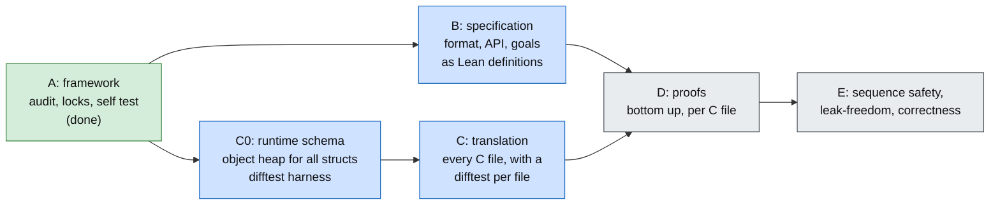

# Overview: verifying zlib in Lean 4

Status: work in progress. The runtime, translation, specifications and proof modules are present.
The latest published checkpoint is `2af1ec2`. Further migration work is being checked before publication.
A successful build does not establish the full safety or correctness goals.

## Current checkpoint and remaining work

The recovered source tree builds without proof placeholders. Its axiom gate reports no forbidden dependencies.
Two registered model goals are proved: format determinism and prefix freedom.
The public inventory records 95 default-build entries, four sequence requirements and four
initialisation-domain requirements. All 95 per-entry propositions are now defined as drafts. The integrated source builds.
The eight sequence/domain targets, semantic review and lock regeneration are not complete.
The `specs` and `final` gates must reject this checkpoint. This is not a final verified result.

The following work remains:

| Area | Remaining work |
| --- | --- |
| Integration | Independently review the new source and kernel-syntax locks and the first verification baseline. Enable and verify repository protections before claiming an enforced authority boundary. Register newly checked results only after their required checks. |
| Public contracts | Review the 95 drafted per-entry contracts against the source and public manual. Finish the eight sequence/domain targets. Review shared allocation cleanup, failure-state validity, callback observations and all representation limits. Regenerate semantic locks after the target set is complete. The public specification-readiness gate currently fails. |
| Specification review | Review every public API against the pinned C before claiming phase B complete. `Uncompress2` is incorrect on late memory failure: with input `78 9c 73 04 00`, capacity 256 and failure of the second allocator call, both implementations return `Z_MEM_ERROR`, output `41` and store lengths 1 and 5. Its empty-output clause excludes this run. Stop proofs using that clause until a corrected contract is reviewed. Review its buffer-error clause for streams followed by unused trailing input. Review dictionary accumulation, counters and the documented call order in `DeflSetDict`. |
| Translation review | Continue the statement-by-statement review beyond the corrected compressor automatic storage. Review scalar-pointer aliasing and the null-minus-null special case in compressor pointer subtraction (**to confirm**). |
| Inflate causal model | Independently review the universal output and unknown-dictionary conditions against the C. Register the checked `inflate_decodes` model proof, then establish these conditions for actual decoder runs. Prove the general negative-value priming bridge, beyond the checked model witnesses and finite execution matrix. |
| Differential harness | Keep the new allocation-failure and negative-prime regressions in automated validation. The test-owned gz handles, input line and deflate buffers are now released. Normal and unsuppressed sanitizer runs compare all 47,890 inputs. A cleanup mutation confirms that the harness still reports library state leaked by a missing end call. |
| Proof mutants | Repair malformed or inapplicable cases in the existing lists, finish all lists, and require failure in the corresponding function proof. |
| Decode tables | Connect the proved canonical-code coverage and entry-shape lemmas to the heap written by `inflate_table`; establish the table predicates used by the decoders. |
| Inflate | Finish the fast-path loop, the main decode modes and their composition, and the remaining copy and recovery cases. |
| Inflate back | Finish table construction, compressed blocks, callback composition and the complete function. |
| Deflate | Finish initialisation and its failure cleanup, dictionary setting, priming, copying, `fill_window`, strategy loops and the complete function. The recovered dictionary-query proof builds and rejects three translation mutants in its own proof; registration remains. |
| Trees | Finish tree construction, tree emission, block compression and the overlay bound, including the small memory levels. |
| Other APIs | Finish the compression utilities and the gz read/write/open paths. |
| End-to-end claims | Instantiate the heap API, connect the history invariant to the format model, and prove sequence safety, ownership, termination and functional correctness on the supported configurations. |

Review the work in this order. Each row has an observable completion condition, rather than a
calendar estimate for proofs whose invariants are still open.

| Checkpoint | Ready when |
| --- | --- |
| Public questions fixed | All 95 per-entry and eight sequence/domain propositions are concrete, reviewed against the selected C and public manual, and `verification.py specs` passes. Correct the known specification counterexamples first. |
| Baseline approved | An independent review approves the runtime, translation, domains and generated locks. Repository protections enforce review of those paths. |
| Function proofs accepted | An exactly matching theorem is registered for each fixed goal. Init establishes its invariant, the frame and ownership clauses hold, and the function's mutants fail in its proof. |
| Final result | The strict acceptance command and all four CI jobs pass on the same named commit against the approved baseline. A development check alone never reaches this checkpoint. |

The specification corrections in `2af1ec2` still need independent review. Conditional deflate theorems
assume `DGood`; the initialisation theorem establishing that invariant is still open.
The migration notes record the earlier proof sources and the adaptation already performed.

The current review adds a pointer-shape compressor model and a direct execution boundary.
The boundary exposes actual runtime faults and requires a successful run in a correctness claim.
The scalar-pointer aliasing limit is recorded in [deviations.md](deviations.md).
The historical `started` flag is now monotone across deflate calls, including refusals. This
repairs a model counterexample without changing the `deflate_valid` goal statement.
New proof modules check that model goal, the model compression bound, the actual saturated
bound arithmetic on every 64-bit argument, and selected concrete null-pointer cases. They are
not yet registered results. The concrete first-allocation failure path also checks the memory
error, cleared length, unchanged byte blocks and preservation of the live-block set. Five
isolated compressor and deflate mutants fail in the corresponding new proofs. The corrected
inflate model also has a checked proof of the unchanged `inflate_decodes` statement. Its
speculative-output, FDICT, unknown-dictionary and negative-prime regressions reject five further
specification mutants. These are model results; the decoder implementation refinement remains open.
The registry now includes the two existing concrete compressor goals and seventeen concrete public
checksum and query goals. They remain open until an exactly matching theorem is registered.
The actual compressor refinement, output bound and full allocation cleanup remain open.

The root import closure now includes the drafted public contract modules. The forbidden-construct text check
also passes after removing two false-positive mentions from comments. The allocation regression
compares 109 full-buffer observations, including the late decoder memory error, and rejects
the former automatic-storage translation. The priming regression compares 185 actual calls.
Differential tests are evidence of fidelity, not proof.

The public boundary is documented in [spec/public-goals.md](spec/public-goals.md). The
verification gate is described in [anti-cheating.md](anti-cheating.md). Reference ideas and their
limits are recorded in [verification-reference.md](verification-reference.md).

## Reading order

| Document | Question it answers |
| --- | --- |
| [safety.md](safety.md) | What does "safe" mean, exactly? |
| [spec/index.md](spec/index.md) | What is zlib supposed to do? The data format, the API, the internal functions, in words |
| [method.md](method.md) | What is the proof method, the invariant, the order, the hard facts? |
| [proof/index.md](proof/index.md) | The proofs in text, one page per C file, and what the earlier attempt already proved |
| [architecture.md](architecture.md) | Layers, heap model, pilot, gates, milestones |
| [translation-guide.md](translation-guide.md) | How every C construct becomes Lean, on the object heap; what a translator delivers |
| [pilot.md](pilot.md) | The object heap tried on `flush_pending`: what was proved and how large it is |
| [trusted-base.md](trusted-base.md) | What a proof does not check |
| [anti-cheating.md](anti-cheating.md) | How a proof is kept from cheating: the audit, the locks, the self test, what is left to a human |

## 1. Goal and scope

Kernel-checked Lean 4 proofs about a faithful translation of upstream zlib `develop`.

**What we eventually want to prove** (every principle, in this order of priority):

| ID | Property | Meaning |
| --- | --- | --- |
| P1 | Safety | Every API function, called as `zlib.h` allows, runs without undefined behaviour (no out-of-bounds or null access, no use of freed memory, no signed overflow, no invalid shift) and without leaking memory: every block it allocates is freed exactly once, by `End` or by the failing `Init`. |
| P2 | Termination | No loop exhausts its fuel bound; every function returns. |
| P3 | Frame | A call writes only the memory it is allowed to write (its stream, the state it owns, the caller's output buffer). |
| P4 | API-sequence safety | Any legal call sequence (`init`, `deflate`/`inflate`*, `reset`, `setDictionary`, `copy`, `end`, ...) preserves one representation invariant, so P1–P3 hold at every call. |
| P5 | Functional correctness | `inflate` decodes RFC 1950/1951/1952 exactly; `deflate` output is valid and `inflate (deflate x) = x`; checksums equal their specifications. |
| P6 | Other configurations | The same for every build that zlib's own CI covers. |

**Target configuration:** default x86_64 Linux, LP64, `./configure --static`.

**Order of work.** All of P1 to P6 are goals. The order follows the dependencies, not a ranking:

1. `inflate`, `deflate` and everything they call: P1 to P4 first, then P5.
2. `compress`, `uncompress`, `infback`.
3. The `gz*` layer (`gzlib`, `gzread`, `gzwrite`, `gzclose`).
4. P6, the other configurations.

Safety comes first inside each component because a function that may fault has no result to
state a correctness theorem about. It does not come first because correctness is optional.

**Non-goals:** proving the C compiler, proving the OS, performance. Custom allocators are
modelled after the default `calloc`/`free` allocator; they belong to the work on P6.

## 2. Why the architecture changes

An earlier attempt (the `zlib-formal` repository) reached 160 translated functions and about
190k lines of proof for 8.7k lines of translation, and ended with these structural problems.
They are the design constraints for this work.

1. **Proofs were hand-threaded.** Every step was proved with a hand-written "runs to this
   state" relation; a 4-line C loop needed about 40 lines of proof. No verification-condition
   generator was used.
2. **The heap made framing expensive.** Bytes and tagged cell arrays were indexed by `Array`
   with `set!`; every function re-proved that "other things did not change".
3. **Callee contracts were assumptions.** There were 65 contract definitions. Several were
   unsatisfiable or satisfiable only by toy instances; one bundle used by all `deflate()`
   theorems was proved jointly unsatisfiable, making those theorems vacuous.
4. **Several invariants described the same object** (`DSInv`, `FastInv`, `SlowInv`, ...) with no
   theorem connecting them.
5. **Combinatorial facts were proved at heap level**, mixed with memory reasoning.

Each design rule below answers one of these.

## 3. Design rules

R1. **Bottom-up, no assumed contracts.** A callee's specification is a theorem about the
    translated callee. A theorem never takes "the callee behaves" as a hypothesis.

R2. **One representation invariant per C struct.** `InflateOK`, `DeflateOK`, ... is established
    by the corresponding `*Init` function and preserved by every API function. That `Init`
    establishes it is itself the non-vacuity proof. A concrete end-to-end run is kept only for
    top-level API theorems.

R3. **One invariant carries safety and correctness.** The correctness theorems of P5 are stated
    over the same records as the safety theorems of P1 to P4, so they use the same invariant
    and nothing is formalised twice. The functional facts that safety needs (list in §6) are
    named lemmas. The correctness statements are in §6a.

R4. **Layered refinement.** The layers below let memory reasoning and mathematics be proved
    separately.

    | Layer | Content | Proved by |
    | --- | --- | --- |
    | L0 | Runtime: memory, pointers, loops, `Fault.ub` for every reachable UB | reviewed by hand; tested against a reference semantics |
    | L1 | Statement-by-statement translation of each C function | differential tests against real C; checked by the layers above |
    | L2 | Pure functional model: same algorithm on Lean structures and arrays, no pointers | L1 refines L2 (mechanical VCG) |
    | L3 | Mathematical specification (Huffman, LZ77, RFC grammar, checksums) | pure mathematics; reuse of [lean-zip](https://github.com/kim-em/lean-zip) specifications |

    L2 and L3 are required by P5. They are built on the same state records as L1, not in a second
    formalisation.

R5. **No trust shortcuts.** No `sorry`, `native_decide`, `bv_decide`, `axiom` or `implemented_by`;
    only `propext`, `Classical.choice`, `Quot.sound` (enforced in CI by `tests/audit/Audit.lean`).

R6. **Narrower than `zlib.h` must be stated.** Any precondition stronger than `zlib.h` requires
    is written in the theorem's docstring and listed in `docs/deviations.md`.

R7. **A translation mismatch is a bug in the translation.** Never change a translation to ease
    a proof.

R8. **File layout mirrors the source.** The Lean sources sit under `ZlibF/Zlib/` and use the
    same file names as upstream with `.lean` appended: `zlib/adler32.c` becomes
    `ZlibF/Zlib/adler32.c.lean`, `zlib/deflate.h` becomes `ZlibF/Zlib/deflate.h.lean`. Each
    module holds the translation, the specification and the proofs of that one C file. A file
    is split into `ZlibF/Zlib/X.c/*.lean` only when it becomes too large. Heap-free
    mathematics goes to `ZlibF/Math/`. The runtime is `ZlibF/Runtime/*.lean`.

## 4. Open decisions

Each has a recommendation; the first four need a decision before the milestone that depends on
them. Decisions are recorded in `docs/decisions.md` when taken.

| ID | Decision | Options | Recommendation | Needed by |
| --- | --- | --- | --- | --- |
| D1 | Heap model | (a) tagged cell arrays (old); (b) per-field maps; (c) **object/record heap**: one Lean `structure` per C struct, per-type arrays; no initialisation tracking (an uninitialised integer is an arbitrary value, a pointer is NULL) | **Decided: (c).** The pilot ([pilot.md](pilot.md)) covers struct fields, allocation, a ring buffer, a loop over arbitrary content, interior pointers and static tables, and copying a struct | done |
| D2 | Proof automation | (a) a small own weakest-precondition tactic for the `CM` monad; (b) Lean's `mvcgen`/`vcgen` (`Std.Do`/`Std.WP`) | (a) if the pilot shows (b) is unstable on the pinned toolchain: `mvcgen` is being replaced by `vcgen` in current releases | M1 |
| D3 | How L1 is produced | (a) hand translation + differential tests; (b) mechanical import of a Clight AST into Lean with a Clight semantics validated against CompCert (as in Certora's CLean) | (a) first; keep the translation format compatible with (b); revisit once `inflate` and `deflate` are done | M2 |
| D4 | Deflate overlay bound for `memLevel` 1–3 | (a) the safety theorem requires `memLevel ≥ 4` (stated per R6) until the bound is proved for 1 to 3; (b) prove the full range at once | (a) to keep the work moving; the full range is required before the safety claim covers all of `zlib.h` | M4 |
| D5 | Uninitialised reads | (a) any read of an uninitialised integer is a fault; (b) it returns an arbitrary value and every theorem holds for all values; a pointer in fresh memory is NULL in the model (a documented gap, `trusted-base.md` item 2) | **(b)**. Option (a) makes the theorem false for real zlib: `slide_hash` reads the whole `prev` array, which is never cleared (see `safety.md` section 3) | M1 |
| D6 | Struct-as-bytes access | (a) fault (the only such use in the default build is `(Bytef *)&stream.reserved` in `uncompress`, never dereferenced); (b) model ABI layout | (a) | M1 |

## 5. Milestones

The order is: the framework, then the whole specification, then the whole translation, then the proofs. A proof about a function is
only worth as much as the specification and the translation it refers to, so those come first and are complete before the
proofs of the large functions start.

| Phase | Content | Exit criterion |
| --- | --- | --- |
| A | Audit of every declaration, locks on trusted definitions and theorem statements, the self test with cheat samples, `CODEOWNERS`, the rules for agents | done; [anti-cheating.md](anti-cheating.md) |
| pilot | The object heap on `flush_pending`, `updatewindow`, `slide_hash`, interior pointers and `inflateCopy` | done; [pilot.md](pilot.md); decision D1 |
| B | The specification in Lean: the data format (RFC 1950, 1951, 1952, checksums), then the API contracts of every function as a functional model of the stream plus the relation between the model and the heap, then the **goals**: every target statement as a Lean definition of type `Prop` (so that no `sorry` is needed) | every rule of [spec/](spec/index.md) has a definition; every goal is listed in `tests/audit/goals.txt`; the audit reports which goals have a proof |
| C0 | The runtime schema generated from the C headers; the old `Core.lean` and the `adler32.c` translation moved onto the object heap; the differential test harness | `adler32.c` is on the new runtime with its proofs, and `tests/run.sh` passes |
| C | The translation of every C file (`crc32`, `zutil`, `inftrees`, `inffast`, `inflate`, `infback`, `trees`, `deflate`, `compress`, `uncompr`, `gzlib`, `gzread`, `gzwrite`, `gzclose`), by the rules of [translation-guide.md](translation-guide.md) | every function is translated and has a passing differential test; the locks are regenerated and reviewed |
| D | The proofs, bottom up, one C file at a time, against the goals of B and the translation of C | a goal is proved when a listed theorem has exactly its type |
| E | Sequence safety and leak-freedom of `inflate` and `deflate`; correctness (the round trip) | the goals of section 6a |

Dependencies: B and C0 are independent and run in parallel; C needs C0; D needs B and C, except that the proofs of a file may start as soon as
that file is translated and its specification exists.

## 6. Facts that safety genuinely needs

These are the functional facts that safety needs. Each is one named lemma proved at the lowest layer
that can state it.

| Fact | Used by | Notes |
| --- | --- | --- |
| `inflate_table` writes only inside its table, fills every root entry, and keeps every link in bounds | `inflate`, `inflate_fast` table lookups | Kraft inequality is the loop invariant of the fill loop; the sort loop needs a counting argument. The `ENOUGH` constants are not needed for safety, because the function rejects a table that would exceed them; see [proof/inflate.md](proof/inflate.md) section 2 |
| Back-reference distance is checked before every window copy | `inflate`, `inflate_fast` | Runtime check in the C; plain arithmetic |
| Hash-chain positions are below `strstart`, and every `prev` slot reached through a chain was written | `longest_match`, `fill_window` | A garbage slot would be used as an index into the window (D5) |
| Huffman code lengths are at most 15 (bit-length tree: 7) | `trees.c` array indices | Follows from the overflow correction in `gen_bitlen` |
| **`pending_buf` / `sym_buf` overlay never overwrites an unread symbol** | `deflate` block writing | The hardest fact. A symbol costs at most 31 bits and a dynamic block is chosen only if not larger than the fixed one. For `memLevel ≥ 4` this follows from Fibonacci-type depth bounds of real Huffman trees; `memLevel` 1–3 is open (D4). Kraft-valid lengths alone are not enough |

## 6a. The correctness statements

The statements below are the target of P5. Each is written in words in [spec/](spec/index.md)
and becomes one Lean theorem.

| ID | Statement | Specification |
| --- | --- | --- |
| C1 | `adler32` and `crc32`, and their `combine` functions, equal the mathematical definitions for every input and every way of splitting it | `F-adler-incremental`, `F-crc-incremental` |
| C2 | `inflate` decodes: if the whole input is a valid stream of the chosen layer, the concatenated output equals the decoded data, **for every split of the input into calls and every split of the output room**, and for every `flush` value; if the input is invalid it returns `Z_DATA_ERROR`, after producing a prefix of what a decoder would produce | `F-*`, `A-inflate-*` |
| C3 | `deflate` output is a valid stream of the chosen layer, and `inflate` of it returns the original input, for every level, strategy, `memLevel`, `windowBits`, flush schedule and split of the input | `F-deflate-valid`, `F-deflate-flush` |
| C4 | Headers and dictionaries: `deflateSetHeader` is reproduced by `inflateGetHeader`; a preset dictionary used by `deflate` is accepted by `inflate` with the same dictionary and rejected with another | `A-header-fill`, `format.md` §3 |
| C5 | `deflateBound` is an upper bound on the size of the output | `A-deflate-bound` |
| C6 | `inflateCopy` and `deflateCopy` give a stream that behaves, from then on, exactly as the original; `Reset` returns a stream to the behaviour of a fresh one | `A-stream-*` |
| C7 | The gz layer reads back what it wrote, and `gzseek`, `gzoffset` agree with the uncompressed position | to be written with M9 |

C2 and C3 are stated over streams, so they need a notion of "the bytes that a stream has
produced so far" that does not depend on how calls were split. The state-machine view of
`inflate` provides it: the decoder state after `k` input bytes is a function of those bytes alone.

## 7. Pilot (M1)

Purpose: choose the heap model and automation by measurement, not by argument.

- **Functions:** `flush_pending` with `putShortMSB` (struct fields + caller buffer + `memcpy`),
  `updatewindow` (allocation + window arithmetic), `fill_window` (loop + overlapping copy).
- **Candidates:** the old tagged-cell model; the object/record heap (D1c); per-field maps if
  the first two are inconclusive. Automation: own wp tactic vs `mvcgen`/`vcgen` (D2).
- **Same statement for every candidate:** fault-free under `Inv`, `Inv` preserved, frame.
- **Measured:** proof lines, lines of reusable framework needed, `lake build` time and peak
  memory, number of `maxHeartbeats` overrides, readability of the final statements.
- **Decision rule:** pick the candidate with the fewest proof lines and no heartbeat overrides;
  tie goes to the one closest to the L2 model.

## 8. Metrics and budgets

Recorded per milestone in `docs/metrics.md`: translation lines, proof lines, ratio, build time,
peak memory, `maxHeartbeats` overrides (target: none above the default), forbidden-construct count
(must be zero).

The hypothesis to validate in M1 is that safety proofs cost about 3–5 lines per translated
line, against about 22 in the earlier attempt. If the pilot shows otherwise, the approach is revised
before M2, not after.

## 9. Validation

- **Differential tests (evidence, not proof):** run the translation and the real C on the same
  inputs and compare results and effects. Built from M2 on; every translation bug found extends
  the tests.
- **Runtime semantics:** reviewed independently of the proofs; the reference for UB is the C
  standard and CompCert's Clight semantics.
- **Mutation checks:** for each proved function, a mutated translation (wrong bound, off-by-one,
  dropped check) must make the proof fail inside that function's proof. Detects vacuous or
  too-weak theorems.
- **Non-vacuity:** by R2, `Init` establishes the invariant; one concrete run per top-level API
  theorem.
- **Sanitiser runs of the real C** on any input where a proof gets stuck, before suspecting the
  proof: ASan/UBSan/MSan. Several real zlib bugs were found that way (see §10).

## 10. Source and patches

The verified source is the pinned `zlib/` submodule plus `patches/*.patch` applied in order.
`zlib/` is never modified. A patch exists only for a confirmed zlib bug that blocks a proof, is
minimal, and matches an upstream pull request; it is deleted when upstream merges it.

Carried over from the earlier attempt (all reproduced there; upstream status to be re-checked at
each submodule bump):

| Patch | Bug | Upstream |
| --- | --- | --- |
| `deflateBound_z` | `2 + extra_len` wraps in 32 bits for a gzip header | [madler/zlib#1360](https://github.com/madler/zlib/pull/1360) |
| `gz_fetch` | stale `x.next` after partial read then error leads to overread (comes with `gz*`) | [madler/zlib#1363](https://github.com/madler/zlib/pull/1363) |
| `adler32` | `buf == Z_NULL` checked after the `len == 1` fast path | [madler/zlib#1364](https://github.com/madler/zlib/pull/1364) |
| `gzseek64` | overflow after an initial pushback (comes with `gz*`) | [madler/zlib#1361](https://github.com/madler/zlib/pull/1361) |

A separate `ub.patch` removes undefined behaviour with no observable effect (for example an
indeterminate pointer that is never used). It is not an upstream fix; each hunk must preserve the
result of every well-defined execution and carry its own argument.

`NULL + 0` and `NULL - NULL` are allowed by the model (undefined in C17, defined in C2y) and are
not patched.

## 11. Continuous integration

On every push and pull request: build all modules; run `tests/audit/Audit.lean` (axioms of every declaration, locks on the trusted definitions and on the listed
theorems); reject `sorry`, `native_decide`, `bv_decide`, `implemented_by`, `axiom` in sources;
check that the patches apply to the pinned submodule. From M2: build the pinned C and run the
differential tests. From M3: mutation checks. Heavy builds are cached per toolchain version.

The workflow file is prepared with M0. Pushing workflow files needs a token with the `workflow`
scope.

## 12. Prior art this work follows

- **seL4 / AutoCorres:** C is imported mechanically, abstracted in proof-producing stages
  (monadic embedding, local-variable lifting, typed heap, word abstraction), and verified at the
  abstract level. → R4, D1. [AutoCorres](https://www.trustworthy.systems/projects/OLD/autocorres),
  [Greenaway et al., PLDI 2014](https://www.trustworthy.systems/publications/nicta_full_text/7629.pdf),
  [Tuch–Klein–Norrish, POPL 2007](https://trustworthy.systems/publications/nicta_full_text/134.pdf).
- **VST (Verifiable C) for SHA-256/HMAC:** a functional model in the proof assistant, forward
  symbolic execution of the C against it. → R4. [Appel, SHA-256](https://www.cs.princeton.edu/~appel/papers/verif-sha.pdf).
- **Certora's `inflate_table` proof in Lean:** C → Clight → Lean with a ported semantics, memory
  safety and termination of one function, about 127 proof lines per C line; found that the caller
  must guarantee a root-table width. → D3, §6.
  [Certora](https://www.certora.com/blog/formally-verifying-zlib-memory-safety-with-lean).
- **lean-zip:** a Lean DEFLATE implementation with a proved round trip; its Huffman, LZ77 and
  checksum specifications are the L3 reference. → R4, M6. [lean-zip](https://github.com/kim-em/lean-zip).
- **Aeneas / SymCrypt:** a pure functional model extracted from the program and verified in Lean
  at scale, with proofs written by agents and the statements reviewed by people. → R4, review
  policy. [Microsoft Research](https://www.microsoft.com/en-us/research/blog/verifying-rust-cryptography-in-symcrypt-from-standards-to-code/).
- **SAW / CN / RefinedC:** automation by symbolic execution or decidable reasoning rather than
  hand-threaded states. → D2.

## 13. Review policy

Whoever or whatever writes a proof, a human reviews: the runtime (L0), every theorem statement
and precondition, `tests/audit/`, `docs/deviations.md`, and any new patch. Proof bodies are checked
by the kernel and need no review.
