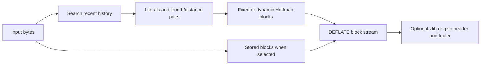
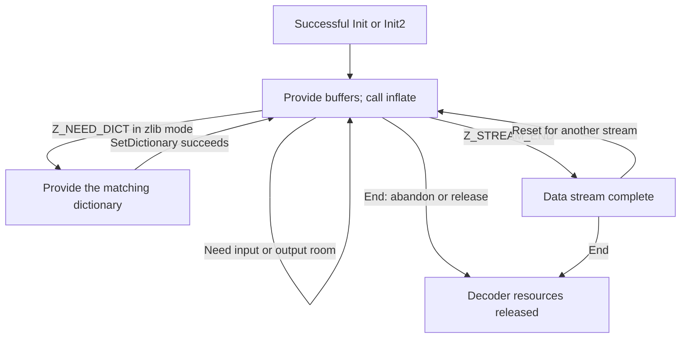
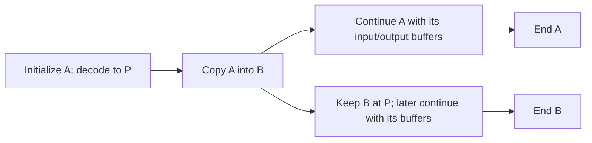
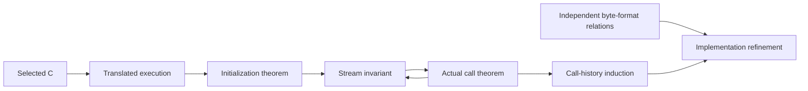

# Understanding and proving zlib

This chapter first follows the bytes and the application's stream object.
It then explains what the implementation must guarantee, why those guarantees
matter, and how the proof connects them to the selected C.

<a id="proving-the-zlib-implementation"></a>

## Contents

- [1. What zlib does](#1-what-zlib-does)
  - [1.1 One library, three related formats](#11-one-library-three-related-formats)
  - [1.2 Repetition becomes a backward reference](#12-repetition-becomes-a-backward-reference)
  - [1.3 Symbols become bits and blocks](#13-symbols-become-bits-and-blocks)
  - [1.4 Where these jobs live in the library](#14-where-these-jobs-live-in-the-library)
- [2. How applications use the APIs](#2-how-applications-use-the-apis)
  - [2.1 One decoder, two kinds of lifetime](#21-one-decoder-two-kinds-of-lifetime)
  - [2.2 The ordinary inflate loop](#22-the-ordinary-inflate-loop)
  - [2.3 Copies, reuse and borrowed metadata](#23-copies-reuse-and-borrowed-metadata)
  - [2.4 Compression has its own completion protocol](#24-compression-has-its-own-completion-protocol)
  - [2.5 Configuration and calling protocol are separate](#25-configuration-and-calling-protocol-are-separate)
- [3. What must be proved and why](#3-what-must-be-proved-and-why)
  - [3.1 The implementation and configurations](#31-the-implementation-and-configurations)
  - [3.2 Safety of calls and lifetimes](#32-safety-of-calls-and-lifetimes)
  - [3.3 Meaning of compressed bytes](#33-meaning-of-compressed-bytes)
- [4. Assumptions and model boundaries](#4-assumptions-and-model-boundaries)
  - [4.1 Platform assumptions](#41-platform-assumptions)
  - [4.2 Caller and external-world obligations](#42-caller-and-external-world-obligations)
  - [4.3 What the kernel trusts](#43-what-the-kernel-trusts)
- [5. How the proof is built](#5-how-the-proof-is-built)
  - [5.1 Translate the actual C execution](#51-translate-the-actual-c-execution)
  - [5.2 Establish an invariant by initialization](#52-establish-an-invariant-by-initialization)
  - [5.3 Preserve it through calls](#53-preserve-it-through-calls)
  - [5.4 Relate executions to byte meaning](#54-relate-executions-to-byte-meaning)
- [6. The inflate argument](#6-the-inflate-argument)
  - [6.1 Construct and interpret decoding tables](#61-construct-and-interpret-decoding-tables)
  - [6.2 Join the slow and fast paths](#62-join-the-slow-and-fast-paths)
  - [6.3 Close the call and its history](#63-close-the-call-and-its-history)
- [7. The deflate argument](#7-the-deflate-argument)
  - [7.1 Window and hash-chain invariants](#71-window-and-hash-chain-invariants)
  - [7.2 Trees, symbols and shared output storage](#72-trees-symbols-and-shared-output-storage)
  - [7.3 Publish blocks and compose calls](#73-publish-blocks-and-compose-calls)
- [8. Reading a formal result](#8-reading-a-formal-result)
  - [8.1 Find its exact statement](#81-find-its-exact-statement)
  - [8.2 Follow its proof and evidence](#82-follow-its-proof-and-evidence)

## 1. What zlib does

### 1.1 One library, three related formats

zlib is a lossless compression library. An application gives it bytes. Compression
produces a representation from which decompression can recover those bytes.
The library does not need to know whether the bytes represent text, an image or
another kind of data.

The library name and the format name are easy to confuse:

| Name | What is on the wire |
| --- | --- |
| Raw DEFLATE | A sequence of DEFLATE blocks. |
| zlib format | A zlib header, a DEFLATE stream and an Adler-32 check value. |
| gzip format | A gzip header, a DEFLATE stream, a CRC-32 check value and the original size modulo `2^32`. |

The zlib and gzip wrappers carry different metadata and integrity checks. Both
use DEFLATE for the compressed body. A whole wrapped stream cannot be passed to
a raw decoder without handling its wrapper. A gzip file can contain several
members, each with its own wrapper and compressed body. The precise byte and bit
rules belong to the [format specification](spec/format/README.md).

This gives two separate jobs: decode the DEFLATE body, and interpret the selected
wrapper. A check value helps detect corruption; equality of check values does
not prove that two byte sequences are equal.

### 1.2 Repetition becomes a backward reference

Consider the eight ASCII bytes `ABABABAB`. One valid description is:

```text
literal A, literal B, copy 6 bytes from distance 2
```

After writing `AB`, a decoder can produce the remaining six bytes by repeatedly
copying the byte two positions behind the current output position. The bytes
just written become available to the same copy. This is why a match may overlap
its own output. The example explains the representation; it does not prescribe
the tokens that a particular compression call will choose.

The distance refers to recently produced bytes. The decoder therefore retains
a history window, at most 32 KiB for DEFLATE, rather than retaining the entire
uncompressed file. The compressor searches its recent input for useful matches.
A literal represents one byte. A length/distance pair represents a repeated run.
This use of repetition is the LZ77 part of DEFLATE.

A compressor must still choose whether a match is worth encoding. Its window,
search effort and strategy affect which tokens it finds. Many different valid
compressed streams can describe the same input. Correctness requires that the
chosen representation decodes to the input; it does not require one unique
compressed byte sequence.

### 1.3 Symbols become bits and blocks

A length/distance description is not yet the byte stream sent to the receiver.
DEFLATE uses Huffman codes for literal/length symbols and distance symbols, with
extra bits for some lengths and distances. Shorter codewords can represent more
frequent symbols. Prefix-free codes let the decoder determine where one symbol
ends and the next begins.

The stream is divided into blocks. Each block chooses one of three forms:

| Block | Why it exists |
| --- | --- |
| Stored | Carries uncompressed bytes. Coding overhead can outweigh any saving. |
| Fixed Huffman | Uses code lengths defined by the format, avoiding a transmitted tree description. |
| Dynamic Huffman | Carries code-length information so the codes can fit that block's symbol frequencies. The description itself is compactly encoded. |

A DEFLATE stream can mix these block forms. Headers and tables cost space, so
compression can produce more bytes than the original input. A capacity guarantee
therefore needs an upper-bound argument, not an assumption that compression
always makes data smaller.



The diagram follows data representations, not the order of C statements. The
block choice belongs to the compressor. The decoder reads that choice, builds
a decoding table when needed, and reconstructs the bytes in order.

Codes and fields are bit-oriented. An input buffer can end in the middle of a
field or a symbol. A decoder must keep the remaining bits for the next call.
Likewise, an application buffer boundary need not be a DEFLATE block boundary.

### 1.4 Where these jobs live in the library

The following implementation map is a reading of the selected source,
**to confirm** by the execution and refinement proofs.

| Component | Responsibility |
| --- | --- |
| `deflate` and its strategy code | Refill and slide the window, find matches, choose tokens and advance compression. |
| `trees.c` | Build coding information and emit stored, fixed or dynamic blocks. |
| `inflate.c` | Process wrappers, drive the decoding modes, retain history and report completion or errors. |
| `inftrees.c` and `inffast.c` | Construct decoding tables and execute the fast decoding path. The main decoder also has a slow path. |
| Adler-32 and CRC-32 code | Maintain the check value required by a wrapper, and expose checksum APIs. |
| Allocation, buffer utilities and gzip file code | Manage resources and provide application-facing ways to use the engines. |

`compress` and `uncompress` offer whole-buffer zlib operations built on ordinary
streams. The `gz*` APIs add gzip file handling, including file positions and I/O.
`inflateBack` is a separate callback-based raw decoder in `infback.c`. It shares
the DEFLATE format, but has its own implementation and calling protocol.

## 2. How applications use the APIs

### 2.1 One decoder, two kinds of lifetime

An ordinary decoder is a stateful object. The caller holds a `z_stream`. Its
public fields describe current input and output buffers. Its internal `state`
retains the decoding mode, tables, buffered bits, history and checksum.

There are two useful notions of lifetime:

- The allocated decoder lives from successful initialization or copy until its
  matching `inflateEnd`.
- One compressed data stream runs through that decoder. `inflateReset` abandons
  its progress and starts another data stream while reusing suitable resources.

The caller owns its stream record and buffers. The library owns its internal
state and window. Keeping or replacing a caller buffer is different from freeing
library state. API behavior below is a reading of the public manual and selected
C, **to confirm** by proof. Exact requirements remain in the
[shared stream rules](spec/api/streams.md) and
[inflate contracts](spec/api/inflate-stream.md).

### 2.2 The ordinary inflate loop

Start with `inflateInit`, or use `inflateInit2` to select the wrapper and maximum
window size. Initialization prepares the decoder; it does not decode the input.
The application then repeats these steps:

1. Supply input through `next_in` and `avail_in`. On later calls, preserve any
   unconsumed bytes indicated by the updated fields. Supply the next chunk only
   after consuming the old one, or retain that remainder when extending it.
2. Provide writable output space through `next_out` and `avail_out`.
3. Call `inflate`. Use its updated pointers and counts to determine what was
   consumed and produced.
4. Deliver the produced bytes before reusing their output storage. Supply more
   input or output room when needed, keeping the decoder's internal state.

`Z_STREAM_END` reports completion. Merely running out of input or output space
does not. `Z_BUF_ERROR` can mean that no progress was possible; suitable input or
room can permit another call. Repeating the same blocked request without changing
anything does not create progress. `inflateEnd` releases resources; it does not
finish decoding the remaining input.



This is an ordinary workflow, not an exhaustive transition system. The selected
format, current mode, storage and individual entry contract also matter. A
complete gzip member produces `Z_STREAM_END`; ordinary `inflate` does not itself
iterate over concatenated gzip members. The caller resets and continues to the
next member when one is present.

The names ending in `_`, such as `inflateInit_`, are the actual initialization
entries behind C macros that supply the version and stream-record size. They
are not additional decoding algorithms.

### 2.3 Copies, reuse and borrowed metadata

**A checkpoint with Copy.** Suppose decoder A has reached position P.
`inflateCopy` creates decoder B with the same decoding position and history.
A can continue, while B is retained for a later continuation. A random-access
application can save such checkpoints together with their compressed input
positions, then resume from a nearby checkpoint instead of decoding from the
beginning.

The source must be a valid live stream and the destination must be distinct,
writable, non-live storage. On success, A and B own their internal state and
window independently, and each needs its own End. Copy does not duplicate the
compressed file or already delivered output. Caller input/output pointers and
any registered header pointer are borrowed and copied as pointers. The application
must manage their lifetimes and the buffers used for each continuation. See the
[copy contract](spec/api/inflate-stream.md#inflatecopy).



The fork duplicates decoder state, not ownership of the application's buffers.
Ending A does not release B's internal state.

**Another stream with Reset.** After completion, or when deliberately abandoning
an unfinished stream, Reset discards the old decoding progress and history.
The same decoder object can process a new stream. Reset2 also permits a new
wrapper/window request. Reset is therefore different from a checkpoint that
resumes old progress. The history-retaining ResetKeep entry has its own
[separate contract](spec/api/inflate-stream.md#inflateresetkeep).

**A preset dictionary.** A zlib stream can request a dictionary with
`Z_NEED_DICT`. The application supplies the compressor's dictionary, checks the
result, then resumes inflate. The stored identifier helps select/check it; an
identifier alone does not establish byte equality. Raw mode has different
[replacement rules](spec/api/inflate-stream.md#inflatesetdictionary), and gzip
has no preset-dictionary path. GetDictionary reads the decoder's current history;
that history need not still be the original preset dictionary.

**Capturing a gzip header.** Before decoding, GetHeader registers a caller-owned
record and optional destination buffers. Later inflate calls fill them while
parsing the header. The storage must remain valid while it can be accessed.
For a gzip member, `head.done == 1` reports that header parsing has completed;
it does not report completion of the compressed body. A name or comment can be
truncated when its registered capacity is too small. Reset clears registration,
so capture for the next member needs a new registration. The library does not
take ownership of these buffers. See the [header contract](spec/api/inflate-stream.md#inflategetheader), including
capacity, alias and completion rules.

**Recovery and bit-level control.** After detected data damage, Sync searches for
a possible full-flush boundary. Finding the marker does not guarantee a valid
suffix or recover lost bytes. Reset instead abandons the damaged stream. Prime
supplies buffered bits for special raw-stream or boundary workflows; Mark and
other queries expose decoder state. These operations follow their
[own entry conditions](spec/api/inflate-stream.md), rather than being arbitrary
steps inserted into the ordinary loop.

**Callback decoding.** The separate `inflateBackInit` / `inflateBack` /
`inflateBackEnd` family decodes raw DEFLATE using an application-supplied window
and input/output callbacks. The decoder asks the callbacks for data and delivers
output through them. It does not use the ordinary loop's buffer-feeding protocol.
The [callback contract](spec/api/inflate-back.md) defines callback termination,
window preservation and resource ownership.

### 2.4 Compression has its own completion protocol

The ordinary compressor uses Init, repeated `deflate` calls, and End. It also
accepts a flush request. `Z_NO_FLUSH` lets the compressor choose when to emit
blocks. When the input stream is complete, the caller uses `Z_FINISH` and retries
with more output room as needed until `Z_STREAM_END`. It supplies no new input
after beginning that finish operation; any input left from the request is still
accounted for by the updated pointers and counts.

Other flushes create particular boundaries. A sync flush can make an aligned
prefix available without ending the stream. A full flush also discards match
history once the flush completes. These are data-format effects, not merely
requests to empty an application buffer. Continue an incomplete flush with the
same request and sufficient room. The precise schedules and capacity conditions
are in the [compression contracts](spec/api/deflate-stream.md) and
[shared flush rules](spec/api/streams.md#compression-and-flushes).

### 2.5 Configuration and calling protocol are separate

A configuration selects an engine's behavior. A protocol describes how an
application uses that configured stream over time.

| Input choice | What it changes |
| --- | --- |
| Wrapper | Header/trailer processing and the applicable integrity check. |
| Window size | The permitted history distance and window storage. |
| Compression level and strategy | Match-search and coding choices. They can change the compressed representation without changing the input it must represent. |
| Compression memory level | Internal buffer and table dimensions. It is not a different compressed-data format. |

Inflate does not receive a compressor memory level or strategy parameter. It
must decode the admitted block descriptions produced by those choices. Buffer
splits and call sequences add further variation even when all configuration
parameters are fixed. The [input configuration ranges](spec/input-configurations.md)
define default/common/all coverage; that does not by itself define a complete
calling protocol or establish every advanced combination.

Finally, distinguish three kinds of condition:

- **Ordinary usage:** for example, register gzip header storage before decoding,
  or Reset when starting an independent stream in a reused decoder.
- **Defined refusals:** valid caller storage with a rejected request may require
  a particular error return. Malformed compressed data is still in the safety
  domain. A buffer error need not destroy the stream.
- **A theorem's focused domain:** a manual or helper can state stronger storage
  or sequencing premises. Being outside that focused domain is not automatically
  C undefined behavior or a cleanly checked refusal.

For example, the focused Prime contract states a raw-stream/boundary usage;
the C does not enforce that entire usage restriction. Conversely, a dangling
pointer cannot be made safe merely by expecting an error return. The
[contract conventions](spec/api/contracts.md) distinguish these cases. These
examples do not narrow the broader [public goals](checking/goals.md).


<a id="1-what-must-be-proved"></a>
## 3. What must be proved and why

<a id="11-the-implementation-and-configurations"></a>
### 3.1 The implementation and configurations

The subject is the pinned upstream `zlib/` source with the registered patches
applied in order. It is translated into executable Lean definitions that follow
its C statements. A mathematical compression algorithm alone is insufficient:
the argument concerns this implementation, including its errors and cleanup.

The initial platform is default x86_64 Linux, LP64, a static library and the
default allocator. Within that platform, inputs still vary: compression level,
window size, wrapper, memory level, strategy and caller buffer splits. The
[configuration specification](spec/input-configurations.md) defines the nested
default, common and all-supported input ranges. Other upstream build
configurations belong to the wider project scope.

The implementation must connect these observable uses to precise guarantees.
Decompressing the expected bytes is insufficient if a damaged input can cause
an invalid read, or a failed allocation leaks earlier allocations. Safe calls
alone are insufficient if Copy leaves two streams sharing mutable state or if
Reset and dictionary changes break the meaning of a later continuation.

The stable property identifiers are used by the formal statements:

| ID | Required property |
| --- | --- |
| P1 | Safety and no leaks. |
| P2 | Termination without fuel exhaustion. |
| P3 | Frame: only permitted storage changes. |
| P4 | Invariants and ownership across legal call sequences. |
| P5 | Functional correctness against independent specifications. |
| P6 | Coverage of every upstream CI configuration. |

<a id="12-safety-of-calls-and-lifetimes"></a>
### 3.2 Safety of calls and lifetimes

For every admitted call, the translated execution must terminate without a
fault. It must retain a legal stream state, change only permitted storage and
account for allocations and frees. Documented parameter refusals and allocation
failures are part of the claim. Malformed compressed input must be handled safely.

A lifetime starts with initialization, permits the documented calls and caller
buffer replacements, and ends with cleanup. Its invariant must hold across
that history. Isolated safe functions do not by themselves establish a safe
lifetime. Read the [safety specification](spec/safety.md) for UB, termination,
frame and ownership, and the [shared stream contracts](spec/api/streams.md)
for legal call sequences.

<a id="13-meaning-of-compressed-bytes"></a>
### 3.3 Meaning of compressed bytes

Safety does not determine whether the output is correct. Decompression must
interpret the admitted byte stream correctly. Compression must emit bytes that
encode the accepted input with the specified wrapper, checksums and flush
behaviour. The argument must account for partial input, partial output and
continuation across calls.

The [format specification](spec/format/README.md) defines byte meaning
independently of C memory. The [API contracts](spec/api/README.md) specify call
results and effects. The [formal format guide](spec/format/model.md) explains
the mathematical relations used to connect those two layers.

The functional property families have these stable identifiers. Each entry
refers to the relevant API and format specifications above.

| ID | Required property |
| --- | --- |
| C1 | Checksum updates and combinations match their definitions. |
| C2 | Decoding produces justified prefixes, completes under stated conditions and safely reports detected invalid data; memory failure and incomplete input remain explicit. |
| C3 | Completed compression encodes accepted input; compatible decoding recovers it across permitted parameters, splits and flushes. |
| C4 | Header capture and dictionary checks have exact API effects; checksum equality is not dictionary byte equality. |
| C5 | Output-bound adequacy under its documented conditions, separately from numeric equality. |
| C6 | Independent copied ownership and matching continuation; specified reset behaviour. |
| C7 | Gzip data, positions and cleanup across read/write/seek/close histories. |

<a id="2-assumptions-and-model-boundaries"></a>
## 4. Assumptions and model boundaries

<a id="21-platform-assumptions"></a>
### 4.1 Platform assumptions

The initial system scope accepts **each represented byte object having fewer
than `2^63` bytes**. This covers caller, static and embedded storage. It is an
environment premise, not a zlib obligation to prove an operating-system limit.
The exact `ByteObjectsFit` definition and its use are explained in
[platform assumptions](spec/platform.md).

The bound is per object. It does not cap the total stream length or total
memory, and it applies throughout the default/common/all input ranges. Proofs
that use it must still establish that actual initialization, allocation and
updates preserve it.

<a id="22-caller-and-external-world-obligations"></a>
### 4.2 Caller and external-world obligations

The caller supplies the readable and writable ranges required by the operation.
The entry contract distinguishes a clean refusal from an input outside its
stated domain. Separation, aliases, callbacks and borrowed headers need their
actual conditions; an internal helper's restriction cannot silently become a
new public precondition.

Callback and file operations also depend on explicit external-world semantics.
Read the [caller obligations](spec/safety.md#4-caller-obligations), the entry's
[API contract](spec/api/README.md), and [external I/O](design/external-io.md).
The [scope register](deviations.md) records restrictions and representation gaps.

<a id="23-what-the-kernel-trusts"></a>
### 4.3 What the kernel trusts

The kernel checks a proof against its Lean statement. Applying the theorem to C
also depends on the translation, runtime and object schema faithfully representing
the source operations. Compiler, operating-system and hardware correctness are
outside that proof.

The runtime deliberately has limits. For example, some null arithmetic is
permitted by the model without establishing C definedness. Fresh pointer fields
also use a weaker representation than a complete uninitialized-memory model.
The [trusted base](trusted-base.md) and [safety model comparison](spec/safety.md#3-faults-undefined-behaviour-and-model-gaps)
state these boundaries. A no-fault model result must be read with them.

<a id="3-how-the-proof-is-built"></a>
## 5. How the proof is built

<a id="31-translate-the-actual-c-execution"></a>
### 5.1 Translate the actual C execution

`ZlibF/Zlib/` follows the source statements. `ZlibF/Runtime/` supplies the heap,
pointers, checked operations, faults and bounded loops. Each execution theorem
refers to the actual translated definition and its returned heap.

The [architecture](design/architecture.md) explains the layers. The
[translation rules](design/translation.md) explain their correspondence to C.
Differential tests compare finite runs; they supply fidelity evidence, not a
proof of that correspondence.

<a id="32-establish-an-invariant-by-initialization"></a>
### 5.2 Establish an invariant by initialization

A stream needs more than well-shaped fields. Its invariant records meaningful
tables, initialized storage, cursor bounds, window history and ownership.
Initialization must establish the invariant from the admitted caller state.
A concrete initialized witness shows that a top-level domain can actually occur.

The invariant is chosen to describe the real implementation. It cannot be
assumed at a public entry merely because a helper needs it. Read the
[one-function proof method](proof/method.md) and the
[internal-call specifications](spec/internal-contracts.md).

<a id="33-preserve-it-through-calls"></a>
### 5.3 Preserve it through calls

A step proof executes the source body, proves termination and establishes the
invariant on the actual returned heap. The caller derives each callee premise
from its current state and the preceding execution. A callee's contract must
be proved about the translated callee; it is not an assumed hypothesis.

The sequence proof then uses initialization as its base case and these
preservation theorems as its induction step. Legal caller rebuffering and
cleanup participate in the same argument.



The arrows show how the argument is constructed. The exact target and
dependency graph is recorded in [progress](progress.md#proof-progress-graph).

<a id="34-relate-executions-to-byte-meaning"></a>
### 5.4 Relate executions to byte meaning

The execution proof carries the bits and bytes that the C actually reads and
writes. It connects table entries to decoded symbols, symbols to copied history,
and emitted blocks to their represented input. Cursor and counter equalities
must describe the same returned heap as the memory and format facts.

The [format/API model guide](design/api-model.md) explains this boundary.
Abstract format theorems supply mathematical facts; the implementation proof
must connect those facts to the actual buffers and control flow.

<a id="4-the-inflate-argument"></a>
## 6. The inflate argument

<a id="41-construct-and-interpret-decoding-tables"></a>
### 6.1 Construct and interpret decoding tables

The table constructor must establish initialized cells, valid widths, bounded
links and the returned read extent. A separate semantic relation connects those
cells to canonical symbols and invalid-code behaviour. Safe table access alone
does not determine the symbol's format meaning.

Read [table construction](proof/inftrees.md), then the table clauses in
[the main decoder argument](proof/inflate.md).

<a id="42-join-the-slow-and-fast-paths"></a>
### 6.2 Join the slow and fast paths

The main decoder advances through modes while retaining its bit stream, input
cursor, output prefix and valid history. Its fast call requires the real input
and output margins, a bound on bits already buffered and suitable tables. The main proof derives
those conditions at dispatch and composes the fast call's returned state.

A default-configured stream can take either path as buffers change. Both paths
and their transitions therefore participate in the default argument. Read
[fast decoding](proof/inffast.md), then [mode composition](proof/inflate.md).

<a id="43-close-the-call-and-its-history"></a>
### 6.3 Close the call and its history

Every exit must restore the correct cursors and counters, update the history
window when required, retain the invariant and perform local cleanup. Direct
returns and the common leave path need compatible results. The lifetime proof
connects these calls to initialization, reset, dictionaries and other admitted
operations under their exact contracts.

The [inflate guide](proof/inflate.md) owns this argument. Return codes, frame,
ownership and lifetime requirements are defined by the
[inflate contracts](spec/api/inflate-stream.md).

<a id="5-the-deflate-argument"></a>
## 7. The deflate argument

<a id="51-window-and-hash-chain-invariants"></a>
### 7.1 Window and hash-chain invariants

The compressor must distinguish initialized input from arbitrary fresh integer
contents. Refill, sliding and match search retain meaningful hash links, bounded
positions and a relation to accepted input. The selected strategy loop needs a
rank as well as these memory facts.

Read [window, hash chains and strategy loops](proof/deflate.md). Parameter ranges
remain those of the [input specification](spec/input-configurations.md#deflate-inputs).

<a id="52-trees-symbols-and-shared-output-storage"></a>
### 7.2 Trees, symbols and shared output storage

Tree construction connects frequencies to bounded code lengths and actual code
emission. The pending-output buffer shares storage with unread symbol data.
Each emitted prefix must fit without destroying symbols still needed by the
source execution. Memory level affects the dimensions of that argument.

The [tree and block guide](proof/trees.md) explains these invariants. Their caller
premises are listed in the [internal specifications](spec/internal-contracts.md).

<a id="53-publish-blocks-and-compose-calls"></a>
### 7.3 Publish blocks and compose calls

The proof carries accepted input, queued bits, published bytes and remaining
storage through block selection, flushes, headers and trailers. Caller buffer
replacement must preserve private state while allowing output to resume.
History induction combines these steps with initialization and cleanup.

Read [the compressor argument](proof/deflate.md) with the
[deflate contracts](spec/api/deflate-stream.md). The same call history must support
accounting, memory effects and the emitted-byte meaning.

<a id="6-reading-a-formal-result"></a>
## 8. Reading a formal result

<a id="61-find-its-exact-statement"></a>
### 8.1 Find its exact statement

Start with the relevant [specification](spec/README.md), then follow the exact
Lean target in the [target index](progress.md#target-evidence). Check its caller
domain, platform premises, result and effects. A helper theorem may have an
internal domain stronger than its public caller's domain.

<a id="62-follow-its-proof-and-evidence"></a>
### 8.2 Follow its proof and evidence

Follow actual theorem references and the derivation of each helper premise.
Keep that dependency separate from a C function call or a reference inside a
specification. The target index records those relationships separately.

The [checking guide](checking/README.md) explains kernel replay, allowed axioms,
locks, mutations, registration and named-commit CI acceptance. The
[progress page](progress.md) records which exact results meet those checks and
what remains; this overview explains how to understand their arguments.
