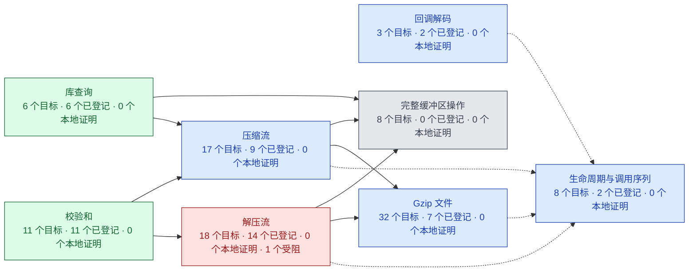
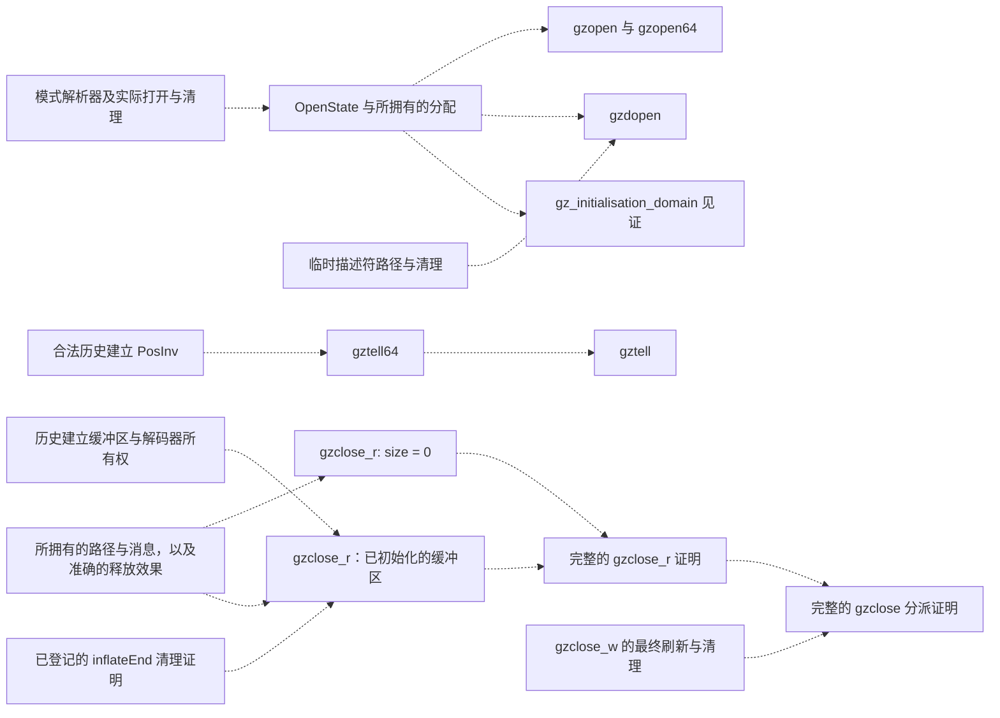
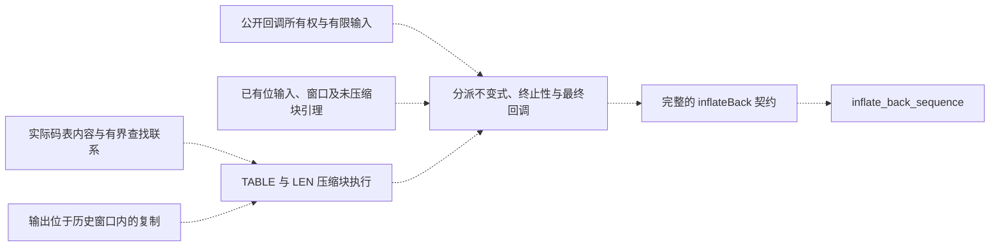

<!-- source-sha256: 01dd4453f6aff8ec0456f77af9906ed9cc7681e451c42ce9c7deb2c11555ad45 -->
# 理解并证明 zlib

先跟随一次完整任务，再逐层展开需要的机制。每章都把实际操作、例子和由此产生的证明义务放在一起讲。
页面顶部的语言菜单可在同一页切换 **简体中文／English**。

## 目录

- [阅读主线](#reading-path)
- [共用证明规则](#shared-proof-rules)
  - [范围](#scope)
  - [论证](#argument)
  - [证据](#evidence)

## 阅读主线

<a id="1-follow-a-complete-task"></a>
<a id="1-what-zlib-does"></a>
<a id="11-one-library-three-related-formats"></a>
<a id="12-repetition-becomes-a-backward-reference"></a>
<a id="13-meaning-of-compressed-bytes"></a>
<a id="13-symbols-become-bits-and-blocks"></a>
<a id="14-where-these-jobs-live-in-the-library"></a>
<a id="2-how-applications-use-the-apis"></a>
<a id="2-understand-the-encoded-bytes"></a>
<a id="21-one-decoder-two-kinds-of-lifetime"></a>
<a id="22-the-ordinary-inflate-loop"></a>
<a id="23-copies-reuse-and-borrowed-metadata"></a>
<a id="24-compression-has-its-own-completion-protocol"></a>
<a id="3-pause-and-continue-the-same-task"></a>
<a id="33-meaning-of-compressed-bytes"></a>
<a id="4-add-format-headers-and-integrity-checks"></a>
<a id="41-construct-and-interpret-decoding-tables"></a>
<a id="42-join-the-slow-and-fast-paths"></a>
<a id="43-close-the-call-and-its-history"></a>
<a id="5-reuse-branch-and-control-a-task"></a>
<a id="51-window-and-hash-chain-invariants"></a>
<a id="52-trees-symbols-and-shared-output-storage"></a>
<a id="53-publish-blocks-and-compose-calls"></a>
<a id="6-choose-an-application-interface"></a>
<a id="61-construct-and-interpret-decoding-tables"></a>
<a id="62-join-the-slow-and-fast-paths"></a>
<a id="63-close-the-call-and-its-history"></a>
<a id="71-window-and-hash-chain-invariants"></a>
<a id="72-follow-the-actual-implementation"></a>
<a id="72-trees-symbols-and-shared-output-storage"></a>
<a id="73-publish-blocks-and-compose-calls"></a>
<a id="74-locate-the-exact-evidence"></a>
<a id="proving-the-zlib-implementation"></a>

| 章节 | 通过例子理解什么 |
| --- | --- |
| [1. 一次完整任务](guide/round-trip.md) | 原始字节 → 压缩字节 → 还原字节，以及创建、处理和释放。 |
| [2. 重复、编码与数据块](guide/encoding.md) | 历史引用的重叠复制、Huffman 编码和数据块选择。 |
| [3. 流式处理](guide/streaming.md) | 缓冲区耗尽时如何保留位和历史，再准确继续。 |
| [4. 格式与完整性检查](guide/wrappers.md) | 共用的 DEFLATE 主体、包装条件和尾部校验。 |
| [5. 状态操作](guide/state-operations.md) | 用 Reset 开始新任务，用 Copy 保存检查点，以及字典和刷新。 |
| [6. 应用接口](guide/interfaces.md) | 整块缓冲区、回调、gzip 文件与逻辑位置跳转（Seek）。 |

需要精确条件或 C 层面的论证时，再沿章内链接下钻。
[规范](spec/README.md)定义必须满足的行为；[实现证明参考](proof/README.md)按 C 组件给出技术推导。
它们与图解例子回答不同的问题。审阅记录收在“检查与验收”下，不放进入门阅读主线。

## 共用证明规则

<a id="1-what-must-be-proved"></a>
<a id="3-what-must-be-proved-and-why"></a>
<a id="7-how-the-arguments-become-checked-claims"></a>

### 范围

<a id="11-the-implementation-and-configurations"></a>
<a id="12-safety-of-calls-and-lifetimes"></a>
<a id="2-assumptions-and-model-boundaries"></a>
<a id="21-platform-assumptions"></a>
<a id="22-caller-and-external-world-obligations"></a>
<a id="23-what-the-kernel-trusts"></a>
<a id="25-configuration-and-calling-protocol-are-separate"></a>
<a id="31-the-implementation-and-configurations"></a>
<a id="32-safety-of-calls-and-lifetimes"></a>
<a id="4-assumptions-and-model-boundaries"></a>
<a id="41-platform-assumptions"></a>
<a id="42-caller-and-external-world-obligations"></a>
<a id="43-what-the-kernel-trusts"></a>
<a id="71-scope-and-assumptions"></a>

起点是默认 x86_64 Linux 构建与默认输入。更广的嵌套范围统一定义在[输入配置](spec/input-configurations.md)。
例子选择具体运行，不会缩小公开目标的定义域。接受的[平台前提](spec/platform.md)包括：每个被表示的字节对象少于 `2^63` 字节；这不限制整个流的总长度。
[安全规范](spec/safety.md)统一规定 UB、帧性质、终止和资源义务。
[可信基础](trusted-base.md)与[偏离记录](deviations.md)统一记录模型限制。

### 论证

这里的“不变量”是每次继续调用前都必须成立的一组状态事实。例如，解压器保存的历史范围必须与已经恢复的字节一致，窗口指针也必须仍指向有效存储。初始化先建立这些事实；后续调用使用它们并重新建立它们；结束调用再释放相应资源。

<a id="3-how-the-proof-is-built"></a>
<a id="31-translate-the-actual-c-execution"></a>
<a id="32-establish-an-invariant-by-initialization"></a>
<a id="33-preserve-it-through-calls"></a>
<a id="34-relate-executions-to-byte-meaning"></a>
<a id="4-the-inflate-argument"></a>
<a id="5-how-the-proof-is-built"></a>
<a id="5-the-deflate-argument"></a>
<a id="51-translate-the-actual-c-execution"></a>
<a id="52-establish-an-invariant-by-initialization"></a>
<a id="53-preserve-it-through-calls"></a>
<a id="54-relate-executions-to-byte-meaning"></a>
<a id="6-the-inflate-argument"></a>
<a id="7-the-deflate-argument"></a>
<a id="73-establish-preserve-and-compose"></a>

对象是固定版本的 C 加上已登记补丁，并逐语句翻译。各章按执行步骤说明算法事实、表示不变量和相应证明义务。
初始化必须建立状态不变量与所有权。每次实际调用都要推出辅助函数的前提，并在返回的堆上保持所需性质；End 要交代资源释放。
被调用函数的契约必须是关于该函数的已证明定理。顶层定义域还需要具体见证。

[共用证明方法](proof/method.md)对合法调用历史做归纳，把这些步骤连接起来，并将实际字节与独立格式含义对应。
各章只在相关例子处解释该机制特有的不变量。

### 证据

<a id="6-reading-a-formal-result"></a>
<a id="61-find-its-exact-statement"></a>
<a id="62-follow-its-proof-and-evidence"></a>
<a id="8-reading-a-formal-result"></a>
<a id="81-find-its-exact-statement"></a>
<a id="82-follow-its-proof-and-evidence"></a>

检查精确命题、调用者定义域与返回状态。局部分支引理或无堆模型定理不能独自证明整个公开 API。
早期的 `C1`–`C7` 标签指向 [API 模型目标](../ZlibF/Spec/Api/Goals.lean)；具体执行仍需自己的细化论证。
有限差分运行只能核对例子，不能证明全称命题。[检查指南](checking/README.md)定义指定提交上的验收要求。
[进度页](progress.md)记录目标依赖图。下文的状态部分记录当前证据与剩余工作。

---

## 项目状态与剩余工作

[文档](README.md) · [API](spec/api/README.md) · [检查](checking/README.md)

**工作进行中。完整的 zlib 验证尚未完成。**
这是当前状态与剩余工作的唯一页面。
首要目标是默认 LP64 Linux 静态构建，使用默认分配器。
其他上游配置仍为目标。编译器/操作系统正确性和性能
不在证明范围内。

## 默认 inflate 调用历史扩展（本地）

选定的默认控制历史由实际初始化、更换缓冲区、inflate、重置、位预置、校验开关、头部拒绝和 undermine 调用推出强解码器不变式。下一次调用的完整公开内存契约使用这个推导结果。这仍是公开合法历史的真子集。

字典设置和提取、同步点查询、mark 及表使用量查询均保持完整不变式。字典设置包含空指针和状态拒绝、校验和错误及窗口分配失败；提取支持所有公开可写调用者字节视图。五个新增模块已导入证明索引，整库 1768 任务和零占位证明检查在本地通过，独立源码审查通过。完整集成审计记录如下，最终 CI 验收仍待完成。

扩展历史现在支持十三类选定操作任意交错，包括字典和全部只读查询，以及合法更换缓冲区。历史归纳建立 J 和默认分配器，将每条边嵌入原有公开可达关系，并给出下一次调用的完整内存契约。具体执行见证采用已有非法头部案例，不声称成功解压。范围仍为明确的默认配置，不含同步恢复和复制。扩展整库 1771 任务及零占位证明检查通过，三个组合模块独立源码审查通过。与最新 main 及已独立审查的常用级别 NO_FLUSH 和拒绝扩展组合后，1810 任务库构建及零占位证明检查通过。正常完整声明审计和全新内核重放在本地通过：37,312 个声明、406 条登记及 181 个固定目标中的 81 个。独立生成锁审查确认新增 59 条语义记录，旧记录没有改动或删除，登记陈述不变，417 个受管源码哈希全部匹配。双语站的 4046 页及三十项源码测试通过。这些是本地检查，不是最终远端 CI 验收。Linux 原生审计程序的解释器支持配置错误正由独立审查修复。

剩余工作是保持同步恢复与复制所需的历史事实，并把实际输出连接到独立格式规范。同步恢复需要默认头部标志的来源，即使处于错误或同步模式；复制需要已安装表指针的来源。这些事实必须由历史推出，不能作为公开调用者的新义务。完整公开 inflate 目标仍未完成。

### 默认恢复与复制的字段来源（本地）

加强的内部状态记录默认头部标志和已安装表指针的来源。实际默认初始化建立
这些事实。重置、prime、校验、头部拒绝、undermine 和字典操作保持它们。
实际成功的 copy 对原流和新流均保持加强状态，包括动态指针重定位与成对固定表。
两次分配成功由实际 MEM_ERROR 分支导出。独立源码审查通过。

实际 Sync 的恢复前缀用 J 中的值界证明保留字完全排空。实际局部分配提供四字节
临时缓冲区条件。实际成功的搜索不改变堆；完整 Sync 观察证明覆盖早期缓冲区拒绝、
首次恢复、继续搜索、两种尾部结果和最终局部释放，并保持加强状态与默认分配器。
其前提是公开可达关系已经记录的实际无故障运行，没有新增原始字节视图限制。
这不是 Sync 总终止性或独立模式语义的证明。独立源码审查通过；所有模块已导入。
完整库本地构建以 1782 个作业通过，证明占位符为零。下文的整合审计已包含本批；
指定提交上的最终 CI 验收仍未完成。

后续批次已证明真实 inflate 调用及所选历史保持这些来源事实，包括 Sync 和成功
复制的目标流。其公开资源闭合结果见下一节。独立的序列格式细化仍未完成。
公开 inflate 目标尚未完成或新增登记。

### 默认历史的资源闭合（本地）

真实初始化后的 DefaultOriginHistory 现为其十三种普通操作及 Sync 推导解码器
不变式和分配器。每次后续调用产生真实执行、下一条历史、流不变式，以及公共
规格要求的精确 BufferFrame 和 LiveChange。GetDictionary 保留原范围前提。
SetDictionary 包含拒绝、校验失败和分配失败；inflate 保留原有窗口所有权。

End 恰好释放原有对象。Copy 保留完整原资源结论，包括两处分配失败，并为成功
目标建立历史。Copy 的每种返回也都保持源流历史：实际后堆满足源流原有的 Rebuffer
关系。该关系由真实资源结论及对象唯一性推导，不要求调用方提供。非法 Reset2
在原堆返回错误并保持历史。真实初始化见证说明定义域非空。

十四个规范化模块逐个通过内核编译，完整的 2045 项库构建及无占位检查也通过。
普通操作、Copy、源流继续、非法 Reset2 及最终组合均通过独立审阅。本批完整审计、
变异检查和指定提交的 CI 仍待完成。本结果限于明确列出的安全范围：合法 Reset2
取十五位，全部非法请求均已覆盖。合法非默认配置仍未证明，GetHeader 保留原参数
前提。尚未证明不受此范围限制的序列目标、payload 语义或 inflate 完成性。

源码 `01e98a91` 的正常审计及全新内核重放通过：41489 个声明、452 条登记定理、
181 个固定目标中的 90 个。独立锁审阅确认旧 9931 条语义记录和登记类型全部保留。
新增二十九项为两个已审的证明定义及二十七个安全编译辅助项。424 个策略文件哈希
全部匹配，只有 trusted 锁的哈希改变。后续 main 合并仅改变文档，所有 Lean 源码、
受保护形式化源码和登记文件的字节均与已审计源码相同。本批指定提交的 CI 验收仍待完成。

### 默认 Sync 的总性与资源（本地）

获准的 Sync 参数修正要求：next_in 为 NULL 时，avail_in 必须为零。空输入调用
及所有非 NULL 输入保留原有边界和所有权要求。没有修改翻译或运行时。

八个支持结果现已证明真实默认 Sync 的总返回性、状态来源与分配器保持、返回码，
以及原公共 BufferFrame 和 LiveChange。历史包装器从真实初始化和先前调用推导
入口不变式，并产生下一条历史，不假设搜索成功、分配成功或被调用函数的执行。
原公共 Sync 目标在其他配置下仍未完成。

与 main `737a037` 整合的源码 `4c3e3d5` 通过完整 2031 项构建、全新内核重放及
正常审计：41277 个声明、452 条登记定理、181 个固定目标中的 90 个。独立源码
及生成锁审阅通过。三条旧语义记录的变化为获准参数谓词及其生成的分支辅助项。
三个新增安全 splitter 别名已与既有定义核对。其余旧记录和登记类型不变。
本批没有新增登记目标。指定提交的 CI 仍待完成。

### 普通解码器的字段来源（本地）

实际成功运行的观察证明现已覆盖快慢解码路径、存储块复制、尾部校验和终止分派，
证明头部标志与两个表指针不变。块头解析也有源码级观察：或者保留两个指针，
或者安装成对固定表；标志不变。这些结论与现有实际运行的 J 结果组合，不假定
被调用函数契约，也不独自证明总终止性。

十二个辅助模块已全部导入。完整库本地构建以 1794 个作业通过，证明占位符为零。
本批独立源码审查通过，下文的整合审计已包含本批；最终 CI 验收仍未完成。

后续来源构造批已覆盖实际 HEAD、字典解析、两个动态构造器及其实际后续路径。
每个实际默认模式分派现在均保持加强状态。完整实际模式循环也保持该状态，以原有
有界秩证明终止，并保留精确输入输出游标计数。没有新增被调用函数契约或调用方
限制。后续七个模块已全部导入；完整库本地构建以 1801 个作业通过，证明占位符为零。
后续批的独立源码审查通过，下文的整合审计已包含本批；最终 CI 验收仍未完成。

完整实际公开调用现已跨入口、模式循环、所有返回分支、实际窗口分配失败和局部清理
保持加强状态。同一次实际返回还满足完整标量、输出观察、精确调用方内存框架与分配契约。

所选默认历史现已包括全部十四种流操作、合法缓冲区替换和成功 copy 的目标流，
并允许任意交错。初始化和 reset2 选择十五位窗口。历史归纳导出两个来源事实、J 和
默认分配器，并将每步嵌入未更改的原公开可达关系。下一次调用的内存契约不再向调用方
索要不变式。真实初始化与现有畸形头部调用是具体见证；该见证不声称成功解压。
后续八个模块已全部导入，完整库本地构建以 1809 个作业通过，证明占位符为零。
最终历史批的独立源码审查通过。

整合源码的完整库本地构建以 1848 个作业通过。冻结源码 `249c34e` 的正常再生成
包含全新内核重放，覆盖 37,707 个声明、406 条登记定理和 181 个固定目标中的 81 个。
自动生成锁已通过独立审查：9,184 条旧语义记录没有改动，新增 81 条辅助记录，
422 个受管文件哈希全部匹配；陈述、登记和辅助例外不变。双语站的 4,122 页、
三十项源码测试与二十项教学模型测试通过。十三个原始审计器对照均通过；九项构建传输
测试和七项原生/解释器公开证明重放测试在普通和优化模式均通过。
`20f9f41b` 的完整托管构建、无占位符、审计与差分门禁均通过
（[CI 运行](https://github.com/cla7aye15I4nd/zlib-f/actions/runs/42543153993)）。
这验收的是已检查源码快照，尚未登记宽泛的公开 inflate 目标。

剩余：独立序列格式细化、更宽的初始化配置和后续格式批次的验收。
宽泛的公开 inflate 目标保持不变；这些辅助结果没有登记该目标。

后续本地语义批把实际 CODES 表构造连接到独立 Huffman 解码器。平坦根表查询的
符号和消费长度已在两个方向建立，包括以数学补零处理短前缀；补零不贡献消费位。
实际构造器保留原有安全性与内存框架结果，覆盖拒绝和空字母表；空表只有无效单元。
这一辅助模块已导入。完整库本地构建以 1849 个作业通过，证明占位符为零。
独立源码审查通过；下文正常整合审计已覆盖本批，托管 CI 仍未完成；尚未完成整个 CODELENS 读取循环
或序列格式证明。

后续表状态批让上述含义持久保存。CodeLengthMeaning 是具体表内容与独立字母表的
性质；DefaultCodeLengthState 向 K 加入受 CODELENS 模式保护的这一分量。实际初始化
建立它并给出具体见证。真实 LENLENS 读取循环、补零循环、构造器和字段写入在实际
CODELENS 后续入口建立它。实际 clRead 循环即使覆盖 lens，也保留原字母表见证，
包括等待和 BAD 结果。这不是被调用函数契约或新增公开调用方前提。
五个辅助模块已全部导入；完整库本地构建以 1854 个作业通过，证明占位符为零。
独立语义/源码审查通过；下文整合审计已覆盖本批，托管 CI 仍未完成。解出的长度序列与完整模式循环
尚需连接到独立流格式含义。


后续实际查表批保留 CODES 表内容的完整源码分类。可接受的非空字母表使根表全部
成为普通叶单元。空字母表恰好生成两个操作码为 64、位宽为一、值为零的单元。
实际 CODELENS 循环不检查操作码而直接读取值；证明没有将其改成立即拒绝。

实际终止的查表现在保留精确选中单元。对于普通单元，原始位流的独立解码返回
该符号和精确消费长度，包括缓存位少于根表宽度的情况。规范缓存字的补零引理
保证不消费人工补位。无效单元分支保留空字母表的精确字段。四个新增模块已全部
导入，完整库本地构建以 1858 个作业通过，证明占位符为零；新增定理只用允许的公理。
独立源码审查通过，已有构表与查表变异对照通过。下文整合审计已覆盖本批；完整
托管验收仍未完成。码长重复与完整格式关系仍需证明。


加强后的内容现有独立且受模式保护的显式状态分量。实际默认初始化建立它，合法
缓冲区替换保留它，完整真实 clRead 调用在覆盖 lens 时仍保持它。实际初始化还提供
具体见证。逐字源码切分隔离真实 LENLENS 构造器及结果写入，同时保留错误与成功
后续。成功时，在实际 CODELENS 后续入口给出精确表内容；没有把表契约作为传入假设。
两个模块已全部导入，完整库本地构建以 1860 个作业通过。这两个模块的独立审查通过；
下文整合审计已覆盖这两模块，完整验收仍未完成。完整头部到状态的合成及解析长度序列的关系还需证明；
这些表结果不建立端到端格式正确性。


进一步的本地字面码长单步结果把实际成功查表、真实 CODELENS 丢位与存储连接起来。
它证明已初始化的长度前缀恰好追加解出的符号，剩余真实位流正是独立解码器的余流。
源码切口前提是内部实际执行等式，并非被调用函数规格。普通单元分支是条件结论；
它没有排除独立的空字母表行为，也未声称重复符号语义。模块已导入，完整库本地
构建以 1861 个作业通过，独立审查通过。同步全部源码切分后，直接写错字面码长的
变异在实际字面执行证明处失败；恢复后的正例证明通过。完整验收仍未完成。


冻结形式源码 `e4ab8659` 的正常再生成包含全新内核重放并通过：37,848 个声明、
406 条登记定理和 181 个固定目标中的 81 个。独立锁审查确认 9,265 条旧语义记录
没有改动，新增 29 条对应已审查的内容/状态结构、实际构造器切分和既有形状的编译器
辅助项。422 个策略哈希全部匹配；已登记陈述与辅助例外没有改动。最终双语站检查
通过，覆盖 4,164 页和 33 项源码测试。这些是本地检查，并非公开 inflate 的完整托管验收。


下一本地重复码长批保留符号 16/17/18 的精确额外位值。真实上一长度准备步骤
读取 lens 中的前一单元，两位额外位决定精确重复次数。零重复准备步骤也保留精确
基数加偏移次数和剩余真实位流。实际后减存储循环恰好追加相应数量的 UInt16 值，
包括最后从零减到 UINT_MAX；允许的越界检查分支进入同一个真实循环。具体前缀视图
给出精确的最后一个值；该视图本身不声称任意单元已初始化。
三个模块已全部导入，完整库本地构建以 1864 个作业通过，独立源码审查通过。
本后续批的完整审计、变异检查和 CI 仍未完成。还需把分支合成完整解析器，并连接头部计数
及空表路径的最终行为。


后续八模块批把真实重复码长分支连接到独立 CodeLens 构造规则。正常结果从实际检查
导出前缀非空及重复范围合法，不把它们作为假设。实际查表给出解码符号，四种继续
分支都建立仅由独立 CodeLens 后续完成关系表达的部分解析关系。循环完成时，实际
计数给出 CodeLens.done 见证；因此该关系给出完整推导，并非假设被调用程序规格。

对于构造器的普通根表分支，完整真实 clRead 循环会终止，并保留原安全性、内存框架
及游标结果。正常且非 BAD 完成时，同一次实际返回的精确前缀和剩余真实位流满足
独立 CodeLens 含义。错误与等待仍保留为真实结果，但本完成定理不对它们声称完成
解析。异常空表没有从公开域中排除，其单独语义仍未完成。八个模块全部导入，完整库
本地构建以 1872 个作业通过，证明占位符为零，独立源码审查通过。本后续批的完整
审计/CI 仍未完成。下文的等待扩展保留更强的消费前缀关系；空表最终拒绝、头部计数/
字母表合成及完整流格式细化仍需证明。


后续七模块批只记录实际消费的位，并证明其独立含义对任意未来后缀成立。四个真实
长度分支建立这一因果轨迹。等待保留真实位流：NEEDBITS 在任何 DROPBITS 前检查
完整码字加额外位的宽度。因此完整普通根表 clRead 循环在正常完成和等待时都保留
该轨迹，最终结果在同一次实际调用上合并原安全性/内存框架/游标定理与独立的完成
CodeLens 关系。消去共同的未读字节后缀，还得到旧缓存位加实际取入字节、已消费
码位及返回缓存位之间的精确账本，没有要求调用方保留旧未读缓冲区。

七个模块全部导入，完整库本地构建以 1879 个作业通过，证明占位符为零，独立源码
审查通过。直接交换额外位奇偶对应关系的变异保留完整旧安全证明和同步后的源码
切分；同步后的新执行等式也独立通过。变异随后在精确额外位值关系处失败，恢复后
的因果解析器正例通过。这个更强控制的独立复核通过。早期控制停在执行等式处，
不足以证明它能检查位值含义，因此已被替换。

最终候选 `7a5e77b` 的正常再生成和全新内核重放通过：37,998 个声明、406 个登记
定理、181 个固定目标中的 81 个。生成锁独立复核确认旧 9,294 条语义记录不变，
新增四条已审记录，423 个受管源码哈希全部匹配。登记陈述和辅助项豁免不变。合并提交 `900015b8` 的十六项 CI
全部通过，包含本批重复码长及因果轨迹。公开 LOAD/RESTORE/换缓冲区合成、独立空表路径、
头部到字母表/计数的含义及完整流格式细化仍未完成。公开目标和调用方域保持不变。

提交 `940e95e4` 的全部十六项远端 CI 通过，包括构建、零占位符、审计、全部审计器
自测与变异分片以及差分检查。该提交包含前一批实际安装表与查表语义，尚不包含
本批重复码长和因果轨迹工作，也不代表完整公共 inflate 或序列格式目标已完成。

### 空根表与普通码长根表（本地）

真实空根表包含两个值为零的单元。完整读取循环只追加零并保留零前缀；正常完成时
计数到达真实界限。当前缀包含索引 256，实际尾部在构建负载表前报告缺少结束码并
进入 BAD。实际计数字段表达式给出 nlen 至少为 257、ndist 至少为一；成功构表记录
把 have 设为零，因此初始前缀为空。

构表产生的内容分类现在在同一次实际运行上覆盖两种读取情况。普通表的正常完成
保留因果轨迹和独立 CodeLens 推导；空表完成保留供结束码检查使用的零码长。空前缀
是明确的数据事实，由 have 为零建立，没有假设任意恢复状态自动满足它。真实构表
前缀还在实际 CODELENS 续接处建立 CodeLengthInvariant、精确表内容及空前缀。头部
检查产生的上界仍是明确的内部前提；这尚未建立完整头部解析关系。

两个模块均已导入。完整库本地构建以 1881 个作业通过，证明占位符为零，独立源码
审查通过。形式源码 `3d1c97c` 的正常再生成和全新内核重放通过：38,023 个声明、
406 个登记定理、181 个固定目标中的 81 个。构建日志中的九个具名端点只打印允许的
公理；审计报告记录整体结果。独立复核确认旧 9,298 条 trusted 记录及登记陈述不变，
423 个受管源码哈希全部匹配。与后续已审 CI 调度改动整合后，Lean 源码与登记文件
逐字不变。合并提交 `a5d53005` 的全部二十项 CI 通过，包含八个差分框架分片。
这次完整工作流含排队耗时 25 分 54 秒。头部的独立字母表/计数含义、公开
LOAD/RESTORE/换缓冲区与历史合成、完整流格式细化仍未完成。公开目标、规格、翻译
和运行时均未修改。

### 动态头部字段与字母表（本地）

实际 TABLE 位字现在给出独立的五位、五位和四位读取，三次计数加法均不回绕。
真实有效性检查给出 DynamicCountsOK，同时保留等待、实际 BAD 结果及 LENLENS 续接。

实际码长排列与独立 clOrder 在全部十九个符号上互逆。精确数组单元引理把 lensRead、
lensZero 接到 readCodeLenLens，不依赖未使用的旧单元。首次进入 LENLENS 时，have 为
零且当前位足够，真实两个循环在实际 llTail 续接处给出同一个独立字母表及剩余位流，
并保留已初始化数组、形状与 BitInv。这是内部完整前缀分支；分多次调用读取头部以及
组合完整动态块仍未完成。

三个模块均已导入，无堆的数组和位数学位于 Math。完整库本地构建以 1884 个作业通过，
证明占位符为零，十四个具名结果的独立源码审查通过。一个仍保持合法排列的错误顺序
变异保留完整旧 LENLENS 安全证明及源码等式，但在新的独立顺序关系处失败；恢复后
的正例通过，变异控制的独立复核通过。冻结源码 `0b26ede` 的正常再生成与全新内核
重放通过：38,082 个声明、406 个登记定理、181 个固定目标中的 81 个。生成锁独立
复核确认旧 9,298 条语义记录不变，新增三个私有读取器 splitter，其类型和内容哈希
均与既有对应项相同；424 个受管源码哈希全部匹配。登记陈述与辅助项豁免不变。本批
合并提交 `1bd0409` 的二十项 CI 作业全部通过；这验收了辅助结果，未证明完整公开
格式目标。公开目标与调用方域未变。

### 流式动态头部阶段（本地）

显式阶段位串记录已经读取的字段和当前保留位。实际码长读取循环只追加本次真正
拉取的字节；未读缓冲区后缀从账本中消去。它包括已有非空字段前缀的续读和零读取
等待。实际补零循环对每个未来后缀给出独立的十九符号字母表；补零时暂时得到的
have=19 不会被当成收到了十九个字段。

实际 LOAD、RESTORE、合法换缓冲区以及完整退出路径均保留这条关系，包含窗口
分配失败。对当前位数不足以补完字段的公开 LENLENS 调用，真实调度、退出和临时
内存释放也保留它。输入视图从公开缓冲区条件导出。入口拒绝不追加字节；接受后
等待会追加完整输入视图。阶段位串是显式历史索引，不是在最终状态上事后选取。

八个新模块的目标构建通过，共 934 个作业，仅依赖允许的公理；完整库构建通过，
共 1892 个作业，证明占位符为零。八个模块及从缓冲区导出的公开包装引理均通过
独立源码审查。与冻结的通用等级历史批次整合后，1923 个作业的构建也通过，证明占位符为零。
冻结源码 `36d29a0` 的完整正常审计与全新内核重放通过：38,301 个声明、406 个登记
定理、181 个固定目标中的 81 个。已有错误排列控制在变异下保留早期安全证明，并
在独立顺序关系处拒绝；基线和恢复后的正例均通过。生成锁独立复核通过：旧 9,301
条语义记录完全不变，新增四十条对应已审定义及生成辅助项；424 个受管源码哈希
全部匹配，登记陈述与辅助项豁免不变。双语站点检查通过，共 4288 页及 34 项源码
测试。合并提交 `d72e1193` 的二十项 CI 作业全部通过，验收了该辅助批次。
这些是阶段条件引理：仍需在 TABLE 阶段
建立索引，把完整 LENLENS 接到 CODELENS，并完成负载、包装器和完整历史的格式
论证。完整 Goal.inflate 仍未证明。

### 实际等待历史与构造器入口（本地）

头部位串现在连接原有公开 DataStep 观察。新的同次运行结果给出等待调用的精确
输入计数器平衡及不变的输出容量，从实际返回流确定观察到的消耗数，并从真实
字节观察推出输出为空。入口拒绝与真实窗口分配失败均包括在内。

对有限的等待／换缓冲区片段归纳，可保留 J、分配器及累计位串。构造器只记录实际
DataStep、源码记录读取和位数不足的分支条件，不含所需不变式或格式结论。每次
调用方编辑都显式保留已接受的单字节对象平台界限。have 为零只给出来自已保存
保留位的条件式初值；实际进入 TABLE／LENLENS 相位仍需独立的执行来源。

真实 TABLE 前缀在其 LENLENS 切点建立 have=0 和初始位串，保留等待和 BAD 分支。
进一步的有效前缀结果暴露精确 tableCounts 状态、输入关系以及同一切点的独立
五／五／四位计数来源。完整续读的 LENLENS 前缀对任意未来后缀在真实 llTail
构造器切点给出独立字母表，并已与有限的实际等待历史组合，支持初始已有非空
字段前缀。初始进度关系须由实际相位入口执行建立，不能仅凭 have=0 判断入口。
TABLE 计数来源、首次公开 leave／保存边界、构造器后续和完整初始化格式历史仍
需组合。完整 Goal.inflate 保持开放。

实际观察历史的目标构建以 943 个作业通过；组合构造器结果也通过，仅依赖允许
公理。完整库构建以 1931 个作业通过，证明占位符为零。八个模块的独立源码审查
全部通过，包括一般初始前缀组合与精确计数来源。冻结源码 `784f5bf` 及其文档布局
整合 `02d27fc0` 均通过完整正常审计和全新内核重放：38,374 个声明、406 个登记
定理、181 个固定目标中的 81 个。生成锁独立复核确认旧 9,341 条语义记录不变，
新增二十五条对应已审历史和生成辅助项；两项私有 splitter 另有与旧锁对应项的内核
定义相等检查。424 个受管源码哈希全部匹配。主线网站迁移只改三个既有布局哈希，
其策略锁再生成也通过独立复核，形式源码不变。登记陈述、辅助项豁免和运行时未变。

定向错误排列控制以实际观察历史到构造器的组合为检查顶点。变异下完整早期
LENLENS 安全证明仍通过，但独立顺序关系拒绝该变异；基线和恢复后的正例通过。
外部适配器独立审查通过。这验证组合对顺序含义的依赖，未直接逐项变异每条新历史
定理。整合站点通过 4308 页、36 项源码测试和 41 项交互测试。PR #129 合入的
提交 `aaeb3fc5` 已通过全部二十项 CI 作业，验收范围是这一辅助头部阶段批次。
从初始化开始的完整格式与调用序列证明仍未完成。

### 原始计数与真实阶段的建立（本地）

三个 TABLE 计数现已贯穿真实等待分派、完整 leave、公开调用临时缓冲区清理和
原始 DataStep 观测。对真实等待／换缓冲区历史归纳，可保留起始状态的 ncode、
nlen 和 ndist；完成字母表读取时使用的因而是最初计数。

从 TABLE 开始的已接受公开调用现可建立存储后的阶段关系。真实十四位读取给出
独立的五／五／四位计数来源，同一次分派继续经过 LENLENS 输入耗尽与完整 leave；
公开调用的分配和释放保留该关系，并释放临时块。这个建立步骤不要求入口已有
LenlensProgress；它保留显式接收位串，不声称位串一定非空。

建立步骤可接到后续真实等待／换缓冲区调用和完成 LENLENS 的读取，在真实 llTail
切分处得到独立解析的字母表与原 TABLE 计数。已接受入口的指针条件，以及正常、
计数合法、位数不足三个分支条件仍显式保留。它不覆盖被拒入口的格式路径，也
没有证明从初始化进入 TABLE。

七个模块均通过独立源码审阅，十二条定理的陈述和正文与已审原型逐字一致。整库
1938 项构建通过，已查询端点仅使用三个允许公理。冻结源码 `70c6d09` 的完整审计
与 fresh kernel 检查通过：38435 个声明、406 条登记定理、181 个固定目标中 81 个
已登记。独立生成锁审阅确认旧 9366 条记录完全未变，新增 24 条为已审编译 match
及 private splitter 辅助定义；其中十二项与旧锁哈希相同，另四项通过内核定义等价
检查。424 个受管哈希全部匹配，只有 trusted 锁哈希变化。错误排列依赖控制的基线
和恢复正例均通过；变异下旧安全性仍通过，独立排列含义准确拒绝它。这是依赖
控制，不是逐条新历史定理的直接变异。PR #133 合并提交 `39823d6d` 的二十项 CI
及原生审计全部通过，验收了本辅助批次。初始化入口、
构造器后续、数据／窗口／封装的组合及完整序列证明仍未完成。

### Inflate 完成性与字典握手

完成性子句现已遵循字典协议。经过明确的人类授权，InflateCompletes 允许合法
zlib FDICT 流在入口尚缺字典时，真实返回 Z_NEED_DICT；后态必须满足 Good，
处于 DICT 模式、havedict 为零，并保留输出容量。入口已接受且字典已安装时，仍需返回
Z_STREAM_END 并得到原来的精确输出。这保留字典输入的覆盖范围，不表示修正后
目标已经证明。

原子句只在入口处于 DICT 模式时检查字典就绪。默认初始化的 HEAD 状态使该蕴含
自动成立，但调用随后可能读到 FDICT；它错误地要求这次调用直接完成。
具体十五字节流为：

```text
78 bb 00 00 00 01 01 00 00 ff ff 00 00 00 01
```

它请求 Adler 校验值为一的空字典，随后是空的最后一个 stored 块。独立内核检查已
证明格式关系，以及真实初始化和合法缓冲区替换后的同一具体堆满足原有全部完成性
前提。输入和输出为同一调用方对象内互不重叠的区间，输入十五字节、输出空间一
字节。翻译的执行返回 Z_NEED_DICT；固定版本 C 库在地址和未定义行为检查下也
如此，已消费六字节。安装长度为零的字典后才返回 Z_STREAM_END。

这是字典协议的规格问题，不是 zlib 错误。独立内核证明现已在同一初始化堆上
建立这个具体翻译返回等式，并通过独立源码审阅。已授权改动只修正完成性契约，C 翻译不变。
完整序列证明仍未完成；条件式头部阶段结果不依赖其完成性断言。

### Inflate 完成性与入口拒绝

明确获准的修正 `ea7dad4` 保留全部原完成性前提及 END / NEED_DICT 结果，只新增
真实 STREAM_ERROR 入口拒绝：next_out 为 NULL，或 next_in 为 NULL 且 avail_in 非零。
后置条件固定原流和解码状态记录。已接受入口仍需完成或字典结果，C 翻译不变。

空解码输出时，旧前提允许 next_out 为 NULL。独立内核反例及审阅已在合法初始化
流上确认实际拒绝，否定 `7b0f7001` 的旧目标。修正后的模块构建及独立源码审阅通过。
`ea7dad4` 上整库 1938 项构建、零占位、完整正常审计及全新内核重放通过：38435 个
声明、406 条登记定理、181 个固定目标中的 81 个。最终生成锁独审确认新增二十四项
已审辅助定义，旧语义只有 InflateCompletes 的值变化；登记陈述均不变。424 个受管
哈希全部匹配，二十三项继承文档／布局哈希与获准规格及 trusted 锁一并刷新。生成
快照保留原目标状态。双语站 4322 页及四十七项源码测试通过；PR #133 的合并提交
`39823d6d` 二十项 CI 及原生审计全部通过。已接受入口的头部证明不假设完成性，完整
序列证明仍未完成。

### 默认动态表的完整构造（本地）

实际默认构造器现已推导 LENS 的 852 项和 DISTS 的 592 项容量界。合法码长输入
排除了真实容量拒绝分支。独立 CodeLens 解析驱动真实读取循环，产生精确 lens
数组，再经过两个真实构造器进入 LEN_，建立两张表的解码不变式。没有假设被调用
函数成功返回或预先算好的输出数组。

四模块的原八十六个端点通过独立源码审阅及轻量内核检查；整库 1942 项构建及零
占位检查通过。第一次正常审计拒绝 histogramMass 的编译器生成 partial 辅助项。
现已用可执行折叠计算同一个函数，并由内核证明等价。修订 Math 模块所属全部
267 个声明已独立检查，没有 partial 或 unsafe 声明，未增加任何审计豁免。
`99c0e44` 的完整正常审计与全新内核重放通过：39022 个声明、406 条登记定理、
181 个固定目标中的 81 个。生成锁独审确认旧 9390 条语义记录与全部登记类型不变。
新增十四条为 CompleteFrontier 的十一项、全定义 histogram 折叠及两项与旧记录
相等的安全编译别名。424 个官方受管哈希全部匹配，只有 trusted 锁哈希变化。
本新批次仍待指定提交的 CI 验收。

结论停在真实 LEN_ 续接点。跨公开调用的初始化解析、payload token 消费、输出
历史与封装完成仍需集成。完整 inflate 目标仍未完成。

### 重复安装 wrapped 字典与协议修正

真实 wrapped setter 在仍处于 DICT 时可以再次成功，并向保存窗口追加内容。
InflateDataTrace 却覆盖字典列表并保留 singleDictionary。头文件要求 setter
紧接 NEED_DICT 调用，模型历史没有编码该时序条件。把每个这样的物理窗口直接
等同于最后字典的 ghost 过强；现有物理历史 producer 已记录真实追加。内核反例
也已否定原完成历史的格式正确性子句：真实初始化、NEED_DICT 和两次成功安装 A
形成物理历史 AA；实际公开解码器使用距离二完成并输出 AAA。模型却只记录 A，
独立格式拒绝该距离。最终组合独审和另一次内核复核通过。这是历史协议的规格
错误，没有确认 zlib 缺陷。

明确获准的修正 `20243f2` 保留原执行历史及安全范围，格式和完成性现使用带待处理
NEED_DICT 请求的协议历史，成功安装一次 wrapped 字典即消耗请求。失败重试与
raw 字典调用仍分别覆盖。真实初始化、请求、安装字典和成功 END 的正例已在
精确协议下通过内核检查。两个擦除定理、全部 raw 历史保留及真实失败 setter
准入均在 Proof 模块中通过内核检查。独审确认原安全及执行历史逐字不变，只替换
两处功能历史前提。

基于 main `de1ce818` 的集成源码 `17c933b` 通过正常 1996 项构建、全新内核重放、
零占位及完整审计：39585 个声明、442 条登记定理、181 个固定目标中的 81 个。
最终锁独审确认旧 9515 条语义记录全部保留，只改变两项获准目标的值，类型不变。
新增三十项为先前已审的十四项记录、十五项协议历史声明及其准入谓词。登记类型、
登记表与辅助项豁免不变。424 个官方策略哈希匹配，只改变 Sequences 与 trusted
锁的哈希。官方进度生成检查通过；双语站通过 4438 页及四十七项源码测试。指定
提交的 CI 验收已在合并后的 main `58de47f4` 上通过：二十项 Lean 作业、native
工作流及站点工作流全部成功。不声称已经证明原来的假陈述或修正后的完整 inflate 目标。

### 精确的默认历史 inflate 契约（本地）

已检查的公开定理保留完整原 Goal.inflate 陈述，只把 StreamReachable 换成明确的
DefaultOriginHistory 定义域。原调用方前提、所有有符号 flush、返回值、计数、输出、
内存帧及分配结论全部不变。证明从真实初始化和历史推导强状态不变式；真实 init、
合法 rebuffer 及实际调用见证满足全部原有前提。

独立源码及精确类型审阅通过。窗口历史和公开契约合计十八个模块，在集成 main
`3cd9a22f` 的源码 `18c8673d` 上通过完整 2063 项构建、全新内核重放及正常审计：
42500 个声明、452 条登记定理、181 个固定目标中的 90 个。独立锁审查确认旧
9960 条语义记录和全部登记类型不变；191 项新增均映射到证明声明及安全的编译器
辅助项。424 个受管理策略文件均匹配。本结果限于默认历史，不是未限制的原目标。
完整序列格式正确性、完成性和变异检查仍待完成。集成后的源码快照已在 main
`4d033f41` 上通过全部二十项 Lean CI 作业、native 工作流及站点工作流
（[Lean CI](https://github.com/cla7aye15I4nd/zlib-f/actions/runs/42696480237)）。
这接受该源码快照，不登记完整公开目标。

### 默认协议下的窗口历史（本地）

在获准的字典协议下，真实默认初始化、数据调用、更换缓冲区和字典安装现已建立
精确物理历史。它等于逻辑字典后接实际输出。每个活跃窗口恰为该历史的保留后缀。
证明包含字典失败、请求字典、入口拒绝、畸形输入和分配失败，不预设解码器不变式、
被调用函数的契约或所需输出。

对象大小的平台前提显式要求在初始化及每次调用方更换缓冲区时成立。
仅有协议准入谓词不足以取得这条受平台约束的轨迹。reset、copy 和恢复历史另行处理。

十七个集成证明模块逐个通过内核编译及独立源码审阅，包括最终公开步骤接口。
该接口产生真实公开调用、计数、输出字节、内存帧和分配事实，并同时产生下一条
受平台约束的协议历史。上述十八模块的完整审计包含这些模块，无占位检查也通过。
同一 main `4d033f41` 的 CI 验收包含这些模块；新顶层登记所需的变异检查仍待完成。
独立 payload 解码，以及
完整 inflate 格式正确性和完成性仍未证明。

### 快速解码语义基础（本地）

二十四个证明模块把真实 root/link 快速解码查询连接到独立符号、额外位及复制输出。
通用字节视图保留同一分配中的分离调用方区域。独立查询桥只有一份定义。
命名空间分片保留原证明陈述及正文，私有辅助项的复制保留原文和私有范围。

独立源码审阅及定向内核检查通过。集成 main `4d033f41` 的源码 `07bd5349` 通过
完整 2087 项库构建、无占位检查、全新内核重放及正常审计：43001 个声明、452 条
登记定理、181 个固定目标中的 90 个。独立锁审查确认旧 10151 条语义记录及全部
登记类型不变；新增十九项安全的证明定义及编译器辅助项。424 个策略文件均匹配。
本批尚未包含后续游标、完整循环或公开被调用函数的组合。
变异检查及指定提交的 CI 尚待完成。
完整序列格式正确性及完成性仍未证明。

### 实际配置的字典窗口（已授权修正）

此前成功规格按 zlib 头部声明的窗口裁剪预置字典。默认初始化在头部声明较小窗口
时仍保留实际配置的 32768 字节窗口。默认构建未定义 INFLATE_STRICT。

取 512 个值为 65 的字节作为字典，输入 `083c4a9e820103060000018900c4` 声明
256 字节窗口，首个指令却从距离 257 复制三字节。固定版本 C 请求字典、接受安装，
并返回 STREAM_END，输出 `414141`。独立内核检查的格式反证排除了原 Zlib.Decodes
关系下的任何输出，因为它初始只保留 256 字节字典。原生执行和格式反证是两项
独立证据，后者本身没有证明翻译的执行。

获明确授权的修正已应用。新关系接受该完整样例的正例也已通过内核检查。
仅任意输入返回 STREAM_END 的条款选用独立的实际配置窗口接受关系。RFC 关系、合法输入前缀及完成性目标保持不变。
没有预置字典时，两种接受关系对所有 wrapper 和窗口参数严格等价；由头部选择
窗口时，也严格恢复原 zlib 关系。

正反格式证明均已导入库，并附有可复现的原生 C 样例。独立集成审阅、完整
2093 项库构建、定向内核检查及无占位检查均在本地通过。正常审计和全新内核
重放也已在源码 `4af0d513` 通过：43068 个声明、452 条登记定理、181 个固定目标
中的 90 个。生成锁独立审阅确认旧 10170 项类型和 10169 项定义体不变，唯一
变化是 Goal.inflate_sequence 中获准修改的成功关系；新增十五项安全定义及辅助项。
452 个登记类型不变，427 个策略文件均匹配。本修正的指定提交 CI 仍待完成。
完整格式正确性及公开完成性仍未证明。

### 借用的 libc 错误文本（本地）

错误文本模型现采用带有代次标识的借用只读视图，不增加分配次数或存活对象。
后续错误文本请求会使先前借用视图失效。可信基础明确列出固定语言环境、顺序
外部调用的范围，以及仍需完成的 C 对应关系。源码结构和受影响的内存框架证明
保留这些元数据，不再把错误文本当作新的分配。

集成库包含六项限定范围的默认压缩契约和真实初始化请求见证，覆盖指定默认
请求历史、继续执行和原始分配的释放。它们没有证明全部公开压缩配置或辅助
API 路径。此前登记的所有根均保留。

完整 2442 项构建、全新内核重放和正常审计已在源码 `c0ffb2b0` 通过：46126 个
声明、458 条登记定理。固定目标仍为 181 个中的 90 个。独立审查涵盖修改的
运行时、受影响的证明源码和生成锁。此前十七项登记类型只增加同一原始堆的
新增元数据保持，其余 435 项逐字不变；428 个策略输入全部匹配。无占位扫描
通过，指定提交的 CI 仍待完成。

一次本地 gzip 差分运行没有通过：实际宿主和选定的 Linux 模型写入不同的 OS
头部字节。这没有被记为 Linux 差分通过。完整外部世界对应关系以及剩余公开
解压缩、压缩和 gzip 目标仍未证明。

<!-- proof-progress:start -->
## 证明进度图

**103 个公共 API 目标。** 已注册证明：51 ·
本地已检查但未注册：0 ·
未证明且无记录阻碍项：51 ·
受阻：1。
这些是本地快照计数，而非最终验证或工作量百分比。

[打开公共 API 图和证明引用](progress.md)。
范围是公共 API 清单，包括调用序列和初始化域。
[辅助证明](progress.md#group-internal) 列出了其他 78 个审计目标
及其模块依赖关系。它们不改变公共 API 计数。
🟩 **已注册证明** · 🟦 **本地已检查，未注册** · ⬜ **未证明** · 🟥 **受阻**。
红色组包含受阻目标。其他混合组若包含
已检查结果则使用蓝色；计数显示剩余部分。其他目标的工作可以继续。
实线箭头表示从被调用入口到其调用者的调用。虚线箭头表示
证明或目标定义引用。[状态详情](progress.md#status-key)。
最终验收仍需在指定提交上完成完整审计和 CI。

### 阻碍项

| 受阻目标 | 原因和下一步 |
| --- | --- |
| [inflateInit2_](./progress.md#target-zlibf-spec-public-goal-inflateinit2) | [Inflate 初始化清理](./overview.md#inflate-initialization-cleanup) |
| [inflate_sequence](./progress.md#target-zlibf-spec-public-goal-inflate-sequence) | [完成性与字典握手](./overview.md#inflate-completion-dictionary-handshake) |



箭头聚合了实际实现调用以及证明/定义引用。
孤立节点没有显示链接；它仍然需要自己的证明。辅助函数和运行时
依赖项的详细信息见 [公共 API 证明就绪状态](./overview.md#public-api-proof-readiness)。
绿色要求组内每个
目标都有经过检查并注册的证明。就绪状态标签用于标识已审查的后续工作，但不改变证明
状态。未审查的前置条件保持显式。参见 [表示限制](./trusted-base.md)。

点击一个组以打开其规范。如果图表链接被禁用，请使用
[目标证据](progress.md#target-evidence)。 [详细图表](progress.md) 单独显示每个
公共 API 目标，并包含指向其契约、陈述和证明证据的链接。
图表链接使用固定的 GitHub 快照 `234bfef`，并在合并
和分支删除后依然有效。表格链接相对于本文档保持相对路径。
在证明更改后，使用 `python3 scripts/proof-progress.py` 刷新。
<!-- proof-progress:end -->

## 记录的检查点

清单包含 95 个默认构建 API 条目、四个生命周期目标和四个
初始化域目标。命题的存在并不等同于证明。
最新的本地声明审计识别出 78 个已注册目标，涵盖
398 个列出的定理和 20,399 个项目声明。早期的注册批次
覆盖 59 个现有的精确证明：六个查询、九个校验和条目、29 个流或
gzip 条目、两个初始化域目标和 13 个抽象模型目标。
[注册审查](checking/registration-review.md) 记录了范围和检查。
早期的格式/查询和 CRC/地址/视图注册保持完整。
审计还跟踪了 47 个内部义务，这些义务已定义但缺失
于注册表中。它们是内部目标，而非额外的公共 API。
这些是本地检查。最终验收需要在指定提交上完成完整审计和 CI。

下一个注册批次包含 33 个本地检查过的目标：31 个内部义务
以及两个后续的字典/头部模型结果。在注册前审查其精确范围和
所需的变异证据。将数学模型结果
与关于翻译后 C 代码的执行/细化声明分开。

记录的本地工作还涵盖版本/标志/错误/边界/CRC 表查询；
gzip EOF、缓冲区、偏移量和错误查询；inflate 状态、标记和预填充
查询；deflate 已用位、调优、头部和待处理查询；内部快速解码器
安全性、位源组合和令牌输出细化；以及规范码/叶/堆树前缀。
进一步的本地证明涵盖 `gzrewind`、`inflateGetHeader`、`inflateResetKeep`、
`inflateReset`、`inflateReset2`、`inflateEnd`、`inflateBackEnd`、`deflateEnd` 和
`deflateGetDictionary`、`inflateGetDictionary`、`deflateResetKeep` 和 `deflateReset`。
它们的直接源变异体使相应的函数证明失败。
`inflateInit_`、`inflateBackInit_` 以及两个相应的初始化域目标
也在 Lean 中通过检查。七个初始化变异体使其函数证明失败。
`inflateSetDictionary` 目标也在 Lean 中通过检查；七个源变异体使
其函数证明失败。
抽象模型目标 `deflate_bound_adequate` 和 `deflate_completes` 也
在 Lean 中通过检查。这些模型结果并未确立 C 翻译的细化。
抽象的 `compress_roundtrip` 和 `gz_roundtrip` 目标也在 Lean 中通过检查。
它们并未证明翻译后的缓冲区或文件操作。
抽象的 `inflate_completes` 目标也在 Lean 中通过检查，包括分配
失败。它并未确立翻译后 inflate 的细化。
抽象的 `deflate_full_flush_resync` 目标在 Lean 中通过检查。它并未确立
翻译后 deflate 的细化。
抽象的 `roundtrip` 和 `roundtrip_completes` 目标在所有
兼容的包装器下均在 Lean 中通过检查。C 实现的细化仍保持开放。
抽象的 `dict_roundtrip` 目标也在 Lean 中通过检查，包括字典
标识符不匹配。它并未确立实现细化。
抽象的 `header_roundtrip` 目标也在 Lean 中通过检查，使用 gzip 头部
前缀唯一性。实现级别的头部证明仍保持开放。
`adler32_combine` 和 `adler32_combine64` 目标也在 Lean 中通过检查；
三个负长度和入口点变异体使其函数证明失败。
`adler32` 和 `adler32_z` 更新目标在文档记录的
零长度 NULL 查询限制下在 Lean 中通过检查。五个更新和包装器变异体使其证明失败。
五个 CRC 组合和生成算子目标也在 Lean 中通过检查；每个条目一个直接
变异体使其匹配的函数证明失败。
源顺序更正和直接证明变异体伴随其所述范围。
这些结果并未完成公共 inflate/deflate 或任意调用序列
的正确性。注册、已审查的锁以及在指定提交上的验收保持
独立。构建计数不是完成百分比。

## Inflate 平台范围基础

选定的 inflate 调用目标明确假设每个存活的表示
字节对象少于 2^63 字节。这是有符号 PTRDIFF_MAX 对象
边界。它包括来自非 malloc 来源的调用方存储，并且不是总
内存或流长度限制。域变更需要语义审查。
运行时分配器和其他公共目标保持不变。

实际成功的初始化会为每个被接受的窗口参数保留此作用域。快速解码器入口从同一子句推导其输入/输出对象大小前提。它保留了现有的表、窗口和不同原始缓冲区前提。它是一个内部定理，而非公开的 inflate 定理。两个直接的源代码变异体伴随此基础。

在验收之前，审查平台作用域，仅注册已检查的结果，并通过审计重新生成语义锁。分别完成更强的流不变式、所有分发路径以及历史证明。

## 剩余工作

### 当前收口顺序

“本地精确证明”覆盖固定目标的完整陈述，与登记和命名提交上的 CI 分开。
分支辅助引理不会增加已完成目标数。默认输入范围也与全部配置范围分开。

| 工作 | 已检查的边界 | 下一条缺失结论 |
| --- | --- | --- |
| 普通默认 deflate | 初始化、请求、换缓冲区、FINISH、End 的契约及正式作用域变异检查已合入 main。 | 在调用者中复用。非默认配置、高级操作和无限制公开目标仍单独保留。 |
| 默认 inflate | 已有真实模式、字节、计数和资源结果。 | 证明每种真实分派退出都保持同一个数据阶段关系，再组合有限调用、历史保持和合法输入完成性。 |
| `compress_z`、`compress` | 真实默认初始化、调用者循环、输出计数和清理已有本地组成部分。 | 把原始仅要求 Fresh 的调用域接到压缩器表示，再接真实调用者的进展与容量论证；不能给调用者悄悄增加全局唯一性。 |
| 压缩 gzip 写入 | 实际内部初始化使用 gzip 窗口参数 31。 | 为内嵌流建立 gzip 初始化、CRC32、数据和结束契约，并处理启动下一成员的 Reset；参数 15 的 zlib 契约不能直接代替。 |
| `uncompress` 封装 | 完整单 stored 块调用已包含空输入和精确长度单元；内部 COPY 到 leave 结果支持输出偏移和剩余容量。 | 组合任意块类型和真实调用者重试；内部剩余容量结果还不是完整封装结论。 |

原 API 模型目标 `inflate_rejects_invalid` 已有精确本地证明和非空模型调用见证，
见 [InflateInvalidRejection](../ZlibF/Proof/Api/InflateInvalidRejection.lean)。
它尚未登记，也没有证明真实 C 的固定错误检测延迟。
证据表从集成后检查过的声明重新生成，不手工修改计数。

已批准的 `SameObjects` 修正逐个比较对象内容与存在性，只忽略释放后留下的空表槽。
存活对象、只读标志、静态数据与分配记账要求保持不变。
它消除了旧表形状造成的规格冲突，本身不等于初始化或缓冲封装目标已证明。

红色目标具有已记录的阻塞项，下方附有证据和下一步骤。
仅凭一次漫长的证明尝试并不能确立阻塞项。灰色目标可以开始；
其缺失的内部引理和历史不变式并未全部绘制在图中。

### 固定流帧审查

成功运行的帧投影保留了流的状态根、
分配器函数、不透明参数和保留字段。源代码检查
涵盖私有状态写入、已检查的部分流写入、类型化的字节/字/代码
存储、字面量消息和头部写入。顺序执行、两种 C 循环
形式以及两种解码器循环包装器组合了该关系。现有的字节视图
引理作为直接前提包含在内。这些是证明基础设施；
它们并未确立公开的 inflate、终止性、完整的调用者内存帧、
所有权或格式细化。应用于完整的实际被调用者以及
公开调用组合在此审查中仍保持开放。

该审查不更改任何运行时、翻译、固定的公开目标或已注册的
定理。完整的本地构建和新的内核重放通过。重新生成的
审计涵盖 21,080 个声明和 401 个列出的定理。三个辅助函数体
变异体在其对应的帧证明中直接失败；其确切的源代码
基线首先进行检查。生成的可信锁添加了四个辅助函数定义
和 29 个匹配器/拆分器声明。现有的条目、语句锁和
已注册的目标保持不变。策略锁记录了该可信哈希
和新的变异套件。CI 和独立审查仍待处理。

### Inflate 直接返回分类

字面翻译的宏、所有模式主体、完整的 switch 以及
`inflate_run` 现在具有已检查的直接退出分类。直接 API
返回恰好是 Z_NEED_DICT、Z_MEM_ERROR 或 Z_STREAM_ERROR 之一。
该证明覆盖了成功建模执行中的每个模式和上下文。
它不假设任何表示不变式、输入限制、被调用者安全
契约或终止性事实。提升的 C 计算无法伪造
独立模式控制异常。普通的 inf_leave 返回寄存器值
和故障自由性仍然是公开 inflate 的独立义务。

本地检查通过：完整的 368 作业构建、新的完整根内核重放、
声明审计（20,480 个声明和 398 个列出的定理），以及
四个实际的伪造返回变异体，并带有已检查的完整源代码基线。
重新生成的锁添加了三个谓词定义和十五个生成的或
宏声明。现有的可信条目和注册保持不变。
策略锁添加了变异体哈希并更新了可信锁哈希。
命名提交 CI 和独立审查仍保持开放。

### Deflate 完成 NULL 输出修正

早期的 `DeflateCompletes` 以及由此产生的 `Goal.deflate_sequence`
即使在经过审查的 FINISH 输入条件下也在本地被内核反驳。
一个具有空输入、NULL 输出和容量 64 的实际默认初始化
满足所有当前的完成前提；界限是 13，但 FINISH 返回
STREAM_ERROR。这是一个错误的规范域，而不是 zlib 的 bug。
[确切的 Lean 反驳、固定的 C 复现和守卫审查](proof/deflate-completion-null-output.md)
已保存。人工审查单独授权了 `z.next_out ≠ .null` 以及审计锁的重新生成。
确切的条件已应用。安全的错误调用覆盖
保持不变。本地构建（1008 作业）、新的内核重放、无占位符
检查以及重新生成的审计在 27,864 个声明和 400 个列出的
定理上通过；覆盖率保持为 181 个目标中的 78 个。在 7,991 个保留的语义
记录中，只有授权的 DeflateCompletes 值发生变化。已注册的
类型、注册和编译器辅助函数例外保持不变。
序列完成合取项通过该引用改变含义。
独立基线审查、组合 CI、实际完成和输出
充分性仍保持开放。

### 公开 API 证明就绪状态

**灰色意味着未证明，而非阻塞。现在就开始独立工作。** 绿色的被调用者并不
确立调用者自身的前提、循环、结果或内存效应。一个可直接
调用的 API 仍可能具有错误的契约或已确认的源代码缺陷；只有此类
证据才值得一个红色阻塞项。不要仅从缺失的箭头推断就绪状态。

[公开目标图](progress.md) 记录了观察到的调用和定理引用。
下面的独立计划揭示了缺失的证明工作。箭头提出了组合要求，仍需对照确切目标核实。它们不是新的公开假设、
已检查的证明引用或额外的公开目标。计划框不携带证明状态。进度图中的颜色保持其
现有含义。本节是剩余前提的维护索引。

#### 开放、查询和关闭前提

打开文件不需要完整的引擎。其主要工作是通用的 `gz_open` 模式循环、实际分配、字符串复制、描述符效应以及不变式建立。
对于 tell 查询，缺失的生产者是关于允许历史的位不变式。
对于 close，是这些历史的所有权，包括分配失败。



本地执行证明目前涵盖：

- [打开条目](../ZlibF/Proof/gzlib.c.open.lean)：NULL 参数、负描述符
  以及首次分配失败。它们给出未改变的文件系统和精确的堆，
  包括分配尝试计数器。
- [读取器关闭](../ZlibF/Proof/gzread.c.close.lean)：在 `GzGood` 下，包括 NULL、错误模式以及完整的
  无缓冲执行，涵盖描述符错误、释放消息、
  路径和句柄，以及一个覆盖无关分配的帧。
- [预置条目](../ZlibF/Proof/deflate.c.prime.lean)：在待处理字节压缩之前，拒绝的流和无效的位
  计数。

这些是范围受限的内部结果，而非完整公共目标的证明。特别是，
`GzGood` 仍必须从允许的公共历史中推导出来。不要仅凭一个分支就将灰色的
公共节点替换为绿色。

#### 回调解码器前提条件

`inflateBack` 无需等待完整的普通 `inflate` 目标。设置和拆除
已经注册。现有的条目、位输入、窗口刷新和存储块参数
可以复用。压缩块和完整的公共回调协议仍需要组合。



一条要求输出缓冲区与历史缓冲区相互独立的快速路径定理，并不涵盖窗口内部的输出。一条关于表返回码的定理，并不能确立已安装条目的内容。[回调证明指南](proof/callbacks.md) 定位了可复用的论证，并阐明了其回调作用域的局限。这些缺失的前提条件，并不会阻碍针对另一种块类型或错误路径的独立工作。

#### 针对所有未完成公开目标的后续工作

“开始”意味着无需完整的引擎定理即可着手工作。“组合”指明了实现完全闭合所需的前置条件；独立的分支仍可继续推进。任何一行均不授予已检查状态，也不假定被调用方的规范。

<!-- proof-readiness:start -->
| 公开目标 | 图中显示的证明工作 | 后续工作及缺失前提 |
| --- | --- | --- |
| `gzopen`, `gzopen64`, `gzdopen`, `gz_initialisation_domain`  | 开始：打开与清理 | <a id="readiness-gzopen"></a> **开始：** 通用模式循环、分配结果、路径格式化/复制、描述符效应、`OpenState` 及见证者。入口/失败分支已在上方局部检查。 |
| `gztell64`, `gztell`  | 需要：位置历史 | <a id="readiness-gztell64"></a> **组合：** 从读取、写入、寻址和回推中推导 `PosInv`；然后复用现有的算术执行证明。 |
| `gzclose_r`  | 需要：资源历史 | <a id="readiness-gzclose-r"></a> **开始：** 初始化缓冲区的清理及其在历史之上的所有权生产者。无缓冲执行和帧已局部检查；仅 `inflateEnd` 是不够的。 |
| `gzclose_w`, `gzclose`  | 需要：刷新与清理 | <a id="readiness-gzclose-w"></a> **组合：** 实际的零填充/最终压缩和文件写入，所有清理/错误路径，然后使用两个完整的关闭结果进行分发。 |
| `gzseek64`, `gzseek`  | 需要：寻址与历史 | <a id="readiness-gzseek64"></a> **开始：** 位置/指针历史不变式，缓冲区和透明路径，精确的错误帧。负位置可达性和历史溢出报告仍**待核实**。 |
| `gzdirect`, `gzread`, `gzfread`, `gzgetc`, `gzgetc_`, `gzgets`, `gzungetc`  | 需要：读取路径证明 | <a id="readiness-gzdirect"></a> **开始：** 通用惰性设置、透明读取和缓冲区/历史不变式。**组合：** 压缩路径的实际解码器执行，然后是 EOF/计数/回推/错误子句。`gzdirect` 需要检测和初始化，而不是完整的数据解码循环。 |
| `gzwrite`, `gzfwrite`, `gzputc`, `gzputs`, `gzvprintf`, `gzprintf`, `gzflush`, `gzsetparams`  | 需要：写入路径证明 | <a id="readiness-gzwrite"></a> **开始：** 缓冲、格式化、透明写入和失败。**组合：** 压缩输出和参数更改的实际压缩器执行。 |
| `deflateInit2_`, `deflateInit_`, `deflate_initialisation_domain`  | 开始：初始化与分配 | <a id="readiness-deflateinit2"></a> **开始：** 参数规范化、五次分配、所有失败清理、实际的 `DGood`/树建立及见证者。重置证明需要不变式；它们不为新存储建立该不变式。 |
| `deflatePrime`  | 开始：压缩与位 | <a id="readiness-deflateprime"></a> **开始：** 待处理字节压缩、检查过的移位、位插入/刷新以及不变式/帧保持。拒绝分支已局部检查；接受的计数仍开放。 |
| `deflateBound_z`, `deflateBound`  | 开始：界限与头部审查 | <a id="readiness-deflatebound-z"></a> **开始：** 将现有的执行公式连接到饱和的数学界限，包括头部字符串和额外长度。历史额外长度报告**待核实**，并非新确认的阻碍因素。 |
| `deflateSetDictionary`  | 开始：窗口与哈希 | <a id="readiness-deflatesetdictionary"></a> **开始：** 窗口填充、哈希链插入、保存输入恢复，然后是校验和及精确的状态/帧效应。绿色校验和调用仅覆盖该部分。 |
| `inflateCopy`, `deflateCopy`  | 开始：复制与重定位 | <a id="readiness-inflatecopy"></a> **开始：** 分配失败、缓冲区复制、指针重定位和独立所有权。在声称完整域之前，解决记录的复制/历史调查；不要添加静默前提。 |
| `deflateParams` | 需要：块刷新与参数状态 | <a id="readiness-deflateparams"></a> **组合：** 实际的旧块刷新、返回码处理和规范化调优行更新。在完全关闭之前，检查拒绝时的精确状态保持。 |
| `inflateSync`  | 需要：扫描与历史 | <a id="readiness-inflatesync"></a> **开始：** 组合现有的首次/恢复扫描、保留位、标记搜索、重置和记账/帧结果。从历史中推导窗口/重置前提。 |
| `compress2_z`, `compress2`, `compress_z`, `compress`  | 需要：压缩器执行 | <a id="readiness-compress2-z"></a> **开始：** 参数、标量长度和清理。**组合：** 具有精确输出的实际初始化/压缩/结束，然后是包装器。抽象往返是不够的。 |
| `uncompress2_z`, `uncompress2`, `uncompress_z`, `uncompress`  | 需要：解码器执行 | <a id="readiness-uncompress2-z"></a> **开始：** 标量结果、空间不足和清理。**组合：** 实际的初始化/解压缩/结束，精确的消耗/输出，然后是包装器。 |
| `inflate` | 需要：完整数据阶段 | <a id="readiness-inflate"></a> **组合：**真实分派保持、有限调用退出、历史归纳及独立输出与完成性质。已有局部模式证明用于这条组合。 |
| `deflate` | 需要：更宽配置覆盖 | <a id="readiness-deflate"></a> 普通默认契约已在 main。扩展其余配置和高级调用历史，同时让调用者立即复用默认结果。 |
| `inflate_sequence`, `deflate_sequence`, `inflate_back_sequence`, `gz_sequence`  | 需要：执行与格式 | <a id="readiness-inflate-sequence"></a> **组合：** 实际的每次调用安全性、历史保持、独立的格式细化以及跨输入/输出分割的完成。 |
| `inflateBack` | 需要：表、窗口和回调 | <a id="readiness-inflateback"></a> **组合：** 压缩 TABLE/LEN 执行、窗口内的输出、公共回调所有权、循环终止和精确的输入/输出记账。现有的存储和入口路径可以独立推进。 |
| `inflateInit2_` | 开始：组合清理 | <a id="readiness-inflateinit2"></a> 逐对象查询修正消除了旧空槽冲突。继续组合真实参数错误与分配错误的清理路径，证明修正后的契约。 |
<!-- proof-readiness:end -->

直接顺序是独立的条目/清理和算术路径，然后是通用的打开、位置和所有权不变式，最后是完整的函数组合。回调压缩块可以与这些并行推进。在此处记录未知的前置条件及其确切问题；不要臆造依赖关系，也不要将经过的时间视为存在阻塞的证据。

### 集成

审查聚焦的函数手册范围，并在经过审查的审计更新中重新生成文档源策略锁。独立审查新的源和内核语法锁以及第一个验证基线。维护针对四项检查和受保护路径审查的仓库保护。仅在完成其所需检查后，才注册新检查的结果。

### 公共契约

在接受验证基线之前，独立批准 103 个目标语句、调用者域和表示限制。将普通数据纪元细化扩展到高级原始字典替换以及所有头部/预热/恢复组合；保留其确切的逐条目效应和无条件序列安全性。任何最终正确性声明都不得静默丢弃这些义务。

### 规范审查

#### Gzip 寻址模式
<!-- proof-blocker: ZlibF.Spec.Api.Goal.gz_seek_read -->

抽象的 `gz_seek_read` 目标为假：`GzSeek` 允许结果句柄从读模式变为写模式，因此随后的模拟读取可能不返回任何数据。
[已检查的反例](../tests/verification/counterexamples/gz-seek-mode.lean)
使用一个已打开的两字节读取器。在证明此目标之前，请审查寻址关系。
这是一个模型问题，而非已确认的 zlib 问题。

#### Inflate 初始化清理

旧 `SameObjects` 要求表结构完全不变，因此拒绝了分配后释放留下的空槽。已批准的逐对象查询修正消除了这个表示冲突，保留对象内容和无泄漏要求。[表形状反例](../tests/verification/counterexamples/inflate-init2-table-shape.lean)记录的是旧结构要求。完整初始化及错误清理路径仍须针对修正后的契约证明。这是模型问题，不是已确认的 zlib 问题。

独立审查修正后的共享 `Uncompress2` 关系。延迟距离和
精确释放的修正具有独立的反例和已检查的回归证明；
实现细化仍然开放。其先前在内存失败时的空输出子句和
在缓冲区错误时的扩展子句已使用现有的配对反例移除。
在完成较旧的抽象 gz 和字典模型之前，不要将其用作完整的操作
细化；具体的公共目标不假设其被调用者的契约。

### 翻译审查

继续逐语句审查，超越已修正的压缩器自动存储。
压缩器滑动现在按源顺序检查有符号减法。其
[内部状态回归](../tests/regression/deflate-slide/README.md) 比较三个定义的
边界，并在 C 和 Lean 中都拒绝人为溢出。恢复未检查的减法
仅改变溢出观察。未声称该人为状态的可达性；
从合法的调用历史推导有符号界限。树合并中的源级选定深度重读已恢复，并带有
[六案例回归](../tests/regression/trees-depth-read/README.md) 和一个必需的结构
检查，该检查拒绝先前缓存的表达式。证明内部深度读取的时间初始化历史。
审查压缩器指针减法中的标量指针别名和空减空特殊情况（**待核实**）。

### CRC 地址模型

CRC 翻译现在观察到每个表示的静态或
嵌入字节数组的稳定原点余数。局部证明覆盖了两个
公共 CRC 更新条目的所有余数、种子和可读长度，具有相同的不可变堆结果。原始的 47 字节静态
输入现在是一个[正向回归](../tests/verification/regressions/crc-static-address.lean)。
公共契约和调用者域保持不变。局部证据仍需在集成提交上进行最终
接受检查。

将表示关系扩展到通用 ABI 布局、有效类型、标量单元别名
以及其他记录的字节视图。当前的地址抽象仅表示 CRC 对齐测试观察到的低
三位；它不是一个完整的地址空间模型。

### Inflate 因果模型

针对 C 完成通用输出和未知字典细化。先前
的整体前瞻一致性为假；支持位前缀修正已审查。固定的
数据错误检测滞后八字节也有一个反例；推导一个有正当理由的替代方案
，而不是在没有证明的情况下提高常数。注册已检查的 `inflate_decodes` 模型证明，
然后为实际解码器运行建立这些条件。证明通用的负值预热
桥接，超越已检查的模型见证和有限执行矩阵。

### 差异测试框架

在新的分配失败和负值预热回归中保持自动化验证。
测试拥有的 gz 句柄、输入行和 deflate 缓冲区现已释放。正常和未抑制的
Sanitizer 运行比较所有 47,890 个输入。一个清理变异确认该测试框架仍报告
由缺失的 end 调用导致的库状态泄漏。

### 证明变异

完成剩余的遗留列表。每个新证明的公共条目必须在锁定映射中提供直接翻译变异体，并在其函数证明中展示失败。未证明的条目随其证明一起获取其记录。

### 解码表

将已证明的规范代码覆盖率和条目形状引理连接到由 `inflate_table` 写入的堆；建立解码器使用的表谓词。

### Inflate

本地检查的内部快速主体现在发出一个独立的字面量/复制令牌，结束块，或者拒绝无效的长度代码、无效的距离代码或过远的匹配而不产生输出。实际距离结果保留精确的剩余位，并将复制等同于独立的逐字节历史复制。令牌关系针对原始格式语法具有已检查的组合、分解和拒绝结果。整个快速调用的位起源也通过循环、字节回滚和最终写回进行了检查。所有这些结果都保留了原始的安全结论。

从实际构建、安装和初始化中建立表含义、后缀稳定性、兼容叶标志和保存窗口历史。完成整个快速调用的输出组合，并覆盖所有合法缓冲区视图。完成其他解码模式、跨调用组合、复制和恢复。这些仍然是内部域结果，而非注册的公共证明。公共 inflate 和序列目标仍然开放。

### 回调解压

完成表构建、压缩块、回调组合和完整函数。

### Deflate

完成通用初始化（`deflateInit2_`）、字典设置、预填充、复制、`fill_window`、策略循环和完整函数。恢复的字典查询证明在其自身证明中构建并拒绝三个翻译变异体；注册仍然保留。

精确的 `Goal.deflateInit_` 在 `public-deflate-init` 中已证明。
CI 在 `7b3a3ac7ddbb1cc2054a667bfc317eaf724672d9` 上通过。它在窗口 15、内存级别 8 和策略 0 下展开实际的固定参数调用。压缩级别保持任意。
该证明涵盖版本和参数拒绝、所有五种分配结果、失败清理、旧对象帧以及精确的活动对象账本。成功执行建立 `DGood`；它不是调用者前提。具体的默认调用者成功返回该不变式。
通用的 `deflateInit2_` 定理仍然开放，且不是依赖项。

完整的根构建、完整的新内核重放、允许公理检查和零占位符扫描在本地通过。三个直接包装器变异体在新内核中拒绝原始的精确公共证明。错误符号限制和丢弃清理变异体保留同步的整源相等性，但在其执行证明中以类型错误失败。资源失败不计入。严格的条目变异列表也通过。

精确的默认条目证明及其具体见证已注册。
生成的锁添加了 72 个语义记录和两个定理类型记录。
现有的语义和定理类型记录未改变。完整的
[CI 运行](https://github.com/cla7aye15I4nd/zlib-f/actions/runs/42364774047)
在指定提交上通过了构建、无 sorry、审计和差分测试。
这接受了默认条目和见证，而非后续的引擎增量。
差分测试是保真度证据，而非证明。
第一个引擎边界现在在
`deflate.c.engine.initial` 中本地检查。它从初始化建立实际的 head/prev/window
哈希链关系，并将成功的默认初始化连接到真实的可达状态构造器。之前的
数组保持任意。实际的 `INSERT_STRING` 保留表示、
链和在同一返回堆上的预填充滚动哈希。
重新缓冲保留默认无标题情况下的私有状态和链；通用 gzip 标题生命周期仍然独立。

符号账本现在从实际的默认公共初始化本地检查。更强的执行引理在树初始化、重置和分配中保留初始叶
频率。两个真实内联计数将相同符号追加到打包字节缓冲区和
自然数频率直方图。它们的频率增量不能
回绕，如从实际符号容量推导。未使用的内部树
节点保持不受限制。
实际的字面量/长度叶权重现在求和为存储的符号计数
加上结束标记。距离叶权重求和至多等于该计数。
它们的总预算遵循 B 而非来自每叶假设：
字面量/长度至多 B，距离严格小于 B。
初始 Huffman 队列及其完整的树构建细化仍然
需要将这些预算带入共享缓冲区输出参数。
块平衡引理关联表示的字节、当前位置
和带符号的 block_start，具有显式的中间计数信用。
账本和平衡意味着有限的负 block_start 界限以及实际带符号滑动减法的
安全性。它们不假设
block_start 是非负的。完整的策略循环在输入重新填充和块发射中保留此
账本和平衡仍然开放。
这些是本地支持证明，而非公共 deflate 的接受。
完整构建、新内核重放和允许公理检查在本地通过。
三个直接打包/减法变异体失败新的语义证明；
打包变异体首先通过其同步执行证明。

首次完整的 `fill_window` 调用现在拥有针对空输入和任意非空输入的局部执行证明。非空调用最多读取 65536 字节的窗口空间，更新实际的校验和与游标，初始化哈希，终止其外层循环和插入循环，并填充至高水位限制。其精确返回的堆满足 `DGood`、哈希链、窗口范围以及下一次插入的滚动哈希条件。该证明同时承认流视图和每个可读输入字节引用。在没有滑动或延迟插入的情况下恢复的非空填充，现在在任意当前位置下均经过局部检查。实际守卫提供空闲空间；读取、校验和、游标、前瞻更新、重新初始化、外层循环停止以及最终填充在精确返回的堆上组合完成。带有延迟插入的非空填充仍未完成。
无输入、非滑动的恢复在填充已经建立的情况下经过局部检查。首次填充的结果提供了该填充，并且消耗一个字节会保留它，因为有效数据端点保持不变。
通用的高水位执行现在覆盖了两个清零分支和两个无操作分支。它仅在有效端点之外写入，保留 H，并从旧标记和窗口边界推导出初始化范围。
恢复的调用在同一份已复制并填充的堆上，保留了 DGood、H、窗口范围以及针对其下一次插入的条件哈希。

恢复的调用者边界使用 StreamBuffers 推导输入数组范围和复制分离；DGood 提供私有可写性。未假设任何新的调用者缓冲区限制。记账精确描述了已接受的字节和未改变的输出游标。逻辑输入仅在旧有效端点之后扩展，保留了较早的惰性匹配见证。
实际返回的窗口表示该扩展并保留了延迟字节边界，因此另一个策略迭代可以使用这些事实。
这些恢复的结果仍然需要源端的非滑动、insert=0 路径。
六个同步的恢复读取和填充变异体保留了整个源相等性，但未能通过实际执行证明。新的内核重放检查了完整的调用者边界。资源失败不计为拒绝。
完整的 taken-slide 调用现在也经过局部检查。源守卫推导出不相交的同数组复制范围、非环绕计数以及滑动后的空间。实际复制、位置更新、有符号块减法、插入钳制以及两个 slide_hash 循环保留了 DGood、链、符号账本、块平衡和逻辑惰性匹配。
当 insert=0 且 wrap=1 时，其精确返回的堆与输入记账、校验和、初始化、循环终止以及通用高水位填充组合完成。调用者的公共缓冲区提供输入范围和分离。
无输入滑动路径也完成了，包括必需的填充，针对每个被承认的包装器和插入计数。它不需要输入指针或已填充窗体的前提。条件滚动哈希事实和逻辑输入视图被保留。这些定理仍然接受内部账本/平衡/历史边界；策略循环和公共历史对该边界的保留仍未完成。
七个同步的滑动变异体通过了两个完整的源相等性，但未能通过滑动执行证明。完整的调用者路径也在本地通过了新的内核重放和允许公理检查。两个完整构建均通过；注册和 CI 批准仍为独立事项。
首次短输入 `NO_FLUSH` 慢策略调用也组合了实际填充并返回 `need_more`，保留其数据以供后续匹配。
这些是支持性结果，而非公共 deflate 定理。

`d6a9bec` 上的初始化 CI 通过了构建、无占位符和差分作业。审计通过了其内核、声明和语义锁定阶段，然后拒绝了源策略。主审计器仍使用旧文档路径；dev 已保护十六个迁移页面。
同步该已审查的基线，同时不丢弃受保护的路径。
匹配器桥接现在保留了插入返回的实际旧头。
经过检查的 `insert_published_chain` 从旧链推导候选顺序，然后从实际堆中读回新头和前驱。
`longest_match_chains` 从这些事实和窗口范围推导比较空间和链环境。它保留了表示和 H，并返回现有的字节相等匹配结果。位置零为 NIL；该位置处的任意 prev 内容从不作为候选顺序的证据使用。

实际慢搜索前缀作为整体经过局部检查：插入、惰性字段准备、条件匹配和短匹配过滤。
其完整主体源相等性保留了所有剩余的策略分支。
搜索在一个返回的堆上保留了 DGood、H 和长度边界。
源表达式 `MIN_MATCH - 1` 在使用记录更新模型之前，通过一个经过检查的相等性进行规范化；没有翻译语句改变。

实际的行内 `tally_lit` 现在具有执行证明。它不调用
`_tr_tally`，因此不假设存在此类调用。其三个符号存储、频率
递增、计数和完整标志是精确的。对齐的严格条目计数提供了空间。结果保留了 DGood、树
不变式和 H。一个为假的完整标志提供了下一个严格计数。慢速策略的非刷新
延迟字面量分支组合了该实际 tally 和游标更新，
保留了窗口端点并遵守输出已满的返回。
六个直接搜索/tally/延迟字节变异体未能通过其执行证明；
同步策略变异体保留了完整的慢速主体源相等性。资源
失败不计为拒绝。

具有足够前瞻的第一个慢速迭代现在组合了实际搜索
与延迟字节分支。一个完整的 NO_FLUSH 策略调用
恰好带有 262 个任意调用者字节，并在本地进行了检查：实际首次
填充、搜索、单字节消耗、恢复填充和 need_more 返回。
其返回的状态具有 strstart 1、lookahead 261 和 match_available 1，
并在同一堆上具有 DGood 和 H。此辅助用例保持
公共 deflate 域不变。

实际的行内 tally_dist 现在也在本地进行了检查。其 UInt16
距离窄化、预递减和距离码表读取
对于 1 到 32768 是有界的。精确的符号字节、两个频率
更新、计数和完整标志已被证明。DGood、树不变式和 H
在真实返回的堆上成立。行内宏不递增
匹配；不假设单独 _tr_tally 函数的执行。
三个同步匹配 tally 变异体通过了完整的源相等性
然后未能通过相应的执行证明：省略距离
预递减、错误的高字节和错误的距离频率索引。
逻辑匹配历史提供了调用者距离和长度
事实。非刷新源分支现在组合了该实际 tally
与完整的匹配消耗循环。

搜索现在保留了条件匹配证据，而不仅仅是安全性：
当所选长度改进之前的懒惰长度时，其字节
确实匹配。在长度未变时的陈旧 match_start 不被用作
该见证。之前的保持定理保留其陈述
并由此更强的执行结果推导得出。

懒惰匹配历史现在用 Lean 编写。初始化
以 match_length 2 建立它。基于窗口的见证蕴含逻辑输入
见证。逻辑形式记录了一个真实距离和绝对输入
位置，因此允许滑动期间的无符号 match_start 减法。
两个源位置更新保留了该逻辑见证，包括
回绕存储的匹配位置。在懒惰字段准备之后，实际
匹配发射测试和逻辑历史推导了 tally 距离、
长度和消耗界限，并组合了真实的行内 tally。
块发射仍然开放。
匹配发射插入循环现在在本地进行了检查：其真实
堆计数器在最多 256 次迭代内减少到零。所有受保护的
插入即使在 lookahead 低于 262 后也具有三个有效字节。
该循环仅更改记录中的 ins_h、strstart 和 prev_length。
其最终的源重置恢复了消耗数据端点和
下一个引擎边界所需的滚动哈希。

当 lookahead 至少为 262 且 tally 将留下符号空间时，完整的慢速循环主体现在在本地进行了检查。所有三个源决策
都被覆盖：匹配发射、待定字面量和新延迟字节。
它们精确返回的堆保留了 DGood、H、窗口内容、匹配
历史、延迟字节界限和下一个插入哈希。每个
分支都推进 strstart 并减少 lookahead。字面量分支还
保留了源输出已满的返回。DeferredByte 由
实际 init 初始化，并防止在任何字节被消耗之前读取 strstart - 1。
完整缓冲区情况、通用恢复填充和外部调用序列
不从此辅助主体定理中得出结论。五个同步
消耗变异体保留了完整的源相等性，然后未能通过
实际执行证明。连同搜索和 tally 检查，所有
当前十四个变异体在不计算资源失败的情况下被拒绝。

更强的慢速边界现在将实际初始化连接到该完整主体。它包含 DGood、当前位置处的 H、窗口范围、逻辑输入视图和惰性匹配历史、延迟字节界限、符号账本和块平衡。信用值恰好为零或一，由实际的 match_available 字段决定。一个具体的默认条目在现有的调用者见证堆上建立了该边界。实际搜索和所有三个非刷新决策在 lookahead>=262 且一次计数将留下符号空间时保持相同的边界。结果记录未改变的符号或追加的字面量/匹配符号。一个精确的记录帧还保留了该源路径未写入的所有配置和存储字段。更强的插入和消费辅助函数保留了整个字节堆和叶频率帧。较早的辅助定理陈述保持不变，并源自那些更强的执行证明。完整的 NO_FLUSH 和 FINISH 策略结果，包括短前瞻块输出，在下面连接。PendingBoundary 将该边界扩展为 insert<=strstart、strstart-insert 处的 H，以及只要 lookahead>=3 则 insert=0。实际默认初始化建立了它，包括一个具体的见证。合法的调用者重新缓冲保持它。完整的实际延迟插入循环通过堆计数器终止。Priming 恰好返回 min(old insert, 2-lookahead) 个待定位置。完整的 fill_window 调用在 wrap=1、短前瞻、公共调用者缓冲区以及已解除的公共空输入拒绝的情况下保持该更强的边界。空/非空输入和两个滑动分支在没有 insert=0 前提的情况下被覆盖。空输入调用还保留了之前的无限制包装器支持结果。实际滑动钳制待定计数并映射其较早的哈希前沿。最终结果保留符号账本、块平衡、匹配历史和逻辑输入前缀。它计算已接受的字节并返回足够的前瞻或耗尽输入。这些是内部执行结果，而不是公共 deflate 调用序列定理。
完整的 Z_NO_FLUSH 慢速迭代现在将实际重新填充与搜索/主体结果组合。如果重新填充留下短前瞻，则在搜索之前返回 need_more，否则推进绝对输入位置。其符号空间前提保持显式。返回的堆保留相同的待定边界和已接受字节计算。一个精确的重新填充记录帧提供未改变的符号容量和配置字段。四个源重新填充/返回变异体通过完整主体源相等性，但失败于实际的就绪/等待执行证明。
一个完整的恢复 deflate_slow 调用也在 Z_NO_FLUSH 下检查 lookahead 加上调用者输入是否低于 262。证明组合了实际的填充、循环退出和函数返回。每个调用者字节都被接受到窗口中，且符号序列保持不变。该结果覆盖滑动和待定插入，以及第一次调用。一个直接策略返回变异体失败于该完整调用执行证明。
更强的初始化/主体/重新填充链在本地通过新鲜内核重放和允许公理检查。五个消费、六个恢复读取和填充，以及七个滑动变异体针对该更强基线重新检查。所有十八个在相应的源相等性检查后，在其实际执行证明中被拒绝。两个完整构建和零占位符扫描通过。这不是 CI 接受。

根构建和允许公理/零占位符检查在本地针对此引擎工作通过。新鲜内核重放检查完整主体及其实际的搜索、计数、插入和首次填充依赖项。新的引擎证明尚未注册或被 CI 接受。

新的待定边界链也在本地通过内核重放和允许公理检查。六个新的同步插入变异体通过源相等性，但失败于实际的步骤、循环或 Priming 证明。完整构建和零占位符扫描在本地通过。没有新的引擎证明获得 CI 接受。

新的引擎工作仍保持本地且未注册。后续的策略组合包含完整循环、短前瞻和块输出。默认的公共调用序列组合仍保持开放。ContentBoundary 现在添加了对实际存储符号及其绝对输入位置的追踪。该追踪随着独立的格式 copyBack 扩展，精确到延迟字节之前的输入前缀，包括重叠匹配。实际初始化建立了此边界并具有具体的见证。重新缓冲以及每个支持的重新填充分支都保持该边界。完整的非刷新慢速主体将实际的字面量或保留的匹配项连同其传入的源分支证据一起追加。完整的 Z_NO_FLUSH 迭代和短恢复策略调用保留此相同的内容边界。早期的 slow_body_with_symbols 定理声明保持不变，并源自更强的发出值执行结果。

本地新鲜重放、允许公理检查、完整构建以及针对此链的零占位符扫描均通过。五个实际的慢速消耗变异体针对完整的内容保持基线进行了重新检查。四个独立的无堆解码/追踪变异体未通过独立的内容桥接；它们不是 C 源代码变异。这些是本地结果，而非注册或 CI 接受。从实际打包符号到独立格式语法的位发出细化仍保持开放。完整的实际 fill_window 结果也保留了调用者缓冲区的有效性。

字节存储框架涵盖原始块、静态表和嵌入的深度数组。公共范围推进到未读后缀，而不施加新的分离要求。DGood 识别出未改变的五对象所有权图。实际的待处理插入、读取、填充和滑动在内容证明相同的堆上建立了该框架。空输入、非空输入以及两个滑动分支均包含在 wrap=1 和短前瞻中。所有四个早期的插入/预置/调用定理声明保持不变。本地完整构建、新鲜重放、允许公理检查和零占位符扫描均通过。六个实际的插入变异体针对完整的内容和调用者缓冲区基线进行了重新检查。

真实的慢速编码决策现在携带相同的外部存储框架。实际的插入、匹配搜索、完整的匹配消耗插入循环以及两个汇总分支保留了所有外部字节数组和其他状态记录。完整的 Z_NO_FLUSH 迭代将此框架与重新填充结果、内容追踪、已接受字节计数以及同一返回堆上的有效调用者缓冲区组合在一起。其精确的迭代记录框架保留了实际重新填充/编码写入并集之外的所有字段。返回值被约束为旧的返回值或 need_more。所有九个早期的插入/搜索/符号定理声明保持不变。

完整的外层循环现在在块输出之前具有作用域执行证明。其显式字节预算在每次迭代中从真实的符号账本推导汇总空间。堆依赖的排名使用剩余输入和前瞻；证明推导出其界限低于运行时燃料。返回的堆保留了解码内容、调用者缓冲区、累计输入计数以及存储和记录框架。精确的停止原因证明了当调用者输出计数非零时，所有调用者输入均被接受。实际的默认初始化提供了一个 300 字节的见证，具有非空的符号追踪。此见证调用内部策略，而非公共 deflate。

完整符号缓冲区的块输出路径、刷新尾部、剩余的公共入口路径以及任意调用历史仍保持开放。早期的本地完整构建、新鲜内核重放、允许公理检查和零占位符扫描均通过。十四个实际的搜索、消耗和汇总变异体针对完整的内容和调用者缓冲区基线进行了重新检查。这不是 CI 接受。

七个实际的循环/控制流变异体被拒绝，以完整的初始化前块循环作为基线。四个早期的定理声明保留了其精确类型。完整的隔离构建、所有七个受影响模块的新鲜重放、允许公理检查和零占位符检查在本地通过。注册和 CI 接受是独立的。

实际的 flush_pending 执行现在覆盖了少于八个缓冲位以及不同的原始调用者输出/待处理分配。其零长度分支在不解引用输出的情况下保持堆不变。非空分支精确复制 min(pending, avail_out) 字节，推进两个指针，更新环绕输出总数，并仅在 pending 耗尽时精确重置 pending_out。两种流表示均包含在内。其他输出视图和其他接受状态下的包装器头发出仍保持开放。

六个实际的待处理复制变异体未通过此函数的执行证明。每次拒绝之前，源代码编译成功。新鲜内核重放、允许公理检查、完整的隔离构建和零占位符检查在本地通过。这不是注册或 CI 接受。

当前首次公开的 deflate 调用现在组合了入口检查、zlib 头部输出以及默认慢速策略的分发。精确的源代码相等性保留了所有其他拒绝、头部和尾部分支。作用域内的调用假设默认级别为六、Z_NO_FLUSH、原始输出且至少包含三个字节，并带有显式的块前字节预算。空输入被包含在内。返回的同一堆具有内容边界、已接受字节端点、公共缓冲区有效性、精确的输入/输出计数以及两个实际的包装器字节 0x78,0x9c。具体的实际默认初始化后，公共 deflate 接受 300 个字节并保留非空的符号轨迹。它不再直接调用策略。逻辑大小传输包括所有调用者字节视图以及共享同一对象的不相交输入/输出范围。六个实际公共源代码变异体在其受影响的执行证明中失败；同步的整函数源代码相等性检查仍然通过。这些是局部支持性结果，并非 Goal.deflate 的证明或注册。完整的隔离构建和共享构建、所有八个新模块的新重放、允许公理检查以及零占位符检查在本地通过。没有更改任何运行时、翻译、现有规范或公共目标。符号关系建立在构造的逻辑输入之上。通过每个已接受的调用者字节切片暴露其精确扩展，对于独立的端到端功能正确性仍然是必需的。完整的块输出、结束、其他已接受的入口路径以及合法历史仍然开放。

完整的实际 flush_pending 发布阶段现在覆盖了所有合法的 0..16 缓冲区比特计数以及任意原始输出容量，包括零和部分复制。实际完整字节刷新保留了写入器比特流并给出精确的商/余数计数器。实际复制保留了 DGood、公共调用者范围以及精确的输入/输出计数。写入的调用者字节后跟随公共 PendingBits 关系等于原始写入器比特。旧对象帧仅命名调用者流、私有状态、待处理块和输出块。所有分配标识、下一块和分配尝试计数均未改变。游标从 pending_buf 开始，且写入器的完整比特空间是显式的。实际默认初始化后，真实的 send_bits 调用建立了两个发布见证：一个字节 0xa5 和两个字节 0xa5,0x3c。两者在刷新后均保留 DGood 和有效的调用者范围。五个实际发布和复制变异体在其函数执行证明中失败。
所有六个发布模块的新重放和十二次允许公理检查通过。所有五个变异体均被拒绝。完整的隔离构建和组合工作副本构建通过，且隔离源代码中没有证明占位符。这些是本地检查；此检查点尚无 CI 接受。
这完成了发布消费者，而非块选择或编码。
其空间前提仍需由每个实际块输出路径产生。
恢复的低比特阶段现在从 DGood 推导其实际先进游标和待处理分配。它没有基础游标或块空间前提。
合法的调用者缓冲区替换保留了公共 PendingBits 关系。
一个经过检查的组合执行了完整的发布，允许任意合法替换，并在其原始输出上执行第二次刷新。
两个写入字节列表后跟随剩余比特等于初始流。
两个副本均保留了 DGood、调用者范围、分配标识和帧。
重新缓冲组合假设没有注册的 gzip 头部，如默认初始化所确立的那样。
所有合法历史上的通用调用者输出视图和阶段保持仍然开放。这些内部发布结果不替代 Goal.deflate。
新重放、五次允许公理检查以及两个先进游标源代码变异体通过。完整的隔离构建和组合构建通过。
隔离源代码扫描发现零个证明占位符。这些仍然是本地检查，此检查点尚无 CI 接受。


实际的公共 deflate 入口现在具有经过检查的待处理输出路径。
现有的待处理字节填满所有正的原始调用方输出容量，
起始于任何由 DGood 允许且小于八位
剩余比特的待处理游标。所有被接受的刷新标志均被覆盖；在 Z_FINISH 时
包含 FINISH_STATE，正如源入口检查所要求的那样。实际
调用返回 Z_OK，将 last_flush 设置为 -1 且不消耗任何输入。写入的
字节后跟剩余的 PendingBits 等于先前的待处理序列。
DGood、调用方范围、精确的记账以及分配/帧事实在
入口标记、实际 flush_pending 和返回的重试标记之后得以保留。
实际的空闲延续也进行了检查：在 BUSY_STATE 下使用 Z_NO_FLUSH，
在没有输入或前瞻的情况下，正的待处理输出在调用方输出有更多空间时
完全排空。该调用通过真实的
头部和数据检查并返回 Z_OK。它保留输出容量，
将 pending_out 重置为其基值，并保留精确的比特内容、所有权
以及正常的刷新标记。带有新数据的延续或结束/尾注
处理仍然是必需的。
此辅助公共路径并未证明 Goal.deflate 或合法历史。
新的重放和七次允许公理检查通过。三个实际的
公共源变异体在此入口执行证明中被拒绝；首先
检查了完整的同步源相等性。完整的隔离和
组合构建通过。此检查点保持本地检查，没有
CI 接受。
空闲延续也通过了新的重放、允许公理检查、
完整的隔离和组合构建，以及其实际的过早返回源
变异体。在该执行证明拒绝之前检查了源相等性。

完整的实际固定表 compress_block 负载现在包含所有
合法的字面量和匹配、空块和 END_BLOCK。源顺序
证明在一个堆上执行长度查找/编码、条件长度额外位、距离
查找/编码和条件距离额外位。长度 258
条目正确地跳过了其未使用的基础。每个符号最多 31 位派生
每个未读符号边界和共享缓冲区的输出空间检查。
实际的 do-while 循环在没有输出空间前提的情况下终止。
对于默认 memLevel 8，在 65536 字节分配中，最终的待处理字节数最多为 63486。
精确的比特内容和完整的写入器帧
得以保留。这些是在排空的块入口
待处理且最多十个缓冲比特下的执行结果，包括固定块标签。

实际的引擎 PackedSymbols 和 SymbolLedger 现在提供写入器的
原始符号顺序和合法性。固定负载发射后跟
实际 flush_pending 保留了 DGood、公共调用方范围、精确的记账
以及分配标识/帧。写入的调用方字节后跟公共
PendingBits 等于入口比特加上恰好那些打包符号比特
和 END_BLOCK。发布空间是从负载执行中派生
而非假设的。原始调用方输出可能具有零、部分或完整容量。
独立的负载桥接也进行了检查。存储的固定码字
与独立的规范码一致，并在每个尾部
后缀上解码。长度/距离额外字段与独立的表一致，
包括零宽度的长度 258。完整的实际负载及其
发布为精确的逻辑输入前缀生成了独立的 Body.fixed 关系。
跟踪证明包含重叠的匹配。
以下结果将负载扩展到固定标签、重置、
对齐、计算的固定选择和包装器尾注。动态树覆盖
界限、其他选择和完整的公共组合仍然开放。这并未
完成或注册 Goal.deflate。
六个新模块的新重放和 33 次允许公理检查
通过。五个实际匹配源变异体和丢弃字面量变异体
在其执行证明中被拒绝。首先检查了完整的源和匹配后缀
相等性。早期的资源失败是不确定的；
最终的宽度变异体具有类型拒绝。完整的隔离和组合
构建以及零占位符扫描通过。这些是本地检查；
此检查点没有 CI 接受。

完整的 _tr_flush_block 源现在具有其固定分支和公共尾部的精确检查切分。
实际的固定标签、完整负载、
init_block 重置和条件 bi_windup 按源顺序组合。
最终和非最终标志均被覆盖。重置保留输出
并恢复空的真实符号账本。最终对齐追加
终止比特并清除比特缓冲区。每一步都保留 DGood、
公共调用方范围、分配标识和完整的旧对象帧。
非最终的待处理界限是 63486 字节；最终对齐界限是
63488 字节。发布空间和足够的完整复制容量遵循
这些实际输出界限。任意原始调用方容量，包括
零和部分复制，保留精确的写入字节加上 PendingBits。

对于从字节边界开始的选定最终固定块，实际执行后接完整发布，针对精确的逻辑输入轨迹，产生独立的 Deflate.Valid 字节。这包括重叠匹配、BFINAL/BTYPE、END_BLOCK、真实重置以及终端对齐。保守的 63488 字节调用方容量仅限定此完整输出推论；部分输出由前述执行定理覆盖。后续的准备、固定选择及包装器证明扩展了此分支。完整的存储/选择覆盖、公共组合及历史仍为开放问题。所构造的动态片段在下文中覆盖。
这是一个选定的源分支，而非 Goal.deflate 或整个函数 _tr_flush_block 的安全性。现有的公共目标及其定义域保持不变。
更强的已检查结果还保留了发布后的精确 BlockOutputFrame 以及空的叶频率。状态记录中的每个窗口、哈希、匹配、位置和配置字段均保持不变。重置计数器为零。这些显式的字段事实以及堆帧允许后续可达性不变式在不重复负载证明的情况下被传输。早期的定理陈述仍为精确的包装器。

此固定块增量的本地验证：完整的独立库构建以 489 个作业通过。对十三个受影响模块和 53 个公理检查的新重放仅使用允许的公理通过。七个实际源变异体在相应的执行证明中失败。同步的整个函数相等性仍针对四个刷新体变异体进行了检查。
Lean 源扫描未发现占位符或禁止的证明捷径。
这些是本地检查。此增量未注册或未经 CI 批准。

实际默认 zlib 尾部现在具有已检查的执行和发布证明。其两个字存储产生独立的大端校验和字节，无需关于未使用的高机器字位的假设。实际 flush_pending 保留已写入字节加上待处理后缀，适用于任意原始输出容量，且实际包装器更新将 1 更改为 -1。对已耗尽块输出的已完成引擎的公共 Z_FINISH 调用执行这些语句并给出源返回码。进一步的公共调用排空排队后缀，或一旦排空则返回 STREAM_END 而无输出。现有的耗尽容量路径覆盖其他待处理情况。
精确的字段和堆帧保留表示、所有权和调用方范围。纯包装器组合还将默认头部、最终固定体、填充和 Adler 尾部关联到独立的 Zlib.Valid。

这些是范围限定的收尾结果。入口需要可达阶段的 last_flush 范围 -2..5；历史必须提供它。最终策略结果、其状态转换、跨调用的输出序列以及已接受输入的校验和仍需组合。包装器格式引理本身不执行这些阶段。这些结果中没有一个证明公共的 Goal.deflate。

本地收尾验证通过：完整的库构建、五个模块的新重放、十四个允许公理检查以及七个源变异体。
对于负包装器变异体，在已完成路径证明中测试拒绝之前，未更改的正包装器路径获得其基本守卫事实。完整的同步公共源相等性在所有变体中均通过检查。未发现占位符或禁止的证明捷径。此增量的注册和 CI 接受仍为独立事项。

每个实际安装的 build_tree 调用现在也保留压缩器的 DGood、调用方范围以及精确的分配/帧账本。构造足迹包括更改的树数组、描述符最大值、工作数组和成本。嵌入的深度字节可能更改，但其实际范围被保留。
相邻的字面量和距离调用在一个堆上组合，为下一个构造器建立 BLInput，同时保留所有现有输出位。
它们的精确记录足迹仍可用于更强的引擎历史不变式。BL、计算出的固定选择以及动态片段组合在下文中描述。完整的存储/选择覆盖仍为开放问题。
这些是支持性执行结果，
而非公共压缩定理。

此引擎桥接的本地验证通过：完整的独立库构建和组合工作区构建、模块的新重放以及四个允许公理检查。现有的树构建器执行证明仍为其依赖项。源翻译、公共规范或定理陈述均未更改。新结果未注册或未经 CI 批准。

完整的实际 BL 调用现在通过两个哨兵扫描、BL 构造、降序搜索和无符号头部成本更新，保留相同的引擎和调用方表示。其精确帧保留代码数组和输出历史，具有通用索引范围 2..18。完整的准备帧命名每个更改的字段，并保留窗口、哈希、匹配、位置、配置以及符号/输出字段。

实际 detect_data_type 也针对终止性、所有字面量树读取边界、未更改的堆以及二进制/文本返回定义域进行了检查。未声称精确的提示分类。实际的条件流提示存储保留已知提示，并用允许的结果替换 UNKNOWN。它与所有三个构造器在一个堆上组合。一个通用的整个源相等性将此准备精确地置于 _tr_flush_block 中，保留所有成本计算和所有三个选择。

完整的实际 _tr_flush_block 现在具有经过检查的固定选择执行结果。实际准备过程产生其成本状态。如果计算出的静态字节成本不大于计算出的动态成本，且先前存储的选择为假，则整个函数发出固定主体，重置真实账本并条件性地对齐。两个最后标志均被包含。没有策略被强制为 Z_FIXED。返回的帧保留了更强的引擎事实和精确的逻辑输入轨迹。对于从字节边界开始的最终块，实际的全函数执行后跟随完整的待发布发布，产生独立的 Deflate.Valid 字节。足够的输出容量为 63488，源自默认内存负载界限。

这是带有实际计算成本的有条件分支覆盖。它并未证明每个默认块都选择固定编码。存储和动态选择以及短前瞻策略组合在下方连接。公共历史仍然必需。后续的构造证明从原始账本和保留的 BL-零历史中推导出动态空间和格式的四码最小值。这些事实仍然需要完整的公共循环/调用者边界。实际扫描、至多两次虚写和堆化现在从原始叶频率中推导合并预算。活动队列权重是其叶质量。每次实际合并都守恒该自然预算。完整的根存储前缀保留所有内部父节点和、精确的模深度更新、非递减的移除权重、正叶及其初始化的零深度。字面量和距离符号账本从合法缓冲区容量中解除预算。祖先链斐波那契论证随后将所有数学层级和实际源深度字节限制在 22 以内。每个父节点深度加法都适合 UInt8。不假设任何自然高度或独立队列预算前提。这些是内部源前缀结果，而非完成的动态分支。

实际的 gen_bitlen 现在有一个执行兄弟，它保留其截断的第一遍、精确的修复计数和计数向量，以及实际的最终重新分配数据。真实的修复循环与固定的纯修复模型一致。实际的重新分配步骤、内部扫描和外部循环保留堆位置顺序中排序的最终叶长度。扫描计数总和确立了当外部循环结束时每个使用的叶都已被分配。

实际使用的叶现在具有秩索引和逆位置。源截断直方图与 histR 一致。实际的最终修复长度与 lenOfRank 一致。针对 15 位字母表的已证明 gen_bitlen 执行兄弟在两个分支中均从输入树的正权重、自然父节点和以及有序移除中推导 FibPushR。这些数据已由实际的堆前缀证明产生。不假设任何被调用者契约。

完整的实际 build_tree 现在通过规范码分配组合该长度结果。最终存储的长度保留 FibPushR；在码分配之后，频率/码并集不再用作权重源。安装在真实压缩器堆上的字面量/距离构造函数从其实际符号账本中推导叶预算，保留引擎/调用者表示并确立该定量结果。

实际的虚叶修复现在证明每个原始正频率的精确保留，使用每个实际短队列步骤的新鲜性。扫描、堆化、完整合并和根存储保留这些源频率及其使用符号的秩位置。完整的构造函数携带这些原始符号事实及其最终 FibPush 数据。

相邻的字面量和距离构造函数现在在实际压缩器堆上组合，具有两个定量结果和 BLInput。每个数值预算在构造之前从原始符号账本中获得。字面量帧保留距离频率数据。距离帧保留字面量最终码长度。在频率并集被重用于码字之后，不假设旧的完整 SymbolLedger。

实际保留的叶秩现在为每个原始使用符号提供符号级 FibPush 类。有限整数成本证书使用实际的额外位表。实际的字面量/距离构造函数从原始符号账本中推导整个正超额界限。不假设独立的频率预算或被调用者契约。原始使用符号受实际描述符最大值限制。因此，完整的 BL 扫描、构造函数、搜索和成本存储尽管存在未使用的哨兵写入，仍保留每个存储符号的成本。

实际构造的动态头最多有 2283 位。完成的运行每个表示的源长度最多花费七位，包括其重复码和额外位。实际的三个构造函数现在确立了该头界限以及默认 memLevel 8 的每个未读符号前缀界限，保留十五位的空间。头、负载、结束标记和最终对齐也适合先前固定路径的调用者容量。这些是实际的构造和空间结果，尚非动态写入器执行或独立负载有效性。

实际的默认初始化现在有一个执行兄弟，它保留所有零 BL 频率和两个重置成本计数器。实际块重置使用空符号账本恢复这些相同的事实。非刷新慢速和重填记录帧保留它们。完整的循环/调用者边界仍然需要携带此数据通过每个公共转换。

实际准备在同一个堆上提供动态头写入器以及独立读取器数据及其空间界限。实际标签和完整头写入器保留打包符号并建立有效载荷空间。原始已用符号字是安全的，并且可以通过两个源构建器、BL 哨兵写入和位输出独立解码。原始账本和实际打包字节实例化了完整的动态有效载荷循环，包括字面量、匹配、空情况以及 END_BLOCK。在该组合中，不假设任何独立的代码适配、头大小或前缀空间前提。

实际源构建、动态头和有效载荷现在通过重置、可选的最终对齐和待发布进行组合。独立的 Body 关系重现了确切的逻辑输入轨迹。任意调用者输出容量保留了确切写入的字节加上 PendingBits。一个从字节边界开始的最终块，当其派生的完整输出容量可用时，具有独立的 Deflate.Valid 结果。这是内部动态片段，而非证明实际选择选择了它，也非证明完整的公共 deflate 目标。源相等性单独保留了实际选择。

接下来从原始账本推导实际的静态成本计数器，包括临时无符号假叶减法的抵消。存储副本分支需要来自实际选择的长度/空间界限。在该执行证明中，源读取静态_len 界限所选字节成本这一点**待核实**。完整的存储分支覆盖、策略完成、包装器/调用者核算以及公共历史仍为开放问题。完整的循环/调用者边界必须保留已清除的块数据，并在每个被接受的转换中保持现有的输入/输出/历史不变式。

权重/顺序/深度增量的本地检查已通过：完整的隔离库构建和组合工作区构建、所有 22 个新证明/数学模块的新颖 elaboration、45 个允许公理检查以及无 sorry 检查。三个源变异体在匹配的选择、频率和深度执行证明中被拒绝。同步的频率/深度变体也通过了完整的 build_tree 源相等性。没有翻译、运行时、公共规范或审计注册发生变化。这些结果未注册且未获 CI 批准。

此准备/固定选择增量的本地验证已通过：完整的隔离库构建和组合工作区构建、四个模块的新颖重放以及 19 个允许公理检查。八个 BL 变异体、六个检测器变异体和五个准备/选择变异体在它们的匹配执行证明中被拒绝。所有适用的完整源相等性仍已检查。良性的比较/步长变体被排除在此证据之外；最终测试使用停滞计数器、膨胀的静态成本和反转的成本偏好。源扫描未发现占位符或禁止的证明捷径。这些结果未注册且未获 CI 批准。

后来的精确 gen_bitlen 阶段/顺序增量也通过了两个完整库构建、其六个证明模块的新颖检查、15 个允许公理检查以及无 sorry。三个同步的源变异体涉及修复溢出递减、分裂计数和分配长度，在匹配的执行证明中被拒绝。每个完整的 gen_bitlen 源相等性仍已检查。此增量也未注册且未获 CI 批准。

后来的 rank/FibPush 组合通过了两个完整库构建、十个证明/数学模块的新颖检查以及 28 个允许公理检查。三个修复/重新分配变异体和三个规范码变异体以完整的压缩器树/FibPush 构建作为正调用者被拒绝。每个同步的完整 gen_bitlen 或 gen_codes 源相等性仍已检查。一个缓存复制竞态在基础构建完成后重新运行；它未被计为证明拒绝。此增量也保持未注册且未获 CI 批准。

后来的原始频率/相邻构造器增量通过了两个完整库构建、其三个证明模块的新颖检查、12 个允许公理检查以及无 sorry。两个计数的源变异体强制选择一个已使用的叶，并错误地以两个活动叶运行修复。两者都在该函数的执行证明中被拒绝；完整的同步 build_tree 源相等性仍已检查。一个额外的零频率变体未被计数：它产生了一个本地类型错误，随后是耗尽预算的恢复诊断。无效的单一替代诊断包装器已被移除。此增量保持未注册且未获 CI 批准。

后来的符号超额/头空间增量通过了两个完整库构建、十二个模块的新颖 elaboration、46 个允许公理检查以及无 sorry。五个同步的源变异体在匹配的假叶、计数修复或长度重新分配执行证明中被拒绝。它们的完整源相等性仍已检查。正基线是完整的实际压缩器动态预算调用者。资源失败未被计数。此增量保持未注册且未获 CI 批准。

后续已清除块/动态头增量通过了两次完整库构建、七个模块的全新展开、21 次允许公理检查以及无 sorry。三个同步的动态标签变异体在头部执行证明中被拒绝，而完整的刷新源相等性仍然通过检查。三个实际的 init_block 变异体使 BL 频率或任一成本计数器变为非零；每个都未能通过其直接展开的函数证明。未计入任何资源失败。此增量仍未注册且未获 CI 批准。

后续完整的动态载荷/主体/尾部/发布增量通过了两次完整库构建、十个模块的全新展开、28 次允许公理检查以及无 sorry。四个实际的载荷变异体未能通过匹配的文本/匹配执行证明，而完整且适用的后缀源相等性仍然通过检查。移除重置或反转最终对齐门控导致实际的动态尾部组合失败，而完整的同步刷新源相等性仍然通过检查。两个实际的发布/游标变异体未能通过其匹配的函数执行证明。正向调用者是完整的已构造动态载荷、尾部和输出结果。未计入任何资源失败。此增量仍未注册且未获 CI 批准。

实际的静态成本计数器现在具有精确的原始频率细化。新的虚拟减法及其后续贡献在无符号字模下相互抵消，包括临时下溢。实际的扫描、堆排序、合并、根存储、gen_bitlen 和代码存储组合了此平衡。两个源构造函数都添加了其原始的固定代码成本。BL 扫描、空静态构造函数和最终头部成本存储保留了该结果。因此，真实的提示/准备前缀具有 `static_len ≤ 31 * symbols + 7`，这是从原始符号账本和已清除块数据推导出来的。默认内存字节舍入和实际选择意味着当存储获胜时 `stored bytes + 6 ≤ 63488`。该策略检查过的有符号块长度减法提供了所需的无回绕字界限，来自账本和块平衡，包括负的 block_start。完整的存储写入器现在具有下方的局部执行结果。其窗口内容细化和完整的刷新分支组合仍然开放。这些是局部支持结果，不是公开的 deflate 定理或 CI 批准的注册。

静态计数器/选择增量通过了两次完整库构建、十一个模块的全新展开、41 次允许公理检查以及无 sorry。丢弃实际的虚拟静态扣除，其源、片段和精确状态效应同步，导致新的静态平衡证明失败。丢弃实际的叶静态贡献导致其匹配的执行证明失败。完整的同步源相等性仍然通过检查。正向调用者包括构造的成本和实际的有符号存储长度界限。未计入任何资源失败。此增量仍未注册且未获 CI 批准。

完整的实际 `_tr_stored_block` 现在按源顺序发出其标签、填充、小端长度、补码和具体源字节。两个最终标志和零长度都被覆盖。复制读取一个不同的活动源分配，仅更改其待处理目标范围，并将无符号待处理计数增加自然复制长度。真实的输出位等于精确的头部后跟那些源字节。从最多七个保留位开始使用最多六个头部字节。此局部写入器结果假设其显式的可读源范围和总待处理空间。将策略的实际窗口切片连接到输入历史，在该同一堆上实例化导出的选择空间，并将重置/发布与完整的刷新选择组合。实际的存储主体语法现在在下方局部连接。公开目标仍然开放。

存储写入器增量通过了两次完整库构建、三个模块的全新展开、九次允许公理检查以及无 sorry。两次写入 LEN 而不是其补码导致头部执行证明失败。丢弃待处理增量导致实际的复制执行证明失败。完整的同步存储源相等性仍然通过检查。正向调用者是具有精确源字节位的完整实际存储写入器。未计入任何资源失败。此增量仍未注册且未获 CI 批准。

存储格式增量将该真实源字节写入器连接到独立的存储主体语法。它证明了精确的字节读取、LEN 和 NLEN 转换，以及对于每个字节倍数尾部后缀的对齐跳过。两个最终块和延续语法规则都遵循。完整实际写入器发出的主体解码为其具体的复制源字节。这仍然需要策略的窗口/输入对应关系、实际分支选择和调用者历史不变式。

两次完整库构建、两个模块的全新展开、十一次允许公理检查以及无 sorry 均通过。两个存储源变异体再次被拒绝，以完整的存储格式结果作为正向调用者。完整的同步源相等性单独通过检查。未计入任何资源失败。此增量仍未注册且未获 CI 批准。

在零信用刷新切点处，块平衡与已接受输入计数现在将非负的 block_start 窗口切片精确地标识为下一个输入前缀。可读性源于已初始化的窗口范围和当前输入范围。引擎堆上实际存储的发射内容随后独立解码为该前缀，并保留 DGood、调用方缓冲区、分配核算以及精确的输出帧。其大小界限仍然是一个显式的内部前提。完整刷新必须从同一状态上的实际准备/选择中推导它，通过每个刷新策略分支确立切点，并组合重置/发布。

两个完整库构建、两个模块的新颖精化、五次允许公理检查以及无 sorry 均通过。两个实际存储源变异体再次被拒绝，以完整的引擎/输入前缀调用方作为正基线。完整的同步源等式已单独检查。未计入任何资源失败。此增量仍保持未注册且未获 CI 批准。

完整的实际 `_tr_flush_block` 现在具有一个存储选择结果。提示处理、所有三个构造器、两种舍入成本选择、实际的存储比较、存储发射、重置以及可选的最终收尾在同一堆上执行。原始账本和已清除的数据推导出 `static_len ≤ 31 * symbols + 7`；实际存储选择随后提供待处理空间，无需单独的大小前提。输出独立解码为下一个已接受的输入前缀。重置恢复空账本以及针对任一最终标志的已清除 BL/成本数据。此结果以实际计算状态选择存储编码为条件。策略仍须提供其刷新切点、指针和长度数据；三个源选择必须合并为一个无限制的刷新结果。

两个完整库构建、两个模块的新颖精化、三次允许公理检查以及无 sorry 均通过。五个实际源变异体（涉及补集、待处理计数、重置、最终门控和存储成本阈值）在其对应的写入器、尾部或分派证明中失败。完整的同步源等式已独立检查。未计入任何资源失败。此增量仍保持未注册且未获 CI 批准。

完整的实际 `_tr_flush_block` 现在也具有一个动态选择结果。提示处理、所有构建器、舍入成本测试、动态头部和负载、重置以及最终对齐在一个堆上组合。代码适配、头部空间和符号覆盖界限从原始账本和已清除的数据中推导；不假设任何被调用方契约或选定输出替换。此结果以实际计算的动态选择为条件。一个独立的固定分支执行兄弟节点现在保留了其早期输出契约中缺失的重置 BL 零值和两个成本计数器。静态分派也覆盖了实际的强制固定策略条件。

两个完整库构建、两个模块的新颖精化、五次允许公理检查以及无 sorry 均通过。反转实际的静态成本偏好或固定分支比较导致动态分派证明失败。两个变异体的完整同步源等式已独立检查。未计入任何资源失败。此增量仍保持未注册且未获 CI 批准。

完整的实际正级别默认内存刷新现在将所有三个计算选择合并，无需选定分支前提。它从原始静态成本推导存储界限，使用已证明的固定/动态写入器，并在每种情况下恢复空账本以及已清除的 BL 频率和成本计数器。对于已接受的输入前缀，保留了精确的独立主体含义。存储主体明确要求对齐的延续后缀且没有终端填充。固定/动态主体保留任意后缀及其实际的最终填充。

实际待处理发布现在在此无限制刷新之后组合，适用于零、短和全调用方输出容量。写入的字节加上剩余的 PendingBits 等于整个实际编码输出。在初始字节边界处，具有至少 63488 个调用方字节的最终块为每个实际选定的编码发布一个有效的独立原始 DEFLATE 流。这是一个内部块入口结果。策略仍须确立每个零信用刷新切点，执行宏的参数/更新步骤，保留更强的哈希/窗口/历史帧，并完成外层循环、包装器和合法的公开历史。

两个完整库构建、两个模块的新颖精化、三次允许公理检查以及无 sorry 均通过。两个实际分支比较变异体和两个待处理发布/游标变异体在其对应的执行证明中失败，以无限制的完整刷新/发布作为正调用方。完整的同步分支源等式已单独检查。未计入任何资源失败。此增量仍保持未注册且未获 CI 批准。

完整的实际 `FLUSH_BLOCK_ONLY` 宏现在组合了真实的参数加载、带符号源分支、受检指针加法、窄化偏移量转换以及受检带符号长度减法与无限制刷新、真实的 block_start 存储和待发布操作。指针和字长与从实际零信用块余额证明的刷新所使用的相同。两个最终标志和任意调用者输出容量均保留了精确字节加上剩余位、输入前缀含义、空叶频率以及已清除的 BL/成本数据。返回的 block_start 等于返回的 strstart 转换值。在初始字节边界和足够的调用者输出容量下，实际的最终宏产生一个独立有效的原始 DEFLATE 流。完整策略仍须建立这些切点并完成其刷新控制流、外层循环和包装器。

两个完整库构建、两个模块的新颖展开、六项允许公理检查以及无 sorry 均已通过。源偏移量、带符号减法顺序和 block_start 存储的实际源变异体在相应的宏参数或完整执行证明中失败。同步的整宏源相等性已针对所有三项独立检查。未计入任何资源失败。此增量仍未注册且未获 CI 批准。

相同的实际刷新宏现在同时恢复 ContentBoundary 并保留其独立解码的块含义。这将真实源运行与其输出字节、剩余 PendingBits 以及下一个空符号账本连接起来。所有三种计算编码选择以及零/短调用者输出均已覆盖。真实的非最终包装器在任一输出满分支上均保留这两个属性。一个延续定理将此实际发出的非最终块扩展到一个独立有效的后续块序列。存储的选择保留其字节对齐条件。后续解析器延续是一个数学前提，而非假设的 C 被调用者契约。

同一模块中的三个支持结果通过了完整库构建（863 个任务）、允许公理检查、无 sorry 以及本地独立的新颖内核重放。所有三个实际宏变异体和两个非最终控制变异体在其受影响的执行证明中被拒绝。它们的正向基线保留了原始的完整执行证明；三个联合结果单独构建。未计入资源失败。这些结果未注册且未获 CI 批准。完整策略仍须将此联合编码属性通过每次实际迭代传递，包括延迟字面量切点，然后通过公共包装器和输出历史。

所有三个实际空刷新标记现在也保留独立的块延续含义。PARTIAL 是真实的十位空固定块。SYNC 和 FULL 使用 LEN=0、NLEN=65535 及其实际对齐填充。它们不添加任何解码字节。真实的标记/发布运行将该含义与其缓冲区内容边界、精确调用者字节和剩余 PendingBits 一起保留。FULL 包含真实的哈希和位置重置；其逻辑原点改变，但编码输入历史不变。存储的延续仍要求字节对齐的后续位。

总之，三个模块中所有九个联合内容/编码和标记结果通过了完整库构建（865 个任务）、独立的允许公理检查以及无 sorry。两个现有的非最终包装器变异体在其受影响的执行证明中被拒绝，所有三个宏变异体和所有三个 PARTIAL/SYNC 标记变异体也是如此。完整的同步源门控独立检查；未计入资源失败。最终九结果整库新颖/审计重放也通过：27,166 个声明、400 个列出定理和 78/181 个目标。语义/语句锁、定理注册表和编译器执行异常与已审查的范围默认契约父级匹配。仅根导入和两个显式范围行更改策略。这扩展了上述联合内容/编码切点；它尚未将该属性通过每个完整策略/公共调用传播，或证明刷新完成。这些结果未注册且未获 CI 批准。

每个实际选中的匹配决策现在都保留独立的编码备选方案以及两个循环前沿。真实的计数和匹配消耗处理所有初始化的剩余输入长度，包括两字节插入路径。非满计数扩展符号账本，保留所有待处理位且不写入调用者字节。满计数执行真实的计算块编码和发布，返回空账本并标识解码的输入前缀。精确的已写入和剩余位、字节计数、位置、配置和恢复阶段在同一返回堆上保留。所有输出容量和所有三种编码选择均已覆盖。存储的延续保留其显式对齐规则。

四个模块中的六个辅助结果通过了完整库构建（869 个任务）、独立的允许公理检查以及本地的无 sorry 检查。在匹配执行证明中，两个实际的全匹配变异体和所有五个短插入变异体均被拒绝，其同步源门控经过单独检查。它们现有的完整执行基线被保留；新的组合编码结果单独构建。无资源失败计数。全新的内核重放和规范审计也通过：27,184 个声明，400 个列出的定理以及 78/181 个目标。恰好添加了四个普通的生成匹配/稀疏情况辅助函数。每个完整的类型和主体在定义上等于先前锁定的等价物，且两者的自反性证明均经过内核检查。现有的语义记录、定理类型、注册表以及编译器执行异常保持不变。这些结果未注册且未获 CI 批准。字面量和延迟分支、完整的策略累积以及公共编码历史仍然开放。

实际完整的 slowDecision 现在返回一个 DecisionResult，连同精确的调用者字节、剩余的 PendingBits 以及独立的块含义。源守卫选择匹配、字面量或延迟；不存在选定的分支前提。所有全/非全计数和初始化的正向前瞻长度均被覆盖。非发布决策保留所有持有的位。刷新决策发布实际计算的块，恢复其空账本，并识别其解码的输入前缀。两个前沿、配置、严格符号计数、进度、输出完整控制以及恢复事实均指向同一个实际返回的堆。完整的字面量半步在刷新之前偿还延迟的字节，并仅在此之后推进。

三个模块中的五个进一步辅助结果通过了完整库构建（872 个任务）、独立的允许公理检查以及本地的无 sorry 检查。两个实际的全字面量变异体和非全输出返回变异体在其受影响的执行证明中被拒绝，并带有现有的完整执行基线。两个同步的全匹配变异体也被拒绝，以新的完整决策编码作为正向调用者。完整的源门控单独检查；无资源失败计数。全库全新的内核重放和规范审计通过：27,203 个声明，400 个列出的定理以及 78/181 个目标。恰好添加了三个普通的生成辅助函数。它们的完整类型和主体检查为定义上等于先前锁定的定义，包括内核自反性证明。现有的语义记录、定理类型、注册表以及编译器执行异常保持不变。独立的基线批准和绿色 CI 仍然是必需的。搜索/插入和重新填充必须在通过完整策略循环、EOF、包装器和公共编码历史折叠之前保留此联合编码属性。

完整的实际慢速主体现在通过重新填充、窗口滑动、填充、待处理插入、搜索以及每个匹配/字面量/延迟决策保留独立编码。重新填充不发布任何字节，保留所有持有的位，并一致地扩展逻辑输入以匹配每个先前接受的前缀。因此，即使经过滑动，生成的块主体也从原始接受的历史开始。就绪、短输入 NO_FLUSH 停止、真正的 EOF 中断以及每个实际的全/非全输出选择都保留相同的策略边界、两个前沿、精确的会计和继续排名事实。所有带符号的刷新标量和零/短输出在显式的初始化发布阶段被接受。停止无需清除旧的 bflush 标志；编码替代项遵循实际发布，而不是该保留的控制字段。

三个模块中的三个辅助结果通过了完整库构建（875 个任务）、独立的允许公理检查以及本地的无 sorry 检查。两个实际的重新填充/输出返回变异体和两个同步的全匹配变异体均被拒绝；后者使用新的完整主体编码作为正向调用者。完整的源门控通过；无资源失败计数。全库全新的内核重放和规范审计通过：27,219 个声明，400 个列出的定理以及 78/181 个目标。语义记录、定理类型、注册表以及编译器执行异常与审查过的决策父级字节相同。策略更改仅涉及三个根导入和显式作用域行。独立的基线批准和绿色 CI 仍然是必需的。将保留的编码通过实际循环折叠，包括存储块对齐，然后组合 EOF、包装器和公共编码历史。原始的 Goal.deflate 和公共序列目标保持不变。

实际的非最终发布现在返回一个可组合的独立块前缀，其中存储分支的字节边界由实际持有的位计数推导。完整的三路调度器通过检查的宏参数、块起始更新和短/零待处理发布，为其存储选择保留零个持有的位。绝对块位置与持有的字模八一致。其下一个位置是从精确的已写入和剩余位长度证明的，而非假设的。固定块和动态块可以在字节之间结束。解析器延续组合这样的前缀，并将最终块加上实际填充转换为完整的独立原始流。此数学延续假设没有 C 被调用者契约。

四个模块中的九个辅助结果通过了完整库构建（879 个任务），所有九个允许公理检查以及本地无 sorry 检查均通过。两个存储写入者、两个选择以及两个发布变异体在其受影响的执行证明中均被拒绝。完整源代码门控通过；无资源失败计数。全库新鲜内核重放和规范化审计通过：27,249 个声明，400 个列出的定理以及 78/181 个目标。新增了两个语义记录：数学上的 BlockPrefix 定义和一个普通单子拆分器。后者的完整类型和主体与其锁定对应项在定义上相等，并通过了内核自反性检查。现有的语义记录、定理类型、注册表以及编译器执行异常保持不变。仍需独立的基线批准和绿色 CI。在组合 EOF/包装器和公开编码历史之前，将新的前缀和保留位位置贯穿所有决策和实际循环。原始公开目标保持不变。

实际完整的慢速循环现在在其最终堆上独立地累积有意义的非最终块以及精确的组合调用者字节切片。这包括所有带符号的刷新标量、重新填充、窗口滑动、短剩余输入、所有匹配/字面量/延迟分支、所有三种实际编码选择以及输出耗尽。该证明从实际保留位推导每个存储边界，组合解析器延续，并在后续相邻写入中保持先前已发布的字节。其返回的位位置与剩余的保留字相匹配。最终定理包含实际终止运行，使用先前证明的 NO_FLUSH 和非零标量执行；它假设没有成功运行或调用者契约。接受的输入历史在所有重新填充中保持一致。

九个模块中的十二个辅助结果通过了完整库构建（888 个任务），所有十二个允许公理检查以及本地无 sorry 检查均通过。所有七个循环、两个匹配发布以及两个字面量发布变异体在其受影响的执行证明中均被拒绝，新的全循环编码模块作为正向调用者。完整源代码门控通过；无资源失败计数。全库新鲜内核重放和规范化审计通过：27,305 个声明，400 个列出的定理以及 78/181 个目标。五个普通生成的辅助函数具有完整类型和主体，与锁定等价项在定义上相等，并通过了内核自反性检查。现有的语义记录、定理类型、注册表以及编译器执行异常保持不变。仍需独立的基线批准和绿色 CI。组合实际的 EOF 字面量结算、插入重置、最终块和填充，然后是包装器和公开编码历史。高级 API 历史和嵌入式输出仍然在范围默认请求契约之外。原始公开目标保持不变。

实际的 FINISH EOF 尾部现在通过最后一个延迟字面量、插入重置、计算出的最终编码、填充和待发布项保留了最终块的含义。所有调用者容量，包括零和短输出，都保留了精确的已写入和剩余位以及实际返回控制。其独立解码的主体在接受的 EOF 输入前缀处结束。给定由循环建立的数学块前缀，另一个定理从先前字节、实际新调用者字节和剩余待发布字节关闭了一个完整的独立有效原始流。待发布输出被明确包含；它不必已经到达调用者。不假设 C 调用者契约。

三个模块中的三个辅助结果通过了完整库构建（891 个任务），所有三个允许公理检查以及本地无 sorry 检查均通过。所有八个 EOF-字面量、插入重置和最终控制变异体在其受影响的执行证明中均被拒绝，使用已建立的完整执行调用者。完整源代码门控通过；无资源失败计数。新的编码结果单独构建。全库新鲜内核重放和规范化审计通过：27,314 个声明，400 个列出的定理以及 78/181 个目标。两个普通生成的辅助函数具有完整类型和主体，与锁定等价项在定义上相等，并通过了内核自反性检查。现有的语义记录、定理类型、注册表以及编译器执行异常保持不变。仍需独立的基线批准和绿色 CI。将此实际 EOF 执行与循环的同运行输出前缀组合，并在尾部保留先前调用者字节。然后连接待发布恢复、包装器、刷新标记和公开编码历史。原始公开目标保持不变。

实际的完整 NO_FLUSH 和 FINISH 策略调用现在通过相同的终止循环和实际 EOF 尾部携带独立编码。NO_FLUSH 返回 need_more 而不进入 EOF 结算。FINISH 输出停止保留一个可组合的块前缀；到达 EOF 从先前字节、实际新调用者输出和精确剩余待发布字节完成一个独立有效的原始流。先前循环输出在最终尾部堆上保持可读。不假设成功运行或 C 调用者契约。

一种新的显式 RawPrefix 表示记录了已发布的原始字节、实际的待处理位以及独立解码的非最终块历史。
实际成功的默认参数初始化将其建立为空。
合法的调用方缓冲区替换会保留它，而实际的待处理部分发布会将字节移入其已发布历史，且不改变其含义。
完整的 NO_FLUSH/FINISH 结果针对此同一初始化表示进行打包。
待处理包装器头/尾字节具有独立的阶段；此原始不变式不会将它们静默地视为原始块位。

四个模块中的九个支持性结果通过了完整库构建（895 个任务）、所有九个允许公理检查以及本地的无 sorry 检查。
所有七个循环控制、两个匹配发布以及两个待处理发布变异体均在受影响的执行证明中被拒绝。
新的完整策略/表示模块是正向调用方。
完整源门通过；无资源失败计数。
全库新鲜内核重放和规范化审计通过：
27,329 个声明，400 个列出的定理以及 78/181 个目标。
RawPrefix 是由实际初始化建立的显式新表示。
其原始待处理位和独立的解析器含义由已证明的调用方编辑/排空/策略执行所保留。
一个普通的生成单子辅助函数具有完整的类型和主体，与其锁定对应项在定义上相等，并带有内核自反性检查。
现有的语义记录、定理类型、注册表和编译器执行异常保持不变。
仍需独立的基线批准和绿色 CI。
连接公共头/排空/分发/尾阶段，在接受的输入上保留 Adler 含义，扩展标记刷新并关闭实际的公共编码历史。
高级 API 历史和嵌入式输出仍保持开放。
原始公共目标保持不变。

实际的公共 BUSY NO_FLUSH 请求现在在同一返回堆上保留初始化的 RawPrefix 编码历史。
这包括无旧待处理字节、全输出待处理排空、排空后跟随实际压缩、新输入以及空输入重试。
真实入口守卫、最后刷新存储、头跳过、计算分发和返回标记按源顺序执行。
先前待处理的输出和后续策略字节在最终堆上形成精确的组合调用方切片。
接受的无效分发保持原始历史不变。
一个独立的公共待处理耗尽定理覆盖了同一原始编码阶段中每个被接受的刷新标量。

三个模块中的六个支持性结果通过了完整库构建（898 个任务）、所有六个允许公理检查以及本地的无 sorry 检查。
扩展的正向调用方首先在变异体运行器所需的执行跨度之外失败；
这两个批次结论不确定，因此不计入。
所有三个真实公共入口和所有三个待处理返回/控制变异体均在受影响的执行证明中被拒绝，且使用了未改变的运行器所建立的完整函数调用方。
源门通过；无资源失败计数。
新的编码模块被单独构建和重放。
全库新鲜内核重放和规范化再生通过：27,339 个声明，400 个列出的定理以及 78/181 个目标。
与已审查的父版本相比，所有语义记录、注册的定理类型、注册表和编译器异常均保持不变。
仍需独立的基线批准和绿色 CI。
这些结果未注册。
重复/拒绝请求、初始和拆分包装器头、FINISH/尾阶段、校验和历史以及标记刷新在关闭公共历史之前仍需编码组合。
范围限定的安全契约和原始公共目标保持不变。

编码路径现在包括零策略入口输出容量。
当实际第一个包装器头恰好消耗两个调用方字节并仍到达数据分发时，需要此功能。
一个新的延续事实通过每个实际主体直接保留 PublishReady；
因此循环不变式携带就绪状态，而不是从正容量推导它。
实际终止的 NO_FLUSH/FINISH 循环和调用在所有输出容量和每个有符号循环标量下保留精确的原始编码。
现有的正向入口结果和公共目标保持不变。

具有至少两个输出字节的实际第一个公共 NO_FLUSH 调用现在返回精确的最终堆切片 [120,156]，随后是其实际原始输出。
完成的头在原始待处理序列中不留下任何包装器位。
真实数据分发可能具有零剩余输出，但仍可接受输入或产生待处理原始块。
其独立的原始历史、初始化边界、计数器和实际重试控制被保留。
单字节头分支仍是一个独立的头待处理阶段。

八个模块中的十二项辅助结果通过了完整库构建
（906 个任务），所有十二项允许公理检查以及本地无 sorry 检查均通过。使用新的首头部编码模块作为正向调用者，拒绝了七项实际循环变异。使用未更改的既定完整条目/头部调用者，拒绝了三项头部变异。源门控通过；无资源失败计数。全库新鲜内核重放和规范化再生成通过：27,364 个声明，400 个列出的定理以及 78/181 个目标。所有语义记录、注册类型、注册表和编译器异常相对于已审查的父版本均未改变。仍需独立的基线批准和绿色 CI。这些结果尚未注册。
在关闭实际公开编码历史之前，组合单字节头部/待定阶段、公开拒绝、FINISH/尾部、Adler 历史以及标记刷新。原始公开目标未改变。

实际的首个公开 NO_FLUSH 请求现在在每个正向输出容量下都保留了精确编码。单字节调用者接收 [120] 并在单独的 HeaderPending 阶段中保留 [156]，且不消耗输入。调用者替换保留了该阶段。实际私有待定发布在头部排空时恰好追加剩余的头部字节并建立空的原始历史。当调用者字节至少为两个时，实际首次调用返回 [120,156] 后跟随原始输出，包括零空间数据分发。初始空编码源自 EngineStart 字段；它不是额外的执行契约前提。

四个模块中的七项辅助结果通过了完整库构建
（910 个任务），七项允许公理检查以及本地无 sorry 检查均通过。使用未更改的既定完整调用者，在其受影响的执行证明中拒绝了三项实际头部和三项待定发布变异。新的编码模块被单独构建和重放。全库新鲜内核重放和规范化再生成通过：27,381 个声明，400 个列出的定理以及 78/181 个目标。相对于已审查的父版本，唯一的新语义记录是明确建立的 HeaderPending 关系；旧的语义记录、注册类型、注册表和编译器异常均未改变。仍需独立的基线审查和绿色 CI。这些结果尚未注册。公开待定头部延续、拒绝、FINISH/尾部、Adler 历史以及标记刷新在关闭实际公开编码历史之前仍需组合。原始目标未改变。

在单字节头部之后的下一个实际正向输出 NO_FLUSH 请求现在完成了封装器并进入原始编码阶段。
剩余的待定字节计数源自 HeaderPending 本身。
当调用者字节为一个时，每个被接受的刷新恰好发出 [156]，不消耗输入并建立空的 RawPrefix。当有更多空间时，实际的 NO_FLUSH 入口、待定发布、头部跳过和策略分发发出 [156] 后跟随原始字节。该头部字节在压缩后仍可读。
组合结果覆盖了每个正向调用者容量，保留了相同的最终堆切片并计算了被接受的输入端点。

一个模块中的六项辅助结果通过了完整库构建（911 个任务），
六项允许公理检查以及本地无 sorry 检查均通过。使用未更改的既定完整调用者，在其受影响的执行证明中拒绝了三项实际头部和三项待定发布变异。源门控通过；无资源失败计数。新的编码结果被单独构建和重放。全库新鲜内核重放和规范化再生成通过：27,392 个声明，400 个列出的定理以及 78/181 个目标。所有语义记录、注册类型、注册表和编译器异常相对于已审查的父版本均未改变。仍需独立的基线审查和绿色 CI。这些结果尚未注册。拒绝、FINISH/尾部、Adler 历史、标记以及完整的编码公开历史仍需组合。原始公开目标未改变。

实际的 Adler 含义现在跟随每个完整的普通循环体。
规范化机器校验和与独立的逐字节递推一致，包括特殊的单字节路径。完整的 fill_window 执行恰好校验和原始调用者输入中被消耗的切片。滑动、待定插入、填充和空输入均被覆盖。实际待定发布、每个计算块编码器、刷新宏、匹配/字面量/延迟决策以及初始化的搜索保留了该校验和。因此，NO_FLUSH 和 FINISH 主体结论校验和先前被接受的字节，后接同一执行中恰好当前被消耗的调用者切片。

七个模块中的二十五项辅助结果通过了完整库构建
（918 个任务），所有 25 项允许公理检查以及本地无 sorry 检查。在独立的同步全源码门控之后，
三项直接读取校验和变异拒绝了陈旧存储、重置种子以及实际读取执行证明中省略的最终字节。
第一次门控调用缺少辅助导入，结果不确定；不计入统计。修复该导入后，
所有三项源码门控和执行拒绝均通过。六项恢复读取/填充变异和
两项待定游标变异也通过，新的主体校验和模块作为正向调用者。无资源失败计数。
全库新鲜内核重放和规范化再生成通过：27,467 个声明，400 个列出的定理和 78/181 个目标。
添加了六个普通生成的辅助函数；它们的完整类型和主体与已锁定的反证对应项匹配，
并进行了内核自反性检查。现有的语义记录、注册类型、注册表和编译器异常保持不变。
仍需独立的基线审查和绿色 CI。这些结果
未注册。通过初始化、完整循环、EOF 和公开历史建立并保持校验和关系，
将已接受字节账本与原始编码输入识别，并组合实际的尾部和标记。
原始公开目标保持不变。

实际的默认参数初始化现在在同一堆上同时建立原始编码和
Adler 含义。合法的调用者替换保留了两者。每个完整的重新填充，包括滑动和延迟哈希插入，
都保留了其返回的压缩边界所使用的确切逻辑输入的校验和。窗口视图、实际消耗的调用者切片和
前缀一致性识别了该输入；幽灵选择无法改变它。

每个实际的带符号刷新主体都保留了这种相同的含义。完整的终止慢循环现在携带原始 BlockPrefix 编码、
确切的最终堆调用者输出以及一个共享逻辑已接受输入的 Adler 校验和。包括零和正输出容量。
现有的正容量和仅编码结果保持不变。实际初始化定理不假设任何循环边界、
被调用者执行契约或初始校验和不变式。

五个模块中的十五项辅助结果通过了完整库构建
（923 个任务），所有十五项允许公理检查以及本地无 sorry 检查。
七项实际循环和六项恢复读取/填充变异在受影响的执行证明中被拒绝，新的组合循环模块作为正向调用者。
完整源码门控通过；无资源失败计数。新鲜规范化再生成通过：27,510 个声明，400 个列出的定理和 78/181
个目标。语义和语句锁与已审查的父级相同；
现有定理类型、注册表和编译器执行异常保持不变。
仅根导入和显式作用域行变更策略。仍需独立的基线审查和绿色 CI。这些结果未注册。在关闭完整的默认编码公开历史之前，
使用此联合历史组合 EOF/最终块发布和公开头部、
待定、拒绝、尾部和标记阶段。原始目标保持不变。

实际的完整 NO_FLUSH 和 FINISH 策略调用现在在一次运行中为相同的已接受逻辑输入保留了原始
编码和 Adler 含义。最终的 EOF 字面量、插入重置、计算出的最终块和待定
发布保留了循环的校验和。FINISH 输出停止保留了
RawPrefix；完成 EOF 产生一个独立有效的原始流，
包括剩余的待定原始字节，以及恰好该流解码输入的校验和。确切的调用者字节在最终
堆上保持可读。覆盖了零和正策略入口输出容量。

四个模块中的七项辅助结果通过了完整库构建
（927 个任务），七项允许公理检查以及本地无 sorry 检查。九项
实际 EOF 字面量、插入和最终控制变异在其受影响的执行证明中被拒绝，已建立的完整调用者保持不变。
完整源码门控通过；无资源失败计数。新的组合编码
和校验和模块被单独构建和重放。新鲜规范化
再生成通过：27,524 个声明，400 个列出的定理和 78/181
个目标。两个普通生成的辅助函数都具有针对已锁定对应项的完整类型/主体内核
自反性检查。现有的语义
条目、注册类型、注册表和编译器执行异常保持
不变。仍需独立的基线审查和绿色 CI。
这些结果未注册。公开包装器/头部/待定/拒绝/尾部
组合、标记编码和完整公开历史仍开放。
原始公开目标保持不变。

实际的已接受公开 BUSY NO_FLUSH 调用现在同时保留了原始编码和
相同已接受逻辑输入的校验和。这覆盖了
就绪入口、旧待定耗尽调用者输出、在真实压缩前排空待定、新输入和空输入重试。实际入口
守卫、重试存储、头部跳过和分发保持在源码顺序中。
较早的待定字节和新的原始字节在最终
堆上形成确切的调用者切片。待定耗尽补充保留了每个已接受刷新标量的校验和。准备好的分发也允许零输出。

三个模块中的四个辅助结果通过了完整库构建
（930 个任务）、四项允许公理检查以及本地无 sorry 检查。三个实际入口和三个待定控制变异体在其受影响的执行证明中被拒绝，且已确立的完整调用者保持不变。完整源代码门控通过；无资源失败计数。新的联合编码/校验和模块被单独构建并重放。新的规范再生通过：
27,536 个声明、400 个列出的定理以及 78/181 个目标。语义和语句锁与已审查的父版本逐字节相同。注册表和编译器执行异常保持不变。仅根导入和显式作用域行变更策略。独立基线审查和绿色 CI 仍然必需。这些结果未注册。
组合首次/拆分头部、拒绝/重复请求、FINISH/尾注、
标记以及完整的实际公开编码历史。原始目标保持不变。

实际的首次和恢复的 NO_FLUSH 包装器头部调用现在同时保留
精确的编码和 Adler 含义。每个正首次容量
都被覆盖。单字节调用输出 [120]，保留 HeaderPending [120] 和
空的已接受输入校验和。较大的缓冲区输出 [120,156] 后跟
原始字节，包括容量恰好为二且零空间数据分发的情况。
校验和源自实际的 EngineStart 字段。联合首次调用结果不假设任何传入
编码或校验和执行契约。

随后的正 NO_FLUSH 调用输出 [156] 后跟其原始
字节，并保留相同已接受逻辑输入的校验和。单字节
待定头部输出允许所有已接受的刷新标志而不消耗
输入。合法的调用者替换同时保留 HeaderPending 和校验和。
最终堆调用者的切片和物理核算保持精确。

四个模块中的七个辅助结果通过了完整库构建
（934 个任务）、七项允许公理检查以及本地无 sorry 检查。三个
实际头部和三个待定控制变异体在受影响的
执行证明中被拒绝，且已确立的完整调用者保持不变。源代码门控
通过；无资源失败计数。新的联合结果被单独
构建并重放。新的规范再生通过：27,552
个声明、400 个列出的定理以及 78/181 个目标。语义和语句
锁与已审查的父版本逐字节相同。现有注册类型、
注册表和编译器执行异常保持不变。仅根导入
和显式作用域行变更策略。独立基线审查和绿色 CI 仍然必需。这些结果未注册。组合拒绝
和重复请求、公开 FINISH/尾注、标记以及完整的实际
公开编码历史。原始公开目标保持不变。

实际公开错误和重复路径现在保留耦合的原始/头部
编码和校验和含义。已证明的静态消息错误执行
更改流消息，同时保留私有待定位、
逻辑内容边界、校验和、调用者缓冲区和零字节核算。
初始 EngineStart 阶段也被保留。真实流守卫和
零输出拒绝直接使用此执行。重复 NO_FLUSH
在错误返回前记录其实际最后刷新值；无效有符号
刷新值甚至使消息和堆保持不变。在这些分支中，
没有输入或输出字节被推进。

一个模块中的九个辅助结果通过了完整库构建（935 个任务），
九项允许公理检查以及本地无 sorry 检查。所有八个实际
公开拒绝变异体在受影响的执行证明中被拒绝，且
完整的普通历史调用者和完整源代码门控保持不变。
新的编码/校验和结果被单独构建并重放。新的
规范再生通过：27,562 个声明、400 个列出的定理
以及 78/181 个目标。语义和语句锁与已审查的
父版本逐字节相同。现有注册类型、注册表和编译器执行
异常保持不变。仅根导入和显式作用域行
变更策略。独立基线审查和绿色 CI 仍然必需。这些结果未注册。组合完整的
公开 NO_FLUSH 历史以及 FINISH/尾注/标记阶段，包括
完成状态的编码表示。原始目标保持不变。

完整填充和每个实际有符号慢循环主体现在都将它们消耗的调用者字节
精确地追加到逻辑已接受输入中。整对象
帧和精确输出区间保留原始完整输入快照。
不相交的调用者输入/输出范围可以共享一个分配。
包含静态和嵌入式输入视图；未添加新的分离前提。

终止循环携带该字节相等性，连同独立的块编码、校验和含义以及在同一实际状态上的精确最终堆输出。完整的 NO_FLUSH 和 FINISH 策略保留它。在 FINISH 完成时，独立的原始有效性和 Adler 含义现在直接指向旧输入前缀，后接原始调用者快照的已消费前缀。仅凭校验和相等性不用于识别字节。九个模块添加了十六个支持性结果。完整库构建（944 个任务）、所有十六个允许公理检查以及无 sorry 在本地通过。所有七个实际循环和六个恢复填充变异体在受影响的执行证明中被拒绝，具有完整的源门控。新的完整原始输入模块是循环运行器的正向调用者；重新填充运行器保留其已建立执行调用者。新的规范再生通过：27,618 个声明、400 个列出定理和 78/181 个目标。语义和语句锁与已审查的父级字节相同。注册表和编译器执行异常未变。仅根导入和显式作用域行变更策略。独立的基线审查和绿色 CI 仍然必需。这些是未注册且未经 CI 批准的。公共包装器、尾注、标记和完整编码历史仍然开放。原始规范、翻译、运行时和目标未变。

实际接受的公共 NO_FLUSH 调用现在将独立的原始编码和校验和含义精确连接到已消费的原始调用者字节。准备好的 BUSY 分发、就绪公共入口、完整的旧待处理输出、待处理排空后接压缩、新输入和空重试均包含在内。完整的可读输入快照在最后一次刷新控制存储和待处理输出中幸存，包括共享不相交的原始调用者范围。

每个正向首次 NO_FLUSH 容量从实际 EngineStart 推导空编码和校验和，然后返回已消费的原始输入前缀。包含两个完整字节头和一个字节拆分头。下一个正向拆分头 NO_FLUSH 调用具有相同的精确输入对应关系，实际剩余头字节后接最终堆上的原始输出。
六个模块添加了九个支持性结果。完整库构建（950 个任务）、所有九个允许公理检查以及无 sorry 在本地通过。所有六个实际入口/头和三个待处理变异体在受影响的执行证明中被拒绝，具有完整的源门控和未变的已建立调用者。新的联合模块被单独重放。新的规范再生通过：27,640 个声明、400 个列出定理和 78/181 个目标。语义和语句锁与已审查的父级字节相同；注册表和编译器执行异常未变。仅根导入和显式作用域行变更策略。独立的基线审查和绿色 CI 仍然必需。这些结果是未注册且未经 CI 批准的。拒绝/历史组合、公共 FINISH/尾注、标记和完整编码历史仍然开放。原始运行时、翻译、规范和目标未变。

任何独立有效的原始 deflate 流现在都通过精确的尾注字节扩展，同时保留其解析。因此，默认的 zlib 头和匹配的 Adler 尾注为每种块类型和块数提供独立的 zlib 有效性。已证明的字节编码单射性识别精确的尾注字节。

实际 zlib 尾注存储、部分待处理发布和包装器否定保留校验和和精确的已写入加待处理字节列表。这些字节正是独立的大端 Adler 尾注。结合匹配的原始输入/输出含义，同一实际返回堆在已发布字节加待处理字节中携带完整的独立 zlib 流。当待处理为空时，仅已发布字节满足包装器语法。
两个模块添加了四个支持性结果。完整库构建（952 个任务）、所有四个允许公理检查以及无 sorry 在本地通过。所有七个实际尾注变异体在受影响的执行证明中被拒绝，具有完整的源门控和未变的已建立调用者。新的联合模块被单独重放。新的规范再生通过：27,652 个声明、400 个列出定理和 78/181 个目标。一个普通的生成单子拆分器针对已锁定的辅助函数具有完整的类型/主体内核自反性检查。现有的语义条目、注册类型、注册表和编译器执行异常未变。独立的基线审查和绿色 CI 仍然必需。这些结果是未注册且未经 CI 批准的。组合完整的公共 FINISH 策略/入口、完成的待处理延续、标记和实际编码历史。原始运行时、翻译、规范和目标未变。

完整的实际 BUSY FINISH 调用现在保留精确的已消费原始调用者输入的独立编码。公共结果包括就绪入口、旧待处理耗尽输出、待处理排空后接压缩、最终块输出耗尽和一次性 zlib 尾注。准备好的数据分发允许完整头后零输出。公共接受的调用允许每个正向原始容量和待处理计数。

早期返回的工作状态保留具有原始编码和校验和含义的逻辑输入端点，因此下一次调用可以继续相同的输入历史。
已完成的最终块保留精确的待处理原始字节或精确的待处理封装字节。当实际公共调用返回 STREAM_END 时，
先前发布的原始字节和本次调用的精确最终堆输出，连同已发出的默认头部，满足独立的 zlib 有效性。
校验和与格式使用相同的已接受原始输入字节。
五个模块增加了五个支持性结果。完整库构建（957 个任务），
所有五个允许公理检查和无 sorry 在本地通过。实际公共完成状态和所有三个待处理变异体均在受影响的执行证明中被拒绝，并带有完整的源门控。新的完整已接受编码模块是完成状态的正向调用者；待处理变异体保留其既定调用者。新的规范审计在本地通过：27,660 个声明和 400 个注册定理；181 个目标中有 78 个保持注册。
现有的语义记录、定理类型、注册表和辅助异常相对于已审查的尾部父级保持不变。生成的源策略仅记录新的导入和声明范围。独立的基线审查和绿色 CI 仍然是必需的。这些结果未注册且未获 CI 批准。首次/分头 FINISH、已完成的待处理延续、
拒绝、标记和完整的实际编码历史仍然开放。
原始运行时、翻译、规范和目标保持不变。

FinishedEncoding 现在精确地在已发布的字节加上真实的待处理后缀上记录已完成的原始或封装含义，没有保留位。它区分了仍需要其尾部的封装 1 和已包含其尾部的封装 -1。这是初始化工作/头部/完成证明路线的已完成替代项，而不是假设的调用者契约或任意初始状态已完成的断言。

实际待处理发布将旧字节精确地划分为已写入的前缀和剩余的后缀。合法的调用者替换和控制存储保留此含义。在最终块之后，没有新输入的每个已接受的正输出 FINISH 调用，都保留物理完成阶段和独立的已完成编码。这涵盖了部分块输出、部分尾部输出以及在没有另一个尾部的情况下重复 STREAM_END。实际 BUSY FINISH 执行现在直接提供相关的工作或完成表示。STREAM_END 为累积的实际 zlib 字节和相同的已接受原始输入提供独立的有效性。七个模块增加了十个支持性结果和此显式内部表示。完整库构建（964 个任务），所有十个允许公理检查和无 sorry 在本地通过。实际高级游标待处理和所有七个尾部变异体均在受影响的执行证明中被拒绝，并带有完整的源门控。待处理正向基线导入新的完整完成调用模块；尾部变异体保留其既定调用者。新的联合模块被单独重放。新的规范审计通过：27,683 个声明和 400 个注册定理；181 个目标中有 78 个保持注册。六个新的语义记录仅描述 FinishedEncoding 及其生成的构造器/消除器。早期的语义记录和注册的定理类型保持不变。独立的语义审查和绿色 CI 仍然是必需的。这些结果未注册且未获 CI 批准。首次/分头 FINISH 头部、新输入/错误刷新拒绝、标记和完整的实际编码历史仍然开放。原始运行时、翻译、规范和目标保持不变。

每个正向的首次 FINISH 调用现在都为精确消耗的原始调用者输入建立分头、工作或已完成编码的替代项。实际 EngineStart 字段建立空的原始编码和校验和；不假设先前的编码或调用者契约。单字节头部不消耗输入。完整头部恰好包含两个输出字节，因此后续数据分发可以从零输出空间开始。

在分头之后的每个正向 FINISH 请求精确地发出剩余的字节 156，并在空间剩余时执行完整的策略和尾部路径。完整的调用者输入快照在该头部字节之后幸存，并精确地标识已接受的输入。工作/完成表示匹配实际的物理状态，并且 STREAM_END 调用的累积封装字节满足独立的 zlib 有效性。早期的头部字节在最终堆上的后续输出之后仍然可读。
五个模块增加了五个支持性结果。完整库构建（969 个任务），
所有五个允许公理检查和无 sorry 在本地通过。三个头部、
两个 FINISH 状态和三个待处理执行变异体在正向编译和源门控后被拒绝。新的规范审计通过：
27,696 个声明和 400 个注册定理；181 个目标中有 78 个保持
注册。所有早期的语义记录、定理类型、注册表和辅助
异常相对于前一个已完成编码基线保持不变。
独立的基线审查和绿色 CI 仍然是必需的。这些结果是
未注册且未获 CI 批准的。拒绝和标记编码、有限的实际数据历史
以及更广泛的公共操作仍然开放。原始运行时、翻译、
规范和目标保持不变。

观察到的默认编码不变式现在将实际初始化、合法的调用方重新缓冲以及有限的 NO_FLUSH/FINISH 调度连接起来。成功的 init 本身意味着所有五个分配都成功了。实际跟踪域中没有添加任何分配成功或表示不变式。初始、部分头部、工作以及完成阶段携带相同的已接受输入、已发出输出和校验和。实际字节观察和记账将日志与每次翻译后的执行标识起来。

普通历史归纳包括对 null/零输出的拒绝、重复调用、最终块之后的错误 flush 以及拒绝新输入。在最终块之后，新输入可能首先发布待处理字节；即使调用稍后返回 BUF_ERROR，这些字节仍保留在实际日志中。当最新结果为 STREAM_END 时，未变的累积日志在默认参数下具有独立的 zlib 有效性以及公开的 DecodesFor 结论。底层跟踪接受所有带符号的 flush 标量，并证明对它们的结构保持性。编码归纳目前仅使用 NO_FLUSH 和 FINISH；其调度限制是显式的。

十二个模块增加了 28 个支持性结果。完整库构建（981 个任务）、所有 28 个允许公理检查以及无 sorry 在本地通过。所有八个实际拒绝、两个 FINISH 状态以及两个高级待处理游标变异体在受影响执行证明中，在其正向源门之后被拒绝。新的完整普通历史模块为每个正向调用方提供支持。新的规范审计通过：27,772 个声明和 400 个注册定理；181 个目标中有 78 个保持注册。语义差异为显式编码不变式、实际数据跟踪、调度谓词及其生成的构造器/消去器增加了 32 条记录。一个生成的 init 契约拆分器具有完整的类型/主体等价性，由内核针对已锁定的默认 init 拆分器进行检查。所有先前的语义记录和注册定理类型均未改变。独立的语义基线审查和绿色 CI 仍然是必需的。这些结果未注册且未获 CI 批准。BLOCK/PARTIAL/SYNC/FULL 编码、基于边界的完成、其他输出引用、字典以及高级公开操作历史仍然开放。现有的运行时、翻译、规范和公开目标未改变。

完整的非零非 FINISH 慢速策略现在保持原始编码表示、精确的最终堆调用方输出以及针对相同消耗的原始调用方前缀的 Adler 校验和。其实际终止循环包括输出停止以及每次重新填充、滑动和块发布。在 EOF 时，它结算延迟的字面量，重置插入，并且仅在仍有符号时发出非最终块。空的符号缓冲区采取实际的无操作分支。独立的块前缀含义和实际的保留位位置通过两个分支组合。每个策略入口的输出容量，包括头部之后的零空间，都被接受。

五个模块增加了七个支持性结果。完整库构建（986 个任务）、所有七个允许公理检查以及无 sorry 在本地通过。所有七个循环、三个非最终尾部、三个 EOF 字面量以及两个插入执行变异体在其正向源门之后被拒绝。新的完整非最终原始输入模块为循环正向调用方提供支持；其他运行器保留其既定的调用方。
新的规范审计在 27,795 个声明、400 个注册定理和 78/181 个目标上通过。所有先前的 7,987 条语义记录和注册类型相对于已审查的普通历史父级未改变。增加了四个普通生成的辅助器。它们的完整封闭类型和主体在定义上等于已锁定的 EOF 拆分器；内核自反性检查对两个等价性均通过。独立的基线审查和绿色 CI 仍然是必需的。这些支持性结果不注册新的公开目标。公开的 BLOCK/PARTIAL/SYNC/FULL 标记组合、其完整的入口/头部/待处理守卫、基于边界的完成以及高级操作历史仍然开放。现有的运行时、翻译、规范和公开目标未改变。

实际的 PARTIAL/SYNC 和 FULL 标记执行现在保持累积的原始编码表示以及相同返回堆上的 Adler 校验和。精确的调用方字节和待处理位保留空标记，而不添加已接受输入。存储标记的对齐由累积编码长度和实际保留位数得出。FULL 包括哈希清除和物理位置重置；初始化的边界将其原点重新基准化到全局逻辑基准，同时保留先前的编码输入历史。零、短和完整的调用方输出容量均被包含。

五个模块新增九个辅助结果。完整库构建（991 个任务）、所有九个允许公理检查以及无 sorry 检查在本地均通过。实际的 PARTIAL/SYNC（三个）、FULL-reset（三个）和 pending-cursor（两个）执行变异体在其正向源门之后被拒绝。
标记/重置运行器保留其既定的完整公开调用者；新的联合标记模块是 pending 运行器的正向调用者。
新鲜规范审计在 27,815 个声明、400 个注册定理和 78/181 个目标上通过。所有 7,991 个语义记录、注册类型、定理注册表以及辅助异常相对于已审查的非最终策略父版本均保持不变。策略记录仅包含根导入和显式偏差。独立基线审查和绿色 CI 仍然是必需的。
这些辅助结果未注册新的公开目标。与完整公开数据分发及其入口/头部/pending 守卫、全刷新编码历史、基于界限的完成以及高级操作历史的组合仍然开放。现有的运行时、翻译、规范和公开目标保持不变。

每个有效的非 FINISH BUSY 调用现在都保留对消耗的原始调用者输入的精确编码和 Adler 校验。这包括 NO_FLUSH、PARTIAL、SYNC、FULL 和 BLOCK，涵盖所有旧的 pending 大小和正向原始输出。真实的秩检查允许空输入重复返回 BUF_ERROR。Pending 输出可能耗尽调用者缓冲区，或排空并继续进入真实的压缩/标记路径；排空之后不重复执行重复检查。较早的输出字节在后续写入后，在最终堆上仍保持精确。

真实的公开数据分发包括可选的非最终 EOF 块、标记发射、哈希/位置重置以及耗尽输出重试存储。PARTIAL/SYNC 保留逻辑输入端点。FULL 将物理原点重基到全局接受端点，而不丢弃较早的编码输入。BLOCK 不添加标记。精确的调用者写入区间将这些路径与较早的 pending 字节组合。零策略入口容量在内部仍然被覆盖，包括完整头部之后剩余的容量。

十个模块新增 13 个辅助结果。完整库构建（1001 个任务）、所有 13 个允许公理检查以及无 sorry 检查在本地均通过。所有七个具有新的完整接受非最终调用者的实际循环变异体，以及所有三个具有其既定调用者的公开 pending 变异体均被拒绝。带有新的完整调用者的 pending 运行器覆盖是不确定的：另一个受影响的源证明报告了第一个错误，位于指定的 pending 证明之前。该运行不计为通过。
新鲜规范审计在 27,840 个声明、400 个注册定理和 78/181 个目标上通过。所有 7,991 个语义记录、注册类型、注册表和辅助异常相对于已审查的标记父版本均保持不变。策略记录仅包含根导入和显式范围。独立基线审查和绿色 CI 仍然是必需的。这些辅助结果未注册新的公开目标。初始/分割头部的非最终调用、较早的入口拒绝、完整的全刷新观察编码历史、基于界限的完成以及更广泛的公开操作仍然开放。现有的运行时、翻译、规范和公开目标保持不变。

每个带符号的刷新调度现在都保留观察到的默认编码不变式。实际的首次调用和分割头部延续包括所有五个有效非 FINISH 标志的所有正向输出容量。真实的 pending 排空、基于秩的重复拒绝、非最终标记、FINISH、无效标志和已完成状态拒绝在同一接受输入和累积输出上组合。在最新的 STREAM_END 处，未改变的实际数据日志满足公开的 DecodesFor 结论。没有刷新调度限制。跟踪仍然具有显式默认参数、空/原始输出和无高级操作的域。

七个模块新增十个辅助结果。完整库构建（1008 个任务）、所有十个允许公理检查以及无 sorry 检查在本地均通过。所有三个实际头部和所有八个拒绝变异体均被拒绝，其正向调用者为新的完整全标量编码历史模块。
新鲜规范审计在 27,864 个声明、400 个注册定理和 78/181 个目标上通过。所有 7,991 个语义记录、注册类型、注册表和辅助异常相对于已审查的完整非最终公开父版本均保持不变。策略记录仅包含根导入和显式偏差。独立基线审查和绿色 CI 仍然是必需的。
这些结果未注册完整的公开 deflate 或序列目标。其他输出引用、字典和高级操作历史仍然开放。

先前 DeflateCompletes 目标允许在先前 FINISH 调用进入 FINISH_STATE 后接受新的输入。固定的头部要求 FINISH 之后的重试不得再提供任何输入。一个具有充足输出的具体默认 C 执行针对该被排除的调用者行为返回 BUF_ERROR。[复现与前提分析](proof/deflate-completion-input.md) 记录了相关证据。人工审查授权在完成条件中添加显式的 FINISH_STATE 输入条件。该单行条件现已应用。数据追踪构造器和安全域保持不变，因此被拒绝的调用仍被覆盖。这修正了完成调用者协议；它并非声称的 zlib 缺陷，也非已完成的证明。
修正后，完整库构建（1008 个任务）和 no-sorry 检查在本地通过。新的规范审计在 27,864 个声明、400 个注册定理和 78/181 个目标上通过。在 7,991 个语义记录中，仅授权修改了 DeflateCompletes 定义；其类型仍为 Prop。注册定理类型、注册表及辅助异常保持不变。策略变更仅涉及规范文件和语义锁指纹。
序列目标的完成合取项有意接收新的调用者条件；其安全和编码子句保持不变。没有新目标被证明。独立的基线验收和绿色 CI 仍为必需。
将实际输出长度与剩余发布关联到文档中规定的界限仍为开放问题。已完成的编码归纳不依赖于完成。针对先前目标的完整内核反例仍**待核实**。

实际观察到的默认历史现在提供了分配器保持和清理，且未向其构造器添加任何分配器或表示假设。成功的初始化建立了默认分配器对。合法的调用者变更和每个签名的实际请求都保留该分配器对。在任何此类有限历史结束后，恰好释放五个拥有的分配，清除流状态，并保留公共帧和分配计数器。未完成和错误历史也被包含在内。

下一个请求的编码、接受的原始输入、实际最终堆输出、包装计数器、错误分类、终止事实以及完整的堆/分配帧在同一实际运行上连接。操作确定性从现有的执行和编码细化中识别返回的堆、状态和观察到的字节。未假设任何被调用者契约。可读的下一个输入切片和 null/原始输出域保持显式。未变更的完整公共和高级操作目标仍为开放。

两个模块添加了四个支持性结果，包括必要的 FINISH 输入条件。完整库构建（1010 个任务）、所有四个允许公理检查和 no-sorry 检查在本地通过。所有八个结束执行变异体和所有八个拒绝变异体均被拒绝，且无已知缺口。这些运行器保留其既定的调用者。新的规范审计在 27,873 个声明、400 个注册定理和 78/181 个目标上通过。所有 7,991 个先前语义记录和注册类型相对于已审查的全标量历史父节点保持不变。添加了一个普通的 init-contract 拆分器。其完整的封闭类型和主体在定义上等于一个已锁定的 observed-init 拆分器；这两个相等性均由内核自反性检查。独立的基线审查和绿色 CI 仍为必需。该必要
条件是从实际作用域历史推导出来的；
它本身并不构造针对完整完成目标的可达反例。该目标及其历史域保持不变。

实际空输入 FINISH 现在在每个准备好的调用者容量下都有直接的 EOF 执行结果。在包装器头部之后空间为零时，真实的最终发布返回 finish_started。因此，首次空 FINISH 调用恰好具有两个调用者字节时，发布其头部，记录 FINISH_STATE 并返回 OK。该证明组合了实际的重填、循环、EOF、最终块和公共状态存储；它不对具体分配的堆进行规范化，也不假设引擎执行契约。

结束阶段具有直接的发布空间完成预算。在没有新输入的情况下，实际待处理后缀的空间加上四个可能的尾部字节使下一个真实的 FINISH 返回 STREAM_END。该证明排空队列中的后缀，建立剩余的四个字节容量，并执行一次性尾部或负包装器返回。此局部预算尚未从公共 deflateBound 公式推导得出。

三个模块新增了六个辅助结果。完整库构建（1011 个任务），所有六个允许公理检查以及无 sorry 检查在本地均通过。十一个严格变异控制通过：七个带有既定调用者的循环控制，两个带有新的公开空输入调用者的 FINISH 状态控制，以及两个带有新的完成预算调用者的待定游标控制。一次尝试的新循环调用者结果不确定，因为其第一个错误位于指定证明之外；它未被计入。新鲜再生成审计了 27,881 个声明和 400 个列出的定理，其中 181 个目标中有 78 个被证明。相对于已批准的输入条件父版本，所有 7,991 个语义记录、注册类型、注册项和编译器辅助例外均保持不变。策略变更涵盖三个根导入及其文档化的范围。独立的基线批准和绿色 CI 仍然是必需的。没有新的完整公开目标被注册。

一个后续的仅定理扩展为 FINISH_STATE 历史提供了一个具体的实数默认初始化，具有空输入和两个观察到的输出字节。它还从实际的 DefaultDataTrace 推导出完成阶段的完成，使用直接的待定加四发布预算。四个纯算术引理分别处理存储块对齐、舍入拼接以及每 16,383 个输入字节加十一个最终/包装字节在默认界限公式下的适配。这些并不是证明实际压缩满足该计数块估计。两个新模块及其六个结果在本地通过了完整构建（1013 个任务）、允许公理检查和无 sorry 检查。新鲜开发审计在提交 6408b15 上通过，涵盖 27,894 个声明和 400 个列出的定理，其中 181 个目标中有 78 个被证明。其现有的语义和语句锁保持不变并通过。

整体策略的输出界限生产者和更广泛的公开操作历史仍然开放。单独审查的完成调用者条件保持不变。

一个后续的累计预算扩展证明了短匹配过滤、无符号滑动、单字节前进和惰性匹配准备的源后条件。实际主体值数据包保留了针对新存储字面量和匹配的短匹配规则。实际符号账本得出 `2 * fixed_cost ≤ 13 * represented_bytes + 5 * symbol_count + 14`。实际块准备在其返回的 static_len 计数器上建立了该字节敏感界限。大型默认块的舍入固定成本不大于其表示字节数，包括先前的位对齐。实际的默认滑动守卫提供了 32,506 字节的游标下限。

紧凑的 deflateBound 输出估计现在是可选的后续工作。主线是固定的默认普通流：实际初始化、合法调用者重新缓冲、deflate 和结束。安全性、编码内容、精确计数器和所有权，以及流式完成是独立的义务。流式完成不得依赖于紧凑的输出估计。复制、重置和高级操作历史仍然是独立的目标。现有的完整公开目标保持不变。

剩余的累计预算生产者是明确的。在完整循环和历史中保留符号和待定匹配质量以及负块游标下限。将动态发出的位连接到实际的 opt_len 选择计数器，适配参考中的 Cost 和 CostForce 证明。通过发布、包装器和 FINISH 累积块成本和完整块计数。现有的 Huffman、FibPush 和覆盖数学被复用。没有公开调用者假设符号质量、输出字节预算或未证明的被调用函数契约。

23 个新的辅助结果在本地通过了完整构建（1015 个任务）、允许公理检查和无占位符检查。声明检查发现一个新的私有单子拆分器。其完整的宇宙实例化类型和主体与锁定的 deflate-base 拆分器在定义上相等；两个自反性证明在内核中检查了该比较。这是比较证据，而不是独立的基线批准。新的生成语义记录仍然需要在组合集成提交上进行审查再生成。没有新的公开目标被注册或证明。

一个保存的成本扩展适配了参考中的双叶修复和原始频率核算。实际的 build_tree，包括强制虚拟叶、堆构建、长度修复和最终代码存储，在其返回的长度上建立了其动态成本。实际的字面量和距离树构建随后精确计数了账本负载和 END_BLOCK 位。计数器相等性使用 UInt64 算术；它不是一个全局自然输出界限。BL 头连接和累计输出估计仍然开放并被推迟。九个模块和 28 个明确的辅助结果在本地通过了完整构建（1024 个任务）、对其 99 个定理声明的允许公理检查以及无 sorry 检查。声明检查发现十四个生成的匹配辅助函数。它们需要在集成分支上进行独立审查和生成锁注册。此处未更改任何辅助函数例外或锁。在验收之前，组合审计、变异检查、独立审查和 CI 仍然是必需的。

默认普通核心现在分别针对实际初始化、每个有符号请求、已完成输出的编码、清理和有限流式完成设有冻结的子句。Calls 即使没有可读快照也涵盖指针拒绝；Trace 单独记录实际输入和输出观察。合法更换缓冲区保留所有输入字节视图，包括同一次分配中互不重叠的输入与输出区间。高级操作、其他配置及原有的完整公开目标仍分别处理。

新增的精确命题 DeflateCore.Completes 和 DeflateCore.Correct 已在本地通过 Lean 检查。完成性构造新的单字节调用者输出块，并保持同一份固定的剩余源数据及已接受日志。初始调用先执行实际的拆分头部，再进行秩归纳。此后，每次尚未完成的实际 FINISH 都减少未读取输入或前瞻、旧待处理输出，或有限的收尾尾部。待处理缓冲区的分配界限区分这些阶段；证明不使用 deflateBound 保证。实际 END 和精确输入计数器证明每个剩余源字节都已被接受。实际的结束调用通过单独的清理子句释放流所拥有的分配，包括未完成及被拒绝的历史。

十四个新模块和四十六个显式支持结果通过了完整本地构建（1068 个任务）、no-sorry 检查，以及对全部 118 个新定理声明的允许公理检查。顶层完成性与正确性结果仅使用三个许可公理。冻结的核心规范及经过审查的桥接和更换缓冲区源码保持不变。五个生成的私有分解器，以及新的限定范围定义和消去器，仍需独立审查与生成语义锁登记。五个分解器各自的完整类型和主体均与已锁定的现有辅助项定义相等；十个自反性证明在内核中检查了这种比较。这一比较不授权新的基线。六个选定的状态和尾部变异体在各自指定的实际执行证明中被拒绝，完整的完成性模块充当正向调用者。重复尾部变异体在临时输出与计数器证明中同步了未改动的正包装器算术事实。它较早的一次运行在指定证明之外失败，因此不计数。合并后的全新审计、定理登记、独立基线审查和绿色 CI 仍然必需。这是本地默认配置的里程碑，并非完整公开 deflate 的最终验收。

三项已登记的默认普通核心子句现已在指定提交 `1bd0409` 通过全部二十项 CI 作业，
其限定范围的安全／编码／清理、有限完成性和正确性里程碑获得验收。
这仍未完成范围更广、保持不变的 Goal.deflate。

实际的树准备、所有三个选定的块编码器、重置、
windup 以及宏发布现在都具有精确的状态记录框架。
窗口/哈希指针、位置、配置和逻辑匹配字段
保留其值，除了实际宏的 block_start 存储。现有的
输出分配框架和调用者所有权契约也
保留具体的 window、prev 和 head 数组。未施加额外的
分配大小前提。这些事实共同保留了两个哈希链
前沿和输入历史。在普通的边界处且没有
延迟字节时，实际宏恢复初始化的 ContentBoundary，
带有空块，且其基址推进到旧块末尾。两个
最终标志和任意调用者容量均被覆盖。完整的字面量
半步和完整缓冲区就绪前瞻情况在下文中连接。
短前瞻路径、阶段保持和外部循环仍保持开放。

两个完整的库构建、五个模块的新颖 elaboration、21
个允许公理检查和 no-sorry 均通过。三个消耗额外前瞻或丢失
窗口/head 指针的实际宏变异体
在新的宏框架执行证明中失败。它们完整的同步宏
源相等性独立检查。未计入任何资源失败。
此增量保持未注册且未获 CI 批准。

完整的延迟字面量决策现在执行实际的 inline tally、
计算的块选择、刷新、发布、单字节推进以及
输出满返回。Tally 在刷新前偿还延迟字节。推进
恢复 credit 为 1。空的符号账本、精确的块位置、
窗口、哈希链以及清除的 BL/cost 数据在实际堆上存活。
下一位置哈希和逻辑匹配事实恢复带有
空块的 ContentBoundary。完整的 deflate_slow_body 情况也包括实际的
插入和最长匹配搜索：传入 match_length=2、一个延迟
字节、lookahead>=262 以及一个剩余的符号槽位。前一个长度
无法选择匹配发射，无论搜索返回什么。此内部
情况不覆盖其他传入长度或整个循环。

实际的非最终 FLUSH_BLOCK 包装器现在保留恢复的内容
边界，并且当返回的调用者输出
容量为零时精确返回 need_more。这提供了完整
匹配分支所需的控制流结果。最终包装器决策保持独立。

两个完整的库构建、三个模块的新颖 elaboration、四个
允许公理检查和 no-sorry 均通过。丢弃完整的字面量
刷新或发射过早的最终块在其实际决策
证明中失败；完整的同步慢体源相等性仍检查通过。
丢弃 need_more 或从非最终刷新返回 finish_started
在其自身的执行证明中失败；变异后的翻译编译通过。所有
四个变异体均被拒绝且无资源失败。这些增量
保持未注册且未获 CI 批准。

实际的全匹配决策现在组合实际的 tally_dist、完整的
匹配消耗和哈希插入、非最终刷新以及输出满
返回。其逻辑前匹配见证提供发射符号的
输入含义。消耗字节平衡和刷新后的空块
在实际返回的堆上恢复相同的 ContentBoundary。

完整的前瞻就绪主体现在覆盖所有决策，包括
完整字面量和匹配块。此结果中没有传入 match_length=2
的限制。初始化的 ContentBoundary、默认
内存、正压缩级别、发布阶段、清除的 BL/cost
数据以及对齐的严格符号计数是显式的。符号计数
推导 tally 空间。实际搜索在匹配、延迟字面量
和推迟发射之间选择。结果保留调用者范围、精确的输出
记账、清除的数据和严格的符号计数。其逻辑块基址
可能在刷新时推进。Lookahead 严格减少且有效数据
端点不变。之前的非完整主体提供剩余的
情况。这关闭了普通主体切点，而非 deflate_slow 或 deflate。

两个完整的库构建、两个模块的新颖 elaboration、三个
允许公理检查和 no-sorry 均通过。丢弃实际的完整
匹配刷新并将其作为过早的最终块发射在匹配的
执行证明中失败。两个同步的完整慢体源相等性
检查通过。显式的执行重写避免了在变异改变其参数时评估错误的被调用者；之前的仅资源失败
未被计入。最终重跑在完整就绪主体证明作为正调用者的情况下，
无资源失败地拒绝了两个变异体。这些
增量保持未注册且未获 CI 批准。

内部的 StrategyBoundary 现在携带固定的配置、清晰的
BL/cost 数据、严格的符号计数、少于八个缓冲位以及
另一次迭代的发布条件。实际的默认初始化
建立它。完整的前瞻就绪主体在相同的返回
堆上保留它。固定的配置包括私有分配键。如果发布后
输出空间仍有剩余，待处理字节为空且游标
位于其基址处，包括零拷贝执行。前瞻就绪主体的 need_more 只能
保留之前的返回或报告输出耗尽。

这是一个内部策略边界，尚未成为公开历史不变式。
调用方在保留待处理字节的情况下重新缓冲，必须通过公开入口的待处理排空阶段，策略迭代才能恢复。
完整的 NO_FLUSH 和 FINISH 策略调用在下方连接。
其他刷新标志、完整的已发出块输出历史、分配/调用方帧以及包装器头/尾仍保持开放。

五个先前的定理陈述保持不变。它们的证明现在投影出更强的执行结果，避免了同一源证明的并行副本。两个完整库构建、十个模块的新颖精化、29 次允许公理检查以及无 sorry 均已通过。两个完整字面量和两个完整匹配变异体在移动后的实际执行证明中失败。所有六个实际待发布变异体也都在其匹配证明中失败，以更强的完整主体作为正向调用方。未计入任何资源失败。这些增量仍保持未注册且未获 CI 批准。

完整的实际 deflate_slow Z_NO_FLUSH 调用现在拥有一个执行证明，无需输入/符号字节预算前提。其初始化的 StrategyBoundary 允许重复的完整存储/固定/动态块输出、待处理插入、重新填充和滑动。相同的返回堆保留了配置、内容、发布阶段、有效的调用方范围以及精确的已接受/已交付计数。逻辑输入端点包含每一次读取。只要主体继续，可用输入加前瞻就会减少；返回标记将秩降至零。初始秩低于运行时的 2^64 燃料。

need_more 返回由调用方输出耗尽或剩余输入为零且前瞻低于 262 来证明。如果输出空间仍有剩余，则所有初始可用的输入字节均已被接受。这是完整的 NO_FLUSH 策略调用，而非公开 deflate 包装器或已完成格式定理。前述开放义务仍然适用。

两个完整库构建、两个模块的新颖精化、四次允许公理检查以及无 sorry 均已通过。在变异后的翻译编译后，返回错误的块状态并绕过真实循环导致匹配 deflate_slow 执行证明失败。无限制的完整策略定理是正向调用方。未计入任何资源失败。此增量仍保持未注册且未获 CI 批准。

实际搜索前缀现在处理所有前瞻长度。它仅在具有三个有效键字节时插入，并在少于三个字节时跳过插入。最长匹配比较使用由真实重新填充建立的物理窗口空间，包括空输入和两个滑动分支。选定的匹配被裁剪到真实前瞻。此前缀未施加 262 字节输入前提。

三个模块的新颖精化、十二次允许公理检查、两个完整库构建以及无 sorry 均已通过。两个最长匹配裁剪变异体通过了完整源相等性，但在匹配执行证明中失败。两个搜索守卫/过滤器变异体和两个滑动变异体也都在其匹配执行证明中失败。未计入任何资源失败。此增量仍保持未注册且未获 CI 批准。

短匹配消耗现在将真实有效数据端点与瞬态 strstart/lookahead 分开保存。实际插入仅在 max_insert 以下运行；少于三个字节的分支保留旧候选和滚动键。完整的 do-while 减少正堆计数器，最多运行 256 次迭代，并在最终源增量后重新加入普通链不变式。仅要求选定匹配的剩余字节，无需 262 字节前瞻前提。

裁剪后的短匹配现在在消耗一个字节时保留逻辑懒惰历史。实际搜索保留了较旧的待处理位置前沿。完整的延迟字面量决策在一字节前瞻时重新建立 ContentBoundary，包括待处理插入和输出满返回。仅当剩余三个键字节时才要求下一个滚动哈希。

六个模块的新颖精化、21 次允许公理检查、两个完整库构建以及无 sorry 均已通过。五个实际消耗变异体通过了完整源相等性，但在新的有界执行证明中失败。它们的独立依赖图排除了较旧的长输入执行证明，并且也通过了其不变的正向基线。两个完整字面量刷新变异体在匹配实际执行证明中失败，以短输入内容包装器作为正向调用方。未计入任何资源失败。此增量仍保持未注册且未获 CI 批准。

完整的 NO_FLUSH 和 FINISH 慢速策略调用在下方连接。
公开调用序列证明仍保持开放。
EOF 插入重置使用下方的先前真实插入前沿。
上方已发出块输出历史和公开包装器/历史义务也仍然保持。公开定理、翻译和现有契约保持不变。

保存端点的匹配证明现在保留第二个、较早的前沿，钳制在最终两个有效输入字节之下。实际短搜索和完整匹配消耗保留它。默认初始化在同一具体堆上建立它。当至少有两个前瞻字节时，普通的当前位置前沿就足够了。通过完整的重新填充/决策/策略组合的保留仍保持开放。

实际的最终 FLUSH_BLOCK 以及 Z_FINISH 的 finish_tail 现在也保留了内容边界以及精确的已接受/已交付计数。对于默认 wrap=1，当输出耗尽时，由于包装器尾部仍然存在，返回 finish_started；否则，finish 尾部返回 finish_done。这是最终控制切点，而非整个 FINISH 策略调用。

五个模块的新颖精化、八次允许公理检查、两个完整库构建以及 no-sorry 均通过。所有五个实际匹配变异体均未能通过新的钳制前沿执行证明，而较旧的长输入和较弱的有界执行证明被排除在独立的负测试依赖图之外。四个实际宏/尾部控制变异体编译成功，并未能通过相应的新执行证明。未计入任何资源失败。这些增量仍未注册，且未获 CI 批准。

完整的实际慢速 EOF 尾部现已连接。它解决了剩余的延迟字面量，清除其信用，存储 min(strstart,2) 个待处理位置，并调用真实的 Z_FINISH 尾部。最后一次汇总可能会填满符号缓冲区。完整的最终发布和部分最终发布均保留了 ContentBoundary、调用者范围、精确的输出核算以及配置。输入切点为零前瞻下的 StrategyBoundary 加上 EndFrontier。默认初始化建立了它。下方的完整 FINISH 调用保留了它。

搜索现在直接从初始化的内容边界和每个前瞻长度下的 EOF 前沿到达 SearchBoundary。它保留了所有三个实际数组前沿、先前匹配历史、裁剪后的当前匹配证据、符号内容以及调用者存储。SearchWorkFrame 使未改变的输入位置、前瞻和延迟信用显式化。先前所有前瞻的定理陈述未变；其证明投影了更强的结果。

六个模块的新颖精化、十次允许公理检查、两个完整库构建以及 no-sorry 均通过。两个 EOF 插入变异体和三个最终字面量变异体通过了完整的实际慢速函数源相等性，并未能通过相应的语义/执行证明。两个搜索守卫/过滤变异体以新的初始化搜索边界作为正调用者，未能通过相应的执行证明。未计入任何资源失败。这些增量仍未注册，且未获 CI 批准。

所有正前瞻搜索/决策后缀现在都恢复了初始化的 StrategyBoundary 和先前的 EOF 前沿。延迟、字面量和匹配决策均被覆盖，包括完整和非完整符号缓冲区。实际计算出的块编码以及零/短发布容量被保留。继续的决策严格推进输入位置并减少前瞻。need_more 由先前的返回或输出耗尽来证明。前缀按源顺序链接到实际的慢速主体。下方的重填停止检查和完整的 FINISH 循环已连接。

在剩余两个字节时保留的三字节匹配执行一次消耗迭代并跳过真实的哈希插入。其精确的无字写入结果保留了任意待处理前沿。其他选定的匹配使用三字节就绪边界。未假设新的插入计数限制。

九个模块的新颖精化、十四次允许公理检查、两个完整库构建以及 no-sorry 均通过。两个有界无字写入变异体、两个完整匹配发布变异体、两个完整字面量发布变异体以及三个延迟/汇总变异体未能通过相应的执行证明。后七个变异体的正调用者是完整的初始化后缀。在两个完整匹配失败之前，整体主体和选定前缀的源相等性已通过。较旧的执行证明被排除在独立的二字节消耗负测试图中。未计入任何资源失败。这些增量仍未注册，且未获 CI 批准。

先前的 EOF 前沿现在在完整的真实 fill_window 调用中得以保留。包括空/新调用者输入、两种滑动选择、待处理哈希插入以及填充。读取输入扩展了有效端点。预填充要么消耗直到该端点的待处理键，要么采用实际的无操作守卫。滑动通过复制的窗口和重基准化的哈希数组传输原始的先前前沿。实际的完整重填，而非成功的被调用者假设，提供了结果。

四个模块的新颖精化、十一次允许公理检查、两个完整库构建以及 no-sorry 均通过。六个实际滑动、读取、填充和待处理插入变异体在其同步源相等性检查后未能通过相应的执行证明。完整的更强重填是正调用者。未计入任何资源失败。这些增量仍未注册，且未获 CI 批准。

每个实际的 Z_FINISH 主体现在都组合了重填、所有正前瞻搜索/决策以及 EOF 停止。它在实际返回的堆上保留了 StrategyBoundary 和 EndFrontier。继续的主体减少剩余输入加上前瞻。新的 break 意味着零前瞻且无剩余调用者输入。只要未产生返回标记，输出就保持为正。这是完整的主体步骤；循环在下方连接。

对单个模块进行全新展开，三次允许公理检查，两次完整库构建以及无 sorry 检查均通过。两个实际的 EOF 停止变异体独立通过了整体函数体和后缀源相等性检查。反转的停止变异体未通过现有的真实填充就绪函数体执行证明。缺失的 break 变异体未通过新的 FINISH 重新填充停止证明。未计入任何资源失败。此增量尚未注册，且未获 CI 批准。

完整的实际 deflate_slow Z_FINISH 调用现已在本地完成检查。完整循环在运行时燃料内终止，并保留已初始化内容、EOF 和待处理边界、配置以及调用方存储。它在同一返回堆上组合真实的 EOF 尾部。不存在输入/符号字节预算前提。接受/交付计数和逻辑输入端点在重复块输出和窗口滑动过程中保持不变。

早期的 need_more 返回已耗尽输出。最终块的 finish_started 也已耗尽输出，且所有初始可用的输入均已被接受。finish_done 具有正值的剩余输出且无剩余输入。返回的策略和 EOF 边界在所有情况下均成立。这是翻译后的慢速策略，而非公开的 deflate 包装器或完整的已发出块格式历史定理。

对两个模块进行全新展开，两次允许公理检查，两次完整库构建以及无 sorry 检查均通过。错误的早期返回和绕过循环的变异体编译成功并通过了独立的完整函数源相等性门控，随后未通过匹配的 deflate_slow 执行证明。完整的 FINISH 调用是正向调用方。未计入任何资源失败。这些增量尚未注册，且未获 CI 批准。

完整的已接受公开 Z_FINISH 调用现在从具有已初始化 StrategyBoundary 和 EndFrontier 的 BUSY 默认流开始检查。实际入口记录 flush 标志，分派无限制的慢速策略，设置 FINISH_STATE，并在就绪时发布真实的 Adler 尾部。包括两种输出耗尽返回以及所有正值的原始输出容量。实际最终块提供零前瞻和零剩余位。STREAM_END 蕴含已完成状态、已写入尾部、无调用方输入、无前瞻、无待处理字节以及无剩余缓冲位。

这是一个内部默认路径定理，其已初始化边界是显式的。任意公开历史、恢复的分头路径、完整的已发出块格式历史、总计数器以及完整堆帧仍未解决。它未确立公开的 Goal.deflate。

对七个模块进行全新展开，十七次允许公理检查，两次完整库构建以及无 sorry 检查均通过。缺失的完成状态和错误的完成返回守卫变异体编译成功并通过了独立的完整公开函数和分派源相等性检查。两者均未通过新的匹配公开 deflate 执行证明。完整的已接受公开 FINISH 调用是正向调用方。未计入任何资源失败。这些增量尚未注册，且未获 CI 批准。

真实的 FINISH 策略现在也允许在入口时建立 PublishReady 的情况下初始输出容量为零。每个继续决策都保留该就绪状态。非满决策通过其实际记录帧保留该状态。满决策仅在其实际输出测试留下空间后才能继续。此不变式取代了新的循环定理中对正初始输出的先前依赖。现有陈述保持不变。完整循环和 EOF 尾部保留已初始化内容、EOF 边界、终止秩和最终零位事实。

第一个已接受的默认公开 Z_FINISH 调用现在在每个正值的原始输出容量下进行检查。一字节在拆分头部后返回，有一个待处理头部字节且无已消耗输入。恰好两字节完成头部并以零输出容量进入实际策略。更大的容量在返回的头部堆上组合完整的实际策略和尾部。输入长度不受限制。已初始化边界保持显式；此切点定理未确立任意历史和完整输出/帧细化。

对九个模块进行全新展开，十五次允许公理检查，两次完整库构建以及无 sorry 检查均通过。九个实际 C 变异体在其同步源相等性检查后未通过匹配的执行证明：两个全匹配刷新、两个全字面量刷新、两个公开完成控制以及三个头部生成/拆分控制。前六个在头部适配时使用完整的首次调用路径作为正向调用方。头部变异体使用全正容量的首次调用。早期的真实全匹配/字面量证明拒绝了它们的函数体变异体；新的公开完成证明拒绝了控制变异体。未计入任何资源失败。这些增量尚未注册，且未获 CI 批准。

实际的默认 deflateInit_ 调用、所有合法的调用方缓冲区替换以及首个被接受的公开 Z_FINISH 调用，如今在一条定理中组合而成。
前提仅包含原始的堆/库/版本/分配器条件、成功的分配以及普通的调用方缓冲区条件。
不假设任何引擎边界或被调用方契约。
初始化确立了内容事实和 EOF 事实。
重新缓冲传输了私有状态，且证明重新确立了就绪状态。
实际的公开调用在其实际返回堆上扩展了 StreamReachable。
包含了所有正的原始输出容量，包括拆分和精确适配的头部。

此组合模块的新颖 elaboration、其允许公理检查、两个完整库构建以及 no-sorry 均已通过。
实际的初始化和公开被调用方保留了其记录的变异证据。
此组合仍未注册且未获 CI 批准。
它确立了一次已初始化的调用，而非针对后续公开调用或完整输出/帧细化的归纳。

BufferedBoundary 如今将已初始化的私有内容与调用方可替换的输出容量分离开来。
它保留了配置、块清除状态、位和符号界限、两个哈希前沿，以及零待处理字节蕴含基础待处理游标的阶段事实。
实际的默认初始化确立了它。
所有合法的调用方重新缓冲都保留了它，包括用正容量输出替换已耗尽的输出。

实际的低位 flush_pending 保留了私有窗口、待处理分配字节以及两个哈希数组。
对于推进的待处理游标、零拷贝以及所有原始输出容量，它保留了 BufferedBoundary。
真实的游标重置在非零拷贝后证明了空游标阶段；执行恒等性处理零拷贝。
随后，正的剩余输出在同一返回堆上确立了 PublishReady。
已写入字节和剩余 PendingBits 拼接为精确的原始待处理序列。

实际的公开待处理耗尽分支如今除了保留之前的精确输出、分配和所有权结果外，还保留了 BufferedBoundary。
它包含了所有被接受的刷新标志以及源端的完成状态限制。
其重试标记存储保留了相同的边界，因此另一次合法的调用方重新缓冲可以使用它。
这是现有待处理的公开路径，而非压缩或任意调用序列的归纳。

五个模块的新颖 elaboration、十一次允许公理检查、两个完整库构建以及 no-sorry 均已通过。
所有十一个实际的 C 变异体均编译成功并通过了匹配的失败执行证明：六个低拷贝/计数/游标案例、两个推进游标案例以及三个公开输出测试/返回/重试案例。
这三个公开变异体还通过了同步的完整函数源相等性检查。
更强的公开缓冲待处理路径是所有三组中的正调用方。
未计入任何资源失败。
这些增量仍未注册且未获 CI 批准。

实际的首个单字节 FINISH 返回如今在其返回堆上确立了 BufferedBoundary。
其完整的源前缀具有精确的堆表达式。
两个生成的待处理字节可以覆盖未使用的符号存储，因为符号账本为空；窗口字节、哈希和所有逻辑位置保持完好。
这将真实的头部生产者连接到公开待处理发布所使用的同一边界。

两个实际的单字节 FINISH 调用如今跨越任意合法的调用方重新缓冲组合而成。
第一个调用留下一个排队的头部字节。
第二个调用将其排空，并以零输出空间、零待处理字节和 PublishReady 返回。
两个实际调用均不消耗输入。
在第二次调用后，缓冲边界、BUSY 状态和重试标记保持有效。
这是拆分头部路径，而非任意调用序列的归纳。

两个模块的新颖 elaboration、四次允许公理检查、两个完整库构建以及 no-sorry 均已通过。
拆分头部返回和公开待处理重试标记变异体编译成功，通过了同步的完整源相等性检查，然后通过了匹配的失败执行证明。
完整的两次调用路径是正调用方。
未计入任何资源失败。
这些增量仍未注册且未获 CI 批准。

完整的实际默认内存 deflate_slow Z_FINISH 调用如今在每个返回堆上返回 BufferedBoundary。
实际的低位和全位待处理发布确立了其空游标阶段。
计算出的块宏、两种刷新控制选择、每个匹配/字面量/延迟决策、搜索、填充、完整循环以及 EOF 尾部都保留了该阶段。
在整个策略期间，状态和 last_flush 保持与其入口值相等。
即使输出为零，继续的后缀也保留 PublishReady。

添加的永久循环不变式在已确立的实际运行上传输这些控制事实。
它不替代终止性：完整的执行定理仍提供其已证明的秩/燃料界限、输入/输出核算、逻辑输入扩展、两个哈希前沿以及最终零位事实。
返回的调用方无关边界与实际初始化、合法重新缓冲和公开待处理排空所确立的边界相同。
未引入任何输入或符号字节预算前提。
在准备好的引擎入口处包含了零原始输出。

对十四个模块进行全新 elaboration，十九次允许公理检查，
完整库构建和 no-sorry 均通过。十四个实际 C 变异体
编译并失败于匹配的执行证明：六个待处理副本/计数/
游标情况，两次完整匹配刷新，两次完整字面量刷新，两次 EOF
主体停止以及两次整体调用返回/循环情况。八个策略情况
也通过了同步的主体/前缀或整个函数源相等性。
完整的带缓冲 FINISH 调用是所有组的正向调用者。
未计入任何资源失败。这些增量仍未注册
且未获 CI 批准。

被接受的默认 FINISH 协议现在封闭于任意有限
实际调用历史。相同的 DefaultFinishBoundary 由
实际固定参数初始化和具体初始化见证建立。
它覆盖第一个头部、每个 BUSY 延续以及收尾阶段。
合法调用者的重新缓冲保持该边界。每个被接受的实际调用保持
该边界并扩展实际 StreamReachable 历史。历史归纳
假设记录的执行和公开调用者守卫，而非被调用者契约
或其所证明的不变式。

包含单字节和恰好两字节的头部容量。
现有待处理字节可能耗尽输出，或在为
实际完整策略留出空间时排空。一旦最终块入队，收尾
阶段将其排空，追加一次性校验和尾部，排空该尾部
并处理重复的 FINISH 调用。包含每个正向原始公开输出容量；
准备好的内部分发和尾部发布也允许
零剩余输出。未添加任何输入或符号字节预算前提。

对九个模块进行全新 elaboration，二十二次允许公理检查，
完整库构建和 no-sorry 均通过。十六个实际 C 变异体
编译并失败于匹配的执行证明：两个头部情况，三个
公开待处理情况，两个策略返回情况，两个整体策略情况
以及七个尾部情况。同步的完整源相等性也
通过；策略返回和整体策略情况通过了其独立的
源门控。完整历史证明是正向调用者。未
计入任何资源失败。该协议仍未注册且
未获 CI 批准。

普通默认 NO_FLUSH 调用现在保留该相同的已初始化
边界。完整实际策略在每个准备好的原始输出容量处具有其秩/燃料证明，包括两字节头部后的零容量。
每个主体保留 EOF 前沿、空游标阶段、状态和
last_flush。包含实际重新填充等待、完整存储/固定/动态块输出、
窗口滑动和完整循环，且无字节预算。
实际公开数据分发也覆盖空闲和耗尽的输出。

完整的第一个 NO_FLUSH 调用在每个正向原始输出容量处保持工作边界，包括分割和恰好适配的头部。
后续带有新非空输入的 BUSY NO_FLUSH 调用包含任何旧的
待处理后缀。它可能因输出耗尽而立即返回，或继续
通过真实完整策略。每个此类调用保持相同的
DefaultFinishBoundary 并扩展实际 StreamReachable 历史。

DefaultCompressionSteps 现在混合这些实际 NO_FLUSH 调用、被接受的
FINISH 调用和任意合法重新缓冲。实际默认初始化
为每个有限此类历史建立不变式。其构造器
携带实际执行和调用者守卫，而非不变式或被调用者
契约。NO_FLUSH 在 FINISH_STATE 之前要求新非空输入；
FINISH 在 FINISH_STATE 之后不添加输入。这些作用域历史结果
保持公开 Goal.deflate 和调用者缓冲区域不变。

对十个模块进行全新 elaboration，十八次允许公理检查，
完整库构建和 no-sorry 均通过。五个实际重新填充/等待/
整体策略变异体和两个公开分发/返回变异体编译，
通过同步源相等性并失败于匹配的执行证明。
完整混合历史证明是正向调用者。未
计入任何资源失败。完整开发审计和 CI 接受仍开放；
这些增量未注册且未获 CI 批准。

普通协议现在也覆盖每个带有 null 或原始数组输出的 NO_FLUSH 或 FINISH 请求，而不仅仅是被接受的请求。
包含零输出、空输入、负重试标记、重复 NO_FLUSH、
null 输入/输出参数以及流结束后的请求。
实际错误消息存储保留相同的私有内容和调用者
范围。无效有符号刷新标志也具有其实际未变堆
源拒绝结果。

带有新输入的 FINISH_STATE 遵循真实的待处理优先顺序。
入队字节可能耗尽输出并在检查新输入前返回 Z_OK。当输出剩余时，实际调用返回 Z_BUF_ERROR 且
不消耗该输入的任何部分。无待处理字节时，在记录 FINISH 后立即拒绝。未插入第二个尾部或策略调用。

DefaultOrdinaryRequests 记录所有这些实际普通调用和合法
重新缓冲。其构造器需要调用者内存、原始/null 输出和
请求的标志，但不需要正向容量、非空输入、被接受请求
条件、不变式或被调用者契约。实际默认初始化
为每个有限此类历史建立相同的边界。独立的
执行结果显示下一个请求确实返回，因此这
并非仅基于成功历史的条件保持。

对十三个模块进行全新展开，二十五次允许公理检查，完整库构建和 no-sorry 检查均通过。八个实际公共函数变异体编译成功，通过了同步的完整源码相等性检查，并在匹配的源码前缀执行证明中失败。它们覆盖了所有三个流守卫、零输出代码、重复请求守卫、两种完成/新输入变更以及上刷边界。完整的普通请求历史是正向调用者。未计入任何资源失败。这些增量尚未注册，且未获 CI 批准。

在 173b604 上的完整开发检查通过了其构建和全新内核重放，随后拒绝了十九个生成的 _unsafe_rec 声明，将其判定为部分。它们属于 Huffman 数学以及符号质量/计数辅助函数。现有的编译器辅助策略要求对每个精确添加的辅助函数进行独立审查，并锁定其完整的导出语法。这十九个精确条目及相应的生成锁定刷新现已审查并批准注册。审计规则、目标问题或公理限制均未变更。CI 接受与本地执行和不变式证明保持独立。

实际的普通慢速策略现在保留精确的包装 total_in 和 total_out 计数器。已接受和已交付的字节计数是 StreamAccounting 使用的相同自然数计数。Refill 涵盖无输入、读取、滑动、延迟插入和填充。块发布涵盖所有计算出的存储、固定和动态选择以及任意原始输出容量。每个匹配、字面量和延迟决策都组合了这些效果。一个额外的不变式通过两个实际循环累积它们。FINISH 结果还包括最终字面量结算、插入重置和最终块输出。NO_FLUSH 结果包括所有实际 refill 和完整块重试。未添加任何字节预算前提或被调用者契约。

十二个仅定理模块和三十三次允许公理检查在本地通过。整个库构建和 no-sorry 检查通过。四个实际源码变异体删除或增加每个输入/输出总更新。所有四个翻译编译成功，并在匹配的函数执行证明中失败，无资源失败。输入源提取更新与变异体保持同步；未更改的实际副本结果检测出错误的总数。完整的普通策略计数器定理是正向调用者。这些添加尚未注册，且未获 CI 批准。

精确的总计数器现在也通过该初始化边界上的每个普通公共请求进行组合。包括首次调用的头部拆分和恰好两个输出字节。旧的待处理字节、完整的慢速策略、一次性尾部、重复/拒绝分支以及完成后的所有请求都使用其实际源顺序。自然数的已接受和已交付计数正是 StreamAccounting 中的那些。每个总数使用实际的包装 UInt64 加法。

default_init_ordinary_request_histories_with_counters 定理从实际的固定默认初始化开始。在每个有限的实际 NO_FLUSH/FINISH 和合法重缓冲历史之后，下一个普通请求实际返回，保留相同的私有边界和调用者范围，并具有那些精确的总数。它既不假设调用成功，也不假设被调用者契约，且不要求正输出或非空输入。配置和 null/原始输出范围保持不变。另外十个模块提供二十三个仅定理结果。CI 接受与此本地组合保持独立。

全新形式模块展开、两个完整库构建、二十三次允许公理检查、独立内核重放和 no-sorry 在本地通过。十二个实际源码变异体涵盖头部存储和拆分、尾部复制和一次性写入，以及待处理输出计数、游标和重置。每个变异翻译编译成功，并在其匹配的函数执行证明中失败。完整的初始化计数器历史是正向调用者。未计入任何资源失败。这些计数器增量尚未注册，且未获 CI 批准。

单独审查的普通协议注册位于 5f69f65。CI 构建、no-sorry、差异测试和正常审计均通过。审计任务在反作弊自检期间超过了其九十分钟限制并被取消。后续审计阶段未运行。一个候选的工作流持续时间变更已准备就绪，等待所需的受保护路径授权。这不是 CI 批准。后续证明批次使用独立的堆栈，并未取消此次运行。

计数器后续工作已在审查基线上完成本地规范再生。全新全库内核重放和完整声明审计通过。添加了九个普通总生成拆分器；它们的类型和主体与现有锁定定义匹配。未更改任何现有语义条目或注册定理陈述。辅助函数例外列表和审计逻辑保持不变。这是本地注册证据，而非对公共目标的 CI 批准。

实际的完整重填现在保留了其完整的堆帧、精确的活动对象集以及未改变的分配计数器。空输入、两个窗口滑动分支、非零延迟插入、哈希种子填充和填充均已覆盖。组合执行定理在同一堆上返回现有的内容边界和精确的公共计数器。它既不假设被调用方成功，也不假设待插入计数为零。五个仅含定理的模块包含十八个额外本地检查的结果。完整的库构建、十八次允许公理检查、独立内核重放和无 sorry 检查均在本地通过。十八个实际源变异体覆盖了待处理计数、游标、守卫和种子填充，以及窗口复制几何、位置更新、有符号减法、插入钳制、哈希滑动、恢复的读取偏移量和高水位填充位置与计数。所有变异后的翻译均可编译，并导致相应的函数执行证明失败；资源失败不计为被杀死的变异体。这些结果未注册且未获 CI 批准。

精确的输出字节切片现在伴随每个普通公共请求和已初始化的历史。其长度等于会计和总计数器的增量。返回的调用方存储为旧输出指针处的切片提供了依据。实际的空输出拒绝建立了零移动；仅凭指针会计无法建立这一点。两个额外的仅含定理的模块包含四个本地检查的结果。其完整的库构建、允许公理检查、全新内核重放和无 sorry 检查均通过。六个实际的待发布变异体导致其匹配的执行证明失败，以完整的已初始化输出历史结果作为正向调用方。这些结果不断言输出格式的正确性。它们未注册且未获 CI 批准。

实际的已初始化搜索现在也保留了完整的私有堆帧、精确的活动对象集以及两个分配计数器。这覆盖了每个前瞻长度：短路径跳过插入，而另一路径执行插入、惰性字段准备、受守卫的匹配和短匹配过滤。现有的内容切点和调用方存储在该同一堆上返回。一个仅含定理的模块增加了六个本地检查的结果。整个库构建、六次允许公理检查、独立的全新内核重放和无 sorry 检查均通过。两个守卫/过滤和两个匹配裁剪源变异体导致匹配的函数执行证明失败，无资源失败。这些结果未注册且未获 CI 批准。

重填、搜索和输出切片的后续工作已完成本地规范再生。整个库的全新内核重放和完整的声明审计在同一冻结证明快照上通过。增加了两个普通的总生成匹配辅助函数。它们的类型和主体与现有的锁定定义匹配。没有现有的语义条目或注册定理陈述发生变化，也没有添加执行辅助函数异常。CI 批准仍单独进行。

实际的匹配消耗、每个决策和两个普通策略循环现在保留了完整的堆/对象/分配帧。受守卫的匹配插入覆盖了 EOF 跳过，并使用正实堆计数器用于终止。选定的匹配、完整和非完整字面量以及单字节延迟与实际计算出的块发布组合。循环归纳保留了来自 EngineConfig 的相同私有分配键。所有活动对象均被保留，且两个分配计数器保持精确。

八个仅含定理的模块增加了十九个本地检查的结果。完整的库构建、十九次允许公理检查、独立的全新内核重放和无 sorry 检查均通过。五个 EOF 消耗和六个搜索、延迟和字面量源变异体导致其匹配的执行证明失败。两个完整匹配发布源变异体也导致其相应的执行证明失败；不计资源失败。该帧目前允许完整的调用方输出分配；精确的未触及字节区间仍是一个单独的义务。这些结果未注册且未获 CI 批准。

两个完整的实际普通策略调用现在保留了其完整的堆、活动对象和分配帧。NO_FLUSH 使用真实的秩证明，并在同一堆上返回其内容边界、控制信息和精确的包装总和。FINISH 包括早期输出耗尽和完整的 EOF 尾部：最终字面量结算、插入重置和最终块输出。它组合了现有的实际终止结果，并假设没有被调用方执行契约。另外三个仅含定理的模块增加了七个本地检查的结果。完整的库构建、七次允许公理检查、独立的全新内核重放和无 sorry 检查均通过。三个 EOF 字面量、两个插入重置和两个完整字面量源变异体导致相应的实际执行证明失败。所有变异后的翻译均可编译，且资源失败不计为被杀死的变异体。这些结果未注册且未获 CI 批准。

实际的待发布现在具有其原始调用方输出区域的精确公共 BufferFrame。位准备保留了旧的调用方数组；零、部分和完整复制保留了会计区间之外的每个字节。完整的堆帧在恢复输出数组后提供了非字节槽位。数组类型唯一性、堆形状和只读标志是从现有的实际状态和缓冲区契约推导出来的。调用方输入和输出范围仍可能共享一个不相交的分配。

一个仅含定理的模块新增了八项本地已检查的结果，包括区间组合以及仅限私有状态的保持性。完整的库构建、八项允许公理的审查、无 sorry 检查以及六项待输出源变异测试均通过。对逻辑证明的独立全新内核重放也通过。规范注册仍处于待定状态。这些结果尚未注册，且未获 CI 批准。

针对决策、完整策略以及精确待输出帧批次的规范再生成通过。它审计了 26,742 个声明，保留了 398 个已注册定理以及 181 个目标中的 78 个。语义锁中新增了八个普通的生成匹配辅助函数。现有的语义条目和定理陈述保持不变。七个辅助函数的类型和定义体与已锁定的辅助函数在定义上相等。第八个恰好是用于可选字节数组的显式 Option.casesOn 消除子。没有编译器辅助函数例外或检查规则变更。CI 接受仍处于待定状态。

完整的实际普通公共入口现在保留了其整体对象帧以及精确的活动对象和分配账本。这包括在每个正输出容量下的首个头部、旧的待输出、两次实际策略调用、一次性尾部发布、收尾重试、新输入拒绝以及入口/重复请求拒绝。实际的默认初始化以及每个有限的普通请求/重新缓冲历史都为下一个请求建立了该结果。同一返回堆具有其已初始化边界、调用方缓冲区、精确的输入/输出计数器以及实际产生的字节切片。历史定理不假设任何成功运行或被调用方契约。

九个仅含定理的模块新增了二十五项本地已检查的结果。完整的库构建、允许公理审查以及无 sorry 检查通过。独立的全新内核重放和源变异检查仍在运行中。这些结果尚未注册，且未获 CI 批准。该帧允许整个调用方输出分配。它尚未证明未触及的输出字节。

完整的实际计算块发布宏现在具有其精确的公共 BufferFrame。准备阶段以及存储的、固定的或动态的编码仅改变私有存储。其最终的实际待发布保留了被计算区间之外的所有调用方字节，包括零长度和短拷贝。三个仅含定理的结果在同一实际执行中组合了这些事实。完整的构建、允许公理审查以及无 sorry 检查在本地通过。独立的全新内核重放也通过。对于此扩展，变异检查、注册和 CI 接受仍处于待定状态。

针对完整普通公共对象帧批次的规范再生成也通过：26,783 个声明，398 个已注册定理以及 181 个目标中的 78 个。其生成的锁与已审查的决策帧锁相同。这二十五项仅含定理的结果没有添加额外的语义定义或辅助函数例外。两个公共 FINISH、三个待处理、八个拒绝以及七个尾部变异体在源编译成功后，未能通过匹配的实际执行证明。CI 接受仍处于待定状态。

两个实际的完整普通策略现在都保留了其精确的原始调用方输出区间。私有的重新填充、搜索、计数和记录写入保留了调用方数组。实际的块发布提供了精确的写入区间。连续区间通过两个循环、早期输出耗尽、最后一个延迟字面量、插入重置以及最后一个块，在被计算的游标处进行组合。零长度和短输出容量仍被包含在内。没有假设新的公共前置条件或被调用方契约。

九个模块新增了二十一项本地已检查的结果和一个内部效应谓词。RawOutputInterval 命名了数组大小的保持性以及该区间之外所有字节的相等性。调用方缓冲区提供了实际的数组。一个通用的组合引理从这一事实以及已证明的对象帧中恢复了公共 BufferFrame。完整的构建、允许公理审查以及无 sorry 检查通过。全新内核重放以及待处理/搜索/计数源变异检查正在运行中。注册和 CI 接受仍处于待定状态。这些是支持性结果，而非 Goal.deflate。

单字节和完整头部堆现在保留了其拷贝区间之外的所有调用方字节。两个实际的待发布路径具有相同的可组合区间效应。实际的一次性 zlib 尾部排队、发布以及包装器否定也返回该精确效应，且无需正容量前提。另外五个支持性结果在本地通过检查；完整的构建、允许公理审查以及无 sorry 检查通过。全新重放、注册、变异覆盖率和 CI 接受仍为独立事项。

针对精确宏、普通策略以及头部/待处理/尾部区间批次的规范再生成通过：26,867 个声明，398 个已注册定理以及 181 个目标中的 78 个。除了已审查的对象帧锁之外，语义新增包括一个内部区间谓词和十一个普通的生成匹配辅助函数。每个辅助函数的类型和定义体都与已锁定的辅助函数在定义上相等。该谓词是已证明的组合引理所使用的显式数组大小和未触及字节条件。现有的语义条目和定理陈述保持不变。没有编译器辅助函数例外、运行时、翻译、规范或检查规则变更。CI 仍处于待定状态。

实际的默认公开普通请求现在具有精确的
BufferFrame，而不仅仅是一个允许其完整输出分配的足迹。
相同的返回堆栈保留其已初始化的边界、调用方缓冲区、
精确的已接受/已交付计数、已产生字节切片、包装后的总计以及
未更改的活动对象/分配账本。首个头部、旧的待处理字节、
策略调用、尾部以及所有入口、重复和结束时的拒绝
均被包含在内。实际的默认初始化以及每个有限的普通调用
和重新缓冲历史为下一个请求建立了结果。

作用域请求契约还建立了来自公开目标的精确 STREAM_ERROR 守卫
以及每个 STREAM_END 状态条件。每个超出范围的有符号刷新参数
都在未更改的堆栈上返回 STREAM_ERROR。该扩展是普通历史之后的下一个请求结果；
它不改变它们的构造函数。作用域保持为级别 6，
内存级别 8，无自定义头部的 zlib 包装器，普通的
NO_FLUSH/FINISH 历史以及 null/raw 调用方输出。

十一个模块增加了二十四个本地检查的仅定理结果。
完整构建、允许公理检查、无 sorry 以及独立的 fresh kernel
重放通过。二十个入口、拒绝和待处理源变异体在受影响的执行证明中被拒绝。
规范再生通过，包含 26,916 个声明、398 个列出的定理以及 181 个目标中的 78 个。语义
锁、现有语句类型和注册表与已审查的区间批次字节相同。
唯一的生成策略更改在偏差中记录了更新的作用域行。
没有编译器辅助异常、翻译、运行时、规范或目标更改。这些支持结果
未注册且未获 CI 批准。它们不证明 Goal.deflate。

其他非零刷新请求在其标志特定的 EOF 尾部之前重用精确翻译的 FINISH 循环。
一个经过检查的源相等性将每个重新填充、搜索、决策和早期输出返回连接到相同的终止
循环、计数器、精确的调用方输出区间、完整的对象帧和
分配账本。实际的非最终尾部结算延迟的字面量，
重置插入，并且仅在符号剩余时发布一个块。其空
符号分支即使输出容量为零也返回 block_done。
完整的非零、非 FINISH 策略保留已初始化的内容
和 EOF 边界，并分类 need_more 与 block_done。不假设
任何成功的运行或被调用方契约。这四个模块中的七个支持结果
经过本地检查。完整构建、允许公理和无 sorry
检查以及独立的 fresh kernel 重放通过。所有三个非最终尾部
源变异体在翻译后的源编译后，在受影响的执行证明中被拒绝。公开刷新标记、FULL_FLUSH 历史重置和新调用历史
组合仍然开放。这些结果
未注册且未获 CI 批准。

实际的 BUSY 默认 BLOCK 数据路径现在组合了完整的策略
及其公开返回。非最终完成建立了空的待处理
缓冲区和基础待处理游标，而不假设正的输出空间。
证明通过字面量结算、插入
重置和实际的终止循环推导出该就绪状态。它保留状态、最后请求、
两个哈希边界、调用方缓冲区和已接受/已交付计数。
实际的 BLOCK 返回不发布额外的标记。五个模块中的十个支持结果
通过本地完整构建、允许公理和无 sorry 检查。
独立的 fresh kernel 重放通过。两个同步的公开标记
源变异体在完整的公开源和分派相等性检查后，在 BLOCK 执行证明中被拒绝。完整的入口/拒绝处理、旧待处理发布、首个
头部和已初始化的 BLOCK 历史仍然开放。这些结果
未注册且未获 CI 批准。其他刷新标记和 FULL_FLUSH
历史重置仍然开放。

五个进一步的支持结果建立了精确的非最终尾部、完整
策略和 BLOCK 数据路径效果。相同的返回堆栈具有精确的
包装输入/输出总计、一个已计账的调用方输出区间、一个
完整的对象帧和未更改的活动/分配账本。BLOCK
数据路径组合提供其实际的已产生字节切片和精确的
公开 BufferFrame。它假设已初始化的默认 BUSY 边界和
原始调用方缓冲区；完整的入口、头部、旧待处理和已初始化
调用历史组合仍然开放。完整构建、所有十五个允许公理
检查、无 sorry 和独立的 fresh kernel 重放在本地通过。两个
同步标记变异体和所有五个待处理发布变异体在它们受影响的执行证明中被拒绝，以精确的 BufferFrame
组合作为它们的正调用方。规范再生如下记录通过。
这些结果
未注册且未获 CI 批准。编码输出
正确性是独立的。

七个非最终策略结果的规范再生通过：
26,933 个声明、398 个列出的定理以及 181 个目标中的 78 个。它增加了两个
普通的生成匹配器辅助函数，其类型和主体与已
锁定的等价物匹配。现有的语义条目、定理类型和注册表
未更改。生成的策略仅更新库导入哈希、
可信锁哈希和新的严格非最终尾部变异脚本。
没有编译器辅助异常、运行时、翻译、规范或目标
更改。CI 批准待定。

BLOCK 数据路径与非最终效应批处理路径的规范化再生：26,968 个声明，398 个列出的定理以及 181 个目标中的 78 个。其新增的八条普通匹配器条目包括在非最终父级中审查的两条；所有八条的类型和主体均与已锁定的等价项匹配。现有的语义条目、定理类型或注册表均未更改。生成的策略记录了库导入、显式作用域行、可信锁定哈希以及两个严格变异体脚本。没有编译器执行异常、运行时、翻译、规范或目标变更。完整构建、全新内核重放、无 sorry 以及七个相关源变异体在本地通过。CI 批准仍待处理。

实际的默认 BLOCK 请求现在通过完整的公共入口保留了相同的已初始化协议。这包括所有输入长度、具有一个、两个或更多输出字节的初始头部、旧的待发布状态、空输入重复拒绝、所有输出容量、指针参数拒绝以及完成后的 BLOCK。一个共享的有效入口证明计算了两个实际秩。旧的待发布延续遵循原始源，越过其重复检查。相同的私有边界支持下一次调用和合法的重新缓冲；未假设任何被调用者契约。

一个新的内部历史关系接纳了实际的 NO_FLUSH、FINISH 和 BLOCK 调用以及调用者重新缓冲。实际的默认初始化建立了其不变式，并且归纳法在每一个有限混合历史中保留了该不变式。下一个受支持的请求返回，核算已消耗/已交付的字节数，并保留该不变式。在这些混合历史之后，下一个普通请求也具有现有的完整计数器、精确的 BufferFrame、拒绝和终止契约，包括下一个无效签名刷新扩展。完整的公共 BLOCK 计数器/帧组合如下所述。

十二个模块添加了二十个支持性结果和一个内部历史关系。完整库构建、允许公理、无 sorry 以及独立的全新内核重放在本地通过。两个同步标记变异体、所有八个公共拒绝变异体以及所有六个聚焦入口/头部变异体在其受影响的执行证明中被拒绝。规范化再生通过：27,023 个声明，398 个列出的定理以及 181 个目标中的 78 个。其十三条语义添加描述了显式的内部历史关系及其生成的构造子和消去子。现有的语义条目、注册的定理类型和编译器执行异常均未更改。这些支持性结果未注册且未获 CI 批准。作用域为第 6 级、memLevel 8、无自定义头部的 zlib 封装以及 null/原始调用者输出。其他有效标志、嵌入式输出、高级操作和编码输出正确性仍待解决。Goal.deflate 未更改。

每个实际的已初始化 BLOCK 请求现在也具有其完整的公共计数器和帧契约。该证明在同一返回堆上组合了真实的初始头部、BUSY 数据、旧待发布和重复/错误分支。它提供了产生的字节切片、精确的 BufferFrame、精确的包装输入/输出总数、完整的对象形状以及未更改的活动和分配台账。STREAM_ERROR 条件恰好是公共守卫；BLOCK 不能返回 STREAM_END。没有成功的运行或被调用者契约是请求定理的前提。

实际的成功的默认初始化以及每一个有限的混合 NO_FLUSH/FINISH/BLOCK/重新缓冲历史为下一个受支持的请求建立了相同的完整契约。下一个无效的签名刷新也在未更改的堆上被拒绝。这八个模块中的十二个支持性结果通过了本地完整构建、允许公理、无 sorry 和全新内核重放检查。两个同步标记变异体、所有五个发布变异体以及所有四个原始计数器变异体在受影响的证明中被拒绝。标记/发布基线导入了完整的混合历史契约；计数器变异体保留了其现有的完整策略基线和匹配函数失败检查。规范化再生通过：27,043 个声明，398 个列出的定理以及 181 个目标中的 78 个。语义和语句锁定、定理注册表以及编译器执行异常与审查过的入口父级相比未更改。仅在源策略中，导入哈希、显式作用域行和现有的变异体调用者基线发生了变化。这些支持性结果未注册且未获 CI 批准。作用域仍为第 6 级、memLevel 8、无自定义头部的 zlib 封装以及 null/原始调用者输出。其他有效标志、嵌入式输出、高级操作和编码输出正确性仍待解决。Goal.deflate 未更改。

实际的 PARTIAL/SYNC 标记路径现在保留了已完成块的内容边界。零长度存储输出使用带有 NULL 源的实际无复制分支。位输出保留了窗口、哈希前沿和空符号台账。完整字节准备和待发布将精确的标记位流分割为调用者字节和剩余位。实际的公共块完成返回包括其输出耗尽重试存储。完整的 BUSY 数据路径为每个调用者输出容量组合了慢速压缩和这些标记。

六个模块新增九个辅助结果。完整的 831 个作业库构建、允许公理检查以及无 sorry 检查在本地通过。独立的内核全新重放通过。在同步源门检查之后，两个公开标记变异体和零计数差一变异体均在受影响的执行证明中被拒绝。零计数运行器仅选择源片段，并保留完整的正调用者基线。规范再生通过：27,060 个声明、398 个列出定理以及 181 个目标中的 78 个。语义和语句锁、定理注册表以及编译器执行异常与已审查的 BLOCK 契约父版本相比保持不变。策略变更仅涵盖导入、显式作用域行以及新的严格标记运行器。这些辅助结果未注册且未获 CI 批准。完整的公开 PARTIAL/SYNC 条目和初始化历史仍需组合。FULL 标记/重置、编码输出历史、嵌入输出以及高级 API 仍保持开放。无运行时、翻译、现有规范或目标变更。

完整的公开 PARTIAL/SYNC 请求现在保留相同的初始化协议。该证明包含具有一个、两个或更多输出字节的第一个 zlib 头部；所有旧待处理大小；空输入重复拒绝；所有输出容量；指针参数拒绝；以及 FINISH_STATE 之后的调用。排空待处理续接遵循原始源，越过重复检查。一个共享请求定理现在从同一不变式覆盖 NO_FLUSH、PARTIAL、SYNC、FINISH 和 BLOCK，具有实际执行、公开可达性以及精确的消耗/交付字节核算。

五个模块在九个标记/数据结果之上新增六个辅助结果。完整的 836 个作业库构建、所有六个允许公理检查以及无 sorry 检查在本地通过。完整的六结果快照通过规范再生和全库全新重放：27,071 个声明、398 个列出定理以及 181 个目标中的 78 个。语义和语句锁、定理注册表以及编译器执行异常与已审查的标记父版本相比保持不变；策略变更仅涵盖导入和显式作用域行。所有八个拒绝变异体以完整协议作为正基线通过。所有六个聚焦入口/头部变异体以其现有的头部调用者基线通过；完整协议单独构建。这些结果未注册且未获 CI 批准。PARTIAL/SYNC 的完整计数器/帧组合、混合标记历史、FULL 重置以及编码输出正确性仍保持开放。Goal.deflate 保持不变。

实际的 FULL 标记/重置数据路径现在保留相同的初始化边界。完成的慢速调用证明其延迟字面量已结算。真实的空存储标记、哈希清除、零位置/插入重置、待处理发布以及输出耗尽存储在源顺序中执行。清除的哈希头在不约束旧 prev 单元格的情况下建立空链。重置将逻辑窗口原点移动到绝对块基址，保留输入端点。调用者缓冲区、待处理位和分配账本在哈希/状态重置后幸存。完整的 BUSY 数据路径为每个调用者输出容量返回。

五个模块新增七个辅助结果。完整库构建（841 个作业）、所有七个允许公理检查、无 sorry 以及独立的内核全新重放在本地通过。在同步源门检查之后，所有三个 FULL 标记/重置变异体均在受影响的公开返回证明中被拒绝。位置重置运行器仅选择实际的 deflate 函数，排除类似的初始化存储。这些
规范再生也通过：27,083 个声明、398 个列出定理以及 181 个目标中的 78 个。语义和语句锁、定理注册表以及编译器执行异常与已审查的父版本相比保持不变。仅根导入、显式作用域行以及新的严格变异体运行器变更策略。这些结果未注册且未获 CI 批准。完整的 FULL 公开入口、所有标志混合历史、完整的公开计数器/帧组合以及编码输出历史仍保持开放。无运行时、翻译、现有规范或目标变更。

完整的公开 FULL 请求现在保留相同的初始化协议，包括所有正容量的初始头部、旧待处理输出、空输入重复、指针拒绝、零输出以及 FINISH_STATE 之后的调用。一个请求定理覆盖所有带符号刷新标量：所有六个有效标志以及在不变堆上的无效标量拒绝。

一个新的内部 DefaultScalarRequests 关系记录真实调用和合法的调用者重新缓冲。它接受所有带符号刷新和真实返回码；其构造器假设没有表示不变式或被调用者契约。实际成功的默认初始化建立不变式。归纳通过每个有限的此类历史保留它，并且下一个请求以相同的不变式和消耗/交付核算返回。作用域保持为级别 6、memLevel 8、无自定义头部的 zlib 以及 null/raw 调用者输出。高级公开操作是独立的。

六个模块新增了八个辅助结果以及该显式内部历史关系。完整库构建（847 个任务）、所有八项允许公理检查、无 sorry 以及独立的新鲜内核重放均在本地通过。所有三个 FULL 标记/重置变异体在其受影响的执行证明中被拒绝，以完整的初始化历史作为正基线，并优先检查同步的实际源门控。规范再生成也通过：27,112 个声明、398 个列出的定理以及 78/181 个目标。仅有的 13 个语义新增项是显式的全标量历史关系、其构造器以及普通的消去器。现有的语义条目、定理类型、注册表以及编译器执行异常均未改变。
这些结果未注册且未获 CI 批准。针对 PARTIAL/SYNC/FULL 的完整公开计数器/帧组合、编码输出历史、嵌入式输出以及高级操作仍保持开放。Goal.deflate 未改变；此协议结果并未证明完整的功能正确性。

每个实际初始化的原始 PARTIAL/SYNC/FULL 请求现在都具有精确的包装总和、已核算的调用方输出区间、完整的对象形状/帧以及未改变的存活/分配账本。这包括完整的标记/重置/发布返回、完整的 BUSY 数据、旧的待处理项、重复项、一/二/多字节的初始头部以及条目拒绝。FULL 哈希清除包含在私有足迹中。不假设任何被调用方契约；现有的初始化协议提供真实的运行，而执行确定性识别其精确的计数器和效应。

八个模块新增了九个辅助结果。完整库构建（855 个任务）、所有九项允许公理检查、无 sorry 以及独立的新鲜内核重放均在本地通过。所有五个待发布变异体和四个原始计数器变异体在其受影响的执行证明中被拒绝。发布变异体使用完整的原始标记请求效应作为正基线。计数器变异体保留其现有的完整策略基线；新的标记效应是单独构建的。规范再生成也通过：27,137 个声明、398 个列出的定理以及 78/181 个目标。语义和语句锁、定理注册表以及编译器执行异常与已审查的全标量父级匹配。仅根导入和显式作用域行改变了策略。这些结果未注册且未获 CI 批准。下一步组合产生的字节切片、精确的公开 BufferFrame 以及所有签名请求在初始化历史上的返回控制子句。编码输出历史、嵌入式输出和高级 API 仍保持开放；Goal.deflate 未改变。

完整的默认公开请求契约现在覆盖了实际初始化之后以及任何有限 deflate/rebuffer 历史上的每个签名刷新标量。在相同的返回堆上，它提供 DGood、调用方范围、实际产生的字节切片、精确的包装总和、精确的 BufferFrame、未改变的存活/分配账本以及公开的 STREAM_ERROR 和 STREAM_END 子句。包括初始头部、所有待处理阶段、重复项以及所有拒绝。一个具体的公开执行正常初始化，接受 300 个输入字节，并以该完整契约产生两个包装字节。

七个模块新增了八个辅助结果，包括具体的见证者。完整库构建（862 个任务）、所有八项允许公理检查、无 sorry 以及独立的新鲜内核重放均在本地通过。所有八个拒绝变异体和两个同步 BLOCK 变异体在其受影响的执行证明中被拒绝，使用完整的全标量契约作为正基线。完整的同步源等式单独检查；不计入资源失败。规范再生成也通过：27,151 个声明、400 个列出的定理以及 78/181 个目标。恰好有两个新注册的语句记录。所有现有的语义和语句记录以及编译器执行异常均未改变。源和审计注册尚未获 CI 批准。作用域为默认级别 6、memLevel 8、无自定义头部的 zlib、null/raw 调用方输出以及 deflate/rebuffer 历史。这并不取代针对更广泛公开历史的原始 Goal.deflate。编码序列正确性、嵌入式输出和高级公开操作仍保持开放。

作用域内的默认完整契约及其具体见证者列在定理注册表中并通过规范审计。完成独立的基线审查和 CI 检查。单独证明编码输出历史。在声称原始 Goal.deflate 之前，扩展公开输出引用和剩余的高级历史。CI 审计任务的执行时间限制仍是一个独立的检查障碍。

```mermaid
flowchart LR
  Init["实际的默认初始化"] --> Caller["调用方合法更换缓冲区：本地已检查"]
  Caller --> Entry["内容边界与 EOF 前沿"]
  Entry --> Refill["完整的重新填充前沿：本地已检查"]
  Refill --> Decide["短决策后缀：本地已检查"]
  Decide --> Refill
  Refill --> Tail["完整的 EOF 尾段：本地已检查"]
  Tail --> Public["BUSY 状态下的公开 FINISH：本地已检查"]
  Public --> First["首次 FINISH，任意正容量：本地已检查"]
  First -->|单字节头部| Retry["两次调用与合法更换缓冲区：本地已检查"]
  Retry --> Protocol["NO_FLUSH/FINISH/BLOCK 历史与拒绝路径：本地已检查"]
  Protocol -->|合法更换缓冲区及下一次调用| Protocol
  Protocol --> Totals["所有普通公开计数器效果：本地已检查"]
  Totals --> Slices["准确的公开输出切片：本地已检查"]
  Slices --> Frames["混合历史后的精确三标志公开 BufferFrame：本地已检查"]
  Frames --> History["编码输出历史：待证明"]
  Protocol --> BlockFrames["完整的公开 BLOCK 计数器与缓冲区框架：本地已检查"]
  Protocol --> Partial["PARTIAL/SYNC 公开协议：本地已检查"]
  Partial --> Full["FULL 标记与重置数据路径：本地已检查"]
  Full --> All["所有有符号请求与有限历史：本地已检查"]
  All --> Effects["所有标记的原始请求效果：本地已检查"]
  Effects --> Contract["完整的限定范围默认请求契约：本地已检查"]
  Contract --> Markers["编码历史与更广的 API 历史：待证明"]
```



完整编码输出历史、嵌入输出引用以及高级公开操作。注册并验证作用域内的默认请求契约。

### 树

实际的 `gen_codes`、叶节点准备、堆排序，以及完整的合并/根存储前缀已检查内部执行证明。节点界限和队列事实源自实际的描述符/重置/扫描/修复/排序执行。旧的堆内容、长度和深度保持不受限制。每次合并按源顺序执行子节点选择、尾部存储、频率/深度更新、父节点存储和下沉操作。循环终止，且最终根存储具有精确的状态效应。使用了实际的被调用方执行定理。

实际的森林和最终根存储现在建立了比特长度表示前提。完整的实际 `build_tree` 在显式存储和静态表条件下执行了两次代码生成调用。已安装的字面量、距离和比特长度描述符满足了表条件。每个原始非零频率符号都获得了正的限制长度及其精确的反向规范词，该词适合该长度。未假设任何被调用方契约。实际的长度和存储的词现在与独立格式的规范代码和完整代码规则一致。其解码器返回每个原始使用的符号，并保留所有尾部比特后缀。

构造函数的精确帧保留了调用方的输出不变式和现有比特。实际构造后发送一个已使用符号在同一堆上组合，具有可独立解码的输出。其十五比特空间条件是一个显式内部义务；从块/覆盖界限推导它。初始化和任意合法调用历史保持开放。这些是内部状态结果，而非公开的 deflate 定理。

实际的 `scan_tree` 终止，写入其哨兵，并为每个运行记录精确的环绕频率增量。实际的 `build_bl_tree` 组合了两次扫描、比特长度树构造、降序搜索和无符号成本更新。源代码词和描述符被保留。通用搜索返回 2..18。实际的块初始化和源树构造建立了更强的 3..18 范围、字面量/距离计数范围 257..286 和 1..30，以及所有十九个比特长度值至多为七。一个新的调用组合证明在任何适合当前块的有效实际计数列表中，保留了 END_BLOCK 频率和不变的比特长度树。实际的 `init_block`、这些计数和所有三个构造函数随后在一个返回的堆上建立了相同的头部字段范围。这既未证明策略的输入到计数历史，也未证明跨块刷新时的保留。

完整的实际 `send_tree` 现在终止，并精确发出共享的游程长度模型。直接重复循环包含其最终的有符号递减。所有重复分支、提前继续、下一长度读取和最终 for 循环迭代按源顺序执行。精确的堆帧保留了两个树数组和现有的输出前缀。实际的比特长度构造现在为每个正扫描符号提供了两个发送方的源容量、长度界限和适配词。每个这样的词在每个后缀上也有其独立的符号解码结果。这些数据在一个返回的堆上，从实际的 `init_block`、任何合法的块内计数列表和所有三个构造函数推导而来。完整的实际 `send_all_trees` 发出所有三个计数字段、以固定排列传输的三位长度，以及两个源树描述。其秩循环终止；使用了实际的源指针和已检查的计数参数。早期输出和所有代码数组保留其精确帧。实际的初始化、块内计数和构造函数在同一返回的堆上建立了所需的数据。实际的计算参数调用在精确的总比特空间下发出完整的模型化头部。

独立格式读取器恢复了这些计数字段和所有十九个 BL 长度。实际构造建立了省略秩的零和可接受的 BL 表。独立的 `CodeLens` 语法恢复了两个源长度序列，保留每个后缀。尾部未使用的 BL 符号保留解码。实际的源构造建立了字面量/距离接受规则和 END_BLOCK；扫描保留了这些事实。构造的头部与那些精确源字母表的任何独立负载组合。这并未证明实际压缩器产生该负载。推导精确的输出空间和输出/符号覆盖界限。策略和整体刷新细化保持开放。

三个代码赋值、十一个扫描/重置/修复、五个堆化/描述符以及十七个合并/守卫/根存储变异体未能通过其执行证明。对于同步变体，完整的源相等性检查仍然独立通过。这三个代码赋值变异体在构建目标中使用完整构造器时也被拒绝。其长度条目、代码条目和输出长度的三个直接 `send_code` 变异体在以完整构建/发送组合作为构建目标时，未能通过其输出证明。五个扫描和八个比特长度构建变异体未能通过其执行证明，而同步的整函数相等性检查仍然通过。三个对字面量索引、匹配索引和完整缓冲区标志的计数变异体未能通过其执行证明，而完整的源相等性检查仍然通过。八个 `send_tree` 变异体，分别针对重复递减、首个代码递减、零游程阈值、额外比特宽度/基数、继续守卫、下一次读取和最终迭代，未能通过其执行证明。它们完整的同步源相等性检查仍然通过。八个 `send_all_trees` 变异体，分别针对计数字段、秩循环和读取、三位宽度以及两个最终树调用，在相应的执行证明中失败；同步的完整源相等性检查仍然通过。这些结果尚未注册或经 CI 批准。完成完整的比特成本细化、实际块负载压缩以及覆盖范围界限，包括小的内存级别。

### 其他 API

完成压缩工具以及 gz 读取/写入/打开路径。

### 端到端声明

实例化堆 API，将历史不变式连接到格式模型，并在支持的配置上证明序列安全性、所有权、终止性和功能正确性。

### 需重新检查的历史报告

针对当前固定版本，重新检查 gzip 额外长度算术、部分读取恢复、负位置寻址、丢失的参数更改、失败结束恢复以及 EOF 后的前向寻址。条件寻址故障引理未能证明可达性：需从实际调用历史中建立带符号位置和借用指针条件。`inflateBack` 历史报告对于该回调 API 仍未得到确认；普通 inflate 的 sanitizer 示例无法解决此问题。在声称完整的 gzip 所有权或任意有限回调终止之前，外部字符串分配器和固定循环燃料也需要审查。疑似缺陷不是排除公开案例的许可。
[发现](findings.md) 记录了证据和置信度；当前补丁位于
[patches/README.md](../patches/README.md)。未应用任何通用的 UB 补丁。

[架构指南](design/architecture.md#design-decisions) 记录了设计决策
D1–D6，包括由生成的模式引用的 D5 的新内存选择。

## 目标

| ID | 必需属性 |
| --- | --- |
| P1 | 安全性且无泄漏。 |
| P2 | 终止且无燃料耗尽。 |
| P3 | 框架：仅允许存储更改。 |
| P4 | 合法调用序列中的不变式和所有权。 |
| P5 | 相对于独立规范的功能正确性。 |
| P6 | 覆盖每个上游 CI 配置。 |
| C1 | 校验和更新和组合与其定义匹配。 |
| C2 | 解码产生有根据的前缀，在所述条件下完成，并安全地报告检测到的无效数据；内存失败和不完整输入保持显式。 |
| C3 | 完成的压缩编码接受的输入；兼容的解码在允许的参数、分割和刷新下恢复它。 |
| C4 | 头部捕获和字典检查具有精确的 API 效果；校验和相等性不是字典字节相等性。 |
| C5 | 在其文档化条件下的输出界限充分性，独立于数值相等性。 |
| C6 | 独立的复制所有权和匹配的继续；指定的重置行为。 |
| C7 | 跨读取/写入/寻址/关闭历史的 Gzip 数据、位置和清理。 |

## 工作规则

| ID | 规则 |
| --- | --- |
| R1 | 证明实际被调用者；绝不假设它们的契约。 |
| R2 | Init 建立共享不变式；顶层声明也需要见证者。 |
| R3 | 通过相同的实际状态传递安全性和功能历史。 |
| R4 | 通过细化连接执行、翻译和独立规范。 |
| R5 | 仅允许公理；无占位符或未检查的证明捷径。 |
| R6 | 显式陈述较窄的域并记录在偏差中。 |
| R7 | 为保真度纠正翻译不匹配，绝不为了简化证明。 |
| R8 | 保留 C 命名/源对应关系；分离无堆数学。 |

## 验收

修复问题，审查基线，使用 init/非空性和证明变异体证明精确目标，然后在命名提交上通过最终检查。
[检查指南](checking/README.md) 定义了每个阶段。测试是有限证据。
阅读 [设计](design/README.md)、[证明方法](proof/method.md)、
[安全性](spec/safety.md)、[可信基础](trusted-base.md) 和 [限制](deviations.md)
以获取完整要求。

### 构建的解码器表内容

实际的 `inflate_table` 翻译具有现有
`Goal.inflate_table_content` 的新证明。它从实际构建及其现有循环不变式推导出内容不变式。目标中未添加任何被调用者契约或几何假设。返回值和退化/无效代码情况
保持为翻译函数的情况。

该结果已登记至定理注册表以供审查。在获得接受之前，构建、直接变异体以及完整审计必须全部通过。解码器读取安全性、规范符号含义以及与主 inflate 循环的连接仍为独立的义务。这并未证明公开的 inflate。

### 已构造的解码器表读取

实际的构造器现已具备现有解码器安全性和读取范围目标的证明。成功的结果提供当前的码长、字面量/长度或距离表谓词。根表和可达子表的单元格位于返回的结束位置之前，包括空表和单符号情况。因此，后续的表可以复用后面的单元格，而解码器不会将该后续存储作为此表的一部分进行读取。

这两个精确目标已登记以供审查。在获得接受之前，需要完整审计和直接构造器变异体。主循环组合、规范符号细化以及公开 inflate 仍为未决事项。

## 码长输入查找审查

实际的码长根查找现已拥有一个使用已构造表内容的已检查执行定理。成功的查找最多拉取一个字节。输入耗尽时安全退出。完整结果保留精确的输入游标、输入字节视图、保留位预算和正数条目宽度。较早的调用者通过投影保留原始接口。辅助的有界循环定理考虑了现有的燃料限制。

这是一个内部查找结果。完整的 CODELENS 构造、公共分派不变式、更广泛的快速调用者视图、完整循环终止以及公开 inflate 正确性仍为未决事项。所有模块、全新内核重放、声明审计以及两个同步的源代码变异体在本地通过。生成的语义锁添加了四个辅助定义以及十九个生成的匹配器/拆分器声明。现有的锁定条目和已登记目标保持不变。CI 以及对生成锁变更的独立审查仍为未决事项。

## inflateCopy 上游修复

维护者确认已应用上游 PR #1369。公开获取的 develop/master 分支头部仍保留旧的大小比较。因此，验证所用源码在未更改的固定版本上应用了该上游提交对应的精确补丁 `patches/0001-inflate-copy-pointer-equality.patch`。翻译遵循其指针相等性测试和语句顺序重定位。C 差分驱动程序现在执行固定表复制。保留的旧源代码复现和聚焦复制回归记录其不同的范围。完整的公开 inflate/复制证明和历史关闭仍为未决事项；此源代码修复不声称这些。

历史 sanitizer 复现、完整 inflate 差分套件、聚焦复制回归以及两个新的差分变异体在本地通过。这些是保真度证据，而非证明。完整的本地锁重新生成在此分支上通过，并且仅更改了此修复的 `inflateCopy` 语义值和源代码策略条目。最终 CI 接受以及公开 inflate/复制证明仍为未决事项。

## 参数化 deflate 初始化

该初始化家族覆盖内存级别 1–9 和归一化压缩级别 0–9，包括默认级别。
方法 8、窗口 15、策略 0 和 zlib 包装器固定；分配与释放回调可为默认函数或 NULL。

所有分配结果均在范围内。成功时建立与内存级别对应的强初始化状态，
并给出实际树构造产生的初始频率。失败时，活跃对象集合与初始化之前精确相同。
成功初始化之后，真实 End 返回 OK，并精确恢复初始化前的活跃对象集合。
这两个全定义性与生命周期定理不假设分配成功，也不假设任何库被调函数契约。

八个源码模块保留先前检查过的声明与证明。源码及直接变异证据与发布验收分开记录。
验收需要生成锁审阅、发布基线上的全新审计，以及指定提交的 CI。
这仍是初始化结论；压缩循环、其他初始化参数及不受此配置限制的公开初始化目标
仍需独立完成。

### 解码器表语义桥接

九个现有解码器表目标已有本地 Lean 证明。它们把实际 `inflate_table` 构造连接到规范符号码、长度与距离条目、根表和子表位宽、短输入分类及查询稳定性。安装定理将解码不变式保持到后续实际 LENS、DISTS 构造调用，包括拒绝路径。此桥接未修改公开目标、翻译或运行时。

较早的 1073 模块构建、全新内核重放和声明审计在本地通过，覆盖 29,123 个声明及 403 个已登记定理。新增精确目标尚未登记，CI 验收仍未完成。后续的 1091 模块构建把固定表单元连接到规范符号含义，并检查通用字节视图上的实际快速入口和写回。以下成果进一步连接了完整调用；合法历史和格式细化仍为独立义务。

常用压缩级别的独立扩展保留实际级别对应的 zlib 头部。标准初始化入口允许的级别（含默认别名）经真实初始化、一次单字节输出 FINISH 和合法换缓冲区后建立缓冲边界。级别 4–9 的完整 BUSY FINISH 调用覆盖旧 pending 输出、实际 slow 循环、结束状态和 trailer，并给出精确计数、输入编码、Adler 含义和实际输出的独立有效性。窗口 15、内存级别 8、策略 0 和 zlib 包装器保持固定。

实际初始化和头部调用建立共同 FINISH 阶段不变式；合法换缓冲区及接受的 FINISH 调用保持该不变式。完整公开调用还给出精确总计数、对象内存帧、存活分配和分配计数。输出区间保持同一份剩余输入，包括同一对象内不重叠的区间。严格自然数重试秩支持强归纳，构造有限次实际 FINISH 与合法单字节输出替换，完整消费固定剩余输入并返回 STREAM_END，不假设 deflateBound 保证。

相同的常用级别不变式现在也在每次 NO_FLUSH 和 FINISH 请求后保持，包括旧待处理字节、空输入重试、重复调用、零输出以及文档规定的指针和状态拒绝。实际成功的标准初始化推出五次分配均成功。任意合法首次标志加上一个输出字节建立边界，无须额外假定引擎不变式或分配成功。实际首次标志推进可达历史；普通历史无需先调用 FINISH。

另一个观察历史不变式已连接级别 4–9 中任意有限 NO_FLUSH/FINISH 调用及合法缓冲区替换的精确接受输入、校验和与输出。真实成功初始化及首次单字节请求建立它。待处理包装器字节使用实际级别的头部，与原始块位分开。每次观察到 END 时，恰好为累计接受输入和发出输出给出独立 zlib 有效性。拒绝、空输入重试、重复、原始待处理字节和完成状态请求均在同一返回堆上保持历史。

这些实际历史还保持库表和默认分配器身份，为其后每个普通请求推导完整对象与分配帧，并通过 End 释放恰好五个所属对象。每个历史都有消费固定剩余输入的有限真实 FINISH 续行，其完整输出具有独立 zlib 有效性。一个具体级别 4 初始化从 300 个可读字节开始并达到该完整结果。历史构造器不假设表示不变式、分配成功或语义调用者契约。

这尚未闭合所有压缩级别的完整正确性。首次接受调用仍恰好使用一个输出字节；后续输出为空或原始字节块。仍需证明所有首次容量、其他 flush 标志，以及更广历史的回绕总量和精确公开 BufferFrame。级别 1–3 需要 fast 循环，级别 0 需要 stored 压缩；之后再扩展包装器、策略、内存和窗口范围。原有默认里程碑及完整公开目标保持不变。39 个新增模块通过 1107 任务本地构建和零占位证明检查；259 个定理只使用三个允许公理。七个编译器辅助项的完整类型与体均与已有锁定项定义相等，并由十四个内核反身性证明核对。级别 4、9 的真实分派变异均在指定选择器证明中被拒绝，变异后的翻译本身可编译，原始初始化调用者在变异前和恢复后均通过。两个已有 FINISH 状态存储和返回控制也在对应执行证明中被拒绝，正例调用者为初始化的常用级别完成，实际源码等式先通过。39 个模块的源码独立审查已通过，生成锁审查和最终 CI 验收仍需单独完成。

下一冻结批次包含 32 个模块和 63 个显式辅助结果，包括观察历史、有限完成性、清理和一个非空级别 4 见证。独立源码审查及限定范围的允许公理检查通过。其分派与 FINISH 依赖中的四个真实翻译变异在指定证明中被拒绝，源码门控及恢复后的正例均通过。这些正例实际导入新的完整历史及其 300 字节完成见证。这些控制验证依赖的敏感性，未逐项直接验证每条新编码定理。与流式头部批次合并后的完整构建和全新审计通过：冻结源码 `36d29a0`，1923 个作业、零占位证明、38,301 个声明、406 个登记定理、181 个固定目标中的 81 个。生成锁独立复核确认旧记录完全不变、受管源码哈希全部匹配。整合站点检查通过，共 4288 页和 34 项源码测试。合并提交 `d72e1193` 的二十项 CI 作业全部通过，验收了该限定范围的辅助批次。现有公开目标及翻译不变。

### 默认解压不变式与快速循环（本地）

实际成功的默认初始化建立默认解码器关系和状态关系，并有具体初始化见证。待处理标量、CODELENS 和 LENLENS 子句约束活动模式；未使用的 lens 单元不受约束。原有定义和初始化定理保持其范围。

这尚不是完整可达历史定理。任意 `inflateReset2` 参数可能离开默认配置。复制需要码表来源关系：`lencode` 指向状态的 `codes[0]` 或固定长度表。当前 J 在表子句未激活时允许内部指针，因此还需从实际初始化和表安装建立来源，并在合法历史中保持。对源码赋值的这一理解，仍须由翻译后调用的证明核实；这不是额外的调用者限制。也不能把当前平台界限替换为所有历史堆均满足界限的假设；历史证明不得悄悄收窄公开定义域。

实际快速主体在两条填充路径、正常与错误退出中保持输入包、状态、缓冲区关系、字节视图大小和输出界限。最多读取六个字节，物理游标与自然数位预算使用同一读取计数。长度、距离、字面量、链接表、块结束、无效码和错误距离均已覆盖。游标唯一性来自偏移，而非输入字节互不相同。证明允许通用字节引用及同一对象内互不重叠的输入输出区间。

实际完整快速循环从 `FastLoopReady` 在燃料界限内返回；继续迭代严格减小剩余输出度量。各退出保持入口位预算、输入阈值、输出范围、最终输入包和状态关系。整字节回退不会早于快速入口，包括错误退出。实际快速守卫、`DefaultStateJ` 和 `DispatchBuffers` 构造可满足的入口及初始不足一字节位数。

实际完整 `inflate_fast` 现已组合源码前缀、循环、所有退出上的回退和写回，并保持 `DefaultStateJ`。没有假设被调用者契约，也不要求 `RawFastIO` 的分配身份限制。调用者仍需满足显式的默认状态关系、同步公开字段和真实快速守卫。

外层 LEN、LEN_ 快速分支实际执行 RESTORE、通用视图快速调用和 LOAD，包括 TYPE 的 back 更新。它们保持完整 J 与调用者输入包。快速调用还提供保留位预算及 BAD、TYPE 或正输出的分类；因此所有实际数据模式都具有精确游标和计数移动，继续迭代时严格降低分派秩。源码退出已在同一次执行中连接到 TYPE 或 BAD。

完整快速调用保持入口窗口、各字节对象大小、可写性和分配账本；最终模式为入口模式、TYPE 或 BAD，保留位小于八。公开字节计数相对于原始流字段成立，包括错误退出。现在还有精确输出前缀 `BufferFrame`，其长度就是同一次执行的 `StreamAccounting` 产出计数。根表和链接表循环保持精确正常、BAD、TYPE 堆效果。

初始复制切片执行实际默认初始化和无窗口复制，保持源状态并建立目标 J；第一次分配失败清理也已检查。后续通用复制结果见下文，完整复制历史仍未完成。

通用帧消费引理在输出区间写入后保持调用者输入字节，覆盖不同对象及同一对象中的不重叠区间。它们用实际游标、计数、窗口、大小和可写性重建完整分派包；单区间帧组合也覆盖嵌入字节视图。这些引理已经连接到完整快速调用及调用者秩。

`copy1`、`copyOp`、`copyMatch` 输入寄存器帧证明不假设安全性或终止性。覆盖输入游标的错误距离变异和多拉取一次输入的距离变异，均在各自证明中被拒绝；基线及恢复源码通过。这尚未覆盖每个新组合定理。标准快速源码变异的三个案例也均被拒绝，首次失败在原有快速函数证明中。

较早的 1472 任务构建与无占位符检查通过。基础、写回、六字节桥接、长度账本、循环入口及完整快速调用通过相应内核重放和独立只读审查；外层 LEN 与返回状态也通过全新重放。调用者帧消费、区间组合及 TYPE 状态保持通过独立只读审查。

第一次完整审计拒绝三个编译器生成的递归执行辅助项。复制模型改用显式全函数递归器或已有实现；对先前及当前模型的逐点等价检查通过，并经独立只读审查。C 翻译、运行时、契约和审计例外未改。修复后的 1455 任务快照通过原有完整审计，覆盖 33,671 个声明、403 个登记定理，181 个固定目标中 81 个已证明。生成锁差异保留所有旧记录和登记陈述。后续 1472 任务快照也通过完整审计，覆盖 33,755 个声明及同样的 403 个登记定理；语义锁新增三个私有模式拆分器，独立审查确认原有记录未变。这些计数不构成公开 inflate 的证明。新增登记、CI 和最终验收仍未完成。

### 完整默认 inflate 执行（本地）

实际默认模式循环已有持续的状态与缓冲区关系，以及覆盖各模式、读取实际堆的严格秩。循环终止，并保持累计输入输出游标及剩余计数。构造落入后续模式、慢路径、完整快路径、字典请求、校验和尾部及终止错误模式均已覆盖。

在 `DefaultStateJ`、默认分配器和公开 `StreamBuffers` 下，实际完整公开调用不会发生模型故障，返回时保持 J 和分配器，并释放真实四字节局部对象。证明覆盖入口拒绝、所有有符号 flush、畸形输入和真正的窗口分配失败，不要求 `RawFastIO`。这一状态核心尚未给出完整公开计数、返回码、精确帧和存活分配结论。

具体见证执行默认初始化、合法调用者缓冲区替换及实际公开调用。输入是畸形的两字节头；它证明定义域可满足，并非成功解码。Prime 对所有有符号位数及值保持 J；ResetKeep、Reset 及 windowBits = 15 的 Reset2 也保持 J。更宽 Reset2 范围、复制和完整历史仍未闭合。


整合后的 1610 任务构建在本地通过，包含证明导入点中的全部 44 个新增精确快速帧模块。公开状态核心与完整模式循环通过全新内核重放和独立只读审查。精确快速帧也针对调用者未改动的旧依赖重放通过。这些检查不构成 CI 验收；下文记录该整合快照的本地完整审计结果；CI 验收仍未完成。

接下来须保留实际普通退出和直接返回中的公开计数与退出原因。总输出计数必须包含 CHECK 提前入账及局部输出基准重置。随后组合整个 inflate 的精确内存帧和分配账本，并从所选合法历史推出状态关系，不能直接假设任意 `StreamReachable` 都有 J。`Goal.inflate` 和序列格式正确性仍未证明。局部辅助定理没有收窄已登记公开陈述。

### 公开返回计数与复制保持（本地）

实际完整默认公开调用现有有界累计输入输出数量。所有普通退出，包括真正的窗口失败，都满足完整 `StreamAccounting`；直接返回仍显式归为 NEED_DICT、MEM_ERROR 或 STREAM_ERROR。因此公开推论对 OK、STREAM_END、DATA_ERROR 和 BUF_ERROR 给出精确字节计数，并证明 Z_FINISH 时不会返回 OK。直接返回的计数及完整返回码、模式和进展子句仍未完成。

实际退出证明保留最终公开游标及计数更新。真实窗口分配失败在后缀计数入账之前返回已恢复的流。实际 CHECK 证明还保持 total_in 和输入基准，证明新输出基准不大于旧基准，并保持模算术账本 total_out + output_base。等待、校验拒绝、包装格式完成和裸流恢复均已覆盖。还须让其他模式和完整循环保持这一账本，再连接原始公开总计数。

实际成功的 inflateCopy 现在于固定表、动态表、有窗口、无窗口四种情形都保持源与目标的完整 J。动态 next 与距离偏移由 Good 推导。内部定理仍以 CopyTableOrigin 及实际分配成功决定为前提。它不是公开复制证明：还须从状态生成操作和历史建立表来源，并组合拒绝、失败、精确帧和存活分配账目。

整合后的 1631 任务构建和零占位符检查在本地通过。新结果仅用允许的三个公理，下文给出完整审计和生成锁审查结果；CI 验收仍需完成。较早冻结的 CI 提交 513547c 已完成构建、no-sorry、核心审计、证明变异及差分检查，但第一个负面审计分片达到 180 分钟作业上限。其基线及六个负面对照通过，最后一个未完成；聚合审计没有通过。修复时限时须保留全部负面对照。公开 inflate 及序列定理均未报告完成。


冻结的 1610 任务公开状态与精确快速帧快照，通过未经修改的本地完整审计：34,855 个声明、403 个登记定理，181 个固定目标中 81 个已证明。98 条新增语义记录通过独立审查；所有旧记录及登记陈述保持不变。

后续冻结的 1631 任务返回计数与复制快照也通过未经修改的完整审计：35,059 个声明，登记及目标计数相同。相对已审的 1610 任务基线，独立只读审查确认新增 41 条 Proof 记录：三个复制堆定义、十三个返回计数匹配辅助项及二十五个私有拆分器。旧记录没有修改或删除。415 个受管文件的哈希均匹配；相对该基线，策略仅改变新的 trusted-lock 哈希。调用者分支中较早的五个受管文件新增项，已包含在此前审查的基线中。定理登记和陈述锁保持不变。这些仍是本地审计；公开 Goal.inflate 及最终 CI 验收仍未完成。


实际源码的所有宏、模式及完整循环现在还保持保存的输入数量，包括直接 API 返回。默认主体入口证明该保存值等于原始公开 avail_in。这是附着于实际成功运行的观察定理，不是假设被调用者安全或终止。整合后的 1635 任务构建通过。完整 total_in 计数仍须按退出原因保持账目；直接退出计数和其他公开义务尚未完成。

DICT 请求字典时，先恢复公开游标并增加 total_in，再返回 NEED_DICT。源码及已有 dictWaitStream 精确执行定理均给出此更新。整个模式主体总保持 total_in 不变的无条件草稿论断是错的，已经撤回；公开陈述未改。保存的局部输入基准仍保持不变。后续须组合普通退出的保持性与字典请求的显式入账。CHECK 则提前增加 total_out 并重置局部输出基准。这两处入账必须在完整公开计数证明中保留。

实际 DICT 请求分支现在还给出 J、相对于显式原始前缀游标和帧事实的精确公开字节计数，以及仅输入的入账量。保存数量可由已检查的完整主体观察定理提供。完整公开 NEED_DICT 分支仍须从真实循环退出产生该源码截点；这些前缀事实不是额外公开调用者限制。整合后的 1636 任务构建通过。


### 所有公开游标返回与普通输入总计数（本地）

实际完整的默认公开调用现在在每种 API 返回上保留 J、默认分配器及完整 StreamAccounting。入口拒绝、直接 NEED_DICT、直接 MEM/STREAM 错误，以及真正窗口分配失败的普通退出均已覆盖。完整实际循环证明 NEED_DICT 返回时的公开字段与寄存器一致。正常迭代不能进入 MEM 或 SYNC，因此直接终态错误保持原始流与寄存器。证明不需要 RawFastIO 前提。

按退出原因区分的源码观察定理还证明：除立即 NEED_DICT 返回外，所有实际模式及完整主体保持 total_in。DICT 的字面源码分支先增加输入总计数，再立即返回，不能继续到普通退出。组合这一观察、保存的原始输入数量及实际后缀更新，得到 OK、STREAM_END、DATA_ERROR 和 BUF_ERROR 时 total_in 恰好增加已消费字节数。这些观察规则不假设安全或终止，而是附着于已经检查的实际返回执行。

整合后的 1664 任务库构建在本地通过。此前 1652 任务的全部返回游标证明也通过独立只读源码审查。本批输入计数证明也已通过独立只读审查；其冻结的 1664 任务源码快照也通过全新内核重放和未改动的完整声明审计：35,572 个声明、403 个已登记定理及 181 个固定目标中的 81 个。生成锁增加 124 条语义记录；独立审查确认旧记录及已登记陈述均未改变。这是本地证据，不是最终公开验收。这些辅助结果没有登记或证明完整公开 Goal.inflate。

仍需：把 CHECK 的模输出账目保持到所有模式；补齐返回码、终态模式及进展条款；证明整个调用的精确输出帧和存活分配变化；从选定的合法历史推出 J。窗口分配失败时必须保持原始公开总计数。序列格式正确性及指定提交上的 CI 验收也仍未完成。


### 输出基准重置后的公开 OK 进展（本地）

CHECK 之外的实际源码片段保持保存的输出基准。CHECK 的实际执行使新基准不大于旧基准。把这些事实与完整模式的状态及缓冲区关系组合，得到每个实际循环退出都满足：剩余输出容量不大于保存基准，保存基准不大于原始调用者容量。这个界限不排除任何源码分支或调用者输入。

因此，实际退出返回表达式只有在消费了输入或产生了输出时才会返回 OK。若累计消费和产出都为零，两个局部差值也都为零，包括 CHECK 重置后的情况；源码会选择 BUF_ERROR。完整公开定理把这一进展、FINISH 时不能返回 OK、所有返回的 StreamAccounting，以及普通返回的精确 total_in，保持在同一个实际分配、执行并释放局部对象的调用上。

整合后的 1671 任务库构建在本地通过。本批进展证明也已通过独立只读审查；后续冻结的 1700 任务声明审计已包含这些源码。输出总计数、整个调用的精确内存及所有权变化、终态返回码与模式条款、合法历史闭合仍未完成；序列格式正确性及指定提交上的最终 CI 验收也未完成。


### 返回寄存器的源码分支（本地）

表构造和 BAD 之外的实际分派，要么保持原返回寄存器，要么设置 STREAM_END 后立即退出。这包括 CHECK/LENGTH 及其真实续行。码长读取也在表构造开始前保持原寄存器。

实际 CODELENS 以 OK 进入时，除构造器正常返回并进入 BAD 外，寄存器仍为 OK。可用表的续行以零返回寄存器进入真实 LEN_；等待输入的退出保持原始 OK。这些结论来自实际读取循环、表构造尾部及其返回的私有状态，没有假设被调用者返回契约。

整合后的 1676 任务库构建在本地通过。本批源码证明也已通过独立只读审查；后续冻结声明审计已包含本批。后续成果已把更早的 LENLENS/TABLE 截点及完整模式循环连接到公开返回码集合。完整公开契约、输出总计数、精确帧与所有权、历史、序列含义及指定提交上的 CI 验收仍未完成。


### 公开返回码与内存错误的输入计数时点（本地）

实际 LENLENS 和 TABLE 入口证明现在在真实构造续行处保留返回寄存器事实。完整构造链以 OK 进入时，要么保留 OK，要么正常返回并进入 BAD。下一次实际 BAD 分派在退出前写入 DATA_ERROR。因此，对完整实际模式循环归纳后，到达普通 inf_leave 时返回寄存器只能是 OK、STREAM_END 或 DATA_ERROR。

实际完整公开调用现在只返回 OK、STREAM_END、NEED_DICT、STREAM_ERROR、DATA_ERROR、MEM_ERROR 或 BUF_ERROR，并保留所有返回的 StreamAccounting、精确普通输入总数及 OK 进展。直接错误和真正的晚期窗口分配失败都在 MEM_ERROR 时保持原始公开输入总数。普通后缀不能返回 MEM_ERROR，因此其输入入账不会与该失败混淆。输出总数的更新时点仍需独立处理。公开目标、翻译及运行时均未修改。

整合后的 1681 任务库构建在本地通过，源码占位证明为零。本批返回码证明也已通过独立只读审查；其冻结声明审计已通过，覆盖 35,799 个声明和 403 条登记，后续 1700 任务审计亦包含这些源码。仍未完成：终态模式对应、完整输出总数及晚期内存失败的输出更新时点、整个调用的精确内存帧与所有权、合法历史闭合、序列格式正确性及指定提交上的最终 CI 验收。


### 公开返回模式对应（本地）

实际完整默认循环现在把每个退出与其存活私有状态关联起来：NEED_DICT 返回 DICT，直接 MEM_ERROR 返回 MEM。普通 STREAM_END 只来自 DONE 或实际 trailer 完成；DATA_ERROR 来自真实 BAD 分派。等待 checksum 的路径保持 OK，不能被当作流已完成。真实退出后缀保持循环模式，只有真正的窗口失败显式进入 MEM。

完整实际公开结果把四条模式对应与 J、默认分配器、所有返回的 StreamAccounting、精确普通输入总数、内存失败时输入总数不变、允许返回码，以及 OK 进展和 FINISH 排除条件组合起来。整合后的 1688 任务库构建在本地通过。本批也已通过独立只读审查，后续 1700 任务声明审计已包含这些源码，没有登记完整公开 Goal.inflate。

仍需完成：输出总数及晚期内存失败的输出时点、整个调用的精确内存帧和存活分配变化、合法历史闭合及序列格式正确性。已通过本地检查的集成批次正按要求冻结并准备合入 main。本地集成不等于最终 CI 证明验收。后续证明工作放入下一个共享 PR。


### 两个普通公开总计数（本地）

实际完整公开调用现在在 OK、STREAM_END、DATA_ERROR 和 BUF_ERROR 时，分别按准确的累计消费量和产出量更新 total_in、total_out。CHECK 提前增加的输出总数只计算一次。其余实际模式分别保持公开输出总数与保存的输出基准，包括直接字典请求。完整循环在无符号 64 位回绕算术下保持 total_out 与保存输出基准之和。真实退出后缀再结合原始剩余输出量，给出相对于原始调用者的输出总数，没有假设累计流长度上限。

公开结果同时保留已检查的模式与返回码条款、精确调用者游标、OK 进展和 FINISH 排除、内存错误的输入计数时点、默认分配器及 J。整合后的 1700 任务库构建及独立只读源码审查在本地通过。冻结集成源码的完整未改动审计亦通过：36,106 个声明、406 条登记及 181 个固定目标中的 81 个；全新内核重放和零占位证明检查均通过。自动生成锁已获独立审查：相对此前 main，增加 244 条 Proof 语义记录和三条已批准的默认 DeflateCore 陈述，旧语义及陈述记录均未改变。MEM_ERROR 的输出总数时点、整个调用的精确内存帧与所有权、合法历史及序列格式正确性仍未完成。这些辅助结果没有登记或证明完整公开 Goal.inflate。

此前经过审查的集成批次已按明确的本地检查合并要求，通过 PR #99 合入 main。单独的自动生成策略更新记录了已批准的审计自测时限变更。这次合并不等于最终远端 CI 证明验收。后续证明及三条已批准的默认核心登记已通过共享 PR #100 合入；新工作继续放在唯一后续共享 PR #101。


### 本地集成检查点

PR #100 冻结了已检查的 inflate 调用计数源码，以及三条明确获批的默认 DeflateCore 登记。受保护定理登记表仅加入这三个已有证明。未改动的审计程序重新生成对应锁；独立审查核对了每个受管文件哈希及新增陈述的精确类型。整合后的网站构建和检查通过，包括双语伴随页、本地链接、API 契约及三十项源码测试。

按明确的本地检查合并指令，PR #100 已合并，无需等待远端 CI。所记录证据是本地检查，没有声称未运行的远端检查或完整公开 inflate 目标已经通过。


### 内存失败时的两个公开总计数（本地）

实际完整默认调用现在在 MEM_ERROR 时保持两个原始公开总计数。CHECK 要么尚未增加 total_out，要么增加输出计数并把本地输出基准归零。后一种情况只到达 BAD 或 DONE；零输出的退出路径不可能因新窗口分配而失败，因此这次提前入账不会出现在真正内存错误之前。直接 MEM_ERROR 和实际晚期窗口分配失败均已覆盖。

结果在同一次实际调用上组合了两个内存错误总计数、J、默认分配器、所有返回的游标计数、两个普通总计数、允许返回码、终态模式、进展及 FINISH 排除条件。整个调用的精确内存帧、分配账本、合法历史闭合和序列格式细化仍未完成，Goal.inflate 仍未证明。

唯一后续共享 PR 是 #101，也包含上述已审查的常用级别 deflate FINISH 扩展。整合后的 1734 任务构建、零占位证明检查和独立源码审查在本地通过。本批仍需完整声明审计、生成锁审查及同步网站检查，没有声称远端 CI 结果。


### 完整默认 inflate 分配账本（本地）

实际完整公开调用现在保持每个原有存活对象。新增存活对象恰是返回解码器拥有的对象。实际模式循环保持完整存活集合及分配元数据，RESTORE 保持对象形状。真实成功的窗口更新只增加新窗口，真正的分配失败不改变存活对象，退出后缀保持同一账本。实际四字节临时分配和最后释放相互抵消；对象唯一性及已建立的默认窗口大小排除了返回窗口与临时块别名。

公开资源组合结果在同一次实际调用上包含已有全部标量条款及该 LiveChange，前提是 DefaultStateJ、默认分配器和已有公开缓冲区条件。整合后的 1743 任务库构建和零占位证明检查通过，两批账本源码的独立只读审查也通过。唯一共享 PR 是 #101；正常完整声明审计和全新内核重放已在本地通过：36,561 个声明、406 条登记及 181 个固定目标中的 81 个。自动生成锁经独立审查：增加 69 条 Proof 语义记录，旧记录没有改动或删除，登记陈述不变。整合网站的 3,912 页及三十项源码测试通过。另获授权的审计性能改动保留全部十三个负例，两个完整分片均在本地通过；最后一项运行时文本控制另有靶向正例、预期证明拒绝及恢复正例检查。这些是本地检查，不是远端 CI 验收。

默认公开路线还需闭合整个调用的精确内存内容帧与产出字节观察，从允许的合法历史推导强不变式，以及独立的序列格式细化。完整 Goal.inflate 仍未证明。


### 完整默认公开 inflate 内存契约（本地）

实际完整调用现在在同一次运行上组合初始化状态、所有返回的游标计数、普通总计数、内存失败时的原始总计数、返回码与模式、进展和 FINISH 排除，以及实际观察到的输出字节、精确产出前缀 BufferFrame 和存活分配账本。模式循环保持窗口指针不变，所以真实窗口续接只写调用前拥有的存储或新拥有的窗口。实际四字节临时分配和释放从公开帧中相互抵消。入口拒绝、直接返回、非法数据、等待、快慢解码与真正内存失败均包含在内。

显式前提仍是 DefaultStateJ、默认分配器与公开 StreamBuffers。实际 inflateInit_ 加合法 rebuffer 给出具体见证；其输入是非法的两字节头，只说明定义域非空，没有声称成功解码。没有新增被调用函数契约或 RawFastIO 前提，也没有改动公开目标或翻译。

隔离整库的 1760 任务构建、零占位证明扫描及各批精确帧的独立只读审查均通过。四项输出和资源变异在指定函数证明中被拒绝，恢复原版后的正例通过；MATCH 同时同步了提取的源码辅助函数。新集成的 1788 任务构建、正常完整声明审计与全新内核重放已在本地通过：37,194 个声明、406 条登记及 181 个固定目标中的 81 个。独立锁审查确认新增 104 条 Proof 语义记录，旧记录没有改动或删除，登记陈述不变。整合网站的 4,002 页与三十项源码测试通过。这些本地结果不是远端 CI 验收；唯一共享集成是 PR #105。

完整默认路线仍需从允许的合法历史及辅助状态操作推出强不变式，并将实际字节连接到独立序列格式含义。在 J 前提下，完整调用的内存帧与输出观察现已闭合。完整 Goal.inflate 与序列格式正确性仍未证明。

### 常用级别与完整的首次头部

一个内部压缩历史允许归一化级别 4–9，固定窗口 15、内存级别 8、
策略 0 和 zlib 包装器。真实初始化及合法换缓冲区先于首次 NO_FLUSH 调用。
首次调用覆盖普通字节块输出的全部正容量。单字节输出保留分割头部；
恰好两个字节完成头部，且没有剩余输出空间。
后续观测到的 NO_FLUSH/FINISH 调用保持独立编码、清理和固定输入的有限完成性。
一个真实级别 4 的历史接受 300 字节，并产生独立有效的完整输出。

最终验收需要在发布提交上通过集成审计和 CI。其他标志、更广的配置和
辅助 API 历史仍不在该内部历史已经覆盖的范围内。已接受的默认核心里程碑
和完整公开目标的陈述保持不变。

### 常用级别与任意正容量的首次 FINISH

同一内部配置范围也允许首次 FINISH 请求使用任意正容量的普通字节块输出。
单字节输出保留分割头部；恰好两个字节时，进入真实压缩策略，且没有剩余输出空间。
真实初始化字段建立精确的原始输入消费关系、Adler 校验和及输出编码。
后续观测到的 NO_FLUSH/FINISH 调用和合法换缓冲区保持累计编码、清理，
以及固定源输入的有限完成性。以 NO_FLUSH 开始的完整跟踪通过其真实构造器嵌入，
保持相同的堆和 DataLog。既有的级别 4、300 字节完成执行提供第二个普通历史见证。

这批源码增量有独立的集成与审计义务。其他标志、首次输出容量为零、更广配置、
辅助 API，以及这些完整历史的精确 BufferFrame 和回绕总量仍未完成。
现有公开目标及默认目标的陈述保持不变。

### 常用级别的观测历史包含初始化

内部观测历史现在从真实成功的标准初始化开始，早于任何输出。
初始化编码状态保留 INIT 或与之关联的头部后阶段。
在首个头部字节发出之前，普通 NO_FLUSH/FINISH 请求可能遇到零输出容量
或 NULL 输出。实际拒绝路径保持空或累计的观察结果及初始化状态。

后续观测调用及合法换缓冲区保持精确编码、对象／分配帧、清理，
以及针对同一份固定剩余输入的有限完成性。
既有的级别 4、300 字节执行原样嵌入。
这移除了该观测定义域对首次正输出容量的要求。可读输入快照仍是显式前提；
所有输入的结构历史、整个生命周期的精确 BufferFrame／计数器，
其他标志／配置及完整公开目标仍是独立工作。


### 内存参数化的快速策略初始化

已检查的初始化边界覆盖压缩级别 1–3 和全部内存级别 1–9。
方法 8、窗口 15、策略 0、zlib 包装器和默认或 NULL 回调均为显式条件。

实际成功初始化在返回堆上给出分配事实、空符号账本、初始频率、
清零的位长树频率和快速策略字段。调用方更换缓冲区会保持该边界。
观测成功定理不假设已有初始化表示或被调用函数的执行契约。
27 个真实初始化见证覆盖允许的级别／内存组合。

四个源码模块及其实际导入依赖在发布候选上编译通过。
登记、独立审阅和正式验收仍分开记录。本批确立压缩循环的入口状态。
全部 27 种设置的压缩执行及完成性不属于本批结论。
现有公开目标保持不变。

### 内存参数化的慢速策略初始化

四个源模块建立全部内存级别 1–9、归一化压缩级别 4–9 的慢速策略初始化边界。
默认级别 −1 归一化为 6。方法 8、窗口 15、策略 0、zlib 包装器，
以及默认或 NULL 回调仍是显式条件。

观测成功定理从实际构造器的返回结果推出全部五次分配选择。
同一返回堆具有空符号账本、初始频率、清零的位长树、慢速配置及可达性。
第二个入口定理建立四阶段编码不变式的初始阶段，已接受输入和观测输出均为空。
两个入口都不假设已有的初始化不变式或被调用函数契约。

本批是源码集成候选。定向编译、独立审阅、登记、从头内核重放，
以及指定提交的 CI 各有独立证据。后续 fast／slow 调用仍须保持该不变式，
才能证明公开历史。其他窗口、策略、包装器、flush 协议和高级状态操作仍未完成。
现有公开目标保持不变。

### 完整描述符打开契约（本地）

实际 `gzdopen` 已在本地满足未修改的完整公开目标。
证明包含负描述符、NULL 模式、任意以零结尾的模式字符串，以及所有分配结果。
它跟随真实的描述符名称格式化、模式解析、初始化、文件世界操作和临时对象释放。
返回堆具有完整调用者帧及精确自有对象账目，没有新增调用者前提。

一个具体见证同时建立原目标的全部调用者前提：真实初始化的常量表、
新鲜且唯一的调用者存储、合法文件世界和实际模式字符串。
成功执行与全部公开后置条件都指向同一个句柄、文件世界及最终堆。

基于当前 main 的源码冻结 `4927bb0` 已通过完整本地构建、全新内核重放和声明审计。
独立源码、登记及生成锁审查通过。同步后的进度视图登记该目标，并保留每个既有定理。
指定提交的 CI 仍须单独检查。压缩、解压和后续 gzip I/O 仍未完成。

现有字典和头部往返定理讨论抽象 API 与格式模型，精确目标登记保留这一范围。
它们没有建立相应的真实 C 调用序列。
