# Proof target graph

[Documentation](README.md) · [Current work and group graph](overview.md)

This generated diagram contains **all 123 registered targets**.
Each node is one target from `tests/audit/goals.txt`. Colours report the freshly built
local environment, not final acceptance. A checked theorem must have exactly the target
as its type and use only allowed axioms. Source-only candidates never count as checked.
The numbers count targets, not proof difficulty or percentage of effort.

| Status | Targets |
| --- | ---: |
| Registered proof | 5 |
| Locally checked | 55 |
| Source candidate | 0 |
| No exact proof | 63 |
| Disallowed dependencies | 0 |

Green = registered; blue = locally checked but not registered; amber = source-only
candidate; gray = no exact proof found; red = disallowed axiom dependencies.
Registered proofs still need the full audit and CI for final acceptance.

Solid arrows point from a called public entry to its caller, including calls through
translated helpers. Dotted arrows record actual proof or target-definition references.
These are observed references, not assumed callee contracts or a complete proof plan.
Missing arrows do not establish mathematical independence. Cycles are preserved.

## All targets

```mermaid
flowchart LR
  subgraph queries["Library queries"]
    n19["compressBound"]:::local
    n20["compressBound_z"]:::local
    n21["zlibVersion"]:::local
    n22["zlibCompileFlags"]:::local
    n23["zError"]:::local
    n30["get_crc_table"]:::local
  end
  subgraph checksums["Checksums"]
    n24["adler32"]:::local
    n25["adler32_z"]:::local
    n26["adler32_combine"]:::local
    n27["adler32_combine64"]:::local
    n28["crc32"]:::open
    n29["crc32_z"]:::open
    n31["crc32_combine_gen"]:::local
    n32["crc32_combine_gen64"]:::local
    n33["crc32_combine_op"]:::local
    n34["crc32_combine"]:::local
    n35["crc32_combine64"]:::local
  end
  subgraph inflate["Inflate streams"]
    n39["inflateCopy"]:::open
    n73["inflateInit2_"]:::open
    n74["inflateInit_"]:::local
    n77["inflateResetKeep"]:::local
    n78["inflateReset"]:::local
    n79["inflateReset2"]:::local
    n80["inflateEnd"]:::local
    n81["inflateGetDictionary"]:::local
    n82["inflateGetHeader"]:::local
    n87["inflateSetDictionary"]:::local
    n89["inflateSyncPoint"]:::local
    n90["inflateMark"]:::local
    n91["inflateCodesUsed"]:::registered
    n92["inflateUndermine"]:::local
    n93["inflateValidate"]:::local
    n94["inflatePrime"]:::local
    n99["inflate"]:::open
    n105["inflateSync"]:::open
  end
  subgraph deflate["Deflate streams"]
    n40["deflateCopy"]:::open
    n75["deflateInit2_"]:::open
    n76["deflateInit_"]:::open
    n83["deflateGetDictionary"]:::local
    n84["deflateEnd"]:::local
    n85["deflateResetKeep"]:::local
    n86["deflateReset"]:::local
    n88["deflateSetDictionary"]:::open
    n95["deflatePending"]:::local
    n96["deflateUsed"]:::local
    n97["deflateTune"]:::local
    n98["deflateSetHeader"]:::local
    n100["deflate"]:::open
    n101["deflateBound_z"]:::open
    n102["deflateBound"]:::open
    n103["deflatePrime"]:::open
    n104["deflateParams"]:::open
  end
  subgraph back["Callback decoding"]
    n36["inflateBackInit_"]:::local
    n37["inflateBack"]:::open
    n38["inflateBackEnd"]:::local
  end
  subgraph gzip["Gzip files"]
    n41["gzclose_r"]:::open
    n42["gzclose_w"]:::open
    n43["gzclose"]:::open
    n44["gzbuffer"]:::local
    n45["gzeof"]:::local
    n46["gztell64"]:::open
    n47["gztell"]:::open
    n48["gzoffset64"]:::local
    n49["gzoffset"]:::local
    n50["gzerror"]:::local
    n51["gzclearerr"]:::registered
    n52["gzrewind"]:::local
    n53["gzseek64"]:::open
    n54["gzseek"]:::open
    n55["gzopen"]:::open
    n56["gzopen64"]:::open
    n57["gzdopen"]:::open
    n58["gzread"]:::open
    n59["gzfread"]:::open
    n60["gzgetc"]:::open
    n61["gzgetc_"]:::open
    n62["gzungetc"]:::open
    n63["gzgets"]:::open
    n64["gzdirect"]:::open
    n65["gzwrite"]:::open
    n66["gzfwrite"]:::open
    n67["gzputc"]:::open
    n68["gzputs"]:::open
    n69["gzvprintf"]:::open
    n70["gzprintf"]:::open
    n71["gzflush"]:::open
    n72["gzsetparams"]:::open
  end
  subgraph buffers["Whole-buffer operations"]
    n106["compress2_z"]:::open
    n107["compress2"]:::open
    n108["compress_z"]:::open
    n109["compress"]:::open
    n110["uncompress2_z"]:::open
    n111["uncompress2"]:::open
    n112["uncompress_z"]:::open
    n113["uncompress"]:::open
  end
  subgraph models["Format and API models"]
    n0["format_deterministic"]:::registered
    n1["format_prefix_free"]:::registered
    n2["inflate_decodes"]:::local
    n3["inflate_completes"]:::open
    n4["inflate_rejects_invalid"]:::open
    n5["deflate_valid"]:::local
    n6["deflate_completes"]:::local
    n7["deflate_full_flush_resync"]:::open
    n8["roundtrip"]:::open
    n9["roundtrip_completes"]:::open
    n10["dict_roundtrip"]:::open
    n11["header_roundtrip"]:::open
    n12["deflate_bound_adequate"]:::local
    n13["compress_bound_adequate"]:::local
    n14["compress_roundtrip"]:::local
    n15["gz_roundtrip"]:::local
    n16["gz_seek_read"]:::open
    n17["compress_bound_value"]:::local
    n18["compress2_z_first_alloc_failure"]:::local
    n122["inflate_deferred_distance"]:::registered
  end
  subgraph lifecycle["Lifecycles and call sequences"]
    n114["inflate_sequence"]:::open
    n115["deflate_sequence"]:::open
    n116["inflate_back_sequence"]:::open
    n117["gz_sequence"]:::open
    n118["inflate_initialisation_domain"]:::local
    n119["deflate_initialisation_domain"]:::open
    n120["inflate_back_initialisation_domain"]:::local
    n121["gz_initialisation_domain"]:::open
  end
  n24 --> n100
  n24 --> n85
  n24 --> n88
  n24 --> n99
  n24 --> n87
  n25 --> n24
  n107 --> n109
  n106 -.-> n18
  n106 --> n107
  n106 --> n108
  n19 -.-> n17
  n20 -.-> n17
  n20 --> n19
  n28 --> n100
  n28 --> n85
  n28 --> n88
  n28 --> n99
  n35 --> n34
  n32 --> n35
  n32 --> n31
  n33 --> n35
  n29 --> n28
  n29 --> n100
  n100 --> n106
  n100 --> n104
  n100 --> n42
  n100 --> n71
  n100 --> n66
  n100 --> n67
  n100 --> n68
  n100 --> n72
  n100 --> n69
  n100 --> n65
  n101 --> n102
  n84 --> n106
  n84 --> n75
  n84 --> n42
  n75 --> n76
  n75 -.-> n119
  n75 --> n42
  n75 --> n71
  n75 --> n66
  n75 --> n67
  n75 --> n68
  n75 --> n72
  n75 --> n69
  n75 --> n65
  n76 --> n106
  n104 --> n72
  n86 --> n75
  n86 --> n42
  n86 --> n71
  n86 --> n66
  n86 --> n67
  n86 --> n68
  n86 --> n72
  n86 --> n69
  n86 --> n65
  n85 --> n86
  n43 -.-> n117
  n41 --> n43
  n42 --> n43
  n71 -.-> n117
  n59 -.-> n117
  n66 -.-> n117
  n60 -.-> n117
  n60 --> n61
  n63 -.-> n117
  n48 --> n49
  n55 -.-> n121
  n58 -.-> n117
  n52 --> n53
  n53 --> n54
  n46 --> n47
  n69 --> n70
  n65 -.-> n117
  n99 --> n59
  n99 --> n60
  n99 --> n63
  n99 --> n58
  n99 --> n62
  n99 --> n110
  n37 -.-> n116
  n38 -.-> n116
  n36 -.-> n120
  n80 --> n41
  n80 --> n110
  n73 --> n64
  n73 --> n59
  n73 --> n60
  n73 --> n63
  n73 --> n58
  n73 --> n62
  n73 --> n74
  n73 -.-> n118
  n74 --> n110
  n78 --> n64
  n78 --> n59
  n78 --> n60
  n78 --> n63
  n78 --> n58
  n78 --> n62
  n78 --> n79
  n78 --> n105
  n79 --> n73
  n77 --> n78
  n111 --> n113
  n110 --> n111
  n110 --> n112
  n23 --> n100
  n23 --> n75
  n21 --> n106
  classDef registered fill:#dcfce7,color:#166534,stroke:#166534
  classDef local fill:#dbeafe,color:#1e40af,stroke:#1e40af
  classDef draft fill:#fef3c7,color:#92400e,stroke:#92400e
  classDef open fill:#e5e7eb,color:#374151,stroke:#374151
  classDef rejected fill:#fee2e2,color:#991b1b,stroke:#991b1b
```

## Proof references

The links below let a reader check the evidence behind each coloured node.
A source-only candidate is not a completed proof. An open target may still have useful
internal lemmas; they do not automatically prove the public target.

| Target | State | Exact proof or source candidate |
| --- | --- | --- |
| [format_deterministic](../ZlibF/Spec/Api/Goals.lean#L42) | Registered proof | [ZlibF.Spec.Api.Proofs.format_deterministic](../ZlibF/Proof/Format/Api.lean#L51) |
| [format_prefix_free](../ZlibF/Spec/Api/Goals.lean#L47) | Registered proof | [ZlibF.Spec.Api.Proofs.format_prefix_free](../ZlibF/Proof/Format/Api.lean#L56) |
| [inflate_decodes](../ZlibF/Spec/Api/Goals.lean#L58) | Locally checked | [ZlibF.Spec.Api.Proofs.inflate_decodes](../ZlibF/Proof/Api/Inflate.lean#L173) |
| [inflate_completes](../ZlibF/Spec/Api/Goals.lean#L69) | No exact proof | — |
| [inflate_rejects_invalid](../ZlibF/Spec/Api/Goals.lean#L84) | No exact proof | — |
| [deflate_valid](../ZlibF/Spec/Api/Goals.lean#L99) | Locally checked | [ZlibF.Spec.Api.Proofs.deflate_valid](../ZlibF/Proof/Api/Deflate.lean#L181) |
| [deflate_completes](../ZlibF/Spec/Api/Goals.lean#L106) | Locally checked | [ZlibF.Spec.Api.Proofs.deflate_completes](../ZlibF/Proof/Api/DeflateBounds.lean#L164) |
| [deflate_full_flush_resync](../ZlibF/Spec/Api/Goals.lean#L116) | No exact proof | — |
| [roundtrip](../ZlibF/Spec/Api/Goals.lean#L134) | No exact proof | — |
| [roundtrip_completes](../ZlibF/Spec/Api/Goals.lean#L143) | No exact proof | — |
| [dict_roundtrip](../ZlibF/Spec/Api/Goals.lean#L162) | No exact proof | — |
| [header_roundtrip](../ZlibF/Spec/Api/Goals.lean#L180) | No exact proof | — |
| [deflate_bound_adequate](../ZlibF/Spec/Api/Goals.lean#L189) | Locally checked | [ZlibF.Spec.Api.Proofs.deflate_bound_adequate](../ZlibF/Proof/Api/DeflateBounds.lean#L103) |
| [compress_bound_adequate](../ZlibF/Spec/Api/Goals.lean#L196) | Locally checked | [ZlibF.Spec.Api.Proofs.compress_bound_adequate](../ZlibF/Proof/Api/Compress.lean#L8) |
| [compress_roundtrip](../ZlibF/Spec/Api/Goals.lean#L203) | Locally checked | [ZlibF.Spec.Api.Proofs.compress_roundtrip](../ZlibF/Proof/Api/CompressRoundtrip.lean#L32) |
| [gz_roundtrip](../ZlibF/Spec/Api/Goals.lean#L214) | Locally checked | [ZlibF.Spec.Api.Proofs.gz_roundtrip](../ZlibF/Proof/Api/GzRoundtrip.lean#L15) |
| [gz_seek_read](../ZlibF/Spec/Api/Goals.lean#L221) | No exact proof | — |
| [compress_bound_value](../ZlibF/Spec/Api/Concrete.lean#L57) | Locally checked | [ZlibF.Spec.Api.Proofs.compress_bound_value](../ZlibF/Proof/Api/Concrete.lean#L57) |
| [compress2_z_first_alloc_failure](../ZlibF/Spec/Api/Concrete.lean#L67) | Locally checked | [ZlibF.Spec.Api.Proofs.compress2_z_first_alloc_failure](../ZlibF/Proof/Api/CompressFailure.lean#L29) |
| [compressBound](../ZlibF/Spec/Public/Queries.lean#L35) | Locally checked | [ZlibF.Spec.Public.Proofs.compressBound](../ZlibF/Proof/public-compress-bound.lean#L49) |
| [compressBound_z](../ZlibF/Spec/Public/Queries.lean#L40) | Locally checked | [ZlibF.Spec.Public.Proofs.compressBound_z](../ZlibF/Proof/public-compress-bound.lean#L46) |
| [zlibVersion](../ZlibF/Spec/Public/Queries.lean#L46) | Locally checked | [ZlibF.Spec.Public.Proofs.zlibVersion](../ZlibF/Proof/public-zlib-version.lean#L8) |
| [zlibCompileFlags](../ZlibF/Spec/Public/Queries.lean#L53) | Locally checked | [ZlibF.Spec.Public.Proofs.zlibCompileFlags](../ZlibF/Proof/public-zlib-compile-flags.lean#L6) |
| [zError](../ZlibF/Spec/Public/Queries.lean#L59) | Locally checked | [ZlibF.Spec.Public.Proofs.zError](../ZlibF/Proof/public-zerror.lean#L37) |
| [adler32](../ZlibF/Spec/Public/Checksums.lean#L66) | Locally checked | [ZlibF.Spec.Public.AdlerUpdateProof.adler_public](../ZlibF/Proof/public-adler-update.lean#L46) |
| [adler32_z](../ZlibF/Spec/Public/Checksums.lean#L61) | Locally checked | [ZlibF.Spec.Public.AdlerUpdateProof.adler_z_public](../ZlibF/Proof/public-adler-update.lean#L36) |
| [adler32_combine](../ZlibF/Spec/Public/Checksums.lean#L86) | Locally checked | [ZlibF.Spec.Public.AdlerCombineProof.combine_public](../ZlibF/Proof/public-adler-combine.lean#L118) |
| [adler32_combine64](../ZlibF/Spec/Public/Checksums.lean#L90) | Locally checked | [ZlibF.Spec.Public.AdlerCombineProof.combine64_public](../ZlibF/Proof/public-adler-combine.lean#L121) |
| [crc32](../ZlibF/Spec/Public/Checksums.lean#L117) | No exact proof | — |
| [crc32_z](../ZlibF/Spec/Public/Checksums.lean#L109) | No exact proof | — |
| [get_crc_table](../ZlibF/Spec/Public/Checksums.lean#L126) | Locally checked | [ZlibF.Spec.Public.Proofs.get_crc_table](../ZlibF/Proof/public-get-crc-table.lean#L13) |
| [crc32_combine_gen](../ZlibF/Spec/Public/Checksums.lean#L140) | Locally checked | [ZlibF.Spec.Public.CrcCombineProof.gen](../ZlibF/Proof/public-crc-combine.lean#L70) |
| [crc32_combine_gen64](../ZlibF/Spec/Public/Checksums.lean#L143) | Locally checked | [ZlibF.Spec.Public.CrcCombineProof.gen64](../ZlibF/Proof/public-crc-combine.lean#L74) |
| [crc32_combine_op](../ZlibF/Spec/Public/Checksums.lean#L150) | Locally checked | [ZlibF.Spec.Public.CrcCombineProof.op](../ZlibF/Proof/public-crc-combine.lean#L78) |
| [crc32_combine](../ZlibF/Spec/Public/Checksums.lean#L162) | Locally checked | [ZlibF.Spec.Public.CrcCombineProof.combine](../ZlibF/Proof/public-crc-combine.lean#L82) |
| [crc32_combine64](../ZlibF/Spec/Public/Checksums.lean#L165) | Locally checked | [ZlibF.Spec.Public.CrcCombineProof.combine64](../ZlibF/Proof/public-crc-combine.lean#L86) |
| [inflateBackInit_](../ZlibF/Spec/Public/Back.lean#L22) | Locally checked | [ZlibF.Spec.Public.InflateBackInitProof.back_init_public](../ZlibF/Proof/public-infback-init.lean#L133) |
| [inflateBack](../ZlibF/Spec/Public/Back.lean#L115) | No exact proof | — |
| [inflateBackEnd](../ZlibF/Spec/Public/Back.lean#L142) | Locally checked | [ZlibF.Spec.Public.InflateBackEndProof.back_end_public](../ZlibF/Proof/public-infback-end.lean#L18) |
| [inflateCopy](../ZlibF/Spec/Public/Copy.lean#L27) | No exact proof | — |
| [deflateCopy](../ZlibF/Spec/Public/Copy.lean#L67) | No exact proof | — |
| [gzclose_r](../ZlibF/Spec/Public/GzClose.lean#L35) | No exact proof | — |
| [gzclose_w](../ZlibF/Spec/Public/GzClose.lean#L40) | No exact proof | — |
| [gzclose](../ZlibF/Spec/Public/GzClose.lean#L44) | No exact proof | — |
| [gzbuffer](../ZlibF/Spec/Public/GzControl.lean#L12) | Locally checked | [ZlibF.Spec.Public.Proofs.gzbuffer_public](../ZlibF/Proof/public-gzbuffer.lean#L49) |
| [gzeof](../ZlibF/Spec/Public/GzControl.lean#L22) | Locally checked | [ZlibF.Spec.Public.Proofs.gzeof_public](../ZlibF/Proof/public-gzeof.lean#L18) |
| [gztell64](../ZlibF/Spec/Public/GzControl.lean#L36) | No exact proof | — |
| [gztell](../ZlibF/Spec/Public/GzControl.lean#L39) | No exact proof | — |
| [gzoffset64](../ZlibF/Spec/Public/GzControl.lean#L53) | Locally checked | [ZlibF.Spec.Public.OffsetProof.gzoffset64_public_goal](../ZlibF/Proof/public-gz-offset.lean#L197) |
| [gzoffset](../ZlibF/Spec/Public/GzControl.lean#L56) | Locally checked | [ZlibF.Spec.Public.OffsetProof.gzoffset_public_goal](../ZlibF/Proof/public-gz-offset.lean#L207) |
| [gzerror](../ZlibF/Spec/Public/GzControl.lean#L63) | Locally checked | [ZlibF.Spec.Public.GzErrorProof.gzerror](../ZlibF/Proof/public-gz-error.lean#L197) |
| [gzclearerr](../ZlibF/Spec/Public/GzControl.lean#L74) | Registered proof | [ZlibF.Spec.Public.Proofs.gzclearerr](../ZlibF/Proof/gzlib.c.public-clearerr.lean#L28) |
| [gzrewind](../ZlibF/Spec/Public/GzControl.lean#L91) | Locally checked | [ZlibF.Spec.Public.GzRewindProof.rewind_public](../ZlibF/Proof/public-gz-rewind.lean#L65) |
| [gzseek64](../ZlibF/Spec/Public/GzControl.lean#L116) | No exact proof | — |
| [gzseek](../ZlibF/Spec/Public/GzControl.lean#L119) | No exact proof | — |
| [gzopen](../ZlibF/Spec/Public/GzOpen.lean#L61) | No exact proof | — |
| [gzopen64](../ZlibF/Spec/Public/GzOpen.lean#L65) | No exact proof | — |
| [gzdopen](../ZlibF/Spec/Public/GzOpen.lean#L70) | No exact proof | — |
| [gzread](../ZlibF/Spec/Public/GzRead.lean#L22) | No exact proof | — |
| [gzfread](../ZlibF/Spec/Public/GzRead.lean#L37) | No exact proof | — |
| [gzgetc](../ZlibF/Spec/Public/GzRead.lean#L58) | No exact proof | — |
| [gzgetc_](../ZlibF/Spec/Public/GzRead.lean#L61) | No exact proof | — |
| [gzungetc](../ZlibF/Spec/Public/GzRead.lean#L66) | No exact proof | — |
| [gzgets](../ZlibF/Spec/Public/GzRead.lean#L80) | No exact proof | — |
| [gzdirect](../ZlibF/Spec/Public/GzRead.lean#L103) | No exact proof | — |
| [gzwrite](../ZlibF/Spec/Public/GzWrite.lean#L28) | No exact proof | — |
| [gzfwrite](../ZlibF/Spec/Public/GzWrite.lean#L43) | No exact proof | — |
| [gzputc](../ZlibF/Spec/Public/GzWrite.lean#L59) | No exact proof | — |
| [gzputs](../ZlibF/Spec/Public/GzWrite.lean#L71) | No exact proof | — |
| [gzvprintf](../ZlibF/Spec/Public/GzWrite.lean#L102) | No exact proof | — |
| [gzprintf](../ZlibF/Spec/Public/GzWrite.lean#L106) | No exact proof | — |
| [gzflush](../ZlibF/Spec/Public/GzWrite.lean#L111) | No exact proof | — |
| [gzsetparams](../ZlibF/Spec/Public/GzWrite.lean#L128) | No exact proof | — |
| [inflateInit2_](../ZlibF/Spec/Public/Initialisation.lean#L90) | No exact proof | — |
| [inflateInit_](../ZlibF/Spec/Public/Initialisation.lean#L95) | Locally checked | [ZlibF.Spec.Public.Proofs.InflateInit.init15_public](../ZlibF/Proof/public-inflate-init.lean#L81) |
| [deflateInit2_](../ZlibF/Spec/Public/Initialisation.lean#L138) | No exact proof | — |
| [deflateInit_](../ZlibF/Spec/Public/Initialisation.lean#L145) | No exact proof | — |
| [inflateResetKeep](../ZlibF/Spec/Public/Lifecycle.lean#L20) | Locally checked | [ZlibF.Spec.Public.InflateResetKeepProof.resetkeep_public](../ZlibF/Proof/public-inflate-reset-keep.lean#L8) |
| [inflateReset](../ZlibF/Spec/Public/Lifecycle.lean#L32) | Locally checked | [ZlibF.Spec.Public.InflateResetProof.reset_public](../ZlibF/Proof/public-inflate-reset.lean#L14) |
| [inflateReset2](../ZlibF/Spec/Public/Lifecycle.lean#L43) | Locally checked | [ZlibF.Spec.Public.InflateReset2Proof.reset2_public](../ZlibF/Proof/public-inflate-reset2.lean#L59) |
| [inflateEnd](../ZlibF/Spec/Public/Lifecycle.lean#L60) | Locally checked | [ZlibF.Spec.Public.InflateEndProof.inflate_end_public](../ZlibF/Proof/public-inflate-end.lean#L53) |
| [inflateGetDictionary](../ZlibF/Spec/Public/Lifecycle.lean#L77) | Locally checked | [ZlibF.Spec.Public.InflateDictionaryProof.inflate_getdict_public](../ZlibF/Proof/public-inflate-getdict.lean#L8) |
| [inflateGetHeader](../ZlibF/Spec/Public/Lifecycle.lean#L87) | Locally checked | [ZlibF.Spec.Public.InflateHeaderProof.getheader_public](../ZlibF/Proof/public-inflate-header.lean#L32) |
| [deflateGetDictionary](../ZlibF/Spec/Public/Lifecycle.lean#L105) | Locally checked | [ZlibF.Spec.Public.DeflateDictionaryProof.deflate_getdict_public](../ZlibF/Proof/public-deflate-getdict.lean#L8) |
| [deflateEnd](../ZlibF/Spec/Public/Lifecycle.lean#L115) | Locally checked | [ZlibF.Spec.Public.DeflateEndProof.deflate_end_public](../ZlibF/Proof/public-deflate-end.lean#L8) |
| [deflateResetKeep](../ZlibF/Spec/Public/Lifecycle.lean#L146) | Locally checked | [ZlibF.Spec.Public.DeflateResetKeepProof.deflate_resetkeep_public](../ZlibF/Proof/public-deflate-reset-keep.lean#L17) |
| [deflateReset](../ZlibF/Spec/Public/Lifecycle.lean#L149) | Locally checked | [ZlibF.Spec.Public.DeflateResetProof.deflate_reset_public](../ZlibF/Proof/public-deflate-reset.lean#L50) |
| [inflateSetDictionary](../ZlibF/Spec/Public/Lifecycle.lean#L153) | Locally checked | [ZlibF.Spec.Public.Proofs.inflateSetDictionary_public](../ZlibF/Proof/public-inflate-setdict.lean#L92) |
| [deflateSetDictionary](../ZlibF/Spec/Public/Lifecycle.lean#L175) | No exact proof | — |
| [inflateSyncPoint](../ZlibF/Spec/Public/StreamQueries.lean#L53) | Locally checked | [ZlibF.Spec.Public.InflateQueryProof.syncpoint_public](../ZlibF/Proof/public-inflate-small-queries.lean#L44) |
| [inflateMark](../ZlibF/Spec/Public/StreamQueries.lean#L62) | Locally checked | [ZlibF.Spec.Public.InflateMarkProof.mark_public](../ZlibF/Proof/public-inflate-mark.lean#L71) |
| [inflateCodesUsed](../ZlibF/Spec/Public/StreamQueries.lean#L73) | Registered proof | [ZlibF.Spec.Public.Proofs.inflate_codes_used](../ZlibF/Proof/Api/QueryLayout.lean#L71) |
| [inflateUndermine](../ZlibF/Spec/Public/StreamQueries.lean#L81) | Locally checked | [ZlibF.Spec.Public.InflateQueryProof.undermine_public](../ZlibF/Proof/public-inflate-small-queries.lean#L60) |
| [inflateValidate](../ZlibF/Spec/Public/StreamQueries.lean#L89) | Locally checked | [ZlibF.Spec.Public.InflateQueryProof.validate_public](../ZlibF/Proof/public-inflate-small-queries.lean#L75) |
| [inflatePrime](../ZlibF/Spec/Public/StreamQueries.lean#L100) | Locally checked | [ZlibF.Spec.Public.InflatePrimeProof.prime_public](../ZlibF/Proof/public-inflate-prime.lean#L115) |
| [deflatePending](../ZlibF/Spec/Public/StreamQueries.lean#L113) | Locally checked | [ZlibF.Spec.Public.DeflateQueryProof.pending_public](../ZlibF/Proof/public-deflate-small-queries.lean#L145) |
| [deflateUsed](../ZlibF/Spec/Public/StreamQueries.lean#L124) | Locally checked | [ZlibF.Spec.Public.DeflateQueryProof.used_public](../ZlibF/Proof/public-deflate-small-queries.lean#L48) |
| [deflateTune](../ZlibF/Spec/Public/StreamQueries.lean#L132) | Locally checked | [ZlibF.Spec.Public.DeflateQueryProof.tune_public](../ZlibF/Proof/public-deflate-small-queries.lean#L61) |
| [deflateSetHeader](../ZlibF/Spec/Public/StreamQueries.lean#L145) | Locally checked | [ZlibF.Spec.Public.DeflateQueryProof.header_public](../ZlibF/Proof/public-deflate-small-queries.lean#L74) |
| [inflate](../ZlibF/Spec/Public/Streams.lean#L24) | No exact proof | — |
| [deflate](../ZlibF/Spec/Public/Streams.lean#L51) | No exact proof | — |
| [deflateBound_z](../ZlibF/Spec/Public/Streams.lean#L105) | No exact proof | — |
| [deflateBound](../ZlibF/Spec/Public/Streams.lean#L109) | No exact proof | — |
| [deflatePrime](../ZlibF/Spec/Public/Streams.lean#L119) | No exact proof | — |
| [deflateParams](../ZlibF/Spec/Public/Streams.lean#L137) | No exact proof | — |
| [inflateSync](../ZlibF/Spec/Public/Streams.lean#L160) | No exact proof | — |
| [compress2_z](../ZlibF/Spec/Public/Utilities.lean#L40) | No exact proof | — |
| [compress2](../ZlibF/Spec/Public/Utilities.lean#L45) | No exact proof | — |
| [compress_z](../ZlibF/Spec/Public/Utilities.lean#L52) | No exact proof | — |
| [compress](../ZlibF/Spec/Public/Utilities.lean#L57) | No exact proof | — |
| [uncompress2_z](../ZlibF/Spec/Public/Utilities.lean#L103) | No exact proof | — |
| [uncompress2](../ZlibF/Spec/Public/Utilities.lean#L107) | No exact proof | — |
| [uncompress_z](../ZlibF/Spec/Public/Utilities.lean#L132) | No exact proof | — |
| [uncompress](../ZlibF/Spec/Public/Utilities.lean#L136) | No exact proof | — |
| [inflate_sequence](../ZlibF/Spec/Public/Sequences.lean#L158) | No exact proof | — |
| [deflate_sequence](../ZlibF/Spec/Public/Sequences.lean#L172) | No exact proof | — |
| [inflate_back_sequence](../ZlibF/Spec/Public/Sequences.lean#L199) | No exact proof | — |
| [gz_sequence](../ZlibF/Spec/Public/Sequences.lean#L211) | No exact proof | — |
| [inflate_initialisation_domain](../ZlibF/Spec/Public/Domains.lean#L24) | Locally checked | [ZlibF.Spec.Public.Proofs.InflateInit.inflate_initialisation_domain_public](../ZlibF/Proof/public-inflate-init.lean#L259) |
| [deflate_initialisation_domain](../ZlibF/Spec/Public/Domains.lean#L37) | No exact proof | — |
| [inflate_back_initialisation_domain](../ZlibF/Spec/Public/Domains.lean#L53) | Locally checked | [ZlibF.Spec.Public.InflateBackInitProof.back_init_domain_public](../ZlibF/Proof/public-infback-init.lean#L226) |
| [gz_initialisation_domain](../ZlibF/Spec/Public/Domains.lean#L77) | No exact proof | — |
| [inflate_deferred_distance](../ZlibF/Spec/Api/Inflate.lean#L267) | Registered proof | [ZlibF.Spec.Api.Proofs.inflate_deferred_distance](../ZlibF/Proof/Api/InflateCausality.lean#L244) |

## Refresh

Run `python3 scripts/proof-progress.py` from the repository root after proof or registry
updates. It builds the root and inspects exact compiled theorem types. It updates this page
and only the marked graph section at the top of overview. `--check` detects stale views.
It never changes a registry, target, proof, lock or verification gate.
Use the [acceptance checks](checking/README.md) for acceptance evidence.
Current work and remaining tasks are maintained only in [overview](overview.md).

Input fingerprint: `368858af84fef2d5bb9bf7244e7539666c249a6cdf92160d07665b0cb421164d`.
