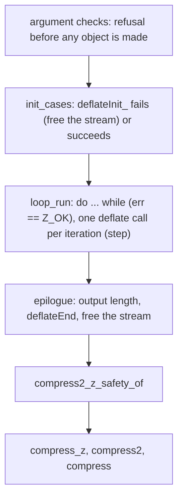

# Safety of `compress*`

The goals are `Goal.compress2_z_safety`, `Goal.compress2_safety`, `Goal.compress_z_safety` and
`Goal.compress_safety` (`ZlibF/Spec/Public/Utilities.lean`, `CompressorSafety`). They are proved in
`ZlibF/Proof/public-compress-safe*.lean` from two explicit hypotheses:

- `Goal.deflate`, the public goal of one `deflate` call (open);
- `DeflateLoopFacts`, four facts about one `deflate` call that `Goal.deflate` does not state (open,
  for the deflate owner):
  - a `Z_NO_FLUSH` call that is not refused, has input and room, and returns `Z_OK` makes progress;
  - new input after the first `Z_FINISH` gives `Z_BUF_ERROR` or writes at least one byte;
  - every call keeps the gzip header pointer;
  - every call keeps the owned blocks.

`deflateInit_` and `deflateEnd` are used through their proved lemmas (the parts of
`deflateInit_proof`, `deflateEnd_safe`, `deflate_end_public`).

## What is proved

For every input the functional goals admit (with `Uniq` of the initial heap):

- the call runs without undefined behaviour and returns;
- a rejected argument returns `Z_STREAM_ERROR` and changes nothing;
- otherwise the call writes at most the capacity into the output buffer and nothing else;
- every allocation is freed on every path;
- `Z_MEM_ERROR` comes only after an allocation failed.

## Structure

`CState` is the state between iterations: the decoder invariant `DGood`, reachability, the
counts of consumed input and produced output, and agreement of the heap with the caller heap
with the output written.

## Termination

The measure is `avail_in + sourceLen + avail_out + left`. It starts below `2^64`, the loop fuel.
The refills keep it. A call that returns `Z_OK` is not refused and has room (else `Goal.deflate`
gives `Z_BUF_ERROR`). With `Z_NO_FLUSH` the call has input (source remains after the refill), so
`DeflateLoopFacts` gives progress. With `Z_FINISH`, `Goal.deflate`'s progress clause gives
progress, unless the stream is finished and has new input; in that case `DeflateLoopFacts` gives
`Z_BUF_ERROR` or a written byte. Progress lowers the measure.
