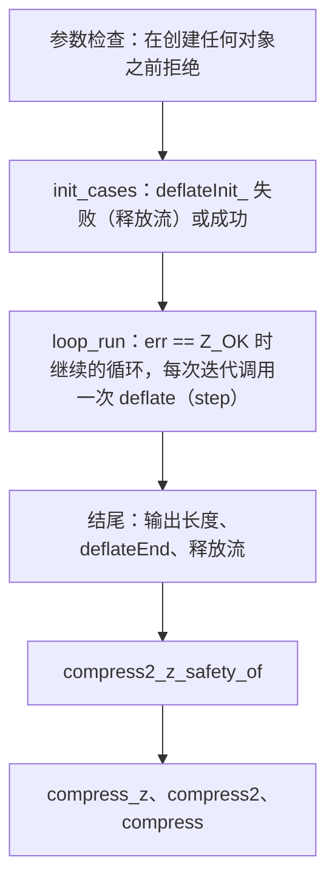

<!-- source-sha256: 1377591616d3f0251826691f9cfdbded8aa1d8881cca32b1d1ebc58191f8876b -->
# `compress*` 的安全性

目标是 `Goal.compress2_z_safety`、`Goal.compress2_safety`、`Goal.compress_z_safety` 和 `Goal.compress_safety`（`ZlibF/Spec/Public/Utilities.lean`，`CompressorSafety`）。它们在 `ZlibF/Proof/public-compress-safe*.lean` 中由两个显式假设证明：

- `Goal.deflate`，一次 `deflate` 调用的公开目标（未完成）；
- `DeflateLoopFacts`，`Goal.deflate` 没有陈述的、关于一次 `deflate` 调用的四个事实（未完成，由 deflate 负责人处理）：
  - 一次未被拒绝、有输入和空间并返回 `Z_OK` 的 `Z_NO_FLUSH` 调用会取得进展；
  - 第一次 `Z_FINISH` 之后的新输入得到 `Z_BUF_ERROR`，或至少写出一个字节；
  - 每次调用都保持 gzip 头指针；
  - 每次调用都保持所拥有的块。

`deflateInit_` 和 `deflateEnd` 通过它们已证明的引理使用（`deflateInit_proof`、`deflateEnd_safe`、`deflate_end_public` 的组成部分）。

## 已证明的内容

对功能目标允许的每个输入（初始堆满足 `Uniq`）：

- 调用运行时没有未定义行为并且返回；
- 被拒绝的参数返回 `Z_STREAM_ERROR`，且不改变任何东西；
- 否则调用最多向输出缓冲区写入其容量大小的数据，不写其他任何地方；
- 每条路径上都释放每次分配；
- `Z_MEM_ERROR` 只在某次分配失败之后出现。

## 结构

`CState` 是迭代之间的状态：解码器不变式 `DGood`、可达性、已消耗输入和已产生输出的计数，以及堆与写入输出后的调用者堆一致。

## 终止

度量是 `avail_in + sourceLen + avail_out + left`。它起初小于循环燃料 `2^64`。重新填充保持它不变。返回 `Z_OK` 的调用没有被拒绝且有空间（否则 `Goal.deflate` 给出 `Z_BUF_ERROR`）。在 `Z_NO_FLUSH` 下调用有输入（重新填充之后还有剩余源数据），所以 `DeflateLoopFacts` 给出进展。在 `Z_FINISH` 下，`Goal.deflate` 的进展条款给出进展，除非流已结束又有新输入；这种情况下 `DeflateLoopFacts` 给出 `Z_BUF_ERROR` 或一个写出的字节。进展使度量减小。
