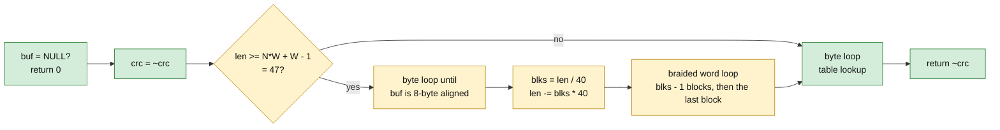

# crc32.c: function by function

Source: `zlib/crc32.c`, default build for x86_64 Linux: `W = 8` (64-bit words), `N = 5` braids,
little-endian, no hardware CRC instructions. Specification: [../spec/format.md](../spec/format.md)
section 5 (`F-crc-incremental`).

## 1. What `crc32_z` does

## 2. Safety

**Table indices.** Every table lookup is `crc_table[x & 0xff]`, `crc_braid_table[k][(w >> (8k)) & 0xff]`
with `k < W = 8`, or the same with a different mask. The mask gives a value below 256, the tables have
256 entries per row and 8 rows (`crc_braid_table` has `W` rows), so the index is in range. The values in the table
do not matter for safety. They matter for correctness (section 4).

**The alignment loop.** `while (len && ((z_size_t)buf & 7) ≠ 0)` advances `buf` by one byte at a time, at most 7
times, and decrements `len` each time. All reads are in `[buf, buf + len)`. The loop ends because
`len` or the low bits reach 0. The test depends on the **address** of `buf`, not only on its offset in the
array. The Lean model gives every block a ghost alignment `a ∈ {0, …, 7}`, so that the address
modulo 8 is `(a + offset) mod 8` (see [../architecture.md](../architecture.md) section 4). The argument below is the same for each `a`.

**The number of blocks.** Before the loop `len ≥ 47`. The alignment consumes at most 7 bytes, so afterwards
`len ≥ 40 = N·W`, hence `blks = len / 40 ≥ 1`. This matters: the block loop is `while (--blks)`, which for
`blks = 0` would wrap to `2^64 − 1` iterations. With `blks ≥ 1`, it runs `blks − 1` times and the last
block is handled after the loop.

**The word reads.** `words = (z_word_t const *) buf` is 8-byte aligned (the loop above). A block reads
`words[0 .. N−1]`, 40 bytes, and advances `words` by `N`. The total read is `blks × 40 ≤ len`, so
all reads are inside `[buf, buf + len)`. The cast of a byte pointer to a word pointer is an access of an
aligned 8-byte group of bytes; the model reads the eight bytes (little endian), which is what the C does on
x86_64 (no stricter aliasing rule is relied on).

**The tail.** After the blocks the remaining `len < 40` bytes are processed with word reads while
`len ≥ W` and then byte reads. **To confirm** the exact form of the tail loops against the source.

**Termination.** Every loop has a counter that decreases (`len`, `blks`, `k < W`).

## 3. The other functions

| Function | Argument |
| --- | --- |
| `crc32` | calls `crc32_z` with `len` of type `uInt`; nothing else |
| `multmodp(a, b)` | loop over the bits of `a`, multiplies in GF(2)[x] modulo the CRC polynomial. The loop ends when `a` is zero. **A caller must not pass `a = 0`**: the loop `for (m = 1 << 31; ; m >≥ 1)` has an exit only when a bit of `a` is found. Every caller passes a non-zero `a` (`x2nmodp` returns a power of x, which is non-zero) |
| `x2nmodp(n, k)` | `n ≥ 0` (the only caller checks `len2 < 0` first); loop over the bits of `n`; the table index is `k & 31`, always inside the 32 entries of `x2n_table` |
| `crc32_combine64`, `crc32_combine`, `crc32_combine_gen64`, `crc32_combine_gen`, `crc32_combine_op` | use `x2nmodp` and `multmodp`; negative `len2` returns an error value first |
| `crc_word`, `byte_swap` | fixed loops over `W` bytes |
| `get_crc_table` | returns the static table; read-only |

## 4. Correctness

For C1 (see [../overview.md](../overview.md) section 6a) the table values must equal the mathematical
ones: `crc_table[n]` is the CRC of the single byte `n`, and `crc_braid_table[k][n]` is the CRC of the byte
`n` followed by `k` zero bytes in the braid arrangement. The earlier attempt proved this by evaluating each entry
(8 files of 1,384 lines for the braid tables, about 11,000 lines in all). A shorter route is to prove
the recurrence between the rows (`crc_braid_table[k+1][n]` is obtained from `crc_braid_table[k][n]` by one
byte step of the polynomial division) and the first row from the definition, and to check the
256 entries of one row by evaluation. This is the intended route.

The braid combination (the `crc_word` calls that merge the five braid CRCs) is correct because the CRC
is linear over GF(2): a braid that starts at byte `i` and takes every 5th word has a CRC that is
a known multiple of `x^{8·(distance)}`, and `multmodp` realises that multiplication. This is the content of the earlier theorems `crc32_z_correct` and
`multmodp_eq_gf2`.

## 5. Status

| Part | Status |
| --- | --- |
| Safety of `crc32_z` (§2) | proved on paper; tail loops **to confirm** |
| Other functions (§3) | proved on paper |
| Correctness (§4) | the route is described; the Lean proof exists in the earlier attempt with the long table evaluation |
