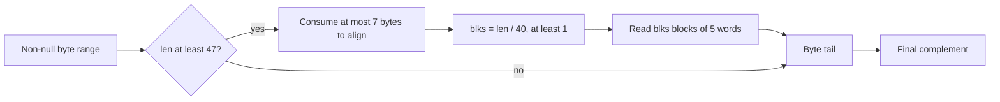

# CRC-32: byte ranges, braids and polynomial meaning

Source: `zlib/crc32.c`; translation: `ZlibF/Zlib/crc32.c.lean`. The first target
is the default x86_64 Linux branch with `W = 8`, `N = 5`, little-endian words and
no hardware CRC instructions. `F-crc-incremental` is specified in the
[format guide](../spec/format/README.md); public helper domains are in the
[API guide](../spec/api/README.md).

Local execution proofs cover every represented byte-array view and all of its
origin residues. General ABI layout and C aliasing remain separate obligations.
[Progress](../progress.md) records current results and remaining work.

## The read budget

A null buffer returns 0. Otherwise the function complements and masks the
incoming CRC, optionally processes braided word blocks, then processes the
remaining bytes and returns the complemented result.

The threshold is `N*W + W - 1 = 47`. Even after seven alignment bytes, at least
40 bytes remain. Thus `blks ≥ 1` before `while (--blks)`. The loop processes
`blks₀ - 1` blocks, and the separate final-block code processes the last one.
Starting it with zero would wrap the counter and destroy the read bound.

Each block reads five 8-byte words and advances by five words. Since
`40 * blks₀ ≤ len_after_alignment`, all word reads fit the original range. The
remaining length is below 40. In this selected branch the final tail uses an
unrolled byte loop while `len ≥ 8`, followed by a byte loop; it is not an
additional word-read loop. Each body consumes exactly the count removed from
`len`.

For every byte lookup, `x & 0xff < 256`. The braid row index is `k < W = 8`, and
each row has 256 entries. Table values do not affect these index bounds. Shifts
extracting bytes use `8k ≤ 56`, below the 64-bit word width. The proof must also
preserve the 32-bit CRC interpretation where the source masks or converts it.
Loop measures are the remaining byte/block count or the fixed row counter;
they must justify the runtime's fuel bounds.

## Alignment and represented addresses

The source alignment test uses the address of `buf`, not its array index.
The translated word read groups eight bytes in the selected endian order.
A faithful bridge needs a relation between represented object addresses,
interior offsets, alignment and valid byte ranges. It also needs the selected C
branch's access and aliasing interpretation; byte grouping alone does not prove
that bridge.

Allocated byte blocks retain the aligned-origin convention. Static and embedded
byte arrays have arbitrary stable origin residues in the heap. The address
proof relates the low three bits to a concrete base plus offset and shows that
every such non-block layout is representable. No alignment premise is added to
the public CRC goals.

The [positive regression](../../tests/verification/regressions/crc-static-address.lean)
retains the former counterexample's valid 47-byte static-table input. Both CRC
entries now return the independent checksum and preserve the entire heap.
The general byte-view proof covers all represented arrays, seeds and readable
lengths. See [trusted-base](../trusted-base.md) and [deviations](../deviations.md)
for the remaining ABI and aliasing limits.

## Polynomial refinement

CRC correctness needs more than safe lookups. Interpret a 32-bit CRC as a
polynomial over GF(2), with the reflected CRC polynomial used by the C.
Establish the byte-table recurrence and the braid-table recurrence, including
initial/final complements and the word's endian order.

A reusable route is to prove the first table row from polynomial division, then
prove how each later row advances the recurrence. Concrete entry evaluation can
check the required base data in the kernel. This avoids treating the table
contents as unproved constants.

The braid invariant relates each running CRC to its subsequence of words and
the powers of x separating those words. Linearity over GF(2) then justifies the
final `crc_word` merges in their actual order. The tail composes the byte
recurrence with that merged prefix. Input-splitting correctness follows from
the polynomial concatenation law.

Earlier work used long entry-by-entry proofs and named results
`crc32_z_correct` and `multmodp_eq_gf2`. Those are historical references for the
algebra, not acceptance evidence for the current translated run.

## Helper contracts

| Function | Proof boundary |
| --- | --- |
| `crc32` | Preserve the selected wrapper branch and convert its length argument to the `crc32_z` domain. |
| `crc_word`, `crc_word_big`, `byte_swap` | Fixed-width loops and exact endian/polynomial meaning for the selected build. |
| `multmodp(a, b)` | The scanning mask starts at bit 31. Termination requires a set bit in the represented 32-bit operand `a`; the source comment excludes zero. Prove this from each caller's domain before using its multiplication theorem. |
| `x2nmodp(n, k)` | `n` is nonnegative and its right shifts terminate; `k & 31` is within the 32-entry table. Prove that represented powers of x satisfy the multiplication premises. |
| `crc32_combine_gen64`, `crc32_combine_gen` | Preserve the negative-length return of 0 and prove the power-of-x formula for permitted lengths. |
| `crc32_combine_op` | Preserve the `op == 0` return. For a permitted generated operator, discharge the multiplication premise and prove the concatenation effect. |
| `crc32_combine64`, `crc32_combine` | Compose the generator and operator theorems, including negative-length behavior and argument conversions. |
| `get_crc_table` | Return the exact read-only static table pointer and the entries specified by its goal; no allocation or heap mutation. |

All these functions require exact frame statements. Read-only checksum calls
leave caller storage unchanged. Static data does not become stream-owned.
Other build branches, dynamic table initialization and hardware paths require
their own source-specific arguments under the same public contracts.

## C correspondence checks

### CRC and small utility decisions

`crc32_z` returns zero immediately for a null buffer. On the non-null path it
masks the complemented CRC to 32 bits. Braiding begins at length 47. Alignment
consumes at most seven bytes, leaving at least one 40-byte block. The
`while (--blks)` loop processes all but the final block, which is combined
separately. **to confirm**: this argument bounds every load and excludes counter
wrap.

Pointer-to-integer tests and byte-to-word casts cross representation boundaries.
The address helper uses offsets for allocated byte blocks and arbitrary stable
origin residues for static and embedded byte arrays. The
[static-address regression](../../tests/verification/regressions/crc-static-address.lean)
checks the former counterexample's valid 47-byte static-table read. Local proofs
cover every represented byte-array view and residue. Word loads assemble eight
bytes in target byte order. **to confirm**: general ABI layout and the C cast's
strict-aliasing semantics are covered by the representation bridge. Reading the low byte of the local
endian marker also depends on the target. Default execution cannot test its
unreachable big-endian branch.

`multmodp` scans bits 31 down to zero of its first operand. If its low word is
zero, the mask reaches zero and the C loop never terminates. The earlier review
observed this through `crc32_combine_op(1, 2, 1UL << 32)`. The documented operator
comes from `crc32_combine_gen`; an arbitrary nonzero 64-bit value is insufficient.
`crc32_combine_op` handles zero before calling `multmodp`. Negative lengths are
rejected before `x2nmodp` can arithmetic-shift a negative value forever. Its
index is masked by 31. **to confirm**: generated operators have the nonzero low
word needed for termination. This misuse observation is not a confirmed defect
within the documented domain.

The source review regenerated the static tree and CRC headers and reported
byte-identical results. That supports table fidelity, not mathematical meaning.
Important shapes include the 288-entry literal tree, 30-entry distance tree,
512-entry distance map, 256-entry length map, 256-entry CRC table, eight-row braid
tables and 32-entry polynomial-power table. Static entries and bounds must stay
faithful to the source.
