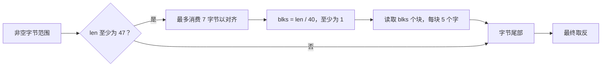

<!-- source-sha256: 9b733b8e50ebb284bec2ff8f0571de0e2f408cb20a40ae709b322be761eec79b -->
# CRC-32：字节范围、交织与多项式含义

源文件为 `zlib/crc32.c`，翻译为 `ZlibF/Zlib/crc32.c.lean`。首个目标是默认 x86_64 Linux 分支。它把 8 字节作为一个机器字，记为 `W = 8`；把整字分到五条交织计算链，记为 `N = 5`。因此一个交织块含 `N * W = 40` 字节。该分支使用小端字，不使用硬件 CRC 指令。[格式指南](../spec/format/README.md)规定 `F-crc-incremental`；公开辅助函数的定义域见 [API 指南](../spec/api/README.md)。

局部执行证明覆盖每种已表示的字节数组视图及其全部起始地址余数。一般 ABI 布局与 C 别名仍是单独义务。[进度](../progress.md)记录当前结果与剩余工作。

## 读取预算

本节先证明“每次读取仍在调用者给出的范围内”，再在后面证明“算出的 CRC 与数学定义一致”。`len` 是当前尚未读取的字节数；对齐后完整块的数量叫 `blks`，其初值记为 `blks₀`。例如剩下 87 字节时，可以处理两个 40 字节块，再处理七字节尾部。

空缓冲区返回 0。否则函数对输入 CRC 取反并掩码，可选择处理交织字块，再处理剩余字节，最后返回取反结果。

阈值为 `N*W + W - 1 = 47`。即使消费七个对齐字节，仍至少剩下 40 字节。因此在 `while (--blks)` 前有 `blks ≥ 1`。循环处理 `blks₀ - 1` 个块，独立的最终块代码处理最后一块。若从零开始，计数器会回绕并破坏读取界限。

每块读取五个 8 字节字，并前移五个字。由于 `40 * blks₀ ≤ len_after_alignment`，全部字读取均位于原范围内。剩余长度低于 40。所选分支的最终尾部先在 `len ≥ 8` 时使用展开字节循环，再用单字节循环；它不是额外的整字读取循环。每轮消费的数量恰等于从 `len` 扣除的数量。

查表时，用 `x` 表示参与本次更新的机器整数；掩码 `& 0xff` 只保留低八位，因此 `x & 0xff < 256`。交织表按机器字中的字节位置选择行，用 `k` 表示这个位置，满足 `k < W = 8`；每行有 256 项。表值不影响这些索引界限。提取字节的移位满足 `8k ≤ 56`，低于 64 位字宽。在源代码执行掩码或转换的位置，证明还必须保持 32 位 CRC 解释。循环度量是剩余字节／块数或固定行计数器，且必须满足运行时的步数预算界限。

## 对齐与表示地址

八字节对齐要求实际地址除以 8 的余数为零。对象内偏移为零并不保证实际地址对齐：例如对象起点余数为 5 时，要再前进三字节才对齐。因此，证明既要知道偏移，也要保留对象起点的地址余数。

源代码对齐测试使用 `buf` 的地址，而非数组索引。翻译后的整字读取按选定端序组合八个字节。忠实对应需要联系模型对象地址、内部偏移、对齐与有效字节范围，还需要所选 C 分支的访问和别名解释；仅组合字节不能证明这种对应。

分配的字节块保留起始地址对齐约定。静态和嵌入式字节数组在堆中具有任意但稳定的起始地址余数。地址证明把低三位联系到具体基址加偏移，并说明每种这样的非字节块布局都可表示。公开 CRC 目标没有增加对齐前提。

[正向回归](../../tests/verification/regressions/crc-static-address.lean)保留旧反例的合法 47 字节静态表输入。两个 CRC 入口现在均返回独立校验和，并保持整个堆。一般字节视图证明覆盖全部已表示数组、种子和可读长度。剩余 ABI 与别名限制见[可信基础](../trusted-base.md)和[偏差记录](../deviations.md)。

## 多项式细化

CRC 正确性需要的不只是安全查表。GF(2) 是只有 0 和 1 的系数系统，加法等同逐位异或。把 32 位 CRC 的每一位看作一个多项式系数后，移位、异或和取余便有对应的代数含义。证明使用 C 所采用的反射 CRC 多项式；“反射”说明位的处理方向，必须与实际移位和字节序一致。建立字节表递推和交织表递推，包括初始／最终取反与整字端序。

一种可复用路线是：通过多项式除法证明第一行表，再证明之后每行如何推进递推。具体表项求值可在内核中检查基础数据，避免把表内容当作未证明常量。

交织不变量把各运行 CRC 联系到各自的整字子序列，以及间隔这些字的 x 次幂。GF(2) 线性性随后证明实际顺序中的最终 `crc_word` 合并。尾部将字节递推与合并后的前缀组合。输入切分正确性来自多项式拼接律。

早期工作使用逐项的长证明，并给出名为 `crc32_z_correct` 和 `multmodp_eq_gf2` 的结果。这些是代数的历史参考，不是当前翻译后运行的验收证据。

## 辅助函数契约

| 函数 | 证明边界 |
| --- | --- |
| `crc32` | 保留所选包装分支，把长度参数转换到 `crc32_z` 定义域。 |
| `crc_word`, `crc_word_big`, `byte_swap` | 针对所选构建证明固定宽度循环及准确的端序／多项式含义。 |
| `multmodp(a, b)` | 扫描掩码从位 31 开始。终止要求表示为 32 位的操作数 `a` 至少有一个置位；源注释排除零。使用乘法定理前须从每个调用者的定义域证明此前提。 |
| `x2nmodp(n, k)` | `n` 非负，其右移会终止；`k & 31` 位于 32 项表内。证明表示的 x 次幂满足乘法前提。 |
| `crc32_combine_gen64`, `crc32_combine_gen` | 保留负长度返回 0 的行为，并对允许长度证明 x 次幂公式。 |
| `crc32_combine_op` | 保留 `op == 0` 返回。对允许的已生成操作数，建立乘法前提并证明拼接效果。 |
| `crc32_combine64`, `crc32_combine` | 组合生成器与操作定理，包括负长度行为和参数转换。 |
| `get_crc_table` | 返回准确的只读静态表指针与目标要求的表项；不分配、不改变堆。 |

所有函数都需要准确帧声明。只读校验和调用保持调用者存储不变。静态数据不会变成流拥有的存储。其他构建分支、动态表初始化和硬件路径，在相同公开契约下各需与其源代码对应的论证。

## C 对应检查

### CRC 与小型工具的处理细节

`crc32_z` 对空缓冲区立即返回零。非空路径把取反 CRC 掩码为 32 位。从长度 47 开始交织处理。对齐最多消费七个字节，至少留下一个 40 字节块。`while (--blks)` 处理除最后一块之外的全部块，最后一块单独合并。C 对应证明还需要把上述预算落实到每次加载，并排除计数器回绕。

指针到整数测试、字节到整字转换跨越表示边界。地址辅助函数对分配字节块使用偏移，对静态和嵌入字节数组使用任意稳定的起始余数。[静态地址回归](../../tests/verification/regressions/crc-static-address.lean)检查旧反例的合法 47 字节静态表读取。局部证明覆盖全部已表示字节数组视图与余数。整字加载按目标字节序组合八个字节。一般 ABI 布局及 C 转换的严格别名语义仍在当前表示范围之外。读取局部端序标记的低字节也依赖目标。默认执行无法测试不可达的大端分支。

`multmodp` 从位 31 向下扫描第一个操作数。若其低字为零，掩码会降为零，C 循环永不终止。早期审查通过 `crc32_combine_op(1, 2, 1UL << 32)` 观察过这一点。文档规定操作数来自 `crc32_combine_gen`；任意非零 64 位值并不够。`crc32_combine_op` 在调用 `multmodp` 前处理零。在 `x2nmodp` 可能永远算术右移负值之前，负长度已被拒绝；其索引由 31 掩码。调用者证明还需建立：生成的操作数具有终止所需的非零低字。这是误用观察，不是文档定义域内的已确认缺陷。

源代码审查重新生成过静态树和 CRC 头文件，并报告字节完全一致。这支持表忠实性，不证明其数学含义。重要形状包括：288 项字面量树、30 项距离树、512 项距离映射、256 项长度映射、256 项 CRC 表、八行交织表，以及 32 项多项式幂表。静态表项与界限必须忠实于源代码。
