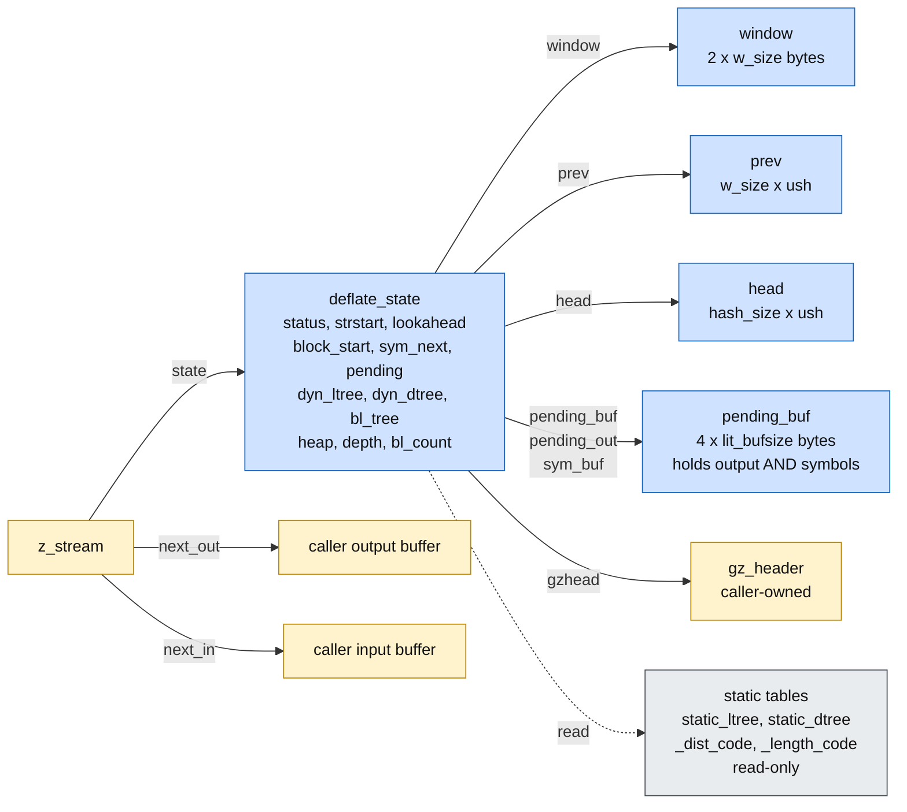
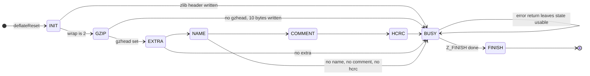

# deflate.c: function by function

Source: `zlib/deflate.c`. Specification: [../spec/api.md](../spec/api.md) section 3 and `I-fw-*`,
`I-sh-*`, `I-hc-inv`, `I-lm-*`, `I-fp-*` in [../spec/internal.md](../spec/internal.md). The functions of
`trees.c` are in [trees.md](trees.md).

Items marked **to confirm** are readings of the C that the proof must still check.

## The idea in short

Deflate remembers the text it has seen in a window and finds repeats through hash chains. Two facts make it safe. First, the search for a repeat only looks at positions inside the window, because the window is slid before the current position comes within 262 bytes of its end. Second, a chain is made only of positions that were really inserted, and the array that links them is read only at slots that were written for exactly those positions. A slot that was never written is never used as an index. Reading garbage anywhere else (for example when the whole array is rescaled) does no harm.

## 1. The memory picture



Four heap blocks are owned by zlib besides the state: `window`, `prev`, `head`, `pending_buf`.
`deflateEnd` frees each exactly once. If any of the four allocations fails, `deflateInit2_` frees
the others and returns `Z_MEM_ERROR` (U4).

## 2. Sizes (`deflateInit2_`) (`deflateInit2_`) — easy but load-bearing

| Field | Value | Used for |
| --- | --- | --- |
| `w_bits` | `windowBits`, with 8 changed to 9 | |
| `w_size` | `1 << w_bits` | at least 512 (see below) |
| `hash_bits` | `memLevel + 7` | `hash_size = 1 << hash_bits` |
| `lit_bufsize` | `1 << (memLevel + 6)` | 128 for `memLevel` 1, 16384 for 8, 32768 for 9 |
| `pending_buf_size` | `4 * lit_bufsize` | overlay, section 6 |
| `sym_buf` | `pending_buf + lit_bufsize` | holds `3 * lit_bufsize` bytes |
| `sym_end` | `3 * (lit_bufsize - 1)` | flush trigger |

**`w_size ≥ 512` is a fact the code makes happen.** `MAX_DIST = w_size - MIN_LOOKAHEAD` with
`MIN_LOOKAHEAD = 262`. With `w_size = 256` that subtraction would wrap. zlib avoids it by
changing `windowBits = 8` to 9 before it computes anything. This is a one-line fact in `DeflateOK`
and it is used by `fill_window`, `longest_match` and both `deflate_*` loops.

`ZALLOC` multiplies `unsigned` by `unsigned`. All four products are below 2^32 for the allowed
ranges (the largest is `lit_bufsize * 4 = 131072`).

## 3. Window and hash chains

Source: `fill_window`, `slide_hash`, `longest_match`, `INSERT_STRING`, `CLEAR_HASH` in
`zlib/deflate.c`. Specification: `I-fw-*`, `I-sh-*`, `I-hc-inv`, `I-lm-*` in
[../spec/internal.md](../spec/internal.md). Facts F5 and F6 of [../method.md](../method.md).

Notation: `W = w_size`, `window_size = 2W`, `MIN_LOOKAHEAD = 262`, `MAX_DIST = W − 262`,
`MAX_MATCH = 258`. All indices are indices into `window` unless said otherwise.

### 3.1 Sizes

**Lemma 0.** `W ≥ 512` and `W ≤ 32768`.

*Proof.* `deflateInit2_` rejects `windowBits` outside 8 to 15 (and the raw and gzip variants
reduce to the same range), and changes 8 to 9. So `W = 2^windowBits` is between `2^9` and `2^15`. ∎

Consequences: `MAX_DIST = W − 262 ≥ 250 > 0`, so the unsigned subtraction does not wrap.
`window` has `2W` bytes, `prev` has `W` entries, `head` has `hash_size` entries.

### 3.2 The window invariant

**(D)** At every point where a deflate function is called from outside, and at the top of every
loop of `deflate_fast`/`slow`/`rle`:

```
strstart + lookahead <= window_size
```

It holds after init (`strstart = lookahead = 0`). `read_buf` writes at most
`more = window_size − lookahead − strstart` bytes (see §3), so `lookahead + strstart` stays at most
`window_size`. Every place that moves a byte from the lookahead to the history decreases
`lookahead` by as much as it increases `strstart`.

### 3.3 `fill_window`

One pass of the `do … while` loop:

1. `more = window_size − lookahead − strstart`. Unsigned subtraction without wrap by (D).
2. If `strstart ≥ W + MAX_DIST` (the slide test):
   - `zmemcpy(window, window + W, W − more)`. Here `strstart ≥ 2W − 262` and (D) give
     `more ≤ 262 − lookahead ≤ 262 < W` (Lemma 0), so `W − more` is a proper non-negative
     count. The source `[W, 2W − more)` and the destination `[0, W − more)` are disjoint
     because the destination ends at `W − more ≤ W`, where the source begins. Both are inside the window.
   - `match_start`, `strstart`, `block_start` decrease by `W`; `strstart ≥ W` so no wrap in the
     unsigned fields. `block_start` is a `long`; no overflow, since its magnitude is at most `2W`.
   - `slide_hash` (section 5).
   - `more += W`: the new value is `window_size − lookahead − strstart_new`, the same formula.
3. If `avail_in = 0`, leave. Otherwise `read_buf(window + strstart + lookahead, more)` writes at
   most `more` bytes, ending at or before `strstart + lookahead + more = window_size`. In bounds.
4. Rehash of the `insert` bytes: reads `window[str + MIN_MATCH − 1]` with `str + 2 ≤ strstart + lookahead − 1`
   (the loop continues only while `lookahead + insert ≥ MIN_MATCH`); writes `prev[str & wmask]` and
   `head[ins_h]` with `ins_h ≤ hash_mask < hash_size` (`UPDATE_HASH` masks).

After the loop, the `high_water` step: `curr = strstart + lookahead ≤ window_size`.

- If `high_water < curr`: `init = min(window_size − curr, WIN_INIT)`, so `curr + init ≤ window_size`.
- Else if `high_water < curr + WIN_INIT`: `init = min(curr + WIN_INIT − high_water, window_size − high_water)`, and `high_water + init ≤ window_size`.
  Both subtractions are non-negative in this branch.

So every `zmemzero` stays in the window. (This step makes the bytes after the data defined. Safety does
not need that; see [../safety.md](../safety.md) section 3.)

**Lemma 1 (post-condition `I-fw-post-room`).** Whenever `fill_window` returns,
`strstart < window_size − MIN_LOOKAHEAD`.

*Proof.* The slide test runs at the top of the first pass, whether or not there is input. If
`strstart ≥ W + MAX_DIST = 2W − 262`, the slide gives `strstart_new = strstart − W ≤ 2W − W = W`
by (D), and `W < 2W − 262` because `W > 262` (Lemma 0). If the test fails,
`strstart < 2W − 262` directly. Later passes do not change `strstart`. ∎

### 3.4 Where the callers call `fill_window`

The loops of `deflate_fast`, `deflate_slow`, `deflate_rle` and `deflate_stored`... call
`fill_window` when `lookahead < MIN_LOOKAHEAD`, **regardless of `avail_in`**, before they search for
a match. So at each call of `longest_match` one of two cases holds:

- `lookahead ≥ MIN_LOOKAHEAD`: by (D), `strstart ≤ window_size − lookahead ≤ window_size − MIN_LOOKAHEAD`.
- `lookahead < MIN_LOOKAHEAD`: `fill_window` has just run, and Lemma 1 gives the same bound.

Nothing changes `strstart` between that point and the call. So

**(M)** at every call of `longest_match`: `strstart ≤ window_size − MIN_LOOKAHEAD`
(and `strstart < window_size − 262`).

This closes the point that [deflate.md](deflate.md) section 3.1 left to confirm: the
end of the stream is covered, because `fill_window` runs there too.

### 3.5 `slide_hash`

It visits each of the `hash_size` entries of `head`, and each of the `W` entries of `prev`, once
(the pointers run down to the first entry). The update of an entry `m` is `m ≥ W ? m − W : 0`.
This is defined for **every** 16-bit value `m`, including a garbage value. So the function is
safe for any content of `prev`, including the slots that were never written (decision D5).
The loop counts (`do … while (--n)` with `n ≥ 1`) never wrap, since `hash_size ≥ 2` and `W ≥ 512`.

### 3.6 The hash-chain invariant

Call a position `q` **inserted** if `INSERT_STRING(q)` ran, or the rehash step of `fill_window`
or the loop of `deflateSetDictionary` inserted it, and no `CLEAR_HASH` has run since. Let
`T = strstart − W`.

**(H1)** Every `head[h]` is 0 or an inserted position `p` with `p < strstart + lookahead`.
**(H2)** For every inserted position `q > T`, the slot `prev[q & wmask]` holds the value that
`head[h(q)]` had when `q` was inserted, as adjusted by the slides since then, and so it is 0 or an
inserted position smaller than `q`. (`h(q)` is the hash of the three bytes at `q`.)

The first positive position is 1; position 0 stands for "none" (`NIL`).

**Lemma 2.** (H1) and (H2) hold initially and are preserved by every operation.

- *Init, `deflateReset`, `CLEAR_HASH`.* All `head` entries are 0 and nothing is inserted. Both clauses are
  vacuous for `prev`. (`CLEAR_HASH` writes `head[hash_size − 1]` and zeroes the first `hash_size − 1`
  entries. Together that is all of `head`.)
- *`INSERT_STRING(str)`* is executed when `str = strstart` (in `deflate_slow` and `deflate_fast` the
  macro is applied after `strstart` has moved). It computes `ins_h ≤ hash_mask`, then
  `prev[str & wmask] = head[ins_h]` and `head[ins_h] = str`. By (H1) the old `head[ins_h]` is 0 or
  inserted, and it is smaller than `str` since `p < strstart + lookahead`... — more precisely: it was
  inserted earlier, hence `p < str`. After the write, `q = str` has its slot set to that value (H2),
  and `head[ins_h] = str < strstart + lookahead` (H1).
  The write may overwrite the slot of the position `str − W`. That position is not above
  `T = strstart − W`, so (H2) says nothing about it. Every other slot is unchanged.
- *Rehash in `fill_window` and the loop in `deflateSetDictionary`* do the same assignments with
  `str < strstart + lookahead`, in increasing order of `str`, and by the same argument.
- *Slide.* Let `T' = strstart_new − W = T − W`. For an inserted `q` with `q > T`, `q' = q − W > T'`...
  Entries `m ≥ W` become `m − W` (inserted position of the new numbering); entries `m < W` become 0
  (the position left the window; the chain simply ends there). A position `q ≤ W` itself leaves the
  window; it is no longer inserted. For `q > W`, `prev[q & wmask]` is the same slot as for `q'`, because
  `W` divides `2^k` for the mask, and the content is updated by the same rule. So (H1) and (H2) hold
  with the new numbering.
- *`slide_hash` on garbage slots.* Those slots belong to no inserted position `q > T`, so (H2)
  never speaks about them, and rewriting them changes nothing that (H2) speaks about.
- *`deflateCopy`.* The copy has the same `head`, the same `prev` (including garbage), and the same
  window contents up to `high_water`; positions and numbering are the same, so the invariant transfers. ∎

Not every position is inserted. `deflate_fast` skips the positions inside a long match, and
`deflate_stored`, `deflate_rle` and `deflate_huff` insert none. That is fine: a position that is not
inserted is not in any chain, because chains are built only from `head[h]` and `prev` entries that
were assigned by the three operations above.

### 3.7 `longest_match`

Precondition `I-lm-pre`: `cur_match < strstart`, and (M).

**Where `cur_match` starts.** The callers pass `hash_head`, the old `head[h]` returned by
`INSERT_STRING`, and call `longest_match` only if `hash_head ≠ NIL` and
`strstart − hash_head ≤ MAX_DIST`. So `hash_head` is an inserted position (H1) with
`hash_head ≥ strstart − MAX_DIST > strstart − W = T`: it is in the domain of (H2).

**The walk.**

```
limit = strstart > MAX_DIST ? strstart − MAX_DIST : 0
do { … match = window + cur_match … } while ((cur_match = prev[cur_match & wmask]) > limit && --chain_length != 0)
```

Claim: at the start of each pass, `cur_match` is an inserted position with `limit < cur_match < strstart`.
- First pass: shown above (`cur_match > limit` holds since `strstart − cur_match ≤ MAX_DIST`;
  when `strstart ≤ MAX_DIST`, `limit = 0 < cur_match` because `cur_match ≠ NIL`).
- Next pass: `cur_match > limit ≥ strstart − MAX_DIST > T`, so (H2) applies: the slot
  `prev[cur_match & wmask]` holds 0 or an inserted position smaller than `cur_match`. The loop test
  reads exactly this slot, so **the value read is a written, meaningful value, never garbage**.
  The test `> limit` rejects 0 (since `limit ≥ 0`) and keeps only inserted positions in range.

*Termination.* `cur_match` strictly decreases and is above `limit ≥ 0`, so at most
`strstart` passes; `chain_length` also decreases to 0 (it is positive on entry:
`max_chain_length ≥ 1`, and `chain_length >≥ 2` for a good previous match: **to confirm**
that `max_chain_length ≥ 4` whenever this shift applies, or that a zero `chain_length` is
harmless: `--chain_length ≠ 0` with `chain_length = 0` would wrap to `2^32 − 1`, which is
a long but finite walk bounded by the strict decrease of `cur_match`).

**The reads of window bytes.** In a pass, `scan = window + strstart` and `match = window + cur_match`.

- `match[best_len]`, `match[best_len − 1]`, `scan[best_len]`, `scan[best_len − 1]`: `best_len`
  is `prev_length`, at most 258 (`prev_length` is set from a `match_length`, which is at most `MAX_MATCH`),
  or `len` from a previous pass, which is at most 258. So these indices are below `strstart + 259`.
- The inner loop compares `*++scan` with `*++match` in groups of eight, after `scan += 2`. It
  starts at offset 2 and each group advances by 8, ending when `scan ≥ strend = window + strstart + 258`. Since
  `258 − 2 = 256 = 8 × 32`, `scan` stops exactly at `strend`, never past it. The largest index read is
  `strstart + 258`.
- By (M), `strstart + 258 < window_size`. And `match < scan`, so every `match` index is also in bounds.

So **every window read is in bounds** (F6). The bytes read may be uninitialised; they are only
compared (decision D5), so any value is safe.

*Result.* The function returns `min(best_len, lookahead)`, and sets `match_start = cur_match` only when
`len > best_len`. The statement `I-lm-ret` is a functional fact; safety does not use it.

### 3.8 The other readers of the window

- `deflate_rle`: scans `window + strstart − 1` up to `strend = window + strstart + 258`. Same bound (M)... Its
  loop condition tests `scan < strend` after eight comparisons, as `longest_match` does.
- `deflate_stored`, `flush_pending` copy `window[block_start …]`: indices bounded by
  `0 ≤ block_start ≤ strstart` and `strstart ≤ window_size`. **To confirm** the invariant
  `block_start ≤ strstart` as signed `long` values, including after the slide (`block_start`
  decreases by `W` together with `strstart`).
- `deflateGetDictionary`: copies `min(strstart + lookahead, W)` bytes from the end of the data, inside the window.

### 3.9 Status

Proved on paper. Two points to confirm in Lean: the `chain_length` shift case in §7, and the
invariant on `block_start` in §8.

## 4. The five block-making loops

| Function | Used for | Hazards | Tier |
| --- | --- | --- | --- |
| `deflate_stored` | level 0 | large unsigned arithmetic on `avail_out`, `have`, `left`; direct copy into `next_out`; both `strstart - block_start` mixing `long` and `unsigned` | medium-hard |
| `deflate_fast` | levels 1 to 3 | hash insert, `longest_match`, tally, `FLUSH_BLOCK` | medium |
| `deflate_slow` | levels 4 to 9 | same plus lazy match state `prev_length`, `match_available` | medium |
| `deflate_rle` | `Z_RLE` | compares `strstart[-1]` with the next bytes up to 258 | medium |
| `deflate_huff` | `Z_HUFFMAN_ONLY` | literal-only tally | easy |

All of them end blocks the same way:

```
_tr_tally_lit / _tr_tally_dist:   write the symbol into sym_buf[sym_next++]
                                   flush when sym_next == sym_end
FLUSH_BLOCK:                       _tr_flush_block, then flush_pending
```

### Symbol write safety

`sym_next` goes up by 3 per symbol and a block is flushed when `sym_next == sym_end =
3 * (lit_bufsize - 1)`. So `sym_next + 3 ≤ 3 * lit_bufsize`, which is the size of the symbol
region. The proof is two lines. The next `_tr_tally_dist` index is the real hazard:

```
d_code(dist) = dist < 256 ? _dist_code[dist] : _dist_code[256 + (dist >> 7)]
```

`dist` here is `strstart - match_start - 1`. For the second branch the index is at most
`256 + (32767 >> 7) = 511`, inside the 512-entry table. That needs `dist ≤ 32767`, which holds
because `dist ≤ MAX_DIST ≤ w_size - 262 ≤ 32506`. A second index, `_length_code[lc]`, needs
`lc ≤ 255`, from `match_length ≤ 258`.

The same index is read again in `compress_block` from the stored symbol. **If a symbol byte in
`pending_buf` were overwritten before it is read, `dist` could be anything up to 65535 and the
index would be out of range.** That is exactly why F9 matters. The danger is not the buffer
itself, it is a corrupted index into a static table.

## 5. `deflate()` and its state machine



### The invariant that ties status to the header

`EXTRA`, `NAME`, `COMMENT` and `HCRC` are only entered when `gzhead ≠ NULL`. The invariant
must say so (`DeflateOK`, clause D7). The earlier attempt's weaker invariant admitted
`status = EXTRA` with `gzhead = NULL`, and `deflate(Z_BLOCK)` then faulted. The real API
cannot reach that state: `deflateSetHeader` says it must be called "before the first call of
`deflate()`". We do not weaken the clause to hide this; the clause is what the sequence
theorem proves is preserved.

### Per-step hazards

| Step | Hazard | Needs |
| --- | --- | --- |
| Argument checks | `deflateStateCheck`, `flush` range, `next_out == NULL` | return an error code without touching the stream (A7, frame `h' = h`) |
| `put_byte` | `pending_buf[pending++] = c` has no bound check | the headers are at most `pending_buf_size` because the extra, name and comment loops flush when full |
| `extra` loop | `left = (extra_len & 0xffff) - gzindex` is unsigned | `gzindex ≤ extra_len & 0xffff` clause |
| `flush_pending` | `zmemcpy(next_out, pending_out, len)`, `len ≤ avail_out` | `pending_out + pending ≤ pending_buf + pending_buf_size` |
| `read_buf` | copy from `next_in` | A2, A3 |
| `deflate_*` call | block functions | section 4, function theorems |
| Trailer | `put_byte` of adler or crc, total_in | easy |

## 6. The other API functions

| Function | Hazard | Tier |
| --- | --- | --- |
| `deflateInit2_` | parameter checks; four allocations; failure paths free correctly | medium (allocation failure branches) |
| `deflateReset`, `deflateResetKeep`, `lm_init` | `zmemzero(head, (hash_size - 1) * 2)` and `head[hash_size - 1] = NIL` | easy |
| `deflateEnd` | frees four blocks plus the state, once each, in any status | easy |
| `deflateBound`, `deflateBound_z` | pure arithmetic; an upstream fix covers a wrap in the gzip extra length | easy |
| `deflatePrime` | `bits ≤ 16`, `bi_valid + bits` | easy |
| `deflateParams` | may call `deflate(Z_BLOCK)`; changes level and strategy | medium |
| `deflateSetDictionary` | `fill_window`, hash insertion loop; reads the dictionary | medium |
| `deflateGetDictionary` | `zmemcpy` from the window | easy |
| `deflateTune`, `deflatePending`, `deflateSetHeader` | field updates and reads | easy |
| `deflateCopy` | four allocations, `memcpy` of state, window (only `high_water` bytes), `prev` (all), `head`, pending; rebases `pending_out`, `sym_buf`, `l_desc.dyn_tree` and friends | **medium-hard** |
