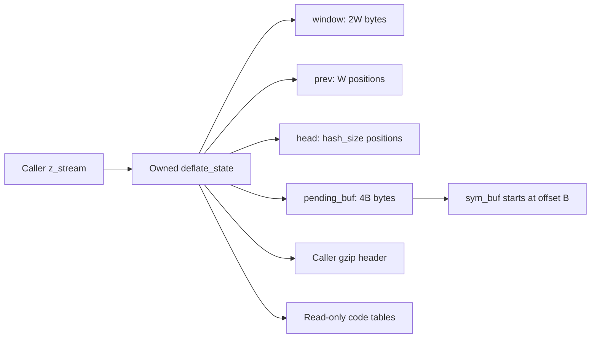
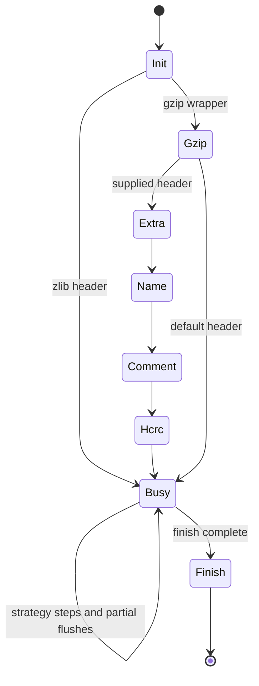
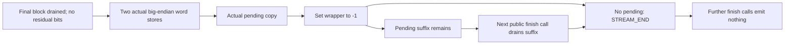
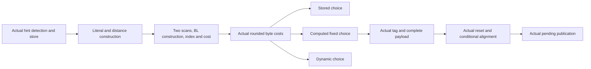

# Stream compression: window, chains and lifecycle

Source: `zlib/deflate.c`; translation: `ZlibF/Zlib/deflate.c.lean`.
The [API guide](../spec/api/README.md) gives public behavior. Internal contracts use
`I-fw-*`, `I-sh-*`, `I-hc-inv`, `I-lm-*` and `I-fp-*` in
[internal contracts](../spec/internal-contracts.md). Tree construction and the
shared-buffer bound F9 are explained in [trees](trees.md).

This page gives the proof structure and its internal premises. Conditional
results over `DGood` or a search invariant need an initialization and
preservation bridge before they imply public correctness. Current accepted
scope and remaining work are recorded only in [progress](../progress.md).

## Input ranges and path composition

The [shared input configurations](../spec/input-configurations.md#deflate-inputs)
define the strictly nested default, common and full stream parameter ranges.
Apply the same coverage colours to complete scoped declarations. Exact entry
contracts keep their existing domains. Smaller branch lemmas remain evidence
for composition, with their premises explicit.

For this compressor, level and strategy select different engines. Separate
the stored, fast, slow, Huffman-only and RLE execution obligations from numeric
ranges that can share one parameterized proof. Refill/window and tree/output
lemmas record their memory-level, window and symbol-room premises individually.
Default initialization can establish its invariant without the universal Init2
contract. Its successful witness is supporting evidence, not a replacement for
all admitted caller states.

## Storage and size equations



The stream owns five blocks: state, window, `prev`, `head` and pending storage.
The caller owns the stream, its input/output views and any gzip header buffers.
Embedded trees, heap and depth arrays belong to the state block.

Validated default-build parameters give these equations:

| Field | Value |
| --- | --- |
| `w_bits` | Normalized window parameter, with 8 changed to 9 |
| `W = w_size` | `1 << w_bits`, so `512 ≤ W ≤ 32768` |
| `window_size` | `2W` |
| `hash_bits`, `hash_size` | `memLevel + 7`, `1 << hash_bits` |
| `B = lit_bufsize` | `1 << (memLevel + 6)`, from 128 to 32768 |
| `pending_buf_size` | `4B` |
| `sym_buf`, `sym_end` | `pending_buf + B`, `3(B - 1)` |

These equations describe the default shared-symbol branch; configurations such
as a different symbol layout need their own refinement. Allocation products
must fit the allocator's 32-bit unsigned multiplication. The largest buffer
products here are 131072 bytes. State-size and ABI assumptions are separate.

The normalization to `W ≥ 512` is load-bearing:
`MIN_LOOKAHEAD = 262`, `MAX_MATCH = 258`, `MAX_DIST = W - 262 ≥ 250`.
Without it, a 256-byte window would make the distance subtraction wrap.

## D: window bounds and `fill_window`

The shape invariant **D** is

```
strstart + lookahead ≤ window_size = 2W
```

Initialization starts both counters at zero. Reading input increases lookahead
by no more than the available window room. Consuming bytes advances `strstart`
and decreases lookahead by the same count. The proof must establish D at every
entry and strategy-loop point that uses it.

`I-fw-pre` additionally provides `lookahead < MIN_LOOKAHEAD`, valid sizes/masks,
`insert ≤ strstart`, a bounded high-water mark, search settings and the
hash-chain invariant. With the current D, the default branch computes
`more = window_size - lookahead - strstart` without loss from the relevant
unsigned subtractions and casts.

If `strstart ≥ W + MAX_DIST = 2W - 262`, then `more ≤ 262 - lookahead < W`.
The slide copies `W - more` bytes from `[W, 2W-more)` to `[0, W-more)`.
Both ranges are in the window and disjoint. The code adjusts `match_start`,
`strstart`, signed `block_start`, `insert`, hash positions and free room.

Each adjustment needs its own type argument. `strstart ≥ W` justifies its
subtraction. It does not show that `match_start ≥ W`: an unsigned stale match
position may wrap, and the proof must show when that value can subsequently be
used. Signed `block_start -= (long)W` must remain in range under its actual
invariant. Model the source expression and conversions exactly.

After the slide, `more += W` again measures room beyond data. If input remains,
`read_buf` copies at most that room into
`window + strstart + lookahead`. The insertion loop hashes only available
three-byte strings, masks `ins_h` to `hash_size` and writes the corresponding
`prev`/`head` cells. Establish how pending `insert` positions relate to the
current window contents.

The high-water initialization writes no farther than `window_size`: either it
extends after the new data by `min(window_size-curr, WIN_INIT)`, or it extends
from the old high-water mark by the smaller of the desired extension and the
remaining capacity. Bound both branch-specific subtractions before using them.
These writes also support the initialization history of later reads.

`I-fw-post-room` gives `strstart ≤ window_size - MIN_LOOKAHEAD`. The slide test
runs before the no-input exit, so the room argument must cover end-of-input
calls too. **to confirm**: every search caller obtains this bound from either
sufficient lookahead under D or a call to `fill_window`, including strategy
changes and resumed calls. A source reading of one loop does not prove it for
all strategies.

## H1/H2: meaningful hash-chain reads

The source leaves `prev` uninitialized and fills it on demand. Safety must hold
for arbitrary contents of the other slots. Let a position be **inserted** when
an insertion operation records its three-byte hash, with its identity adjusted
by window slides and invalidated by hash clearing. Position zero is `NIL`.
With `T = strstart - W` interpreted in the mathematical position domain, use:

- **H1:** Every head is zero or a meaningful inserted position within the current
  represented data range.
- **H2:** For each retained inserted `q > T`, `prev[q & wmask]` contains its recorded
  predecessor after slide adjustment, either zero or a smaller inserted position
  with the relevant hash.

In the universal invariant (`deflate.c.universal-invariant`, `Chains`) the chains are kept up to
the insertion frontier `chainTop = min (strstart - insert) (strstart + lookahead - 2)`: positions
from `strstart - insert` on wait for insertion, and a position is inserted only once its three
bytes are in the window, so no position among the last two bytes of the data is inserted either.
The second bound is what lets `deflate_fast` and `deflate_slow` set `insert = MIN(strstart, 2)` at
the end of the input without inserting anything. `Shape.windowInit` records that the window is
written up to the end of the data (`strstart + lookahead <= high_water`), which `deflateCopy` needs.

These clauses express `I-hc-inv`. Their exact temporal/range formulation must
cover insertion in `fill_window` and dictionaries as well as the strategy
macros. Membership in an allocated `prev` array alone proves no such fact.

`CLEAR_HASH` writes the last head and zeroes the preceding heads. The head map
is then empty; there is no need to initialize every `prev` slot. An insertion
writes its predecessor slot before publishing its position in the head. A
proof must track insertion order and show that overwriting the slot for a
position one window behind cannot destroy a retained link.

`slide_hash` visits every head and `prev` slot. It transforms every 16-bit value
m by `m ≥ W ? m-W : 0`. This is safe even for garbage. For meaningful links,
prove that the transformation agrees with new window positions and preserves
the mask slot, since subtracting W preserves the residue modulo W. Discarded
positions become `NIL`; arbitrary unused slots remain outside H2's domain.
The `do … while (--n)` loops start with positive sizes and have fixed bounds.

Dictionary insertion and copying must preserve these relationships. Copying
all of `prev` also copies garbage; that is permitted by the runtime rules.
No argument may infer that every copied slot was initialized.

## `longest_match`: F5 and F6

`I-lm-pre` supplies a nonzero matching head below `strstart`, distance at most
`MAX_DIST`, H1/H2, a room bound, a valid previous length and a positive effective
search budget. The first head is therefore in the retained H2 range.

Set `limit = max(strstart-MAX_DIST, 0)`. The first body may have
`cur_match = limit` when the distance is exactly `MAX_DIST`: the body is a
`do` loop. A continuing body requires the next predecessor to be strictly
above limit. Do not use that continuation test as an extra premise for the
first body.

At each reached predecessor read, H2 shows that the slot was initialized for
that position and contains zero or a smaller meaningful position. The loop test
rejects zero and out-of-range predecessors. This is **F5**: garbage may be
rescaled, but it is not used as a chain address.

The bounded-window argument is **F6**. `scan` starts at `window + strstart` and
`match` at an earlier valid position. Previous-match sentinels use a length at
most 258. The default comparison loop advances from offset 2 in groups of eight
up to offset 258, since `258 - 2 = 8 × 32`. The room premise gives
`strstart + 258 < window_size`, so every such comparison is in bounds. Alternate
unaligned comparison branches require their actual width/alignment proof.

These comparisons may inspect arbitrary bytes beyond real lookahead. Such a
read is allowed for the modeled integer bytes, but the returned match is
clamped to lookahead. Functional correctness must show that the selected match
agrees on the real data; no-fault reasoning alone does not prove independence
of garbage.

For termination, meaningful predecessor positions strictly decrease. The
configured chain budget also bounds the walk. **to confirm**: the budget stays
positive after its `>>= 2` reduction whenever that branch applies, including
values permitted through `deflateTune`. If a zero budget wraps on decrement,
unsigned wrapping is defined; it still invalidates a proof that assumes that
budget strictly decreases to zero. Use only bounds justified by the exact
contract.

The result returns `min(best_len, lookahead)` and updates `match_start` on an
improvement. Prove its byte-equality and distance facts for callers, including
the case in which stale match state is retained.

## Strategy loops and symbol production

| Function | Required invariant and functional step |
| --- | --- |
| `deflate_stored` | Bound direct input/output copies, pending header rewrites and window retention; track `block_start`, signed/unsigned conversions, and hash-slide bookkeeping for later strategy changes. |
| `deflate_fast` | Insert meaningful positions, prove a selected match, tally valid symbols and preserve D/H1/H2 across flush/return. |
| `deflate_slow` | Also relate deferred literals, `prev_length` and lazy-match decisions to the consumed input. |
| `deflate_rle` | Establish the prior-byte read at `strstart-1` and comparison room through offset 258; emit only valid distance-one matches. |
| `deflate_huff` | Emit the consumed bytes as literals and preserve the same block/flush invariant. |

A symbol consumes three bytes and increases `sym_next` by three. Flushing at
`sym_end = 3(B-1)` bounds every tally write within the symbol region.
For a match, the stored length offset is at most 255 and distance minus one is
at most 32767, so `_length_code` and the 512-entry `_dist_code` lookup are in
range. The branch `256 + (dist >> 7)` is at most 511 under that premise.

These bounds must hold again when `compress_block` reads the symbol. If pending
output overwrote it, the reconstructed distance could be any 16-bit value and
the table index could reach 767. F9 therefore protects later reads as well as
output writes. A total compressed-size bound does not establish F9's prefix
condition. See [trees](trees.md#the-overlay-lemma-f9), including the small
`memLevel` cases.

`block_start` can become negative after a slide. The block-flush macro then
passes a null raw-buffer pointer, so an invariant requiring
`0 ≤ block_start` everywhere is wrong. **to confirm**: the signed interval and
per-branch nonnegative conditions establish each actual window copy and the
stored-length subtraction without hiding that case.

## `deflate`: headers, data and trailers



The actual source has conditional skips and partial returns inside these
groups. The invariant D7 ties `EXTRA`, `NAME`, `COMMENT` and `HCRC` to valid
`gzhead` storage. An earlier invariant admitted `EXTRA` with a null header;
that counterexample showed a missing reachability condition, not a legal
sequence theorem.

Each header `put_byte` needs pending room. Extra/name/comment loops flush at
capacity and preserve their exact progress counters across output exhaustion.
The subtraction `(extra_len & 0xffff) - gzindex` requires the corresponding
progress bound. Trailer writes require the same room proof. `flush_pending`
uses `pending_out + pending ≤ pending_buf + pending_buf_size` and copies at
most `avail_out`, then updates exact cursors and counts.

Public correctness additionally relates emitted wrapper fields, block bits,
checksums and trailer lengths to the consumed input and selected flush schedule.
A monotone history of whether compression has started matters across refusals:
a failed call must not make a later call look like a fresh stream.

## API lifecycle and error cases

| Functions | Proof boundary |
| --- | --- |
| `deflateInit_`, `deflateInit2_` | Validate parameters and version/size; allocate state and four buffers; establish every field/ownership clause on success and free every successful allocation on failure. The default allocator does not zero storage. |
| `deflateReset`, `deflateResetKeep`, `lm_init` | Distinguish full history/hash reset from retained-state behavior and establish the appropriate phase invariant. |
| `deflateEnd` | Free all owned buffers and state exactly once under every admitted status; return the documented status and clear the state pointer. |
| `deflateSetDictionary`, `deflateGetDictionary` | Read/copy the permitted dictionary views, update wrapper checksum/history and meaningful insertions, and return the exact dictionary suffix. |
| `deflatePrime` | Preserve nonnegative/negative-count behavior and pending/bit-buffer capacity conditions with the source's exact shifts. |
| `deflateParams` | Compose any `deflate(Z_BLOCK)` call and its partial/failure effects before changing strategy, level and hash state. |
| `deflateCopy` | Allocate independent blocks, clean up each failure prefix, copy only the source-prescribed ranges and rebase pending/symbol/descriptor pointers. |
| `deflateBound`, `deflateBound_z` | Prove machine arithmetic and separately prove output adequacy under the contract's configuration/header conditions. A numeric formula theorem is not adequacy. |
| `deflateTune`, `deflatePending`, `deflateSetHeader`, `deflateUsed` | Exact parameter/query/refusal effects, permitted output-cell writes and preservation needed by later data calls. |

Copy's window content range is `high_water`; its `prev` copy includes unwritten
integer cells. Allocation failure may occur after earlier allocations succeeded.
The proof must retain the source's cleanup behavior and destination/source
frames for each case. Callee contracts are proved execution results, never
hypotheses bundled into the top theorem.

The lifecycle theorem composes initialization, calls, reset/dictionary/header/
priming/copy operations and End. The round-trip theorem then connects the actual
emitted stream to independent DEFLATE semantics for every permitted split,
strategy, level and configuration in its domain. Historical restrictions such
as `memLevel ≥ 4` must remain explicit where a theorem has them; they cannot
stand for the full `zlib.h` domain.

## C correspondence checks

### Allocation, initialization and copying

`zcalloc(items, size)` multiplies 32-bit unsigned arguments before widening for
allocation. Wrapping is defined behavior. Compressor allocation sizes stay
below that threshold: the state is 5968 bytes; the window is `2 * w_size` bytes;
`prev` has `w_size` 16-bit entries; `head` has `hash_size` 16-bit entries; and
pending storage is `4 * lit_bufsize` bytes.

`deflateInit2_` checks version, stream size and parameters before constructing
the state. It raises a requested eight-bit zlib window to nine bits. Preserve
these checks and their order. Absent allocator callbacks are replaced by the
defaults. Custom callback behavior has a separate scope in
[deviations](../deviations.md).

The version check reads only the first byte after its null test. State checks
read a deflate-state back-pointer and status; they do not make an arbitrary
pointer or an inflate-state pointer safe to interpret as a deflate record.
**to confirm**: the represented pointer kind and legal call history justify
these reads without silently narrowing the public refusal domain.

There are five owned allocations: state, window, predecessors, heads and pending
storage. After state allocation, the four buffer allocations occur before the
combined failure check. Later attempts still occur when an earlier buffer
allocation fails. Cleanup must free exactly the blocks obtained, clear the
public state as the C does and retain the source return code. Fresh model
pointer fields being null cannot replace a proof that C initialized every
pointer read by cleanup.

`deflateEnd` reads status before freeing. It frees pending storage, heads,
predecessors, window and state in that order, then clears the stream's state
pointer. It can return `Z_DATA_ERROR` for a busy stream after freeing everything.
Return codes and ownership effects are separate facts.

`deflateCopy` copies the state record, allocates its backing blocks, then copies
the public stream and installs the destination state. Failure frees the new
blocks, not the source pointers copied into the record. Successful copying
retains these distinctions:

- The window copy is limited by `high_water`.
- The predecessor copy covers a whole window after a slide, otherwise the
  prefix determined by `strstart - insert`. **to confirm**: `insert <= strstart`
  justifies that unsigned size calculation.
- The pending-output pointer retains its offset within the new block. Unsent
  pending bytes and used symbol bytes are copied to their corresponding offsets.
  `sym_buf` becomes the new pending base plus `lit_bufsize`.
- The stream back-pointer and dynamic descriptor pointers change to the
  destination. Borrowed gzip-header and static descriptor pointers stay shared.

The C uses whole-stream copying, so overlaps cannot silently be treated as safe.
Identical source and destination can also replace the source state and lose its
old ownership; whether the API admits that call is **to confirm**. Byte copies
can include uninitialized data. A value copy must preserve that data and the
source order of subsequent fix-ups.

### Window movement and strategy loops

`read_buf` decreases `avail_in` before copying, computes the checksum over the
destination bytes, then advances `next_in` and `total_in`. The stored strategy
also uses it to copy input directly to caller output. Changing the checksum
input or moving the counter update changes the translation.

`fill_window` computes free space in `ulg`, narrows to `unsigned`, and may slide
before testing whether input remains. A slide copies the upper window region
down, adjusts positions and the signed block origin, caps `insert`, then slides
hash entries. High-water zeroing initializes a read margin; it does not make all
future window bytes meaningful input.

**to confirm**: slide copies are bounded and disjoint, and their sizes do not
underflow. Matcher reads, including final pre-incremented comparisons, stay
inside the window even past `strstart + lookahead`. Returned match lengths are
clipped to real lookahead. These are different obligations.

In `longest_match`, `continue` reaches the `do` loop condition, which follows a
predecessor and conditionally decrements the chain counter. `break` skips that
condition. The inner scan performs eight short-circuited pre-increment
comparisons before testing its end pointer. Replacing it with a memory
comparison would change the reads. **to confirm**: reachable chain entries are
older inserted positions, so following them is safe and terminates even when
tuning values alter the counter.

`deflate_stored` first tries to write directly to caller output. It emits a
dummy stored header, overwrites its four length bytes, flushes it, copies window
bytes, then reads input directly into output. It subsequently reconstructs
retained history in the window and can fall back to buffered stored blocks.
Preserve these stages and their early exits.

Its `len`, `left`, `have` and `used` locals are unsigned. For example,
`(unsigned)(strstart - block_start)` performs a signed difference before
narrowing; `((unsigned)bi_valid + 42) >> 3` casts before addition.
`MIN(pending_buf_size - have, MAX_STORED)` compares in `ulg`. **to confirm**:
block origins used as pointers are nonnegative, `insert <= w_size`, and backward
input pointers stay within bytes already consumed from that object. `matches`
records deferred hash slides while level zero bypasses the matcher.

| Function | Source distinction to preserve |
| --- | --- |
| `deflate_fast` | Insertion inside a short match differs from hash re-priming after a long match. The flush macro can return from the enclosing loop. |
| `deflate_slow` | Lazy match state persists between iterations. After flushing a pending literal, positions change before output exhaustion is checked. The final pending literal is followed immediately by a flush. |
| `deflate_rle` | Refills at `lookahead <= MAX_MATCH`, uses a previous byte only when `strstart > 0`, and preserves the unrolled scan and clipping. It does not maintain hash chains. |
| `deflate_huff` | Emits literals without matching and resets `insert`. Empty-input and flush exits remain part of its loop. |

### Public state changes that constrain translation

These observations explain source decisions. Full domains and effects belong
in [the API manual](../spec/api/deflate-stream.md).

#### Reset, dictionary, header and parameter operations

`deflateResetKeep` resets counters and block state, normalizes a negative
wrapper, selects the initial checksum and clears the header pointer. It saves
level-zero deferred slides around `_tr_init`, which clears `matches`.
`deflateReset` additionally runs `lm_init`. Combining them would lose retained
history behavior.

`deflateSetDictionary` saves the input view and wrapper, disables checksum
wrapping, installs dictionary input, calls `fill_window`, builds hash entries
and restores the saved view and wrapper. The zlib checksum is computed before
truncating a long dictionary to its retained suffix. Calls through `read_buf`
also increase `total_in`. That counter effect was observed in the earlier
review; interpreting the public counter's dictionary meaning is **to confirm**,
rather than grounds for deleting the update.

Raw dictionary replacement and zlib preset dictionaries have different domains.
The C can accept a zlib dictionary after stream end even though the ordinary
model describes documented ordering before compression. A model rejection must
not replace that execution. See [deviations](../deviations.md).

`deflateGetDictionary` copies the suffix ending at `strstart + lookahead`,
capped by `w_size`. Its buffer and length outputs are independently optional.
Preserve source pointer arithmetic and each guarded write.

`deflateSetHeader` stores a borrowed pointer; it neither copies nor frees the
header. The C checks the wrapper but does not enforce documented call order.
Replacing the pointer with null after header emission begins can leave a later
header state dereferencing null. **to confirm**: legal histories establish the
non-null header relation. Extra data, its low-16-bit length, and NUL-terminated
name and comment must stay valid while emission resumes across calls. Shrinking
`extra_len` below `gzindex` can wrap the remaining-length calculation. These
requirements do not establish an unrestricted pointer-domain result.

`deflateParams` can call `deflate(..., Z_BLOCK)` before changing compressor
function or strategy. Refusal can follow that call's effects. Level-zero
bookkeeping chooses between sliding and clearing hashes when compression
resumes. The compressor function pointer becomes the stored/fast/slow choice;
its equality test must retain the source dispatch decision.

`deflateTune` stores negative arguments into unsigned fields by conversion; it
does not reject them. `nice_length` stays signed. A zero chain limit can wrap on
pre-decrement. **to confirm**: the chain argument and buffer invariant cover the
accepted tuning domain. Assuming only default tuning values would narrow a
later `deflate` theorem.

#### Priming, queries and the main state machine

`deflatePrime` rejects bit counts outside `0..16`. Before its capacity refusal,
it can compact pending bytes with a forward byte loop. Preserve that loop and
its effect on refusal. The insertion loop is a `do` loop, so zero bits still
execute its body. A full bit buffer can insert zero bits in a step, flush, then
make progress.

The mask and left shift are signed `int` expressions. **to confirm**: operands
and counts exclude overflow and invalid shifts. Right shift of a negative
`value` follows the target's arithmetic-shift behavior. That is
implementation-defined C behavior, not a reason to reject negative values.

`deflatePending` writes the bit output first. It narrows pending bytes to
`unsigned`, compares with the original `ulg`, then overwrites with the unsigned
maximum on overflow before returning `Z_BUF_ERROR`. Both stores matter.
`deflateUsed` has its own optional bit output. Scalar writes need their explicit
represented-cell and aliasing scope.

The main `deflate` header phases are sequential `if` statements, not exclusive
branches. One call can traverse several phases. Each can return with pending
output, `gzindex` and `last_flush` ready for the next call. Header loops can
return from the enclosing function. The header CRC helper captures stream and
state and checksums the exact pending slice produced since its saved beginning.

Dispatch checks level zero, Huffman-only and RLE before using the configuration
table function. Finishing writes a trailer and negates `wrap` to record its
emission. Error checks, pending flushes and `last_flush` changes retain source
order, including calls that ultimately refuse input.

## Signed positions and unwritten window storage

`strstart - block_start` is signed `long` arithmetic on this target: `long` can
represent the `uInt` operand. The same matters for `block_start -= (long)wsize`
during a slide and for the mixed expressions in `deflateParams`. They must not
become unsigned differences or unchecked signed subtraction. **to confirm**:
reachability invariants exclude overflow. A rough count of symbols or slides is
not that proof.

The two unions in `ct_data` each have two `unsigned short` members. They become
two shared cells: `Freq` and `Code` name one; `Dad` and `Len` name the other.
Tree construction deliberately overwrites a parent with a length, then a
frequency with a code. Independent fields would lose the aliasing.

Dynamic tree descriptors point into arrays embedded in their own state. Static
descriptors point to read-only tables. Those identities matter for framing and
for the pointer fix-ups in `deflateCopy`.

#### Uninitialized storage and repeated reads

The default allocator returns fresh storage, not zeroed storage. `deflateInit2_`
explicitly zeroes its state record, but does not clear all of `prev` or the
window. `lm_init` clears hash heads; predecessor slots are written as positions
are inserted.

`slide_hash` intentionally reads the whole predecessor array. `longest_match`
can compare bytes beyond real lookahead. The model permits arbitrary
uninitialized integer values; the theorem must cover every such value. It must
show that a garbage predecessor is never used as an address. Copies preserve
those values. The fixed-garbage and fresh-pointer limitations are described in
[safety](../spec/safety.md) and [the trusted base](../trusted-base.md).

In `build_tree`, a conditional compares both child depths, then reads the
selected depth again. Caching the compared value omits that source read. The
[depth-read regression](../../tests/regression/trees-depth-read/README.md)
includes a structural check because initialized examples give the same final
value either way. **to confirm**: each actual depth read follows the write that
initializes it. Agreement on initialized fixtures does not prove that history.


## Construction and source constants

The selected source has `TOO_FAR = 4096` and `OS_CODE = 3`. Static tree
initialization has an empty body; debug checks are absent. The standalone tally
entry has no ordinary library caller in this branch.

A newly allocated construction state can have `window_size = 0`. The complete
window invariant follows after actual `lm_init`; it must not be assumed before
reset. Earlier restrictions on every refill call, including `lookahead < 262`,
cannot be silently imported into dictionary or public call domains. Establish
those domains from the actual callers.

## Finishing the default zlib wrapper

The source finish tail has two phases. It writes the four checksum bytes,
then copies as much pending output as the caller can receive. The wrapper
flag becomes negative even when the copy is partial. Later calls must drain
that pending suffix before returning through the negative-wrapper branch.
This ordering prevents duplicate trailers.



The internal trailer publisher accepts arbitrary raw output capacity. The
public finish entry requires positive capacity, FINISH_STATE, empty input
and lookahead, a base pending cursor, zero pending bytes and zero residual
bits. These are phase facts supplied by strategy completion. Its last_flush
range is -2..5, matching initialization and accepted flag stores. The public
pending-drain theorem retains an advanced cursor and requires capacity
strictly larger than the queued suffix. Capacity exhaustion uses the existing
public pending theorem. All cases retain the complete emitted-bit ledger.

## Tree construction on the compressor heap

The tree builder's exact record footprint permits changes to its selected
tree and descriptor maximum, heap and depth work arrays, bit-length counts
and costs. All replacement arrays retain their original extents. Engine
preservation follows from that footprint and the builder's actual checked
tree representation. It retains stream ownership, caller buffer ranges,
allocation counts and the pending output bit sequence.

The embedded depth byte view needs its own size argument. Its contents
change during construction, so exact byte-view equality would be false.
The caller-size relation records its retained extent. Actual adjacent literal
and distance builds compose these facts, then establish the BL constructor's
input representation from the same execution. No called specification is
assumed.

## Complete preparation and computed fixed choice

The actual positive-level prefix first checks the public data_type hint.
UNKNOWN invokes two bounded, read-only scans of the literal frequencies.
Its safe execution result leaves the heap unchanged and returns BINARY or
TEXT. The conditional stream store changes only that hint. Literal, distance
and BL construction then run on the same heap, including both sentinel
scans, BL search and the unsigned header-cost store.



The fixed-choice theorem returns the actual preparation state, then makes
its branch condition explicit: static rounded cost is at most dynamic
rounded cost, and the preceding stored test is false. It executes the whole
source function under those computed conditions. It does not force a fixed
strategy. Preparation retains every state field outside its code arrays,
descriptor/work arrays, heap controls and costs. The existing fixed-output
frame supplies the later counter reset and pending/bit changes. Together they
retain the window, chains, match history and configuration needed by stronger
engine invariants. The complete raw-stream corollary includes actual tree
preparation, actual selection, real payload, reset, padding and copying.
