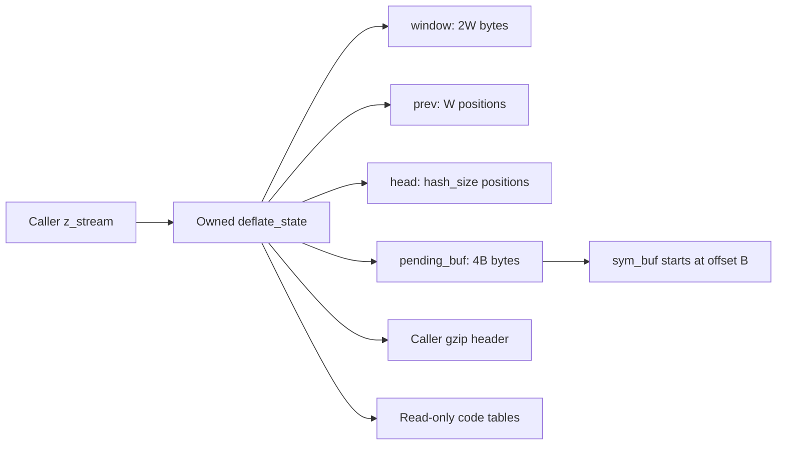
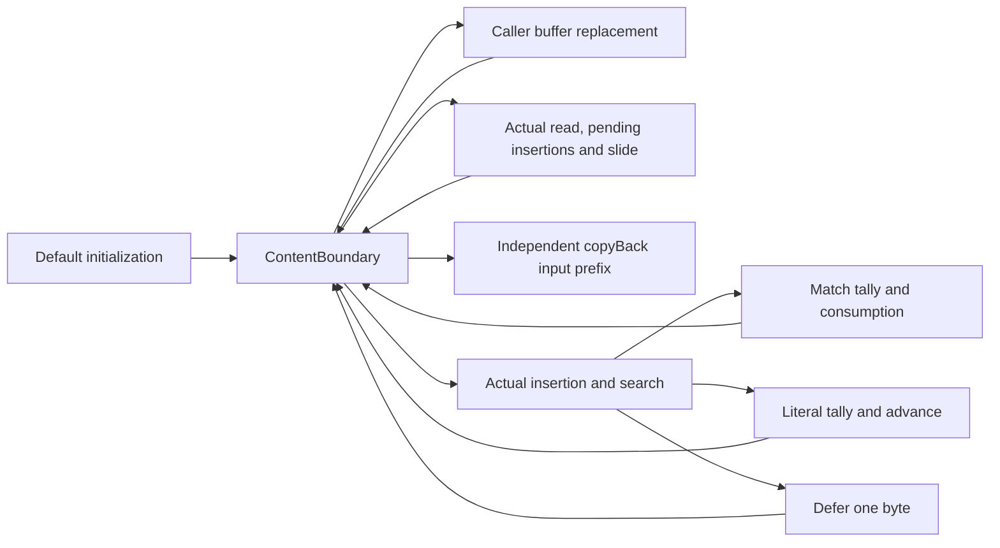
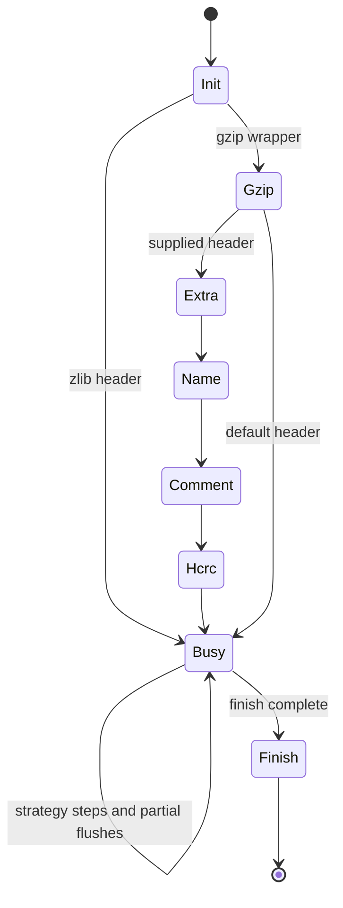
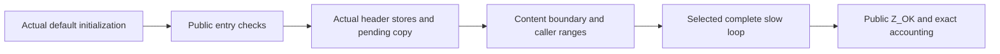
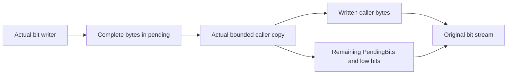
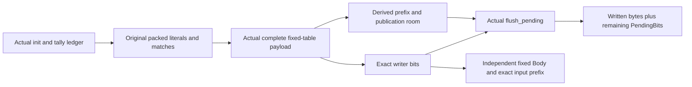
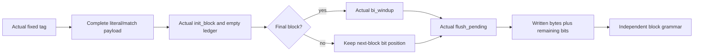
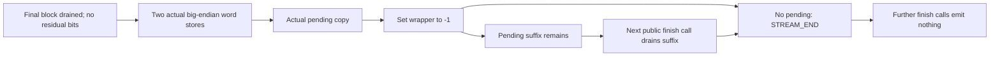

# Stream compression: window, chains and lifecycle

Source: `zlib/deflate.c`; translation: `ZlibF/Zlib/deflate.c.lean`.
The [API guide](../api/README.md) gives public behavior. Internal contracts use
`I-fw-*`, `I-sh-*`, `I-hc-inv`, `I-lm-*` and `I-fp-*` in
[internal contracts](../design/internal-contracts.md). Tree construction and the
shared-buffer bound F9 are explained in [trees](trees.md).

This page gives the proof structure and its internal premises. Conditional
results over `DGood` or a search invariant need an initialization and
preservation bridge before they imply public correctness. Current accepted
scope and remaining work are recorded only in [the overview](../overview.md).

## Storage and size equations



The stream owns five blocks: state, window, `prev`, `head` and pending storage.
The caller owns the stream, its input/output views and any gzip header buffers.
Embedded trees, heap and depth arrays belong to the state block.

Validated default-build parameters give these equations:

| Field | Value |
| --- | --- |
| `w_bits` | Normalized window parameter, with 8 changed to 9 |
| `W = w_size` | `1 << w_bits`, so `512 ≤ W ≤ 32768` |
| `window_size` | `2W` |
| `hash_bits`, `hash_size` | `memLevel + 7`, `1 << hash_bits` |
| `B = lit_bufsize` | `1 << (memLevel + 6)`, from 128 to 32768 |
| `pending_buf_size` | `4B` |
| `sym_buf`, `sym_end` | `pending_buf + B`, `3(B - 1)` |

These equations describe the default shared-symbol branch; configurations such
as a different symbol layout need their own refinement. Allocation products
must fit the allocator's 32-bit unsigned multiplication. The largest buffer
products here are 131072 bytes. State-size and ABI assumptions are separate.

The normalization to `W ≥ 512` is load-bearing:
`MIN_LOOKAHEAD = 262`, `MAX_MATCH = 258`, `MAX_DIST = W - 262 ≥ 250`.
Without it, a 256-byte window would make the distance subtraction wrap.

## Symbols and signed block positions

The symbol ledger ties each stored three-byte symbol to the leaf
frequencies in the same state. Distance zero means a literal; a positive
distance stores a length offset from three. A symbol represents at most
258 input bytes. With at most `B - 1` symbols, the represented byte count
is at most `258 * (B - 1)`. Each literal/length leaf frequency is at most
the symbol count plus one; each distance leaf is at most the symbol count.
The extra one is the end marker established by the actual initializer.
These bounds justify UInt16 increments without assuming no wrapping.
Summing the actual literal/length leaf frequencies gives exactly the
symbol count plus one. Summing the distance leaves gives at most the
symbol count. The proof counts each symbol once in its selected leaf;
it does not multiply a per-leaf upper bound by the alphabet size.
Thus the initial tree weight budget is at most B, with a strict bound
for the distance tree, before any source-prescribed dummy leaves.

The block balance is

```text
strstart - block_start = represented_bytes(symbols) + credit
```

At a regular slow-strategy boundary, credit is zero or one for a deferred
byte. At intermediate cutpoints it can be negative: tallying a match
subtracts its whole length before the source advances through that match.
Literal tally subtracts one, and one-byte traversal adds one.
Sliding subtracts the window size from both positions and preserves the
balance. The capacity bound controls a negative block_start and justifies
its checked signed subtraction. For default memory level 8, B is 16384;
the general shared-buffer bound permits B up to 32768.

The initialization bridge must retain actual leaf values, not just the
array extents in DGood. The tally bridge must retain both actual packed
bytes and the corresponding natural-number histogram on its returned
heap. Extent-only contracts cannot supply either fact.

## D: window bounds and `fill_window`

The shape invariant **D** is

```
strstart + lookahead ≤ window_size = 2W
```

Initialization starts both counters at zero. Reading input increases lookahead
by no more than the available window room. Consuming bytes advances `strstart`
and decreases lookahead by the same count. The proof must establish D at every
entry and strategy-loop point that uses it.

`I-fw-pre` additionally provides `lookahead < MIN_LOOKAHEAD`, valid sizes/masks,
`insert ≤ strstart`, a bounded high-water mark, search settings and the
hash-chain invariant. With the current D, the default branch computes
`more = window_size - lookahead - strstart` without loss from the relevant
unsigned subtractions and casts.

If `strstart ≥ W + MAX_DIST = 2W - 262`, then `more ≤ 262 - lookahead < W`.
The slide copies `W - more` bytes from `[W, 2W-more)` to `[0, W-more)`.
Both ranges are in the window and disjoint. The code adjusts `match_start`,
`strstart`, signed `block_start`, `insert`, hash positions and free room.

Each adjustment needs its own type argument. `strstart ≥ W` justifies its
subtraction. It does not show that `match_start ≥ W`: an unsigned stale match
position may wrap, and the proof must show when that value can subsequently be
used. Signed `block_start -= (long)W` must remain in range under its actual
invariant. Model the source expression and conversions exactly.

The sliding proof keeps a source-equal contiguous prefix: window copy,
match and current positions, signed block position, insertion clamp,
then both hash-rescaling loops. The new machine strstart is the old
position minus W. The logical input origin increases by W, so retained
match witnesses can continue to use modular distances even when an old
match_start wraps. Private pending bytes and their frequency ledger stay
unchanged.

After this prefix, the real outer-loop body agrees with a non-sliding
body on that returned heap. Equality of first body evaluations gives
equality of the remaining do-while computation, with the same condition
and remaining fuel. The non-sliding execution supplies the actual read,
checksum, re-priming and padding result. With no input the body still
slides before it exits; the generic high-water proof then supplies any
required padding without assuming the new window is already padded.

After the slide, `more += W` again measures room beyond data. If input remains,
`read_buf` copies at most that room into
`window + strstart + lookahead`. The insertion loop hashes only available
three-byte strings, masks `ins_h` to `hash_size` and writes the corresponding
`prev`/`head` cells. Establish how pending `insert` positions relate to the
current window contents.

The high-water initialization writes no farther than `window_size`: either it
extends after the new data by `min(window_size-curr, WIN_INIT)`, or it extends
from the old high-water mark by the smaller of the desired extension and the
remaining capacity. Bound both branch-specific subtractions before using them.
These writes also support the initialization history of later reads.

`I-fw-post-room` gives `strstart ≤ window_size - MIN_LOOKAHEAD`. The slide test
runs before the no-input exit, so the room argument must cover end-of-input
calls too. **to confirm**: every search caller obtains this bound from either
sufficient lookahead under D or a call to `fill_window`, including strategy
changes and resumed calls. A source reading of one loop does not prove it for
all strategies.

A non-sliding refill has real free room whenever the source lookahead
test requests it. Read at the old valid endpoint. Re-prime the rolling
hash at the current strstart, rather than at allocation offset zero.
After the source condition stops the outer loop, extend high-water
padding beyond the new valid endpoint. Retain the caller-input prefix
in the logical history and append the newly accepted bytes there.


## H1/H2: meaningful hash-chain reads

The source leaves `prev` uninitialized and fills it on demand. Safety must hold
for arbitrary contents of the other slots. Let a position be **inserted** when
an insertion operation records its three-byte hash, with its identity adjusted
by window slides and invalidated by hash clearing. Position zero is `NIL`.
With `T = strstart - W` interpreted in the mathematical position domain, use:

- **H1:** Every head is zero or a meaningful inserted position within the current
  represented data range.
- **H2:** For each retained inserted `q > T`, `prev[q & wmask]` contains its recorded
  predecessor after slide adjustment, either zero or a smaller inserted position
  with the relevant hash.

These clauses express `I-hc-inv`. Their exact temporal/range formulation must
cover insertion in `fill_window` and dictionaries as well as the strategy
macros. Membership in an allocated `prev` array alone proves no such fact.

`CLEAR_HASH` writes the last head and zeroes the preceding heads. The head map
is then empty; there is no need to initialize every `prev` slot. An insertion
writes its predecessor slot before publishing its position in the head. A
proof must track insertion order and show that overwriting the slot for a
position one window behind cannot destroy a retained link.

`slide_hash` visits every head and `prev` slot. It transforms every 16-bit value
m by `m ≥ W ? m-W : 0`. This is safe even for garbage. For meaningful links,
prove that the transformation agrees with new window positions and preserves
the mask slot, since subtracting W preserves the residue modulo W. Discarded
positions become `NIL`; arbitrary unused slots remain outside H2's domain.
The `do … while (--n)` loops start with positive sizes and have fixed bounds.

Dictionary insertion and copying must preserve these relationships. Copying
all of `prev` also copies garbage; that is permitted by the runtime rules.
No argument may infer that every copied slot was initialized.

## `longest_match`: F5 and F6

`I-lm-pre` supplies a nonzero matching head below `strstart`, distance at most
`MAX_DIST`, H1/H2, a room bound, a valid previous length and a positive effective
search budget. The first head is therefore in the retained H2 range.

Set `limit = max(strstart-MAX_DIST, 0)`. The first body may have
`cur_match = limit` when the distance is exactly `MAX_DIST`: the body is a
`do` loop. A continuing body requires the next predecessor to be strictly
above limit. Do not use that continuation test as an extra premise for the
first body.

At each reached predecessor read, H2 shows that the slot was initialized for
that position and contains zero or a smaller meaningful position. The loop test
rejects zero and out-of-range predecessors. This is **F5**: garbage may be
rescaled, but it is not used as a chain address.

The bounded-window argument is **F6**. `scan` starts at `window + strstart` and
`match` at an earlier valid position. Previous-match sentinels use a length at
most 258. The default comparison loop advances from offset 2 in groups of eight
up to offset 258, since `258 - 2 = 8 × 32`. The room premise gives
`strstart + 258 < window_size`, so every such comparison is in bounds. Alternate
unaligned comparison branches require their actual width/alignment proof.

These comparisons may inspect arbitrary bytes beyond real lookahead. Such a
read is allowed for the modeled integer bytes, but the returned match is
clamped to lookahead. Functional correctness must show that the selected match
agrees on the real data; no-fault reasoning alone does not prove independence
of garbage.

For termination, meaningful predecessor positions strictly decrease. The
configured chain budget also bounds the walk. **to confirm**: the budget stays
positive after its `>>= 2` reduction whenever that branch applies, including
values permitted through `deflateTune`. If a zero budget wraps on decrement,
unsigned wrapping is defined; it still invalidates a proof that assumes that
budget strictly decreases to zero. Use only bounds justified by the exact
contract.

The actual insertion result supplies two different facts at different times.
Before insertion, a nonzero returned head is below the old insertion frontier,
which is no later than `strstart`. After insertion, the head names `strstart`
and its predecessor cell names that returned head. Use the first fact for
candidate order and the latter facts for chain provenance. A post-insertion
NIL head at position zero does not constrain arbitrary old prev contents.
The heap bridge derives matcher storage from DGood and comparison room from
D plus sufficient lookahead. It does not assume the matcher's contract.

The slow strategy decreases lookahead before inserting the consumed match
positions. Its insertion loop therefore needs three valid bytes, not the
262-byte matcher entry condition. For a previous length from 3 through 258,
that source update leaves at least five lookahead bytes. The positive
prev_length counter after subtracting two is at most 256. Use that actual
heap counter as the do-while rank. Keep strstart plus the counter constant
while each insertion advances the primed rolling hash. The final source
increment restores the original strstart-plus-lookahead endpoint.

A pending literal also needs strstart to be positive when match_length is
below three. Keep this fact separately from the conditional match witness.
Initialization has no pending literal, and every source decision preserves
the implication from a pending literal to a consumed previous byte.

The result returns `min(best_len, lookahead)` and updates `match_start` on an
improvement. Prove its byte-equality and distance facts for callers, including
the case in which stale match state is retained.

## Strategy loops and symbol production

SlowBoundary ties the actual owned arrays to the logical input, current
hash-chain frontier and lazy match history. It also carries the symbol
ledger and block balance. Deferred-byte credit is defined by the actual
match_available flag. Initialization supplies this boundary with no
symbols and an empty input view.

PendingBoundary adds the earlier frontier strstart-insert. This describes
strings awaiting their third byte. It records insert<=strstart and requires
insert=0 once lookahead>=3. Initialization establishes both frontiers.
Caller rebuffering preserves the owned arrays and both chain facts.
The actual priming loop advances its local position and decreases the
heap insertion counter together. It stops with exactly
min(old insert, 2-lookahead) pending strings. Sliding clamps insert to
the new strstart; the new lower frontier is the old frontier minus one
window, using truncated natural subtraction. Complete refill preserves
the same logical input prefix, symbol ledger and block balance.
The public null-input refusal is discharged before this internal call.



The non-flushing body appends at most one real symbol. A selected match
starts with one deferred byte, tallies the full previous match length,
then advances through the remaining length minus one. Its credit returns
to zero. A literal spends one credit and restores it by advancing one
byte. Deferring emits no symbol and changes credit from zero to one.
The exact record frame retains all fields outside the source writes.
In particular the buffer geometry, block_start, high_water and wrapper
configuration are available to the next proof step.
The refill frame separately retains all fields outside slide, read,
priming and padding writes. This supplies the strategy's symbol-room
condition on the actual filled heap. The source's Z_NO_FLUSH guard
returns need_more before search when the filled lookahead is short.
Otherwise the complete search/body execution starts on that heap.
The composed iteration accounts for accepted bytes and preserves the
absolute input endpoint, including the shift of window origin.

ContentBoundary adds a symbol trace at an absolute block base. Each
literal agrees with the input byte at its cumulative position. Every
match agrees byte by byte with its positive-distance predecessor,
including overlap within that match. The trace expands through the
independent format copyBack to the complete input prefix. Its endpoint
is origin+strstart minus the zero-or-one deferred-byte credit.
The source branch evidence is retained with each actual emitted value:
a literal has an incoming deferred byte, and a retained match has length
at least three. These facts place that value at the trace endpoint.
Refill extends the logical input only after the old accepted endpoint,
so it preserves all earlier symbol meanings even when the window slides.
Initialization establishes the empty trace before caller rebuffering.

The byte-storage frame preserves raw arrays and embedded depth arrays
outside the five private object keys, as well as the read-only flags and
static byte tables. Stream records may advance their caller cursors.
The private ownership keys stay fixed under refill and slow record
updates. CallerRange therefore transports the unread input suffix and
unchanged output range to the returned heap. Interval separation is
preserved even when the two caller ranges share one allocation.
The real refill establishes this frame through its read, deferred
insertion loop, padding and optional slide. The same returned heap then
carries ContentBoundary, accounting and StreamBuffers together.
The actual search and coding decisions also retain that byte-storage
frame. Hash insertion changes word tables and one private state record.
Match consumption preserves it through the complete insertion loop.
Tally writes only the private pending byte array and private state.
Composing those effects preserves caller buffers after each complete
Z_NO_FLUSH iteration. SlowIterationFrame records exactly the union of
fields written by refill and slow coding; its untouched fields include
wrapper, symbol capacity and storage geometry. The source return is
either its prior value or need_more.

The complete before-block loop uses the explicit internal budget
`3 * (origin + fillEnd + avail_in - base + 1) < sym_end`. Every symbol
represents at least one byte, so the content ledger derives tally room
for each actual iteration. The accepted endpoint plus unread caller input
is constant. This also transports the budget through refill and sliding.
No tally-room contract is assumed.

The loop rank is zero after a source return. Otherwise it is
`lookahead + avail_in + 1`. Refill transfers bytes between those terms;
a coding step advances the absolute consumed position. The rank therefore
strictly decreases. Window geometry and the caller's UInt32 count derive
the bound below the runtime's 2^64 fuel. The loop invariant composes input
accounting, content-prefix agreement, symbol-list extension, caller-buffer
validity and both exact frames on each returned heap.

A retained source stop reason distinguishes short lookahead with no input
from an exhausted output count. The strategy emits no output on this
path, so a positive initial output count forces acceptance of all input.
The result expands every emitted symbol through the independent format
copyBack and retains the deferred-byte credit. Actual default initialization
preserves caller bindings and derives sym_end = 49149. A 300-byte concrete
caller then reaches the complete internal loop with a nonempty symbol trace.
This is an initialization-to-strategy witness, not public dispatch.


| Function | Required invariant and functional step |
| --- | --- |
| `deflate_stored` | Bound direct input/output copies, pending header rewrites and window retention; track `block_start`, signed/unsigned conversions, and hash-slide bookkeeping for later strategy changes. |
| `deflate_fast` | Insert meaningful positions, prove a selected match, tally valid symbols and preserve D/H1/H2 across flush/return. |
| `deflate_slow` | Also relate deferred literals, `prev_length` and lazy-match decisions to the consumed input. |
| `deflate_rle` | Establish the prior-byte read at `strstart-1` and comparison room through offset 258; emit only valid distance-one matches. |
| `deflate_huff` | Emit the consumed bytes as literals and preserve the same block/flush invariant. |

A symbol consumes three bytes and increases `sym_next` by three. Flushing at
`sym_end = 3(B-1)` bounds every tally write within the symbol region.
For a match, the stored length offset is at most 255 and distance minus one is
at most 32767, so `_length_code` and the 512-entry `_dist_code` lookup are in
range. The branch `256 + (dist >> 7)` is at most 511 under that premise.

These bounds must hold again when `compress_block` reads the symbol. If pending
output overwrote it, the reconstructed distance could be any 16-bit value and
the table index could reach 767. F9 therefore protects later reads as well as
output writes. A total compressed-size bound does not establish F9's prefix
condition. See [trees](trees.md#the-overlay-lemma-f9), including the small
`memLevel` cases.

`block_start` can become negative after a slide. The block-flush macro then
passes a null raw-buffer pointer, so an invariant requiring
`0 ≤ block_start` everywhere is wrong. **to confirm**: the signed interval and
per-branch nonnegative conditions establish each actual window copy and the
stored-length subtraction without hiding that case.

## `deflate`: headers, data and trailers



For the first default level-six Z_NO_FLUSH call, exact source cut points
join entry checks, the zlib header and data dispatch. The arithmetic writes
0x78,0x9c. One output byte follows the header's early return. A complete
header updates both output cursors and the wrapped total, and resets the
pending cursor. Its metadata update keeps the initialized window, hash
frontiers, leaf frequencies and empty symbol ledger. Size-preserving
writes retain caller range safety, even for two intervals in one object.
This size relation makes no claim about their contents.



The before-block composition retains the absolute accepted endpoint and
independent symbol expansion on the same returned heap. The private byte
frame then retains both wrapper bytes in caller output. A concrete
300-byte caller executes initialization and the public function, with a
nonempty symbol trace after the call. The supporting first-call theorem
states its raw-output, three-byte capacity and before-block budget scopes.
Current coverage and remaining refinement obligations are in the overview.

The actual source has conditional skips and partial returns inside these
groups. The invariant D7 ties `EXTRA`, `NAME`, `COMMENT` and `HCRC` to valid
`gzhead` storage. An earlier invariant admitted `EXTRA` with a null header;
that counterexample showed a missing reachability condition, not a legal
sequence theorem.

Each header `put_byte` needs pending room. Extra/name/comment loops flush at
capacity and preserve their exact progress counters across output exhaustion.
The subtraction `(extra_len & 0xffff) - gzindex` requires the corresponding
progress bound. Trailer writes require the same room proof. `flush_pending`
uses `pending_out + pending ≤ pending_buf + pending_buf_size` and copies at
most `avail_out`, then updates exact cursors and counts.

The aligned raw-output flush_pending proof executes the actual bit-flush
callee, which leaves fewer than eight buffered bits unchanged. The unsigned
length selection has natural value min(pending, avail_out), including the
branch where pending does not fit UInt32. Zero selection returns before
pointer access. For positive selection, the exact returned heap has the
copied prefix, both advanced pointers and wrapping output-total update.
The pending cursor resets to pending_buf exactly when the subtraction is
zero. The internal premise requires distinct raw output and pending objects;
it is not a new restriction on the public caller-buffer domain.

The complete publishing proof first executes the actual bi_flush callee.
It increases pending by bi_valid/8 and retains bi_valid%8 bits. The same
returned heap supplies DGood to the pending copy. Copying min(pending,
avail_out) bytes uses non-wrapping count subtraction, advances both cursors
and resets pending_out only when no bytes remain. The returned public
PendingBits relation starts at the actual advanced cursor. Its bits,
prefixed by the written caller bytes, equal the writer's original bits.
The proof retains object identities, allocation counters and the full
old-object frame as well as caller-range sizes and read-only flags.



The publishing phase has pending_out = pending_buf. A fitting actual
send_bits call preserves that cursor and establishes its new bit count
and content on the same heap. Default initialization followed by one or
two eight-bit sends provides concrete executions of the byte and word
bi_flush branches. Each actual copy has zero allocation change.
After a partial copy, the resumed low-bit theorem obtains the actual
cursor and allocation from DGood. It splits the bytes at that cursor,
not at pending_buf. Legal caller replacement retains the complete public
PendingBits sequence. A two-call composition includes both actual flushes
and arbitrary valid raw-output capacities; both observed output lists
followed by the final pending bits equal the original sequence.
**to confirm**: establish the publishing phase and room conditions for
every block selection and preserve the phase across all public paths.
The overview tracks current scope.

The public pending-output branch now composes both actual last_flush
writes with the proved flush_pending execution. When positive output
capacity is no greater than the pending byte count, it returns Z_OK,
records the retry marker -1 and leaves input untouched. The remaining
bit relation uses the returned advanced cursor. All admitted flush flags
are included; a FINISH_STATE entry requires Z_FINISH, exactly as in C.
This composes the real entry, rather than assuming a callee contract.
The complementary idle path drains positive pending bytes with output
room remaining. In BUSY_STATE with no input or lookahead on Z_NO_FLUSH,
the actual header and data continuation returns Z_OK, with the base
pending cursor, remaining caller output capacity and normal flush marker.

The complete fixed-table payload consumes the packed logical symbols
in their original order. A legal literal costs at most nine bits; a legal
match costs at most 31 bits, including length and distance extras. If i
symbols have been consumed, their output costs at most 31*i bits, while
the next symbol starts at byte lit_bufsize+3*i. The actual symbol-count
bound and minimum buffer size derive the no-overtaking and total-room
conditions. No output-room contract is an engine premise here.
For default memLevel 8, the payload and END_BLOCK leave at most 63486
pending bytes in 65536 bytes. This also derives complete-bit publication
room. The actual engine ledger supplies count, packed bytes and legal
symbol values. Emission and flush_pending compose on one heap, retaining
DGood, caller ranges, allocation/frame facts and the exact bit sequence.
The stored fixed words also agree with the independent canonical codes.
Length/distance extras give the independent field values. The complete
payload accepts every trailing suffix in Symbols, including END_BLOCK.
The actual logical trace identifies its output with the input prefix,
using independent copyBack for overlapping matches. This grammar result
composes with actual payload emission and publication on the same heap.



The selected fixed branch now includes the actual checked tag arithmetic.
At most seven entry bits become at most ten payload-entry bits. After
compress_block, the real init_block loops restore the empty symbol ledger
while retaining pending output and all bit-buffer fields. Only then does
the source run bi_windup when last is nonzero. Non-final blocks keep their
exact next-block continuation. Final blocks append alignment bits, clear
the bit buffer and use at most 63488 pending bytes in default memory.
The full source equality retains both other branches and all preparation.



For a final block starting at a byte boundary and full publication, the
actual bytes satisfy independent Deflate.Valid for the logical input.
The grammar skips precisely the terminal remainder of that byte. This
corollary uses a sufficient 63488-byte caller view; execution and partial
publication have arbitrary raw caller capacity. Earlier preparation and
selection remain separate from this checked source-branch composition.
The returned BlockOutputFrame names every changed state-record field.
Window, hash, match history, positions and configuration retain their old
values. The reset counters and empty leaf frequencies are established on
the post-publication heap. Earlier supporting statements keep their exact
types and follow from the stronger results.

Public correctness additionally relates emitted wrapper fields, block bits,
checksums and trailer lengths to the consumed input and selected flush schedule.
A monotone history of whether compression has started matters across refusals:
a failed call must not make a later call look like a fresh stream.

## API lifecycle and error cases

| Functions | Proof boundary |
| --- | --- |
| `deflateInit_`, `deflateInit2_` | Validate parameters and version/size; allocate state and four buffers; establish every field/ownership clause on success and free every successful allocation on failure. The default allocator does not zero storage. |
| `deflateReset`, `deflateResetKeep`, `lm_init` | Distinguish full history/hash reset from retained-state behavior and establish the appropriate phase invariant. |
| `deflateEnd` | Free all owned buffers and state exactly once under every admitted status; return the documented status and clear the state pointer. |
| `deflateSetDictionary`, `deflateGetDictionary` | Read/copy the permitted dictionary views, update wrapper checksum/history and meaningful insertions, and return the exact dictionary suffix. |
| `deflatePrime` | Preserve nonnegative/negative-count behavior and pending/bit-buffer capacity conditions with the source's exact shifts. |
| `deflateParams` | Compose any `deflate(Z_BLOCK)` call and its partial/failure effects before changing strategy, level and hash state. |
| `deflateCopy` | Allocate independent blocks, clean up each failure prefix, copy only the source-prescribed ranges and rebase pending/symbol/descriptor pointers. |
| `deflateBound`, `deflateBound_z` | Prove machine arithmetic and separately prove output adequacy under the contract's configuration/header conditions. A numeric formula theorem is not adequacy. |
| `deflateTune`, `deflatePending`, `deflateSetHeader`, `deflateUsed` | Exact parameter/query/refusal effects, permitted output-cell writes and preservation needed by later data calls. |

Copy's window content range is `high_water`; its `prev` copy includes unwritten
integer cells. Allocation failure may occur after earlier allocations succeeded.
The proof must retain the source's cleanup behavior and destination/source
frames for each case. Callee contracts are proved execution results, never
hypotheses bundled into the top theorem.

The lifecycle theorem composes initialization, calls, reset/dictionary/header/
priming/copy operations and End. The round-trip theorem then connects the actual
emitted stream to independent DEFLATE semantics for every permitted split,
strategy, level and configuration in its domain. Historical restrictions such
as `memLevel ≥ 4` must remain explicit where a theorem has them; they cannot
stand for the full `zlib.h` domain.

## Finishing the default zlib wrapper

The source finish tail has two phases. It writes the four checksum bytes,
then copies as much pending output as the caller can receive. The wrapper
flag becomes negative even when the copy is partial. Later calls must drain
that pending suffix before returning through the negative-wrapper branch.
This ordering prevents duplicate trailers.



The internal trailer publisher accepts arbitrary raw output capacity. The
public finish entry requires positive capacity, FINISH_STATE, empty input
and lookahead, a base pending cursor, zero pending bytes and zero residual
bits. These are phase facts supplied by strategy completion. Its last_flush
range is -2..5, matching initialization and accepted flag stores. The public
pending-drain theorem retains an advanced cursor and requires capacity
strictly larger than the queued suffix. Capacity exhaustion uses the existing
public pending theorem. All cases retain the complete emitted-bit ledger.

## Tree construction on the compressor heap

The tree builder's exact record footprint permits changes to its selected
tree and descriptor maximum, heap and depth work arrays, bit-length counts
and costs. All replacement arrays retain their original extents. Engine
preservation follows from that footprint and the builder's actual checked
tree representation. It retains stream ownership, caller buffer ranges,
allocation counts and the pending output bit sequence.

The embedded depth byte view needs its own size argument. Its contents
change during construction, so exact byte-view equality would be false.
The caller-size relation records its retained extent. Actual adjacent literal
and distance builds compose these facts, then establish the BL constructor's
input representation from the same execution. No called specification is
assumed.
