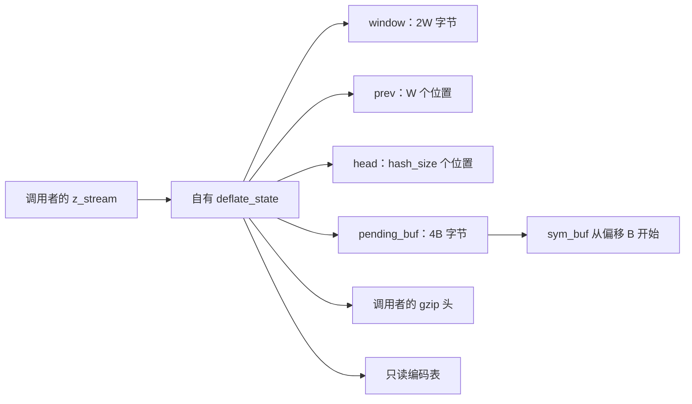
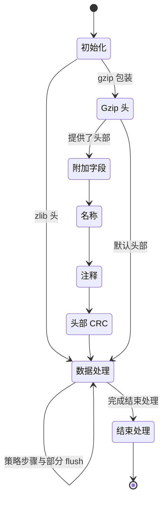

# 流式压缩：窗口、链与生命周期

源文件：`zlib/deflate.c`；翻译：`ZlibF/Zlib/deflate.c.lean`。
[API 指南](../spec/api/README.md)规定公开行为。
内部契约使用[内部契约](../spec/internal-contracts.md)中的 `I-fw-*`、`I-sh-*`、`I-hc-inv`、`I-lm-*`、`I-fp-*`。
树构造与共用缓冲区界限 F9 见[树](trees.md)。

本页给出证明结构及其内部前提。以 `DGood` 或搜索不变量为条件的结果，
需要通过初始化与保持论证连接，才能推出公开正确性。
当前已接受范围与剩余工作只记录在[进度](../progress.md)。

## 输入范围与路径组合

[共用输入配置](../spec/input-configurations.md#deflate-inputs)定义严格嵌套的默认、常见及完整流参数范围。
完整且范围明确的声明使用同一套覆盖颜色。精确入口契约保持其原有定义域。
较小的分支引理仍是组合证明的依据，其前提必须明确。

对于这个压缩器，级别与策略选择不同引擎。
应把存储、快速、慢速、仅 Huffman、RLE 的执行义务，与可共用参数化证明的数值范围分开。
补充输入／窗口引理及树／输出引理各自记录内存级别、窗口、符号空间前提。
默认初始化可以建立自己的不变量，不必依赖完整 Init2 契约。
成功见证是支持性证据，不能代替对所有许可调用者状态的覆盖。

## 存储与大小等式



流拥有五个块：状态、窗口、`prev`、`head` 和待输出存储。
调用者拥有流记录、输入／输出视图及 gzip 头缓冲区。
内嵌树、堆、深度数组属于状态块。

经过验证的默认构建参数给出以下等式：

| 字段 | 值 |
| --- | --- |
| `w_bits` | 规范化窗口参数，8 调整为 9 |
| `W = w_size` | `1 << w_bits`，因此 `512 ≤ W ≤ 32768` |
| `window_size` | `2W` |
| `hash_bits`、`hash_size` | `memLevel + 7`、`1 << hash_bits` |
| `B = lit_bufsize` | `1 << (memLevel + 6)`，范围 128 到 32768 |
| `pending_buf_size` | `4B` |
| `sym_buf`、`sym_end` | `pending_buf + B`、`3(B - 1)` |

这些等式描述默认的共用符号分支；其他配置，例如不同符号布局，需要自己的细化。
分配大小的乘积必须能由分配器的 32 位无符号乘法表示。
这里最大缓冲区乘积是 131072 字节。状态大小和 ABI 假设是单独事项。

规范化到 `W ≥ 512` 是关键条件：
`MIN_LOOKAHEAD = 262`、`MAX_MATCH = 258`、`MAX_DIST = W - 262 ≥ 250`。
否则，256 字节窗口会使距离减法回绕。

## D：窗口界限与 `fill_window`

形状不变量 **D** 为：

```
strstart + lookahead ≤ window_size = 2W
```

初始化把两个计数都设为零。读入使 lookahead 的增量不超过可用窗口空间。
消费字节使 `strstart` 增加、lookahead 减少相同数量。
证明必须在每个使用 D 的入口及策略循环位置建立它。

`I-fw-pre` 还提供 `lookahead < MIN_LOOKAHEAD`、有效大小／掩码、`insert ≤ strstart`、
有界的高水位、搜索设置及哈希链不变量。
结合当前 D，默认分支计算 `more = window_size - lookahead - strstart` 时，
相关无符号减法与转换不会丢失数学值。

若 `strstart ≥ W + MAX_DIST = 2W - 262`，则 `more ≤ 262 - lookahead < W`。
滑动把 `W - more` 个字节从 `[W, 2W-more)` 复制到 `[0, W-more)`。
两个范围都在窗口内且不相交。代码调整 `match_start`、`strstart`、有符号 `block_start`、
`insert`、哈希位置及空闲空间。

每项调整需要自己的类型论证。`strstart ≥ W` 证明其减法合理，却不能推出 `match_start ≥ W`：
无符号的过期匹配位置可能回绕，证明必须说明该值何时还可能被使用。
有符号 `block_start -= (long)W` 必须在实际不变量下保持可表示。
应准确建模源表达式与转换。

滑动后，`more += W` 再次度量数据之后的空闲空间。
若输入仍存在，`read_buf` 把至多该空间大小的字节复制到 `window + strstart + lookahead`。
插入循环只哈希已有的三字节串，把 `ins_h` 掩码到 `hash_size` 范围，并写相应 `prev`／`head` 单元。
必须建立待处理 `insert` 位置与当前窗口内容的关系。

高水位初始化的写入不超过 `window_size`：或者在新数据之后扩展
`min(window_size-curr, WIN_INIT)` 字节，或者从旧高水位开始，扩展期望长度与剩余容量的较小值。
使用前应为两个分支各自的减法建立界限。这些写入也支撑后续读取的初始化历史。

`I-fw-post-room` 给出 `strstart ≤ window_size - MIN_LOOKAHEAD`。
滑动判断先于无输入出口，所以空间论证也必须覆盖输入结束后的调用。
**待确认（to confirm）**：每个搜索调用者都能由 D 下足够的 lookahead，或一次 `fill_window` 调用，
取得该界限，包括策略变化和恢复调用。只阅读一个循环的源代码，不能证明全部策略。

## H1/H2：有意义的哈希链读取

源代码不初始化整个 `prev`，而是按需填入。其他槽位任意取值时仍必须安全。
当插入操作记录某位置的三字节哈希时，称该位置**已插入**；其身份随窗口滑动调整，哈希清空时失效。
位置零是 `NIL`。在数学位置域中解释 `T = strstart - W`，使用以下条件：

- **H1：** 每个 head 是零，或当前所表示数据范围内有意义的已插入位置。
- **H2：** 对每个保留的已插入位置 `q > T`，`prev[q & wmask]` 包含滑动调整后的已记录前驱，
  该前驱是零，或更小且哈希相关的已插入位置。

这些条件表达 `I-hc-inv`。其准确的时序／范围形式必须覆盖 `fill_window` 与字典中的插入，
也覆盖策略宏。某位置属于已分配 `prev` 数组，并不能证明这些事实。

`CLEAR_HASH` 写最后一个 head，再把前面的 head 清零。
此后 head 映射为空，无须初始化每个 `prev` 槽位。
插入先写前驱槽位，再把位置发布到 head。
证明必须跟踪插入顺序，说明覆盖一个窗口之前的位置所用槽位，不会破坏保留的链接。

`slide_hash` 访问每个 head 和 `prev` 槽位，把任意 16 位值 m 变为 `m ≥ W ? m-W : 0`。
即使是垃圾值，这样转换也安全。对于有意义链接，应证明转换与新窗口位置一致且保持掩码槽位，
因为减去 W 保持模 W 的余数。丢弃的位置变成 `NIL`；任意未用槽位仍在 H2 定义域之外。
`do … while (--n)` 循环从正大小开始，具有固定界限。

字典插入与复制必须保持这些关系。复制整个 `prev` 也复制垃圾值，运行时规则允许这一点。
不能由复制推出每个槽位都已初始化。

## `longest_match`：F5 与 F6

`I-lm-pre` 提供小于 `strstart` 的非零匹配 head、至多 `MAX_DIST` 的距离、H1/H2、空间界限、
有效的先前长度及正的有效搜索预算。因此首个 head 位于保留的 H2 范围内。

令 `limit = max(strstart-MAX_DIST, 0)`。
当距离恰好为 `MAX_DIST`，首个循环体可以有 `cur_match = limit`，因为循环是 `do` 循环。
继续执行的循环体要求下一个前驱严格大于 limit。
不能把这个继续条件当成首个循环体的额外前提。

每次实际前驱读取时，H2 都说明该槽位曾为该位置初始化，内容为零或更小的有意义位置。
循环条件拒绝零及范围外前驱。这是 **F5**：垃圾值可以被重新缩放，但不能用作链地址。

有界窗口论证是 **F6**。`scan` 从 `window + strstart` 开始，`match` 从更早的有效位置开始。
先前匹配的哨兵使用至多 258 的长度。默认比较循环从偏移 2 开始，每组推进八个字节，直到偏移 258，
因为 `258 - 2 = 8 × 32`。
空间前提给出 `strstart + 258 < window_size`，所以这些比较都在界限内。
其他非对齐比较分支需要按其实际宽度／对齐条件证明。

比较可能查看真实 lookahead 之外的任意字节。在模型中的整数型字节上，这种读取被允许，
但返回匹配会被截断到 lookahead。
功能正确性必须说明所选匹配在真实数据部分相等；无故障论证本身不能证明结果与垃圾值无关。

终止性方面，有意义的前驱位置严格递减。配置中的链预算也限制遍历。
**待确认（to confirm）**：适用 `>>= 2` 缩减分支时，预算缩减后仍为正，
包括 `deflateTune` 许可的值。若零预算在递减时回绕，无符号回绕本身有定义，
但这会使“预算严格递减到零”的证明假设失效。
只能使用精确契约能证明的界限。

结果返回 `min(best_len, lookahead)`，并在改进时更新 `match_start`。
应为调用者证明字节相等与距离事实，包括保留过期匹配状态的情形。

## 策略循环与符号生成

| 函数 | 所需不变量与功能步骤 |
| --- | --- |
| `deflate_stored` | 限制直接输入／输出复制、待输出头重写及窗口保留；跟踪 `block_start`、有／无符号转换及后续策略变化需要的哈希滑动记录。 |
| `deflate_fast` | 插入有意义位置，证明所选匹配，累计有效符号，并在 flush／返回期间保持 D/H1/H2。 |
| `deflate_slow` | 还要把延迟字面量、`prev_length` 及惰性匹配决策对应到已消费输入。 |
| `deflate_rle` | 建立 `strstart-1` 的先前字节读取及到偏移 258 的比较空间，只输出有效的距离一匹配。 |
| `deflate_huff` | 把消费的字节输出为字面量，并保持相同的块／flush 不变量。 |

每个符号占用三字节，`sym_next` 增加三。
在 `sym_end = 3(B-1)` 处 flush，使每次 tally 写入都在符号区域内。
匹配中，保存的长度偏移至多为 255，距离减一至多为 32767，
所以 `_length_code` 和有 512 项的 `_dist_code` 查找均在范围内。
在该前提下，`256 + (dist >> 7)` 分支至多为 511。

`compress_block` 读取符号时，这些界限必须仍成立。
若待输出区覆盖符号，重建距离可能为任意 16 位值，表索引可能达到 767。
所以 F9 不仅保护输出写入，也保护后续读取。
总压缩大小上界不能建立 F9 的前缀条件。
见[树](trees.md#the-overlay-lemma-f9)，包括较小 `memLevel` 的情形。

滑动后 `block_start` 可为负。此时块 flush 宏传递 null 原始缓冲区指针，
所以处处要求 `0 ≤ block_start` 的不变量是错误的。
**待确认（to confirm）**：有符号区间及各分支的非负条件能够证明每次实际窗口复制及存储长度减法，
同时不隐藏负值情形。

## `deflate`：头部、数据与尾部



实际源代码在这些组内有条件跳过及部分返回。
不变量 D7 把 `EXTRA`、`NAME`、`COMMENT`、`HCRC` 对应到有效的 `gzhead` 存储。
先前不变量允许 null 头部处于 `EXTRA`；该反例表明缺少可达性条件，并不是合法序列定理。

每个头部 `put_byte` 都需要待输出区空间。
extra/name/comment 循环在容量处 flush，并在输出空间耗尽时保持准确的进度计数。
减法 `(extra_len & 0xffff) - gzindex` 需要相应进度界限。
尾部写入需要同样的空间证明。
`flush_pending` 使用 `pending_out + pending ≤ pending_buf + pending_buf_size`，
复制量至多为 `avail_out`，随后准确更新游标和计数。

公开正确性还需把发出的包装字段、块比特、校验和及尾部长度，
对应到已消费输入与所选 flush 安排。
对于“压缩是否已经开始”需要单调的历史记录，并跨拒绝保持：
失败调用不得使后续调用看起来像全新流。

## API 生命周期与错误情形

| 函数 | 证明边界 |
| --- | --- |
| `deflateInit_`、`deflateInit2_` | 验证参数及版本／大小；分配状态与四个缓冲区；成功时建立全部字段／所有权条件，失败时释放每个成功分配。默认分配器不清零存储。 |
| `deflateReset`、`deflateResetKeep`、`lm_init` | 区分完整历史／哈希重置与保留状态行为，并建立相应阶段不变量。 |
| `deflateEnd` | 在每个许可状态下恰好释放一次所有自有缓冲区及状态，返回文档规定状态并清空状态指针。 |
| `deflateSetDictionary`、`deflateGetDictionary` | 读取／复制许可字典视图，更新包装校验和／历史及有意义的插入，返回准确字典后缀。 |
| `deflatePrime` | 用源代码准确的移位，保持非负／负计数行为及待输出区／位缓冲区容量条件。 |
| `deflateParams` | 改变策略、级别及哈希状态前，组合可能的 `deflate(Z_BLOCK)` 调用及其部分／失败效果。 |
| `deflateCopy` | 分配独立块，清理每个失败前缀，只复制源规定范围，并重定位待输出／符号／描述符指针。 |
| `deflateBound`、`deflateBound_z` | 证明机器算术，并单独证明在契约配置／头部条件下容量足够。数值公式定理不等于容量充分性。 |
| `deflateTune`、`deflatePending`、`deflateSetHeader`、`deflateUsed` | 准确参数／查询／拒绝效果、许可输出单元写入及后续数据调用所需的保持。 |

Copy 的窗口内容范围是 `high_water`；`prev` 复制包括未写入的整数单元。
先前分配成功后仍可能出现分配失败。
证明必须逐一保持源清理行为及目标／源的帧性质。
被调用者契约是已证明的执行结果，不能打包成顶层定理的假设。

生命周期定理组合初始化、数据调用、reset／字典／头部／priming／copy 操作及 End。
往返定理再把实际发出流连接到独立 DEFLATE 语义，覆盖其定义域中全部许可拆分、策略、级别与配置。
如果某个定理有 `memLevel ≥ 4` 等历史限制，必须明确保留；
不能用它代表完整 `zlib.h` 定义域。

## 与 C 的对应检查

### 分配、初始化与复制

`zcalloc(items, size)` 先对 32 位无符号实参相乘，再拓宽用于分配。
回绕是有定义行为。压缩器分配大小低于该阈值：状态为 5968 字节；
窗口为 `2 * w_size` 字节；`prev` 有 `w_size` 个 16 位项；`head` 有 `hash_size` 个 16 位项；
待输出存储为 `4 * lit_bufsize` 字节。

`deflateInit2_` 在构造状态前检查版本、流大小与参数。
请求八位 zlib 窗口时提升到九位。应保留这些检查及其顺序。
缺少的分配器回调替换为默认函数。
自定义回调行为有单独范围，见[偏离与限制](../deviations.md)。

版本检查在 null 判断后只读取第一个字节。
状态检查读取 deflate 状态反向指针及 status；它们不能使任意指针或 inflate 状态指针
都可以安全解释为 deflate 记录。
**待确认（to confirm）**：所表示指针种类与合法调用历史能证明这些读取有效，且不默默缩小公开拒绝域。

自有分配共有五个：状态、窗口、前驱、head 和待输出存储。
状态分配后，四次缓冲区分配先全部发生，再进行合并的失败检查。
即使更早缓冲区分配失败，后续分配尝试仍会发生。
清理必须恰好释放取得的块、按 C 的方式清空公开状态，并保留源返回码。
模型中新指针字段为 null，不能代替“C 已初始化清理时读取的每个指针”的证明。

`deflateEnd` 在释放前读取 status。
它依次释放待输出存储、head、前驱、窗口、状态，然后清空流状态指针。
对于忙碌流，它可以在全部释放后返回 `Z_DATA_ERROR`。
返回码与所有权效果是不同事实。

`deflateCopy` 先复制状态记录，分配其后备块，再复制公开流并安装目标状态。
失败时释放新块，而非复制进记录的源指针。
成功复制保持以下区别：

- 窗口复制以 `high_water` 为界。
- 前驱在滑动后复制整个窗口，否则复制由 `strstart - insert` 决定的前缀。
  **待确认（to confirm）**：`insert <= strstart` 能证明该无符号大小计算有效。
- 待输出指针保留其在新块中的偏移。尚未发送的待输出字节与已使用符号字节复制到相应偏移。
  `sym_buf` 变为新待输出基址加 `lit_bufsize`。
- 流反向指针与动态描述符指针改为目标。借用的 gzip 头及静态描述符指针保持共享。

C 复制整个流，所以不能默默把重叠视为安全。
源、目标相同还可能替换源状态并丢失旧所有权；API 是否许可这种调用仍**待确认（to confirm）**。
字节复制可包含未初始化数据。值复制必须保留这些数据，以及后续修正的源顺序。

### 窗口移动与策略循环

`read_buf` 在复制前减少 `avail_in`，对目标字节计算校验和，再推进 `next_in` 与 `total_in`。
存储策略还用它把输入直接复制到调用者输出。
改变校验和输入或移动计数更新位置，都改变了翻译。

`fill_window` 在 `ulg` 中计算空闲空间，缩窄到 `unsigned`，且可在检查是否还有输入前滑动。
滑动把窗口上半部下移，调整位置及有符号块起点、限制 `insert`，随后滑动哈希项。
高水位清零初始化读取余量，并不使所有未来窗口字节都成为有意义输入。

**待确认（to confirm）**：滑动复制有界且不相交，大小不会下溢。
匹配器读取，包括最后的前置递增比较，即使超过 `strstart + lookahead`，也仍在窗口内。
返回匹配长度被截断到真实 lookahead。这些是不同义务。

`longest_match` 中，`continue` 到达 `do` 循环条件，该条件跟随前驱并有条件地递减链计数；
`break` 跳过该条件。内层扫描在检查结束指针前执行八次短路的前置递增比较。
改成内存比较会改变读取。
**待确认（to confirm）**：可达链项是更早已插入位置，所以即使调优值改变计数器，跟随它们仍安全且终止。

`deflate_stored` 先尝试直接写调用者输出。
它发出占位存储块头，重写其四个长度字节、flush 该头、复制窗口字节，
再把输入直接读到输出。随后在窗口中重建保留历史，也可退回缓冲的存储块。
这些阶段及提前出口都必须保留。

局部变量 `len`、`left`、`have`、`used` 是无符号类型。
例如，`(unsigned)(strstart - block_start)` 先做有符号差再缩窄；
`((unsigned)bi_valid + 42) >> 3` 先转换再相加。
`MIN(pending_buf_size - have, MAX_STORED)` 在 `ulg` 中比较。
**待确认（to confirm）**：被用作指针的块起点非负、`insert <= w_size`，
且向后输入指针仍在该对象已消费的字节范围内。
零级别绕过匹配器时，`matches` 记录延迟哈希滑动。

| 函数 | 必须保留的源代码区别 |
| --- | --- |
| `deflate_fast` | 短匹配内部的插入不同于长匹配后的哈希重新准备。flush 宏可以从外层循环返回。 |
| `deflate_slow` | 惰性匹配状态在迭代间保持。flush 待处理字面量后，先改变位置再检查输出耗尽。最后的待处理字面量后紧接 flush。 |
| `deflate_rle` | 在 `lookahead <= MAX_MATCH` 时补充，只在 `strstart > 0` 时使用先前字节，并保留展开扫描与截断。它不维护哈希链。 |
| `deflate_huff` | 不匹配，只发字面量，并重置 `insert`。空输入与 flush 出口仍是循环的一部分。 |

### 约束翻译的公开状态变化

这些观察解释源代码决策。完整定义域与效果见 [API 手册](../spec/api/deflate-stream.md)。

#### 重置、字典、头部与参数操作

`deflateResetKeep` 重置计数与块状态、规范化负包装值、选择初始校验和，并清空头指针。
它在 `_tr_init` 前后保存零级别的延迟滑动，因为该调用清空 `matches`。
`deflateReset` 还执行 `lm_init`。合并两者会丢失保留历史的行为。

`deflateSetDictionary` 保存输入视图与包装，禁用校验和包装，安装字典输入，
调用 `fill_window`，建立哈希项，再恢复保存的视图与包装。
zlib 校验和在把长字典截断为保留后缀之前计算。
通过 `read_buf` 的调用也增加 `total_in`。
早期审阅观察到了这一计数效果；公开计数的字典含义如何解释仍**待确认（to confirm）**，
不能据此删除更新。

raw 字典替换与 zlib 预置字典的定义域不同。
C 可在流结束后接受 zlib 字典，而普通模型描述的是压缩前的文档规定顺序。
不能用模型拒绝替代该执行。见[偏离与限制](../deviations.md)。

`deflateGetDictionary` 复制结束于 `strstart + lookahead`、长度以 `w_size` 为限的后缀。
缓冲区输出与长度输出分别可选。应保留源指针算术及每次受条件保护的写入。

`deflateSetHeader` 保存借用指针，既不复制也不释放头部。
C 检查包装，却不强制文档规定的调用顺序。
头输出开始后把指针改为 null，可能使后续头状态解引用 null。
**待确认（to confirm）**：合法历史建立非 null 头部关系。
extra 数据、其低 16 位长度、以 NUL 结尾的名称与注释，在跨调用恢复输出期间必须保持有效。
把 `extra_len` 缩到 `gzindex` 以下可能使剩余长度计算回绕。
这些要求并不能建立不受限的指针定义域结果。

`deflateParams` 可在改变压缩函数或策略前调用 `deflate(..., Z_BLOCK)`。
拒绝可能发生在该调用产生效果之后。
从零级别恢复压缩时，记录状态决定滑动还是清空哈希。
压缩函数指针变成存储／快速／慢速选择；其相等判断必须保留源分派决策。

`deflateTune` 通过转换把负实参存入无符号字段，并不拒绝它们。
`nice_length` 保持有符号。零链上限可在前置递减时回绕。
**待确认（to confirm）**：链论证及缓冲区不变量覆盖接受的调优定义域。
只假设默认调优值会缩小后续 `deflate` 定理范围。

#### Priming、查询与主状态机

`deflatePrime` 拒绝 `0..16` 之外的位数。
在容量拒绝之前，它可以通过向前逐字节循环压紧待输出字节。
应保留该循环及其在拒绝路径上的效果。
插入循环是 `do` 循环，所以零位也执行循环体。
填满的位缓冲区可以在一步插入零位，flush 后再取得进展。

掩码与左移是 signed `int` 表达式。
**待确认（to confirm）**：操作数和位数排除溢出与无效移位。
负 `value` 的右移遵循目标的算术右移行为。
这是实现定义的 C 行为，不能因此拒绝负值。

`deflatePending` 先写比特输出。它把待输出字节数缩窄到 `unsigned`，与原 `ulg` 比较，
若溢出，则改写为无符号最大值后返回 `Z_BUF_ERROR`。两次保存都重要。
`deflateUsed` 有自己可选的比特输出。标量写入需要明确的表示单元及别名范围。

主 `deflate` 的头部阶段是连续的 `if` 语句，不是互斥分支。
一次调用可以经过多个阶段。各阶段都可返回，保留待输出内容、`gzindex`、`last_flush` 供下次调用。
头循环可从外层函数返回。头 CRC 辅助函数捕获流与状态，
对从保存起点开始恰好新生成的待输出切片计算校验和。

分派先检查零级别、仅 Huffman、RLE，再使用配置表函数。
完成结束处理时写尾部，并把 `wrap` 取负以记录已发出。
错误检查、待输出 flush 与 `last_flush` 改动保持源顺序，包括最终拒绝输入的调用。

## 有符号位置与未写入窗口存储

本目标上，`strstart - block_start` 是 signed `long` 算术，因为 `long` 能表示 `uInt` 操作数。
滑动中的 `block_start -= (long)wsize`，以及 `deflateParams` 的混合表达式也依赖这一点。
不能把它们变成无符号差或未经检查的有符号减法。
**待确认（to confirm）**：可达性不变量排除溢出。
粗略统计符号数或滑动次数并不是这一证明。

`ct_data` 的两个 union 各有两个 `unsigned short` 成员。
它们变为两个共用单元：`Freq` 与 `Code` 指同一个；`Dad` 与 `Len` 指另一个。
树构造有意用长度覆盖父节点，再用码字覆盖频率。
改成独立字段会丢失别名关系。

动态树描述符指向自己状态内嵌的数组。静态描述符指向只读表。
这些身份关系对帧性质及 `deflateCopy` 的指针修正都重要。

#### 未初始化存储与重复读取

默认分配器返回新存储，不清零。
`deflateInit2_` 显式清零状态记录，但不清空全部 `prev` 或窗口。
`lm_init` 清空哈希 head；插入位置时写入前驱槽位。

`slide_hash` 有意读取整个前驱数组。
`longest_match` 可比较真实 lookahead 之外的字节。
模型允许任意未初始化整数值；定理必须涵盖每个值。
它必须说明垃圾前驱绝不被用作地址。复制保留这些值。
固定垃圾值与新指针的局限见[安全](../spec/safety.md)及[可信基础](../trusted-base.md)。

`build_tree` 中，一个条件比较两个子深度，然后再次读取选中深度。
缓存比较时的值会省略该源读取。
[深度读取回归](../../tests/regression/trees-depth-read/README.md)包含结构检查，
因为已初始化例子在两种实现下具有相同最终值。
**待确认（to confirm）**：每次实际深度读取都发生在初始化它的写入之后。
已初始化样例结果一致，并不能证明这种历史。

## 构造状态与源常量

选定源代码具有 `TOO_FAR = 4096`、`OS_CODE = 3`。
静态树初始化函数体为空；调试检查不存在。
独立 tally 入口在本分支没有普通库调用者。

新分配的构造状态可有 `window_size = 0`。
完整窗口不变量在实际 `lm_init` 之后成立，不能在 reset 前假设。
针对每次补充输入调用的早期限制，包括 `lookahead < 262`，
不能默默导入字典或公开调用定义域。必须从实际调用者建立这些定义域。
