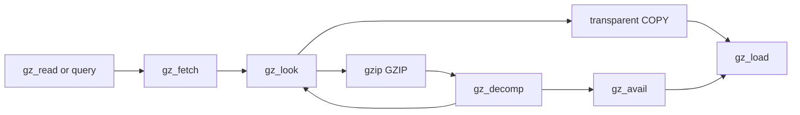

# Gzip files: source flow, ownership and cleanup

Sources: `gzlib.c`, `gzread.c`, `gzwrite.c`, `gzclose.c` and `gzguts.h`.
The [API](../api/gz-file.md) defines caller-visible behavior. The separate
[external-I/O model](../design/external-io.md) defines represented file and
formatting operations. Source readings below are **to confirm** by execution
and history proofs; [overview](../overview.md) owns status and remaining work.

## Representation and history predicates

`GzGood` carries state, string and buffer ownership, uniqueness and freshness.
`PosInv` bounds positions and pending skips. `NextOk` excludes dangling input
and pointers into message storage that may be freed. These facts need actual
history producers; a direct caller-buffer read can change their lifetime case.

On the selected LP64 branch, `GT_OFF` is false because int and offset widths
differ. Offsets are signed 64-bit, with `GZ_OFF_MAX = 2^63 - 1`. Individual
I/O requests are at most `2^30`. The public `gzFile_s` prefix and the library's
`x.have`, `x.next` and `x.pos` fields are the same storage, including macro access.

## State and lazy allocation

Opening allocates the handle and owned path. Buffer allocation is deferred until inspection,
reading or writing needs it. `want` is the requested size, initially 8192; `size == 0` means
the buffers and codec have not completed initialization. `gzbuffer` is allowed before that
point. It rejects doubled unsigned-size wrap and clamps the request to the minimum buffer size.

| Use | `in` capacity | `out` capacity |
| --- | --- | --- |
| Read | `size` | `2 * size` |
| Compressed write | `2 * size` | `size` |
| Transparent write | `2 * size` | no output allocation |

`gz_look` and `gz_init` publish `size` only after successful buffer allocation. Codec-init
failure frees the buffers and restores the allocation flag as the C specifies. Pointer fields
can still contain the freed values; cleanup uses `size` rather than treating every non-null
field as live ownership. **To confirm:** this flag matches allocation ownership on every exit,
including failure during codec initialization.

`gz_reset` clears counts, positions, pending skip and errors, with different read/write fields.
It does not write `x.next`. The model supplies null for a fresh pointer field, so a later
`x.next += 0` on a new handle succeeds under the project's null-plus-zero rule. C's unwritten
pointer is indeterminate. The missing temporal initialization cannot be dismissed by a
successful model run; see [safety](../safety.md) and [trusted base](../trusted-base.md).

## Read pipeline

`gz_load` accumulates bytes until the request is filled or a read stops it. A positive read
advances `have`; zero sets EOF; a blocking refusal sets `again`; other failures set an error.
A failure can follow successful partial reads. Its scalar out-parameter is represented as
`(returnCode, have)`, and callers must store `have` even when the code is `-1`.
That store does not authorize moving other writes across the call.

`gz_avail` compacts remaining compressed input before refilling. Pointer equality there is
defined even across objects; any difference, arithmetic or memory access has its own bounds.
`gz_look` recognizes gzip only with at least four available bytes: magic `31,139`, method 8,
and a flags byte below 32. A short prefix, invalid method or invalid flags is transparent input
when allowed by the mode; magic alone is not enough. `direct`, `junk` and `how` distinguish
initial detection, a forced gzip stream, concatenated members and trailing non-gzip data.

`gz_decomp` computes produced bytes from the change in output space and sets `x.next` to
the start of that produced slice. The member-end path returns to detection for concatenation.
`eof` means the underlying read ended; `past` records a read attempted beyond available data.
They are not interchangeable. `gzeof` queries `past`; `gzclearerr` clears the relevant read
flags and error state.

`gz_read` has three data paths: consume buffered output, read transparent data directly into
the caller buffer, or inflate directly into a sufficiently large caller buffer. A refill
`continue` jumps to the loop condition and skips the common progress update. A `break` inside
`gz_fetch`'s switch leaves the switch, not the enclosing loop. Preserve both distinctions.
Counts, caller pointers and `x.pos` change only at the source's progress point.

Reader wrappers preserve check order. Serious errors with no buffered output are tested before
clearing an `again` condition. `gzread` checks whether its unsigned request fits `int`;
`gzfread` checks multiplication overflow before dividing by item size. Zero size/item cases
must avoid division by zero. `gzgets` reserves room for NUL, uses `memchr` to bound a copied
line, and never reads its initially unset `eol` when there is no loop iteration.

`gzungetc` can set `x.pos = -1` at the start of a file. It writes at the end of the double
output buffer when empty, rejects a full buffer, or shifts bytes backwards before inserting.
The backward read/write order matters. Its `src > out` comparison is within one object.
A position invariant restricted to nonnegative values would exclude documented behavior.

## Write pipeline and pointer aliases

`gz_init` prepares the double input buffer and, for compressed output, the output buffer and
codec. `gz_comp` writes direct input for transparent output, or alternates codec calls and
output writes. Finishing sets the pending-reset flag so a later write can start another member.
The do-while condition observes actual output progress, not merely the return code.

The compressed-output invariant is `out ≤ x.next ≤ strm.next_out ≤ out + size`, within one
object. It justifies `next_out > x.next` and their difference. Pointer order across two
objects faults in the model. Each successful write advances only the count actually written.
A zero result for a positive request causes a non-progressing loop in the C; termination
therefore depends on an external progress assumption. The current regular-file model returns
positive progress or an error for such requests.

`gz_write` either copies small input into `in` or points `strm.next_in` at the caller's large
buffer. It resets `next_in` after direct writes, including the failure route. `gz_zero` resolves
a pending forward seek by supplying zeros from `in`. Before calculating
`(next_in + avail_in) - in`, the code restores `next_in = in` if no input remains.
**To confirm:** after each public write path, later pointer differences in `gz_write`, `gzputc`
and `gz_vacate` refer to `in`, rather than a caller buffer.

`gz_vacate` compresses pending data and uses overlapping `memmove` to bring it to the front.
Before formatting, it must leave room for an entire `size`-byte formatting region in the
`2 * size` input allocation. A nonzero vacate result is paired with an error/stall route;
**to confirm** before using the resulting buffer-room invariant.

`gzvprintf` writes a sentinel at `next[size - 1]`, then formats with capacity `size`.
The returned C99 length is the untruncated length. Zero, a length outside `1..size-1`, or a
lost sentinel refuses the formatted result. Accepted text changes `avail_in` and `x.pos`;
a later vacate stall can discard it and adjust the position. Keep those effects and error
returns in source order. The actual represented format language is in [gz-files.md](../design/external-io.md).
The older demonic fallback for unsupported formats was a proposal, not the implementation.

`gzsetparams` flushes pending data, calls `deflateParams`, then stores the requested level and
strategy. It ignores the callee's result. A contract cannot assume a successful parameter
change merely because the wrapper returns `Z_OK`; see the historical observation below.

## Positions, seeking and error ownership

`gztell64` reports logical position plus a pending skip unless `past` suppresses it.
`gzoffset64` queries descriptor position and subtracts buffered compressed input in read mode.
These are different positions. The LP64 wrappers do not introduce a narrower offset range.

`gzseek64` has three paths: use a direct-file seek for transparent reading, consume buffered
output, or record a pending skip. Backward compressed seeks rewind and then skip forward;
write seeks produce zeros. Signed `x.pos`, `skip`, `offset` and intermediate differences use
checked arithmetic. A pending-seek invariant cannot erase the negative position produced by
`gzungetc`, or treat every intermediate subtraction as safe merely because its intended final
position fits. An extra near-limit position precondition suggested in older notes was a
proposed narrowing, not an accepted replacement for the public domain.

`gz_error` first releases the old owned message when appropriate. Memory-error handling
allocates no new message; other messages own the NUL-terminated `path + ": " + text` allocation.
`gzerror` returns the memory-error literal, the current message or the empty literal and can
write a four-byte error code through the optional caller pointer. The message it returns
must remain readable for its documented lifetime. `gzclearerr` goes through the same error
helper, so it can release message ownership.

`gzclose_r` ends the codec when allocated, frees read buffers, error message, path and state,
and closes the descriptor. `gzclose_w` also resolves pending zeros and finishes output before
releasing resources. Cleanup must occur even when those operations fail. The read close uses
any nonzero `close` result as failure; the write close tests `-1`. `gzclose` dispatches by mode.
A successful `gzdopen` transfers responsibility for closing its descriptor; a failed open
must preserve the caller's descriptor. No public query legitimizes using a freed handle.

## Historical reports and current behavior

These reports remain useful counterexamples to proposed invariants. This documentation
revision did not rerun their reproductions or apply their proposed fixes. Their tracked status
belongs in [overview](../overview.md); the applied patch list remains authoritative.

| Case | Source behavior and consequence | Historical fix or evidence |
| --- | --- | --- |
| R-1: negative seek position | After initial `gzungetc`, `GZ_OFF_MAX - pos` or a later position difference can overflow signed 64-bit arithmetic. The translation retains checked operations. | Earlier notes report a sanitizer reproduction and upstream [PR 1361](https://github.com/madler/zlib/pull/1361). Proposed guards check positive `pos` and representable subtraction from negative `x.pos`. No patch is applied here. |
| R-2: partial read then error | In `gz_fetch`'s COPY case, `gz_load` can leave nonzero `x.have` on error before `x.next = out` executes. Readers can then use a stale pointer. The current model cannot generate that partial-success/failure sequence on regular files. | Earlier notes report a sanitizer reproduction and upstream [PR 1363](https://github.com/madler/zlib/pull/1363). Proposed fix moves the pointer assignment before the load. Current translation preserves the old order. |
| R-3: unwritten pointer | `gz_reset` leaves `x.next` unwritten; seek or skip code may add zero to it. Fresh null pointers hide the missing write in the model. | Historical `ub.patch` proposed `x.next = NULL`. It is absent. A passing model run does not settle the C initialization issue. |
| R-4: caller-buffer lifetime | Direct decompression sets `x.next` into the caller buffer. `gz_read` clears `x.have` but retains the pointer. After the caller frees the buffer, later zero-offset pointer arithmetic can fault. | Source-level concern and proposed reset to null; no reproduction is established here and no patch is applied. Embedded `strm` input/output fields can also retain caller pointers, so distinguish a stored pointer from a later use. |

An additional historical experiment reported `gzsetparams` returning success without applying
level 0 when the output buffer was nearly full. It wrote a variable pseudo-random prefix at
level 6, requested level 0, then wrote 200,000 zero bytes. Some resulting files remained much
smaller than a stored second segment. The proposed mechanism is an ignored `Z_BUF_ERROR`
from `deflateParams`; data remains valid and the effect concerns compression parameters.
The source ignores that result, but this experiment has not been independently reproduced in
this workspace. It remains an unconfirmed report, not a new finding or a patch justification.

## Review boundary

C memory obligations include live handles, NUL-terminated path/mode/format strings, readable
or writable caller ranges, non-overlapping `memcpy` ranges and valid variadic argument types.
The runtime permits disjoint slices of one byte allocation; older distinct-block claims were
obsolete. Address-taken local bytes have temporary allocations freed on every return.
Scalar out-parameters and embedded record references use the choices described in
[gz-files.md](../design/external-io.md); those choices need their own alias and framing justification.

The older proposal quantified over arbitrary short I/O and failures, with an explicit OS
oracle and a fairness premise. The current model implements a smaller regular-file world.
Neither reading the source nor comparing that model with selected executions proves the
broader claim. Model limits are part of the public-domain review, not implicit caller promises.
