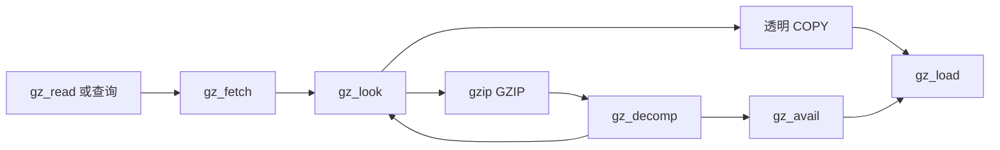

<!-- source-sha256: e4cb5dd17f087b4a79fbd9f9d15165a7dbbd87a91517904d8210b3865f8ff172 -->
# Gzip 文件：源代码流程、所有权与清理

源文件为 `gzlib.c`、`gzread.c`、`gzwrite.c`、`gzclose.c` 和 `gzguts.h`。[API](../spec/api/gz-file.md)定义调用者可见行为，独立的[外部 I/O 模型](../design/external-io.md)定义已表示的文件与格式化操作。下文沿源代码展开执行与调用历史的证明义务；[进度](../progress.md)负责状态与剩余工作。

## 表示与历史谓词

先把文件任务拆成三件事：句柄拥有哪几块内存、已经交付到未压缩数据的哪里、下一次访问的指针是否仍有效。例如，文件末尾已经读到不等于缓冲输出已经交付完；指针非空也不等于其对象还活着。下面的三个谓词分别携带这些状态事实，供每次读取、写入和清理使用。

`GzGood` 承载状态、字符串和缓冲区的所有权、唯一性与新鲜性。`PosInv` 约束位置和待执行跳过量。`NextOk` 排除悬空输入，以及指向可能被释放消息存储的指针。这些事实必须由实际历史产生；直接读取调用者缓冲区会改变其生命周期情形。

在所选 LP64 分支上，`int` 为 32 位，文件偏移为 64 位；`GT_OFF` 检查整数位宽是否大于偏移位宽，因此为假。偏移是有符号 64 位，`GZ_OFF_MAX = 2^63 - 1`。单次 I/O 请求最多 `2^30`。公开 `gzFile_s` 前缀与库的 `x.have`、`x.next`、`x.pos` 字段使用相同存储，包括宏访问。

## 状态与延迟分配

打开时分配句柄与所拥有的路径。缓冲区分配推迟到检查、读取或写入需要时。`want` 是请求的基础缓冲区大小，按字节计，初始为 8192；`size == 0` 表示缓冲区和编解码器尚未完成初始化。此前允许 `gzbuffer`，它拒绝无符号大小翻倍回绕，并把请求至少提升到最小缓冲区大小。

| 用途 | `in` 容量 | `out` 容量 |
| --- | --- | --- |
| 读取 | `size` | `2 * size` |
| 压缩写入 | `2 * size` | `size` |
| 透明写入 | `2 * size` | 不分配输出 |

`gz_look` 和 `gz_init` 仅在缓冲区分配成功后公布 `size`。编解码器初始化失败时释放缓冲区，并按 C 代码恢复分配标志。指针字段仍可能含已释放值；清理依据 `size`，不能把所有非空字段都视为存活所有权。清理证明还需覆盖每个退出点，建立标志与实际分配所有权一致的关系，包括编解码器初始化失败。

`gz_reset` 清除计数、位置、待跳过量和错误，读取／写入字段有别。它不写 `x.next`。模型将新鲜指针字段设为空，因此新句柄上之后的 `x.next += 0` 在项目的空指针加零规则下成功。C 中尚未写入的指针是不确定值。一次成功的模型运行不能消除先写后读证明的缺失；见[安全规范](../spec/safety.md)和[可信基础](../trusted-base.md)。

## 读取流水线

下面按“检测格式 → 补充压缩输入 → 解码 → 交付字节”的方向阅读。透明读取表示直接把文件字节交给调用者，gzip 读取则要先恢复未压缩数据。函数名用于定位实际 C 步骤；它们之间的箭头表示调用关系，不是另外的证明假设。

`gz_load` 累积字节，直到满足请求或读取停止。正数读取推进 `have`；零设置 EOF；阻塞拒绝设置 `again`；其他失败设置错误。失败可能发生在已成功部分读取之后。标量输出参数表示为 `(returnCode, have)`，即使返回码是 `-1`，调用者也必须存储 `have`。这项存储不授权将其他写入移动到调用两侧。

`gz_avail` 在补充前压紧剩余压缩输入。此处跨对象的指针相等比较有定义；任何相减、算术或内存访问则各有界限。`gz_look` 只有至少四个可用字节时才识别 gzip：魔数 `31,139`、方法 8、标志字节低于 32。当模式允许时，短前缀、无效方法或无效标志均是透明输入；仅魔数不足。`direct`、`junk` 和 `how` 区分初始检测、强制 gzip 流、拼接成员与尾随非 gzip 数据。

`gz_decomp` 根据输出空间变化计算产生量，并将 `x.next` 设为该输出切片开头。成员结束路径返回检测以支持拼接。`eof` 表示底层读取已结束；`past` 表示曾尝试读取可用数据之外。二者不能互换。`gzeof` 查询 `past`；`gzclearerr` 清除相应读取标志和错误状态。

`gz_read` 有三条数据路径：消费缓冲输出、直接向调用者缓冲区读取透明数据，或直接向足够大的调用者缓冲区 inflate。补充路径中的 `continue` 跳到循环条件，跳过共享进展更新。`gz_fetch` 的 switch 内的 `break` 只退出 switch，不退出外层循环。必须保留这两项区别。计数、调用者指针和 `x.pos` 只在源代码进展点改变。

读取包装函数保留检查顺序。没有缓冲输出时，严重错误检查先于清除 `again` 条件。`gzread` 检查无符号请求是否可放入 `int`；`gzfread` 在除以项目大小前检查乘法溢出。零大小／零项目情形必须避免除零。`gzgets` 为 NUL 留空间，用 `memchr` 限定所复制行，在没有循环迭代时从不读取初始未赋值的 `eol`。

`gzungetc` 可在文件开头设置 `x.pos = -1`。缓冲区空时在双倍输出缓冲区末尾写入；缓冲区满时拒绝；否则先向后移动字节再插入。反向读写顺序很重要。`src > out` 比较位于同一对象内。只允许非负位置的不变量会排除文档允许的行为。

## 写入流水线与指针别名

`gz_init` 准备双倍输入缓冲区，并在压缩输出时准备输出缓冲区和编解码器。`gz_comp` 对透明输出直接写输入；否则交替调用编解码器和写出输出。完成时设置待 reset 标志，使后续写入可开始新成员。do-while 条件观察实际输出进展，而非仅观察返回码。

在压缩输出缓冲区里，`out` 是缓冲区开头，`x.next` 是下一处尚未写入文件的字节，`strm.next_out` 是压缩引擎下一处可写位置，`size` 是容量字节数。压缩输出不变量为 `out ≤ x.next ≤ strm.next_out ≤ out + size`，均位于一个对象中。它证明 `next_out > x.next` 及其差合法。跨两个对象的指针顺序比较在模型中故障。每次成功写入仅按实际写入数量推进。正数请求若返回零，C 会形成不前进循环；因此终止依赖外部进展假设。当前普通文件模型对此类请求返回正进展或错误。

`gz_write` 将小输入复制到 `in`，或使 `strm.next_in` 指向调用者的大缓冲区。直接写入后它重设 `next_in`，包括失败路径。`gz_zero` 通过从 `in` 提供零字节完成待执行向前 seek。计算 `(next_in + avail_in) - in` 前，若无输入剩余，代码恢复 `next_in = in`。后续指针差的合法性还需逐公开写路径建立：`gz_write`、`gzputc` 和 `gz_vacate` 使用的指针已经恢复到内部 `in` 缓冲区。

`gz_vacate` 压缩待处理数据，使用允许重叠的 `memmove` 将其移到前部。格式化前，它必须在 `2 * size` 的输入分配中，为整个 `size` 字节格式化区域留空间。非零 vacate 结果与错误／停滞路径配对；证明还需逐返回分支建立剩余空间不变量，供后续格式化使用。

`gzvprintf` 在 `next[size - 1]` 写入哨兵，随后以容量 `size` 格式化。返回的 C99 长度是未截断长度。零、`1..size-1` 之外的长度或丢失的哨兵都会拒绝格式化结果。接受的文本改变 `avail_in` 和 `x.pos`；后续 vacate 停滞可能丢弃它并调整位置。必须按源顺序保留这些效果和错误返回。实际表示的格式语言见[外部 I/O 模型](../design/external-io.md)。旧的对不支持格式采用按最不利结果解释的非确定性后备方案只是提案，并非实现。

`gzsetparams` 先刷出待处理数据，再调用 `deflateParams`，随后存储请求的级别与策略。它忽略被调用函数结果。不能仅因包装函数返回 `Z_OK`，就在契约中假定参数改变成功；见下述历史观察。

## 位置、定位与错误所有权

`gztell64` 报告逻辑位置加待跳过量，除非 `past` 抑制该量。`gzoffset64` 查询描述符位置，并在读取模式减去已缓冲压缩输入。这是两种不同位置。LP64 包装函数不引入更窄的偏移范围。

`gzseek64` 有三条路径：透明读取时直接文件定位、消费缓冲输出，或记录待执行跳过。压缩向后定位先回卷再向前跳过；写入定位产生零字节。有符号 `x.pos`、`skip`、`offset` 和中间差使用检查算术。待定位不变量不能抹去 `gzungetc` 产生的负位置，也不能仅因预期最终位置可表示就把所有中间减法视为安全。旧笔记建议过额外的近上限位置前置条件；那是拟议缩小范围，不是已接受的公开定义域替代。

`gz_error` 首先按需释放旧的自有消息。内存错误处理不分配新消息；其他消息拥有以 NUL 结尾的 `path + ": " + text` 分配。`gzerror` 返回内存错误字面量、当前消息或空字面量，并可经可选调用者指针写入四字节错误码。返回消息必须在文档规定的生命周期内保持可读。`gzclearerr` 经过相同错误辅助函数，因此可能释放消息所有权。

`gzclose_r` 在编解码器已分配时结束它，释放读取缓冲区、错误消息、路径和状态，并关闭描述符。`gzclose_w` 还在释放资源前完成待填零和输出收尾。即使这些操作失败也必须清理。读关闭把任意非零 `close` 结果视为失败；写关闭测试 `-1`。`gzclose` 按模式分派。成功的 `gzdopen` 转移描述符关闭责任；打开失败必须保留调用者描述符。任何公开查询都不使已释放句柄的使用合法化。

## 历史报告与当前行为

这些报告仍可反驳拟议不变量。R-1 和 R-2 已在 sanitizer 下复现，其上游修复作为补丁 0002 和 0003 应用；其余各行没有重新执行，其拟议修复也未应用。跟踪状态属于[进度](../progress.md)，已应用补丁清单仍具有权威性。

| 情形 | 源行为与后果 | 历史修复或证据 |
| --- | --- | --- |
| R-1：负定位位置 | 初始 `gzungetc` 之后，未打补丁的 C 在 `GZ_OFF_MAX - pos` 或后续位置差处发生有符号 64 位算术溢出。翻译遵循打补丁后的 C；`gzseek64_head_any` 证明其检查从负位置出发不会故障。 | 已复现：[gzseek-pushback-overflow](../../tests/regression/gzseek-pushback-overflow/README.md)。上游 [PR 1361](https://github.com/madler/zlib/pull/1361)，作为补丁 0002 应用：第一项检查只在 `pos` 为正时执行，从负 `x.pos` 出发位移不可表示的目标被拒绝。维护者尚未确认。 |
| R-2：部分读取后错误 | 在未打补丁的 `gz_fetch` COPY 分支中，`gz_load` 可能在 `x.next = out` 执行前出错，留下非零 `x.have`；`gz_read` 随后从旧指针复制。翻译遵循打补丁后的 C。文件模型不能在普通文件上产生这种部分成功再失败序列。 | 已复现：[gzread-transparent-stale-next](../../tests/regression/gzread-transparent-stale-next/README.md)。上游 [PR 1363](https://github.com/madler/zlib/pull/1363)，作为补丁 0003 应用：指针赋值移到加载之前。维护者尚未确认。 |
| R-3：未写入指针 | `gz_reset` 未写 `x.next`；定位或跳过代码可能对它加零。新鲜空指针使模型隐藏了缺失写入。 | 历史 `ub.patch` 建议 `x.next = NULL`，但并未包含。模型运行通过不能解决 C 初始化问题。 |
| R-4：调用者缓冲区生命周期 | 直接解压使 `x.next` 指向调用者缓冲区。`gz_read` 清除 `x.have` 但保留指针。调用者释放缓冲区后，后续零偏移指针算术可能故障。 | 源层面的疑虑及重设为空的提议；此处未建立复现，也未应用补丁。嵌入 `strm` 的输入／输出字段也可能保留调用者指针，因此须区分仅存储指针与之后使用它。 |

另一项历史实验报告：输出缓冲区接近满时，`gzsetparams` 返回成功，却没有应用级别 0。实验在级别 6 写入长度变化的伪随机前缀，请求级别 0，再写 200,000 个零字节。有些结果文件仍远小于第二段直接存储的大小。拟议机制是忽略了 `deflateParams` 的 `Z_BUF_ERROR`；数据仍有效，影响的是压缩参数。源代码确实忽略该结果，但本工作区未独立复现该实验。它仍是未确认报告，不是新发现或补丁理由。

## 审查边界

C 内存义务包括存活句柄、NUL 结尾的路径／模式／格式字符串、调用者可读或可写范围、不重叠的 `memcpy` 范围，以及有效变参类型。运行时允许同一字节分配中的不相交切片；旧的必须不同块声明已过时。被取址的局部字节使用临时分配，并在每次返回释放。标量输出参数和嵌入记录引用采用[外部 I/O 模型](../design/external-io.md)描述的表示选择；这些选择各需别名与帧性质论证。

旧提案对任意短 I/O 和失败量化，并明确使用 OS 预言机与公平性前提。当前模型实现较小的普通文件世界。阅读源代码、或将该模型与选定执行比较，都不能证明更广声明。模型限制属于公开定义域审查，不是隐含调用者承诺。
