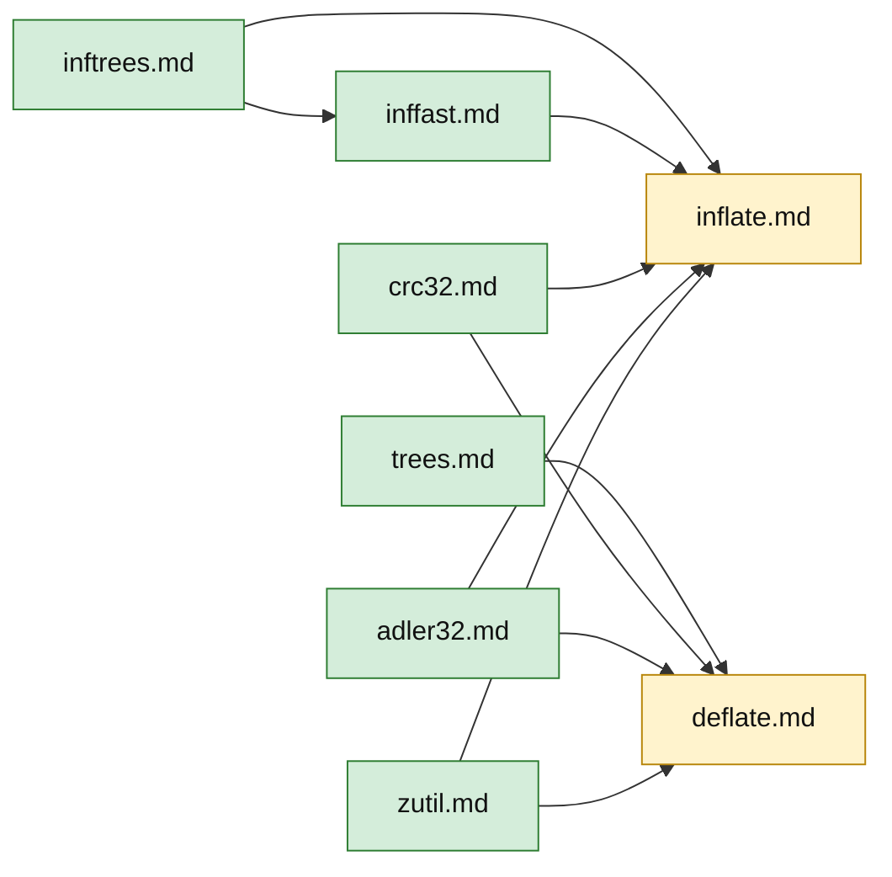

# Proofs in text

These pages prove, in ordinary mathematical language, what the Lean proofs must establish: the
safety of every function (no undefined behaviour, no memory error, no leak, termination) and, in the
end, its correctness. A reader who checks them has checked the idea of every Lean proof. The Lean
proofs then add what people are bad at: that no case was forgotten and no arithmetic step was wrong.

The work does not start from zero. An earlier attempt (the `zlib-formal` repository) has Lean proofs
for most functions of the default build, and the Lean proofs here are moved over from it where they
fit. The text on these pages is written to be read without them.

## How to read a page

One page per C file, one section per function or group of functions. A section has the same parts:

| Part | Content |
| --- | --- |
| Statement | the claim, with its hypotheses spelled out, and the specification identifiers it formalises ([../spec/](../spec/index.md)) |
| Hazards | the operations that could be undefined or could leak, from the list U1 to U12 of [../safety.md](../safety.md) |
| Argument | for each hazard, why its side condition holds: a precondition, a loop invariant, or a promise of a callee |
| Status | `proof`, `proof, to confirm` (one step rests on a reading of the C that the Lean proof must check), `obligations` (the hazards are listed, the argument is not yet written), or `open` |

## Notation

- `⌊x⌋`, `x mod m`, `2^k` have the usual meaning. `x << k` and `x >> k` are the C shifts on the stated type.
- Unsigned arithmetic wraps. Where a proof needs "no wrap", it shows the exact bound.
- `[a, b)` is the half-open range of integers from `a` to `b − 1`.
- A pointer `p` into an array of `n` elements is valid for index `i` when `0 ≤ i < n`; the one-past-the-end
  pointer `i = n` is valid to form and invalid to read.

## Contents

| C file | Page | State of the text |
| --- | --- | --- |
| `adler32.c` | [adler32.md](adler32.md) | `adler32_z`: safety and correctness, written as proof. The `combine` functions: not yet |
| `crc32.c` | [crc32.md](crc32.md) | safety of `crc32_z`: proof (tail loops to confirm). Other functions: argument. Table values: route described |
| `zutil.c` | [zutil.md](zutil.md) | proof |
| `inftrees.c` | [inftrees.md](inftrees.md) | `inflate_table`: complete proof of safety and of the table properties |
| `inffast.c` | [inffast.md](inffast.md) | `inflate_fast`: complete proof (one entry condition to confirm) |
| `inflate.c` | [inflate.md](inflate.md) | `updatewindow`: proof. `inflate()` and the API functions: obligations per mode and per function, proofs not yet written |
| `infback.c` | not yet |  |
| `trees.c` | [trees.md](trees.md) | heap bounds and `gen_bitlen`: complete proof. Overlay lemma: fixed codes proved, dynamic codes proved in the earlier work and open for `memLevel` 1 to 3 |
| `deflate.c` | [deflate.md](deflate.md) | window, `fill_window`, `slide_hash`, hash chains, `longest_match`: proof. Block loops, `deflate()`, the API functions: obligations, proofs not yet written |
| `compress.c, uncompr.c` | not yet |  |
| `gzlib.c, gzread.c, gzwrite.c, gzclose.c` | not yet |  |

Green pages have complete arguments for the functions they cover. Yellow pages combine arguments with
function-by-function obligations that still need their proofs.

## What is not here yet

- The proofs of `inflate()` mode by mode and of the other API functions of `inflate.c` and `deflate.c`.
- The functions of `infback.c`, `compress.c`, `uncompr.c` and the `gz*` files.
- The correctness statements C1 to C7 of [../overview.md](../overview.md) section 6a: only the checksum parts and
  the tables of `inflate_table` are written.
