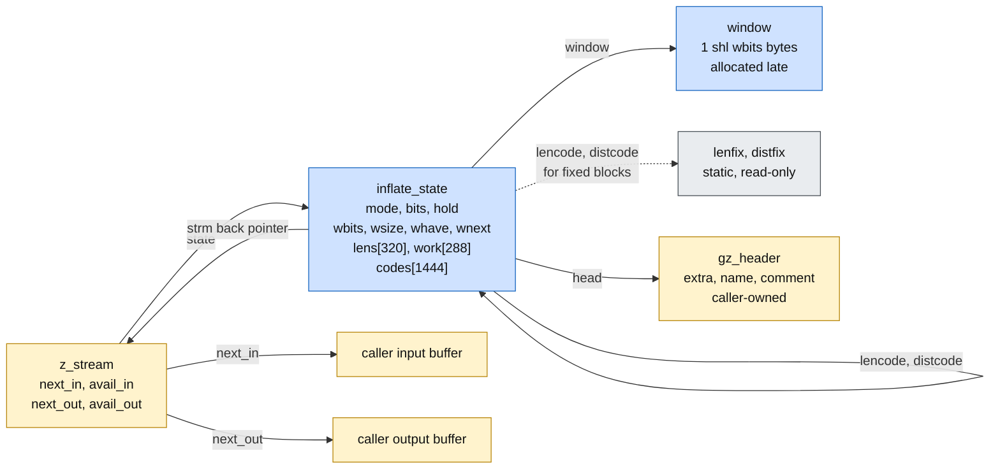
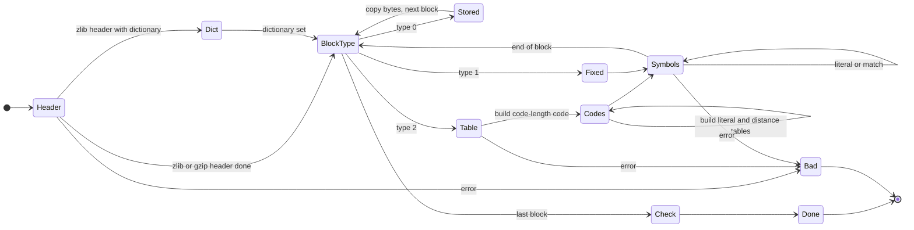

# inflate.c: function by function

Source: `zlib/inflate.c`. Specification: [../spec/api.md](../spec/api.md) section 2 and
`I-uw-*` in [../spec/internal.md](../spec/internal.md). Numbering: U (undefined behaviour, including
leaks) in [../safety.md](../safety.md); F (facts) in [../method.md](../method.md).

The tables for this file are in [inftrees.md](inftrees.md), the fast path in
[inffast.md](inffast.md). The checksums are in [adler32.md](adler32.md) and [crc32.md](crc32.md).

Items marked **to confirm** are readings of the C that the proof must still check.
## The idea in short

The window is a ring buffer of `wsize` bytes. Two numbers describe it: how many bytes it holds, and where the next byte goes. While the window is not full the two are equal. Each update copies the newest output into the ring in at most two pieces, and the invariant is restored in each case. For `inflate()` itself, each of its thirty or so modes reads some bits, checks them and moves on. The argument for every mode is the same: the bit buffer is refilled only when it is short, so shifts stay small, and every table lookup uses a table that `inflate_table` has completed.

## 1. The memory picture

Blue is owned by zlib: allocated by `inflateInit2_`/`updatewindow`, freed by `inflateEnd`. Yellow
is owned by the caller: zlib may only touch the ranges `zlib.h` allows. Grey is static and
read-only.

The pointers `lencode` and `distcode` point into `codes[]` for dynamic blocks and into the static
tables for fixed blocks. The invariant says which. `inflateCopy` has to rebase them, which is
why it is the one function where this matters most.

## 2. `updatewindow`: the window invariant

State invariant **W**:

1. `wsize = 0` or `wsize = 2^wbits`;
2. `window` is null, or points to `2^wbits` bytes; `wsize > 0` implies `window` is not null;
3. `whave ≤ wsize`, `wnext < wsize` if `wsize > 0`, and `wnext = 0` if `wsize = 0`;
4. `whave < wsize` implies `wnext = whave`.

The init functions establish W (`wsize = whave = wnext = 0`, `window` null). `inflateReset*`
set `wsize = whave = wnext = 0` and free the window if `wbits` changes.

**Preservation by `updatewindow(strm, end, copy)`** with `copy` at most the number of bytes in
the output buffer before `end` (`I-uw-pre`): so `[end − copy, end)` is inside the buffer.

- Allocation fails: returns 1, state unchanged, W holds.
- `wsize = 0`: sets `wsize = 2^wbits`, `wnext = whave = 0`. W holds.
- `copy ≥ wsize`: copies `wsize` bytes from `[end − wsize, end)` (inside the buffer because
  `copy ≥ wsize`) into `window[0 .. wsize)`. Sets `wnext = 0`, `whave = wsize`. W holds.
- `copy < wsize`: `dist = min(wsize − wnext, copy)`. The first copy writes `window[wnext .. wnext + dist)`,
  inside the window since `wnext + dist ≤ wsize`, from `[end − copy, end − copy + dist)`, inside the
  buffer since `dist ≤ copy`.
  - If `copy − dist > 0`: then `dist = wsize − wnext`; the second copy writes `window[0 .. copy − dist)`
    where `copy − dist < copy < wsize`, from `[end − (copy − dist), end)`. Then `wnext = copy − dist < wsize`
    and `whave = wsize`. W holds.
  - Otherwise: `wnext' = wnext + dist` (set to 0 if it equals `wsize`) and `whave' = whave + dist` if
    `whave < wsize`. By W.4, `whave = wnext` in that case. So `whave' = wnext + dist`. If this equals `wsize`,
    then `wnext' = 0` and W.4 is vacuous. If it is less, `wnext' = wnext + dist = whave'`. If
    `whave = wsize` it stays. W.3 holds because `whave + dist ≤ wsize`. ∎

The destination (the window) and the source (the caller's buffer, or the dictionary) are different
objects, so no copy overlaps. When `copy` is 0 the copies have length 0; the pointers involved are
valid (`window` is not null), so no null-plus-offset issue arises.

## 3. The bit macros

The per-mode obligations are listed in [inflate.md](inflate.md) section 5. They use the facts above
as follows: tables are built by `inflate_table` (T1, T2); `LEN` calls `inflate_fast` when `have ≥ 6`
and `left ≥ 258`; `inf_leave` calls `updatewindow` with `copy = bytes produced in this call`.

The bit macros: `NEEDBITS(n)` has a constant `n ≤ 32` and pulls a byte only while `bits < n`, so
the shift `byte << bits` has `bits ≤ 31`. The bit buffer `hold` is 64 bits, and after the pull
`bits ≤ 39`, so no bit is lost. `BITS(n)` is `hold & (2^n − 1)` with `n ≤ 16`, and `DROPBITS(n)`
follows a `NEEDBITS(n)`, so `bits ≥ n` and the subtraction does not wrap.

## 4. `inflate()` mode by mode (inflate.c) — medium, long

About 1,700 lines of translation. Roughly 30 modes, one big loop. The proof is not one proof.
It is one *case per mode*, each short, over the same invariant.

(The state names group the real modes. `Header` is HEAD to HCRC; `Symbols` is LEN to MATCH
and LIT; `Codes` is LENLENS and CODELENS.)

### Per-group hazards

| Group | Hazard | Answer |
| --- | --- | --- |
| Bit macros | `hold` is `unsigned long`, shifts `<< bits`, `>> n`, `1U << n` | every `n` is a constant at most 32, `bits` is below 32 when shifting; `omega` goals |
| `PULLBYTE` | `*next++` | guarded by `have == 0 → goto inf_leave` |
| Header (`gzhead`) | writes to `extra`, `name`, `comment` | guarded by `extra_max`, `name_max`, `comm_max`; **precondition**: the caller allocated those buffers (`inflateGetHeader` doc); `length ≤ extra_len` clause for the unsigned subtraction |
| `STORED`/`COPY` | `zmemcpy(put, next, copy)` | `copy ≤ min(length, have, left)`; **A3**: input and output do not overlap, else `memcpy` is undefined |
| `TABLE` | `nlen > 286 or ndist > 30` is `BAD` | so `nlen + ndist ≤ 316 ≤ 320 = sizeof lens` |
| `LENLENS` | `lens[order[have++]]` | `have < ncode ≤ 19`, `order` has 19 entries |
| `CODELENS` | `lens[have++] = val` | the check `have + copy > nlen + ndist` is `BAD` |
| Table build | `inflate_table` calls | contracts from section 2; `next` stays in `codes[]` (LENS ≤ 852, then DISTS ≤ 592) |
| `LEN` | `lencode[BITS(lenbits)]`, then sub-table `last.val + (…)` | F1 reader half: every entry written, every link in range |
| `MATCH` | `from` pointer into window or output | same three cases as section 3 |
| `CHECK` | `crc32/adler32(put - out, out)` | `out` bytes were written this call |
| `inf_leave` | `updatewindow(…, out - avail_out)` | section 4 |
| Entry | `inflateStateCheck`, `next_out == NULL` | return `Z_STREAM_ERROR` on bad arguments (A7) |

The pre-call checks (`strm`, `state`, `next_out`) matter: an error return must not touch the
stream. That is a frame statement (`h' = h`) for the error cases.

## 5. The other API functions

| Function | Hazard | Tier |
| --- | --- | --- |
| `inflateInit2_` | `version[0]`, `stream_size` check; `ZALLOC` can return NULL; sets `window = NULL`, `strm->state` | easy |
| `inflateReset`, `Reset2`, `ResetKeep` | `windowBits` range; frees `window` if size changes | easy |
| `inflateEnd` | frees `window` and `state` once each; sets `state = NULL` | easy |
| `inflatePrime` | `bits ≤ 16`, `state->bits + bits ≤ 32`, `1L << bits` | easy |
| `inflateSetDictionary` | `dictionary + dictLength` read; `updatewindow` | medium |
| `inflateGetDictionary` | two `memcpy` from the ring (`wnext`, `whave - wnext`) | medium |
| `inflateSync`, `syncsearch` | reads `next_in[0..avail_in)`; `have` counter | easy |
| `inflateCopy` | `memcpy` of the whole state; rebases `lencode`, `distcode`, `next` into the copy's `codes[]`; allocates and copies the window | **medium-hard** |
| `inflateGetHeader` | stores a caller pointer | easy |
| `inflateValidate`, `Mark`, `SyncPoint`, `Undermine` | field updates | easy |

`inflateCopy` needs two things: a `memcpy` that can copy a whole struct (in the earlier model a
struct embedded in a larger object was refused, though the C has no UB there), and a way to say
"this pointer is the old one shifted into the new object". The record-and-offset pointer form of
the object heap (architecture.md section 3) gives both.

A source note: the pinned tree contains one `ub.patch` hunk here. The C compared `lencode` to
`codes` with a relational operator across different objects (undefined). The patch replaces it by
`==`, which is equal on every well-defined run.
