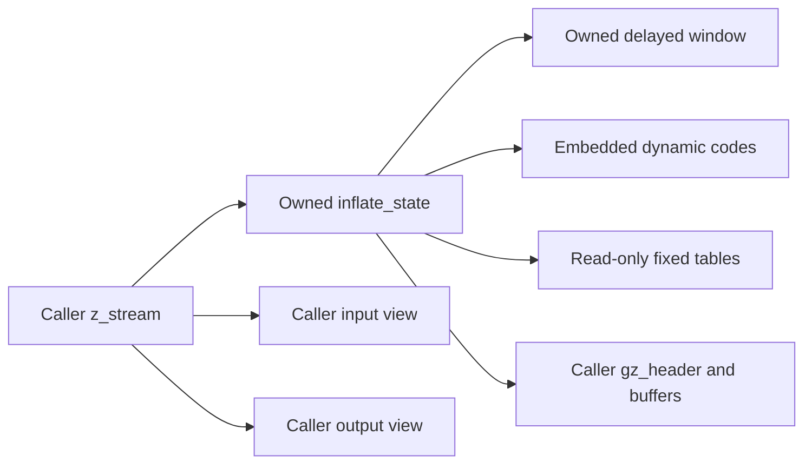
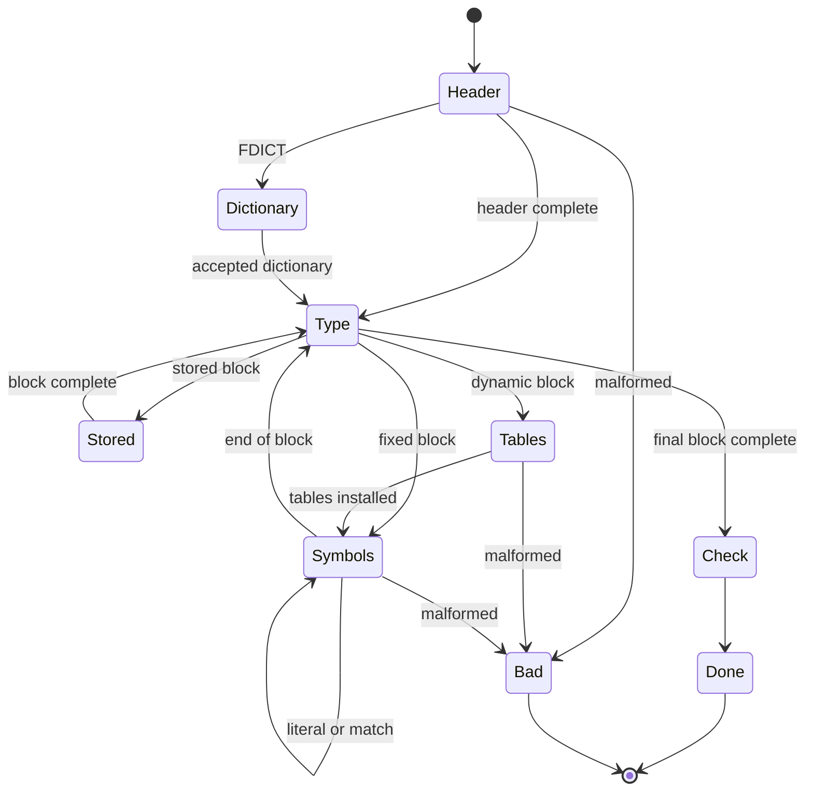

# Stream decoding: modes, history and call composition

Source: `zlib/inflate.c`; translation: `ZlibF/Zlib/inflate.c.lean`.
Public behavior is specified in [the API guide](../api/README.md), the decoded
stream in [the format guide](../format/README.md), and window updates by
`I-uw-*` in [internal contracts](../design/internal-contracts.md).

The proof uses [decode tables](inftrees.md), [fast decoding](inffast.md),
[Adler-32](adler32.md), [CRC-32](crc32.md) and [allocation](zutil.md).
This page describes the composition they must support. It does not label the
whole decoder proved. [The overview](../overview.md) is the current progress
record.

## Memory and ownership

The stream owns its allocated state and any allocated window. `lens[320]`,
`work[288]` and `codes[1444]` are embedded in the state. `lencode` and `distcode`
select static fixed tables or regions of `codes`; `next` tracks table
construction. `head` refers to caller-owned header storage. The invariant must
record those alternatives, initialized ranges and authorized byte views.

Initialization establishes pointer fields before they are read. The runtime's
fresh-null convention cannot prove that temporal fact; see
[safety](../safety.md#uninitialised-memory). Error modes also belong to the
invariant so that cleanup remains safe after a refusal or data error.

## Window invariant W and F4

Use **W** for the ring-buffer shape:

1. `wsize = 0` or `wsize = 2^wbits`.
2. `window` is null or points to an allocated `2^wbits`-byte block;
   `wsize > 0` implies non-null storage.
3. `whave ≤ wsize`; if `wsize > 0`, `wnext < wsize`; otherwise `wnext = 0`.
4. If `whave < wsize`, then `wnext = whave`.

Initialization gives the empty window. Reset variants must be checked
individually: resetting the counters, retaining existing storage and changing
window size are different operations. Only the size-changing path that frees
storage may remove its ownership claim.

For correctness, enrich W with the ring contents: the valid `whave` bytes are
the appropriate suffix of logical history in ring order. Preset dictionary
bytes contribute history without becoming output. Shape W alone cannot prove
that a back-reference returns the right byte.

### `updatewindow(strm, end, copy)`

`I-uw-pre` provides a readable source interval `[end-copy, end)` and the
non-overlap facts for each `memcpy`. The source may be recent output or a
permitted dictionary range. A public caller must supply those facts; it cannot
silently exclude an allowed view.

If allocation is needed and fails, the function returns 1 without acquiring a
window block. Prove its exact field/frame effects; do not infer a global
unchanged-heap claim from the failure code. If `wsize` is zero after successful
allocation, set it to `2^wbits` and initialize `wnext = whave = 0`.

For `copy ≥ wsize`, retain only `[end-wsize, end)`, write the whole window and
set `wnext = 0`, `whave = wsize`.

For `copy < wsize`, let `dist = min(wsize-wnext, copy)`. The first copy writes
`[wnext, wnext+dist)` from the source prefix. If bytes remain, then
`dist = wsize-wnext`; the second copy writes `[0, copy-dist)` and the ring is
full. Set `wnext = copy-dist`, `whave = wsize`.

If no bytes remain, advance `wnext` by dist and wrap at `wsize`. If the old ring
was partial, W.4 gives `whave = wnext`, so the same addition advances `whave` to
at most `wsize` and restores W.4 when it remains partial. If it was full, it
stays full. This proves the shape preservation argument. The content argument
tracks the newest suffix through these same cases. Include zero-copy calls and
exact pointer formation for their actual source views.

## The mode proof

Each real mode has one execution case over a common invariant. A grouped view
shows the dataflow; it does not replace the source's individual modes or exits.

| Source group | Required execution fact |
| --- | --- |
| Entry checks | Invalid stream/arguments return the specified error with exactly the permitted effects. A blanket unchanged-heap claim applies only where the contract says so. |
| `PULLBYTE` | `have == 0` leaves before the read; otherwise the read and cursor increment consume one valid byte. |
| `NEEDBITS`, `BITS`, `DROPBITS` | Bound each actual requested count and establish enough bits before subtraction. A byte is shifted only at a valid count; the default 64-bit `hold` retains the pulled bits. |
| `HEAD` through `HCRC` | Validate wrapper fields; write `extra`, `name`, `comment` only within caller-provided capacities. Bound `length` and progress counters before unsigned subtraction. |
| `DICTID`, `DICT` | Preserve dictionary-required state and checksum effects; a dictionary refusal does not invent decoded output. |
| `STORED`, `COPY` | `copy ≤ min(length, have, left)` bounds both views. Supply the API's justified non-overlap condition for `memcpy`. |
| `TABLE` | Default checks give `nlen ≤ 286`, `ndist ≤ 30`, hence `nlen+ndist ≤ 316 < 320`. |
| `LENLENS` | `have < ncode ≤ 19` bounds `order[have]`; zero-fill completes the 19-length input to the code-length table. |
| `CODELENS` | Code 16 requires a previous length; repeat-count checks prevent writing beyond `nlen+ndist`. |
| Table installation | Prove `inflate_table` execution, its entry meanings and total reservation `852+592 = 1444`; install the resulting table predicate. |
| `LEN` through `DISTEXT` | Root/subtable reads use initialized entries and consume exactly the supporting code and extra bits. Prove the fast-path entry premises when that branch is selected. |
| `MATCH`, `LIT` | Bound output writes and justify history/window sources, including overlap within sequential output. |
| `CHECK`, `LENGTH` | Compare the right wrapper checksum/length against actual produced bytes with their defined widths. |
| `inf_leave` | Write back exact cursors/counters/bits, update history when required and preserve the specified return behavior. |

For refill reasoning, if a requested `n ≤ 32`, pulling occurs only with
`bits < n`; the byte shift is then at most 31 and the count after a pull at most
39. Other masks and drops require their own source-specific bounds. It is not
correct to treat every `BITS` use as a fixed small constant: dynamic table
widths and linked entries obtain their bounds from the table predicate.

The outer loop needs a mode-aware measure. Some transitions consume no input
and produce no output. Bound those internal transitions between progress or
return points, and combine that bound with finite input/output and copy
measures. Per-mode termination alone does not establish the complete fuel bound.

## Causality and history across calls

Functional correctness must identify output independently of the implementation
state. A decoded symbol needs a supporting prefix of source bits. The decoder
may read beyond that prefix speculatively, and may return whole lookahead bytes
before leaving the fast path. Relate the emitted symbol to the supporting bits;
do not require its meaning to agree with all speculative lookahead.

The earlier whole-lookahead consistency condition is false. The corrected
supporting-bit-prefix relation addresses that distinction. Likewise, a fixed
data-error detection lag of eight bytes has a counterexample. Increasing the
constant without proof does not establish a causal error theorem. These are
specification/model lessons, not confirmed upstream memory bugs. The current
counterexample and acceptance record is in [the overview](../overview.md).

Across calls, preserve the accumulated bit prefix, output prefix, logical
history, wrapper/checksum state and any dictionary requirement. Quantify over
all permitted input splits, output-room splits and flush values. A later
failure may follow actual output: delayed window allocation can return
`Z_MEM_ERROR` after decompression has written bytes. Error contracts must retain
those effects rather than require empty output.

A preset dictionary contributes a known checksum requirement and may provide
history whose contents are not known until the caller supplies it. Distinguish
that unknown history from output bytes. Raw dictionary replacement, header
operations, priming and recovery require their exact API effects; an ordinary
data-epoch refinement does not cover every such sequence automatically.
Negative-value priming also requires the general bit-level bridge, beyond a
finite execution matrix or model witness.

## Lifecycle and auxiliary functions

| Functions | What the proof must compose |
| --- | --- |
| `inflateInit_`, `inflateInit2_` | Version/size and parameter refusals, state allocation, initialization writes, success invariant and exact failure cleanup. |
| `inflateReset`, `inflateResetKeep`, `inflateReset2` | Their distinct counter/history/header effects, permitted window-size changes and matching ownership transitions. |
| `inflateEnd` | Free window and state once, clear the stream state and restore the caller's prior live-block set. |
| `inflatePrime` | Negative-count reset and nonnegative bit insertion; shifts, low-bit interpretation and count-limit refusals. |
| `inflateSetDictionary`, `inflateGetDictionary` | Documented dictionary modes, checksum decision and ring copies in chronological order; history differs from produced output. |
| `inflateCopy` | Independent state/window allocations and failure cleanup; copy content, rebase dynamic `lencode`, `distcode`, `next`, preserve static pointers and prove future behavioral equivalence. |
| `inflateSync`, `syncsearch` | Bounded scanning, recovery state changes and the relation of discarded input to the restarted decoder epoch. |
| `inflateGetHeader` | Store permitted caller storage and preserve its lifetime/capacity requirements until header processing completes. |
| `inflateMark`, `inflateSyncPoint`, `inflateCodesUsed` | Exact numeric/query behavior in every admitted mode, including refusal cases. |
| `inflateValidate`, `inflateUndermine` | Exact state updates, supported/unsupported behavior and invariant preservation. |

A relational comparison of pointers to dynamic and static tables needs source
review under the pointer model. Historical references to an `inflateCopy`
`ub.patch` are not a patch authorization: only `patches/README.md` defines the
selected patch set.

The final sequence theorem uses the init result and each function's proved
preservation, frame and ownership effects. It must connect the internal history
and table predicates to the independent format relation. Neither an abstract
`inflate_decodes` model theorem nor a local fast-call theorem supplies that
implementation refinement by itself.
