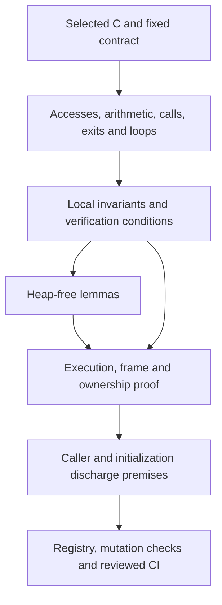
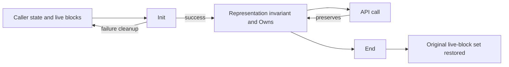

# Proving one function

A function proof connects the statement-by-statement translation to its fixed
contract. It must establish safety, termination, the frame and exact ownership
effects. Functional correctness relates the same execution and state to the
format or API model. [Safety](../safety.md) defines those claims;
[the overview](../overview.md) records their current acceptance status.

## Fix the question before proving it

Start with the selected C, including the patches listed in `patches/README.md`.
Read its public requirements in [the API guide](../api/README.md) and its internal
conditions in [the design guide](../design/README.md). Identify the exact
proposition the function must satisfy. Record all caller requirements, error
cases, writable objects and allocation effects.

A public precondition must cover what `zlib.h` permits. An internal theorem may
require table bounds or a mode-specific invariant, but its callers must prove
those requirements. Any public restriction beyond `zlib.h` belongs in the
theorem's docstring and [deviations](../deviations.md).

Follow the C in order. Preserve each branch, read, write and arithmetic conversion.
Unsigned arithmetic wraps. Signed arithmetic and invalid pointer operations must
raise the modeled fault. Do not combine statements or replace a source expression
with an equivalent-looking one to make the proof easier. Temporal reads matter:
reading a field before another write can differ from caching its earlier value.

## Build the argument

For each access, show that the object is live, the pointer has the right form and
the offset is inside the accessed range. For pointer arithmetic, include the
one-past rule. For each shift or signed operation, establish its range. For each
loop, give a measure and show that its execution fits the actual fuel bound. A
finite mathematical loop does not by itself prove that the translated run avoids
`Fault.outOfFuel`.

Use a proved execution theorem for each callee. Supply its precondition from the
current state, then use its result, frame and ownership effects. A hypothesis
saying that the callee satisfies its specification is forbidden.

Keep arithmetic and combinatorial lemmas in `ZlibF/Math/` when they need no heap.
Memory proofs instantiate them for the cells actually read and written. A pure
table theorem, for example, becomes useful to the decoder only after a heap
refinement proves that `inflate_table` installed those entries.

## Diagnose a stuck proof

There are four possible causes. Investigate them without presuming that the
program or the specification is right.

| Cause | Evidence to seek | Response |
| --- | --- | --- |
| Proof technique | The statement and translation agree, but a missing structural lemma or invariant prevents the argument | Prove the lemma at the lowest layer. Establish and preserve any stronger invariant from initialization. |
| Wrong specification | A legal execution contradicts the stated result or its error behavior | Explain the counterexample and stop the proof of that statement. Correcting it requires a separate reviewed specification change. |
| Translation bug | The translation differs from the selected C, including evaluation order or conversions | Correct the translation through the reviewed workflow and add a differential regression. |
| Real zlib bug | The selected C itself fails on a legal input | Construct the input, run the C under a sanitizer and record the reproduction and scope. |

Narrowing the caller domain does not resolve any of these causes. A confirmed
upstream bug may justify a minimal patch matching a submitted upstream fix. A
model limitation is not an upstream bug.

## One representation invariant

`InflateOK` and `DeflateOK` name the intended stream invariants. The source may
contain intermediate predicates or older names such as `DGood`; their
relationship to the stream invariant needs an explicit theorem. A conditional
result over such a predicate is not sequence safety.

| Invariant | Clauses that the proof must establish |
| --- | --- |
| `InflateOK` | Owned state/window blocks are live and distinct; modes and bit counts are valid; window indices obey W; table pointers select the right static or dynamic object; entries and initialized ranges support every reached read. |
| `DeflateOK` | State, window, `prev`, `head` and pending storage are live and distinct; size equations hold; D bounds the window; H1/H2 describe meaningful hash chains; pending/symbol regions satisfy the overlay bound; trees and statuses support the reached operations. |

Clause D7 ties gzip emission states `EXTRA`, `NAME`, `COMMENT` and `HCRC` to a
non-null `gzhead`. An earlier invariant admitted `EXTRA` with a null header, so a
conditional `deflate(Z_BLOCK)` execution faulted. This was an invariant
counterexample. The sequence proof must establish that legal calls cannot reach
that combination.

The invariant carries the data relationships needed by correctness too. Bounds
alone do not identify the decoded bytes. Add a history or format relation over
the same state; prove how it changes at each step. Do not build a second,
unconnected account of the stream for correctness.

## Initialization, frame and ownership

Initialization must establish the representation invariant on success. It must
also account for every allocation failure. Default allocation is not a promise
of zeroed storage: show the writes that initialize every field subsequently read.
For a fresh pointer field, the runtime supplies null without detecting an
uninitialized read. This is weaker than C. A proof must separately show a prior
write before each such read; see [safety, section 3](../safety.md#uninitialised-memory)
and [trusted-base](../trusted-base.md).

Uninitialized integer reads range over arbitrary values. `slide_hash` may visit
all of `prev`, including unwritten slots, but a chain traversal must reach only
slots initialized for meaningful positions. The model fixes each garbage cell's
value during a run. An argument that relies on repeated garbage reads agreeing
needs review against the stronger C behavior.

The frame identifies the exact memory a function may change: its stream,
stream-owned state and the caller ranges authorized for that call. Caller input,
unrelated blocks and static read-only tables stay unchanged as required by the
contract. Error cases have their own exact effects. Some refuse without writing;
others update state or produce output before returning an error. Do not infer an
unchanged heap from a negative return code.

`Owns` tracks the stream's live allocated blocks. Allocation adds a fresh block;
free removes it exactly once. Copy creates independent owned blocks and rebases
interior pointers. End removes the owned blocks. Failed initialization or copy
must free every block acquired by that attempt and preserve earlier ownership.
Leak-freedom follows over a lifecycle from these transitions, including failure
paths, rather than from the success path alone.

## Non-vacuity and composition

An init theorem shows that the representation invariant can hold. It must cover
the permitted parameter domain and failure behavior; an inconsistent invariant
cannot be accepted merely because conditional preservation is easy. Top-level
claims also need a concrete witness. Existing model witnesses do not instantiate
the translated heap API automatically.

Compose API calls by induction over legal call sequences. Initialization supplies
the first invariant. Each call supplies the next invariant, frame and ownership
transition. Reset, dictionaries, priming, recovery, copying and partial buffers
belong in that induction whenever the public API permits them. The functional
relation must also compose across arbitrary input and output splits.

## Structural facts used by several proofs

These identifiers are shared with the component pages. Each fact needs premises
appropriate to the actual execution, rather than an assumed callee contract.

| ID | Required fact | Used by |
| --- | --- | --- |
| F1 | Canonical-table writes stay within reserved tables, and successful tables cover all reader indices | `inflate_table`, `inflate`, `inflate_fast` |
| F2 | Counting offsets sort coded symbols into distinct, initialized `work` slots | `inflate_table` |
| F3 | A reached window copy checks the distance against available history | `inflate`, `inflate_fast` |
| F4 | In a partially filled ring, `whave < wsize` implies `wnext = whave` | `updatewindow`, decoder copies |
| F5 | A hash walk reaches inserted positions and initialized `prev` links | `longest_match` |
| F6 | Match comparisons through offset 258 fit in the window under the caller's room bound | `longest_match`, `deflate_rle` |
| F7 | Active heap, stored nodes and tree indices stay within their arrays | `build_tree`, `pqdownheap` |
| F8 | Overflow repair finds a nonempty class below the length limit and can decrement the final class | `gen_bitlen` |
| F9 | Pending output never overwrites an unread symbol and fits in the shared buffer | Block writers and subsequent static-table lookups |

F1 uses Kraft and canonical-code arguments. F8 uses full binary trees and the
clamped Kraft sum. F9 requires a prefix cost bound for actual constructed trees;
a comparison of total block sizes is insufficient. The
[table](inftrees.md) and [tree](trees.md) pages give those arguments and their scope.

## Accept the result

For a reviewable proof, record the source function, fixed goal, explicit domain,
used invariant clauses, footprint, ownership changes, callee theorems, loop
measures and mathematical lemmas. Include the pointer-initialization argument
where the runtime cannot detect the missing write.

Mutation checks must change the translated function and fail inside that
function's proof. A source-equality lemma failing elsewhere is insufficient.
Choose mutations that test the function's actual obligations, such as a dropped
check, changed return, wrong field store or off-by-one index.

The theorem must match a registered goal and pass the axiom audit. The full
acceptance process also checks source/specification locks, mutation evidence,
differential tests and all four CI jobs on the same named commit. Differential
tests are evidence of fidelity, not proof. See
[checking](../checking/README.md) and [anti-cheating](../anti-cheating.md).

Earlier work measured proof size and explored shorter proofs through generated
verification conditions. Those estimates motivate the method; they establish no
bound on the difficulty or size of the present proofs. Neither a small proof nor
a successful build substitutes for the acceptance conditions.
