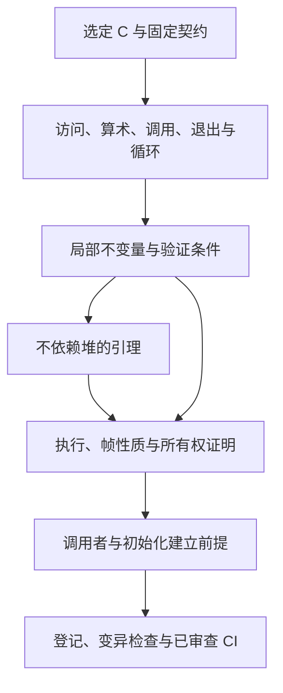

<!-- source-sha256: 73d5bc8c19aa5f0f0c9e88da6e586187ceb92b00918b75b172052eaffb3c080f -->

# 证明一个函数

例如，函数准备从一个数组读取 4 字节并写入另一个数组。只证明“结果有 4 字节”还不够：这 4 次读取和写入都要合法，结果必须来自规定的源位置，其余内存不能被意外改动；若分配失败，还要说明先前取得的资源如何清理。函数证明把这些要求同时落实到原来的执行顺序上。

这里的“固定契约”是预先确定的命题，不能为了让证明通过而临时缩小输入范围。安全性关心合法访问和机器运算；终止性关心执行能否结束；帧性质关心哪些内存保持不变；所有权效果关心哪些分配被保留或释放。功能正确性还要解释返回值和输出内容。

函数证明把逐语句翻译联系到固定契约，必须建立安全、终止、帧性质与准确所有权效果。功能正确性将同一次执行和状态联系到格式或 API 模型。[安全规范](../spec/safety.md)定义这些声明，[进度](../progress.md)记录当前验收状态。

## 证明之前先确定问题

从选定 C 开始，包括 `patches/README.md` 列出的补丁。阅读 [API 指南](../spec/api/README.md)的公开要求和[设计指南](../design/README.md)的内部条件。确定函数必须满足的准确命题，记录全部调用者要求、错误情形、可写对象和分配效果。

公开前置条件必须覆盖 `zlib.h` 允许的情况。内部定理可以要求表界限或特定模式不变量，但调用者必须证明这些要求。超出 `zlib.h` 的任何公开限制，都应写入定理文档字符串和[偏差记录](../deviations.md)。

按 C 的顺序处理，保留每个分支、读取、写入和算术转换。无符号算术回绕；有符号算术及无效指针操作必须引发模型故障。不能为了简化证明而合并语句，或将源表达式替换为看似等价的表达式。读取时序很重要：某字段在另一次写入之前被读取，与缓存更早值可能不同。

## 构造论证

下图中的验证条件，是由一条实际读写、分支或循环产生的小问题。例如，读数组第 i 项前，要有 `0 ≤ i < 数组长度`；证明循环会结束前，要有每轮都会减少且不能无限下降的量，称为终止度量。数学界限最后还要换算成运行时允许的执行步数。

每次访问都要说明对象存活、指针形式正确、偏移位于访问范围内。指针算术须包含末尾后一位置规则。每次移位或有符号操作都要建立范围。每个循环都给出度量，并说明其执行满足实际步数预算界限。数学上有限的循环本身不能证明翻译后运行避开 `Fault.outOfFuel`。

对每个被调用函数使用已证明的执行定理。从当前状态给出其前置条件，再使用结果、帧性质和所有权效果。禁止用“被调用函数满足其规范”作为假设。

不需要堆的算术与组合引理放在 `ZlibF/Math/`。内存证明把它们实例化到实际读取和写入的单元。例如，纯表定理只有在堆细化证明 `inflate_table` 安装了那些表项之后，才能用于解码器。

## 诊断受阻证明

可能有四类原因。调查时不能先假定程序或规范正确。

| 原因 | 寻找的证据 | 处理方式 |
| --- | --- | --- |
| 证明技术 | 声明与翻译一致，但缺少结构引理或不变量使论证无法继续 | 在最低层证明该引理。从初始化建立并保持更强不变量。 |
| 错误规范 | 合法执行与所述结果或错误行为矛盾 | 解释反例并停止证明该声明。修正规范需要独立审查的变更。 |
| 翻译错误 | 翻译不同于选定 C，包括求值顺序或转换 | 经过审查流程修正翻译，并添加差分回归。 |
| 真实 zlib 缺陷 | 选定 C 本身在合法输入上失败 | 构造输入，在运行时检测器下运行 C，记录复现与范围。 |

缩小调用者定义域不能解决任何上述原因。已确认的上游缺陷可能允许最小补丁，并须匹配已提交上游的修复。模型限制不是上游缺陷。

## 一个表示不变量

表示不变量把“这是一条可继续使用的流”写成精确条件。它同时描述存储是否存在、索引是否有界，以及字段之间如何对应。例如，窗口未满时，下一个写位置应恰好位于已有历史之后。这里的 `InflateOK`、`DeflateOK` 是整组条件的名字；它们不是一个由调用者任意设成真的开关。

`InflateOK` 和 `DeflateOK` 命名预期流不变量。源代码可能包含中间谓词或旧名称，如 `DGood`；其与流不变量的关系需要明确的定理。对这类谓词的条件结果并不等于序列安全。

下表的 W、D、H1/H2 是后续组件指南给出的条件编号：W 描述解压历史环，D 描述压缩器连续窗口的边界，H1/H2 描述哈希桶和前驱链接确实来自插入过的位置。它们不是新的数值变量。`prev` 保存同桶较早位置，`head` 保存每个桶的最新位置，待输出区保存尚未交付调用者的压缩字节。

| 不变量 | 证明必须建立的条款 |
| --- | --- |
| `InflateOK` | 所拥有的状态／窗口块存活且互异；模式与位计数有效；窗口索引满足 W；表指针选择正确的静态或动态对象；表项和已初始化范围支持全部可达读取。 |
| `DeflateOK` | 状态、窗口、`prev`、`head` 和待输出存储存活且互异；大小等式成立；D 约束窗口；H1/H2 描述有意义的哈希链；待输出／符号区域满足共享存储界限；树与状态支持可达操作。 |

D7 条款将 gzip 输出状态 `EXTRA`、`NAME`、`COMMENT`、`HCRC` 联系到非空 `gzhead`。旧不变量允许 `EXTRA` 配合空头，因而条件性的 `deflate(Z_BLOCK)` 执行会故障。这是不变量反例。序列证明必须建立合法调用无法到达该组合。

不变量也承载正确性所需的数据关系。仅有界限不能确定解码字节。应在同一状态上加入历史或格式关系，并证明每一步如何改变它。不能为正确性建立第二套互不相连的流描述。

## 初始化、帧性质与所有权

初始化成功时必须建立表示不变量，也必须说明每个分配失败。默认分配不承诺清零存储：要展示初始化所有后续读取字段的写入。对新鲜指针字段，运行时提供空值，却不检测未初始化读取；这弱于 C。证明必须单独说明每次此类读取之前已有写入；见[安全规范第 3 节](../spec/safety.md#uninitialised-memory)和[可信基础](../trusted-base.md)。

未初始化整数读取取任意值。`slide_hash` 可能遍历整个 `prev`，包括未写槽，但链遍历只能到达为有意义位置初始化的槽。模型在一次运行中固定每个垃圾单元的值。若论证依赖重复垃圾读取相同，就必须对照更强的 C 行为审查。

为区分存储是否分配与内容是否可读，先看两个例子：已分配但从未写入的单元不一定含有初始化值；已经释放的单元即使仍残留旧内容，也不能再读。初始化证明负责前一种区别，存活性和所有权证明负责后一种区别。

帧性质指出函数可以改变的准确内存：自身流、流拥有的状态、该调用授权的调用者范围。调用者输入、无关块和静态只读表按契约保持不变。错误情形也有各自准确效果：有些拒绝而不写入，有些返回错误之前会更新状态或产生输出。不能从负返回码推断堆不变。

“所有权”在这里是资源账本，不是字节内容相等。两条流可以保存相同历史，但复制后的动态缓冲区必须独立；释放其中一条流时，不能使另一条流的缓冲区失效。

`Owns` 追踪流的存活分配块。分配增加新鲜块；释放恰好移除一次。复制创建独立自有块，并重定向内部指针。结束移除自有块。初始化或复制失败必须释放该次尝试取得的所有块，并保留先前所有权。无泄漏性通过这些生命周期转移推出，包括失败路径，而不只是成功路径。

## 非空泛性与组合

初始化定理说明表示不变量可以成立，必须覆盖允许参数定义域与失败行为。不能仅因条件保持证明容易，就接受不一致的不变量。顶层声明还需要具体见证。已有模型见证不会自动实例化翻译后的堆 API。

通过对合法调用序列归纳组合 API。初始化提供首个不变量；每次调用提供下个不变量、帧性质与所有权转移。公开 API 允许的重置、字典、位预置、恢复、复制和部分缓冲区，均须纳入归纳。功能关系也必须跨任意输入／输出切分组合。

## 多个证明共享的结构事实

组件页面共享这些标识。每项事实需要适合实际执行的前提，不能假设被调用函数契约。

| ID | 所需事实 | 使用方 |
| --- | --- | --- |
| F1 | 规范表写入位于预留表内，成功表覆盖全部读取索引 | `inflate_table`, `inflate`, `inflate_fast` |
| F2 | 计数偏移将有码符号排序到互异且已初始化的 `work` 槽 | `inflate_table` |
| F3 | 可达窗口复制根据可用历史检查距离 | `inflate`, `inflate_fast` |
| F4 | 部分填充环中，`whave < wsize` 蕴含 `wnext = whave` | `updatewindow`、解码器复制 |
| F5 | 哈希遍历到达已插入位置与已初始化 `prev` 链接 | `longest_match` |
| F6 | 在调用者剩余空间界限下，直到偏移 258 的匹配比较均在窗口内 | `longest_match`, `deflate_rle` |
| F7 | 活动堆、已存节点与树索引保持在各自数组内 | `build_tree`, `pqdownheap` |
| F8 | 溢出修正找到长度限制以下的非空类，并能递减最后一类 | `gen_bitlen` |
| F9 | 待输出不会覆盖未读符号，且可放入共享缓冲区 | 块写入器和后续静态表查找 |

表中的 `wsize` 是历史窗口容量，`whave` 是已有历史字节数，`wnext` 是下次写入的环下标。F4 说，窗口未满时已有历史从下标零开始连续排列；F3 再利用这个形状，检查复制距离能否找到真实历史。F1/F2 则分别处理解码表和符号暂存区，不能只凭“数组已经分配”推出。

F1 使用 Kraft 与规范码论证。F8 使用满二叉树和截断后的 Kraft 和。F9 需要实际构造树的前缀成本界限；只比较整块总大小不够。[解码表](inftrees.md)与[树](trees.md)页面给出这些论证和范围。

## 接受结果

可审查的证明应记录：源函数、固定目标、明确定义域、使用的不变量条款、内存足迹、所有权变化、被调用函数定理、循环度量和数学引理。若运行时不能检测缺失写入，还须包含指针初始化论证。

变异检查必须修改翻译后的函数，并在该函数的证明内部失败。其他位置的源相等引理失败并不足够。应选择检验实际义务的变异，如丢失检查、改变返回值、错误字段存储或索引差一。

定理必须匹配已登记目标并通过公理审计。完整验收还在同一命名提交上检查源／规范锁、变异证据、差分测试和四项 CI。差分测试是忠实性证据，不是证明。见[检查指南](../checking/README.md)和[防作弊规则](../anti-cheating.md)。

早期工作测量过证明大小，并探索以生成验证条件缩短证明。这些估计是方法的动机，不为当前证明的难度或大小建立界限。小证明与构建成功都不能替代验收条件。

## 检查每个证明接口

组合分支结果前，记录生产者建立的关系和消费者要求的关系，并确认两者涉及
同一堆和寄存器。定理名称相近并不能建立连接。缺失的蕴含仍是证明义务。

流引擎需要检查六个接口：初始化建立持久关系；入口推出局部派发关系；
每个模式保持该关系或建立精确退出关系；继续派发时有界秩下降；每个出口
恢复公开计数、帧和所有权关系；每个允许的历史操作保持持久关系。
直接返回和公共退出路径分别需要退出论证。

表构造也有两个不同义务。有界索引和合法叶节点形状支持安全查表；
与独立规范码的对应关系支持解码含义。安全写入范围本身不能证明任一完整的
消费者结论。格式精化必须沿用安全论证中的同一执行。
