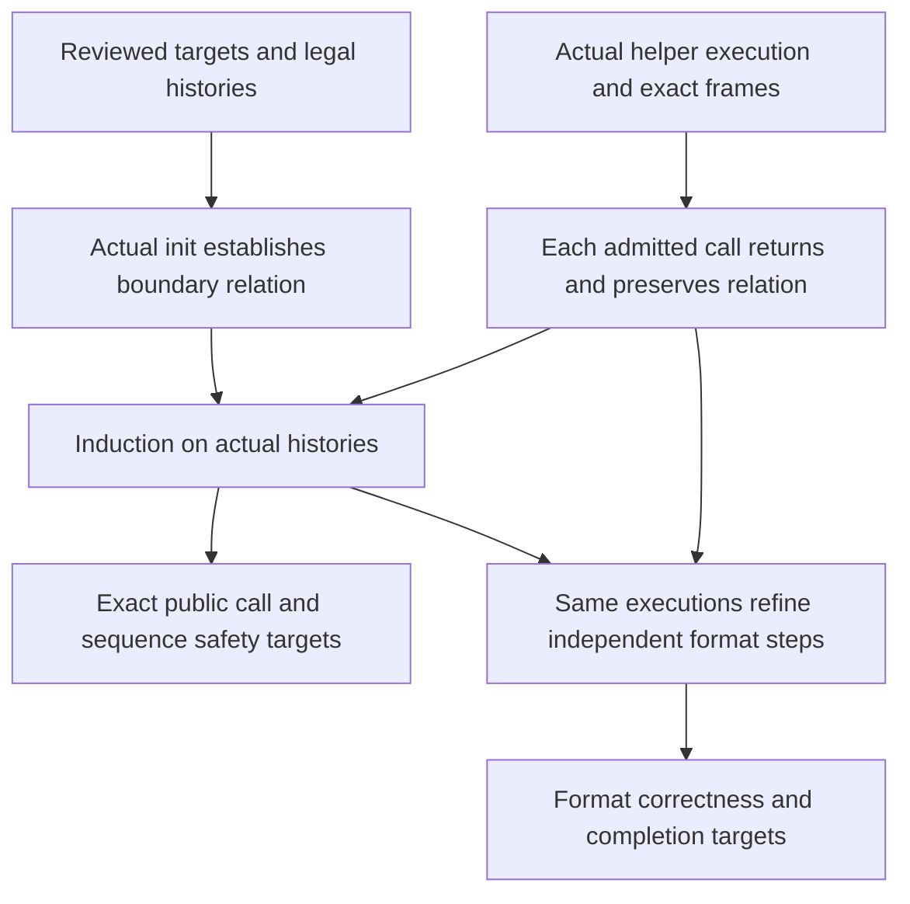

# Proof architecture for the two stream engines

This is a proof architecture with initial local implementation steps. The
explicit platform byte-object premise and its fast-entry bridge are separate
Lean modules. `Goal.inflate` now states that platform premise explicitly;
its conclusions, other public targets, translations and runtime rules are
unchanged. The ordered work and current blockers are recorded only in
[overview](../overview.md#stream-proof-route).

The primary targets are `Goal.inflate` and `Goal.deflate` in
[`Streams.lean`](../../ZlibF/Spec/Public/Streams.lean). They state returning
execution, representation preservation, accounting, frame and ownership.
They do not themselves state the complete format result. The separate
`Goal.inflate_sequence` and `Goal.deflate_sequence` in
[`Sequences.lean`](../../ZlibF/Spec/Public/Sequences.lean) add format correctness
and completion. All four obligations belong to the intended result.

## Evidence and limits of the architecture

The structure below has precedents in public verification developments. Those
sources were read, not rebuilt or independently audited for this project.
They provide methodological evidence, not a proof of these fixed targets.

| Source | Relevant evidence and scope |
| --- | --- |
| [Direct C verification contract](https://github.com/genproof/zlib-full-auto-proofs-public/blob/37189f4964f99ba879a0a5fc6aa9d55754f29dea/CONTRACT.md) | The subject is a patched release with configuration changes and source idiom edits. Its claims exclude termination and record an outstanding adequacy instantiation. It is not acceptance evidence for the selected source here. |
| [Mode invariant](https://github.com/genproof/zlib-full-auto-proofs-public/blob/37189f4964f99ba879a0a5fc6aa9d55754f29dea/src/proof/inflate/Inv.v), [strengthened invariant](https://github.com/genproof/zlib-full-auto-proofs-public/blob/37189f4964f99ba879a0a5fc6aa9d55754f29dea/src/proof/inflate/Inv3.v), [case assembly](https://github.com/genproof/zlib-full-auto-proofs-public/blob/37189f4964f99ba879a0a5fc6aa9d55754f29dea/src/proof/za/inflate/CasesAllZ.v) | The direct C proof separates machine well-formedness, memory representation, table coverage and individual cases. Case proofs compose backwards along fall-throughs. Its invariant revisions also show why a plausible global clause must be checked against sync and reset. |
| [Buffer correspondence](https://github.com/kim-em/lean-zip/blob/2f7a63f38195bc667a926881b55d10c9f8a88eeb/Zip/Spec/InflateBufCorrect.lean), [production correctness](https://github.com/kim-em/lean-zip/blob/2f7a63f38195bc667a926881b55d10c9f8a88eeb/Zip/Spec/InflateProductionCorrect.lean) | A concrete bit-buffer relation supports per-operation correspondence, loop induction and a final connection to an independent format. The implementation is a different decoder. Its [stated limitations](https://github.com/kim-em/lean-zip/blob/2f7a63f38195bc667a926881b55d10c9f8a88eeb/README.md#known-limitations) exclude a streaming API. |
| [Verified format and parser construction](https://arxiv.org/html/1609.01220v1#S5) | The paper composes relational parsers using prefix uniqueness and decidability. It verifies a new implementation, not the original C engine and its memory lifecycle. |
| [Table safety theorem](https://github.com/Certora/zlib-inflate-table-fv/blob/main/fv/InflateTableSafety.lean) | The theorem concerns table construction. It does not establish the surrounding public stream machine. |

These sources support the decomposition, not the claim that all necessary
invariants already hold. The outstanding local obligations and the decision
about implementation readiness are in [overview](../overview.md#inflate-route-readiness).

## Dependency direction

The organizing unit is a preserved relation over actual execution. The number
of helper proofs is not a measure of progress toward a public target.

For each stream kind, write `J h r g` for the proposed boundary relation.
Here `g` is logical history, not another implementation or a callee contract.
The following are schematic proof obligations, not existing theorems:

| Obligation | Required argument |
| --- | --- |
| Successful init establishes J | Use the actual initialization writes on every successful parameter and allocation path. |
| Rebuffer preserves J | Use exactly the current `Rebuffer` relation. Any borrowed-memory premise needs justification. |
| An operation from J returns and establishes J | Prove the actual call, including all admitted error returns, its frame and allocation ledger. Supply its local premises from J and the current arguments. |
| Copy transports J | Relocate owned references and copy logical history. Prove source preservation and each failure cleanup separately. |
| Reachability implies existence of J | Induct over the constructors of `StreamReachable`, using the preceding execution theorems. |
| End releases ownership | Use the same boundary relation and exact live-block accounting. |

The operation proof must not require the public target that the history lemma
will later establish. It can require J, whose initialization and preservation
are separate proved obligations. The equation recording a previous successful
execution in `StreamReachable.step` is evidence about that execution. It is
not permission to assume its specification or to omit proof that the next
call returns. Refused calls also become reachable when they return normally.

The two copy constructors record only successful destination histories.
They do not discharge allocation-failure cleanup or source preservation.
Those remain part of the concrete copy arguments.

## Checking that the pieces compose

Before extending a branch proof, record its exact input and output relations.
A producer's conclusion must entail the consumer's premises on the same heap
and registers. Existence of both theorem names is insufficient.

For inflate, the composition has six fixed interfaces. The names in this
table are schematic, not declarations already implemented in the library.

| Interface | Obligation |
| --- | --- |
| Initialization | Actual successful initialization establishes the persistent safety relation. Invalid and allocation-failure exits retain their exact separate cleanup contracts. |
| Entry | The persistent relation and current public arguments establish `L(mode, heap, IL, history)` after actual entry checks and LOAD. |
| Dispatch | For each admitted mode, actual execution either establishes L at the next dispatch point or an exact exit relation. Fall-through callees are composed from their proved execution results. |
| Termination | Each continued dispatch decreases a bounded rank. Every nested loop has its own bound below the actual fuel limit. |
| Exit | Each exit kind proves the exact return, accounting, frame, ownership and restored persistent relation. Direct returns and `inf_leave` have different obligations. |
| History | Every admitted auxiliary operation, successful-copy constructor and rebuffer preserves the persistent relation. Copy refusal and cleanup have separate totality obligations. Induction then supplies the relation at the public call. |

Together these interfaces are a sufficient proof outline for the public call
target. They must be instantiated with proved execution lemmas, not retained
as assumed library contracts. Format refinement and completion add their own
relations and progress arguments over those same runs.

A useful termination design tracks remaining unread bits and output space,
plus a rank for silent control transitions. Fast-path byte rollback must
preserve the unread-bit accounting. The silent transition graph must have no
unaccounted cycle. This is a design to check against all branches, not an
already proved rank or a reason to choose an arbitrary fuel constant.

A table producer also needs two distinct conclusions. Safety requires bounded
root/subtable access and valid leaf shapes. Functional refinement additionally
requires those entries to describe the independent canonical codes. Code
length acceptability or a safe write footprint does not imply either complete
consumer conclusion by itself.

### Mode interfaces for inflate

The following is a source-based interface design, **to confirm** by
initialization and preservation proofs. Facts apply when their mode reaches
the corresponding access. They are not new public assumptions. Every row
also carries the common heap ownership, cursor ranges, held-bit relation and
exact permitted writes.

| Mode or source group | Facts needed at its reads | Establishing transition or operation |
| --- | --- | --- |
| HEAD | Wrapper alternatives; sufficient held bits before header tests; safe window-size selection. Raw entry has a different branch. | Successful init or reset; sync's exact recovery effect. |
| FLAGS, TIME, OS, EXLEN | Valid requested bit widths, parsed wrapper context and permitted header record writes. | Previous wrapper phase and actual bit operations. |
| EXTRA, NAME, COMMENT, HCRC | Current field progress and caller capacities; header checksum over the actual prefix; buffer exhaustion preserves the parse position. | Previous header phase, earlier calls and the current borrowed-memory protocol. |
| DICTID, DICT | Parsed dictionary identifier; exact dictionary-required and accepted states. A refusal does not produce output. | Header parsing, dictionary installation and reset. |
| TYPE, TYPEDO | Last-block flag and boundary semantics; fixed-table installation or checked dynamic/stored selection. | Init, raw HEAD, completed copy/token block, reset or recovery. |
| STORED | Byte alignment; four-byte length/complement check; installed length at most 65535 and empty held bits on success. | Block-type selection and actual header reads. |
| COPY_, COPY | Remaining stored bytes; bounded source/output views; required non-overlap; precise consumed and produced prefixes. | Successful STORED or the previous partial copy. |
| TABLE | Fourteen header bits and checked literal/distance counts before later array use. | Dynamic block selection. |
| LENLENS | `have ≤ ncode ≤ 19`; initialized three-bit length values in the order selected by the source. Successful construction installs the code-length table relation. | TABLE and earlier LENLENS iterations or calls. |
| CODELENS | `have ≤ nlen + ndist`; valid code-length table; initialized previous length before repeat 16; repeat fits before stores. Successful constructors install both data table relations. | LENLENS, actual repeat handling and actual table calls. |
| LEN_, LEN | Valid literal/length and distance tables, leaf/link bounds and code meanings; progress and every fast-call premise when its guard is selected. | Fixed installation, successful CODELENS or the previous token. |
| LENEXT | Length base and at most five extra bits; final length at most 258; checked accounting for `back`. | An actual valid length leaf. |
| DIST | Valid distance lookup and bounded root/subtable bit counts; positive length and checked `back`. | LENEXT and actual lookup operations. |
| DISTEXT | Positive distance base, at most thirteen extra bits and final distance at most 32768. | An actual valid distance leaf. |
| MATCH | Positive remaining length; output room before writes; source from the produced prefix or checked retained history. The bytewise copy also covers overlap. | DISTEXT and the previous partial match. |
| LIT | Literal value and output room before the store; exact one-byte history extension. | An actual literal leaf. |
| CHECK, LENGTH | Wrapper checksum/length over the actual output; distinguish already committed totals and the source's reassignment of the local `out` counter. | Final block completion and earlier partial trailer calls. |
| DONE, BAD, MEM, SYNC | Exact terminal/error effect and exit kind. Preserve cleanup without requiring abandoned parse/table data to remain semantically usable. | Successful completion, detected data error, allocation failure or recovery. |

The assembly order within a fall-through chain follows its tail first:
MATCH supports DISTEXT, then DIST and LENEXT, then the slow LEN branch.
The analogous chains are COPY before COPY_ before STORED, CODELENS before
LENLENS before TABLE, and DONE before LENGTH before CHECK. These are proof
dependencies. The translated source order is unchanged.

The dispatch loop closes the cycles between chains. Its invariant must retain
any pending match, stored-copy or table-construction work across a returned
call. A finite witness does not establish this universal closure.

## Relations at different execution points

J has a safety and ownership part and a semantic history part. Both refer to
the same heap, state record and actual execution. The public `Good` and
`DGood` definitions stay fixed. An auxiliary relation supplies their missing
premises; it does not silently strengthen the public domain.

Each clause is justified at the access or transition that needs it. A larger
conjunction with no establishing execution only moves the gap. Logical history
starts with the actual init event and changes with observed call effects.
It cannot be chosen afresh to assume the desired format result.

The API boundary relation is different from an invariant inside a function.
In inflate, `LOAD` transfers cursor and bit state into `IL`. During dispatch,
the current values are in those registers. Heap fields can still hold their
entry values. A relation at a dispatch point therefore depends on the context,
heap, registers and logical history. It must not require register/heap equality
before the corresponding `RESTORE` writes.

In deflate, construction, ordinary streaming, block construction and block
emission have different obligations. A partially allocated state cannot
satisfy `DGood`. An emission state needs an unread-symbol boundary, whereas
an API return needs a valid pending-output interval. Each implication between
these relations is proved at the source point that establishes it.

Ghost history records accepted input, emitted output, supporting bits,
dictionary context, wrapper/checksum state and pending work. It contains
logical values, not a permanent equality with old caller buffers. Rebuffering
can replace or release those buffers. Reset and recovery have explicit history
effects. Copy shares logical history while allocating independent private
storage. Sequence format results use their exact existing data-trace domains;
safety covers the broader operation history. Broader functional coverage must
remain explicit rather than being attributed to an ordinary data epoch.

## Inflate relation

The first table clause has a concrete Lean interface:
[`DataTableInvariant`](../../ZlibF/Spec/InflateTableInvariant.lean).
It is guarded by the modes that retain data tables. Successful initialization
therefore establishes the clause at HEAD without claiming that unbuilt tables
are valid. The actual fixed TYPEDO branch establishes it at LEN_. Caller
rebuffering transports the same clause using the private state and static
frame; no equality with discarded caller buffers is required.

The later DISTS constructor writes into the same code array as LENS. Its
actual write frame preserves the first table's returned extent, rather than
requiring the complete backing array to stay unchanged. The corresponding
execution theorem retains table safety, read extent and exact query results
on that same returned heap. The constructor producing the first table must
establish the safety and extent inputs. Their current evidence and status
are recorded in [overview](../overview.md#checked-table-clause-composition).

J for inflate extends the facts available from `Good` with guarded facts about
the current mode. It does not require all old fields or table cells to be
meaningful in every mode.

| Part | Meaning and source of the facts |
| --- | --- |
| Storage | State/window ownership, array extents, static contents and written pointer fields follow from initialization and actual writes. |
| Mode | Each reached access has the needed count, width or initialized-prefix fact. COPY has remaining stored bytes; CODELENS has bounded counts and initialized lengths; MATCH has a justified pending copy. |
| Tables | A construction phase has only its established initialized ranges. An installed phase has root/subtable coverage, leaf flags, widths and code meaning for the actual selected heap arrays. |
| Bits | Supporting bits and held lookahead have distinct roles. Refill, drop, fast-path rollback and priming preserve the relation at their actual source points. |
| History | Window contents are the retained chronological history. Dictionary context and output are distinct. A match can also use the current call's output prefix. |
| Wrapper | Parsing position, checksums, header writes and required dictionary checks follow the actual produced bytes and modes. |

`inflate_table` has to produce the installed-table relation on its returned
heap. Array-level canonical coverage alone cannot do this. The selected fast
branch then has to derive the existing fast decoder's premises from that same
table, current buffers and ring history. Fast execution is part of the public
translation even if a development milestone first covers slow decoding.

The entry/exit proof connects J to the dispatch relation. It includes early
returns, the local header array's lifetime, `inf_leave`, counter writeback and
late window-allocation failure. In particular, output and cursor changes may
precede `Z_MEM_ERROR`, while stored totals retain their old values. Successful
and failed exits cannot share an invented unchanged-state postcondition.

Termination uses progress between actual dispatch points. Input consumption,
output production, remaining copy/table work and bounded silent mode changes
are candidates for a combined measure. A mode number alone is not decreasing:
blocks and tokens revisit modes. Each translated loop also needs a numerical
bound below its own fuel limit. Finiteness of a mathematical trace is weaker.

## Deflate relation

The initialization argument uses a construction relation for allocated blocks
and fields written so far. It covers all five allocations, arbitrary old
integer contents and every permitted allocation oracle. When the state
allocation succeeds, the source attempts all four buffer allocations before
checking their combined result. Cleanup must account for every acquired block,
including allocations after an earlier buffer failure.

`DGood` already includes the tree invariant. Applying a reset theorem that
assumes `DGood` cannot establish `DGood` for a new state. Existing
`resetKeep_run'` uses `DLive` and `TreesBase`, and `tr_init_spec` establishes
`TreesInvAt` from `TreesBase`. Together with `lm_init_run`, these provide
concrete starting points for construction; their remaining premises still
have to be derived from the actual initialization writes.

| Part | Meaning and source of the facts |
| --- | --- |
| Window | Real input and retained history satisfy the window bound. The slide changes represented coordinates. Signed `block_start` may be negative. |
| Chains | Instantiate existing `HashChains` with actual `head`, `prev` and window arrays. Derive its `top` and `lim` through insertion, slide, dictionary replacement and reset. |
| Matches | The selected literal or match consumes exactly the corresponding input. The slow strategy also tracks its deferred literal and previous match. |
| Symbols | Stored triples have their original values, domains and frequency contributions. Those facts survive until each triple is read. |
| Emission | Pending bytes, bit-buffer contents, unread symbols, tree description and block costs agree on the same execution. |
| Header/status | Header progress and status imply the required current borrowed storage and index bounds, under the reviewed caller protocol. |

`HashChains`, `chains_insert`, `chains_slide` and `chain_ok_of_chains` already
exist in [`deflate.c.engine.chains.lean`](../../ZlibF/Proof/deflate.c.engine.chains.lean).
They are useful mathematical relations and implications. They are not yet a
proof of all reachable engine states. `longest_match_ok` similarly supplies an
actual execution theorem under `LMEnv`; callers must establish that environment.
Search termination must also cover the values admitted through `deflateTune`,
without assuming an unjustified positive chain budget.

### The shared output buffer is a central dependency

F9 is a temporal property of emission. At every write, output stays before
unread symbol bytes; after the last symbol, the end code and alignment still
fit in the allocation. An allocation-capacity bound alone is insufficient.

The proof uses the actual prefix bit cost, the current buffered-bit count and
the exact next write width. A triple becomes consumed only after its three
source reads. The tree description must fit before the first such read.
Only the final flush can use the space released by all consumed symbols.

The entry bound H0 must follow from every real caller, including headers,
resumed pending output and parameter changes. It is not a public assumption.
The existing fifteen-bit room premise for sending a symbol is then discharged
from this prefix accounting. Dynamic block selection compares total sizes;
it cannot alone prove no overtaking at each prefix. Any frequency/cost lemma
used here must follow from the trees actually built and cover memory levels
1 through 9. Small memory levels are part of the initial public domain.

The block encoding argument does not require optimal compression or the
longest possible match. It requires that every chosen token reproduces the
accepted input and that the actual encoded bits decode to those tokens.
That reduces strategy correctness to valid token production. Cost properties
used for F9 or completion still need their own exact proofs.

## Reuse and acceptance

Existing exact execution equations and frames can transport added clauses
when the relevant storage is unchanged. Changed clauses need targeted
preservation proofs. An unchanged function theorem over `Good` does not itself
establish J, but it need not be discarded or mechanically rewritten.

Stored blocks and literal-only compression are useful composition milestones.
Their restrictions belong in their internal theorem statements. They do not
discharge the unrestricted public targets. Auxiliary declarations follow the
existing source-file proof organization. Heap-free history and cost arguments
belong in the mathematical layer. No new runtime or verification framework is
needed for this architecture.

Each useful milestone identifies the caller that establishes its premises and
the next consumer of its conclusions. New invariant definitions are semantic
material even inside proof modules; they need the existing review and lock
process. The public result still requires exact target registration, direct
translation mutants, the axiom gate and all four CI checks on a named commit.
Abstract-model results support the last refinement step but cannot replace it.
