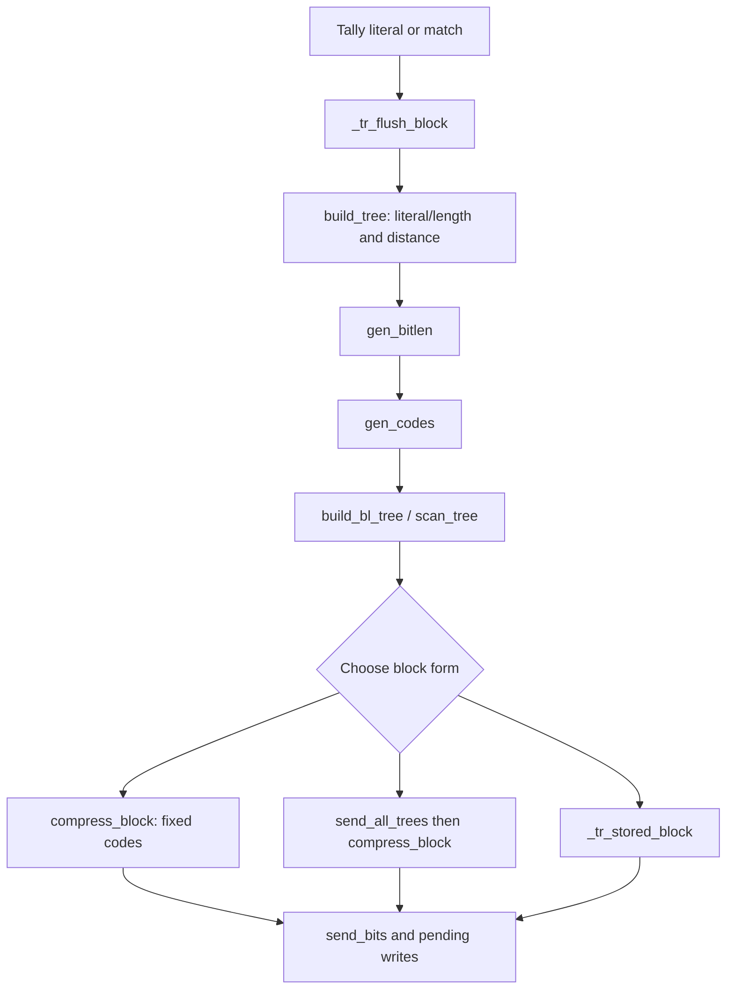

# Trees and block emission: bounds, codes and shared storage

Source: `zlib/trees.c`, with the symbol layout in `zlib/deflate.h`.
Translation: `ZlibF/Zlib/trees.c.lean`. Internal contracts use `I-bt-*`,
`I-gb-*`, `I-gc-*`, `I-cb-*`, `I-tf-*`, `I-fp-*` and `I-pb-room` in
[internal contracts](../design/internal-contracts.md). Mathematical code rules
are `F-code-*`, `F-length-table` and `F-distance-table` in the
[format guide](../format/README.md).

The proof must connect the actual tree construction, canonical words and emitted
bits. Array safety alone does not show that the output is a DEFLATE block.
Historical results below identify useful arguments with explicit scope.
[The overview](../overview.md) records current results and remaining work.

## Dataflow



Each edge requires an execution theorem and established representation facts.
In particular, block emission must preserve unread symbols in the pending
buffer before their values can be used in table-index proofs.

## Heap and node bounds: F7

Let `elems` be 286, 30 or 19 for the literal/length, distance or bit-length tree.
`HEAP_SIZE = 573`. The `heap`, `depth` and `dyn_ltree` arrays have 573 entries;
`dyn_dtree` has 61 and `bl_tree` has 39.

The scan resets heap counters, selects nonzero-frequency leaves and initializes
the required lengths/depths. For zero or one live leaf, the forcing loop creates
at most two distinct live leaves. Prove this from unrestricted old array
contents, including its exact descriptor maximum and unsigned cost adjustments.
The result is `2 ≤ N ≤ elems` populated entries in heap positions `1..N`.

For `pqdownheap(k)`, the left child `j = 2k` is read only with `j ≤ heap_len`;
the right child `j+1` only with `j < heap_len`. Descending moves k to a child,
so the finite heap depth bounds the loop and shifts. Its execution theorem must
preserve the heap's node permutation and restore the ordering needed by the
constructor. A bound on indices does not establish a minimal root.

The heapify loop applies that theorem in reverse internal-node order. The
following merge loop starts with `heap_len = N`, `heap_max = HEAP_SIZE` and
`node = elems`. After t merges,

```
heap_len = N - t
heap_max = HEAP_SIZE - 2t
```

The next merge exists only with `t ≤ N-2`. Its two stored-node writes use indices
`HEAP_SIZE-2t-1` and `HEAP_SIZE-2t-2`. They are positive and above the active heap:

```
HEAP_SIZE - 2t - 2 > N - t
```

because `N ≤ 286` and `t ≤ N-2`. The new node number is at most
`elems+N-2 ≤ 2*elems-2`, namely 570, 58 or 36. It fits its selected tree array.
The last root write uses `HEAP_SIZE-2N+1 ≥ 2`. These are the principal array
bounds in **F7**.

The full merge proof must also establish distinct children, parent links,
frequency sums, node membership and stored order. Source-level tie-breaking
uses depth reads at specific times. Preserve the selected-depth reread in the
translated merge expression; a cached earlier depth is a different program.
The initialization history of every reached depth read is part of the proof.

Depth is an unsigned byte. A depth increment may wrap as C permits. That fact
alone is harmless to memory safety, but it does not justify a mathematical
claim that uses the unwrapped depth for ordering or an overlay bound. Such a
claim must establish a sufficient range or explicitly account for wrapping.
Frequency and cost fields likewise need their actual width and total-weight
bounds, including artificial leaves and reset/repair effects.

## Length repair: F8

`gen_bitlen` receives the constructed full binary tree, its parent links and
ordered stored-node region. Let `L = max_length`, 15 for data codes or 7 for the
bit-length tree, and let n be its number of leaves. The root precedes its
descendants in `heap[heap_max..HEAP_SIZE)`: a parent is constructed after its
children leave the priority queue and is stored later at a smaller index.

The first pass assigns each non-root node
`Len = min(Len(parent)+1, L)`. Thus `Len = min(true depth, L)`.
`overflow` counts every node whose true depth exceeds L, including internal
nodes; it is not merely a count of deep leaves. The pass counts leaf lengths in
`bl_count` and updates exact source cost fields.

### The clamped Kraft identity

For a full binary tree, the true leaf Kraft sum is 1. Let
`K = Σ_leaves 2^-Len` after clamping. Every internal node v at true depth L
has a full subtree with `ℓ_v` leaves and `2ℓ_v-2` nodes strictly below it.
Clamping that subtree raises its Kraft weight from `2^-L` to `ℓ_v*2^-L`.
Every node below depth L belongs to exactly one such subtree. Hence

```
K - 1 = 2^-L Σ_v (ℓ_v - 1)
overflow = Σ_v (2ℓ_v - 2)
K = 1 + (overflow/2) 2^-L
```

In particular, overflow is even. This identity depends on the real full tree
and the traversal accounting; arbitrary bounded leaf lengths do not imply it.

A repair finds the highest nonempty class `b < L`, then performs

```
bl_count[b]--
bl_count[b+1] += 2
bl_count[L]--
overflow -= 2
```

Splitting a leaf preserves Kraft weight and adds one leaf. Dropping a length-L
leaf removes `2^-L` and one leaf. Thus repair preserves n and the displayed
identity while lowering overflow by two.

### Why repair cannot run off the arrays

**F8(i):** while overflow is positive, some class `1 ≤ b < L` is nonempty.
Otherwise all n leaves have length L, so the identity with positive overflow
would give `n > 2^L`. But the descriptor gives `n ≤ 286 < 2^15`, or
`n ≤ 19 < 2^7` for the bit-length tree. The downward class scan therefore stops
before zero or a negative index.

**F8(ii):** the final class has at least two leaves at every repair entry.
Initially its count is at least the number of deep leaves:

```
a₀ ≥ Σ_v ℓ_v = overflow₀/2 + R ≥ overflow₀/2 + 1
```

where R is the positive number of depth-L internal subtrees when overflow is
positive. Each repair decreases a by at most one and overflow/2 by exactly one.
Thus `a ≥ overflow/2 + 1 ≥ 2` at a continuing entry. The decrement cannot wrap.
The intermediate count increase is bounded by n+1, so it also fits its field.

Overflow decreases through nonnegative even values, so repair terminates with
K = 1. The second pass assigns exactly `bl_count[b]` leaves at each length,
scanning `heap[--h]` and skipping internal nodes. There are n leaves among the
`2n-2` non-root stored nodes, so the scan stays at or above `heap_max+1`.
Prove that assignment order and cost corrections match the source, in addition
to these bounds.

The resulting `I-gb-len` gives active leaf lengths in `1..L`, counts and a
complete prefix code. The parent/tree/heap premises must come from
`build_tree` execution; they cannot be callee-contract assumptions.

## Canonical words and tree descriptions

`gen_codes` first computes canonical start words from `bl_count`, then writes
the reversed word for each positive-length symbol and advances that length's
next word. `I-gc-*` must establish the exact reversed canonical assignment,
preservation of lengths and the frame outside selected code cells. Safety
needs explicit array and length bounds; correctness additionally needs the
canonical-code/count relation. Unsigned wrapping in the start-code arithmetic
must agree with the actual translated operations.

`bi_reverse` has a positive count for each such call, at most 15. Its loop
reverses exactly that many bits. The zero-length case is skipped before the
call. The actual execution proof must account for both loops and their fuel.

| Functions | Required bounds and meanings |
| --- | --- |
| `scan_tree` | Sentinel store at `max_code+1` fits the tree. Real lengths are `0..15`; sentinel `0xffff` is compared without indexing `bl_tree` by it. Repeat symbols 16, 17 and 18 fit the bit-length tree. |
| `send_tree` | Its repeat decomposition matches the scan's counts and reproduces the original code-length sequence using the generated bit-length codes. |
| `build_bl_tree` | `bl_order[max_blindex]` is bounded while scanning from 18 toward 3; connect tree costs to the actual description. |
| `send_all_trees` | `blcodes ≤ 19` and the other count bounds justify descriptor and order-table accesses; emitted counts and lengths match the format grammar. |
| `_tr_tally` and tally macros | Every stored literal/match has the specified length/distance domain and corresponding frequency update; symbol writes fit the shared region. |
| Initialization and reset helpers | Establish descriptor pointers, END_BLOCK frequency, bit-buffer state and zero/count facts before their consumers read them. |

## Bits, pending bytes and `compress_block`

`I-pb-room` requires one/two bytes of room for `put_byte`/`put_short`.
`send_bits` requires `1 ≤ length ≤ 16`, a fitting value and valid bit-buffer
state. It has no capacity check of its own. It either appends within the
16-bit buffer or writes a short and retains the remainder. Each shift and
conversion needs the exact branch-specific range.

Use **P** for the accounting bound. If S bits have been sent since a base
pending position and the initial bit count is v, then the short-write portion
satisfies

```
pending ≤ base + 2 floor((S + v) / 16)
```

Equality need not hold at an exact 16-bit boundary: the source can retain a full
bit buffer until the next write. With `v ≤ 7`, the convenient upper bound is
`pending ≤ base + S/8 + 1`. Byte-alignment, tree headers and final flushes need
their own extra-byte accounting.

`compress_block` reads three symbol bytes before emitting their code. For a
match, `lc ≤ 255` bounds `_length_code[lc]`; its code is at most 28 and indexes
the length base/extra tables and the literal/length tree up to symbol 285.
Distance minus one is at most 32767, so
`d_code(x) = x < 256 ? _dist_code[x] : _dist_code[256 + (x >> 7)]`
indexes at most 511. The selected distance code is at most 29.

Those premises require the symbols still to be the values tallied. Overwriting
an unread distance can create an arbitrary 16-bit value and an index up to 767.
The overlay lemma therefore supports static-table read safety as well as
pending write safety.

## The overlay lemma F9

Let `B = lit_bufsize`. Pending storage has `4B` bytes. Symbols start at offset B,
consume three bytes each and number at most `K ≤ B-1`. Symbol k is read at
`[B+3k, B+3k+3)`.

**F9 / I-cb-pending:** after emitting symbol k,

```
pending < B + 3(k+1)
```

and no write during emission may reach the unread suffix. After the end code
and final flush, require `pending ≤ 4B`. The pre-symbol tree/header writes must
also preserve symbol 0. A proof needs these temporal facts, not only the final
pending count.

### Entry accounting H0

The intended **H0** is `pending = 0` and `bi_valid ≤ 7` at `_tr_flush_block`
entry. **to confirm**: derive it for every caller, wrapper-header path and
resumed partial-output call. The source flushes pending bits/bytes and may
return when output is exhausted. A fresh block must not bypass residual
pending bytes. Any path with a different entry bound needs the actual stronger
accounting premise rather than H0 by assertion.

### Fixed and stored blocks

For fixed codes a literal costs at most nine bits and a match at most
`8 + 5 + 5 + 13 = 31`. A fixed block adds a three-bit header and seven-bit end
code. Under H0 and P, after q symbols (`1 ≤ q ≤ K`) a convenient bound is

```
pending ≤ (7 + 3 + 31q)/8 + 1
```

It is below `B+3q` whenever `(7/8)q + 9/4 < B`. Since `q ≤ B-1`, `B > 11`
suffices; the permitted minimum is B = 128. Exact integer rounding only
improves that loose bound. Include the end code and final alignment to prove
the final `4B` capacity. The initial slack also protects symbol 0 from the
three-bit header.

Block selection computes rounded dynamic and fixed byte costs. Dynamic output
is chosen only if its rounded cost is strictly less than the fixed cost; a
stored block requires `stored_len+4 ≤` the selected cost and an available raw
buffer. For stored blocks, that comparison and the fixed cost bound control
the header plus copied data. Symbols are not read afterwards, so overwriting
their region is permitted once the stored form is selected. Prove the byte
rounding and entry-bit accounting for the actual branch.

### Dynamic blocks need a prefix bound

A dynamic block emits its tree description before its symbols: 14 count bits,
three bits per announced bit-length code and a repeat-coded length sequence.
The subsequent data code lengths can be as large as 15. Comparing the complete
dynamic block against the complete fixed block bounds a total. It does not
bound each prefix: long early symbols can precede short late symbols.

The required inequality is of the form

```
tree_bits + Σ_(i < q) dynamic_symbol_bits(i)
    < 8(B + 3q) - rounding_and_entry_slack
```

for each emitted prefix, plus the bound for the tree before symbol 0 and the
final flush. Kraft-valid code lengths alone do not establish this inequality;
it must use the tree actually constructed from the block's frequencies.

Earlier work explored Fibonacci growth along real Huffman paths. A deep
low-frequency leaf forces enough total weight in surrounding subtrees; a
formal depth/frequency theorem can then bound prefix emission cost.
`build_tree_fib_stmt_holds`, recorded in the earlier
`theorems_trees_fib.txt`, was the historical constructor result.
`dynFits_dynOf_of_fib` covered `memLevel` 4 and 5, and `dynFits_of_push` covered
6 through 9 in that earlier development. Reuse requires their exact frequency,
tie-breaking, depth and cost premises to be derived for this translation.
They do not establish the present whole compressor theorem.

For `memLevel` 1, 2 and 3, B is only 128, 256 and 512. The fixed-code slack is
roughly 16 to 64 bytes, and the dynamic description can consume comparable
space. Historical searches found no real-block violation and recorded a
closest case with 47 bytes free. That search is evidence, not a proof. The
historical `lowmem_lp_bound` route used linear-programming dual certificates;
checked certificates did not by themselves complete the required bridge from
real block frequencies and prefixes.

A theorem restricted to `memLevel ≥ 4` must state that premise and appear in
[deviations](../deviations.md). It cannot justify a safety claim over every
configuration permitted by `zlib.h`. The authoritative current treatment of
all overlay cases is in [the overview](../overview.md).

## What the component theorem must compose

The whole result uses actual descriptor initialization, heap selection and
merges, length repair, canonical assignment, description emission and
block-cost selection. It establishes F7/F8/F9 on the same execution and frames
all memory outside the allowed tree, symbol and pending regions. Mutations
must fail the function's execution proof, even when a complete source-equality
lemma still checks. A proof of a reset/scan/heapify prefix is not a proof of
the unchanged remaining merge and emission code.
