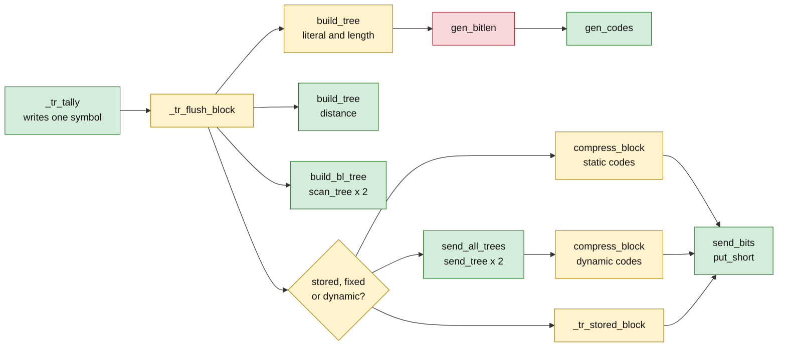

# trees.c: function by function

Source: `zlib/trees.c`, with the symbol buffer of `zlib/deflate.h`. Specification: `I-bt-*`, `I-gb-*`,
`I-gc-*`, `I-cb-*`, `I-tf-*`, `I-fp-*` in [../spec/internal.md](../spec/internal.md) and the code rules
`F-code-*`, `F-length-table`, `F-distance-table` in [../spec/format.md](../spec/format.md).
Items marked **to confirm** are readings of the C that the proof must still check.

## The idea in short

Huffman trees are built in arrays whose sizes are exactly big enough: the nodes added never exceed twice the number of symbols. The one subtle place is the repair of codes that are too long. It works because the sum of 2^(−length) over the leaves exceeds 1 by exactly half the overflow count times 2^(−limit), and each repair step lowers it by exactly that unit. The last fact is that the compressed output never overtakes the symbols it shares a buffer with: the output grows by at most 31 bits per symbol while the symbols are read at 24 bits per symbol, and the buffer has just enough slack, about one eighth, for a block.

## 1. The pipeline



## 2. `build_tree` and `pqdownheap`: the array bounds (F7)

Notation: `N` is the number of symbols with a non-zero frequency, after the forcing step
(see below). `elems` is 286, 30 or 19 for the literal/length, distance and bit-length tree.
`HEAP_SIZE = 2 × 286 + 1 = 573`. The arrays: `heap` and `depth` have `HEAP_SIZE` entries;
`dyn_ltree` has `HEAP_SIZE`, `dyn_dtree` has `2 × 30 + 1 = 61`, `bl_tree` has `2 × 19 + 1 = 39`.

**Theorem F7.** `build_tree` reads and writes only inside these arrays, and terminates.

**Proof.**

*Initial heap.* The loop over `n < elems` stores each symbol with a non-zero frequency at
`heap[++heap_len]`. So after it `heap_len ≤ elems`, and the stored indices are `1 .. heap_len`.

*Forcing.* `while (heap_len < 2)` adds a node `max_code < 2 ? ++max_code : 0`, at most twice. So
afterwards `2 ≤ N = heap_len ≤ elems` (when `elems ≥ 2`, which holds for all three trees).
The added nodes are 0 or 1 or 2 (if `max_code` was 0 or 1), all below `elems`, so
`tree[node]` and `depth[node]` are in bounds.

*`pqdownheap(k)`.* The index `j = 2k` is used only when `j ≤ heap_len`, and `j + 1` only when
`j < heap_len`, so `heap[j]` and `heap[j+1]` are inside `1 .. heap_len`. The index doubles in
each pass, so the loop ends after at most `log2(heap_len) + 1` passes. The `k << 1` stays far below
`2^31`.

*The main loop.* It runs while `heap_len ≥ 2`. Each pass does the following.

1. `pqremove` takes `heap[1]` and replaces it by `heap[heap_len--]`, then restores the heap. So
   `heap_len` decreases by 1.
2. Writes `heap[--heap_max]` twice. Initially `heap_max = HEAP_SIZE`.
3. Creates `node`, which starts at `elems` and grows by 1 per pass, and sets `heap[1] = node++`.

After `t` passes, `heap_len = N − t` and `heap_max = HEAP_SIZE − 2t`. The pass number `t + 1`
exists only if `N − t ≥ 2`, so `t ≤ N − 2` before the pass, and `t + 1 ≤ N − 1` after. The two
writes of pass `t + 1` go to indices `HEAP_SIZE − 2t − 1` and `HEAP_SIZE − 2t − 2`. We show these
are positive and above `heap_len`, so that they neither fall out of the array nor overwrite the
active heap `1 .. heap_len`:

```
HEAP_SIZE − 2t − 2  >  N − t        ⇔       t  <  HEAP_SIZE − 2 − N
```

With `t ≤ N − 2` and `N ≤ elems ≤ 286`: `HEAP_SIZE − 2 − N ≥ 573 − 2 − 286 = 285`, and
`t ≤ 284`. So `t < 285 ≤ HEAP_SIZE − 2 − N`. ✓ (The same holds for the shorter trees, since
`HEAP_SIZE` is the same and `N` is smaller.)

*Node numbers.* `node` takes values `elems, elems + 1, …, elems + N − 2` (one per pass,
`N − 1` passes). The largest is `elems + N − 2 ≤ 2 elems − 2`: 570 for the literal/length tree
(`< 573`), 58 for the distance tree (`< 61`), 36 for the bit-length tree (`< 39`). So
`tree[node]`, `depth[node]` are in bounds, and so are `tree[n].Dad = node` for the two children.

*Last write.* After the loop `heap_len = 1`, and `heap[--heap_max]` writes the root at index
`HEAP_SIZE − 2 (N − 1) − 1 = HEAP_SIZE − 2N + 1 ≥ 573 − 572 + 1 = 2 > 0`. ✓

*`depth`.* It is a `uch`; `depth[node] = max(depth[n], depth[m]) + 1` converts to `uch` and wraps
if it exceeds 255. Wrapping is defined in C and only affects the tie-break of `smaller`, so it is
not a safety issue. ∎

## 3. `gen_bitlen`: the bit-length repair (F8)

### 3.1 What the function does

Let `L = max_length` (15, or 7 for the bit-length tree). Let `n` be the number of leaves, `n ≥ 2`
(the forcing step of §2). The nodes `heap[heap_max .. HEAP_SIZE − 1]` are all nodes of the tree
in decreasing order of frequency; `heap[heap_max]` is the root. The tree is a full binary tree: every
internal node has two children (§2, each pass creates a node with exactly two children).

**Pass 1.** For each node `n` after the root, in heap order, `Len(n) = min(Len(parent) + 1, L)`, and
`overflow` counts the nodes where the minimum was `L`, that is, the nodes whose true depth is
more than `L`. For each leaf `bl_count[Len]++`.

Parents come before children in the array. `build_tree` stores a node in `heap[--heap_max]` when it
removes the node from the priority queue, and it creates a node's parent only after that removal. So
the parent is stored later, at a lower index. (This needs no argument about equal frequencies.) The
root is stored last, at `heap_max`.

Why `overflow` counts true depth: `Len(parent)` is already clamped. If the parent has true depth
`d` then `Len(parent) = min(d, L)`. The child gets `min(d, L) + 1`; this exceeds `L` exactly when
`d ≥ L`, i.e. when the child's true depth `d + 1 > L`. ✓

**Repair.** While `overflow > 0`:

```
bits = L − 1
while (bl_count[bits] == 0) bits--          // find a leaf level below L
bl_count[bits]--; bl_count[bits + 1] += 2   // split one leaf at level bits
bl_count[L]--                                // drop one leaf from level L
overflow -= 2
```

**Pass 2.** Reassigns lengths to leaves by frequency from `bl_count`: for `bits` from `L` down to
1, it takes `bl_count[bits]` leaves from the heap in increasing frequency order (`heap[--h]`).

### 3.2 The hazards

(a) the scan `while (bl_count[bits] == 0) bits--` reads `bl_count[bits]` and decrements `bits`,
with no lower bound in the code; (b) `bl_count[L]--` is an unsigned 16-bit decrement that must
not wrap; (c) pass 2 reads `heap[--h]` with `h` going down from `HEAP_SIZE`; it must stay at or
above `heap_max + 1`.

### 3.3 Two identities

For a full binary tree with `n` leaves, `n − 1` internal nodes and `2n − 1` nodes, the Kraft sum
of the leaf depths is exactly 1: `Σ 2^{−depth} = 1`.

**Identity 1 (the overflow count).** Let `K = Σ_{leaves} 2^{−Len}` after pass 1, where
`Len = min(depth, L)`. Then

```
K = 1 + (overflow / 2) × 2^{−L}.
```

*Proof.* Consider the nodes at depth exactly `L` that are internal. Each such node `v` has a
subtree below it with `ℓ_v` leaves; the subtree rooted at `v` is a full binary tree, so it has
`2 ℓ_v − 1` nodes, of which `2 ℓ_v − 2` are strictly below `v`. The leaves below `v` have true
depth more than `L` and their clamped length is `L`. In the true tree their Kraft sum is
`2^{−L}` (the subtree of `v` carries weight `2^{−L}`). After clamping each contributes
`2^{−L}`, so the subtree contributes `ℓ_v 2^{−L}`, an excess of `(ℓ_v − 1) 2^{−L}` over the true
tree. Leaves at depth at most `L` are not changed. So

```
K − 1 = 2^{−L} Σ_v (ℓ_v − 1).
```

Every node of true depth more than `L` lies below exactly one such `v`, and is counted once in
`overflow`. So `overflow = Σ_v (2 ℓ_v − 2)`, i.e. `Σ_v (ℓ_v − 1) = overflow / 2`. ∎

In particular `overflow` is even.

**Identity 2 (the repair step).** One step replaces a leaf at level `b < L` by two leaves at level
`b + 1` (Kraft sum unchanged: `2^{−b} = 2 × 2^{−(b+1)}`) and removes a leaf at level `L` (Kraft sum
decreases by `2^{−L}`). It does not change the number of leaves (`−1 + 2 − 1 = 0`). And
`overflow` decreases by 2, so by Identity 1 the quantity `K − 1 − (overflow/2) 2^{−L}` stays 0.
After the last step `overflow = 0` and `K = 1`.

### 3.4 Theorem F8

At the start of every step of the repair loop (so with `overflow ≥ 2`):

(i) there is a level `b` with `1 ≤ b ≤ L − 1` and `bl_count[b] > 0`;
(ii) `bl_count[L] ≥ 2`.

*Proof of (i).* `bl_count[0] = 0`: every leaf is a descendant of the root, so `Len ≥ 1`, and
the root is not a leaf since `n ≥ 2`. Suppose no level in `1 .. L−1` has a leaf. Then all `n`
leaves are at level `L` and `K = n 2^{−L}`. By Identity 1 and 2, before this step
`K = 1 + (overflow / 2) 2^{−L} > 1`. So `n > 2^L`. But `n ≤ elems ≤ 286 < 2^15` and, for the
bit-length tree, `n ≤ 19 < 2^7`. This is a contradiction. ∎

*Proof of (ii).* Let `a` be `bl_count[L]`. Initially `a ≥ ℓ_deep`, the number of leaves of true
depth more than `L`. By the counting in Identity 1, `ℓ_deep = Σ_v ℓ_v = Σ_v (ℓ_v − 1) + R`, where `R` is the number of depth-`L` internal
nodes that have a deep subtree (all of them). Since `overflow_0 > 0`, `R ≥ 1`. Hence
`a_0 ≥ overflow_0 / 2 + 1`. Each step decreases `a` by at most 1 (by 1 if `b + 1 < L`, and it
increases by 1 if `b + 1 = L`), and decreases `overflow / 2` by exactly 1. So at step `t`,
`a_t ≥ a_0 − t ≥ overflow_0/2 + 1 − t = overflow_t / 2 + 1 ≥ 2`. ∎

*Consequences.*
(a) The scan `while (bl_count[bits] == 0) bits--` stops at some level in `[1, L − 1]` by (i), so `bits`
never reaches 0 or becomes negative: every read is in `bl_count[1 .. L − 1]`. The write
`bl_count[bits + 1]` has `bits + 1 ≤ L`.
(b) By (ii) `bl_count[L] ≥ 1` before `bl_count[L]--`, so the 16-bit decrement does not wrap. (`bl_count[b+1] += 2` cannot
wrap either: counts are at most `n ≤ 286`.)
(c) The loop terminates: `overflow` is even and decreases by 2.
(d) Pass 2. The total `Σ_{b=1}^{L} bl_count[b] = n` before and after the repair (Identity 2). Pass 2 takes exactly
`bl_count[b]` leaves for each `b` from the heap region `heap[heap_max + 1 .. HEAP_SIZE − 1]`, scanning
downward and skipping internal nodes. That region contains all `n` leaves, and `h` starts at `HEAP_SIZE`. It reads
`heap[--h]` once per node it inspects. After inspecting all `n` leaves it has consumed at most the
`2n − 2` entries of the region (all non-root nodes). So `h ≥ heap_max + 1 ≥ 1` throughout, and every read
is in the array.

### 3.5 Correctness side

After the repair the lengths define a complete prefix code with lengths at most `L` (`K = 1`).
This is what `gen_codes` and the format rules need (`F-code-fits`, `F-code-complete`). It is stated
as `I-gb-len`.

## 4. `gen_codes`, `scan_tree`, `send_tree`, `build_bl_tree`

| Function | Index or shift | Bound |
| --- | --- | --- |
| `gen_codes` | `next_code[bits]`, `bits` from 1 to `MAX_BITS` | the loop range |
| | `bl_count[bits − 1]` | `bits ≥ 1` |
| | `bi_reverse(code, len)` | `len = tree[n].Len`; the code is skipped if `len = 0`; otherwise `1 ≤ len ≤ 15` by §3, so the `do … while (--len > 0)` loop runs `len` times and shifts by 1 each time |
| `scan_tree` | `tree[max_code + 1].Len = 0xffff` | `max_code + 1 ≤ elems ≤ 286`, inside the array (`dyn_dtree`: 30 inside 61) |
| | `bl_tree[curlen].Freq++` | `curlen` is a real length, 0 to 15, at every use. The sentinel 0xffff is only compared |
| | `bl_tree[REP_3_6]`, `REPZ_3_10`, `REPZ_11_138` | indices 16, 17, 18 inside 39 |
| `send_tree` | `send_code(curlen, bl_tree)` | same as above |
| `build_bl_tree` | `bl_order[max_blindex]` | `max_blindex` from 18 down to 3; `bl_order` has 19 entries |
| `send_all_trees` | `bl_order[rank]`, `bl_tree[...]`, loop bound `blcodes` | `blcodes ≤ 19` |
| `send_bits` | the shift `value << bi_valid` | `bi_valid ≤ 16`; the case `bi_valid > 16 − length` writes a short first, so the shift is by at most 15 into a 16-bit buffer. See §6 |

All of these are bounds on loops over fixed ranges or on values already shown to be at most 15.

## 5. `compress_block`: table lookups

The function reads the symbol buffer at `sx, sx + 1, sx + 2`. For a match it uses

```
code = _length_code[lc]                      // lc is 0 .. 255
code + LITERALS + 1 <= 285                   // index into the literal/length tree
base_length[code], extra_lbits[code]         // code <= 28
code = d_code(dist − 1)                      // dist is 1 .. 32768
base_dist[code], extra_dbits[code]           // code <= 29
```

with `d_code(x) = x < 256 ? _dist_code[x] : _dist_code[256 + (x >> 7)]`. Since `x ≤ 32767`,
`256 + (x >> 7) ≤ 511` and `_dist_code` has 512 entries. These bounds hold **if the symbol bytes are the
values that `_tr_tally_dist` stored**: `lc ≤ 255` because the match length is at most 258, and
`dist ≤ MAX_DIST ≤ 32506`. If a symbol byte had been overwritten by output bytes, the
distance could be any 16-bit value and the lookup `_dist_code[256 + (x >> 7)]` could reach index 767. That
is why the overlay lemma (§7) is a safety fact, not a performance remark.

## 6. `send_bits` and the pending counter

`send_bits(value, length)` has `length ≤ 16` and `bi_valid ≤ 16`. When `bi_valid > 16 − length`,
it fills the buffer, writes it with `put_short` (2 bytes at `pending_buf[pending]`), and keeps
the rest: `bi_buf = value >> (16 − bi_valid)`, `bi_valid += length − 16`. Otherwise it appends. So
after every call `bi_valid ≤ 16` and `pending` has grown by 2 for each 16 bits sent:

**(P)** `pending = base + 2 ⌊(bits sent since the block started + bi_valid_0) / 16⌋ ≤ base + bits sent / 8 + 1`.

The writes `put_byte`/`put_short` do not test `pending` against the buffer size. Their safety is the
statement **I-cb-pending** and the bound `pending < pending_buf_size` of §7.

## 7. The overlay lemma (F9)

### 7.1 Statement

In `pending_buf` of `4B` bytes, where `B = lit_bufsize`, the symbols occupy `3B` bytes from offset
`B`; a block has at most `K ≤ B − 1` symbols (`sym_next ≤ sym_end = 3 (B − 1)`).
`compress_block` reads symbol `k` (0-based) at `B + 3k .. B + 3k + 2`, then writes its code to `pending`.

**Lemma F9.** For every `k < K`, after the code of symbol `k` is written,
`pending < B + 3 (k + 1)`. Also after the end-of-block code and the final flush,
`pending ≤ 4B`.

This implies: no unread symbol (offset `B + 3 (k + 1)` or more) has been overwritten, and no write
is outside the buffer.

### 7.2 What the code guarantees at the start of a block

**(H0)** When `_tr_flush_block` begins: `pending = 0`, `bi_valid ≤ 7`. **To confirm.** Reading of the code:
`deflate()` and the block loops always call `flush_pending` after a block. `flush_pending` first runs
`_tr_flush_bits` (leaving fewer than 8 bits in `bi_buf`) and then copies `min(pending, avail_out)`
bytes out. If `avail_out` is not 0 afterwards, all pending bytes are gone. If it is 0, the loop returns and the
next call of `deflate()` flushes first. So a new block never starts with pending bytes. The same
holds after the header bytes of the zlib and gzip wrappers.

### 7.3 Proof for fixed codes

A symbol costs at most 31 bits: a literal at most 9; a match at most 8 (length code) + 5 (length extra) +
5 (distance code) + 13 (distance extra). The block header costs 3 bits, the end of block 7. By (P) and (H0),
after symbol `k` the pending counter is at most

```
(7 + 3 + 31 (k + 1)) / 8 + 1  =  3.875 (k + 1) + 2.25
```

The lemma needs `< B + 3 (k + 1)`, that is `0.875 (k + 1) + 2.25 < B`. Because `k + 1 ≤ K ≤ B − 1`,
it suffices that `0.875 (B − 1) + 2.25 < B`, i.e. `0.125 B > 1.375`, i.e. `B > 11`. And `B = 2^{memLevel + 6} ≥ 128`. ✓

At the end: `pending ≤ (7 + 3 + 31 K + 7) / 8 + 1 + 2 ≤ 3.875 (B − 1) + 5.1 < 4B`. ✓

The slack at the last symbol is about `B / 8` bytes: 16 for `memLevel` 1, 2048 for `memLevel` 8.

### 7.4 Which block type is chosen

```
opt_lenb    = (opt_len + 3 + 7) >> 3        // dynamic, in bytes
static_lenb = (static_len + 3 + 7) >> 3     // fixed, in bytes
if (static_lenb <= opt_lenb || strategy == Z_FIXED) opt_lenb = static_lenb
if (stored_len + 4 <= opt_lenb && buf != NULL)  stored block
else if (static_lenb == opt_lenb)               fixed block
else                                            dynamic block
```

So a dynamic block is written only if `opt_lenb < static_lenb`: it is **strictly smaller**
than the fixed block of the same symbols. A stored block is written only if its size is at most
`opt_lenb`.

### 7.5 Stored blocks

`_tr_stored_block` writes at most 1 + 4 bytes of header, then copies `stored_len` bytes. By §7.4,
`stored_len + 4 ≤ opt_lenb ≤ static_lenb ≤ (31 K + 7 + 3 + 7) / 8 + 1`, so
`pending ≤ 5 + stored_len ≤ 3.875 (B − 1) + 4 < 4B`. The symbols are not read afterwards, so
overwriting them is harmless. ✓

### 7.6 Dynamic codes

A dynamic block writes, before the symbols, the tree description (`send_all_trees`): 14 bits of counts,
3 bits per used bit-length code (up to 19), and then the code lengths of the literal/length and
distance codes, each coded with the bit-length code. In the worst case that is about 280 bytes. The symbols are then
coded with the Huffman code, whose lengths are up to 15.

What §7.4 gives is a bound on the **total**: `tree + Σ dyn_i < fixed total`. The lemma needs a bound
on every **prefix**: `tree + Σ_{i≤k} dyn_i < 8 (B + 3 (k + 1)) − slack`. A total bound does not imply a
prefix bound by itself: the first symbols can be long and the last short.

What is known (the earlier attempt, `lean/ZlibLean/Proofs/trees/` and `docs/DEFLATE_OVERLAY.md` of
the `zlib-formal` repository):

- The Huffman tree built by `build_tree` for total weight `W ≤ B − 1` has the depth of a leaf of
  frequency `f` bounded by a Fibonacci-type function: a node of depth `d` has weight at least
  `F_{d}`-like growth along the path, so a leaf at depth `d` forces `W ≥ F_{d+1}`. This bounds each code
  length by about `1.44 log2 (W / f)`. Theorem `build_tree_fib_stmt_holds` (listed in
  `theorems_trees_fib.txt`) states it for the real `build_tree`.
- From the length bound the prefix cost is bounded. Kernel-checked: every dynamic block for
  `memLevel` 4 and 5 (`dynFits_dynOf_of_fib`) and for 6 to 9 (`dynFits_of_push`).
- **Open: `memLevel` 1 to 3** (`B` = 128, 256, 512). The slack of §7.3 is 16 to 64 bytes and the tree
  description can cost as much. Searches over real blocks found no violation; the closest kept 47
  bytes free. A route with linear-programming duality (`lowmem_lp_bound`) was started, with kernel-checked
  dual certificates, and not finished.

This is the one fact in the library whose proof is not complete. Until it is, the safety theorem for
`deflate` carries the explicit hypothesis `memLevel ≥ 4`, stated in its docstring (decision D4 in
[../overview.md](../overview.md)). The hypothesis is narrower than `zlib.h` and is listed in `docs/deviations.md`.

### 7.7 Why this fact matters beyond the buffer

Section 5 shows that an overwritten symbol could make `compress_block` index a static table out of
range. The overlay lemma is therefore needed for both memory safety (the write) and for the
lookup (the read).

## 8. Status

| Part | Status |
| --- | --- |
| F7, `build_tree`, `pqdownheap` | proved on paper |
| F8, `gen_bitlen` | proved on paper |
| `gen_codes`, `scan_tree`, `send_tree`, `build_bl_tree`, `send_bits`, `compress_block` bounds | proved on paper, from §3 and §7 |
| F9, fixed codes | proved on paper; (H0) **to confirm** |
| F9, dynamic codes, `memLevel` 4 to 9 | proved in the earlier attempt (Lean); the text proof of the length bound is to be written |
| F9, dynamic codes, `memLevel` 1 to 3 | **open** |
