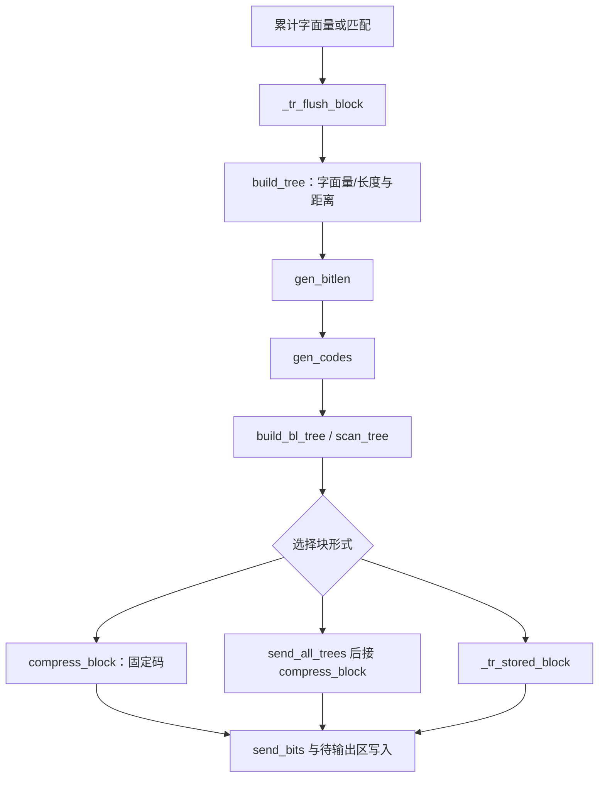
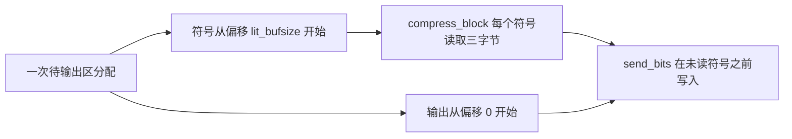

# 树与块输出：界限、码字及共用存储

源文件：`zlib/trees.c`，符号布局见 `zlib/deflate.h`。
翻译：`ZlibF/Zlib/trees.c.lean`。内部契约使用[内部契约](../spec/internal-contracts.md)中的
`I-bt-*`、`I-gb-*`、`I-gc-*`、`I-cb-*`、`I-tf-*`、`I-fp-*` 与 `I-pb-room`。
数学编码规则是[格式指南](../spec/format/README.md)中的 `F-code-*`、`F-length-table` 与 `F-distance-table`。

证明必须连接实际树构造、规范码字和输出比特。数组安全本身不能说明输出是 DEFLATE 块。
下文历史结果指出一些带有明确范围的可用论证。
当前结果与剩余工作见[进度](../progress.md)。

## 数据流



每条边都需要执行定理及已建立的表示事实。
尤其是，使用符号值证明表索引界限之前，块输出必须保持待输出缓冲区中的未读符号。

## 堆与节点界限：F7

对于字面量／长度树、距离树、码长树，`elems` 分别是 286、30、19。
`HEAP_SIZE = 573`。`heap`、`depth`、`dyn_ltree` 各有 573 项；`dyn_dtree` 有 61 项，`bl_tree` 有 39 项。

扫描重置堆计数，选取非零频率叶子，并初始化所需长度／深度。
如果存活叶子为零个或一个，补足循环会形成至多两个不同的存活叶子。
必须从不受限的旧数组内容证明这一点，包括准确的描述符最大值及无符号成本调整。
结果是在堆位置 `1..N` 有 `2 ≤ N ≤ elems` 个已填入项。

对于 `pqdownheap(k)`，只有 `j ≤ heap_len` 时读取左子节点 `j = 2k`，
只有 `j < heap_len` 时读取右子节点 `j+1`。
向下调整把 k 移到子节点，所以有限堆深度限制循环与移位。
执行定理必须保持堆的节点排列，并恢复构造器需要的顺序。
仅有索引界限不能建立根节点最小。

建堆循环按内部节点的逆序应用该定理。
随后的合并循环从 `heap_len = N`、`heap_max = HEAP_SIZE`、`node = elems` 开始。
t 次合并后，

```
heap_len = N - t
heap_max = HEAP_SIZE - 2t
```

只有 `t ≤ N-2` 时存在下一次合并。两次保存节点的写入使用索引
`HEAP_SIZE-2t-1` 与 `HEAP_SIZE-2t-2`。它们为正且高于活跃堆：

```
HEAP_SIZE - 2t - 2 > N - t
```

因为 `N ≤ 286` 且 `t ≤ N-2`。新节点编号至多为 `elems+N-2 ≤ 2*elems-2`，
即 570、58、36，位于所选树数组内。
最后一次根写入使用 `HEAP_SIZE-2N+1 ≥ 2`。这些是 **F7** 中主要的数组界限。

完整合并证明还必须建立子节点不同、父链接、频率和、节点成员关系与保存顺序。
源代码的同频排序在特定时刻读取深度。
应保留翻译后合并表达式中对选中深度的再次读取；缓存更早深度会成为不同程序。
每次实际深度读取的初始化历史也是证明的一部分。

深度是无符号字节。深度增加可能按 C 规则回绕。
这一点本身不损害内存安全，却不能支撑使用未回绕深度进行排序或证明覆盖界限的数学声明。
相应声明必须建立足够的范围，或明确处理回绕。
频率与成本字段同样需要实际位宽及总权重界限，包括人工补足叶子、重置和修复的效果。

## 码长修复：F8

`gen_bitlen` 接收已构造的满二叉树、父链接及有序的已保存节点区域。
令 `L = max_length`，数据码为 15、码长树为 7；叶子数为 n。
在 `heap[heap_max..HEAP_SIZE)` 中，根先于后代：父节点在子节点离开优先队列后才构造，
之后被保存在更小索引处。

第一遍为每个非根节点赋值 `Len = min(Len(parent)+1, L)`，所以 `Len = min(true depth, L)`。
`overflow` 统计真实深度超过 L 的所有节点，包括内部节点，并不只是深叶子的数量。
这一遍在 `bl_count` 中累计叶子码长，并更新源代码中的准确成本字段。

### 截断后的 Kraft 恒等式

满二叉树的真实叶子 Kraft 和为 1。令截断后的 `K = Σ_leaves 2^-Len`。
每个真实深度为 L 的内部节点 v 都有满子树，其中有 `ℓ_v` 个叶子和 `2ℓ_v-2` 个严格位于其下的节点。
截断把该子树的 Kraft 权重从 `2^-L` 增到 `ℓ_v*2^-L`。
深度超过 L 的每个节点恰好属于一个这样的子树。因此

```
K - 1 = 2^-L Σ_v (ℓ_v - 1)
overflow = Σ_v (2ℓ_v - 2)
K = 1 + (overflow/2) 2^-L
```

特别地，overflow 为偶数。此恒等式依赖真实的满树与遍历计数；
任意有界叶子码长并不能推出它。

一次修复寻找最高的非空类别 `b < L`，然后执行：

```
bl_count[b]--
bl_count[b+1] += 2
bl_count[L]--
overflow -= 2
```

分裂一片叶子保持 Kraft 权重，并增加一片叶子。
删除一个长度为 L 的叶子减少 `2^-L` 权重及一片叶子。
所以修复保持 n 和上述恒等式，同时把 overflow 减二。

### 为什么修复不会越出数组

**F8(i)：** overflow 为正时，必有某个 `1 ≤ b < L` 类别非空。
否则所有 n 个叶子长度都为 L，上述恒等式结合正 overflow 将给出 `n > 2^L`。
但描述符给出 `n ≤ 286 < 2^15`，码长树则有 `n ≤ 19 < 2^7`。
所以向下扫描类别会在零或负索引之前停止。

**F8(ii)：** 每次修复入口，最后一个类别至少有两片叶子。
最初其计数至少为深叶子数：

```
a₀ ≥ Σ_v ℓ_v = overflow₀/2 + R ≥ overflow₀/2 + 1
```

其中，overflow 为正时，R 是正的深度 L 内部子树数量。
每次修复使 a 至多减一，使 overflow/2 恰好减一。
因此继续执行的入口满足 `a ≥ overflow/2 + 1 ≥ 2`，递减不会回绕。
中间的计数增加也有 n+1 的界限，能放入相应字段。

Overflow 沿非负偶数递减，因此修复终止于 K = 1。
第二遍在各长度恰好分配 `bl_count[b]` 片叶子，扫描 `heap[--h]` 并跳过内部节点。
`2n-2` 个非根保存节点中有 n 片叶子，因此扫描不低于 `heap_max+1`。
除这些界限外，还必须证明赋值顺序和成本修正与源代码一致。

所得 `I-gb-len` 给出活跃叶子的长度在 `1..L` 内、计数正确且形成完整前缀码。
父节点／树／堆前提必须来自 `build_tree` 执行，不能把被调用者契约当作假设。

## 规范码字与树描述

`gen_codes` 先由 `bl_count` 计算各码长的规范起始码字，再为每个正码长符号写入反转码字，
并推进相应长度的下一个码字。
`I-gc-*` 必须建立准确的反转规范赋值、长度保持及选定码字段之外的帧性质。
安全性需要明确的数组和长度界限；正确性还需要规范码／计数关系。
起始码算术中的无符号回绕必须与实际翻译操作一致。

这里每次 `bi_reverse` 调用的计数都为正，至多为 15。循环恰好反转这么多比特。
零长度情形在调用前跳过。实际执行证明必须考虑两个循环及其 fuel。

| 函数 | 所需界限与含义 |
| --- | --- |
| `scan_tree` | `max_code+1` 的哨兵写入位于树内。真实长度是 `0..15`；比较哨兵 `0xffff` 时不得用它索引 `bl_tree`。重复符号 16、17、18 在码长树内。 |
| `send_tree` | 重复分解匹配扫描计数，并用生成的码长码重建原始码长序列。 |
| `build_bl_tree` | 从 18 向 3 扫描时，`bl_order[max_blindex]` 有界；把树成本连接到实际描述。 |
| `send_all_trees` | `blcodes ≤ 19` 及其他计数界限证明描述符和顺序表访问有效；发出的计数与长度匹配格式语法。 |
| `_tr_tally` 与 tally 宏 | 保存的每个字面量／匹配都具有规定的长度／距离定义域及相应频率更新；符号写入位于共用区域内。 |
| 初始化与重置辅助函数 | 在消费者读取前建立描述符指针、END_BLOCK 频率、位缓冲状态及零值／计数事实。 |

## 比特、待输出字节与 `compress_block`

`I-pb-room` 要求 `put_byte`／`put_short` 分别有一／两个字节空间。
`send_bits` 要求 `1 ≤ length ≤ 16`、值能够装入、位缓冲状态有效。
它不自行检查容量。它或者把位追加到 16 位缓冲区内，或者写出一个 short 并保留余下位。
每次移位和转换都需要所在分支的准确范围。

用 **P** 表示计数界限。如果从某个待输出基准位置起已经发送 S 位，初始位数为 v，
则写 short 的部分满足：

```
pending ≤ base + 2 floor((S + v) / 16)
```

在恰好 16 位边界处不必相等：源代码可把填满的位缓冲区保留到下一次写入。
当 `v ≤ 7`，方便的上界是 `pending ≤ base + S/8 + 1`。
字节对齐、树头部和最终 flush 需要各自的额外字节计数。

`compress_block` 在输出编码前先读三个符号字节。
匹配中，`lc ≤ 255` 限制 `_length_code[lc]`；所得码至多为 28，
用于索引长度基值／附加位表及字面量／长度树，最高符号为 285。
距离减一至多为 32767，所以
`d_code(x) = x < 256 ? _dist_code[x] : _dist_code[256 + (x >> 7)]`
最高索引为 511。所选距离码至多为 29。

这些前提要求符号仍是 tally 时的值。覆盖未读距离可制造任意 16 位值，使索引达到 767。
所以覆盖引理同时支撑静态表读取安全与待输出区写入安全。

## 共用存储覆盖引理 F9

令 `B = lit_bufsize`。待输出存储有 `4B` 字节。符号从偏移 B 开始，每个占三字节，
数量至多为 `K ≤ B-1`。符号 k 从 `[B+3k, B+3k+3)` 读取。

**F9 / I-cb-pending：** 发出符号 k 后，

```
pending < B + 3(k+1)
```

而且输出过程中的任何写入都不得到达未读后缀。
结束码与最终 flush 之后要求 `pending ≤ 4B`。
符号之前的树／头部写入也必须保持符号 0。
证明需要这些时序事实，不能只用最终 pending 计数。

### 入口计数 H0

预期的 **H0** 是 `_tr_flush_block` 入口满足 `pending = 0`、`bi_valid ≤ 7`。
**待确认（to confirm）**：对每个调用者、包装头路径及部分输出后的恢复调用推导它。
源代码刷出待输出比特／字节，并可能在输出空间耗尽时返回。
新块不得绕过残留待输出字节。
具有不同入口界限的路径需要实际更强的计数前提，不能直接断言 H0。

### 固定块与存储块

固定码下，字面量至多花九位，匹配至多花 `8 + 5 + 5 + 13 = 31` 位。
固定块增加三位块头及七位结束码。在 H0 与 P 下，q 个符号后（`1 ≤ q ≤ K`）可用上界为：

```
pending ≤ (7 + 3 + 31q)/8 + 1
```

只要 `(7/8)q + 9/4 < B`，该值就小于 `B+3q`。
因为 `q ≤ B-1`，所以 `B > 11` 已足够；许可最小值是 B = 128。
准确的整数取整只会改进这个宽松界限。
把结束码与最终对齐也计入，才能证明最终 `4B` 容量。
初始余量也保护符号 0 不被三位块头破坏。

块选择计算取整后的动态、固定字节成本。只有动态的取整成本严格小于固定成本时才选择动态输出；
存储块要求 `stored_len+4 ≤` 所选成本，且原始缓冲区可用。
对于存储块，这一比较结合固定成本上界，限制头部加复制数据的大小。
之后不再读取符号，因此选择存储形式后允许覆盖符号区域。
必须针对实际分支证明字节取整与入口比特计数。

### 动态块需要前缀界限

动态块先发出树描述再发出符号：14 个计数位、每个公布码长码三个比特，以及重复编码的码长序列。
之后数据码长可达 15。比较完整动态块与完整固定块只能限制总量，不能限制每个前缀：
前面的长符号可能先于后面的短符号。

所需不等式形如：

```
tree_bits + Σ_(i < q) dynamic_symbol_bits(i)
    < 8(B + 3q) - rounding_and_entry_slack
```

它应适用于每个发出前缀，还需符号 0 之前树描述的界限，以及最终 flush 的界限。
仅有满足 Kraft 条件的码长不能建立该不等式；必须使用依据此块频率实际构造的树。

早期工作研究真实 Huffman 路径上的 Fibonacci 增长。
一个深的低频叶子会迫使周围子树具有足够总权重；形式化深度／频率定理便可限制前缀输出成本。
早先 `theorems_trees_fib.txt` 记录的 `build_tree_fib_stmt_holds` 是历史构造器结果。
在早期开发中，`dynFits_dynOf_of_fib` 覆盖 `memLevel` 4、5，`dynFits_of_push` 覆盖 6 到 9。
复用时必须为当前翻译推导其准确的频率、同频排序、深度及成本前提。
它们并不建立当前整个压缩器定理。

对于 `memLevel` 1、2、3，B 只有 128、256、512。
固定码余量约为 16 到 64 字节，动态描述可能消耗相近空间。
历史搜索未发现真实块违规，记录的最近情形还剩 47 字节。
搜索是证据，不是证明。历史 `lowmem_lp_bound` 路线使用线性规划对偶证书；
已检查证书本身并未完成从真实块频率及前缀到所需界限的连接。

限制为 `memLevel ≥ 4` 的定理必须明确该前提，并列入[偏离与限制](../deviations.md)。
它不能证明 `zlib.h` 许可的全部配置都安全。
全部覆盖情形的权威当前记录在[进度](../progress.md)。

## 组件定理必须组合的内容

完整结果使用实际描述符初始化、堆选择与合并、码长修复、规范赋值、描述输出及块成本选择。
它在同一次执行上建立 F7/F8/F9，并证明许可树、符号和待输出区域外的所有内存不变。
即便完整源代码相等引理仍通过，变异也必须使该函数的执行证明失败。
重置／扫描／建堆前缀的证明，不能证明尚未变化的后续合并与输出代码。

## 与 C 的对应检查

### 树、比特输出与共用缓冲区覆盖

待输出块同时包含输出与符号：



`sym_end = 3 * (lit_bufsize - 1)`。
tally 写入距离低字节、距离高字节、字面量或长度字节，然后更新频率。
字面量使用零距离。匹配在宏的 16 位递减前需要正距离；零会回绕为 65535，
使 `d_code` 在只有 512 项的表中使用索引 767。
**待确认（to confirm）**：调用者提供 `1..32768` 的距离和 `0..255` 的长度偏移，
且每次 flush 决策都为其三字节 tally 留出空间。

比特输出辅助函数不做容量检查。**待确认（to confirm）**：每次写入都在容量内，且不会覆盖未读符号。
覆盖界限依赖块选择与树码长，不仅依赖分配大小。
存储块还需要填充、四个长度字节及载荷所需的容量。

早期覆盖分析包括内存级别 4 到 9 的已检查分类论证，以及级别 1 到 3 的松弛分析。
这些不同形式的证据并未证明全部实际执行。
数学论证见[树证明指南](trees.md)。

`send_bits` 把 `ush` 提升为 signed `int` 后移位，再把保存值缩窄。
**待确认（to confirm）**：位数与码字范围排除无效移位和有符号溢出，包括左移 16 位。
`bi_windup` 计算 `((bi_valid - 1) & 7) + 1`；在本目标平台上，零个有效位得到八。
把结果改为零会改变 `bi_used`。

| 函数或事项 | 源代码区别及所需依据 |
| --- | --- |
| `init_block`、`_tr_init` | 重置清空频率与成本，并非所有旧长度或父节点。初始化还安装描述符并重置位缓冲字段。 |
| `gen_codes` | 局部 `next_code[16]` 不读取第零项。`1..15` 项先写后读。起始码使用无符号算术并缩窄到 16 位。后置递增把旧值传给反转。 |
| 堆构造 | `pqremove` 读取旧堆末尾，递减 `heap_len`，再向下调整。同频时比较深度。对所选深度的再次读取仍是单独访问。 |
| `build_tree` | 必要时补足额外叶子。成本递减有意按 `ulg` 回绕。频率和先提升到 `int`，再缩窄到 `ush`。 |
| `gen_bitlen` | 用长度覆盖父节点。**待确认（to confirm）**：父节点先写后读、堆节点有效，码长修复在递减到零以下前找到非零较短类别。其成本调整有意回绕。 |
| `scan_tree`、`send_tree` | 前者写 `max_code + 1` 哨兵；后者以相同最大值读取。动态数组有 573、61、39 项。**待确认（to confirm）**：额外槽位在界限内，且始终是下一个长度，绝不作为真实长度用于树索引。 |
| `_tr_flush_block` | 存储、固定、动态成本在重置前决定输出。保留取整后的无符号成本及准确的同成本选择。 |

宏作用域与控制流也重要。`send_bits` 声明 `len` 和 `val`；距离 tally 声明 `len` 和 `dist`。
现有实参避免变量捕获。`put_short` 与 `MIN` 可能多次求值实参。
`INSERT_STRING` 是有序的逗号表达式。`FLUSH_BLOCK` 可从调用者返回，`FLUSH_BLOCK_ONLY` 不会。
被编译移除的断言不能证明上述任何界限。
