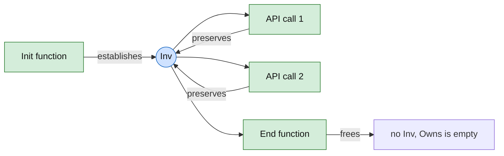
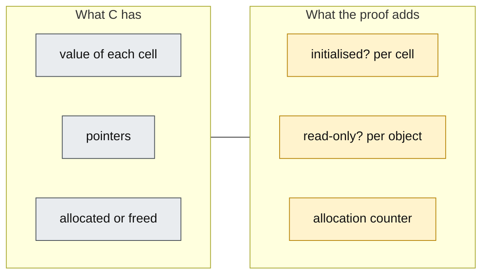
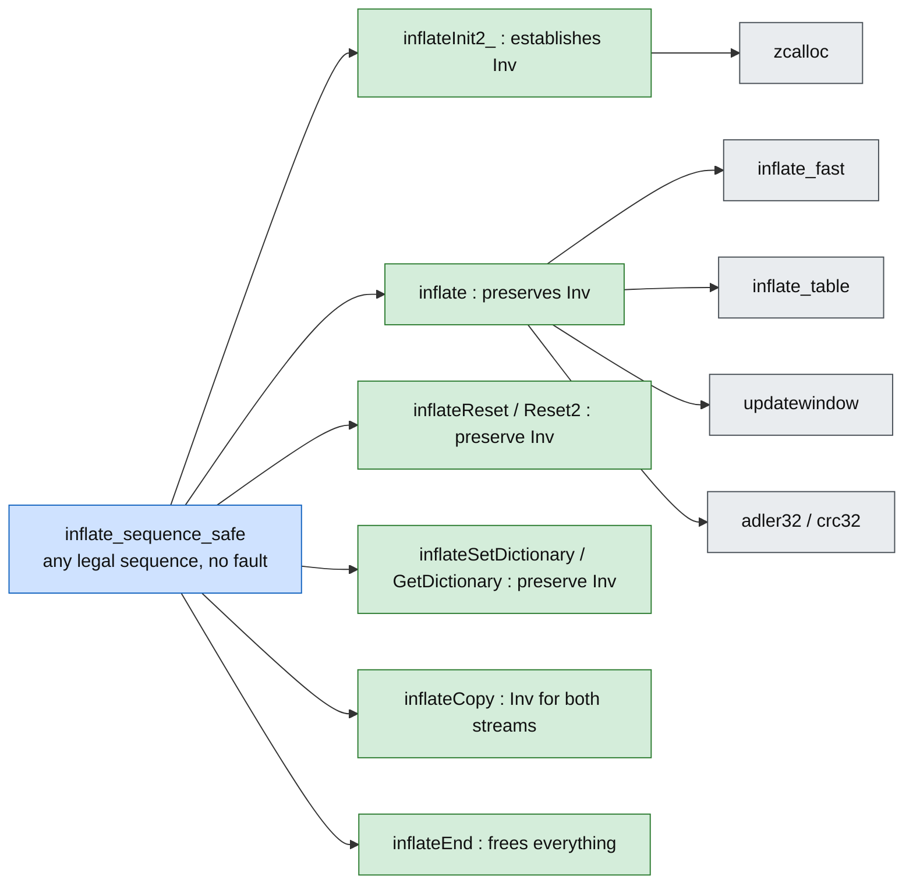

# What "safe" means here

This document says what we prove about safety. It does not say how. For the how, see
[method.md](method.md). For the layers, see [architecture.md](architecture.md).

## 1. One sentence

> If the caller follows `zlib.h`, then no zlib function ever performs an operation that the C
> standard calls undefined, every call ends, and no call sequence leaks memory.

"Follows `zlib.h`" is the precondition. "Undefined" is a closed list (section 3). "Ends" means no
loop runs out of its fuel bound. "Leaks" means a block that was allocated and is neither freed
nor reachable from a live stream.

## 2. The theorem shape

Every function gets one theorem, which says this in words:

> Take any state in which the objects the function may touch satisfy their representation
> invariant, and any call that meets the requirements of `zlib.h`. Then the function runs to the
> end without a fault. Afterwards the invariant still holds, memory outside the function's footprint
> is unchanged, and the set of blocks the stream owns has changed exactly as the code allocates and
> frees.

Four parts, four names:

| Part | Name | Plain meaning |
| --- | --- | --- |
| `∃ r h', … = .ok` | **no fault** | The run never reaches `Fault.ub` or `Fault.outOfFuel`. |
| `Inv h'` | **preservation** | The next call can assume the same invariant. |
| `Frame` | **frame** | Memory outside the footprint is bit-for-bit unchanged. |
| `Owns` | **ownership** | `Owns h` is the set of blocks that the stream owns. An allocation adds a block to it, a free removes one, and nothing else changes it. |

Because `Init` establishes `Inv` from nothing, `Inv` is satisfiable. No separate "witness" is
needed for it. This is the main protection against vacuous theorems.

**Leak-freedom** is the statement about `Owns` over a whole life: after `Init` the stream owns
its blocks, no step changes the set except as the code says, and after `End` the set is empty and
every block has been freed once. A failing `Init` frees what it had allocated before it
failed. Together: *the set of live blocks after `End` (or after a failing `Init`) equals the set
before `Init`.*

## 3. The closed list of undefined behaviour

The runtime turns U1 to U11 into `Fault.ub`. A no-fault theorem therefore rules each of them out. U12 is
not a fault in C; it is stated by the ownership clause of the theorem.

| # | Undefined behaviour | Where zlib can reach it | How the proof rules it out |
| --- | --- | --- | --- |
| U1 | Read or write outside an object | every buffer index and every `p + n` | bounds facts in `Inv`; see section 5 |
| U2 | Pointer arithmetic outside `0..size` | `next_in += n`, `window + wnext`, `from = out - dist` | the same facts, on offsets |
| U3 | Null dereference | `strm`, `state`, `window`, `head` | `Inv` says which pointers are non-null |
| U4 | Use after free, double free | `inflateEnd`, `deflateEnd`, `inflateCopy` | `Inv` owns each block once; `End` frees each once |
| U5 | Garbage used as an index or address | `prev` chain walk, any pointer read from fresh memory | theorems hold for every garbage value; `prev` slots reached through a chain hold real positions |
| U6 | Signed overflow | `int` counters, `z_off_t` arithmetic | range facts in `Inv` and `Pre` |
| U7 | Invalid shift (count ≥ width or negative) | bit buffers: `hold >> bits`, `1U << n` | `bits ≤ 32` style facts |
| U8 | Write to a read-only object | static tables (`lenfix`, `distfix`, CRC tables, `_dist_code`) | tables are read-only in the heap |
| U9 | Overlapping `memcpy` | window copies, `pending_buf` copies | disjointness from offset arithmetic |
| U10 | Wrong type for an access | `z_stream` seen as bytes (`uncompress`), CRC word reads | type tags; decision D6 and D5 in [overview.md](overview.md) |
| U11 | Non-termination | every `while` and `do … while` | a measure that decreases; fuel never reached |
| U12 | Memory leak | every `ZALLOC` call: a later failure or an early return can skip the matching free | `Owns` bookkeeping; every exit of `Init`, `Copy` and `End` is checked, including each failed allocation |

Unsigned arithmetic wraps. That is defined in C, so it is not a fault. The translation wraps
too.

### Uninitialised reads (U5)

C does not make every read of an uninitialised object undefined. For an integer type without
trap representations, which covers every type zlib reads this way, the value is *unspecified*
(C11 6.2.6.1; defect report 451). zlib reads such values on purpose:

- `slide_hash` walks the whole `prev` array. `deflateInit2_` never clears it (`lm_init` says
  "prev[] will be initialized on the fly"), and the comment in `slide_hash` says that the garbage
  entries are never used.
- `longest_match` compares bytes past the end of the real data; its comment says that
  uninitialised memory will be accessed and that the result does not depend on it.

A rule that turns every such read into a fault would make the safety theorem **false** for real
zlib. The rule is therefore:

> A read of an uninitialised integer returns an arbitrary value. A theorem must hold for every
> possible value. A read of an uninitialised pointer is a fault.

So U5 means: *no undefined behaviour can be caused by whatever value uninitialised memory holds.*
We do not claim the stronger property that the output is independent of such values.

What the proof still has to show is that a garbage value is never *used as an index or an
address*. The hash chain is the one place where that is not obvious (fact F5 in
[method.md](method.md)). Bytes that are only compared or copied are harmless.

`memcpy` of uninitialised bytes is allowed, as in C. `deflateCopy` does exactly this with the
whole `prev` array. In the model `memcpy` copies the "initialised" flag together with the byte, so
copied garbage stays garbage.

## 4. Ghost state

The heap carries a table that C does not have: for each byte or field, "has it been written".
It is ghost state. It lives in the proof model and has no counterpart in the compiled program. It
is the only way to state U5.

## 5. Preconditions we assume from the caller

These come from `zlib.h`. Each one is a hypothesis of the top-level theorems. Any that is
stronger than `zlib.h` is listed in `docs/deviations.md` (rule R6 in [overview.md](overview.md)).

| ID | Precondition | Source |
| --- | --- | --- |
| A1 | `strm` points to a `z_stream`; before `Init`, `zalloc`, `zfree`, `opaque` are set | `zlib.h`, "z_stream" |
| A2 | `next_in` points to `avail_in` readable bytes; `next_out` points to `avail_out` writable bytes | `zlib.h`, `inflate`/`deflate` |
| A3 | Input and output buffers do not overlap each other or the stream's own state | **to confirm**: `zlib.h` does not say it in one sentence |
| A4 | Calls on one stream do not run concurrently | `zlib.h`, "thread safety" |
| A5 | The default allocator is used (`zalloc == Z_NULL`) | model scope; other allocators come later |
| A6 | After `End`, the stream is not used again | `zlib.h` |
| A7 | Parameters are in documented ranges (`level`, `windowBits`, `memLevel`, `flush`) or the function must return an error code | `zlib.h` |

A7 has two halves. For a value inside the range, the theorem proves the normal path. For a
value outside it, the theorem proves a clean error return. This catches bugs in argument
checking, which is where many real bugs live.

## 6. What this document does not cover

| Not covered here | Why | Where it goes |
| --- | --- | --- |
| That the output is correct (decodes to the input) | A different property, stated in [spec/](spec/index.md) and [overview.md](overview.md) §6a | P5, milestones M6 and M7 |
| Custom allocators | They run arbitrary user code | after the default allocator |
| Timing, stack depth, performance | Not a correctness property | out of scope |
| Compiler and OS correctness | Outside the model | out of scope |
| Resource limits against crafted input, such as a zip bomb | Safety is "no undefined behaviour for every input", which includes hostile input. A bound on memory or time is a different property | out of scope |

The last row matters. "Safe for every input" already covers malformed and malicious compressed
data. `inflate` must return `Z_DATA_ERROR` and never fault. That is the central safety claim for
the decoder.

## 7. Two stronger claims we may add

1. **Error paths are exact.** For every function, a failing call leaves the stream in a state
   where `End` is still safe. This is a corollary of preservation if the error cases are
   included in `Inv`.
2. **Sequence safety.** Any legal call sequence is safe. This is the top theorem of M5. It is
   proved by induction on the sequence, from the per-function theorems and nothing else.

