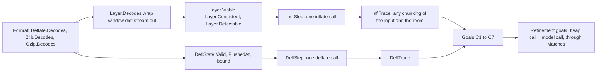

# The API in Lean

[api.md](api.md) says in words what each public function of `zlib.h` does. This page says which Lean
definition formalises each of them, how the model is built, what the goals are and what each goal
needs. The Lean files are `ZlibF/Spec/Api.lean` and `ZlibF/Spec/Api/*.lean`. The core models are
heap-free. `Concrete.lean` binds selected entries to the actual runtime and translated functions.
The global heap interface remains incomplete. Where `zlib.h` is silent the model leaves the
answer open; a proof of a model property does not establish that the implementation refines it.

## Files

| File | Content |
| --- | --- |
| `Api/Basic.lean` | return codes, flush values, the parameter checks of `inflateInit2`/`deflateInit2` (computable), the decoding oracle `Layer.Decodes`, `Layer.Viable`, `Layer.Detectable` |
| `Api/Header.lean` | the gzip header record (`gz_header`) for `deflateSetHeader` and `inflateGetHeader` |
| `Api/Inflate.lean` | the inflate stream state `InflState`, `InflStep` (the `inflate` call), every other inflate function, `inflateBack` |
| `Api/Deflate.lean` | the deflate stream state `DeflState`, `DeflStep` (the `deflate` call), every other deflate function, `deflateBound` |
| `Api/Compress.lean` | `compress`, `compress2`, `compressBound`, `uncompress`, `uncompress2` |
| `Api/Gz.lean` | the gz file API as state machines over an abstract file |
| `Api/Run.lean` | the operations of each family as one datatype with the dispatch `InflModel`, `DeflModel`, `GzModel`; the traces `InflTrace`, `DeflTrace` |
| `Api/Iface.lean` | the placeholder interface `HeapApi` to the heap (section "The placeholder interface") |
| `Api/Concrete.lean` | direct execution of translated compressor entries, a successful-run correctness predicate, and the numeric `compress_bound_value` goal |
| `Api/Goals.lean` | the goals, one `def ... : Prop` each |
| `Api/Examples.lean` | the examples: computable definitions on small cases, and a deflate-then-inflate run through the model |

## Reviewed compressor boundary

The data-only relation `Compress2` describes bytes written, not every scalar-pointer effect.
`CompressCall` records null pointer shapes, capacity, input and level. `CompressResult` separates
bytes written from the value stored through the length pointer. `Compress2Z` follows the order of
`compress.c`:

1. Reject a null source with nonzero length, a null length pointer, or a null destination with
   positive capacity. No bytes are written. A present length pointer keeps its original value.
2. Clear the length before initialisation. An invalid level returns the stream error before
   allocation failure can occur.
3. A null destination with zero capacity passes the first checks. Initialisation may fail with the
   memory error; otherwise the inner compressor refuses the null destination with the stream error.
4. With acceptable pointer shapes, the data-only relation applies and the stored length is the
   number of bytes written.

The compatibility wrapper reads the length before these checks. A null length pointer is outside
its defined-execution domain; it is not a clean argument error. `Concrete.execute` exposes this
fault. The scalar-pointer abstraction does not yet model aliasing the length cell with buffers;
[../deviations.md](../deviations.md) records that limit.

`Concrete.execute` is a function of the actual translated computation and actual heap. Its run
relation cannot be chosen to be empty. `Concrete.Correct` requires a successful concrete run,
with any frame and ownership facts stated in its postcondition. A precondition still needs an
initialisation theorem or a concrete witness before non-vacuity can be claimed. These definitions
do not complete the global `HeapApi` or its `Matches` relation.

`Goal.compress_bound_value` names the actual translated bound functions on every `UInt64` input.
It states the saturated numeric formula. It does not state that compressed output fits that bound.
The separate `Goal.compress_bound_adequate` is a model consequence: its assumptions already
require the bound in the successful branch and insufficient capacity in the buffer-error branch.
A refinement theorem is still needed to transfer that property to compression runs.

`Goal.compress2_z_first_alloc_failure` follows actual execution when the first default-allocator
call fails. It requires a fresh runtime heap and nonnull buffers for positive lengths. It states
the memory error, a cleared length, unchanged byte blocks and no new live blocks. It covers this
early error path for arbitrary byte contents and static tables; it does not cover the later
allocation failures or successful compression. The local automatic stream does not consume an
allocation-failure index.

For the deflate trace model, `started` is historical until reset. A refused call cannot clear it.
The C returns on the error paths without restarting the wrapper state. Keeping this flag closes
a model trace that erased that history and then changed the preset dictionary of an already-written
header. The `Goal.deflate_valid` statement and its parameter domain are unchanged.

This does not validate `DeflSetDict` as an operational contract. The C can accept a dictionary after
stream end, outside the documented zlib call order, while this model refuses it. Dictionary calls,
their history and counters need a separate refinement review. This restriction is recorded in
[../deviations.md](../deviations.md).

## How the model is built

Inflate output must be determined by the consumed input. `Layer.Consistent` alone only chooses
one possible continuation. It allowed a fresh decoder to emit a byte without reading input,
even when the supplied stream decoded to nothing. `Layer.Determined` instead quantifies over
every complete stream whose bytes are prefix-compatible with the consumed history. The output
must be a prefix of every such decoding. Both normal progress and window-allocation failure
carry this condition. The `inflate_decodes` target and its valid-input domain are unchanged.
The condition is a specification obligation; proving it for translated decoder runs remains
necessary before claiming implementation correctness.

An unknown preset dictionary must not justify a data error. For an exact stream with a full
window, `Z_DATA_ERROR` requires the consumed prefix to be nonviable for every dictionary still
permitted by the state. A supplied dictionary is fixed. Before a wrapped stream requests one,
its value may still be supplied by a legal continuation. This removes a vacuous condition that
allowed rejection after only the two bytes of a valid FDICT header.

Priming a negative signed value uses its low bits. The model takes the nonnegative remainder
modulo `2^bits` before extracting them, matching the C mask. For one bit, `-1` inserts `true`.

- **A stream is a state plus a relation.** `InflState` and `DeflState` remember the whole history: all
  input consumed and all output delivered since the last reset (`seen`, `out`; `input`, `produced`).
  A call is a relation `InflStep st call result st'`. It is a relation, not a function, because
  `zlib.h` does not say how much input a call consumes or when `deflate` closes a block: the relation
  lists what is promised and nothing else. The heap-level function has to be one of the allowed behaviours.
- **The history is the key.** What the data means does not depend on how the caller cut the calls:
  `Layer.Decodes w b dict seen out` is the format specification applied to the whole history. A clause
  of `InflRun` such as "the output is a prefix of the decoding of a stream that starts with the
  input consumed" (`Layer.Consistent`) is therefore a statement for every chunking.
- **A run is a trace.** `InflTrace z d` is a sequence of `inflate` calls in which the caller re-presents
  the part of `z` not yet consumed (`avail_in` bytes of it), with any room and any flush value, and
  `inflateSetDictionary` calls with `d`. `DeflTrace x` is the same for `deflate` over the input `x`. The goals
  quantify over all traces.
- **Exact and imprecise streams.** After `inflatePrime` with bits, a successful `inflateSync`, or
  `inflateValidate(0)`, `zlib.h` promises less about the data. The state flag `precise` (and
  `validate`) is cleared and the clauses that mention data (soundness, liveness, checksum field) need
  `Exact`; the frame and return-code clauses still hold. The same flag exists for `DeflState`.
- **No null buffer in the model.** `badBuf` stands for "`next_out` is null, or `next_in` is null with
  `avail_in` not 0" and gives `Z_STREAM_ERROR`.
- **Totals are natural numbers.** `total_in` and `total_out` are `uLong`, 64 bits in the default build;
  `Matches` relates them modulo `2^64`.

## What `zlib.h` promises, and where it is in the model

| Item | Lean | Remark |
| --- | --- | --- |
| Return codes | `Z.ok` to `Z.bufError` and the library-identification error | the `Z_*` constants |
| `windowBits` of init/reset | `inflWbits`, `deflInit?` | copied from `inflate.c`, `deflate.c`; `decide` examples |
| `inflateInit_`, `inflateInit2_` | `InflInit` | the library-identification check, bad window bits, allocation failure |
| `inflate` | `InflStep`, `InflRun` | frame, return codes, soundness, stopping, liveness, checksum field, header record |
| `inflateEnd`, `inflateReset`, `inflateReset2` | `InflEnd`, `InflReset`, `InflReset2` | reset: `InflState.fresh`, totals 0, no dictionary, no header request |
| `inflatePrime` | `InflPrime` | exact while no input has been consumed |
| `inflateSetDictionary` | `InflSetDict` | checks the `DICTID` (`Z_DATA_ERROR`); raw only before any input |
| `inflateGetDictionary` | `InflGetDict` | while running, fixed window |
| `inflateSync`, `inflateSyncPoint` | `InflSync` (with `syncSearch`), `InflSyncPoint` | `syncSearch` is `syncsearch` of `inflate.c`; the sync point is only partly specified |
| `inflateCopy` | `InflCopy` | the copy has the same model state |
| `inflateMark` | `InflMark` | only a fresh stream is specified |
| `inflateGetHeader` | `InflGetHeader`, `HdrReq`, `GzHdrOut`, `fillHeader`, `HeaderRead` | `A-header-fill` |
| `inflateUndermine` | `InflUndermine` | `Z_DATA_ERROR` in the default build |
| `inflateValidate` | `InflValidate` | |
| `inflateBack`, `inflateBackInit`, `inflateBackEnd` | `InflBack` with `BackCallbacks`, `BackResult` | the callbacks are two functions of the call number; init and end are in the refinement goal only |
| `deflateInit_`, `deflateInit2_` | `DeflInit` | |
| `deflate` | `DeflStep`, `DeflRun` | frame, refused calls, return codes, `FlushedAt`, `Valid`, `bound`, liveness |
| `deflateEnd`, `deflateReset` | `DeflEnd`, `DeflReset` | |
| `deflateParams` | `DeflParamsFn` | includes the implicit `Z_BLOCK` flush into the room the stream has |
| `deflateTune`, `deflatePrime`, `deflatePending` | `DeflTune`, `DeflPrime`, `DeflPending` | |
| `deflateSetDictionary`, `deflateGetDictionary` | `DeflSetDict`, `DeflGetDict` | the returned dictionary is a suffix of the history between the window less 262 and the window |
| `deflateSetHeader` | `DeflSetHeader`, `GzHead`, `GzHead.bytes`, `Gzip.DecodesWith` | |
| `deflateCopy` | `DeflCopy` | |
| `deflateBound` | `DeflBound`, `DeflState.bound` | the exact formula of `deflate.c` (no overflow clamp) |
| `compress`, `compress2`, `compressBound` | `Compress`, `Compress2`, `compressBound` | `compressBound` is the formula of `compress.c`, clamped to `2^64 - 1` |
| `uncompress`, `uncompress2` | `Uncompress`, `Uncompress2` | the `_z` variants have the same specification |
| `gzopen`, `gzdopen`, `gzbuffer` | `GzOpen` (with `gzMode?`), `GzBuffer` | |
| `gzread`, `gzfread`, `gzgetc`, `gzungetc`, `gzgets` | `GzReadFn`, `GzFread`, `GzGetc`, `GzUngetc`, `GzGets` | the data is `GzDecoded` of the file |
| `gzwrite`, `gzfwrite`, `gzputc`, `gzputs`, `gzprintf` | `GzWrite`, `GzFwrite`, `GzPutc`, `GzPuts`, `GzPrintf` | `gzprintf` takes the formatted bytes |
| `gzflush`, `gzsetparams` | `GzFlush`, `GzSetParams` | |
| `gzseek`, `gzrewind`, `gztell`, `gzoffset`, `gzeof`, `gzdirect`, `gzerror`, `gzclearerr` | `GzSeek`, `GzRewind`, `GzTell`, `GzOffset`, `GzEof`, `GzDirect`, `GzError`, `GzClearerr` | |
| `gzclose`, `gzclose_r`, `gzclose_w` | `GzClose` | the content of the file after closing |

`data_type` is not modelled (`zlib.h` promises only a guess for `deflate`, and bits and flags for `inflate`
with `Z_BLOCK`). `msg` is not modelled. `adler` is: after `inflate` it is the checksum of the output so far
for zlib and gzip streams (`checkValue`); after `deflate` it is the checksum of the input accepted.
`deflateUsed`, `inflateCodesUsed`, `zlibCompileFlags` and the `crc32`/`adler32` combine functions are not in
this model (the checksums are in the format specification; the others return numbers that `zlib.h` does
not specify).

## The oracle

`Layer.Decodes w wbits dict stream out` is the format specification selected by the configuration:
raw `Deflate.Decodes` (only the last `2^wbits` bytes of the dictionary), `Zlib.Decodes` (and the zlib
header's window fits `wbits`; `wbits = 0` accepts any), `Gzip.Decodes`, or either of the last two for
automatic detection.

- `Layer.Viable x`: some complete stream, followed by anything, starts with `x`; the first
  `hdrLag` bytes (0, 2, 4 for raw, zlib, gzip) are never rejected.
- `Layer.Consistent x out`: `x` begins a stream and `out` is a prefix of what that stream decodes to.
- `Layer.Detectable x`: a prefix of `x` that is at least `detectLag` bytes shorter than `x` is not viable.
  This is how the model says "zlib has seen enough to reject": a data error that shows only in the last
  bytes may need more input. `detectLag = 8` is a specification parameter (a symbol and its extra bits are
  read as one unit of at most 48 bits, a stored block's length fields and a trailer's checksum as one unit
  of 4 bytes). The proof of `Goal.inflate_rejects_invalid` is where this number is checked; it may have to
  grow.
- `FullWindow w b z`: the configurations in which zlib accepts every format-valid stream: `windowBits` 15
  for every layer, or 0 when the window comes from the header (zlib: the header announces 15; gzip: zlib
  uses 15). For a smaller window zlib may answer `Z_DATA_ERROR` for a valid stream with a far distance: the
  check counts the window and only the output of the current call, so the answer depends on how the caller
  splits the output room. Run on the real library: a gzip stream of 20000 bytes read with `windowBits`
  16 + 8 to 16 + 13 and 100 bytes of room per call fails with `Z_DATA_ERROR`, with all the room in one call
  it succeeds. (An earlier text of the model said "gzip: always full"; that was wrong.) The model then
  promises only "correct output or `Z_DATA_ERROR`": the soundness clause for `Z_DATA_ERROR` and
  `InflBack` need `FullWindow`/`wbits = 15`.

## Choices and deviations to review

1. **Stopping rule.** With input left over a call stops because the output is full, the stream ended or failed,
   a dictionary is needed, or the flush value is `Z_BLOCK`/`Z_TREES` (`InflRun`, clause 4). This is the
   reading of "inflate decompresses as much as possible" in `zlib.h`. The proof must check it against `inflate.c`
   (the bit buffer consumes input ahead of the symbol).
2. **Data errors.** `Z_DATA_ERROR` only for a non-viable input (soundness); and, with room left, for an input
   that is detectable (liveness). Between the two, either answer is allowed.
3. **`Z_BUF_ERROR` and `Z_OK`.** `Z_OK` needs progress; `Z_BUF_ERROR` is no progress or an unfinished
   `Z_FINISH`. For `deflate`, `Z_OK` without progress is allowed (the first call of a raw stream with no input).
4. **`inflateSetDictionary` for raw streams** is specified only before any input (a goal about a raw stream with a dictionary therefore starts from `InflStart`, which sets the dictionary) (`seen = []`). `zlib.h` also
   allows it later, where it amends the window.
5. **`inflateSyncPoint`, `inflateMark`, `inflatePrime` after input** are specified only partly (see the definitions).
6. **Checksums switched off** (`inflateValidate(0)`): the data-level promises stop (`precise`).
7. **Window.** `FullWindow` as above. `Goal.roundtrip` is stated for an inflate window of 15 bits. The property
   that `deflate` never uses a distance beyond its own window (`F-deflate-matches`, `format-lean.md`
   "Not formalised") is not part of the model; it is needed to state the round trip for smaller inflate windows.
8. **`deflateBound`** is the exact formula, and its adequacy is a clause of `DeflRun` for a stream that was only fed
   input and `Z_FINISH` (`clean`). A flush, `deflateParams`, `deflateTune`, `deflatePrime` or a late dictionary
   makes the stream not `clean`.
9. **`gzread` and errors.** The model follows the current `gzread.c`: data read before an error is delivered
   first and the error is reported when a read comes up short (the model allows the error to show earlier in
   `gzerror`). A truncated file is `Z_BUF_ERROR` and does not stop reading. Trailing garbage after at least one
   member is ignored.
10. **`Z_MEM_ERROR` of `inflate`** is a separate outcome (`InflRunMem`): the window could not be allocated at
    the end of the call. The call has read input and written output (`consumed`, `produced`, not empty), but
    `total_in`, `total_out` and `adler` are **not** advanced, the stream is in the `mem` state, and every later
    `inflate` returns `Z_MEM_ERROR`. Run on the real library with a failing allocation of the window, zlib wrapper
    (12 bytes read, 10 written, totals 0, `adler` 1) and raw (all read, all written, totals 0). With the zlib wrapper
    a call that reaches the end of the stream does not allocate (the trailer check resets the counter), so
    it ends with `Z_STREAM_END`; the model allows both. Every liveness clause allows `Z_MEM_ERROR` instead
    (`Goal.inflate_completes` and the others say so). Candidate finding in `findings.md`.
11. **`deflate` and the end of the stream.** `done` is set exactly when `Z_STREAM_END` is returned (`DeflRun`: the
    clause `done' <-> done or rc = Z_STREAM_END`); a call that returns `Z_BUF_ERROR` consumes nothing and does not
    finish. Verified on the real library: `Z_FINISH` with `avail_out = 0` is `Z_BUF_ERROR` and changes nothing (also in
    the middle of a sequence of calls with room 1); with room 1 it returns `Z_OK` with `avail_out = 0` every time; after
    `Z_STREAM_END` another `Z_FINISH` without input is `Z_STREAM_END` with no output; with input it is `Z_BUF_ERROR`;
    a flush other than `Z_FINISH` is `Z_STREAM_ERROR`. After the end nothing is consumed or produced.
12. **Full flush.** A call performs a completed full flush exactly when it returns `Z_OK` with room left and
    `Z_FULL_FLUSH`; then, and only then, `fullAt` becomes the new lengths (`DeflRun`; `DeflFrame` does not mention
    `fullAt`). Verified on the real library for levels 0 to 9, all strategies, window and memory sizes, raw output, random
    chunking and room: after such a call the output followed by `03 00` decodes to the input so far, and the
    output after it is a valid raw stream of the input after it (300 runs).
13. **`deflateBound` and flushes.** The bound is promised only for a stream that was fed input and `Z_FINISH`; any
    call with a flush value other than `Z_NO_FLUSH` or `Z_FINISH` (even if it did not complete) makes the stream not
    `clean`, and `clean` never becomes true again. Checked on the real library with random chunking of the input and
    of the room, all levels, strategies, `memLevel`, `windowBits`, wrappers, header, dictionary: the output never
    exceeds `deflateBound`, and `Z_FINISH` with the room of the bound minus what was delivered returns `Z_STREAM_END`.
14. **The file system** is abstract: an input/output failure is one allowed outcome of each operation that touches the
    file, and then `failed` is set and no data promise remains.

## `gzseek`, `gztell`, `gzoffset`, `gzdirect`, `gzungetc`: what the real library does

Checked on the real library (gzip file and transparent file of 5 bytes):

| Call | gzip file | transparent file |
| --- | --- | --- |
| `gzread(100)` returns 5, then `gzseek(f, 5, SEEK_CUR)` | returns 10; `gztell` is **5**, `gzeof` stays 1 (the seek does not clear `past`, and `gztell` ignores the pending skip while `past` is set) | returns 10; `gztell` 10, `gzeof` 0 |
| `gzseek` backward after the end | rewinds: `gztell` = position, `gzeof` 0 | same |
| `gzungetc` then `gzseek(f, 0, SEEK_CUR)` then `gzread` | the pushed-back byte is still read first | the pushed-back byte is dropped (the file is repositioned) |
| `gzungetc` then `gzseek(f, 1, SEEK_CUR)` | skips the pushed-back byte | same |
| `gzoffset` | at most the size of the file | after `gzseek(f, 100, SEEK_SET)` of a 5-byte file it is 100 (the descriptor moved beyond the end) |
| `gzdirect` before any read | 0 for a gzip-looking file; 1 for an empty file, for a file of fewer than four bytes, and for any file that does not start with a gzip header; 0 for `G` | |

The model: `GzSeek` states these cases (`GzHandle.CopyMode` is the transparent mode, `GzHandle.tell` ignores the pending
skip while `past`); `GzOffset` is only "not negative or -1"; `GzDirect` also marks the handle as looked at
(`sized`), which `CopyMode` needs. `Goal.gz_seek_read` is stated for the cases where `gztell` agrees.
`gz_seek_quirk` and `gz_seek_copy` in `Examples.lean` are the witnesses.

## Points where `api.md` and the code differ (to correct in `api.md`)

| `api.md` | Code (`deflate.c`, `inflate.c`, `uncompr.c`) |
| --- | --- |
| `deflate`: new input after `Z_FINISH` is `Z_STREAM_ERROR` | it is `Z_BUF_ERROR`; `Z_STREAM_ERROR` is a flush value other than `Z_FINISH` after `Z_FINISH` |
| `deflateInit2`: raw `windowBits` -8 to -15 | -8 is refused (`Z_STREAM_ERROR`): 8 is accepted only with the zlib wrapper (and then becomes 9); gzip needs 9 to 15 |
| `inflateUndermine` not described | returns `Z_DATA_ERROR` and does nothing in the default build |
| `uncompress2`: `Z_BUF_ERROR` is lack of output room | a `Z_BUF_ERROR` of `inflate` with all input used is turned into `Z_DATA_ERROR` (truncated input), and `Z_NEED_DICT` is `Z_DATA_ERROR` |
| `deflateEnd` | `Z_DATA_ERROR` only if the state is `BUSY_STATE` (started, header written, not finished) |

## The placeholder interface

`Api/Iface.lean` is a **placeholder**: nothing in it is derived from the heap. It fixes the shape that
the refinement goals use, so that they can be written and reviewed before the heap-level statements exist. The
integration step instantiates `HeapApi` and then each refinement goal becomes a statement about the real
translated functions.

| Field | Must mean |
| --- | --- |
| `Heap`, `Strm`, `GzFile` | the heap type of `ZlibF/Runtime`, a reference to a `z_stream`, a reference to a gz file state |
| `inflMatches h s st` | the generated schema relation: `s` is an initialised inflate stream in `h` whose state fields (mode, bit buffer, window, `strm->total_in/out`, `adler`) are described by `st` (`seen`, `out`, phase, dictionary, ...). It is **not** a function of the model state: unrelated fields are free; the window holds the last `min(wsize, history)` bytes of the history in ring order; a model state with `phase = .bad` matches mode `BAD`. It must be preserved by every operation of `inflRun` (that is what `Goal.inflate_refines` says) |
| `inflArgs h s op` | the buffers and fields of `s` hold the arguments of `op`: `next_in`/`avail_in` describe `c.inp`, `next_out`/`avail_out` describe a buffer of `c.availOut` writable bytes, buffers disjoint from each other and from the state (`A-stream-*`); `badBuf` iff a null pointer is passed. For `setDictionary`/`sync`, the byte buffer holds `d`/`inp` |
| `inflRun h s op out` | `out` is an outcome of the translated function from `h`: faulted, or returned `h'` and a result whose `out` and `rc` fields are read from `strm` after the call (consumed = `avail_in` before minus after, produced = bytes written to the output buffer) |
| `inflNoState h s` | `strm->state` is null |
| `inflInitArgs`, `inflInit`, `inflEnd`, `inflCopy`, `inflDisjoint` | the same for init, end, copy (storage of `dest` disjoint from `source`) |
| `inflBack` | the translated `inflateBack` with the two callbacks given as pure functions of the call number (a stateful C callback is out of the model; the proof treats the callbacks as functions) |
| `deflMatches` .. `deflDisjoint` | the same for deflate (`pend`, `bits`: `s->pending`, `s->bi_valid`; `last`: `s->last_flush`) |
| `utilArgs`, `compress2`, `compress`, `uncompress2`, `uncompress` | the one-call functions with their buffers; the result is the code and the bytes written to `dest` |
| `gzMatches`, `gzArgs`, `gzRun`, `gzOpen`, `gzClose` | the gz state; `gzOpen` also takes the content the operating system holds for the file; `gzClose` also returns the content of the file after closing |

The leak statement (after `End`, the live blocks are the ones before `Init`) and the safety statements of
[safety.md](../safety.md) are not in this interface: they are heap statements and belong to the safety
goals. Refinement includes "no fault" (every outcome is a return), so safety of every operation on a matching
stream follows. For a sequence of operations it follows by induction on `Matches`.

## The goals

| Goal | Statement | Needs |
| --- | --- | --- |
| `Goal.format_deterministic` | one stream has one decoding (`Layer.Decodes`) | the format relation is a function: induction on `Symbols`, `CodeLens`, `Body`, `Blocks`; the header fields of gzip are determined by the bytes |
| `Goal.format_prefix_free` | a complete stream has no complete extension | the same, plus: a block parse of `z` is a block parse of `z ++ t` that leaves `t` |
| `Goal.inflate_decodes` (C2) | every trace over a valid stream never fails, produces a prefix of the decoding, and if it ends has the decoding | `InflRun` (soundness, frame), `Layer.Viable` of a prefix of a valid stream, `format_prefix_free` |
| `Goal.inflate_completes` (C2) | from any running state, a call with the rest of the stream and room ends it, or returns `Z_MEM_ERROR` | the liveness clause, `format_deterministic`, `format_prefix_free` |
| `Goal.inflate_rejects_invalid` (C3) | an input with a detectable bad prefix never ends, and answers `Z_DATA_ERROR` (or `Z_MEM_ERROR`) when it has room | the liveness clause, monotonicity of `Viable` |
| `Goal.deflate_valid` (C3) | the output is a valid stream of the layer for exactly the input accepted | the clause of `DeflRun`, induction over `DeflTrace` |
| `Goal.deflate_completes` | `Z_FINISH` with the room of the bound ends the stream | the liveness clause |
| `Goal.deflate_full_flush_resync` | after a full flush the rest is a valid stream by itself (raw) | the full-flush clause of `DeflRun` (its proof is the hard part: the compressor forgets the history at the flush) |
| `Goal.roundtrip` (C1) | whatever `deflate` delivers, any trace of `inflate` over it never fails, produces a prefix of the input, and if it ends has the input | `deflate_valid`, `inflate_decodes`, `format_deterministic`; trimming of the dictionary (raw) |
| `Goal.roundtrip_completes` (C1) | and from any running state a call with the rest ends it with the input | `deflate_valid`, `inflate_completes` |
| `Goal.dict_roundtrip` (C4) | the dictionary is accepted, another one is rejected, `inflateSetDictionary` refuses it | `Valid` (the `FDICT` clause), `be32` is injective |
| `Goal.header_roundtrip` (C4) | `inflateGetHeader` returns `expectedHdr` of the header that `deflateSetHeader` gave | the gzip header is parsed in one way (a prefix-free code) |
| `Goal.deflate_bound_adequate` (C5) | a stream fed input and `Z_FINISH` ends within `deflateBound` | the clause of `DeflRun` |
| `Goal.compress_bound_adequate` (C5) | a destination of `compressBound` bytes suffices; the output is not larger | `Compress2`; `bound_default` (proved) links `deflateBound` to `compressBound` |
| `Goal.compress_roundtrip` (C1) | `uncompress2` of what `compress2` wrote gives the source | `format_deterministic`, `format_prefix_free` |
| `Goal.gz_roundtrip` (C7) | a closed writer's file reads back as what was written | `GzClose`, `format_deterministic`, `format_prefix_free` |
| `Goal.gz_seek_read` (C7) | after `gzseek`, `gztell` is the position and the next read starts there, unless the reader hit the end earlier and the seek is forward in the decoding mode (quirk, section above) | `GzSeek`, `GzReadFn` |
| `Goal.inflate_refines`, `Goal.deflate_refines` | every operation on a matching stream does not fault and is an allowed model step, with `Matches` again | the heap interface; the proofs of `inflate.c`, `inffast.c`, `inftrees.c`, `deflate.c`, `trees.c` against the clauses; `docs/internal.md` |
| `Goal.inflate_init_refines`, `_end_`, `_copy_`, `_back_` and the deflate ones | init, end, copy (C6: independent storage), back | the same, `infback.c` for back |
| `Goal.compress2_refines` .. `Goal.uncompress_refines` | the one-call functions are allowed by their relations | `compress.c`, `uncompr.c` over the stream refinement |
| `Goal.gz_open_refines`, `Goal.gz_refines`, `Goal.gz_close_refines` | the gz functions | `gzlib.c`, `gzread.c`, `gzwrite.c`, `gzclose.c` over the stream refinement and an abstract file |

C6 (copy and reset) is the pair of copy goals (the copy has the model state of the source and its own storage) together
with `InflReset`/`DeflReset`, which put the model state back to `fresh`: the later behaviour is then the same
by the refinement goals, since the model state determines the allowed steps.

The composition: a refinement goal says "the heap does what the model allows"; a model goal says "the model, in
every allowed behaviour, decodes correctly". Both are needed. The model goals can be proved now; the refinement goals
need the instantiation of `HeapApi`.

## Checks

`Api/Examples.lean` has the examples. The computable parts (`inflWbits`, `deflInit?`, `compressBound`,
`DeflState.bound`, `syncSearch`, `gzMode?`) are checked by `decide`. `bound_default` is a theorem: the bound
of `deflateBound` with the default parameters equals `compressBound`. The inflate model is run on the zlib
stream of "a" in one call (`infl_one_call`) and in two calls cut after the first byte (`infl_step1`, `infl_step2`,
`infl_trace`): the whole of `InflRun`, including the liveness and soundness clauses, holds for these steps. The deflate model
is run on the same data (`defl_one_call`), and `roundtrip_example` composes the two. `compress2_example`,
the `Uncompress2` edge cases, `gzA_file` (the file of a writer reads back) and the read and close of a gz handle are
checked in the same way.

`defl_finish_buf_error`, `defl_full_flush`, `infl_mem_error`, `gz_seek_quirk`, `gz_seek_copy` are the witnesses of the
repaired clauses (a `Z_FINISH` that returns `Z_BUF_ERROR`, a completed full flush, an `inflate` call that returns
`Z_MEM_ERROR`, `gzseek` after the end). `defl_done_iff`, `defl_no_done_on_buf_error`, `defl_fullAt_kept` are the lemmas.

Not checked by an example: the positive case of `Uncompress2` (its liveness clause quantifies over all decodings of the
source, so the example needs `Goal.format_deterministic`), and any heap-level statement.
