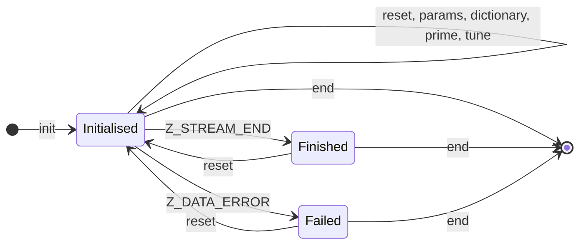

# API contracts

What a caller must do and what each call does. Source: `zlib.h` at the pinned commit. The scope
is the `inflate` and `deflate` families. Where `zlib.h` says nothing the text says
**not specified**.

## 1. The stream

A `z_stream` carries the interface between caller and library.

| Field | Direction | Meaning |
| --- | --- | --- |
| `next_in`, `avail_in` | caller sets | the input bytes not yet consumed, and how many |
| `total_in` | library updates | input consumed so far, modulo `2^32` for the 32-bit type |
| `next_out`, `avail_out` | caller sets | where the library may write, and how much room |
| `total_out` | library updates | output produced so far |
| `msg` | library sets | last error message, or null |
| `state` | library owns | the internal state; the caller never touches it |
| `zalloc`, `zfree`, `opaque` | caller sets before init | allocator; null means the default |
| `data_type`, `adler`, `reserved` | library | information fields |

### Rules that every call relies on (`A-stream-*`)

| Id | Rule |
| --- | --- |
| `A-stream-init` | before `inflateInit*`/`deflateInit*` the caller sets `zalloc`, `zfree`, `opaque` (all null for the default). After init `state` is non-null |
| `A-stream-in` | `next_in` points to `avail_in` readable bytes. It may be null only if `avail_in` is 0 |
| `A-stream-out` | `next_out` points to `avail_out` writable bytes |
| `A-stream-disjoint` | the input and output buffers do not overlap each other or the library's state. **Not stated in one sentence by `zlib.h`**; the code needs it because it copies with `memcpy` |
| `A-stream-single` | one stream is used by one thread at a time |
| `A-stream-end` | after `inflateEnd`/`deflateEnd` the stream is not used again, except for a new init |
| `A-stream-progress` | a call that consumes input decreases `avail_in` and advances `next_in` by the same amount; likewise for output |
| `A-stream-dealloc` | with the default allocator, the library frees everything it allocated at end |
| `A-leak-free` | a failing init frees whatever it had allocated. After `End`, the set of live blocks is the set that existed before init |

## 2. Inflate

### 2.1 Initialisation and release

| Function | Requires | Effect | Returns |
| --- | --- | --- | --- |
| `inflateInit_(strm, version, size)` | `A-stream-init`; `version` starts with the same major character as the library; `size` is `sizeof(z_stream)` | as `inflateInit2_` with `windowBits` 15 | see below |
| `inflateInit2_(strm, windowBits, version, size)` | as above | allocates the state; `windowBits` selects the layer (section 2.2) | `Z_OK`; `Z_VERSION_ERROR` if `version` is null or differs or `size` differs; `Z_STREAM_ERROR` if `strm` is null or `windowBits` is invalid; `Z_MEM_ERROR` if allocation fails (then `state` is null) |
| `inflateEnd(strm)` | a stream from init | frees window and state | `Z_OK`; `Z_STREAM_ERROR` if the state is inconsistent |
| `inflateReset(strm)` | initialised | forgets all data, keeps the allocated window size | `Z_OK`; `Z_STREAM_ERROR` |
| `inflateReset2(strm, windowBits)` | initialised | as reset, with a new `windowBits` | `Z_OK`; `Z_STREAM_ERROR` |

### 2.2 `windowBits`

| Value | Layer |
| --- | --- |
| 8 to 15 | zlib wrapper, window `2^windowBits` |
| 0 | zlib wrapper, window size taken from the header |
| 16 + (8 to 15) | gzip wrapper only |
| 32 + (8 to 15) | automatic detection of zlib or gzip |
| -8 to -15 | raw deflate |

`A-wbits-range`: any other value makes init and reset return `Z_STREAM_ERROR`.

### 2.3 `inflate(strm, flush)`

`flush` is one of `Z_NO_FLUSH`, `Z_SYNC_FLUSH`, `Z_FINISH`, `Z_BLOCK`, `Z_TREES`.

Requires: an initialised stream, `A-stream-in`, `A-stream-out`, `A-stream-disjoint`.

Effect: `A-inflate-progress`: decodes as much input as it can into as much room as there is. It
stops when input runs out, output fills, a block boundary is reached and `flush` asked for it
(`Z_BLOCK`, `Z_TREES`), the stream ends, or an error occurs. It does not read past the end of the
stream.

| Return | When |
| --- | --- |
| `Z_OK` | progress was made and the stream has not ended |
| `Z_STREAM_END` | the end of the stream was reached and all output was written |
| `Z_NEED_DICT` | the zlib header asks for a dictionary; call `inflateSetDictionary` |
| `Z_DATA_ERROR` | the input is not valid (`A-inflate-err-data`); `msg` says why. The state becomes an error state; only `inflateReset`, `inflateReset2` or `inflateEnd` are legal after it |
| `Z_STREAM_ERROR` | the stream is inconsistent, `next_out` is null, or `next_in` is null with `avail_in` not 0 |
| `Z_MEM_ERROR` | the window could not be allocated |
| `Z_BUF_ERROR` | no progress was possible (no input and no output room), or `Z_FINISH` could not finish |

`A-inflate-err-data`: **for every input**, a malformed stream makes `inflate` return
`Z_DATA_ERROR` and never anything worse. This is the central safety statement for the decoder.

`A-inflate-no-leak`: a call that returns an error leaves the stream in a state where `inflateEnd`
is safe.

### 2.4 The other inflate functions

| Function | Requires | Effect | Returns |
| --- | --- | --- | --- |
| `inflatePrime(strm, bits, value)` | initialised; `0 ≤ bits ≤ 16` unless `bits < 0`; `state.bits + bits ≤ 32` | inserts `bits` low bits of `value` into the input; `bits < 0` clears the bit buffer | `Z_OK`; `Z_STREAM_ERROR` |
| `inflateSetDictionary(strm, dict, len)` | initialised; `dict` has `len` readable bytes; called when `inflate` returned `Z_NEED_DICT` (zlib wrapper) or before the first `inflate` (raw) | loads the dictionary into the window; checks its Adler-32 against the header | `Z_OK`; `Z_STREAM_ERROR`; `Z_DATA_ERROR` if the checksum does not match |
| `inflateGetDictionary(strm, buf, &len)` | initialised; `buf` null or has room for 32768 bytes | copies the window into `buf`, sets `len` | `Z_OK`; `Z_STREAM_ERROR` |
| `inflateSync(strm)` | initialised | skips input to the next sync point (an empty stored block, `00 00 FF FF`) | `Z_OK` found; `Z_DATA_ERROR` not found; `Z_BUF_ERROR` no input |
| `inflateSyncPoint(strm)` | initialised | tests whether `inflate` stopped at a stored-block boundary | 1, 0, or `Z_STREAM_ERROR` |
| `inflateCopy(dest, source)` | `source` initialised; `dest` writable, not initialised | `dest` becomes an independent copy, with its own allocations | `Z_OK`; `Z_STREAM_ERROR` if either is null or inconsistent; `Z_MEM_ERROR` |
| `inflateGetHeader(strm, head)` | initialised; called after init or reset and **before the first `inflate`**; `head->extra`, `name`, `comment` are null or point to `extra_max`, `name_max`, `comm_max` writable bytes | requests that the gzip header be stored in `head` | `Z_OK`; `Z_STREAM_ERROR` |

`A-header-fill`: while a gzip header is decoded with `inflateGetHeader`, at most `extra_max`
bytes go to `extra`, at most `name_max` bytes (the terminating zero included) go to `name`, and
at most `comm_max` to `comment`. Longer fields are truncated, and the truncated name or
comment is not zero-terminated. `head->done` is 0 until the header is complete, then 1, or -1
for a zlib stream.

## 3. Deflate

### 3.1 Initialisation and release

| Function | Requires | Effect | Returns |
| --- | --- | --- | --- |
| `deflateInit2_(strm, level, method, windowBits, memLevel, strategy, version, size)` | `A-stream-init`; `method = Z_DEFLATED`; `level` -1 to 9; `windowBits` 8 to 15 (8 is changed to 9), or -8 to -15 for raw, or +16 for gzip; `memLevel` 1 to 9; `strategy` 0 to 4 | allocates the state, the window, `prev`, `head` and the pending buffer; then resets | `Z_OK`; `Z_VERSION_ERROR`; `Z_STREAM_ERROR` for a bad parameter; `Z_MEM_ERROR` if any allocation fails (all earlier allocations are freed and `state` is null) |
| `deflateEnd(strm)` | a stream from init | frees everything | `Z_OK`; `Z_STREAM_ERROR`; `Z_DATA_ERROR` if the stream was freed while data was pending |
| `deflateReset(strm)` | initialised | forgets all data, keeps the parameters and the allocations | `Z_OK`; `Z_STREAM_ERROR` |

`A-deflate-level`: `level` -1 means 6. Level 0 stores; levels 1 to 3 use the fast strategy;
4 to 9 use the lazy strategy.

`A-deflate-strategy`: 0 default, 1 filtered, 2 Huffman only, 3 run-length, 4 fixed codes.

### 3.2 `deflate(strm, flush)`

`flush` is one of `Z_NO_FLUSH`, `Z_PARTIAL_FLUSH`, `Z_SYNC_FLUSH`, `Z_FULL_FLUSH`, `Z_FINISH`,
`Z_BLOCK`.

Requires: an initialised stream, `A-stream-in`, `A-stream-out`, `A-stream-disjoint`. After
`Z_FINISH` has been given, later calls must also use `Z_FINISH` and must not add input.
Between calls, `deflateParams`, `deflateSetDictionary` and `deflateSetHeader` may be used only
as described below.

Effect: compresses input into the output buffer. It may keep input inside (the window and the
pending bytes) until it has enough to emit a block.

| Return | When |
| --- | --- |
| `Z_OK` | progress was made |
| `Z_STREAM_END` | `Z_FINISH` was given and all output was written |
| `Z_STREAM_ERROR` | the stream is inconsistent, or new input after `Z_FINISH` |
| `Z_BUF_ERROR` | no progress possible; the call can be repeated with more room |

`A-deflate-flush`: `Z_NO_FLUSH` lets the library decide when to emit. The other values force
output as specified in `zlib.h`; `Z_SYNC_FLUSH` and `Z_FULL_FLUSH` end with an empty stored
block (see [format.md](format.md), `F-deflate-flush`).

`A-deflate-no-leak`: as for inflate, an error return leaves the stream safe for `deflateEnd`.

### 3.3 The other deflate functions

| Function | Requires | Effect | Returns |
| --- | --- | --- | --- |
| `deflateParams(strm, level, strategy)` | initialised | changes level and strategy; if the compression function changes and input has been consumed, the current block is flushed first | `Z_OK`; `Z_STREAM_ERROR`; `Z_BUF_ERROR` if the flush needs output room |
| `deflateSetDictionary(strm, dict, len)` | initialised; `dict` has `len` readable bytes; **before the first `deflate`** (zlib wrapper), or at any point for raw | loads the dictionary into the window | `Z_OK`; `Z_STREAM_ERROR` |
| `deflateGetDictionary(strm, buf, &len)` | initialised; `buf` null or room for 32768 bytes | copies the last window bytes | `Z_OK`; `Z_STREAM_ERROR` |
| `deflateCopy(dest, source)` | as `inflateCopy` | an independent copy | `Z_OK`; `Z_STREAM_ERROR`; `Z_MEM_ERROR` |
| `deflateBound(strm, n)` | initialised | an upper bound on the compressed size of `n` input bytes, given the current parameters | the bound |
| `deflatePrime(strm, bits, value)` | initialised; `bits` 0 to 16 and room in the bit buffer | inserts bits into the output | `Z_OK`; `Z_BUF_ERROR` if not enough room; `Z_STREAM_ERROR` |
| `deflatePending(strm, &pending, &bits)` | initialised | reports bytes and bits not yet delivered | `Z_OK`; `Z_STREAM_ERROR` |
| `deflateTune(strm, good, lazy, nice, chain)` | initialised | changes the match-search parameters | `Z_OK`; `Z_STREAM_ERROR` |
| `deflateSetHeader(strm, head)` | initialised for gzip; **after init or reset and before the first `deflate`**; `name` and `comment` zero-terminated if not null; `extra` has `extra_len` readable bytes | stores a pointer to the header to write | `Z_OK`; `Z_STREAM_ERROR` |

`A-deflate-bound`: `deflateBound(strm, n)` is at least the size of the compressed output for any
`n` bytes of input, for the current parameters, including a gzip header with `extra`, `name`
and `comment`. (The pinned zlib has one case where this fails; see
[proof/deflate.md](../proof/deflate.md), section 6.)

## 4. What this contract does not say

- It does not say what happens if a precondition is violated. That is undefined, and it is
  outside the theorems. (`A-inflate-err-data` is not a precondition: malformed *data* is allowed.)
- It does not specify the output bytes of `deflate` beyond [format.md](format.md) section 6.
- It does not specify behaviour with a custom allocator.

## 5. The call protocol

`A-sequence`: every sequence of calls that follows this protocol and meets the preconditions
above is legal. The sequence theorem says that a legal sequence never faults and never leaks.
