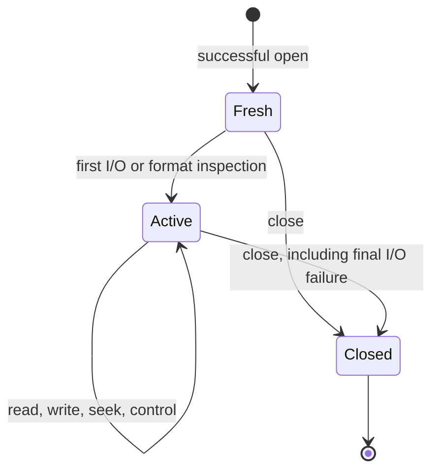

# Gzip files

[API manual](README.md) · [Contract conventions](contracts.md) · [Stream compression](deflate-stream.md) · [Stream decompression](inflate-stream.md)

Use a `gzFile` handle for buffered gzip file I/O. Open acquires a file descriptor and private
state; data operations initialize buffers and codec state as needed; close releases the
handle even if final I/O fails. Reading can also accept transparent, uncompressed input.

| Task | Entries |
| --- | --- |
| Open or configure | [Open path](#gzopen), [open descriptor](#gzdopen), [buffer size](#gzbuffer), [compression parameters](#gzsetparams) |
| Read | [Bytes](#gzread), [items](#gzfread), [character](#gzgetc), [pushback](#gzungetc), [line](#gzgets) |
| Write | [Bytes](#gzwrite), [items](#gzfwrite), [character](#gzputc), [string](#gzputs), [formatted text](#gzprintf), [flush](#gzflush) |
| Position | [Seek](#gzseek64), [rewind](#gzrewind), [uncompressed position](#gztell64), [file offset](#gzoffset64) |
| Inspect or clear status | [EOF](#gzeof), [transparent mode](#gzdirect), [error](#gzerror), [clear error](#gzclearerr) |
| Close | [Any mode](#gzclose), [reader](#gzclose_r), [writer](#gzclose_w) |

These focused contracts follow the pinned source and `zlib.h`. Source readings are
**to confirm** by implementation proof. They do not assert full API verification or narrow
the broader [registered public goals](../../checking/goals.md). See
[progress](../../progress.md) for proof status and remaining work.

## Common handle conditions

This page uses the default x86_64 Linux build. `int` and `unsigned` have
32 bits. `long`, `z_off_t`, `z_off64_t` and `z_size_t` have 64 bits.
The large-file declarations are enabled. Plain and `*64` entry points have
the same offset range here. Other configurations need separate contracts.
`gzopen_w` is a Windows-only entry and is scoped separately below.

**Restricted domain** means ordinary use with these common requirements:

- A non-NULL handle is live, returned by a successful open, and not closed.
  It is used serially and its private state is not modified by the caller.
- A reader or writer has the access mode named by the entry. NULL and
  wrong-mode refusals are documented separately. A stale or arbitrary pointer
  is outside this domain; checking a mode field does not validate a pointer.
- Buffers cover the requested readable or writable extent. They are separate
  from handle-owned memory. Strings have a readable terminating NUL.
  The caller retains ownership of these objects.
- Position arithmetic and requested extents are representable in the stated
  C types. Explicit oversized-request and multiplication-overflow refusals
  remain part of the contracts below.
- The descriptor belongs to the handle until close. No other operation changes
  its data or position during a call. OS failures and allocation failures remain
  possible; a successful open does not guarantee that later I/O succeeds.

Every entry carries a domain label. “Full scalar range” applies only to the
named scalar argument, under these pointer and lifetime requirements.
Documentary restrictions do not excuse known failure paths. In particular,
partial-read errors and pushback-created negative positions remain obligations
of the unchanged public goals.

**Effects.** Read, write, open, seek, control and close operations are stateful,
including operations without a caller output buffer. Tell, offset and EOF
queries read state; `gzerror` may also write its optional code output.
`gzdirect` can read the file and allocate, so it is stateful.



**Format and buffering.** Opening does no payload I/O. Buffers and codec state
are allocated lazily, with a default requested buffer size of 8192 bytes.
Allocation can fail at first use or later in decompression. Closing releases
owned allocations even when final I/O fails.

An ordinary reader detects gzip from a plausible four-byte header; otherwise
it returns the input unchanged. Empty input is transparent. Detection waits
when non-blocking input stalls before four bytes are available. Gzip members
are concatenated in the output. Trailing non-member data is ignored when the
attempted following member produces no output before its format error.
`G` requires gzip; `T` selects transparent output and is invalid for reading.

**Read results.** Reads advance the uncompressed position by bytes consumed,
including a final partial item. Buffered bytes can be returned before a
recorded error is reported. `gzeof` reports an attempted read beyond available
data, not simply the delivery of the final byte. `gzerror` distinguishes EOF,
corruption (`Z_DATA_ERROR`), truncation (`Z_BUF_ERROR`), allocation failure
(`Z_MEM_ERROR`) and system failure (`Z_ERRNO`). Zero-length reads do not consume
input or carry out a pending seek.

**Write results.** Success means input was accepted by the handle. It can still
be buffered. Flush or close can fail later. A hard error can return failure
after consuming a prefix; the return value alone is not always a retry offset.
A non-blocking stall can instead return the number consumed so far.

Errors normally persist until cleared. A recorded would-block condition permits
the next data I/O call to retry. Seek and rewind still refuse that recorded
`Z_ERRNO`. Constructing an error message can itself fail and replace the code
with `Z_MEM_ERROR`. `errno` is meaningful for the associated system failure,
not as a general explanation of every failed API call.

The source is [gzlib.c](../../../zlib/gzlib.c),
[gzread.c](../../../zlib/gzread.c), [gzwrite.c](../../../zlib/gzwrite.c),
[gzclose.c](../../../zlib/gzclose.c) and [zlib.h](../../../zlib/zlib.h).
The abstract contracts are in [Api/Gz.lean](../../../ZlibF/Spec/Api/Gz.lean).
Concrete goals are in [GzOpen](../../../ZlibF/Spec/Public/GzOpen.lean),
[GzRead](../../../ZlibF/Spec/Public/GzRead.lean),
[GzWrite](../../../ZlibF/Spec/Public/GzWrite.lean),
[GzControl](../../../ZlibF/Spec/Public/GzControl.lean) and
[GzClose](../../../ZlibF/Spec/Public/GzClose.lean).
The translations mirror the C names in `ZlibF/Zlib/`.

## gzopen

```c
gzFile ZEXPORT gzopen(const char *path, const char *mode);
```

Open a path for reading, writing or appending.

### Return values and next calls {#api-gzopen-returns}

**Return type.** `gzFile` — Owned handle or failure sentinel

The result tells you whether opening acquired a new gzip file handle.

| Returned value | Meaning and conditions | Caller’s next step |
| --- | --- | --- |
| `file != NULL`<br>**Handle acquired** | Mode parsing, state/path allocation and file opening succeed. Position is zero, the error is clear, and I/O buffers remain unallocated. | Use the handle in its selected mode and close it exactly once. Check later I/O and the close result. |
| `NULL`<br>**No handle acquired** | A path or mode is NULL, the mode is invalid, allocation fails, or the OS cannot open the file. | There is no handle to close or query. Correct the cause before another open; errno explains only an associated OS opening failure. |

**Reading the result.**

- Opening does no payload I/O and does not validate the input format; buffers and codecs are initialized lazily.

### Calling conditions and effects {#api-gzopen-contract}

**Domain:** Restricted domain: strings and file environment; mode parsing includes
invalid strings. **Effect:** stateful open and ownership acquisition.

**Pre:** Non-NULL `path` and `mode` are readable NUL-terminated strings.

<details markdown="1" class="ar-return-exact" data-return-exact="gzopen"><summary>Complete return conditions and boundaries</summary>

**Post:** A non-NULL result owns a descriptor, state and copied path. Its
uncompressed position is zero, error is clear and buffers are unallocated.
Reading remembers the initial descriptor position for rewind. Writing creates
or truncates; appending keeps existing data and adds a new member on writing.

**Errors and edges:** NULL arguments, allocation failure, invalid mode or failed
OS open return NULL. Failed opening leaves no owned allocations or descriptor.
Only OS opening failure promises its associated `errno`.

The last `r`/`w`/`a`, level digit and strategy letter win. `+` is refused;
no access letter is refused. Digits `0`–`9` select level, and `f`, `h`, `R`, `F`
select strategy. The last `G`/`T` wins: read with `T` or write with `G` is refused.
`b` and unknown letters are ignored. `e`, `x`, `N` request close-on-exec,
exclusive creation and non-blocking mode where supported; `x` has no effect
for reading. Opening does not validate the file format or allocate I/O buffers.

</details>

## gzopen64

```c
gzFile ZEXPORT gzopen64(const char *path, const char *mode);
```

Open using the large-file entry point.

### Return values and next calls {#api-gzopen64-returns}

**Return type.** `gzFile` — Owned handle or failure sentinel

The result tells you whether opening acquired a new gzip file handle.

| Returned value | Meaning and conditions | Caller’s next step |
| --- | --- | --- |
| `file != NULL`<br>**Handle acquired** | Mode parsing, state/path allocation and file opening succeed. Position is zero, the error is clear, and I/O buffers remain unallocated. | Use the handle in its selected mode and close it exactly once. Check later I/O and the close result. |
| `NULL`<br>**No handle acquired** | A path or mode is NULL, the mode is invalid, allocation fails, or the OS cannot open the file. | There is no handle to close or query. Correct the cause before another open; errno explains only an associated OS opening failure. |

**Reading the result.**

- Opening does no payload I/O and does not validate the input format; buffers and codecs are initialized lazily.
- gzopen64 has the same implementation and offset range as gzopen in the default LP64 build; its declaration can be gated on other builds.

### Calling conditions and effects {#api-gzopen64-contract}

**Domain:** Restricted domain, as for `gzopen`. **Effect:** stateful open.

**Pre:** The `gzopen` string and environment requirements hold.

<details markdown="1" class="ar-return-exact" data-return-exact="gzopen64"><summary>Complete return conditions and boundaries</summary>

**Post:** The `gzopen` contract applies, including ownership, lazy allocation
and initial position. Its implementation and offset range coincide here.

**Errors and edges:** The same NULL, invalid-mode, allocation and OS failures
apply. This name requires the appropriate large-file declaration on builds
where the public header gates it.

</details>

## gzdopen

```c
gzFile ZEXPORT gzdopen(int fd, const char *mode);
```

Wrap an existing descriptor without opening or duplicating it.

### Return values and next calls {#api-gzdopen-returns}

**Return type.** `gzFile` — Owned handle or failure sentinel

The result tells you whether an existing descriptor has been transferred to a new handle. No descriptor is duplicated.

| Returned value | Meaning and conditions | Caller’s next step |
| --- | --- | --- |
| `file != NULL`<br>**Descriptor transferred** | Handle and diagnostic-path allocation and mode parsing succeed for a nonnegative fd. The fresh logical position is zero, even when the descriptor position is not. | Let the handle exclusively own fd until close, which closes fd. Pass a duplicate instead if the original must stay open. |
| `NULL`<br>**Caller retains descriptor** | fd is negative, mode is NULL or invalid, or allocation fails. | No handle exists to close. The caller retains ownership of any supplied descriptor and must manage it. |

**Reading the result.**

- A nonnegative closed or wrong-access descriptor can pass this entry and fail during later I/O; non-NULL does not validate fd.
- Append attempts to seek to the end. e/N flag changes are attempted without reporting their system-call failures; x does not create or truncate an existing descriptor.

### Calling conditions and effects {#api-gzdopen-contract}

**Domain:** Restricted domain: descriptor use; negative-descriptor refusal included.

**Effect:** stateful ownership transfer and possible descriptor flag changes.

**Pre:** For ordinary success, `fd` is open with access matching the mode.
Non-NULL `mode` meets `gzopen`'s string requirements. Other users do not read,
write, seek or close this descriptor while the handle owns it.

<details markdown="1" class="ar-return-exact" data-return-exact="gzdopen"><summary>Complete return conditions and boundaries</summary>

**Post:** Success creates the same fresh state as `gzopen`, with an error name
of the form `<fd:N>`. Uncompressed position starts at zero even if `fd` does not.
Close will close `fd`. Pass a duplicate if the original must remain open.

**Errors and edges:** Negative `fd`, invalid/NULL mode or allocation failure
returns NULL and leaves descriptor ownership with the caller. Nonnegative
closed or wrong-access descriptors are not reliably rejected at this point;
later I/O can fail. `x` does not create exclusively or truncate an existing
descriptor. Append attempts to seek to the end. `e`/`N` attempt descriptor flag
changes; their system-call failures are not reported by this entry.

</details>

## gzopen_w

```c
gzFile ZEXPORT gzopen_w(const wchar_t *path, const char *mode);
```

Open a Windows wide-character path.

### Return values and next calls {#api-gzopen_w-returns}

**Return type.** `gzFile` — Owned handle or failure sentinel

The result tells you whether opening acquired a new gzip file handle. This entry is available only in Windows WIDECHAR builds.

| Returned value | Meaning and conditions | Caller’s next step |
| --- | --- | --- |
| `file != NULL`<br>**Handle acquired** | Mode parsing, state/path allocation and file opening succeed. Position is zero, the error is clear, and I/O buffers remain unallocated. | Use the handle in its selected mode and close it exactly once. Check later I/O and the close result. |
| `NULL`<br>**No handle acquired** | A path or mode is NULL, the mode is invalid, allocation fails, or the OS cannot open the file. | There is no handle to close or query. Correct the cause before another open; errno explains only an associated OS opening failure. |

**Reading the result.**

- Opening does no payload I/O and does not validate the input format; buffers and codecs are initialized lazily.
- The diagnostic path uses the current multibyte locale; an unrepresentable wide name can leave an empty diagnostic name.

### Calling conditions and effects {#api-gzopen_w-contract}

**Domain:** Restricted domain: Windows `WIDECHAR` build only, outside the default build.

**Effect:** stateful open.

**Pre:** Non-NULL `path` is a readable terminated wide string. Non-NULL `mode`
meets `gzopen`'s mode requirements. The Windows file environment is available.

<details markdown="1" class="ar-return-exact" data-return-exact="gzopen_w"><summary>Complete return conditions and boundaries</summary>

**Post:** The `gzopen` lifetime, buffering and mode contract applies, using a
wide-path open. The diagnostic path is converted to the current multibyte
locale; an unrepresentable name can become an empty diagnostic name.

**Errors and edges:** NULL, invalid mode, allocation and file-opening failures
return NULL. Windows and locale details are **to confirm** separately; the
Linux translation and public goals do not establish this variant's behavior.

</details>

## gzbuffer

```c
int ZEXPORT gzbuffer(gzFile file, unsigned size);
```

Choose the requested buffer size before buffers exist.

### Return values and next calls {#api-gzbuffer-returns}

**Return type.** `int` — Zero / minus-one control result

The result reports whether the requested future buffer size was recorded. This call does not allocate the buffers.

| Returned value | Meaning and conditions | Caller’s next step |
| --- | --- | --- |
| `0`<br>**Request recorded** | The handle is a reader or writer, buffers are unallocated, and size < 2^31. The recorded request is max(size, 8). | Proceed to I/O or inspection; later buffer allocation can still fail. |
| `-1`<br>**Request unchanged** | The handle is NULL or has the wrong mode, buffers already exist, or size >= 2^31. | For a size refusal, choose a smaller size before allocation. If buffers already exist, this handle cannot be resized by this call. |

**Reading the result.**

- Call before gzdirect, pushback and ordinary I/O, any of which can allocate buffers.

### Calling conditions and effects {#api-gzbuffer-contract}

**Domain:** Restricted domain: live handle; full unsigned `size` range.

**Effect:** stateful buffer configuration, without allocating buffers.

**Pre:** A live reader or writer meets the shared handle requirements.

<details markdown="1" class="ar-return-exact" data-return-exact="gzbuffer"><summary>Complete return conditions and boundaries</summary>

**Post:** Returns 0 and records `max(size, 8)` when buffers are unallocated and
`size < 2^31`. Readers later need an input buffer and a doubled output buffer;
writers need a doubled input buffer and, for gzip, an output buffer.

**Errors and edges:** Returns -1 without changing the request for NULL,
already allocated buffers, wrong mode or `size >= 2^31`. Small sizes clamp to
eight, not two. A successful request does not promise later allocation success.
Call before `gzdirect` or pushback as well as before ordinary I/O.

</details>

## gzsetparams

```c
int ZEXPORT gzsetparams(gzFile file, int level, int strategy);
```

Request a new compression level and strategy for subsequent input.

### Return values and next calls {#api-gzsetparams-returns}

**Return type.** `int` — zlib status code

The status reports whether the parameter request reached the handle, including any required processing of old input. Z_OK does not establish that the compressor applied the requested parameters.

| Returned value | Meaning and conditions | Caller’s next step |
| --- | --- | --- |
| `Z_OK`<br>**Request accepted** | The request is unchanged, a fresh writer records it for lazy initialization, or an active writer reaches the parameter-update step after processing pending work. | Continue with valid parameters, while retaining the contract caveat: deflateParams returns are ignored, so the applied settings can differ from the recorded request. |
| `Z_STREAM_ERROR`<br>**Call refused** | The handle is NULL, a reader, a transparent writer, or has a pending hard error. | Use a live gzip writer. Inspect a live handle before closing it; do not assume clearing an error applies the requested settings. |
| `Z_MEM_ERROR / Z_ERRNO / Z_STREAM_ERROR`<br>**Pending work failed** | Pending zero-fill or processing old buffered input fails and returns the recorded error code. | Inspect gzerror while the handle is live. Distinguish a would-block stall from a hard error; the request has not been completed and blind replay is not justified. |

**Reading the result.**

- Ordinary requests use levels -1 through 9 and strategies Z_DEFAULT_STRATEGY through Z_FIXED. Invalid values are not consistently rejected here and can fail later initialization as Z_MEM_ERROR.

### Calling conditions and effects {#api-gzsetparams-contract}

**Domain:** Restricted domain: gzip writer; ordinary levels -1 through 9 and strategies
`Z_DEFAULT_STRATEGY` through `Z_FIXED`. **Effect:** stateful control and possible I/O.

**Pre:** A live gzip writer meets the shared requirements. A transparent
writer is refused. Existing hard errors normally prevent the call.

<details markdown="1" class="ar-return-exact" data-return-exact="gzsetparams"><summary>Complete return conditions and boundaries</summary>

**Post:** An unchanged request returns `Z_OK`. A fresh writer records the
request for lazy initialization. An active writer processes pending input with
the old parameters before requesting the change. A pending seek can write zeros.

**Errors and edges:** NULL, reader, transparent writer or pending hard error
returns `Z_STREAM_ERROR`. Seek/flush failure returns the recorded error.
The source ignores `deflateParams`' return and can report `Z_OK` after recording
parameters that the compressor did not apply. This is **to confirm** against
the current pin, including valid requests; valid scalar restrictions do not
remove it. Invalid parameters are not consistently rejected here and can cause
a later initialization failure to be reported as `Z_MEM_ERROR`.

</details>

## gzread

```c
int ZEXPORT gzread(gzFile file, voidp buf, unsigned len);
```

Read up to `len` uncompressed bytes.

### Return values and next calls {#api-gzread-returns}

**Return type.** `int` — Uncompressed byte count, or failure sentinel

A positive result counts bytes delivered by this call. Zero can mean a zero-length request, EOF or truncation; -1 is this interface's failure sentinel.

| Returned value | Meaning and conditions | Caller’s next step |
| --- | --- | --- |
| `0 < n <= len`<br>**Delivered n bytes** | Reading, decompression or buffered data supplied n bytes; a short result or recorded error does not erase the delivered prefix. | Process those n bytes; on a short read, query gzerror and gzeof before deciding how to continue. |
| `0`<br>**Zero-length request** | len is zero and the existing state does not make the call fail; no input is consumed and no pending seek is executed. | Issue a nonzero read when needed; this result does not establish EOF. |
| `0`<br>**EOF or truncation, no output** | A nonzero request has no bytes to deliver; both ordinary end of input and truncation recorded as Z_BUF_ERROR can return zero. | Query gzerror and gzeof; Z_BUF_ERROR does not mean a complete gzip member ended successfully. |
| `-1`<br>**Failure or temporary stall** | NULL, wrong mode, len > INT_MAX, a hard error with no deliverable bytes, or a non-blocking stall with no output; existing error state can also reject a zero request. | For a valid handle, query gzerror. Retry only after identifying a retryable stall and handling the wait; handle hard errors according to their cause. |

**Reading the result.**

- The return counts bytes; it is not a zlib status code. An oversized request records Z_STREAM_ERROR while preserving an existing serious error.

### Calling conditions and effects {#api-gzread-contract}

**Domain:** Restricted domain: reader and destination; full unsigned `len` refusal range.

**Effect:** stateful read, destination write and possible allocation.

**Pre:** For `len <= INT_MAX`, `buf` covers `len` writable bytes under the
shared separation rules. A zero extent needs no accessed bytes.

<details markdown="1" class="ar-return-exact" data-return-exact="gzread"><summary>Complete return conditions and boundaries</summary>

**Post:** A positive result `n <= len` gives the next `n` bytes and advances
the position by `n`, after any pending skip. Format, member concatenation,
transparent input and deferred errors follow the shared read rules.

**Errors and edges:** Returns -1 for NULL, wrong mode, an undeliverable hard
error or `len > INT_MAX`; oversized requests record `Z_STREAM_ERROR` unless
preserving a more serious error. No output at EOF/truncation returns zero.
A zero request normally returns zero, but existing error/stall state can still
cause -1. Consult `gzerror`; truncation is `Z_BUF_ERROR`, not a successful
complete gzip member. A later error does not erase delivered
bytes. Blocking descriptors may wait to fill internal reads. Non-blocking
stalls are retryable and are not EOF. Partial transparent-read recovery has a
known **to confirm** caveat below; no unconditional safety claim is made here.

</details>

## gzfread

```c
z_size_t ZEXPORT gzfread(voidp buf, z_size_t size, z_size_t nitems, gzFile file);
```

Read up to `nitems` items of `size` uncompressed bytes.

### Return values and next calls {#api-gzfread-returns}

**Return type.** `z_size_t` — Complete items read

The result counts complete items of size bytes. Bytes of a final incomplete item are also written and consumed, but are absent from the count.

| Returned value | Meaning and conditions | Caller’s next step |
| --- | --- | --- |
| `n = nitems > 0`<br>**All requested items read** | size is nonzero, the request product is representable, and size * nitems bytes were read. | Process these complete items; this does not detect later EOF or validate an unread member trailer. |
| `0 < n < nitems`<br>**Some complete items read** | n complete items were read, possibly with a written and consumed partial tail; EOF, a stall or an error can stop the read. | Query gzerror and gzeof. Do not infer the actual bytes consumed or a safe continuation position from n * size alone. |
| `0`<br>**Zero total request** | size or nitems is zero; no input is consumed and no pending seek is executed. | Use nonzero size and count when data is needed; zero does not establish EOF. |
| `0`<br>**No complete item returned** | A nonzero request encounters NULL, wrong mode, EOF, a stall, a hard error or product overflow; a partial item may still have been consumed. Overflow records Z_STREAM_ERROR, preserving an existing serious error. | For a valid handle, query gzerror and gzeof; distinguish the cause before treating zero as no bytes consumed. |

**Reading the result.**

- The total request has no gzread INT_MAX limit; its product must still fit z_size_t.

### Calling conditions and effects {#api-gzfread-contract}

**Domain:** Restricted domain: reader/destination; full scalar sizes with overflow refusal.

**Effect:** stateful read and destination write.

**Pre:** When the product is representable, `buf` covers `size * nitems`
writable bytes and meets the shared separation rules.

<details markdown="1" class="ar-return-exact" data-return-exact="gzfread"><summary>Complete return conditions and boundaries</summary>

**Post:** Returns the number of complete items read. All bytes read are
consumed and written, including a final partial item that is absent from the
returned count. Shared read behavior and the `gzread` recovery caveat apply.

**Errors and edges:** Zero `size` or `nitems` returns zero without consuming
input. Product overflow returns zero and records `Z_STREAM_ERROR`, preserving
a prior serious error. NULL, wrong mode, EOF and hard errors can also return
zero. A short item count requires `gzerror`/`gzeof` to distinguish causes;
there is no `INT_MAX` limit on the total request here.

</details>

## gzgetc

```c
int ZEXPORT gzgetc(gzFile file);
```

Read one uncompressed byte as an unsigned value.

### Return values and next calls {#api-gzgetc-returns}

**Return type.** `int` — Unsigned byte value, or failure/EOF sentinel

0–255 is an actual byte read; -1 means no byte was returned. This call advances reading state.

| Returned value | Meaning and conditions | Caller’s next step |
| --- | --- | --- |
| `0 <= c <= 255`<br>**One byte read** | A buffered byte or subsequent read supplied one byte; the uncompressed position advances by one after any pending skip. An existing error can be deferred until buffered bytes are exhausted. | Use the byte; both 255 and zero are data values. |
| `-1`<br>**No byte returned** | NULL, a writer, EOF, or an error/non-blocking stall with no deliverable byte. | For a valid reader, query gzerror and gzeof; wait and retry only for an identified retryable stall. |

**Reading the result.**

- The header's macro fast path also changes the same reader; it is not a read-only query.

### Calling conditions and effects {#api-gzgetc-contract}

**Domain:** Restricted domain: reader. **Effect:** stateful read and possible allocation.

**Pre:** The shared reader requirements hold.

<details markdown="1" class="ar-return-exact" data-return-exact="gzgetc"><summary>Complete return conditions and boundaries</summary>

**Post:** Returns a value in 0–255 and consumes one byte, advancing the
uncompressed position by one after a pending skip. It can use buffered data
without descriptor I/O. Shared format and deferred-error rules apply.

**Errors and edges:** Returns -1 for NULL, a writer, EOF or an error with no
byte available. `gzerror` distinguishes these read outcomes. A byte 255 is
not EOF. The header can supply a macro fast path that changes the same handle
state; callers must not treat the macro as a stateless query.

</details>

## gzgetc_

```c
int ZEXPORT gzgetc_(gzFile file);
```

Provide the exported wrapper for single-byte reading.

### Return values and next calls {#api-gzgetc_-returns}

**Return type.** `int` — Unsigned byte value, or failure/EOF sentinel

This exported single-byte wrapper has the same result as the gzgetc function.

| Returned value | Meaning and conditions | Caller’s next step |
| --- | --- | --- |
| `0 <= c <= 255`<br>**One byte read** | One byte was obtained and consumed; the uncompressed position advances by one after any pending skip. Buffered bytes can be returned before an existing error. | Use the unsigned byte value; 255 is not EOF. |
| `-1`<br>**No byte returned** | NULL, wrong mode, EOF, or an error/non-blocking stall with no deliverable byte. | For a valid reader, query gzerror and gzeof before ending, handling an error or waiting out a retryable stall. |

### Calling conditions and effects {#api-gzgetc_-contract}

**Domain:** Restricted domain: reader, as for `gzgetc`.

**Effect:** stateful read and possible allocation.

**Pre:** The `gzgetc` handle requirements hold.

<details markdown="1" class="ar-return-exact" data-return-exact="gzgetc_"><summary>Complete return conditions and boundaries</summary>

**Post:** The `gzgetc` byte, position, buffering and format contract applies.

**Errors and edges:** Returns -1 for its NULL/wrong-mode/EOF/error cases.
The wrapper has the function behavior even where the public `gzgetc` name
expands to a macro.

</details>

## gzungetc

```c
int ZEXPORT gzungetc(int c, gzFile file);
```

Push one byte onto a reader's uncompressed input.

### Return values and next calls {#api-gzungetc-returns}

**Return type.** `int` — Original nonnegative argument, or failure sentinel

Success returns the original c, while pushing back only its low eight bits. The uncompressed position decreases by one; the physical file is unchanged.

| Returned value | Meaning and conditions | Caller’s next step |
| --- | --- | --- |
| `c >= 0`<br>**One byte pushed back** | Buffer space is available and any pending skip did not fail; c & 0xff is stored, the original c is returned, and past-EOF is cleared. With allocated room, success is possible even after inspection or reading records an error. | Later reads return pushed data first, in reverse push order; an existing read error is not necessarily cleared. |
| `-1`<br>**Byte not pushed back** | NULL, a writer, negative c, no pushback room, or failed setup/skip. A full buffer records Z_DATA_ERROR unless preserving an existing serious error. | For a valid handle, query gzerror. Inspection or skipping can occur before negative c is refused; do not assume position and state were unchanged. |

**Reading the result.**

- Pushback is allowed immediately after open and can make logical position negative; a tell result of -1 can therefore be a real position.

### Calling conditions and effects {#api-gzungetc-contract}

**Domain:** Restricted domain: reader; full `int c` range, including refusal of negatives.

**Effect:** stateful pushback, possible input inspection/allocation and skip.

**Pre:** The shared reader requirements hold. Pushback is allowed immediately
after open and can therefore make the logical position negative.

<details markdown="1" class="ar-return-exact" data-return-exact="gzungetc"><summary>Complete return conditions and boundaries</summary>

**Post:** On success, stores the low eight bits of `c`, returns the original
nonnegative `c`, decreases position by one and clears past-EOF. Pushed bytes
are read in reverse push order. The physical input file is not modified.

**Errors and edges:** Returns -1 for NULL, a writer, negative `c`, lack of
pushback room or failed setup/skip. Initial inspection and a pending skip can
happen before negative `c` is refused. Full pushback records `Z_DATA_ERROR`
unless preserving a serious error. With allocated room, pushback may succeed
after a read error; it does not generally clear that error. Position -1 can
be a successful state, so tell's -1 alone is ambiguous. Seeking from this
state has a **to confirm** source caveat; it is not forbidden here.

</details>

## gzgets

```c
char * ZEXPORT gzgets(gzFile file, char *buf, int len);
```

Read a line fragment and terminate it with NUL.

### Return values and next calls {#api-gzgets-returns}

**Return type.** `char *` — Caller buffer pointer, or NULL

Returning buf means a NUL-terminated line fragment was written; NULL means no fragment was returned. The result is a pointer, not a byte count.

| Returned value | Meaning and conditions | Caller’s next step |
| --- | --- | --- |
| `buf`<br>**Line fragment returned** | len > 1 and at least one data byte was copied, at most len - 1 bytes; the first newline is included, or reading stops at the limit, EOF or an error. | Process the fragment; the same line may continue. A returned prefix can coexist with a recorded error; query gzerror as needed. |
| `buf`<br>**Empty string returned** | len == 1 and the call is accepted after state checks and any pending skip; only NUL is written and no input byte is copied, even at EOF. | Use a larger buffer to read data; a preceding pending skip may still have consumed input or changed position. |
| `NULL`<br>**Request refused** | NULL handle, NULL buf, a writer, or len < 1. | Correct the handle mode or buffer arguments before reading. |
| `NULL`<br>**EOF, stall or error, no fragment** | An otherwise valid request encounters an undeliverable error or failed pending skip; for len > 1, EOF with no data or a non-blocking stall also returns NULL. | Query gzerror and gzeof to distinguish end of input, truncation, a stall and a hard error; continue only as appropriate for that state. |

**Reading the result.**

- Input NUL bytes are copied as data; strlen(buf) does not reliably measure bytes consumed by this call.

### Calling conditions and effects {#api-gzgets-contract}

**Domain:** Restricted domain: reader/destination; full `int len` refusal range.

**Effect:** stateful read and destination write.

**Pre:** For non-NULL `buf` and `len > 0`, the destination covers `len`
writable bytes under the shared separation rules.

<details markdown="1" class="ar-return-exact" data-return-exact="gzgets"><summary>Complete return conditions and boundaries</summary>

**Post:** Returns `buf` with at most `len - 1` data bytes and a terminating
NUL. Stops after the first newline, which is included, or at the limit/EOF.
Consumed data advances the position. Embedded NUL input is copied as data.

**Errors and edges:** NULL handle/buffer, wrong mode or `len < 1` returns
NULL. For larger lengths, EOF with no bytes or an undeliverable error returns
NULL; a delivered prefix can still be returned with an error recorded.
For `len == 1`, an otherwise accepted call copies no input byte to `buf`
and returns an empty string, even at EOF. A pending skip runs first: it can
consume input, decompress, allocate, advance position or fail and return NULL.
Shared deferred-error and partial-read caveats apply.

</details>

## gzwrite

```c
int ZEXPORT gzwrite(gzFile file, voidpc buf, unsigned len);
```

Accept `len` uncompressed bytes for output.

### Return values and next calls {#api-gzwrite-returns}

**Return type.** `int` — Accepted uncompressed byte count

The result counts bytes accepted from this call, which may still be buffered. Zero can mean either an empty request or failure.

| Returned value | Meaning and conditions | Caller’s next step |
| --- | --- | --- |
| `n = len > 0`<br>**All bytes accepted** | All len requested bytes are buffered or compressed after any pending zero fill; len <= INT_MAX. | Continue with subsequent input. Check flush or close for delayed output failure. |
| `0 <= n < len`<br>**Stall after a prefix** | A non-blocking write stalls and returns the accepted byte count, possibly zero. | Confirm the stall with gzerror, handle writability, then retry only the unaccepted suffix at buf + n. |
| `0`<br>**No requested bytes** | len is zero and the handle passes the writer/error checks. No data is written and no pending seek is executed. | No input needs resubmitting. The handle still needs its eventual close. |
| `0`<br>**Request failed or refused** | The handle is NULL, a reader, has a hard error, len exceeds INT_MAX, or allocation/seek/output fails. Oversized len records Z_DATA_ERROR. | For a live handle, inspect gzerror before closing. A hard failure can consume a prefix despite returning zero; do not use zero as a retry offset. |

### Calling conditions and effects {#api-gzwrite-contract}

**Domain:** Restricted domain: writer/source; full unsigned `len` refusal range.

**Effect:** stateful write, buffering and possible allocation.

**Pre:** For `len <= INT_MAX`, `buf` covers `len` readable bytes under the
shared separation rules. The selected compression parameters are valid.

<details markdown="1" class="ar-return-exact" data-return-exact="gzwrite"><summary>Complete return conditions and boundaries</summary>

**Post:** Normally returns `len` and advances position by that accepted count,
after any pending zero-fill seek. Output is gzip, or unchanged bytes for `T`.
Acceptance can leave data buffered; successful close is still required.

**Errors and edges:** Returns zero for NULL, reader, hard error, allocation
failure or system write failure. `len > INT_MAX` returns zero and records
`Z_DATA_ERROR`. A zero request does not write or execute a pending seek.
A hard failure can consume a prefix despite returning zero. A would-block
stall can return a short accepted count; retry the unaccepted suffix after
handling the stall. Shared failed-finish recovery caveats still apply.

</details>

## gzfwrite

```c
z_size_t ZEXPORT gzfwrite(voidpc buf, z_size_t size, z_size_t nitems, gzFile file);
```

Accept up to `nitems` items of `size` uncompressed bytes.

### Return values and next calls {#api-gzfwrite-returns}

**Return type.** `z_size_t` — Complete accepted item count

The result counts complete items of size bytes, not bytes. Accepted bytes from a final partial item are omitted from this count.

| Returned value | Meaning and conditions | Caller’s next step |
| --- | --- | --- |
| `n = nitems > 0`<br>**All items accepted** | size is nonzero and every requested byte is accepted; the product size * nitems is representable. | Continue with later input and check flush or close for delayed output errors. |
| `0 <= n < nitems`<br>**Incomplete item count** | A non-blocking stall accepts fewer requested bytes. Complete items are counted, but an additional partial item may already be consumed, even when n is zero. | Inspect gzerror. The item count alone cannot identify a safe byte pointer for retry; do not simply resend from buf + n * size. |
| `0`<br>**No data requested** | size or nitems is zero and the handle passes the writer/error checks. No data I/O or pending seek occurs. | No input needs resubmitting; preserve the normal handle lifetime. |
| `0`<br>**Request failed or refused** | The handle is NULL, has the wrong mode or a hard error, the product overflows, or allocation/seek/output fails. Overflow records Z_STREAM_ERROR. | Inspect a live handle with gzerror before close. Hard failure can hide an accepted prefix, so zero is not evidence that resending the whole request is safe. |

### Calling conditions and effects {#api-gzfwrite-contract}

**Domain:** Restricted domain: writer/source; full scalar sizes with overflow refusal.

**Effect:** stateful write and buffering.

**Pre:** For a representable product, `buf` covers `size * nitems` readable
bytes. The shared writer and separation requirements hold.

<details markdown="1" class="ar-return-exact" data-return-exact="gzfwrite"><summary>Complete return conditions and boundaries</summary>

**Post:** Returns the number of complete accepted items. Accepted bytes advance
the position; a partial item can be accepted even though the count omits it.
The output format and delayed-I/O meaning are those of `gzwrite`.

**Errors and edges:** Zero factors return zero without data I/O or pending
seek execution. Product overflow returns zero with `Z_STREAM_ERROR`.
NULL, wrong mode and hard failures also return zero. A short item count can
hide a consumed partial item, and a hard error can hide an accepted prefix;
it is not sufficient to compute a safe retry pointer. Consult `gzerror`.

</details>

## gzputc

```c
int ZEXPORT gzputc(gzFile file, int c);
```

Accept the low eight bits of `c` for output.

### Return values and next calls {#api-gzputc-returns}

**Return type.** `int` — Accepted byte value or failure sentinel

A successful result is the byte value, not a count or zlib status. Every int input is converted to its low eight bits.

| Returned value | Meaning and conditions | Caller’s next step |
| --- | --- | --- |
| `c & 0xff`<br>**One byte accepted** | One byte is accepted after any pending zero-fill seek; the returned value lies in 0 through 255. | Continue with later input; this byte can remain buffered, so check flush or close. |
| `-1`<br>**Byte not confirmed** | The handle is NULL, a reader, has a pending hard error, or allocation, pending seek or writing fails. | Inspect gzerror on a live handle before close. Pending work can already have changed output or position; do not infer an unchanged state. |

**Reading the result.**

- A negative c is data after conversion, not EOF; a successful byte value of 0 is not failure.

### Calling conditions and effects {#api-gzputc-contract}

**Domain:** Restricted domain: writer; full `int c` range.

**Effect:** stateful write and possible allocation.

**Pre:** The shared writer requirements and valid compression parameters hold.

<details markdown="1" class="ar-return-exact" data-return-exact="gzputc"><summary>Complete return conditions and boundaries</summary>

**Post:** Returns `c & 0xff`, accepts one byte and advances position by one,
after carrying out any pending zero-fill seek. The byte can remain buffered.

**Errors and edges:** Returns -1 for NULL, reader, pending hard error or failed
allocation/seek/write. Negative `c` is converted to a byte, not treated as EOF.
A failed call can still have changed output or position during pending work.
Check close for delayed output failure.

</details>

## gzputs

```c
int ZEXPORT gzputs(gzFile file, const char *s);
```

Accept a NUL-terminated string, excluding its terminator.

### Return values and next calls {#api-gzputs-returns}

**Return type.** `int` — Accepted string byte count or failure sentinel

The result counts accepted bytes before the string terminator. The NUL terminator is not written.

| Returned value | Meaning and conditions | Caller’s next step |
| --- | --- | --- |
| `n = strlen(s) > 0`<br>**Whole string accepted** | All bytes of a nonempty string of at most INT_MAX bytes are accepted after any pending zero fill. | Continue with subsequent input and check flush or close for delayed output errors. |
| `0 < n < strlen(s)`<br>**Stall after a prefix** | A non-blocking stall returns a positive count smaller than the string length. | Confirm the stall with gzerror, handle writability, and retry the unaccepted suffix at s + n. |
| `0`<br>**Empty string accepted** | The handle passes the writer/error checks and s is empty. There is no data I/O. | No string bytes need resubmitting; later pending output still needs checking at flush or close. |
| `-1`<br>**Write failed or refused** | The handle is NULL, a reader, has a hard error, the string exceeds INT_MAX, or a nonempty write reports zero, including a stall with no accepted string bytes. Oversized strings record Z_STREAM_ERROR. | Inspect gzerror on a live handle before close. A hard failure can consume bytes despite -1, so it supplies no general retry offset. |

### Calling conditions and effects {#api-gzputs-contract}

**Domain:** Restricted domain: writer and readable string.

**Effect:** stateful write and possible allocation.

**Pre:** `s` is a readable NUL-terminated string separate from owned state.
The shared writer requirements and valid compression parameters hold.

<details markdown="1" class="ar-return-exact" data-return-exact="gzputs"><summary>Complete return conditions and boundaries</summary>

**Post:** Returns the accepted byte count, normally `strlen(s)`, with no NUL
written. Advances position by accepted bytes after any pending zero-fill seek.
An empty string returns zero without data I/O.

**Errors and edges:** Returns -1 for NULL handle, reader, hard error, a string
longer than `INT_MAX`, or a nonempty write that reports zero. Oversized strings
record `Z_STREAM_ERROR`. Non-blocking stalls may return a positive short count.
A hard failure can consume bytes before returning -1; the count is not a
universal retry offset. A NULL `s` is outside the string domain.

</details>

## gzprintf

```c
int ZEXPORTVA gzprintf(gzFile file, const char *format, ...);
```

Format arguments and accept the resulting bytes for output.

### Return values and next calls {#api-gzprintf-returns}

**Return type.** `int` — Formatted byte count, zero, or zlib error code

Positive values count accepted formatted bytes. Zero and negative values have different meanings and must not be interpreted as a simple success/failure flag.

| Returned value | Meaning and conditions | Caller’s next step |
| --- | --- | --- |
| `n > 0`<br>**Formatted bytes accepted** | The formatted result fits strictly below the configured buffer size and n bytes are accepted. The terminating NUL is excluded. | Continue with later input; output can still be buffered. Check flush or close for later output errors. |
| `0`<br>**No formatted bytes accepted** | The formatted output is empty, the formatter fails, or the output does not fit the per-call buffer. Zero need not record a gzerror code. | Distinguish empty output from a formatting/size failure. Correct the request before resubmission; earlier pending I/O or formatter effects may already have occurred. |
| `Z_STREAM_ERROR`<br>**Call refused** | The handle is NULL, has the wrong mode, or has a pending hard error. | Use a live writer with valid formatting arguments. Inspect any live handle before closing it; do not infer that a preexisting error was cleared. |
| `Z_BUF_ERROR`<br>**Formatted call needs retry** | A non-blocking stall leaves insufficient buffer room and this formatted call must be retried. | Handle the stall, then retry the formatted call. Account for earlier pending output and any formatter effects; this is not an unchanged-state guarantee. |
| `Z_MEM_ERROR / Z_ERRNO / Z_STREAM_ERROR`<br>**Initialization or output failed** | Buffer/codec initialization, pending zero fill, or writing before or after formatting fails and returns its error code. | Inspect gzerror before close; distinguish a system stall from a hard error. A negative result can follow state changes and is not a safe byte offset for retry. |

**Reading the result.**

- The default formatted length limit is strictly below 8192 bytes per call; gzbuffer changes it. Format arguments, including writable %n targets, must meet the full contract.
- No negative return guarantees that position, buffers, output or formatter-visible memory stayed unchanged.

### Calling conditions and effects {#api-gzprintf-contract}

**Domain:** Restricted domain: writer and well-typed C formatting arguments.

**Effect:** stateful formatted write, allocation and formatter effects.

**Pre:** `format` is a readable terminated string. Arguments have the types
required by each conversion; referenced objects are valid. External formatting
obeys the platform `vsnprintf` semantics. Any `%n` target is writable, properly
separated and an allowed caller-visible effect. Valid compression parameters hold.

<details markdown="1" class="ar-return-exact" data-return-exact="gzprintf"><summary>Complete return conditions and boundaries</summary>

**Post:** Has the `gzvprintf` contract for the created argument list. A positive
result counts formatted bytes accepted and advances uncompressed position.
The terminating NUL is not output. Formatting is an external-library assumption,
not a theorem of zlib.

**Errors and edges:** NULL, reader or pending hard error returns
`Z_STREAM_ERROR`, not zero. Empty or oversized formatted output returns zero.
Allocation, pending seek and I/O can fail before or after formatting; see
`gzvprintf`. The default limit is below 8192 formatted bytes per call and
changes with `gzbuffer`. The non-variadic legacy build is outside this contract.

</details>

## gzvprintf

```c
int ZEXPORTVA gzvprintf(gzFile file, const char *format, va_list va);
```

Format a `va_list` and accept the result for output.

### Return values and next calls {#api-gzvprintf-returns}

**Return type.** `int` — Formatted byte count, zero, or zlib error code

Positive values count accepted formatted bytes. Zero and negative values have different meanings and must not be interpreted as a simple success/failure flag.

| Returned value | Meaning and conditions | Caller’s next step |
| --- | --- | --- |
| `n > 0`<br>**Formatted bytes accepted** | The formatted result fits strictly below the configured buffer size and n bytes are accepted. The terminating NUL is excluded. | Continue with later input; output can still be buffered. Check flush or close for later output errors. |
| `0`<br>**No formatted bytes accepted** | The formatted output is empty, the formatter fails, or the output does not fit the per-call buffer. Zero need not record a gzerror code. | Distinguish empty output from a formatting/size failure. Correct the request before resubmission; earlier pending I/O or formatter effects may already have occurred. |
| `Z_STREAM_ERROR`<br>**Call refused** | The handle is NULL, has the wrong mode, or has a pending hard error. | Use a live writer with valid formatting arguments. Inspect any live handle before closing it; do not infer that a preexisting error was cleared. |
| `Z_BUF_ERROR`<br>**Formatted call needs retry** | A non-blocking stall leaves insufficient buffer room and this formatted call must be retried. | Handle the stall, then retry the formatted call. Account for earlier pending output and any formatter effects; this is not an unchanged-state guarantee. |
| `Z_MEM_ERROR / Z_ERRNO / Z_STREAM_ERROR`<br>**Initialization or output failed** | Buffer/codec initialization, pending zero fill, or writing before or after formatting fails and returns its error code. | Inspect gzerror before close; distinguish a system stall from a hard error. A negative result can follow state changes and is not a safe byte offset for retry. |

**Reading the result.**

- The default formatted length limit is strictly below 8192 bytes per call; gzbuffer changes it. Format arguments, including writable %n targets, must meet the full contract.
- No negative return guarantees that position, buffers, output or formatter-visible memory stayed unchanged.
- The va_list must be initialized for the format and used according to the platform lifetime and copying rules.

### Calling conditions and effects {#api-gzvprintf-contract}

**Domain:** Restricted domain: writer, valid argument list and external formatting.

**Effect:** stateful formatted write and possible formatter memory effects.

**Pre:** The `gzprintf` format, argument and separation requirements hold.
`va` is initialized for those arguments; its use follows the platform's
`va_list` lifetime and copying rules.

<details markdown="1" class="ar-return-exact" data-return-exact="gzvprintf"><summary>Complete return conditions and boundaries</summary>

**Post:** A positive result is the formatted byte count accepted without the
terminating NUL. Position advances accordingly and data can remain buffered.
The formatted length must be strictly less than the configured buffer size.
A prior pending seek can emit zeros before any formatted output is accepted.

**Errors and edges:** NULL, wrong mode or a pending hard error returns
`Z_STREAM_ERROR`. Initialization, skip or write failure returns its error code.
Empty output, formatter failure or output that does not fit returns zero;
that zero need not record an error, and earlier pending I/O may have occurred.
A non-blocking stall can return `Z_BUF_ERROR` when this formatted call must
be retried. Do not infer zero state change from a negative result. Builds
without secure bounded formatting can provide a refusal stub or a separately
scoped insecure implementation; neither is covered by this default contract.

</details>

## gzflush

```c
int ZEXPORT gzflush(gzFile file, int flush);
```

Process buffered output using the requested flush mode.

### Return values and next calls {#api-gzflush-returns}

**Return type.** `int` — zlib status code

The status reports the requested flush work, while the handle stays open. Z_FINISH success completes a member, not the handle lifetime.

| Returned value | Meaning and conditions | Caller’s next step |
| --- | --- | --- |
| `Z_OK`<br>**Flush work completed** | Processing the requested flush and any pending zero fill succeeds. Z_SYNC_FLUSH exposes pending data; Z_FINISH completes a gzip member. Transparent mode writes buffered bytes. | Continue using the live handle; a later successful write after Z_FINISH can start another member. Close exactly once and check that result. |
| `Z_STREAM_ERROR`<br>**Request refused** | The handle is NULL, a reader, has a pending hard error, or flush is outside Z_NO_FLUSH through Z_FINISH. | Use a valid flush on a live writer. A valid writer can clear retryable error state before rejecting an invalid flush; do not assume this refusal preserved all state. |
| `Z_MEM_ERROR / Z_ERRNO / Z_STREAM_ERROR`<br>**Output work failed** | Buffer or codec initialization, pending zero fill, or compression/system output fails and returns its recorded code. | Inspect gzerror before close and distinguish would-block from a hard error. A failed Z_FINISH has not completed the member; clearing errors alone does not justify fresh-output recovery. |

### Calling conditions and effects {#api-gzflush-contract}

**Domain:** Restricted domain: writer; full `int flush` refusal range.

**Effect:** stateful output, possible allocation and pending zero fill.

**Pre:** The shared writer requirements and valid compression parameters hold.
Ordinary flush modes range from `Z_NO_FLUSH` through `Z_FINISH`.

<details markdown="1" class="ar-return-exact" data-return-exact="gzflush"><summary>Complete return conditions and boundaries</summary>

**Post:** Returns `Z_OK` if the requested work succeeds. `Z_SYNC_FLUSH` makes
pending data available to a reader; `Z_FINISH` completes a gzip member.
A later successful write can start another member. `T` writes buffered bytes
without a gzip trailer. The handle remains live and must still be closed.

**Errors and edges:** NULL, reader, pending hard error or a flush value outside
0–`Z_FINISH` returns `Z_STREAM_ERROR`. Allocation, seek fill and system write
failures return the recorded code. A valid writer clears a retryable error
before validating `flush`, so invalid flush is not always a state-preserving
refusal. A failed `Z_FINISH` is not a completed member; error clearing alone
does not justify treating recovery as fresh output. See the caveat below.

</details>

## gzrewind

```c
int ZEXPORT gzrewind(gzFile file);
```

Reset a reader to its saved descriptor start.

### Return values and next calls {#api-gzrewind-returns}

**Return type.** `int` — Rewind success/failure sentinel

0 means the reader was reset to its saved start; -1 means failure. This zero is not a zlib status code.

| Returned value | Meaning and conditions | Caller’s next step |
| --- | --- | --- |
| `0`<br>**Reset to saved start** | A valid reader has Z_OK or Z_BUF_ERROR and descriptor seeking succeeds; uncompressed position becomes zero, buffered contents, pending skip and error/EOF are cleared, and format inspection restarts. | Read again from the start; existing buffers remain owned by the handle, which still needs closing. |
| `-1`<br>**Could not rewind** | NULL, a writer, a serious saved error, or failed system seeking, such as on a nonseekable pipe. | Check handle mode and the saved error; for system seeking failure inspect the associated errno. Do not continue as though rewind succeeded. |

**Reading the result.**

- A gzdopen reader returns to its initial descriptor offset, not necessarily physical offset zero; this is not always equivalent to gzseek(file, 0, SEEK_SET).

### Calling conditions and effects {#api-gzrewind-contract}

**Domain:** Restricted domain: reader and descriptor environment.

**Effect:** stateful seek and reader reset.

**Pre:** A live reader meets the shared requirements. Its descriptor must be
seekable for success. `Z_OK` and `Z_BUF_ERROR` permit the operation.

<details markdown="1" class="ar-return-exact" data-return-exact="gzrewind"><summary>Complete return conditions and boundaries</summary>

**Post:** Returns 0, sets uncompressed position to zero, discards buffered
input/output and pending skips, clears errors/EOF, and restarts format inspection.
Existing buffers remain allocated and owned by the handle.

**Errors and edges:** Returns -1 for NULL, writer, serious recorded error or
failed system seek. A pipe cannot generally rewind. A `gzdopen` reader rewinds
to its initial descriptor offset, not necessarily physical file offset zero.
It is not interchangeable with `gzseek(file, 0, SEEK_SET)` in every mode.

</details>

## gzseek64

```c
z_off64_t ZEXPORT gzseek64(gzFile file, z_off64_t offset, int whence);
```

Request an uncompressed position relative to start or current position.

### Return values and next calls {#api-gzseek64-returns}

**Return type.** `z_off64_t` — Requested uncompressed position, or failure sentinel

The result is the requested logical uncompressed position, not the physical compressed-file offset. Success can leave work for later reads, writes, flush or close.

| Returned value | Meaning and conditions | Caller’s next step |
| --- | --- | --- |
| `position >= 0`<br>**Seek request accepted** | The target relative to SEEK_SET or SEEK_CUR is valid and representable. Transparent reading can seek immediately; gzip reading rewinds if needed and records remaining forward skip; writing permits only forward movement. | Check later I/O. Reading may still decompress to skip, and writer gaps are zero-filled by later output, flush or close; acceptance does not guarantee that work succeeds. |
| `-1`<br>**Seek failed or refused** | NULL, wrong mode, hard error, invalid origin (including SEEK_END), a before-start or out-of-range target, writer backseek, or failed required rewind/system seek. | Distinguish an invalid request, saved error and system seeking failure; do not proceed as though seeking succeeded. |

**Reading the result.**

- Z_OK and Z_BUF_ERROR permit seeking; a saved retryable Z_ERRNO still prevents it. Seeking can immediately consume buffered bytes.
- A beyond-EOF request can initially succeed; after a later read discovers the end, tell excludes the unfulfilled skip.

### Calling conditions and effects {#api-gzseek64-contract}

**Domain:** Restricted domain: live reader/writer; full offsets require the source
range checks, including pushback-created negative positions.

**Effect:** stateful seek, buffer discard and possible immediate descriptor I/O.

**Pre:** The shared requirements hold. Ordinary origins are `SEEK_SET` and
`SEEK_CUR`. `Z_OK` and `Z_BUF_ERROR` permit the operation.

<details markdown="1" class="ar-return-exact" data-return-exact="gzseek64"><summary>Complete return conditions and boundaries</summary>

**Post:** A nonnegative result is the requested uncompressed position. A
transparent reader can seek the descriptor immediately. Gzip readers rewind
when needed and defer remaining forward movement to later decompression.
Writers allow forward movement, supplied as zero bytes by later output,
flush or close. A successful request can therefore fail during later I/O.

**Errors and edges:** Returns -1 for NULL, invalid origin (including `SEEK_END`),
hard error, before-start target, out-of-range target, writer backseek or failed
required rewind/system seek. A seek can consume buffered bytes immediately.
Seeking past input EOF can initially succeed; the later read discovers the
actual end. Tell excludes unfulfilled skip after a read passes EOF.
The negative-position overflow check is **to confirm**; pushback before the
start is not excluded to hide that source issue. No full-range safety result
is claimed by this documentary contract.

</details>

## gzseek

```c
z_off_t ZEXPORT gzseek(gzFile file, z_off_t offset, int whence);
```

Request an uncompressed position through the ordinary offset type.

### Return values and next calls {#api-gzseek-returns}

**Return type.** `z_off_t` — Requested uncompressed position, or failure sentinel

A nonnegative value is the requested logical uncompressed position. Accepting a seek does not mean the corresponding decompression, zero filling or later I/O has completed.

| Returned value | Meaning and conditions | Caller’s next step |
| --- | --- | --- |
| `position >= 0`<br>**Seek request accepted** | The SEEK_SET or SEEK_CUR request is valid and representable; a reader can seek immediately, consume buffered data or record a later skip, while a writer allows only forward movement. | Continue reading or writing and check later results; deferred reader skips use decompression, while writer gaps are zero-filled by later output, flush or close. |
| `-1`<br>**Seek failed or refused** | NULL, wrong mode, hard error, invalid origin (including SEEK_END), a before-start or out-of-range target, writer backseek, or failed required rewind/system seek. Narrower builds also reject a result that does not fit z_off_t. | Handle the request error, saved error or system seeking failure as appropriate; do not use -1 as a reached position. |

**Reading the result.**

- The default LP64 build has the same signed 64-bit position range as gzseek64. Z_OK and Z_BUF_ERROR permit seeking; a saved retryable Z_ERRNO still prevents it.
- Seeking beyond EOF can initially succeed. After a later read discovers the real end, tell excludes the unfulfilled skip.

### Calling conditions and effects {#api-gzseek-contract}

**Domain:** Restricted domain, as for `gzseek64`.

**Effect:** stateful seek and possible descriptor I/O.

**Pre:** The `gzseek64` handle, origin and environment requirements hold.

<details markdown="1" class="ar-return-exact" data-return-exact="gzseek"><summary>Complete return conditions and boundaries</summary>

**Post:** The `gzseek64` position, deferred skip, zero-fill and buffering
contract applies. The result is converted to `z_off_t`.

**Errors and edges:** The same refusal cases and negative-position caveat
apply. A result outside `z_off_t` returns -1 on narrower builds; the default
LP64 build has the same signed 64-bit range as `gzseek64`.

</details>

## gztell64

```c
z_off64_t ZEXPORT gztell64(gzFile file);
```

Query the current logical uncompressed position.

### Return values and next calls {#api-gztell64-returns}

**Return type.** `z_off64_t` — Logical uncompressed position; -1 can also signal failure

The result includes consumed/accepted position and applicable pending forward skip, without executing a skip or flush. Pushback before the start can make it negative.

| Returned value | Meaning and conditions | Caller’s next step |
| --- | --- | --- |
| `position != -1`<br>**Logical position value** | The live reader/writer's reported sum is representable; after a read passes EOF, pending unfulfilled skip is excluded. | Use it as an uncompressed byte position; use gzoffset64 for the physical compressed-file offset. |
| `-1`<br>**May be real position -1** | A valid handle has pushed bytes back before the start and its logical position is -1. | Interpret using known handle validity and pushback history; do not decide failure from -1 alone. |
| `-1`<br>**Query refused** | The handle is NULL or has the wrong mode. | Use a live reader/writer; the result alone does not distinguish this from valid position -1. |

**Reading the result.**

- An accepted beyond-EOF seek can be reported until a later read discovers the real end. This query performs no descriptor I/O and does not change the handle.

### Calling conditions and effects {#api-gztell64-contract}

**Domain:** Restricted domain: live reader/writer.

**Effect:** read-only handle query; no descriptor I/O.

**Pre:** The shared handle requirements hold and the reported sum is representable.

<details markdown="1" class="ar-return-exact" data-return-exact="gztell64"><summary>Complete return conditions and boundaries</summary>

**Post:** Returns consumed/accepted position plus pending forward skip, except
that pending skip is excluded after a read has passed EOF. It does not execute
a pending seek or flush. The handle and its allocations are unchanged.

**Errors and edges:** NULL or wrong mode returns -1. Pushback before the start
can make -1 a genuine position. A previously accepted seek beyond EOF can be
reported here before a later read discovers the real end. Physical compressed
file offset is a different quantity, queried by `gzoffset64`.

</details>

## gztell

```c
z_off_t ZEXPORT gztell(gzFile file);
```

Query logical uncompressed position using `z_off_t`.

### Return values and next calls {#api-gztell-returns}

**Return type.** `z_off_t` — Logical uncompressed position; -1 can also signal failure

This queries logical position without executing a pending seek or flush. Pushback before the start can create negative positions, so -1 alone cannot establish failure.

| Returned value | Meaning and conditions | Caller’s next step |
| --- | --- | --- |
| `position != -1`<br>**Logical position value** | The representable position of a live reader/writer: consumed/accepted position plus pending forward skip, excluding unfulfilled skip after a read passes EOF. Pushback can produce negative values. | Use it as an uncompressed byte position; use gzoffset for a physical file offset. |
| `-1`<br>**May be real position -1** | A valid handle has pushed bytes back before the start and its logical position is exactly -1. | Interpret using known handle validity and pushback history; do not classify it as failure from the value alone. |
| `-1`<br>**Query refused** | NULL or wrong mode; a narrower build can also return -1 when the result does not fit z_off_t. The default LP64 build has no extra narrowing. | Use a valid handle and representable position range; the result itself cannot resolve the overlap with real position -1. |

**Reading the result.**

- An accepted beyond-EOF seek can appear in this result until a later read discovers the real end. The query performs no descriptor I/O.

### Calling conditions and effects {#api-gztell-contract}

**Domain:** Restricted domain, as for `gztell64`.

**Effect:** read-only handle query.

**Pre:** The `gztell64` handle and representability requirements hold.

<details markdown="1" class="ar-return-exact" data-return-exact="gztell"><summary>Complete return conditions and boundaries</summary>

**Post:** Returns the `gztell64` result converted to `z_off_t`, without
executing pending work or changing the handle.

**Errors and edges:** NULL/wrong mode and position -1 have the same ambiguity
as `gztell64`. On narrower builds an unrepresentable result returns -1; this
extra narrowing does not occur in the default LP64 build.

</details>

## gzoffset64

```c
z_off64_t ZEXPORT gzoffset64(gzFile file);
```

Query the underlying physical file offset.

### Return values and next calls {#api-gzoffset64-returns}

**Return type.** `z_off64_t` — Physical file offset, or failure sentinel

The result is the descriptor's current position, less unused compressed input when reading. This physical quantity is not the count of uncompressed bytes delivered.

| Returned value | Meaning and conditions | Caller’s next step |
| --- | --- | --- |
| `offset != -1`<br>**Physical file offset value** | The valid handle's system position query succeeds and offset arithmetic is representable; held unused compressed input is subtracted for a reader. | Use it as a physical offset; the query does not move the descriptor, flush writer buffers or execute a pending logical seek. |
| `-1`<br>**Physical offset unavailable** | NULL, wrong mode or failed system position query, including a nonseekable descriptor. | Check the handle and descriptor seekability; inspect the associated errno for a system failure, without assuming gzerror records this query failure. |

**Reading the result.**

- A transparent reader's unread output buffer is not deducted, so the result can lead delivered bytes. A file prefix before a gzdopen start remains part of the offset.

### Calling conditions and effects {#api-gzoffset64-contract}

**Domain:** Restricted domain: live reader/writer and descriptor environment.

**Effect:** read-only handle query and system position query; `errno` may change.

**Pre:** The shared requirements hold. Successful offset arithmetic is representable.

<details markdown="1" class="ar-return-exact" data-return-exact="gzoffset64"><summary>Complete return conditions and boundaries</summary>

**Post:** Returns the descriptor's current position, subtracting unused
compressed input held by a reader. Does not flush buffered writer data or
execute a pending logical seek. It does not change the descriptor position.

**Errors and edges:** Returns -1 for NULL, wrong mode or failed system query,
including a nonseekable descriptor. It differs from uncompressed position.
A transparent reader's unread output buffer is not subtracted, so the result
can be ahead of bytes already delivered. It includes any existing prefix
before a `gzdopen` handle's initial offset.

</details>

## gzoffset

```c
z_off_t ZEXPORT gzoffset(gzFile file);
```

Query physical file offset using `z_off_t`.

### Return values and next calls {#api-gzoffset-returns}

**Return type.** `z_off_t` — Physical file offset, or failure sentinel

This queries the underlying file position, subtracting unused compressed input when reading. It differs from tell's logical uncompressed position.

| Returned value | Meaning and conditions | Caller’s next step |
| --- | --- | --- |
| `offset != -1`<br>**Physical file offset value** | The valid handle's system position query succeeds and offset arithmetic is representable; held unused compressed input is subtracted for a reader, then the result is converted to z_off_t. | Use it as a physical file offset; the query does not move the descriptor, flush writer buffers or execute a pending logical seek. |
| `-1`<br>**Physical offset unavailable** | NULL, wrong mode or failed system position query, including a nonseekable descriptor; narrower builds also reject a result outside z_off_t. | Check the handle and descriptor seekability; inspect the associated errno for a system query failure rather than assuming gzerror saved this failure. |

**Reading the result.**

- A transparent reader's undelivered output buffer is not subtracted, so the result can lead delivered bytes; the offset also includes any file prefix before a gzdopen start.
- The default build has the same position range as gzoffset64, with no extra narrowing.

### Calling conditions and effects {#api-gzoffset-contract}

**Domain:** Restricted domain, as for `gzoffset64`.

**Effect:** read-only handle query and system position query.

**Pre:** The `gzoffset64` handle, environment and arithmetic requirements hold.

<details markdown="1" class="ar-return-exact" data-return-exact="gzoffset"><summary>Complete return conditions and boundaries</summary>

**Post:** Returns its physical offset converted to `z_off_t`, with the same
buffering treatment and no descriptor movement.

**Errors and edges:** The same NULL, wrong-mode and system-query failures
return -1. A result outside `z_off_t` also returns -1 on narrower builds;
the default build has no narrower offset range.

</details>

## gzeof

```c
int ZEXPORT gzeof(gzFile file);
```

Query whether a reader has tried to read beyond available data.

### Return values and next calls {#api-gzeof-returns}

**Return type.** `int` — Past-EOF flag

This queries whether reading has been attempted beyond available data; it performs no read. Delivering the final byte need not set the flag.

| Returned value | Meaning and conditions | Caller’s next step |
| --- | --- | --- |
| `1`<br>**Read attempted past end** | The reader's past-EOF flag is set. | Query gzerror as needed to distinguish ordinary end from truncation. If the file later grows, clear the error before another read attempt. |
| `0`<br>**Past-end flag not set** | The reader's flag is unset, or the argument is a writer/NULL; successful pushback and error clearing also clear the flag. | Do not infer available data or absence of errors; query gzerror after a failed or stalled read. |

### Calling conditions and effects {#api-gzeof-contract}

**Domain:** Restricted domain: live handle, with NULL refusal included.

**Effect:** read-only handle query.

**Pre:** A non-NULL handle meets the shared requirements.

<details markdown="1" class="ar-return-exact" data-return-exact="gzeof"><summary>Complete return conditions and boundaries</summary>

**Post:** Returns the reader's past-EOF flag, or zero for a writer. Does not
read the file, allocate, flush or change state.

**Errors and edges:** NULL returns zero. Consuming the last byte need not set
the flag. A zero result does not rule out a read error or a non-blocking stall.
Use `gzerror` to distinguish those cases. Successful pushback and error clearing
clear past-EOF; a later read can set it again.

</details>

## gzdirect

```c
int ZEXPORT gzdirect(gzFile file);
```

Report whether the handle is using transparent data.

### Return values and next calls {#api-gzdirect-returns}

**Return type.** `int` — Transparent-mode flag, not error status

The result is the current transparent-mode flag; 1 does not guarantee that format detection has completed. Querying a fresh reader can allocate memory and read input.

| Returned value | Meaning and conditions | Caller’s next step |
| --- | --- | --- |
| `1`<br>**Transparent flag set** | An ordinary reader detects non-gzip or empty input, or a writer uses T mode; an ordinary reader's initial flag can also remain 1 while detection is pending or inspection has failed. | Interpret the result with later reads and gzerror; do not infer completed format recognition or error-free inspection. |
| `0`<br>**Transparent mode not reported** | The current transparent flag is unset, for example in gzip mode or a G reader; NULL also returns zero. | For a valid handle, query gzerror as needed; the mode flag itself does not report allocation or I/O failure during inspection. |

**Reading the result.**

- Set the desired size with gzbuffer first. Inspection can apply a pending skip to transparent buffered bytes, without delivering data to the caller.

### Calling conditions and effects {#api-gzdirect-contract}

**Domain:** Restricted domain: live reader/writer.

**Effect:** stateful format inspection; may allocate, read and record errors.

**Pre:** The shared handle requirements hold. Set any desired buffer size first.

<details markdown="1" class="ar-return-exact" data-return-exact="gzdirect"><summary>Complete return conditions and boundaries</summary>

**Post:** Returns 1 exactly when the resulting mode is transparent, otherwise
zero. A fresh ordinary reader can inspect input to decide. A writer reports
whether `T` was selected. Inspection can apply a pending skip to newly
buffered transparent bytes; it does not deliver data to the caller.

**Errors and edges:** NULL returns zero. Empty ordinary input is transparent.
`G` readers report zero. Format inspection can fail allocation or I/O and
record an error; the returned mode flag does not itself report that failure.
Non-blocking input can leave detection pending. Inspect `gzerror` as needed.

</details>

## gzerror

```c
const char * ZEXPORT gzerror(gzFile file, int *errnum);
```

Read the handle's current error code and message.

### Return values and next calls {#api-gzerror-returns}

**Return type.** `const char *` — Borrowed message pointer; optional error-code output

The return is a message address; the current zlib error code is written through non-NULL errnum. Message text and error code are separate channels.

| Returned value | Meaning and conditions | Caller’s next step |
| --- | --- | --- |
| `""`<br>**No saved message text** | A valid handle has no message and the current code is not Z_MEM_ERROR; the current code is still stored when errnum is supplied. | Read `*errnum` to classify the state; do not infer Z_OK from empty text alone. |
| `"out of memory"`<br>**Static out-of-memory message** | The valid handle's saved code is Z_MEM_ERROR, which is written when errnum is supplied. | Handle the memory failure; do not modify or free this static string. |
| `message`<br>**Borrowed diagnostic message** | A valid handle has a diagnostic string for a code other than Z_MEM_ERROR; the corresponding current code is written when errnum is supplied. | Handle the cause using `*errnum`. Copy text before an error change, clearing or close if it must be retained; do not modify or free the original string. |
| `NULL`<br>**No handle to query** | The handle is NULL; errnum is not written. | Do not dereference the result or treat an existing `*errnum` as this query's output. |

**Reading the result.**

- Common saved codes: Z_OK for no error, Z_DATA_ERROR for corruption, Z_BUF_ERROR for truncation, Z_MEM_ERROR for allocation failure, Z_ERRNO for system failure, and Z_STREAM_ERROR for a request error. A non-blocking stall can also record Z_ERRNO.
- The query neither allocates nor clears errors. Once a valid handle is closed, querying it is invalid even if close reported failure.

### Calling conditions and effects {#api-gzerror-contract}

**Domain:** Restricted domain: live handle and optional writable code output.

**Effect:** read-only handle query; writes `*errnum` when supplied.

**Pre:** Non-NULL `errnum` points to a writable `int` separate from owned state.
The shared handle requirements hold.

<details markdown="1" class="ar-return-exact" data-return-exact="gzerror"><summary>Complete return conditions and boundaries</summary>

**Post:** Stores the current code when `errnum` is non-NULL. Returns a borrowed
message pointer: an empty string when no message exists, the static
`"out of memory"` for `Z_MEM_ERROR`, or the owned diagnostic string. No allocation
occurs and handle state is unchanged.

**Errors and edges:** NULL handle returns NULL without writing `errnum`.
The caller must not free or modify the returned string. An error change,
`gzclearerr` or close can invalidate an owned message; copy it before then if
needed. This query is invalid after close, including a failed final close.

</details>

## gzclearerr

```c
void ZEXPORT gzclearerr(gzFile file);
```

Clear recorded error information and rearm reader EOF detection.

### Return values and next calls {#api-gzclearerr-returns}

**Return type.** `void` — State reset with no return value

This clears the saved error message and code; for a reader it also clears input EOF and past-EOF. It returns no success code and does not rebuild the codec.

| Returned value | Meaning and conditions | Caller’s next step |
| --- | --- | --- |
| `void`<br>**Errors cleared, or NULL no-op** | A valid handle is set to Z_OK and its old message removed; position, pending skip, buffered data and codec state are preserved. NULL does nothing. | An old borrowed message may be invalidated. Read again or continue only when the input and retained state permit it; clearing alone neither repairs the file nor guarantees a successful retry. |

### Calling conditions and effects {#api-gzclearerr-contract}

**Domain:** Restricted domain: live handle, with NULL no-op included.

**Effect:** stateful error reset and possible message deallocation.

**Pre:** A non-NULL handle meets the shared requirements.

<details markdown="1" class="ar-return-exact" data-return-exact="gzclearerr"><summary>Complete return conditions and boundaries</summary>

**Post:** Sets the error to `Z_OK` and removes the old diagnostic message.
For readers, clears input EOF and past-EOF. It preserves the position, pending
skip, buffered data and codec state; no file read or write occurs.

**Errors and edges:** NULL is a no-op. Clearing an error does not repair the
file or promise successful retry. It permits another attempt to read a growing
file. A borrowed message can become invalid. Failed-finish recovery and prior
partial-read recovery remain **to confirm** and are not resolved by this reset.

</details>

## gzclose

```c
int ZEXPORT gzclose(gzFile file);
```

Close a reader or finish and close a writer.

### Return values and next calls {#api-gzclose-returns}

**Return type.** `int` — zlib close status code

The status comes from the reader or writer close selected for this handle. A valid handle is destroyed even when final I/O reports failure.

| Returned value | Meaning and conditions | Caller’s next step |
| --- | --- | --- |
| `Z_OK`<br>**Handle released** | Reader close succeeds without recorded truncation, or writer final work and descriptor close succeed. This does not replay all earlier errors. | The handle has been destroyed. Do not query it, reuse it, or retry close. |
| `Z_BUF_ERROR`<br>**Reader released after truncation** | The selected reader close finds recorded truncation and descriptor close succeeds. | The handle has been destroyed. Do not query it, reuse it, or retry close. The input was recorded as incomplete. |
| `Z_MEM_ERROR`<br>**Writer final allocation failed** | Writer zero-fill/finish work returns a memory error and descriptor close does not override it. | The handle has been destroyed. Do not query it, reuse it, or retry close. Final output is not confirmed complete. |
| `Z_ERRNO`<br>**Final system operation failed** | Writer final output reports a system error, or the reader/writer descriptor close fails. Close failure takes precedence. | The handle has been destroyed. Do not query it, reuse it, or retry close. Address the system failure without using the old handle. |
| `Z_STREAM_ERROR`<br>**Writer destroyed after finish failure** | A valid writer is selected and final work reports Z_STREAM_ERROR; descriptor close succeeds. | The handle has been destroyed. Do not query it, reuse it, or retry close. Do not mistake this result for a refusal that left the writer live. |
| `Z_STREAM_ERROR`<br>**No handle supplied** | The argument is NULL. | No handle was acquired by this call and no cleanup or retry-close is needed. |

**Reading the result.**

- Read diagnostics must be inspected before closing. Once a valid handle is closed, gzerror is invalid even if close returned an error.

### Calling conditions and effects {#api-gzclose-contract}

**Domain:** Restricted domain: live handle, closed exactly once.

**Effect:** stateful final I/O, deallocation and descriptor close.

**Pre:** The shared handle requirements hold. No later call will use this handle.

<details markdown="1" class="ar-return-exact" data-return-exact="gzclose"><summary>Complete return conditions and boundaries</summary>

**Post:** Dispatches to `gzclose_r` or `gzclose_w`. A valid handle is destroyed,
its owned storage released, and its descriptor close attempted. Writer close
also attempts pending zero fill and completion of buffered output.

**Errors and edges:** NULL returns `Z_STREAM_ERROR`. The mode-specific results
below apply. An error during final I/O does not keep a valid handle live:
do not retry close or query its error afterward. A wrong-mode refusal is
distinct from a finalization failure on a valid writer, which can also report
`Z_STREAM_ERROR` after destroying the handle.

</details>

## gzclose_r

```c
int ZEXPORT gzclose_r(gzFile file);
```

Release a reader and close its descriptor without further decompression.

### Return values and next calls {#api-gzclose_r-returns}

**Return type.** `int` — zlib close status code

The status reports reader cleanup and descriptor closing, with a special result for already recorded truncation. Every accepted reader close destroys the handle.

| Returned value | Meaning and conditions | Caller’s next step |
| --- | --- | --- |
| `Z_OK`<br>**Reader released** | Descriptor close succeeds and the recorded error is not Z_BUF_ERROR. Other earlier read errors are not returned. | The handle has been destroyed. Do not query it, reuse it, or retry close. This result does not validate unread input. |
| `Z_BUF_ERROR`<br>**Released after truncation** | Z_BUF_ERROR is recorded when closing the reader and descriptor close succeeds. | The handle has been destroyed. Do not query it, reuse it, or retry close. Treat the recorded gzip truncation as incomplete input, not as a retryable live-reader status. |
| `Z_ERRNO`<br>**Descriptor close failed** | The OS descriptor close fails; this takes precedence over recorded truncation. | The handle has been destroyed. Do not query it, reuse it, or retry close. Handle the associated system failure without calling gzip APIs on the old handle. |
| `Z_STREAM_ERROR`<br>**No reader was closed** | The argument is NULL or is a live writer. No writer resources are released. | There is no handle to close for NULL. A live writer remains owned and must instead be closed with gzclose_w or gzclose. |

**Reading the result.**

- Inspect gzerror before closing if you need earlier read diagnostics. Close performs no final read or decompression to check unconsumed input.

### Calling conditions and effects {#api-gzclose_r-contract}

**Domain:** Restricted domain: reader; NULL and writer refusal included.

**Effect:** stateful deallocation and descriptor close.

**Pre:** A live reader meets the shared requirements and is closed once.

<details markdown="1" class="ar-return-exact" data-return-exact="gzclose_r"><summary>Complete return conditions and boundaries</summary>

**Post:** Ends allocated inflate state, releases owned buffers/messages/path
and state, and attempts descriptor close. The handle is destroyed even if
closing the descriptor fails.

**Errors and edges:** Returns `Z_OK` normally, or `Z_BUF_ERROR` if truncation
is the recorded error at close. Failed descriptor close returns `Z_ERRNO`,
which takes precedence. Other earlier read errors are not returned: inspect
`gzerror` before closing. NULL or writer returns `Z_STREAM_ERROR` without
closing or releasing that writer. No final read is performed to validate
unconsumed input.

</details>

## gzclose_w

```c
int ZEXPORT gzclose_w(gzFile file);
```

Finish buffered output, release a writer and close its descriptor.

### Return values and next calls {#api-gzclose_w-returns}

**Return type.** `int` — zlib close status code

The status reports final zero-fill/finish work and descriptor closing. Once a live writer is accepted, cleanup destroys it even if final output fails.

| Returned value | Meaning and conditions | Caller’s next step |
| --- | --- | --- |
| `Z_OK`<br>**Writer finalized and released** | Pending zero fill, final output and descriptor close succeed. Earlier errors are not automatically returned when final work succeeds. | The handle has been destroyed. Do not query it, reuse it, or retry close. |
| `Z_MEM_ERROR`<br>**Allocation failed during final work** | Final zero-fill or finish work reports Z_MEM_ERROR, including buffer/codec initialization or diagnostic-message allocation failure, and descriptor close does not override it. | The handle has been destroyed. Do not query it, reuse it, or retry close. Final output is not confirmed complete. |
| `Z_ERRNO`<br>**Final system operation failed** | Final writing fails with Z_ERRNO, or descriptor close fails. Descriptor close failure takes precedence over any earlier finalization result. | The handle has been destroyed. Do not query it, reuse it, or retry close. Handle the system failure externally; this code does not identify a reusable gzip handle. |
| `Z_STREAM_ERROR`<br>**Writer released after finish failure** | A valid writer reaches final compression work and that work reports Z_STREAM_ERROR; descriptor close succeeds. | The handle has been destroyed. Do not query it, reuse it, or retry close. This differs from rejecting a reader before cleanup. |
| `Z_STREAM_ERROR`<br>**No writer was closed** | The argument is NULL or is a live reader. The reader is not destroyed. | NULL requires no cleanup. A live reader still needs exactly one gzclose_r or gzclose call. |

**Reading the result.**

- An unused gzip writer normally emits an empty member; an unused transparent writer emits no payload. Successful close does not resolve the contract caveat about earlier failed-finish recovery.

### Calling conditions and effects {#api-gzclose_w-contract}

**Domain:** Restricted domain: writer; NULL and reader refusal included.

**Effect:** stateful output, possible allocation, deallocation and descriptor close.

**Pre:** A live writer meets the shared requirements and is closed once.

<details markdown="1" class="ar-return-exact" data-return-exact="gzclose_w"><summary>Complete return conditions and boundaries</summary>

**Post:** Attempts pending zero fill and `Z_FINISH`, then releases owned
codec state, buffers/messages/path and handle, and attempts descriptor close.
This cleanup occurs even if output fails. An unused gzip writer normally
emits an empty member; an unused transparent writer emits no payload.

**Errors and edges:** Returns `Z_OK` when final work succeeds. Seek-fill or
finish failure returns its error, including `Z_MEM_ERROR`, `Z_ERRNO` or
`Z_STREAM_ERROR`; descriptor close failure takes precedence as `Z_ERRNO`.
Earlier errors are not automatically returned if final work succeeds.
NULL or reader returns `Z_STREAM_ERROR` without destroying the reader.
A valid writer is destroyed even when its result is `Z_STREAM_ERROR`.
Close success does not settle the failed-finish recovery caveat below.

</details>

## Scope and source caveats

A documented error code does not by itself establish safe retry or recovery. The affected
entries above retain source caveats for partial-read errors, negative positions after pushback,
parameter changes and failed finishing. Those cases remain **to confirm**; this manual does
not exclude them from the broader goals or confirm a new upstream bug. Current evidence and
remaining work are recorded in [progress](../../progress.md). Initial or exhausted buffered
pointers and their zero-offset arithmetic are also **to confirm** under the pointer and
initialization rules in [safety](../safety.md).

Differential tests supply evidence of translation fidelity, not proof. Private helpers,
the legacy fixed-argument `gzprintf`, and Windows error-string helpers have no additional
public entry here. Source files and concrete targets are linked above the function entries.

[Back to the API manual](README.md) · [Contract conventions](contracts.md)
