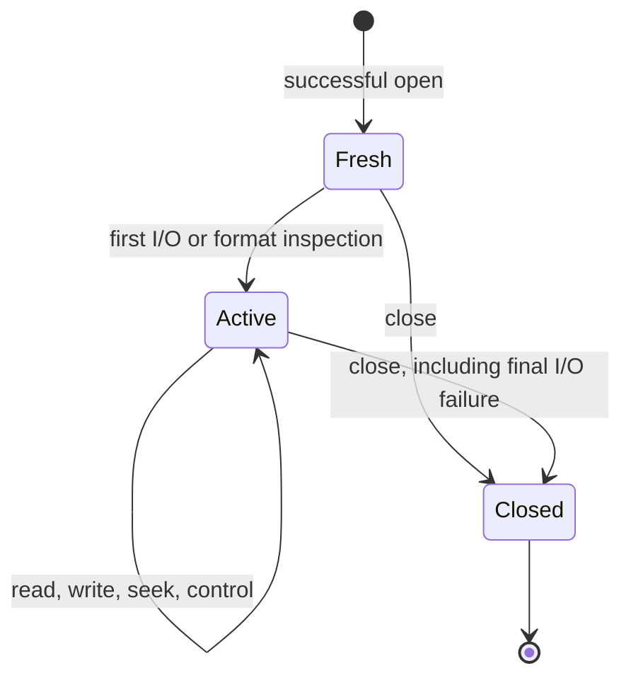

# Gzip files

[API manual](README.md) · [Contract conventions](contracts.md) · [Stream compression](deflate-stream.md) · [Stream decompression](inflate-stream.md)

Use a `gzFile` handle for buffered gzip file I/O. Open acquires a file descriptor and private
state; data operations initialize buffers and codec state as needed; close releases the
handle even if final I/O fails. Reading can also accept transparent, uncompressed input.

| Task | Entries |
| --- | --- |
| Open or configure | [Open path](#gzopen), [open descriptor](#gzdopen), [buffer size](#gzbuffer), [compression parameters](#gzsetparams) |
| Read | [Bytes](#gzread), [items](#gzfread), [character](#gzgetc), [pushback](#gzungetc), [line](#gzgets) |
| Write | [Bytes](#gzwrite), [items](#gzfwrite), [character](#gzputc), [string](#gzputs), [formatted text](#gzprintf), [flush](#gzflush) |
| Position | [Seek](#gzseek64), [rewind](#gzrewind), [uncompressed position](#gztell64), [file offset](#gzoffset64) |
| Inspect or clear status | [EOF](#gzeof), [transparent mode](#gzdirect), [error](#gzerror), [clear error](#gzclearerr) |
| Close | [Any mode](#gzclose), [reader](#gzclose_r), [writer](#gzclose_w) |

These focused contracts follow the pinned source and `zlib.h`. Source readings are
**to confirm** by implementation proof. They do not assert full API verification or narrow
the broader [registered public goals](../../checking/goals.md). See
[overview](../../overview.md) for proof status and remaining work.

## Common handle conditions

This page uses the default x86_64 Linux build. `int` and `unsigned` have
32 bits. `long`, `z_off_t`, `z_off64_t` and `z_size_t` have 64 bits.
The large-file declarations are enabled. Plain and `*64` entry points have
the same offset range here. Other configurations need separate contracts.
`gzopen_w` is a Windows-only entry and is scoped separately below.

**Restricted domain** means ordinary use with these common requirements:

- A non-NULL handle is live, returned by a successful open, and not closed.
  It is used serially and its private state is not modified by the caller.
- A reader or writer has the access mode named by the entry. NULL and
  wrong-mode refusals are documented separately. A stale or arbitrary pointer
  is outside this domain; checking a mode field does not validate a pointer.
- Buffers cover the requested readable or writable extent. They are separate
  from handle-owned memory. Strings have a readable terminating NUL.
  The caller retains ownership of these objects.
- Position arithmetic and requested extents are representable in the stated
  C types. Explicit oversized-request and multiplication-overflow refusals
  remain part of the contracts below.
- The descriptor belongs to the handle until close. No other operation changes
  its data or position during a call. OS failures and allocation failures remain
  possible; a successful open does not guarantee that later I/O succeeds.

Every entry carries a domain label. “Full scalar range” applies only to the
named scalar argument, under these pointer and lifetime requirements.
Documentary restrictions do not excuse known failure paths. In particular,
partial-read errors and pushback-created negative positions remain obligations
of the unchanged public goals.

**Effects.** Read, write, open, seek, control and close operations are stateful,
including operations without a caller output buffer. Tell, offset and EOF
queries read state; `gzerror` may also write its optional code output.
`gzdirect` can read the file and allocate, so it is stateful.



**Format and buffering.** Opening does no payload I/O. Buffers and codec state
are allocated lazily, with a default requested buffer size of 8192 bytes.
Allocation can fail at first use or later in decompression. Closing releases
owned allocations even when final I/O fails.

An ordinary reader detects gzip from a plausible four-byte header; otherwise
it returns the input unchanged. Empty input is transparent. Detection waits
when non-blocking input stalls before four bytes are available. Gzip members
are concatenated in the output. Trailing non-member data is ignored when the
attempted following member produces no output before its format error.
`G` requires gzip; `T` selects transparent output and is invalid for reading.

**Read results.** Reads advance the uncompressed position by bytes consumed,
including a final partial item. Buffered bytes can be returned before a
recorded error is reported. `gzeof` reports an attempted read beyond available
data, not simply the delivery of the final byte. `gzerror` distinguishes EOF,
corruption (`Z_DATA_ERROR`), truncation (`Z_BUF_ERROR`), allocation failure
(`Z_MEM_ERROR`) and system failure (`Z_ERRNO`). Zero-length reads do not consume
input or carry out a pending seek.

**Write results.** Success means input was accepted by the handle. It can still
be buffered. Flush or close can fail later. A hard error can return failure
after consuming a prefix; the return value alone is not always a retry offset.
A non-blocking stall can instead return the number consumed so far.

Errors normally persist until cleared. A recorded would-block condition permits
the next data I/O call to retry. Seek and rewind still refuse that recorded
`Z_ERRNO`. Constructing an error message can itself fail and replace the code
with `Z_MEM_ERROR`. `errno` is meaningful for the associated system failure,
not as a general explanation of every failed API call.

The source is [gzlib.c](../../../zlib/gzlib.c),
[gzread.c](../../../zlib/gzread.c), [gzwrite.c](../../../zlib/gzwrite.c),
[gzclose.c](../../../zlib/gzclose.c) and [zlib.h](../../../zlib/zlib.h).
The abstract contracts are in [Api/Gz.lean](../../../ZlibF/Spec/Api/Gz.lean).
Concrete goals are in [GzOpen](../../../ZlibF/Spec/Public/GzOpen.lean),
[GzRead](../../../ZlibF/Spec/Public/GzRead.lean),
[GzWrite](../../../ZlibF/Spec/Public/GzWrite.lean),
[GzControl](../../../ZlibF/Spec/Public/GzControl.lean) and
[GzClose](../../../ZlibF/Spec/Public/GzClose.lean).
The translations mirror the C names in `ZlibF/Zlib/`.

## gzopen

```c
gzFile ZEXPORT gzopen(const char *path, const char *mode);
```

Open a path for reading, writing or appending.

**Domain:** Restricted domain: strings and file environment; mode parsing includes
invalid strings. **Effect:** stateful open and ownership acquisition.

**Pre:** Non-NULL `path` and `mode` are readable NUL-terminated strings.

**Post:** A non-NULL result owns a descriptor, state and copied path. Its
uncompressed position is zero, error is clear and buffers are unallocated.
Reading remembers the initial descriptor position for rewind. Writing creates
or truncates; appending keeps existing data and adds a new member on writing.

**Errors and edges:** NULL arguments, allocation failure, invalid mode or failed
OS open return NULL. Failed opening leaves no owned allocations or descriptor.
Only OS opening failure promises its associated `errno`.

The last `r`/`w`/`a`, level digit and strategy letter win. `+` is refused;
no access letter is refused. Digits `0`–`9` select level, and `f`, `h`, `R`, `F`
select strategy. The last `G`/`T` wins: read with `T` or write with `G` is refused.
`b` and unknown letters are ignored. `e`, `x`, `N` request close-on-exec,
exclusive creation and non-blocking mode where supported; `x` has no effect
for reading. Opening does not validate the file format or allocate I/O buffers.

## gzopen64

```c
gzFile ZEXPORT gzopen64(const char *path, const char *mode);
```

Open using the large-file entry point.

**Domain:** Restricted domain, as for `gzopen`. **Effect:** stateful open.

**Pre:** The `gzopen` string and environment requirements hold.

**Post:** The `gzopen` contract applies, including ownership, lazy allocation
and initial position. Its implementation and offset range coincide here.

**Errors and edges:** The same NULL, invalid-mode, allocation and OS failures
apply. This name requires the appropriate large-file declaration on builds
where the public header gates it.

## gzdopen

```c
gzFile ZEXPORT gzdopen(int fd, const char *mode);
```

Wrap an existing descriptor without opening or duplicating it.

**Domain:** Restricted domain: descriptor use; negative-descriptor refusal included.

**Effect:** stateful ownership transfer and possible descriptor flag changes.

**Pre:** For ordinary success, `fd` is open with access matching the mode.
Non-NULL `mode` meets `gzopen`'s string requirements. Other users do not read,
write, seek or close this descriptor while the handle owns it.

**Post:** Success creates the same fresh state as `gzopen`, with an error name
of the form `<fd:N>`. Uncompressed position starts at zero even if `fd` does not.
Close will close `fd`. Pass a duplicate if the original must remain open.

**Errors and edges:** Negative `fd`, invalid/NULL mode or allocation failure
returns NULL and leaves descriptor ownership with the caller. Nonnegative
closed or wrong-access descriptors are not reliably rejected at this point;
later I/O can fail. `x` does not create exclusively or truncate an existing
descriptor. Append attempts to seek to the end. `e`/`N` attempt descriptor flag
changes; their system-call failures are not reported by this entry.

## gzopen_w

```c
gzFile ZEXPORT gzopen_w(const wchar_t *path, const char *mode);
```

Open a Windows wide-character path.

**Domain:** Restricted domain: Windows `WIDECHAR` build only, outside the default build.

**Effect:** stateful open.

**Pre:** Non-NULL `path` is a readable terminated wide string. Non-NULL `mode`
meets `gzopen`'s mode requirements. The Windows file environment is available.

**Post:** The `gzopen` lifetime, buffering and mode contract applies, using a
wide-path open. The diagnostic path is converted to the current multibyte
locale; an unrepresentable name can become an empty diagnostic name.

**Errors and edges:** NULL, invalid mode, allocation and file-opening failures
return NULL. Windows and locale details are **to confirm** separately; the
Linux translation and public goals do not establish this variant's behavior.

## gzbuffer

```c
int ZEXPORT gzbuffer(gzFile file, unsigned size);
```

Choose the requested buffer size before buffers exist.

**Domain:** Restricted domain: live handle; full unsigned `size` range.

**Effect:** stateful buffer configuration, without allocating buffers.

**Pre:** A live reader or writer meets the shared handle requirements.

**Post:** Returns 0 and records `max(size, 8)` when buffers are unallocated and
`size < 2^31`. Readers later need an input buffer and a doubled output buffer;
writers need a doubled input buffer and, for gzip, an output buffer.

**Errors and edges:** Returns -1 without changing the request for NULL,
already allocated buffers, wrong mode or `size >= 2^31`. Small sizes clamp to
eight, not two. A successful request does not promise later allocation success.
Call before `gzdirect` or pushback as well as before ordinary I/O.

## gzsetparams

```c
int ZEXPORT gzsetparams(gzFile file, int level, int strategy);
```

Request a new compression level and strategy for subsequent input.

**Domain:** Restricted domain: gzip writer; ordinary levels -1 through 9 and strategies
`Z_DEFAULT_STRATEGY` through `Z_FIXED`. **Effect:** stateful control and possible I/O.

**Pre:** A live gzip writer meets the shared requirements. A transparent
writer is refused. Existing hard errors normally prevent the call.

**Post:** An unchanged request returns `Z_OK`. A fresh writer records the
request for lazy initialization. An active writer processes pending input with
the old parameters before requesting the change. A pending seek can write zeros.

**Errors and edges:** NULL, reader, transparent writer or pending hard error
returns `Z_STREAM_ERROR`. Seek/flush failure returns the recorded error.
The source ignores `deflateParams`' return and can report `Z_OK` after recording
parameters that the compressor did not apply. This is **to confirm** against
the current pin, including valid requests; valid scalar restrictions do not
remove it. Invalid parameters are not consistently rejected here and can cause
a later initialization failure to be reported as `Z_MEM_ERROR`.

## gzread

```c
int ZEXPORT gzread(gzFile file, voidp buf, unsigned len);
```

Read up to `len` uncompressed bytes.

**Domain:** Restricted domain: reader and destination; full unsigned `len` refusal range.

**Effect:** stateful read, destination write and possible allocation.

**Pre:** For `len <= INT_MAX`, `buf` covers `len` writable bytes under the
shared separation rules. A zero extent needs no accessed bytes.

**Post:** A positive result `n <= len` gives the next `n` bytes and advances
the position by `n`, after any pending skip. Format, member concatenation,
transparent input and deferred errors follow the shared read rules.

**Errors and edges:** Returns -1 for NULL, wrong mode, an undeliverable hard
error or `len > INT_MAX`; oversized requests record `Z_STREAM_ERROR` unless
preserving a more serious error. No output at EOF/truncation returns zero.
A zero request normally returns zero, but existing error/stall state can still
cause -1. Consult `gzerror`; truncation is `Z_BUF_ERROR`, not a successful
complete gzip member. A later error does not erase delivered
bytes. Blocking descriptors may wait to fill internal reads. Non-blocking
stalls are retryable and are not EOF. Partial transparent-read recovery has a
known **to confirm** caveat below; no unconditional safety claim is made here.

## gzfread

```c
z_size_t ZEXPORT gzfread(voidp buf, z_size_t size, z_size_t nitems, gzFile file);
```

Read up to `nitems` items of `size` uncompressed bytes.

**Domain:** Restricted domain: reader/destination; full scalar sizes with overflow refusal.

**Effect:** stateful read and destination write.

**Pre:** When the product is representable, `buf` covers `size * nitems`
writable bytes and meets the shared separation rules.

**Post:** Returns the number of complete items read. All bytes read are
consumed and written, including a final partial item that is absent from the
returned count. Shared read behavior and the `gzread` recovery caveat apply.

**Errors and edges:** Zero `size` or `nitems` returns zero without consuming
input. Product overflow returns zero and records `Z_STREAM_ERROR`, preserving
a prior serious error. NULL, wrong mode, EOF and hard errors can also return
zero. A short item count requires `gzerror`/`gzeof` to distinguish causes;
there is no `INT_MAX` limit on the total request here.

## gzgetc

```c
int ZEXPORT gzgetc(gzFile file);
```

Read one uncompressed byte as an unsigned value.

**Domain:** Restricted domain: reader. **Effect:** stateful read and possible allocation.

**Pre:** The shared reader requirements hold.

**Post:** Returns a value in 0–255 and consumes one byte, advancing the
uncompressed position by one after a pending skip. It can use buffered data
without descriptor I/O. Shared format and deferred-error rules apply.

**Errors and edges:** Returns -1 for NULL, a writer, EOF or an error with no
byte available. `gzerror` distinguishes these read outcomes. A byte 255 is
not EOF. The header can supply a macro fast path that changes the same handle
state; callers must not treat the macro as a stateless query.

## gzgetc_

```c
int ZEXPORT gzgetc_(gzFile file);
```

Provide the exported wrapper for single-byte reading.

**Domain:** Restricted domain: reader, as for `gzgetc`.

**Effect:** stateful read and possible allocation.

**Pre:** The `gzgetc` handle requirements hold.

**Post:** The `gzgetc` byte, position, buffering and format contract applies.

**Errors and edges:** Returns -1 for its NULL/wrong-mode/EOF/error cases.
The wrapper has the function behavior even where the public `gzgetc` name
expands to a macro.

## gzungetc

```c
int ZEXPORT gzungetc(int c, gzFile file);
```

Push one byte onto a reader's uncompressed input.

**Domain:** Restricted domain: reader; full `int c` range, including refusal of negatives.

**Effect:** stateful pushback, possible input inspection/allocation and skip.

**Pre:** The shared reader requirements hold. Pushback is allowed immediately
after open and can therefore make the logical position negative.

**Post:** On success, stores the low eight bits of `c`, returns the original
nonnegative `c`, decreases position by one and clears past-EOF. Pushed bytes
are read in reverse push order. The physical input file is not modified.

**Errors and edges:** Returns -1 for NULL, a writer, negative `c`, lack of
pushback room or failed setup/skip. Initial inspection and a pending skip can
happen before negative `c` is refused. Full pushback records `Z_DATA_ERROR`
unless preserving a serious error. With allocated room, pushback may succeed
after a read error; it does not generally clear that error. Position -1 can
be a successful state, so tell's -1 alone is ambiguous. Seeking from this
state has a **to confirm** source caveat; it is not forbidden here.

## gzgets

```c
char * ZEXPORT gzgets(gzFile file, char *buf, int len);
```

Read a line fragment and terminate it with NUL.

**Domain:** Restricted domain: reader/destination; full `int len` refusal range.

**Effect:** stateful read and destination write.

**Pre:** For non-NULL `buf` and `len > 0`, the destination covers `len`
writable bytes under the shared separation rules.

**Post:** Returns `buf` with at most `len - 1` data bytes and a terminating
NUL. Stops after the first newline, which is included, or at the limit/EOF.
Consumed data advances the position. Embedded NUL input is copied as data.

**Errors and edges:** NULL handle/buffer, wrong mode or `len < 1` returns
NULL. For larger lengths, EOF with no bytes or an undeliverable error returns
NULL; a delivered prefix can still be returned with an error recorded.
For `len == 1`, an otherwise accepted call copies no input byte to `buf`
and returns an empty string, even at EOF. A pending skip runs first: it can
consume input, decompress, allocate, advance position or fail and return NULL.
Shared deferred-error and partial-read caveats apply.

## gzwrite

```c
int ZEXPORT gzwrite(gzFile file, voidpc buf, unsigned len);
```

Accept `len` uncompressed bytes for output.

**Domain:** Restricted domain: writer/source; full unsigned `len` refusal range.

**Effect:** stateful write, buffering and possible allocation.

**Pre:** For `len <= INT_MAX`, `buf` covers `len` readable bytes under the
shared separation rules. The selected compression parameters are valid.

**Post:** Normally returns `len` and advances position by that accepted count,
after any pending zero-fill seek. Output is gzip, or unchanged bytes for `T`.
Acceptance can leave data buffered; successful close is still required.

**Errors and edges:** Returns zero for NULL, reader, hard error, allocation
failure or system write failure. `len > INT_MAX` returns zero and records
`Z_DATA_ERROR`. A zero request does not write or execute a pending seek.
A hard failure can consume a prefix despite returning zero. A would-block
stall can return a short accepted count; retry the unaccepted suffix after
handling the stall. Shared failed-finish recovery caveats still apply.

## gzfwrite

```c
z_size_t ZEXPORT gzfwrite(voidpc buf, z_size_t size, z_size_t nitems, gzFile file);
```

Accept up to `nitems` items of `size` uncompressed bytes.

**Domain:** Restricted domain: writer/source; full scalar sizes with overflow refusal.

**Effect:** stateful write and buffering.

**Pre:** For a representable product, `buf` covers `size * nitems` readable
bytes. The shared writer and separation requirements hold.

**Post:** Returns the number of complete accepted items. Accepted bytes advance
the position; a partial item can be accepted even though the count omits it.
The output format and delayed-I/O meaning are those of `gzwrite`.

**Errors and edges:** Zero factors return zero without data I/O or pending
seek execution. Product overflow returns zero with `Z_STREAM_ERROR`.
NULL, wrong mode and hard failures also return zero. A short item count can
hide a consumed partial item, and a hard error can hide an accepted prefix;
it is not sufficient to compute a safe retry pointer. Consult `gzerror`.

## gzputc

```c
int ZEXPORT gzputc(gzFile file, int c);
```

Accept the low eight bits of `c` for output.

**Domain:** Restricted domain: writer; full `int c` range.

**Effect:** stateful write and possible allocation.

**Pre:** The shared writer requirements and valid compression parameters hold.

**Post:** Returns `c & 0xff`, accepts one byte and advances position by one,
after carrying out any pending zero-fill seek. The byte can remain buffered.

**Errors and edges:** Returns -1 for NULL, reader, pending hard error or failed
allocation/seek/write. Negative `c` is converted to a byte, not treated as EOF.
A failed call can still have changed output or position during pending work.
Check close for delayed output failure.

## gzputs

```c
int ZEXPORT gzputs(gzFile file, const char *s);
```

Accept a NUL-terminated string, excluding its terminator.

**Domain:** Restricted domain: writer and readable string.

**Effect:** stateful write and possible allocation.

**Pre:** `s` is a readable NUL-terminated string separate from owned state.
The shared writer requirements and valid compression parameters hold.

**Post:** Returns the accepted byte count, normally `strlen(s)`, with no NUL
written. Advances position by accepted bytes after any pending zero-fill seek.
An empty string returns zero without data I/O.

**Errors and edges:** Returns -1 for NULL handle, reader, hard error, a string
longer than `INT_MAX`, or a nonempty write that reports zero. Oversized strings
record `Z_STREAM_ERROR`. Non-blocking stalls may return a positive short count.
A hard failure can consume bytes before returning -1; the count is not a
universal retry offset. A NULL `s` is outside the string domain.

## gzprintf

```c
int ZEXPORTVA gzprintf(gzFile file, const char *format, ...);
```

Format arguments and accept the resulting bytes for output.

**Domain:** Restricted domain: writer and well-typed C formatting arguments.

**Effect:** stateful formatted write, allocation and formatter effects.

**Pre:** `format` is a readable terminated string. Arguments have the types
required by each conversion; referenced objects are valid. External formatting
obeys the platform `vsnprintf` semantics. Any `%n` target is writable, properly
separated and an allowed caller-visible effect. Valid compression parameters hold.

**Post:** Has the `gzvprintf` contract for the created argument list. A positive
result counts formatted bytes accepted and advances uncompressed position.
The terminating NUL is not output. Formatting is an external-library assumption,
not a theorem of zlib.

**Errors and edges:** NULL, reader or pending hard error returns
`Z_STREAM_ERROR`, not zero. Empty or oversized formatted output returns zero.
Allocation, pending seek and I/O can fail before or after formatting; see
`gzvprintf`. The default limit is below 8192 formatted bytes per call and
changes with `gzbuffer`. The non-variadic legacy build is outside this contract.

## gzvprintf

```c
int ZEXPORTVA gzvprintf(gzFile file, const char *format, va_list va);
```

Format a `va_list` and accept the result for output.

**Domain:** Restricted domain: writer, valid argument list and external formatting.

**Effect:** stateful formatted write and possible formatter memory effects.

**Pre:** The `gzprintf` format, argument and separation requirements hold.
`va` is initialized for those arguments; its use follows the platform's
`va_list` lifetime and copying rules.

**Post:** A positive result is the formatted byte count accepted without the
terminating NUL. Position advances accordingly and data can remain buffered.
The formatted length must be strictly less than the configured buffer size.
A prior pending seek can emit zeros before any formatted output is accepted.

**Errors and edges:** NULL, wrong mode or a pending hard error returns
`Z_STREAM_ERROR`. Initialization, skip or write failure returns its error code.
Empty output, formatter failure or output that does not fit returns zero;
that zero need not record an error, and earlier pending I/O may have occurred.
A non-blocking stall can return `Z_BUF_ERROR` when this formatted call must
be retried. Do not infer zero state change from a negative result. Builds
without secure bounded formatting can provide a refusal stub or a separately
scoped insecure implementation; neither is covered by this default contract.

## gzflush

```c
int ZEXPORT gzflush(gzFile file, int flush);
```

Process buffered output using the requested flush mode.

**Domain:** Restricted domain: writer; full `int flush` refusal range.

**Effect:** stateful output, possible allocation and pending zero fill.

**Pre:** The shared writer requirements and valid compression parameters hold.
Ordinary flush modes range from `Z_NO_FLUSH` through `Z_FINISH`.

**Post:** Returns `Z_OK` if the requested work succeeds. `Z_SYNC_FLUSH` makes
pending data available to a reader; `Z_FINISH` completes a gzip member.
A later successful write can start another member. `T` writes buffered bytes
without a gzip trailer. The handle remains live and must still be closed.

**Errors and edges:** NULL, reader, pending hard error or a flush value outside
0–`Z_FINISH` returns `Z_STREAM_ERROR`. Allocation, seek fill and system write
failures return the recorded code. A valid writer clears a retryable error
before validating `flush`, so invalid flush is not always a state-preserving
refusal. A failed `Z_FINISH` is not a completed member; error clearing alone
does not justify treating recovery as fresh output. See the caveat below.

## gzrewind

```c
int ZEXPORT gzrewind(gzFile file);
```

Reset a reader to its saved descriptor start.

**Domain:** Restricted domain: reader and descriptor environment.

**Effect:** stateful seek and reader reset.

**Pre:** A live reader meets the shared requirements. Its descriptor must be
seekable for success. `Z_OK` and `Z_BUF_ERROR` permit the operation.

**Post:** Returns 0, sets uncompressed position to zero, discards buffered
input/output and pending skips, clears errors/EOF, and restarts format inspection.
Existing buffers remain allocated and owned by the handle.

**Errors and edges:** Returns -1 for NULL, writer, serious recorded error or
failed system seek. A pipe cannot generally rewind. A `gzdopen` reader rewinds
to its initial descriptor offset, not necessarily physical file offset zero.
It is not interchangeable with `gzseek(file, 0, SEEK_SET)` in every mode.

## gzseek64

```c
z_off64_t ZEXPORT gzseek64(gzFile file, z_off64_t offset, int whence);
```

Request an uncompressed position relative to start or current position.

**Domain:** Restricted domain: live reader/writer; full offsets require the source
range checks, including pushback-created negative positions.

**Effect:** stateful seek, buffer discard and possible immediate descriptor I/O.

**Pre:** The shared requirements hold. Ordinary origins are `SEEK_SET` and
`SEEK_CUR`. `Z_OK` and `Z_BUF_ERROR` permit the operation.

**Post:** A nonnegative result is the requested uncompressed position. A
transparent reader can seek the descriptor immediately. Gzip readers rewind
when needed and defer remaining forward movement to later decompression.
Writers allow forward movement, supplied as zero bytes by later output,
flush or close. A successful request can therefore fail during later I/O.

**Errors and edges:** Returns -1 for NULL, invalid origin (including `SEEK_END`),
hard error, before-start target, out-of-range target, writer backseek or failed
required rewind/system seek. A seek can consume buffered bytes immediately.
Seeking past input EOF can initially succeed; the later read discovers the
actual end. Tell excludes unfulfilled skip after a read passes EOF.
The negative-position overflow check is **to confirm**; pushback before the
start is not excluded to hide that source issue. No full-range safety result
is claimed by this documentary contract.

## gzseek

```c
z_off_t ZEXPORT gzseek(gzFile file, z_off_t offset, int whence);
```

Request an uncompressed position through the ordinary offset type.

**Domain:** Restricted domain, as for `gzseek64`.

**Effect:** stateful seek and possible descriptor I/O.

**Pre:** The `gzseek64` handle, origin and environment requirements hold.

**Post:** The `gzseek64` position, deferred skip, zero-fill and buffering
contract applies. The result is converted to `z_off_t`.

**Errors and edges:** The same refusal cases and negative-position caveat
apply. A result outside `z_off_t` returns -1 on narrower builds; the default
LP64 build has the same signed 64-bit range as `gzseek64`.

## gztell64

```c
z_off64_t ZEXPORT gztell64(gzFile file);
```

Query the current logical uncompressed position.

**Domain:** Restricted domain: live reader/writer.

**Effect:** read-only handle query; no descriptor I/O.

**Pre:** The shared handle requirements hold and the reported sum is representable.

**Post:** Returns consumed/accepted position plus pending forward skip, except
that pending skip is excluded after a read has passed EOF. It does not execute
a pending seek or flush. The handle and its allocations are unchanged.

**Errors and edges:** NULL or wrong mode returns -1. Pushback before the start
can make -1 a genuine position. A previously accepted seek beyond EOF can be
reported here before a later read discovers the real end. Physical compressed
file offset is a different quantity, queried by `gzoffset64`.

## gztell

```c
z_off_t ZEXPORT gztell(gzFile file);
```

Query logical uncompressed position using `z_off_t`.

**Domain:** Restricted domain, as for `gztell64`.

**Effect:** read-only handle query.

**Pre:** The `gztell64` handle and representability requirements hold.

**Post:** Returns the `gztell64` result converted to `z_off_t`, without
executing pending work or changing the handle.

**Errors and edges:** NULL/wrong mode and position -1 have the same ambiguity
as `gztell64`. On narrower builds an unrepresentable result returns -1; this
extra narrowing does not occur in the default LP64 build.

## gzoffset64

```c
z_off64_t ZEXPORT gzoffset64(gzFile file);
```

Query the underlying physical file offset.

**Domain:** Restricted domain: live reader/writer and descriptor environment.

**Effect:** read-only handle query and system position query; `errno` may change.

**Pre:** The shared requirements hold. Successful offset arithmetic is representable.

**Post:** Returns the descriptor's current position, subtracting unused
compressed input held by a reader. Does not flush buffered writer data or
execute a pending logical seek. It does not change the descriptor position.

**Errors and edges:** Returns -1 for NULL, wrong mode or failed system query,
including a nonseekable descriptor. It differs from uncompressed position.
A transparent reader's unread output buffer is not subtracted, so the result
can be ahead of bytes already delivered. It includes any existing prefix
before a `gzdopen` handle's initial offset.

## gzoffset

```c
z_off_t ZEXPORT gzoffset(gzFile file);
```

Query physical file offset using `z_off_t`.

**Domain:** Restricted domain, as for `gzoffset64`.

**Effect:** read-only handle query and system position query.

**Pre:** The `gzoffset64` handle, environment and arithmetic requirements hold.

**Post:** Returns its physical offset converted to `z_off_t`, with the same
buffering treatment and no descriptor movement.

**Errors and edges:** The same NULL, wrong-mode and system-query failures
return -1. A result outside `z_off_t` also returns -1 on narrower builds;
the default build has no narrower offset range.

## gzeof

```c
int ZEXPORT gzeof(gzFile file);
```

Query whether a reader has tried to read beyond available data.

**Domain:** Restricted domain: live handle, with NULL refusal included.

**Effect:** read-only handle query.

**Pre:** A non-NULL handle meets the shared requirements.

**Post:** Returns the reader's past-EOF flag, or zero for a writer. Does not
read the file, allocate, flush or change state.

**Errors and edges:** NULL returns zero. Consuming the last byte need not set
the flag. A zero result does not rule out a read error or a non-blocking stall.
Use `gzerror` to distinguish those cases. Successful pushback and error clearing
clear past-EOF; a later read can set it again.

## gzdirect

```c
int ZEXPORT gzdirect(gzFile file);
```

Report whether the handle is using transparent data.

**Domain:** Restricted domain: live reader/writer.

**Effect:** stateful format inspection; may allocate, read and record errors.

**Pre:** The shared handle requirements hold. Set any desired buffer size first.

**Post:** Returns 1 exactly when the resulting mode is transparent, otherwise
zero. A fresh ordinary reader can inspect input to decide. A writer reports
whether `T` was selected. Inspection can apply a pending skip to newly
buffered transparent bytes; it does not deliver data to the caller.

**Errors and edges:** NULL returns zero. Empty ordinary input is transparent.
`G` readers report zero. Format inspection can fail allocation or I/O and
record an error; the returned mode flag does not itself report that failure.
Non-blocking input can leave detection pending. Inspect `gzerror` as needed.

## gzerror

```c
const char * ZEXPORT gzerror(gzFile file, int *errnum);
```

Read the handle's current error code and message.

**Domain:** Restricted domain: live handle and optional writable code output.

**Effect:** read-only handle query; writes `*errnum` when supplied.

**Pre:** Non-NULL `errnum` points to a writable `int` separate from owned state.
The shared handle requirements hold.

**Post:** Stores the current code when `errnum` is non-NULL. Returns a borrowed
message pointer: an empty string when no message exists, the static
`"out of memory"` for `Z_MEM_ERROR`, or the owned diagnostic string. No allocation
occurs and handle state is unchanged.

**Errors and edges:** NULL handle returns NULL without writing `errnum`.
The caller must not free or modify the returned string. An error change,
`gzclearerr` or close can invalidate an owned message; copy it before then if
needed. This query is invalid after close, including a failed final close.

## gzclearerr

```c
void ZEXPORT gzclearerr(gzFile file);
```

Clear recorded error information and rearm reader EOF detection.

**Domain:** Restricted domain: live handle, with NULL no-op included.

**Effect:** stateful error reset and possible message deallocation.

**Pre:** A non-NULL handle meets the shared requirements.

**Post:** Sets the error to `Z_OK` and removes the old diagnostic message.
For readers, clears input EOF and past-EOF. It preserves the position, pending
skip, buffered data and codec state; no file read or write occurs.

**Errors and edges:** NULL is a no-op. Clearing an error does not repair the
file or promise successful retry. It permits another attempt to read a growing
file. A borrowed message can become invalid. Failed-finish recovery and prior
partial-read recovery remain **to confirm** and are not resolved by this reset.

## gzclose

```c
int ZEXPORT gzclose(gzFile file);
```

Close a reader or finish and close a writer.

**Domain:** Restricted domain: live handle, closed exactly once.

**Effect:** stateful final I/O, deallocation and descriptor close.

**Pre:** The shared handle requirements hold. No later call will use this handle.

**Post:** Dispatches to `gzclose_r` or `gzclose_w`. A valid handle is destroyed,
its owned storage released, and its descriptor close attempted. Writer close
also attempts pending zero fill and completion of buffered output.

**Errors and edges:** NULL returns `Z_STREAM_ERROR`. The mode-specific results
below apply. An error during final I/O does not keep a valid handle live:
do not retry close or query its error afterward. A wrong-mode refusal is
distinct from a finalization failure on a valid writer, which can also report
`Z_STREAM_ERROR` after destroying the handle.

## gzclose_r

```c
int ZEXPORT gzclose_r(gzFile file);
```

Release a reader and close its descriptor without further decompression.

**Domain:** Restricted domain: reader; NULL and writer refusal included.

**Effect:** stateful deallocation and descriptor close.

**Pre:** A live reader meets the shared requirements and is closed once.

**Post:** Ends allocated inflate state, releases owned buffers/messages/path
and state, and attempts descriptor close. The handle is destroyed even if
closing the descriptor fails.

**Errors and edges:** Returns `Z_OK` normally, or `Z_BUF_ERROR` if truncation
is the recorded error at close. Failed descriptor close returns `Z_ERRNO`,
which takes precedence. Other earlier read errors are not returned: inspect
`gzerror` before closing. NULL or writer returns `Z_STREAM_ERROR` without
closing or releasing that writer. No final read is performed to validate
unconsumed input.

## gzclose_w

```c
int ZEXPORT gzclose_w(gzFile file);
```

Finish buffered output, release a writer and close its descriptor.

**Domain:** Restricted domain: writer; NULL and reader refusal included.

**Effect:** stateful output, possible allocation, deallocation and descriptor close.

**Pre:** A live writer meets the shared requirements and is closed once.

**Post:** Attempts pending zero fill and `Z_FINISH`, then releases owned
codec state, buffers/messages/path and handle, and attempts descriptor close.
This cleanup occurs even if output fails. An unused gzip writer normally
emits an empty member; an unused transparent writer emits no payload.

**Errors and edges:** Returns `Z_OK` when final work succeeds. Seek-fill or
finish failure returns its error, including `Z_MEM_ERROR`, `Z_ERRNO` or
`Z_STREAM_ERROR`; descriptor close failure takes precedence as `Z_ERRNO`.
Earlier errors are not automatically returned if final work succeeds.
NULL or reader returns `Z_STREAM_ERROR` without destroying the reader.
A valid writer is destroyed even when its result is `Z_STREAM_ERROR`.
Close success does not settle the failed-finish recovery caveat below.

## Scope and source caveats

A documented error code does not by itself establish safe retry or recovery. The affected
entries above retain source caveats for partial-read errors, negative positions after pushback,
parameter changes and failed finishing. Those cases remain **to confirm**; this manual does
not exclude them from the broader goals or confirm a new upstream bug. Current evidence and
remaining work are recorded in [overview](../../overview.md). Initial or exhausted buffered
pointers and their zero-offset arithmetic are also **to confirm** under the pointer and
initialization rules in [safety](../safety.md).

Differential tests supply evidence of translation fidelity, not proof. Private helpers,
the legacy fixed-argument `gzprintf`, and Windows error-string helpers have no additional
public entry here. Source files and concrete targets are linked above the function entries.

[Back to the API manual](README.md) · [Contract conventions](contracts.md)
