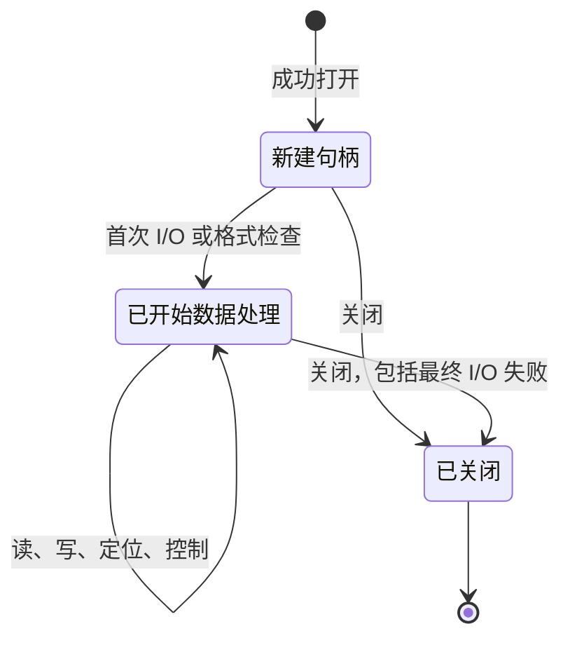

<!-- source-sha256: 1b637fe886fc092432b8441e5d46552cea8dcfaea6880e6404083fa54280fad1 -->

# Gzip 文件

[API 手册](README.md) · [契约约定](contracts.md) · [流式压缩](deflate-stream.md) · [流式解压](inflate-stream.md)

使用 `gzFile` 句柄进行带缓冲的 gzip 文件 I/O。打开时取得文件描述符和私有状态；
数据操作按需初始化缓冲区和编解码器状态；即使最终 I/O 失败，关闭也会释放句柄。
读取还可接受透明的未压缩输入：文件中的字节不经解压，直接作为结果交付。

| 任务 | 入口 |
| --- | --- |
| 打开或配置 | [打开路径](#gzopen)、[打开描述符](#gzdopen)、[缓冲区大小](#gzbuffer)、[压缩参数](#gzsetparams) |
| 读取 | [字节](#gzread)、[数据项](#gzfread)、[字符](#gzgetc)、[回退字节](#gzungetc)、[行](#gzgets) |
| 写入 | [字节](#gzwrite)、[数据项](#gzfwrite)、[字符](#gzputc)、[字符串](#gzputs)、[格式化文本](#gzprintf)、[刷新](#gzflush) |
| 位置 | [定位](#gzseek64)、[回到起点](#gzrewind)、[未压缩位置](#gztell64)、[文件偏移](#gzoffset64) |
| 查询或清除状态 | [文件末尾](#gzeof)、[透明模式](#gzdirect)、[错误](#gzerror)、[清除错误](#gzclearerr) |
| 关闭 | [任意模式](#gzclose)、[读取句柄](#gzclose_r)、[写入句柄](#gzclose_w) |

本页按固定版本源码和 `zlib.h` 组织接口契约。各条目明确列出调用范围，
对应的完整执行要求见[已登记公开目标](../../checking/goals.md)，当前证据见[进度](../../progress.md)。
超出聚焦前提只表示本契约不作保证，不自动等于 C 未定义行为（UB），也不保证一定返回错误码。

## 通用句柄条件

先分清两种位置。**逻辑位置**以未压缩字节计数；普通读写按已消费或接受的数量推进，定位还可以登记尚未执行的前移。底层文件另有**物理偏移**，它以文件中的字节计数。`gztell` 查询前者，`gzoffset` 查询后者。库会预读和缓冲，因此两个值通常不同；单次压缩率也不能用来换算它们。

例如，没有额外定位或字节回退时，读取句柄已向应用交付 1000 个解压字节，逻辑位置就是 1000；为了完成这些输出，底层可能已预读更靠后的压缩字节。相反，写入成功表示库接受了输入，不能据此推断这些字节已全部写入描述符。

后面的参数沿用这套单位：`len` 和缓冲区配置 `size` 按字节计；数据项接口中的 `size` 是每项字节数，`nitems` 是项数，总请求为 `size * nitems` 字节。`offset` 是有符号的未压缩字节位移；`whence` 指定从起点（`SEEK_SET`）还是当前位置（`SEEK_CUR`）计算。`INT_MAX` 是本构建中有符号 `int` 能表示的最大值，即 `2^31 - 1`。

本页把可直接重试的非阻塞停顿与其他已记录的“硬错误”分开描述。这个区别说明本次调用怎样返回；它不免除错误后的状态、重试和清理要求。

本页使用默认 x86_64 Linux 构建。`int` 和 `unsigned` 为 32 位。
`long`、`z_off_t`、`z_off64_t` 和 `z_size_t` 为 64 位。大文件声明已启用。
这里普通入口和 `*64` 入口的偏移范围相同。其他配置需要单独契约。
`gzopen_w` 仅适用于 Windows，下文另行限定其范围。

**受限定义域**指满足下列通用要求的普通用法：

- 非 NULL 句柄由成功打开返回、仍存活且尚未关闭。串行使用它，调用者不修改其私有状态。
- 读取或写入句柄具有入口指定的访问模式。NULL 和错误模式的拒绝情形分别说明。
  已失效或任意指针不在本定义域内；检查模式字段不等于验证指针。
- 缓冲区覆盖请求的可读或可写范围，并与句柄拥有的内存分离。
  字符串具有可读的终止 NUL。调用者保留这些对象的所有权。
- 位置运算和请求范围能由指定 C 类型表示。下述契约仍包括显式的超大请求和乘法溢出拒绝。
- 描述符在关闭前属于句柄。调用期间，没有其他操作改变其数据或位置。
  操作系统失败和分配失败仍可能发生；成功打开不保证后续 I/O 成功。

每个入口均带定义域标签。“完整标量范围”仅在上述指针和生存期要求下，
适用于所指明的标量参数。文档中的限制不免除已知失败路径的义务。
特别地，部分读取错误和字节回退形成的负位置仍属于未改变的公开目标。

**效果。** 读、写、打开、定位、控制和关闭均为有状态操作，包括没有调用者输出缓冲区的操作。
位置查询（`gztell`、`gzoffset`）和文件末尾查询（`gzeof`）读取状态；`gzerror` 还可能写入可选错误码输出。
`gzdirect` 可读取文件并分配内存，因此也是有状态操作。



**格式与缓冲。** 打开时不对载荷执行 I/O。缓冲区和编解码器状态按需分配，
默认请求的缓冲区大小为 8192 字节。请求大小是配置量，实际内部存储还包括下述双倍缓冲区和编解码器状态。首次使用或后续解压期间都可能分配失败。
即使最终 I/O 失败，关闭也释放拥有的分配。

普通读取句柄根据合理的四字节头部识别 gzip；否则原样返回输入。
空输入属于透明输入。非阻塞输入在获得四字节前停顿时，检测保持等待。
一个 gzip 成员是一段带有自身头部、压缩数据和尾部校验信息的完整流；一个文件可以顺序放置多个成员。读取输出按顺序拼接各成员的未压缩数据。若尝试解码下一个成员时，在格式错误前未产生输出，
则忽略尾随的非成员数据。`G` 要求 gzip；`T` 选择透明输出，不能用于读取。

**读取结果。** 读取按已消费字节数推进未压缩位置，包括最终的部分数据项。
已缓冲字节可能在已记录错误被报告之前返回。`gzeof` 表示曾尝试读取可用数据之后的内容，
而不只是已交付最后一个字节。`gzerror` 区分 EOF、损坏（`Z_DATA_ERROR`）、
截断（`Z_BUF_ERROR`）、分配失败（`Z_MEM_ERROR`）和系统失败（`Z_ERRNO`）。
零长度读取不消费输入，也不执行待处理定位。

**写入结果。** 成功表示句柄已接受输入；数据仍可能在缓冲区内。
后续刷新或关闭仍可能失败。硬错误可能在消费一个前缀后返回失败；
仅凭返回值不总能确定重试偏移。非阻塞停顿则可能返回至今已消费的数量。

错误通常持续到被清除。已记录的非阻塞停顿允许下次数据 I/O 重试。
定位和回到起点仍拒绝该已记录的 `Z_ERRNO`。构造错误消息本身可能失败，
并将错误码改为 `Z_MEM_ERROR`。`errno` 只对关联的系统失败有意义，
不能普遍解释每个失败的 API 调用。

源码为 [gzlib.c](../../../zlib/gzlib.c)、[gzread.c](../../../zlib/gzread.c)、
[gzwrite.c](../../../zlib/gzwrite.c)、[gzclose.c](../../../zlib/gzclose.c) 和
[zlib.h](../../../zlib/zlib.h)。抽象契约位于 [Api/Gz.lean](../../../ZlibF/Spec/Api/Gz.lean)。
具体目标位于 [GzOpen](../../../ZlibF/Spec/Public/GzOpen.lean)、
[GzRead](../../../ZlibF/Spec/Public/GzRead.lean)、[GzWrite](../../../ZlibF/Spec/Public/GzWrite.lean)、
[GzControl](../../../ZlibF/Spec/Public/GzControl.lean) 和
[GzClose](../../../ZlibF/Spec/Public/GzClose.lean)。翻译在 `ZlibF/Zlib/` 中保留 C 名称。

## gzopen

打开路径，用于读取、写入或追加。

```c
gzFile ZEXPORT gzopen(const char *path, const char *mode);
```

### 返回值与后续调用 {#api-gzopen-returns}

**返回值类型。** `gzFile` — 拥有资源的句柄或失败标记

返回值说明打开操作是否取得新的 gzip 文件句柄。

| 返回值 | 含义与出现条件 | 调用者接下来 |
| --- | --- | --- |
| `file != NULL`<br>**已取得句柄** | 模式解析、状态／路径分配和文件打开成功。位置为零，错误已清除，I/O 缓冲区尚未分配。 | 按所选模式使用句柄，并且只关闭一次。检查后续 I/O 及关闭结果。 |
| `NULL`<br>**未取得句柄** | 路径或模式为 NULL、模式无效、分配失败，或操作系统无法打开文件。 | 没有可关闭或查询的句柄。解决原因后再打开；errno 仅解释相关的操作系统打开失败。 |

**判读要点。**

- 打开不进行载荷 I/O，也不验证输入格式；缓冲区和编解码器延迟初始化。

### 调用条件与状态效果 {#api-gzopen-contract}

**定义域：** 受限定义域：字符串和文件环境；模式解析包括无效字符串。
**效果：** 有状态打开并取得所有权。

**前置条件：** 非 NULL 的 `path` 和 `mode` 是可读、以 NUL 结尾的字符串。

<details markdown="1" class="ar-return-exact" data-return-exact="gzopen"><summary>完整返回条件与边界</summary>

**后置条件：** 非 NULL 结果拥有描述符、状态和复制的路径。
未压缩位置为零，无错误，缓冲区尚未分配。
读取时保存初始描述符位置，供回到起点使用。
写入会创建或截断；追加保留现有数据，并在写入时增加一个新成员。

**错误与边缘情形：** NULL 参数、分配失败、无效模式或操作系统打开失败返回 NULL。
打开失败不遗留拥有的分配或描述符。只有系统打开失败保证关联的 `errno`。

最后一个 `r`／`w`／`a`、级别数字和策略字母生效。拒绝 `+`；没有访问字母也拒绝。
数字 `0`–`9` 选择级别，`f`、`h`、`R`、`F` 选择策略。
最后一个 `G`／`T` 生效：读取配合 `T`、写入配合 `G` 均被拒绝。
忽略 `b` 和未知字母。`e`、`x`、`N` 分别请求执行时关闭、独占创建和非阻塞模式
（在支持的平台上）；`x` 对读取无效果。打开不验证文件格式，也不分配 I/O 缓冲区。

</details>

## gzopen64

通过大文件入口打开。

```c
gzFile ZEXPORT gzopen64(const char *path, const char *mode);
```

### 返回值与后续调用 {#api-gzopen64-returns}

**返回值类型。** `gzFile` — 拥有资源的句柄或失败标记

返回值说明打开操作是否取得新的 gzip 文件句柄。

| 返回值 | 含义与出现条件 | 调用者接下来 |
| --- | --- | --- |
| `file != NULL`<br>**已取得句柄** | 模式解析、状态／路径分配和文件打开成功。位置为零，错误已清除，I/O 缓冲区尚未分配。 | 按所选模式使用句柄，并且只关闭一次。检查后续 I/O 及关闭结果。 |
| `NULL`<br>**未取得句柄** | 路径或模式为 NULL、模式无效、分配失败，或操作系统无法打开文件。 | 没有可关闭或查询的句柄。解决原因后再打开；errno 仅解释相关的操作系统打开失败。 |

**判读要点。**

- 打开不进行载荷 I/O，也不验证输入格式；缓冲区和编解码器延迟初始化。
- 在默认 LP64 构建中，gzopen64 与 gzopen 的实现和偏移范围相同；其他构建可能按条件提供其声明。

### 调用条件与状态效果 {#api-gzopen64-contract}

**定义域：** 与 `gzopen` 相同的受限定义域。**效果：** 有状态打开。

**前置条件：** 满足 `gzopen` 的字符串和环境要求。

<details markdown="1" class="ar-return-exact" data-return-exact="gzopen64"><summary>完整返回条件与边界</summary>

**后置条件：** 适用 `gzopen` 契约，包括所有权、延迟分配和初始位置。
在此构建中，其实现和偏移范围均相同。

**错误与边缘情形：** 适用相同的 NULL、无效模式、分配和系统失败情形。
若构建的公开头文件对它设置条件，此名称需要相应的大文件声明。

</details>

## gzdopen

包装已有描述符，不打开或复制它。

```c
gzFile ZEXPORT gzdopen(int fd, const char *mode);
```

### 返回值与后续调用 {#api-gzdopen-returns}

**返回值类型。** `gzFile` — 拥有资源的句柄或失败标记

返回值说明现有描述符是否已转交给新句柄。此操作不复制描述符。

| 返回值 | 含义与出现条件 | 调用者接下来 |
| --- | --- | --- |
| `file != NULL`<br>**描述符已转交** | fd 非负，句柄／诊断路径分配与模式解析成功。新的逻辑位置为零，即使描述符位置不为零。 | 让句柄独占 fd，直至关闭时关闭 fd。若原描述符须保持打开，应传入副本。 |
| `NULL`<br>**描述符仍归调用者** | fd 为负、mode 为 NULL 或无效，或分配失败。 | 没有可关闭的句柄。传入的描述符仍归调用者管理。 |

**判读要点。**

- 非负但已关闭或访问模式不符的描述符可能通过此入口，之后 I/O 才失败；非 NULL 不代表 fd 已获验证。
- 追加模式尝试定位到末尾。e／N 尝试更改标志但不报告其系统调用失败；x 不创建或截断现有描述符。

### 调用条件与状态效果 {#api-gzdopen-contract}

**定义域：** 受限定义域：描述符使用；包括负描述符的拒绝。

**效果：** 有状态所有权转移，并可能修改描述符标志。

**前置条件：** 普通成功情形中，`fd` 已打开，且访问权限与模式匹配。
非 NULL 的 `mode` 满足 `gzopen` 的字符串要求。
句柄拥有该描述符期间，其他使用者不对它读、写、定位或关闭。

<details markdown="1" class="ar-return-exact" data-return-exact="gzdopen"><summary>完整返回条件与边界</summary>

**后置条件：** 成功时创建与 `gzopen` 相同的新状态，错误名称形式为 `<fd:N>`。
即使 `fd` 本身不在零位置，未压缩位置也从零开始。关闭会关闭 `fd`。
若原描述符必须保持打开，应传入复制得到的描述符。

**错误与边缘情形：** 负 `fd`、无效／NULL 模式或分配失败返回 NULL，
描述符所有权仍归调用者。非负但已关闭或权限错误的描述符，不保证在此时被拒绝；
后续 I/O 可能失败。`x` 不会独占创建或截断已有描述符。
追加会尝试定位到末尾。`e`／`N` 尝试改变描述符标志；本入口不报告这些系统调用的失败。

</details>

## gzopen_w

打开 Windows 宽字符路径。

```c
gzFile ZEXPORT gzopen_w(const wchar_t *path, const char *mode);
```

### 返回值与后续调用 {#api-gzopen_w-returns}

**返回值类型。** `gzFile` — 拥有资源的句柄或失败标记

返回值说明打开操作是否取得新的 gzip 文件句柄。此入口仅适用于 Windows WIDECHAR 构建。

| 返回值 | 含义与出现条件 | 调用者接下来 |
| --- | --- | --- |
| `file != NULL`<br>**已取得句柄** | 模式解析、状态／路径分配和文件打开成功。位置为零，错误已清除，I/O 缓冲区尚未分配。 | 按所选模式使用句柄，并且只关闭一次。检查后续 I/O 及关闭结果。 |
| `NULL`<br>**未取得句柄** | 路径或模式为 NULL、模式无效、分配失败，或操作系统无法打开文件。 | 没有可关闭或查询的句柄。解决原因后再打开；errno 仅解释相关的操作系统打开失败。 |

**判读要点。**

- 打开不进行载荷 I/O，也不验证输入格式；缓冲区和编解码器延迟初始化。
- 诊断路径使用当前多字节区域设置；无法表示的宽字符名称可能留下空诊断名。

### 调用条件与状态效果 {#api-gzopen_w-contract}

**定义域：** 受限定义域：仅限 Windows `WIDECHAR` 构建，不属于默认构建。

**效果：** 有状态打开。

**前置条件：** 非 NULL 的 `path` 是可读且有终止符的宽字符串。
非 NULL 的 `mode` 满足 `gzopen` 的模式要求。Windows 文件环境可用。

<details markdown="1" class="ar-return-exact" data-return-exact="gzopen_w"><summary>完整返回条件与边界</summary>

**后置条件：** 适用 `gzopen` 的生存期、缓冲和模式契约，使用宽路径打开。
诊断路径转换为当前多字节区域设置；无法表示的名称可能成为空诊断名称。

**错误与边缘情形：** NULL、无效模式、分配和文件打开失败返回 NULL。
Windows 宽字符路径和区域设置需要单独的执行论证；默认 Linux 目标只覆盖相应的窄字符入口。

</details>

## gzbuffer

在缓冲区存在前选择请求大小。

```c
int ZEXPORT gzbuffer(gzFile file, unsigned size);
```

### 返回值与后续调用 {#api-gzbuffer-returns}

**返回值类型。** `int` — 零／负一控制结果

返回值报告是否记录了后续缓冲区大小请求。本次调用不分配缓冲区。

| 返回值 | 含义与出现条件 | 调用者接下来 |
| --- | --- | --- |
| `0`<br>**已记录请求** | 句柄为读取或写入句柄，缓冲区尚未分配，且 size < 2^31。记录的请求为 max(size, 8)。 | 可继续 I/O 或检查；后续缓冲区分配仍可能失败。 |
| `-1`<br>**请求未改变** | 句柄为 NULL 或模式错误、缓冲区已存在，或 size >= 2^31。 | 若因大小被拒绝，在分配前选择更小的大小。若缓冲区已存在，此调用无法调整该句柄的大小。 |

**判读要点。**

- 应在 gzdirect、字节回退和普通 I/O 前调用；这些操作都可能分配缓冲区。

### 调用条件与状态效果 {#api-gzbuffer-contract}

**定义域：** 受限定义域：活跃句柄；完整无符号 `size` 范围。

**效果：** 有状态缓冲配置，不分配缓冲区。

**前置条件：** 活跃读取或写入句柄满足通用要求。

<details markdown="1" class="ar-return-exact" data-return-exact="gzbuffer"><summary>完整返回条件与边界</summary>

**后置条件：** 缓冲区尚未分配且 `size < 2^31` 时，返回 0，记录 `max(size, 8)`。
读取句柄后续需要输入缓冲区及双倍大小的输出缓冲区；
写入句柄需要双倍大小的输入缓冲区，gzip 写入还需要输出缓冲区。

**错误与边缘情形：** NULL、缓冲区已分配、模式错误或 `size >= 2^31` 时返回 -1，
不改变请求。小大小被提升至八，而不是二。请求成功不保证后续分配成功。
不但要在普通 I/O 前调用，也应在 `gzdirect` 或字节回退前调用。

</details>

## gzsetparams

为后续输入请求新的压缩级别和策略。

```c
int ZEXPORT gzsetparams(gzFile file, int level, int strategy);
```

### 返回值与后续调用 {#api-gzsetparams-returns}

**返回值类型。** `int` — zlib 状态码

状态码报告参数请求是否已传达给句柄，包括必要的旧输入处理。Z_OK 不证明压缩器已采用所请求的参数。

| 返回值 | 含义与出现条件 | 调用者接下来 |
| --- | --- | --- |
| `Z_OK`<br>**已接受请求** | 请求未改变、新写入句柄记录请求以便延迟初始化，或活跃写入句柄在处理待办工作后到达参数更新步骤。 | 可使用有效参数继续，但须保留契约中的注意事项：源码忽略 deflateParams 的返回值，实际设置可能与记录的请求不同。 |
| `Z_STREAM_ERROR`<br>**调用被拒绝** | 句柄为 NULL、读取句柄、透明写入句柄，或有待处理硬错误。 | 使用活跃的 gzip 写入句柄。关闭前检查活跃句柄；不能假定清除错误会使请求的设置生效。 |
| `Z_MEM_ERROR / Z_ERRNO / Z_STREAM_ERROR`<br>**待办工作失败** | 待处理零填充或旧缓冲输入处理失败，并返回已记录错误码。 | 在句柄仍存活时检查 gzerror。区分非阻塞停顿与硬错误；请求尚未完成，不能盲目重放。 |

**判读要点。**

- 普通请求使用 -1 至 9 的级别及 Z_DEFAULT_STRATEGY 至 Z_FIXED 的策略。无效值在此不一定被拒绝，可能在后续初始化时以 Z_MEM_ERROR 失败。

### 调用条件与状态效果 {#api-gzsetparams-contract}

**定义域：** 受限定义域：gzip 写入句柄；普通级别 -1 至 9，策略
`Z_DEFAULT_STRATEGY` 至 `Z_FIXED`。**效果：** 有状态控制，可能执行 I/O。

**前置条件：** 活跃 gzip 写入句柄满足通用要求。拒绝透明写入句柄。
已有硬错误通常阻止调用。

<details markdown="1" class="ar-return-exact" data-return-exact="gzsetparams"><summary>完整返回条件与边界</summary>

**后置条件：** 请求未改变时返回 `Z_OK`。新写入句柄记录请求，供延迟初始化使用。
已活动的写入句柄先用旧参数处理待处理输入，再请求改变参数。
待处理定位可能写入零字节。

**错误与边缘情形：** NULL、读取句柄、透明写入句柄或待处理硬错误返回 `Z_STREAM_ERROR`。
定位／刷新失败返回已记录错误。源码忽略 `deflateParams` 的返回值，可能在记录了
压缩器未应用的参数后报告 `Z_OK`。执行论证需要对照句柄记录的参数与压缩器实际采用的参数，
包括有效请求；有效标量限制不会消除该问题。无效参数在此并非总被拒绝，还可能使后续初始化失败
被报告为 `Z_MEM_ERROR`。

</details>

## gzread

读取至多 `len` 个未压缩字节。

```c
int ZEXPORT gzread(gzFile file, voidp buf, unsigned len);
```

### 返回值与后续调用 {#api-gzread-returns}

**返回值类型。** `int` — 已读取的未压缩字节数，或失败标记

正数表示本次已交付的字节数。零可能表示零长度请求、EOF 或截断；-1 才是该接口的失败标记。

| 返回值 | 含义与出现条件 | 调用者接下来 |
| --- | --- | --- |
| `0 < n <= len`<br>**已交付 n 字节** | 读取、解压或缓冲数据提供了 n 字节；返回不足或已有错误记录时，已交付前缀仍有效。 | 处理这 n 字节；不足请求时查询 gzerror 和 gzeof，再决定是否继续读取。 |
| `0`<br>**零长度请求** | len 为零且已有状态未使调用失败；不消费输入，也不执行待处理定位。 | 按需要发起非零长度读取；不能由此判断 EOF。 |
| `0`<br>**EOF 或截断，无输出** | 非零请求没有可交付字节；正常末尾和记录为 Z_BUF_ERROR 的截断都可返回零。 | 查询 gzerror 和 gzeof；Z_BUF_ERROR 不表示完整 gzip 成员已成功结束。 |
| `-1`<br>**请求失败或暂时停顿** | NULL、模式错误、len > INT_MAX、无可交付字节的硬错误，或无输出的非阻塞停顿；已有错误状态也可使零请求失败。 | 对有效句柄查询 gzerror。仅在确认是可重试停顿并处理等待后重试；硬错误须按其原因处理。 |

**判读要点。**

- 返回值按字节计数，不是 zlib 状态码。超大请求记录 Z_STREAM_ERROR，但保留已有严重错误。

### 调用条件与状态效果 {#api-gzread-contract}

**定义域：** 受限定义域：读取句柄和目标；完整无符号 `len` 的拒绝范围。

**效果：** 有状态读取、目标写入，可能分配内存。

**前置条件：** 当 `len <= INT_MAX` 时，`buf` 按共享分离规则覆盖 `len` 个可写字节。
零范围不需要访问任何字节。

<details markdown="1" class="ar-return-exact" data-return-exact="gzread"><summary>完整返回条件与边界</summary>

**后置条件：** 正结果 `n <= len` 给出接下来的 `n` 个字节，
在处理任何待处理跳过后，将位置推进 `n`。格式、成员拼接、透明输入和延迟错误遵循共享读取规则。

**错误与边缘情形：** NULL、模式错误、无法交付数据的硬错误或 `len > INT_MAX` 时返回 -1；
超大请求记录 `Z_STREAM_ERROR`，除非需保留更严重错误。
EOF／截断且无输出时返回零。零请求通常返回零，但已有错误／停顿状态仍可能导致 -1。
应查询 `gzerror`；截断对应 `Z_BUF_ERROR`，不表示成功完成 gzip 成员。
后续错误不抹除已交付字节。阻塞描述符可能等待以填满内部读取。
非阻塞停顿可重试，不是 EOF。对部分透明读取后的恢复，需要核对失败前已读字节、
缓冲指针和下一次调用的推进量；不能仅从错误码推算重试位置。

</details>

## gzfread

读取至多 `nitems` 个数据项，每项为 `size` 个未压缩字节。

```c
z_size_t ZEXPORT gzfread(voidp buf, z_size_t size, z_size_t nitems, gzFile file);
```

### 返回值与后续调用 {#api-gzfread-returns}

**返回值类型。** `z_size_t` — 已读取的完整数据项数

返回完整 size 字节数据项的数量。末尾不足一项的字节也已写入并消费，却不计入返回值。

| 返回值 | 含义与出现条件 | 调用者接下来 |
| --- | --- | --- |
| `n = nitems > 0`<br>**完整读取请求的数据项** | size 非零，请求乘积可表示，且读到 size * nitems 字节。 | 处理这些完整数据项；这并不检测后续 EOF 或验证尚未读取的成员尾部。 |
| `0 < n < nitems`<br>**读取了部分完整数据项** | 读到 n 个完整数据项，可能还写入并消费了不足一项的尾部；EOF、停顿或错误可使读取停止。 | 查询 gzerror 和 gzeof。不要仅以 n * size 推断实际已消费字节数或安全续读位置。 |
| `0`<br>**请求总长度为零** | size 或 nitems 为零；不消费输入，也不执行待处理定位。 | 如需数据，使用非零大小和项数；零结果不说明 EOF。 |
| `0`<br>**未返回完整数据项** | 非零请求遇到 NULL、模式错误、EOF、停顿、硬错误或乘积溢出；也可能已消费不足一项的字节。溢出记录 Z_STREAM_ERROR，保留已有严重错误。 | 对有效句柄查询 gzerror 和 gzeof；先区分原因，不要把零当作未消费任何字节。 |

**判读要点。**

- 该接口的总请求没有 gzread 的 INT_MAX 限制；乘积仍须能用 z_size_t 表示。

### 调用条件与状态效果 {#api-gzfread-contract}

**定义域：** 受限定义域：读取句柄／目标；完整标量大小范围，包含溢出拒绝。

**效果：** 有状态读取和目标写入。

**前置条件：** 乘积可表示时，`buf` 覆盖 `size * nitems` 个可写字节，并满足共享分离规则。

<details markdown="1" class="ar-return-exact" data-return-exact="gzfread"><summary>完整返回条件与边界</summary>

**后置条件：** 返回读到的完整数据项数量。全部已读字节都被消费和写入，
包括未计入返回数量的最终部分数据项。适用共享读取行为及 `gzread` 的恢复注意事项。

**错误与边缘情形：** `size` 或 `nitems` 为零时返回零，不消费输入。
乘积溢出返回零并记录 `Z_STREAM_ERROR`，同时保留此前严重错误。
NULL、模式错误、EOF 和硬错误也可返回零。
数量不足时须通过 `gzerror`／`gzeof` 区分原因；此处总请求没有 `INT_MAX` 限制。

</details>

## gzgetc

将一个未压缩字节作为无符号值读取。

```c
int ZEXPORT gzgetc(gzFile file);
```

### 返回值与后续调用 {#api-gzgetc-returns}

**返回值类型。** `int` — 无符号字节值，或失败／EOF 标记

0–255 是读到的实际字节，-1 表示没有返回字节。该调用会推进读取状态。

| 返回值 | 含义与出现条件 | 调用者接下来 |
| --- | --- | --- |
| `0 <= c <= 255`<br>**读到一个字节** | 从缓冲区或后续读取获得一个字节；完成待处理跳过后，未压缩位置增加一。已有错误可推迟到缓冲字节耗尽后报告。 | 使用该字节；255 和零都是数据值。 |
| `-1`<br>**未返回字节** | NULL、写入句柄、EOF，或没有可交付字节的错误／非阻塞停顿。 | 对有效读取句柄查询 gzerror 和 gzeof；仅对确认可重试的停顿等待后重试。 |

**判读要点。**

- 头文件的宏快路径也会改变同一读取句柄，不能作为只读查询使用。

### 调用条件与状态效果 {#api-gzgetc-contract}

**定义域：** 受限定义域：读取句柄。**效果：** 有状态读取，可能分配内存。

**前置条件：** 满足共享读取句柄要求。

<details markdown="1" class="ar-return-exact" data-return-exact="gzgetc"><summary>完整返回条件与边界</summary>

**后置条件：** 返回 0–255 内的值，消费一个字节，并在待处理跳过后将未压缩位置推进一。
可直接使用缓冲数据，不进行描述符 I/O。适用共享格式和延迟错误规则。

**错误与边缘情形：** NULL、写入句柄、EOF 或没有可交付字节的错误返回 -1。
`gzerror` 区分这些读取结果。字节 255 不是 EOF。
头文件可提供修改同一句柄状态的宏快速路径；调用者不得把该宏当成无状态查询。

</details>

## gzgetc_

提供单字节读取的导出包装函数。

```c
int ZEXPORT gzgetc_(gzFile file);
```

### 返回值与后续调用 {#api-gzgetc_-returns}

**返回值类型。** `int` — 无符号字节值，或失败／EOF 标记

这是单字节读取的导出包装函数，结果与 gzgetc 函数相同。

| 返回值 | 含义与出现条件 | 调用者接下来 |
| --- | --- | --- |
| `0 <= c <= 255`<br>**读到一个字节** | 获得一个字节并消费它；完成待处理跳过后，未压缩位置增加一。缓冲字节可先于已有错误返回。 | 使用该无符号字节值；255 不是 EOF。 |
| `-1`<br>**未返回字节** | NULL、模式错误、EOF，或没有可交付字节的错误／非阻塞停顿。 | 对有效读取句柄查询 gzerror 和 gzeof，再决定结束、处理错误或等待可重试停顿。 |

### 调用条件与状态效果 {#api-gzgetc_-contract}

**定义域：** 与 `gzgetc` 相同的受限定义域：读取句柄。

**效果：** 有状态读取，可能分配内存。

**前置条件：** 满足 `gzgetc` 的句柄要求。

<details markdown="1" class="ar-return-exact" data-return-exact="gzgetc_"><summary>完整返回条件与边界</summary>

**后置条件：** 适用 `gzgetc` 的字节、位置、缓冲和格式契约。

**错误与边缘情形：** NULL／模式错误／EOF／错误情形返回 -1。
即使公开名称 `gzgetc` 展开为宏，该包装函数仍具有函数行为。

</details>

## gzungetc

将一个字节压回读取句柄的未压缩输入。

```c
int ZEXPORT gzungetc(int c, gzFile file);
```

### 返回值与后续调用 {#api-gzungetc-returns}

**返回值类型。** `int` — 原始非负参数，或失败标记

成功返回原始 c，但只压回它的低八位。未压缩位置减一，物理文件不变。

| 返回值 | 含义与出现条件 | 调用者接下来 |
| --- | --- | --- |
| `c >= 0`<br>**压回一个字节** | 缓冲区有可用空间，且待处理跳过未失败；保存 c & 0xff，返回原始 c，并清除越过 EOF 标志。有已分配空间时，即使检查或读取曾记录错误，也可能成功。 | 后续读取先返回压回的数据，顺序与压回顺序相反；已有读取错误不一定被清除。 |
| `-1`<br>**未压回字节** | NULL、写入句柄、负 c、无压回空间，或设置／跳过失败。空间已满会记录 Z_DATA_ERROR，除非保留已有严重错误。 | 对有效句柄查询 gzerror。检查或跳过可在拒绝负 c 前发生，不能假定位置和状态完全未变。 |

**判读要点。**

- 刚打开后也允许压回，逻辑位置可变为负数；因此 tell 返回 -1 也可能是真实位置。

### 调用条件与状态效果 {#api-gzungetc-contract}

**定义域：** 受限定义域：读取句柄；完整 `int c` 范围，包括负数拒绝。

**效果：** 有状态字节回退，可能检查输入、分配内存和跳过数据。

**前置条件：** 满足共享读取句柄要求。允许在打开后立即回退字节，
因此逻辑位置可能成为负数。

<details markdown="1" class="ar-return-exact" data-return-exact="gzungetc"><summary>完整返回条件与边界</summary>

**后置条件：** 成功时存储 `c` 的低八位，返回原始非负 `c`，位置减一，
并清除越过 EOF 标志。压回的字节按压回顺序的逆序读取。物理输入文件不变。

**错误与边缘情形：** NULL、写入句柄、负 `c`、无回退空间或准备／跳过失败时返回 -1。
初始检查和待处理跳过可能在拒绝负 `c` 之前发生。
回退缓冲区满时记录 `Z_DATA_ERROR`，除非需保留严重错误。
已分配空间时，字节回退可能在读取错误后成功；它通常不清除该错误。
位置 -1 可以是成功状态，因此位置查询只返回 -1 时存在歧义。
从这个负位置继续定位时，执行论证也必须覆盖偏移相加和范围拒绝，不能把该状态排除掉。

</details>

## gzgets

读取一个行片段，并以 NUL 结尾。

```c
char * ZEXPORT gzgets(gzFile file, char *buf, int len);
```

### 返回值与后续调用 {#api-gzgets-returns}

**返回值类型。** `char *` — 调用者缓冲区指针，或 NULL

返回 buf 表示已写入 NUL 终止的行片段；返回 NULL 表示没有返回片段。它返回指针，不返回字节数。

| 返回值 | 含义与出现条件 | 调用者接下来 |
| --- | --- | --- |
| `buf`<br>**返回行片段** | len > 1 且已复制至少一个数据字节，至多 len - 1 字节；遇到首个换行时包含该换行，也可因长度、EOF 或错误而停止。 | 处理片段；可能仍有同一行的后续数据。返回前缀时仍可有已记录错误，按需查询 gzerror。 |
| `buf`<br>**返回空字符串** | len == 1 且调用在状态检查和待处理跳过后被接受；只写入 NUL，不复制输入字节，即使已到 EOF 也可成功。 | 使用更大的缓冲区读取数据；此前待处理跳过仍可能已消费输入或改变位置。 |
| `NULL`<br>**请求被拒绝** | NULL 句柄、NULL buf、写入句柄或 len < 1。 | 修正句柄模式或缓冲区参数后再读取。 |
| `NULL`<br>**EOF、停顿或错误，无片段** | 有效请求遇到不可交付的错误或失败的待处理跳过；len > 1 时，无数据的 EOF 或非阻塞停顿也返回 NULL。 | 查询 gzerror 和 gzeof，区分末尾、截断、停顿和硬错误；仅在适合相应状态时继续。 |

**判读要点。**

- 输入中的 NUL 会作为数据复制；strlen(buf) 不能可靠表示本次实际消费的字节数。

### 调用条件与状态效果 {#api-gzgets-contract}

**定义域：** 受限定义域：读取句柄／目标；完整 `int len` 拒绝范围。

**效果：** 有状态读取和目标写入。

**前置条件：** `buf` 非 NULL 且 `len > 0` 时，目标按共享分离规则覆盖 `len` 个可写字节。

<details markdown="1" class="ar-return-exact" data-return-exact="gzgets"><summary>完整返回条件与边界</summary>

**后置条件：** 返回 `buf`，其中最多含 `len - 1` 个数据字节及一个终止 NUL。
在首个换行符后停止（包括该换行符），或在达到限制／EOF 时停止。
已消费数据推进位置。输入中的内嵌 NUL 也作为数据复制。

**错误与边缘情形：** NULL 句柄／缓冲区、模式错误或 `len < 1` 返回 NULL。
更大长度下，无字节的 EOF 或无法交付数据的错误返回 NULL；
已交付前缀仍可能返回，同时记录错误。
`len == 1` 时，其他条件可接受的调用不向 `buf` 复制输入字节，并返回空字符串，
即使已在 EOF。先执行待处理跳过：它可能消费输入、解压、分配、推进位置，
或失败并返回 NULL。适用共享的延迟错误和部分读取注意事项。

</details>

## gzwrite

接受 `len` 个未压缩字节用于输出。

```c
int ZEXPORT gzwrite(gzFile file, voidpc buf, unsigned len);
```

### 返回值与后续调用 {#api-gzwrite-returns}

**返回值类型。** `int` — 已接受的未压缩字节数

返回值计数本次已接受的字节，数据可能仍在缓冲区中。零可能表示空请求，也可能表示失败。

| 返回值 | 含义与出现条件 | 调用者接下来 |
| --- | --- | --- |
| `n = len > 0`<br>**已接受全部字节** | 在完成待处理零填充后，全部 len 个请求字节已缓冲或压缩；len <= INT_MAX。 | 可继续提交后续输入。检查刷新或关闭，确认是否有延迟输出失败。 |
| `0 <= n < len`<br>**接受前缀后停顿** | 非阻塞写入停顿，返回已接受字节数，可能为零。 | 用 gzerror 确认停顿，处理可写状态后，只重试 buf + n 处未接受的后缀。 |
| `0`<br>**没有请求字节** | len 为零且句柄通过写入模式／错误检查。不写数据，也不执行待处理定位。 | 无需重新提交输入。最终仍须关闭句柄。 |
| `0`<br>**请求失败或被拒绝** | 句柄为 NULL、读取句柄、有硬错误、len 超过 INT_MAX，或分配／定位／输出失败。len 过大会记录 Z_DATA_ERROR。 | 对活跃句柄，关闭前检查 gzerror。硬失败即使返回零也可能已消费前缀；不能把零作为重试偏移。 |

### 调用条件与状态效果 {#api-gzwrite-contract}

**定义域：** 受限定义域：写入句柄／源；完整无符号 `len` 拒绝范围。

**效果：** 有状态写入、缓冲，可能分配内存。

**前置条件：** `len <= INT_MAX` 时，`buf` 按共享分离规则覆盖 `len` 个可读字节。
所选压缩参数有效。

<details markdown="1" class="ar-return-exact" data-return-exact="gzwrite"><summary>完整返回条件与边界</summary>

**后置条件：** 通常返回 `len`，在处理任何待处理的零填充定位后，按接受数量推进位置。
输出为 gzip；若指定 `T`，则为原样字节。
接受数据后仍可能保留在缓冲区中；仍要求成功关闭。

**错误与边缘情形：** NULL、读取句柄、硬错误、分配失败或系统写入失败返回零。
`len > INT_MAX` 返回零并记录 `Z_DATA_ERROR`。
零请求不写入，也不执行待处理定位。硬失败即使返回零，也可能已消费一个前缀。
非阻塞停顿可返回不足的已接受数量；处理停顿后，重试尚未接受的后缀。
共享的结束失败恢复注意事项仍适用。

</details>

## gzfwrite

接受至多 `nitems` 个数据项，每项为 `size` 个未压缩字节。

```c
z_size_t ZEXPORT gzfwrite(voidpc buf, z_size_t size, z_size_t nitems, gzFile file);
```

### 返回值与后续调用 {#api-gzfwrite-returns}

**返回值类型。** `z_size_t` — 已接受的完整数据项数

返回值计数每项 size 字节的完整数据项，不是字节数。已接受的最后一个部分项的字节不计入此数。

| 返回值 | 含义与出现条件 | 调用者接下来 |
| --- | --- | --- |
| `n = nitems > 0`<br>**已接受全部数据项** | size 非零、size * nitems 可表示，且全部请求字节已接受。 | 可继续提交后续输入，并检查刷新或关闭时的延迟输出错误。 |
| `0 <= n < nitems`<br>**完整项数不足** | 非阻塞停顿使已接受字节不足。只计完整项，但还可能已消费一个部分项，即使 n 为零。 | 检查 gzerror。仅靠数据项数无法确定安全的字节重试指针；不能简单从 buf + n * size 重新发送。 |
| `0`<br>**未请求数据** | size 或 nitems 为零，且句柄通过写入模式／错误检查。不进行数据 I/O 或待处理定位。 | 无需重新提交输入；保持正常句柄生存期。 |
| `0`<br>**请求失败或被拒绝** | 句柄为 NULL、模式错误或有硬错误，乘积溢出，或分配／定位／输出失败。溢出记录 Z_STREAM_ERROR。 | 关闭前用 gzerror 检查活跃句柄。硬失败可能隐藏已接受前缀，故零不证明可安全重发整个请求。 |

### 调用条件与状态效果 {#api-gzfwrite-contract}

**定义域：** 受限定义域：写入句柄／源；完整标量大小范围，包含溢出拒绝。

**效果：** 有状态写入和缓冲。

**前置条件：** 乘积可表示时，`buf` 覆盖 `size * nitems` 个可读字节。
满足共享写入句柄和分离要求。

<details markdown="1" class="ar-return-exact" data-return-exact="gzfwrite"><summary>完整返回条件与边界</summary>

**后置条件：** 返回已接受的完整数据项数量。
已接受字节推进位置；部分数据项可能已接受，但未计入返回数量。
输出格式和延迟 I/O 的含义与 `gzwrite` 相同。

**错误与边缘情形：** 任一因子为零时返回零，不进行数据 I/O 或待处理定位。
乘积溢出返回零，并记录 `Z_STREAM_ERROR`。NULL、模式错误和硬失败也返回零。
不足的数据项数量可能隐藏已消费的部分项，硬错误也可能隐藏已接受的前缀；
因此返回数量不足以计算安全重试指针。应查询 `gzerror`。

</details>

## gzputc

接受 `c` 的低八位用于输出。

```c
int ZEXPORT gzputc(gzFile file, int c);
```

### 返回值与后续调用 {#api-gzputc-returns}

**返回值类型。** `int` — 已接受字节值或失败标记

成功返回字节值，不是数量或 zlib 状态码。任意 int 输入均转换为其低八位。

| 返回值 | 含义与出现条件 | 调用者接下来 |
| --- | --- | --- |
| `c & 0xff`<br>**已接受一个字节** | 在完成待处理零填充定位后接受一个字节；返回值为 0 至 255。 | 可继续提交后续输入；此字节可能仍在缓冲区中，应检查刷新或关闭。 |
| `-1`<br>**未确认接受字节** | 句柄为 NULL、读取句柄、有待处理硬错误，或分配、待处理定位或写入失败。 | 关闭前在活跃句柄上检查 gzerror。待办工作可能已改变输出或位置；不能推断状态未变。 |

**判读要点。**

- 负 c 转换后仍为数据，不是 EOF；成功返回字节值 0 不表示失败。

### 调用条件与状态效果 {#api-gzputc-contract}

**定义域：** 受限定义域：写入句柄；完整 `int c` 范围。

**效果：** 有状态写入，可能分配内存。

**前置条件：** 满足共享写入句柄要求，压缩参数有效。

<details markdown="1" class="ar-return-exact" data-return-exact="gzputc"><summary>完整返回条件与边界</summary>

**后置条件：** 返回 `c & 0xff`，接受一个字节，并在完成待处理零填充定位后将位置推进一。
该字节可能仍在缓冲区中。

**错误与边缘情形：** NULL、读取句柄、待处理硬错误或分配／定位／写入失败返回 -1。
负 `c` 转换为字节，不当作 EOF。失败调用仍可能在处理待处理工作时改变输出或位置。
关闭时应检查延迟输出失败。

</details>

## gzputs

接受以 NUL 结尾的字符串，不包含终止符。

```c
int ZEXPORT gzputs(gzFile file, const char *s);
```

### 返回值与后续调用 {#api-gzputs-returns}

**返回值类型。** `int` — 已接受字符串字节数或失败标记

返回值计数字符串终止符之前已接受的字节。不写入 NUL 终止符。

| 返回值 | 含义与出现条件 | 调用者接下来 |
| --- | --- | --- |
| `n = strlen(s) > 0`<br>**已接受完整字符串** | 非空字符串不超过 INT_MAX 字节，并在完成待处理零填充后接受全部字节。 | 可继续提交后续输入，并检查刷新或关闭时的延迟输出错误。 |
| `0 < n < strlen(s)`<br>**接受前缀后停顿** | 非阻塞停顿返回小于字符串长度的正数。 | 用 gzerror 确认停顿，处理可写状态后，重试 s + n 处未接受的后缀。 |
| `0`<br>**已接受空字符串** | 句柄通过写入模式／错误检查，且 s 为空。不进行数据 I/O。 | 无需重新提交字符串字节；之后仍须在刷新或关闭时检查待处理输出。 |
| `-1`<br>**写入失败或被拒绝** | 句柄为 NULL、读取句柄、有硬错误、字符串超过 INT_MAX，或非空写入报告零，包括未接受字符串字节的停顿。超大字符串记录 Z_STREAM_ERROR。 | 关闭前在活跃句柄上检查 gzerror。硬失败即使返回 -1 也可能已消费字节，故不能由此得到通用重试偏移。 |

### 调用条件与状态效果 {#api-gzputs-contract}

**定义域：** 受限定义域：写入句柄和可读字符串。

**效果：** 有状态写入，可能分配内存。

**前置条件：** `s` 是可读、以 NUL 结尾、与拥有的状态分离的字符串。
满足共享写入句柄要求，压缩参数有效。

<details markdown="1" class="ar-return-exact" data-return-exact="gzputs"><summary>完整返回条件与边界</summary>

**后置条件：** 返回已接受字节数，通常为 `strlen(s)`，不写入 NUL。
在处理待处理零填充定位后，按已接受字节数推进位置。空字符串返回零，不进行数据 I/O。

**错误与边缘情形：** NULL 句柄、读取句柄、硬错误、字符串长于 `INT_MAX`，
或非空写入报告零时返回 -1。超大字符串记录 `Z_STREAM_ERROR`。
非阻塞停顿可返回不足但为正的数量。硬失败可能在消费字节后返回 -1；
该数量不是通用重试偏移。NULL `s` 不属于字符串定义域。

</details>

## gzprintf

格式化参数，并接受所得字节用于输出。

```c
int ZEXPORTVA gzprintf(gzFile file, const char *format, ...);
```

### 返回值与后续调用 {#api-gzprintf-returns}

**返回值类型。** `int` — 格式化字节数、零或 zlib 错误码

正值计数已接受的格式化字节。零与负值含义不同，不能视为简单的成功／失败标志。

| 返回值 | 含义与出现条件 | 调用者接下来 |
| --- | --- | --- |
| `n > 0`<br>**已接受格式化字节** | 格式化结果长度严格小于所配置缓冲区大小，且已接受 n 个字节。不包括 NUL 终止符。 | 可继续提交后续输入；输出可能仍在缓冲区中。检查刷新或关闭时的后续输出错误。 |
| `0`<br>**未接受格式化字节** | 格式化输出为空、格式化器失败，或输出超出本次调用缓冲区。零不一定记录 gzerror 错误码。 | 区分空输出与格式化／大小失败。修正请求后再提交；此前待处理 I/O 或格式化器效果可能已发生。 |
| `Z_STREAM_ERROR`<br>**调用被拒绝** | 句柄为 NULL、模式错误，或有待处理硬错误。 | 使用活跃写入句柄和有效格式化参数。关闭前检查仍存活的句柄；不能推断此前错误已被清除。 |
| `Z_BUF_ERROR`<br>**需重试格式化调用** | 非阻塞停顿导致缓冲区空间不足，必须重试本次格式化调用。 | 处理停顿后重试格式化调用。须考虑此前待处理输出及格式化器效果；此结果不保证状态未变。 |
| `Z_MEM_ERROR / Z_ERRNO / Z_STREAM_ERROR`<br>**初始化或输出失败** | 缓冲区／编解码器初始化、待处理零填充，或格式化前后写入失败，并返回其错误码。 | 关闭前检查 gzerror，区分系统停顿与硬错误。负结果之前可能已改变状态，也不是安全的字节重试偏移。 |

**判读要点。**

- 默认每次调用的格式化长度须严格小于 8192 字节；gzbuffer 可更改此限制。格式参数（包括可写的 %n 目标）须满足完整契约。
- 任何负返回值都不保证位置、缓冲区、输出或格式化器可见内存保持不变。

### 调用条件与状态效果 {#api-gzprintf-contract}

**定义域：** 受限定义域：写入句柄和类型正确的 C 格式化参数。

**效果：** 有状态格式化写入、分配和格式化器效果。

**前置条件：** `format` 是可读且有终止符的字符串。
参数具有各转换要求的类型；引用对象有效。外部格式化遵循平台的 `vsnprintf` 语义。
任何 `%n` 目标均可写、正确分离，且属于允许的调用者可见效果。压缩参数有效。

<details markdown="1" class="ar-return-exact" data-return-exact="gzprintf"><summary>完整返回条件与边界</summary>

**后置条件：** 对创建的参数列表适用 `gzvprintf` 契约。
正结果表示已接受的格式化字节数，并推进未压缩位置。终止 NUL 不输出。
格式化是对外部库的假设，不是 zlib 的定理。

**错误与边缘情形：** NULL、读取句柄或待处理硬错误返回 `Z_STREAM_ERROR`，而不是零。
空或超大的格式化输出返回零。分配、待处理定位和 I/O 可在格式化前后失败；见 `gzvprintf`。
默认每次调用的格式化字节数须低于 8192，该限制随 `gzbuffer` 改变。
非可变参数的旧构建不属于此契约。

</details>

## gzvprintf

格式化 `va_list`，并接受结果用于输出。

```c
int ZEXPORTVA gzvprintf(gzFile file, const char *format, va_list va);
```

### 返回值与后续调用 {#api-gzvprintf-returns}

**返回值类型。** `int` — 格式化字节数、零或 zlib 错误码

正值计数已接受的格式化字节。零与负值含义不同，不能视为简单的成功／失败标志。

| 返回值 | 含义与出现条件 | 调用者接下来 |
| --- | --- | --- |
| `n > 0`<br>**已接受格式化字节** | 格式化结果长度严格小于所配置缓冲区大小，且已接受 n 个字节。不包括 NUL 终止符。 | 可继续提交后续输入；输出可能仍在缓冲区中。检查刷新或关闭时的后续输出错误。 |
| `0`<br>**未接受格式化字节** | 格式化输出为空、格式化器失败，或输出超出本次调用缓冲区。零不一定记录 gzerror 错误码。 | 区分空输出与格式化／大小失败。修正请求后再提交；此前待处理 I/O 或格式化器效果可能已发生。 |
| `Z_STREAM_ERROR`<br>**调用被拒绝** | 句柄为 NULL、模式错误，或有待处理硬错误。 | 使用活跃写入句柄和有效格式化参数。关闭前检查仍存活的句柄；不能推断此前错误已被清除。 |
| `Z_BUF_ERROR`<br>**需重试格式化调用** | 非阻塞停顿导致缓冲区空间不足，必须重试本次格式化调用。 | 处理停顿后重试格式化调用。须考虑此前待处理输出及格式化器效果；此结果不保证状态未变。 |
| `Z_MEM_ERROR / Z_ERRNO / Z_STREAM_ERROR`<br>**初始化或输出失败** | 缓冲区／编解码器初始化、待处理零填充，或格式化前后写入失败，并返回其错误码。 | 关闭前检查 gzerror，区分系统停顿与硬错误。负结果之前可能已改变状态，也不是安全的字节重试偏移。 |

**判读要点。**

- 默认每次调用的格式化长度须严格小于 8192 字节；gzbuffer 可更改此限制。格式参数（包括可写的 %n 目标）须满足完整契约。
- 任何负返回值都不保证位置、缓冲区、输出或格式化器可见内存保持不变。
- va_list 须按格式初始化，并依平台生存期和复制规则使用。

### 调用条件与状态效果 {#api-gzvprintf-contract}

**定义域：** 受限定义域：写入句柄、有效参数列表和外部格式化。

**效果：** 有状态格式化写入，可能产生格式化器的内存效果。

**前置条件：** 满足 `gzprintf` 的格式、参数和分离要求。
`va` 已按这些参数初始化；其使用遵循平台的 `va_list` 生存期和复制规则。

<details markdown="1" class="ar-return-exact" data-return-exact="gzvprintf"><summary>完整返回条件与边界</summary>

**后置条件：** 正结果是已接受的格式化字节数，不含终止 NUL。
相应推进位置，数据可能仍被缓冲。格式化长度须严格小于配置的缓冲区大小。
此前待处理定位可在接受任何格式化输出前先输出零字节。

**错误与边缘情形：** NULL、模式错误或待处理硬错误返回 `Z_STREAM_ERROR`。
初始化、跳过或写入失败返回相应错误码。
空输出、格式化器失败或输出放不下时返回零；该零不一定记录错误，
此前待处理 I/O 可能已发生。若本次格式化调用必须重试，非阻塞停顿可返回 `Z_BUF_ERROR`。
不得由负结果推断状态未改变。没有安全有界格式化的构建，可能提供拒绝桩函数或
另行限定范围的不安全实现；两者都不在此默认契约内。

</details>

## gzflush

按请求的刷新模式处理缓冲输出。

```c
int ZEXPORT gzflush(gzFile file, int flush);
```

### 返回值与后续调用 {#api-gzflush-returns}

**返回值类型。** `int` — zlib 状态码

状态码报告所请求刷新工作的结果，句柄仍保持打开。Z_FINISH 成功完成一个成员，不结束句柄生存期。

| 返回值 | 含义与出现条件 | 调用者接下来 |
| --- | --- | --- |
| `Z_OK`<br>**刷新工作已完成** | 请求的刷新和待处理零填充成功。Z_SYNC_FLUSH 使待处理数据可供读取；Z_FINISH 完成一个 gzip 成员。透明模式写出缓冲字节。 | 可继续使用活跃句柄；Z_FINISH 后的成功写入可开始另一成员。只关闭一次，并检查关闭结果。 |
| `Z_STREAM_ERROR`<br>**请求被拒绝** | 句柄为 NULL、读取句柄、有待处理硬错误，或 flush 不在 Z_NO_FLUSH 至 Z_FINISH 范围内。 | 在活跃写入句柄上使用有效刷新值。有效写入句柄可能先清除可重试错误，再拒绝无效刷新；不能假定拒绝保留了所有状态。 |
| `Z_MEM_ERROR / Z_ERRNO / Z_STREAM_ERROR`<br>**输出工作失败** | 缓冲区或编解码器初始化、待处理零填充，或压缩／系统输出失败，并返回其已记录错误码。 | 关闭前检查 gzerror，并区分非阻塞停顿和硬错误。失败的 Z_FINISH 未完成成员；仅清除错误不足以按全新输出恢复。 |

### 调用条件与状态效果 {#api-gzflush-contract}

**定义域：** 受限定义域：写入句柄；完整 `int flush` 拒绝范围。

**效果：** 有状态输出，可能分配内存并处理待处理零填充。

**前置条件：** 满足共享写入句柄要求，压缩参数有效。
普通刷新模式范围为 `Z_NO_FLUSH` 至 `Z_FINISH`。

<details markdown="1" class="ar-return-exact" data-return-exact="gzflush"><summary>完整返回条件与边界</summary>

**后置条件：** 请求工作成功时返回 `Z_OK`。`Z_SYNC_FLUSH` 使待处理数据可供读取；
`Z_FINISH` 完成一个 gzip 成员。后续成功写入可开始另一个成员。
`T` 写出缓冲字节，不生成 gzip 尾部。句柄仍存活，仍须关闭。

**错误与边缘情形：** NULL、读取句柄、待处理硬错误或 0–`Z_FINISH` 范围外的刷新值，
返回 `Z_STREAM_ERROR`。分配、定位填充和系统写入失败返回已记录错误码。
有效写入句柄在验证 `flush` 前会清除可重试错误，因此无效刷新不总是保持状态的拒绝。
失败的 `Z_FINISH` 不表示成员完成；仅清除错误不足以把恢复当作全新输出。
见下述注意事项。

</details>

## gzrewind

将读取句柄重置到保存的描述符起点。

```c
int ZEXPORT gzrewind(gzFile file);
```

### 返回值与后续调用 {#api-gzrewind-returns}

**返回值类型。** `int` — 回到起点的成功／失败标记

0 表示读取句柄已回到保存的起点，-1 表示失败。这里的零不是 zlib 状态码。

| 返回值 | 含义与出现条件 | 调用者接下来 |
| --- | --- | --- |
| `0`<br>**已回到保存的起点** | 有效读取句柄处于 Z_OK 或 Z_BUF_ERROR，且描述符定位成功；未压缩位置归零，清除缓冲内容、待处理跳过和错误／EOF，重新检查格式。 | 可以从头再次读取；已有缓冲区仍由句柄拥有，最终仍须关闭。 |
| `-1`<br>**未能回到起点** | NULL、写入句柄、已记录的严重错误，或系统定位失败，例如不可定位的管道。 | 检查句柄模式和已有错误；系统定位失败时检查相应 errno。不要按成功回到起点继续。 |

**判读要点。**

- gzdopen 读取句柄回到打开时的描述符偏移，未必是物理文件偏移零；它不总与 gzseek(file, 0, SEEK_SET) 等价。

### 调用条件与状态效果 {#api-gzrewind-contract}

**定义域：** 受限定义域：读取句柄和描述符环境。

**效果：** 有状态定位和读取句柄重置。

**前置条件：** 活跃读取句柄满足共享要求。成功要求描述符可定位。
`Z_OK` 和 `Z_BUF_ERROR` 允许该操作。

<details markdown="1" class="ar-return-exact" data-return-exact="gzrewind"><summary>完整返回条件与边界</summary>

**后置条件：** 返回 0，将未压缩位置设为零，丢弃已缓冲输入／输出和待处理跳过，
清除错误／EOF，并重新开始格式检查。已有缓冲区仍保持分配，归句柄拥有。

**错误与边缘情形：** NULL、写入句柄、已记录严重错误或系统定位失败返回 -1。
管道通常不能回到起点。`gzdopen` 读取句柄返回其初始描述符偏移，
不一定是物理文件偏移零。它与 `gzseek(file, 0, SEEK_SET)` 并非在所有模式下都可互换。

</details>

## gzseek64

请求相对于起点或当前位置的未压缩位置。

```c
z_off64_t ZEXPORT gzseek64(gzFile file, z_off64_t offset, int whence);
```

### 返回值与后续调用 {#api-gzseek64-returns}

**返回值类型。** `z_off64_t` — 请求的未压缩位置，或失败标记

返回请求的逻辑未压缩位置，不是物理压缩文件偏移。成功时仍可能把后续工作留给读取、写入、刷新或关闭。

| 返回值 | 含义与出现条件 | 调用者接下来 |
| --- | --- | --- |
| `position >= 0`<br>**定位请求已接受** | 目标相对 SEEK_SET 或 SEEK_CUR 有效且可表示。透明读取可立即定位；gzip 读取必要时回到起点并登记剩余前向跳过；写入只允许前移。 | 检查后续 I/O。读取可能还须解压跳过，写入间隙由后续输出、刷新或关闭补零；接受请求不保证这些工作成功。 |
| `-1`<br>**定位失败或被拒绝** | NULL、模式错误、硬错误、无效参考点（含 SEEK_END）、起点之前或范围外的目标、写入向后定位，或所需的回到起点／系统定位失败。 | 区分无效请求、保存的错误和系统定位失败；不要按定位成功继续。 |

**判读要点。**

- Z_OK 和 Z_BUF_ERROR 允许定位；已记录的可重试 Z_ERRNO 仍会阻止定位。定位可立即消费缓冲字节。
- 越过 EOF 的请求可先成功；后续读取发现末尾后，tell 排除尚未满足的跳过。

### 调用条件与状态效果 {#api-gzseek64-contract}

**定义域：** 受限定义域：活跃读取／写入句柄；完整偏移范围要求源码的范围检查，
包括字节回退形成的负位置。

**效果：** 有状态定位、缓冲区丢弃，可能立即进行描述符 I/O。

**前置条件：** 满足共享要求。普通参考点为 `SEEK_SET` 和 `SEEK_CUR`。
`Z_OK` 和 `Z_BUF_ERROR` 允许该操作。

<details markdown="1" class="ar-return-exact" data-return-exact="gzseek64"><summary>完整返回条件与边界</summary>

**后置条件：** 非负结果是请求的未压缩位置。透明读取句柄可立即定位描述符。
gzip 读取句柄在需要时回到起点，将剩余前移延迟至后续解压。
写入句柄允许前移，由后续输出、刷新或关闭补入零字节。
因此成功请求仍可能在后续 I/O 中失败。

**错误与边缘情形：** NULL、无效参考点（包括 `SEEK_END`）、硬错误、起点之前的目标、
范围外目标、写入句柄向后定位，或必需的回到起点／系统定位失败，返回 -1。
定位可立即消费已缓冲字节。定位到输入 EOF 之后可以先成功；后续读取才发现实际末尾。
读取越过文件末尾后，位置查询不计尚未满足的跳过。
负位置上的溢出检查需要同时覆盖有符号相加与拒绝顺序；
起点之前的字节回退仍在相应公开目标的范围内。

</details>

## gzseek

通过普通偏移类型请求未压缩位置。

```c
z_off_t ZEXPORT gzseek(gzFile file, z_off_t offset, int whence);
```

### 返回值与后续调用 {#api-gzseek-returns}

**返回值类型。** `z_off_t` — 请求的未压缩位置，或失败标记

非负值是请求的逻辑未压缩位置。接受定位请求不表示对应的解压、零填充或后续 I/O 已完成。

| 返回值 | 含义与出现条件 | 调用者接下来 |
| --- | --- | --- |
| `position >= 0`<br>**定位请求已接受** | SEEK_SET 或 SEEK_CUR 请求有效且可表示；读取句柄可立即定位、消费缓冲数据或登记后续跳过，写入句柄仅允许前移。 | 继续读取或写入，并检查后续结果；读取的延迟跳过依靠解压完成，写入的间隙由后续输出、刷新或关闭补零。 |
| `-1`<br>**定位失败或被拒绝** | NULL、模式错误、硬错误、无效参考点（含 SEEK_END）、起点之前或范围外的目标、写入向后定位，或所需的回到起点／系统定位失败。较窄构建还拒绝无法用 z_off_t 表示的结果。 | 按请求、保存的错误或系统定位失败分别处理；不要把 -1 用作已到达的位置。 |

**判读要点。**

- 默认 LP64 构建与 gzseek64 使用相同的有符号 64 位位置范围。Z_OK 和 Z_BUF_ERROR 允许定位，已记录的可重试 Z_ERRNO 仍会阻止定位。
- 定位到 EOF 之后可先成功。后续读取发现实际末尾后，tell 不再计入未满足的跳过。

### 调用条件与状态效果 {#api-gzseek-contract}

**定义域：** 与 `gzseek64` 相同的受限定义域。

**效果：** 有状态定位，可能进行描述符 I/O。

**前置条件：** 满足 `gzseek64` 的句柄、参考点和环境要求。

<details markdown="1" class="ar-return-exact" data-return-exact="gzseek"><summary>完整返回条件与边界</summary>

**后置条件：** 适用 `gzseek64` 的位置、延迟跳过、零填充和缓冲契约。
结果转换为 `z_off_t`。

**错误与边缘情形：** 相同的拒绝情形和负位置注意事项适用。
在较窄构建中，超出 `z_off_t` 的结果返回 -1；
默认 LP64 构建与 `gzseek64` 具有相同的有符号 64 位范围。

</details>

## gztell64

查询当前逻辑未压缩位置。

```c
z_off64_t ZEXPORT gztell64(gzFile file);
```

### 返回值与后续调用 {#api-gztell64-returns}

**返回值类型。** `z_off64_t` — 逻辑未压缩位置；-1 也可能是失败标记

返回已消费／接受的位置及有效的待处理前向跳过，不执行跳过或刷新。负数可来自起点前的压回。

| 返回值 | 含义与出现条件 | 调用者接下来 |
| --- | --- | --- |
| `position != -1`<br>**逻辑位置值** | 活跃读取／写入句柄的报告和可表示；读取越过 EOF 后，待处理但未满足的跳过被排除。 | 把它作为未压缩字节位置；若需要物理压缩文件偏移，使用 gzoffset64。 |
| `-1`<br>**可能是真实位置 -1** | 有效句柄在起点之前压回字节，当前逻辑位置为 -1。 | 结合已知句柄有效性和压回历史解释，不要只按 -1 判断失败。 |
| `-1`<br>**查询被拒绝** | 句柄为 NULL 或模式错误。 | 使用活跃读取／写入句柄；单看结果无法与有效位置 -1 区分。 |

**判读要点。**

- 已接受的越过 EOF 的定位，可在后续读取发现实际末尾前被报告。查询不进行描述符 I/O，也不改变句柄。

### 调用条件与状态效果 {#api-gztell64-contract}

**定义域：** 受限定义域：活跃读取／写入句柄。

**效果：** 只读句柄查询；不进行描述符 I/O。

**前置条件：** 满足共享句柄要求，且报告的和可表示。

<details markdown="1" class="ar-return-exact" data-return-exact="gztell64"><summary>完整返回条件与边界</summary>

**后置条件：** 返回已消费／接受的位置加上待处理前向跳过，
但读取越过 EOF 后不计待处理跳过。不执行待处理定位或刷新。
句柄及其分配不变。

**错误与边缘情形：** NULL 或模式错误返回 -1。起点前的字节回退可使 -1 成为真实位置。
此前接受的越过 EOF 的定位请求，可在后续读取发现实际末尾前由此处报告。
物理压缩文件偏移是另一种量，由 `gzoffset64` 查询。

</details>

## gztell

使用 `z_off_t` 查询逻辑未压缩位置。

```c
z_off_t ZEXPORT gztell(gzFile file);
```

### 返回值与后续调用 {#api-gztell-returns}

**返回值类型。** `z_off_t` — 逻辑未压缩位置；-1 也可能是失败标记

查询逻辑位置，不执行待处理定位或刷新。起点之前的压回可产生负位置，因此 -1 不足以单独判定失败。

| 返回值 | 含义与出现条件 | 调用者接下来 |
| --- | --- | --- |
| `position != -1`<br>**逻辑位置值** | 活跃读取／写入句柄的可表示位置：已消费／接受的位置加待处理前向跳过；读取越过 EOF 后不计未满足的跳过。压回可产生负值。 | 将其作为未压缩字节位置使用；需要物理文件偏移时调用 gzoffset。 |
| `-1`<br>**可能是真实位置 -1** | 有效句柄在起点之前压回字节，使当前逻辑位置恰好为 -1。 | 结合已知句柄有效性和压回历史解释；不要仅凭返回值将其当作失败。 |
| `-1`<br>**查询被拒绝** | NULL 或模式错误；较窄构建也可能因结果无法用 z_off_t 表示而返回 -1。默认 LP64 构建没有额外缩窄。 | 使用有效句柄和可表示的位置范围；返回值本身不能消除真实位置 -1 的歧义。 |

**判读要点。**

- 此前接受的越过 EOF 的定位，在后续读取发现实际末尾前，仍可反映在此结果中。查询不进行描述符 I/O。

### 调用条件与状态效果 {#api-gztell-contract}

**定义域：** 与 `gztell64` 相同的受限定义域。

**效果：** 只读句柄查询。

**前置条件：** 满足 `gztell64` 的句柄和可表示性要求。

<details markdown="1" class="ar-return-exact" data-return-exact="gztell"><summary>完整返回条件与边界</summary>

**后置条件：** 返回转换为 `z_off_t` 的 `gztell64` 结果，不执行待处理工作，也不改变句柄。

**错误与边缘情形：** NULL／模式错误和位置 -1 具有与 `gztell64` 相同的歧义。
在较窄构建中，无法表示的结果返回 -1；默认 LP64 构建没有这项额外缩窄。

</details>

## gzoffset64

查询底层物理文件偏移。

```c
z_off64_t ZEXPORT gzoffset64(gzFile file);
```

### 返回值与后续调用 {#api-gzoffset64-returns}

**返回值类型。** `z_off64_t` — 物理文件偏移，或失败标记

返回底层描述符的当前位置，读取时扣除未使用的压缩输入。此物理量不表示已交付的未压缩字节数。

| 返回值 | 含义与出现条件 | 调用者接下来 |
| --- | --- | --- |
| `offset != -1`<br>**物理文件偏移值** | 有效句柄的系统位置查询成功，偏移计算可表示；读取句柄减去持有的未使用压缩输入。 | 按物理偏移使用；查询不移动描述符、不刷新写入缓冲，也不执行待处理逻辑定位。 |
| `-1`<br>**无法取得物理偏移** | NULL、模式错误或系统位置查询失败，包括不可定位描述符。 | 检查句柄和描述符可定位性；系统失败时查看相应 errno，不要假定 gzerror 会记录本次查询失败。 |

**判读要点。**

- 透明读取句柄的未读输出缓冲不被扣除，因此结果可领先于已交付字节。gzdopen 起点之前已有的文件前缀仍计入偏移。

### 调用条件与状态效果 {#api-gzoffset64-contract}

**定义域：** 受限定义域：活跃读取／写入句柄及描述符环境。

**效果：** 只读句柄查询和系统位置查询；`errno` 可能改变。

**前置条件：** 满足共享要求。成功偏移计算可表示。

<details markdown="1" class="ar-return-exact" data-return-exact="gzoffset64"><summary>完整返回条件与边界</summary>

**后置条件：** 返回描述符的当前位置，读取句柄须减去持有的未使用压缩输入。
不刷新写入句柄的缓冲数据，也不执行待处理逻辑定位。不改变描述符位置。

**错误与边缘情形：** NULL、模式错误或系统查询失败（包括不可定位描述符）返回 -1。
它不同于未压缩位置。不减去透明读取句柄尚未读取的输出缓冲区，
因此结果可领先于已交付字节。包括 `gzdopen` 句柄初始偏移前已有的任何前缀。

</details>

## gzoffset

使用 `z_off_t` 查询物理文件偏移。

```c
z_off_t ZEXPORT gzoffset(gzFile file);
```

### 返回值与后续调用 {#api-gzoffset-returns}

**返回值类型。** `z_off_t` — 物理文件偏移，或失败标记

查询底层文件位置，读取时减去尚未使用的压缩输入。它不同于 tell 的逻辑未压缩位置。

| 返回值 | 含义与出现条件 | 调用者接下来 |
| --- | --- | --- |
| `offset != -1`<br>**物理文件偏移值** | 有效句柄的系统位置查询成功，偏移计算可表示；读取句柄减去持有的未使用压缩输入，再转换为 z_off_t。 | 按物理文件偏移使用；该查询不移动描述符、不刷新写入缓冲，也不执行待处理逻辑定位。 |
| `-1`<br>**无法取得物理偏移** | NULL、模式错误或系统位置查询失败，包括不可定位描述符；较窄构建还拒绝超出 z_off_t 的结果。 | 检查句柄和描述符可定位性；系统查询失败时查看相应 errno，不能依赖 gzerror 一定保存本次失败。 |

**判读要点。**

- 透明读取句柄尚未交付的输出缓冲不被减去，所以结果可领先于已交付字节；gzdopen 起点之前已有的文件前缀也包含在偏移中。
- 默认构建与 gzoffset64 的位置范围相同，没有额外缩窄。

### 调用条件与状态效果 {#api-gzoffset-contract}

**定义域：** 与 `gzoffset64` 相同的受限定义域。

**效果：** 只读句柄查询和系统位置查询。

**前置条件：** 满足 `gzoffset64` 的句柄、环境和计算要求。

<details markdown="1" class="ar-return-exact" data-return-exact="gzoffset"><summary>完整返回条件与边界</summary>

**后置条件：** 返回转换为 `z_off_t` 的物理偏移，采用相同缓冲处理，不移动描述符。

**错误与边缘情形：** 相同的 NULL、模式错误和系统查询失败返回 -1。
在较窄构建中，结果超出 `z_off_t` 也返回 -1；默认构建没有更窄的偏移范围。

</details>

## gzeof

查询读取句柄是否曾尝试读取可用数据之后的内容。

```c
int ZEXPORT gzeof(gzFile file);
```

### 返回值与后续调用 {#api-gzeof-returns}

**返回值类型。** `int` — 越过 EOF 标志

它查询是否尝试读取了可用数据之后的内容，不发起读取。读到最后一个字节并不一定设置该标志。

| 返回值 | 含义与出现条件 | 调用者接下来 |
| --- | --- | --- |
| `1`<br>**已尝试越过末尾读取** | 读取句柄的越过 EOF 标志已设置。 | 按需查询 gzerror，区分普通末尾与截断。若文件之后增长，可清除错误后再次尝试读取。 |
| `0`<br>**未设置越过末尾标志** | 读取句柄的标志未设置，或参数是写入句柄／NULL；成功压回和清除错误也会清除此标志。 | 不要据此认定仍有数据或没有错误；读取失败或停顿时另查 gzerror。 |

### 调用条件与状态效果 {#api-gzeof-contract}

**定义域：** 受限定义域：活跃句柄，包括 NULL 拒绝情形。

**效果：** 只读句柄查询。

**前置条件：** 非 NULL 句柄满足共享要求。

<details markdown="1" class="ar-return-exact" data-return-exact="gzeof"><summary>完整返回条件与边界</summary>

**后置条件：** 返回读取句柄的越过 EOF 标志，写入句柄则返回零。
不读取文件、不分配、不刷新，也不改变状态。

**错误与边缘情形：** NULL 返回零。消费最后一个字节不一定设置该标志。
零结果不排除读取错误或非阻塞停顿。使用 `gzerror` 区分这些情形。
成功字节回退和清除错误会清除此标志；后续读取可再次设置它。

</details>

## gzdirect

报告句柄是否使用透明数据。

```c
int ZEXPORT gzdirect(gzFile file);
```

### 返回值与后续调用 {#api-gzdirect-returns}

**返回值类型。** `int` — 透明模式标志，不是错误状态

返回当前透明模式标志；1 不保证格式检测已完成。新读取句柄的查询可分配内存并读取输入。

| 返回值 | 含义与出现条件 | 调用者接下来 |
| --- | --- | --- |
| `1`<br>**透明标志已设置** | 普通读取句柄检测到非 gzip 或空输入，或写入句柄使用 T 模式；普通读取句柄的初始标志在检测待定或检查失败时也可保持为 1。 | 结合后续读取与 gzerror 解释结果；不要由此认定格式已完成识别或检查期间没有错误。 |
| `0`<br>**未报告透明模式** | 当前透明标志未设置，例如 gzip 模式或 G 读取句柄；NULL 也返回零。 | 对有效句柄按需查询 gzerror；模式标志本身不报告检查的分配或 I/O 失败。 |

**判读要点。**

- 先调用 gzbuffer 设置所需大小。检查可消费待处理跳过涉及的透明缓冲字节，但不向调用者交付数据。

### 调用条件与状态效果 {#api-gzdirect-contract}

**定义域：** 受限定义域：活跃读取／写入句柄。

**效果：** 有状态格式检查；可能分配、读取并记录错误。

**前置条件：** 满足共享句柄要求。先设置任何所需的缓冲区大小。

<details markdown="1" class="ar-return-exact" data-return-exact="gzdirect"><summary>完整返回条件与边界</summary>

**后置条件：** 最终模式为透明模式时恰好返回 1，否则为零。
新的普通读取句柄可检查输入以作决定。写入句柄报告是否选择了 `T`。
检查可将待处理跳过应用于新缓冲的透明字节，但不向调用者交付数据。

**错误与边缘情形：** NULL 返回零。普通空输入是透明输入。`G` 读取句柄报告零。
格式检查可能分配或 I/O 失败并记录错误；返回的模式标志本身不报告该失败。
非阻塞输入可使检测保持待处理。按需检查 `gzerror`。

</details>

## gzerror

读取句柄的当前错误码和消息。

```c
const char * ZEXPORT gzerror(gzFile file, int *errnum);
```

### 返回值与后续调用 {#api-gzerror-returns}

**返回值类型。** `const char *` — 借用的消息指针；错误码写入可选输出参数

返回值是消息地址，当前 zlib 错误码通过非 NULL 的 errnum 写出。空消息和错误码是两个不同通道。

| 返回值 | 含义与出现条件 | 调用者接下来 |
| --- | --- | --- |
| `""`<br>**没有保存的消息文本** | 有效句柄没有消息，且当前码不是 Z_MEM_ERROR；提供 errnum 时仍写入当前错误码。 | 读取 `*errnum` 判断状态；不要仅由空字符串推断 Z_OK。 |
| `"out of memory"`<br>**静态内存不足消息** | 有效句柄保存的错误码为 Z_MEM_ERROR，提供 errnum 时写入该码。 | 按内存失败处理；不要修改或释放此静态字符串。 |
| `message`<br>**借用的诊断消息** | 有效句柄保存了非 Z_MEM_ERROR 的诊断字符串，提供 errnum 时写入相应当前码。 | 按 `*errnum` 处理原因。需要保留消息时，在错误改变、清除错误或关闭前复制；不要修改或释放原字符串。 |
| `NULL`<br>**没有可查询的句柄** | 句柄为 NULL；不写入 errnum。 | 不要解引用返回值，也不要把原有 `*errnum` 当成本次查询结果。 |

**判读要点。**

- 常见保存码：Z_OK 无错误；Z_DATA_ERROR 数据损坏；Z_BUF_ERROR 截断；Z_MEM_ERROR 分配失败；Z_ERRNO 系统失败；Z_STREAM_ERROR 请求错误。非阻塞停顿也可记录 Z_ERRNO。
- 查询不分配、不清除错误。有效句柄一旦关闭，即使关闭报告失败，也不能再查询。

### 调用条件与状态效果 {#api-gzerror-contract}

**定义域：** 受限定义域：活跃句柄和可选可写错误码输出。

**效果：** 只读句柄查询；提供 `errnum` 时写入 `*errnum`。

**前置条件：** 非 NULL `errnum` 指向与拥有的状态分离的可写 `int`。
满足共享句柄要求。

<details markdown="1" class="ar-return-exact" data-return-exact="gzerror"><summary>完整返回条件与边界</summary>

**后置条件：** `errnum` 非 NULL 时存储当前错误码。
返回借用的消息指针：无消息时为空字符串，`Z_MEM_ERROR` 时为静态
`"out of memory"`（内存不足），否则为拥有的诊断字符串。不分配，句柄状态不变。

**错误与边缘情形：** NULL 句柄返回 NULL，不写 `errnum`。
调用者不得释放或修改返回字符串。错误改变、`gzclearerr` 或关闭可使拥有的消息失效；
需要保留时须事先复制。关闭后不得作此查询，包括最终关闭失败的情形。

</details>

## gzclearerr

清除已记录错误信息，并重新启用读取句柄的 EOF 检测。

```c
void ZEXPORT gzclearerr(gzFile file);
```

### 返回值与后续调用 {#api-gzclearerr-returns}

**返回值类型。** `void` — 无返回值的状态重置

清除保存的错误消息和错误码；读取句柄还清除输入 EOF 与越过 EOF 标志。它不报告成功码，也不重建编解码器。

| 返回值 | 含义与出现条件 | 调用者接下来 |
| --- | --- | --- |
| `void`<br>**清除错误，或 NULL 空操作** | 有效句柄设为 Z_OK 并移除旧消息；位置、待处理跳过、缓冲数据和编解码器状态保留。NULL 不做任何事。 | 旧的借用消息可能失效。仅在输入和保留状态允许时再次读取或继续处理；清除错误本身不修复文件或保证重试成功。 |

### 调用条件与状态效果 {#api-gzclearerr-contract}

**定义域：** 受限定义域：活跃句柄，包括 NULL 空操作情形。

**效果：** 有状态错误重置，可能释放消息内存。

**前置条件：** 非 NULL 句柄满足共享要求。

<details markdown="1" class="ar-return-exact" data-return-exact="gzclearerr"><summary>完整返回条件与边界</summary>

**后置条件：** 将错误设为 `Z_OK`，移除旧诊断消息。
对读取句柄，清除输入 EOF 和越过 EOF 标志。
保留位置、待处理跳过、缓冲数据和编解码器状态；不进行文件读写。

**错误与边缘情形：** NULL 是空操作。清除错误不会修复文件，也不保证重试成功。
它允许再次尝试读取增长中的文件。借用的消息可能失效。
结束失败和部分读取后的恢复，还需要依据保留的编解码器状态及缓冲指针继续处理；
清除错误本身不重建这些状态。

</details>

## gzclose

关闭读取句柄，或完成输出后关闭写入句柄。

```c
int ZEXPORT gzclose(gzFile file);
```

### 返回值与后续调用 {#api-gzclose-returns}

**返回值类型。** `int` — zlib 关闭状态码

状态码来自按句柄模式选择的读取或写入关闭。即使最终 I/O 报告失败，有效句柄也会销毁。

| 返回值 | 含义与出现条件 | 调用者接下来 |
| --- | --- | --- |
| `Z_OK`<br>**句柄已释放** | 读取句柄关闭成功且无已记录截断，或写入句柄最终工作与描述符关闭成功。此结果不重报此前所有错误。 | 句柄已销毁。不得查询、复用或重试关闭。 |
| `Z_BUF_ERROR`<br>**截断后读取句柄已释放** | 所选读取句柄关闭发现已记录截断，且描述符关闭成功。 | 句柄已销毁。不得查询、复用或重试关闭。输入已被记录为不完整。 |
| `Z_MEM_ERROR`<br>**写入句柄最终分配失败** | 写入句柄零填充／结束工作返回内存错误，且描述符关闭未覆盖此结果。 | 句柄已销毁。不得查询、复用或重试关闭。未确认最终输出完整。 |
| `Z_ERRNO`<br>**最终系统操作失败** | 写入句柄最终输出报告系统错误，或读取／写入句柄描述符关闭失败。关闭失败优先。 | 句柄已销毁。不得查询、复用或重试关闭。处理系统失败时不得再使用旧句柄。 |
| `Z_STREAM_ERROR`<br>**结束失败后写入句柄已销毁** | 选择了有效写入句柄，最终工作报告 Z_STREAM_ERROR；描述符关闭成功。 | 句柄已销毁。不得查询、复用或重试关闭。不能把此结果误作写入句柄仍存活的拒绝。 |
| `Z_STREAM_ERROR`<br>**未提供句柄** | 参数为 NULL。 | 此调用未取得句柄，无需清理或重试关闭。 |

**判读要点。**

- 读取诊断须在关闭前检查。有效句柄一经关闭，即使关闭返回错误，也不能再调用 gzerror。

### 调用条件与状态效果 {#api-gzclose-contract}

**定义域：** 受限定义域：活跃句柄，恰好关闭一次。

**效果：** 有状态最终 I/O、释放内存并关闭描述符。

**前置条件：** 满足共享句柄要求。后续不再使用此句柄。

<details markdown="1" class="ar-return-exact" data-return-exact="gzclose"><summary>完整返回条件与边界</summary>

**后置条件：** 分派至 `gzclose_r` 或 `gzclose_w`。
有效句柄被销毁，拥有的存储被释放，并尝试关闭描述符。
写入句柄关闭还会尝试待处理零填充和完成缓冲输出。

**错误与边缘情形：** NULL 返回 `Z_STREAM_ERROR`。适用下述按模式区分的结果。
最终 I/O 错误不会让有效句柄保持存活：不得重试关闭，也不得随后查询其错误。
模式错误的拒绝与有效写入句柄的最终处理失败不同；后者也可能在销毁句柄后报告
`Z_STREAM_ERROR`。

</details>

## gzclose_r

释放读取句柄并关闭其描述符，不继续解压。

```c
int ZEXPORT gzclose_r(gzFile file);
```

### 返回值与后续调用 {#api-gzclose_r-returns}

**返回值类型。** `int` — zlib 关闭状态码

状态码报告读取句柄清理与描述符关闭；此前已记录的截断有单独结果。每次接受的读取句柄关闭都会销毁句柄。

| 返回值 | 含义与出现条件 | 调用者接下来 |
| --- | --- | --- |
| `Z_OK`<br>**读取句柄已释放** | 描述符关闭成功，且已记录错误不是 Z_BUF_ERROR。不返回此前其他读取错误。 | 句柄已销毁。不得查询、复用或重试关闭。此结果不验证未读输入。 |
| `Z_BUF_ERROR`<br>**截断后已释放** | 关闭读取句柄时已记录 Z_BUF_ERROR，且描述符关闭成功。 | 句柄已销毁。不得查询、复用或重试关闭。应将已记录的 gzip 截断视为输入不完整，不能视为可重试的活跃读取句柄状态。 |
| `Z_ERRNO`<br>**描述符关闭失败** | 操作系统描述符关闭失败；其优先级高于已记录的截断。 | 句柄已销毁。不得查询、复用或重试关闭。处理相关系统失败时，不得再对旧句柄调用 gzip API。 |
| `Z_STREAM_ERROR`<br>**未关闭读取句柄** | 参数为 NULL 或活跃写入句柄。不释放写入句柄的资源。 | NULL 没有可关闭的句柄。活跃写入句柄仍由调用者拥有，应改用 gzclose_w 或 gzclose 关闭。 |

**判读要点。**

- 若需要此前读取诊断，应在关闭前检查 gzerror。关闭不进行最终读取或解压来检查未消费输入。

### 调用条件与状态效果 {#api-gzclose_r-contract}

**定义域：** 受限定义域：读取句柄；包括 NULL 和写入句柄的拒绝。

**效果：** 有状态释放内存并关闭描述符。

**前置条件：** 活跃读取句柄满足共享要求，且只关闭一次。

<details markdown="1" class="ar-return-exact" data-return-exact="gzclose_r"><summary>完整返回条件与边界</summary>

**后置条件：** 结束已分配的 inflate 状态，释放拥有的缓冲区／消息／路径和状态，
并尝试关闭描述符。即使关闭描述符失败，句柄也已销毁。

**错误与边缘情形：** 通常返回 `Z_OK`；若关闭时记录的错误为截断，返回 `Z_BUF_ERROR`。
描述符关闭失败返回 `Z_ERRNO`，优先级更高。不返回此前其他读取错误：
应在关闭前查询 `gzerror`。NULL 或写入句柄返回 `Z_STREAM_ERROR`，
不关闭或释放该写入句柄。不进行最终读取来验证未消费输入。

</details>

## gzclose_w

完成缓冲输出、释放写入句柄并关闭描述符。

```c
int ZEXPORT gzclose_w(gzFile file);
```

### 返回值与后续调用 {#api-gzclose_w-returns}

**返回值类型。** `int` — zlib 关闭状态码

状态码报告最终零填充／结束工作及描述符关闭。一旦接受活跃写入句柄，即使最终输出失败，清理也会销毁它。

| 返回值 | 含义与出现条件 | 调用者接下来 |
| --- | --- | --- |
| `Z_OK`<br>**写入句柄已结束并释放** | 待处理零填充、最终输出及描述符关闭成功。最终工作成功时，不会自动返回此前错误。 | 句柄已销毁。不得查询、复用或重试关闭。 |
| `Z_MEM_ERROR`<br>**最终工作分配失败** | 最终零填充或结束工作报告 Z_MEM_ERROR，包括缓冲区／编解码器初始化或诊断消息分配失败，且描述符关闭未覆盖此结果。 | 句柄已销毁。不得查询、复用或重试关闭。未确认最终输出完整。 |
| `Z_ERRNO`<br>**最终系统操作失败** | 最终写入以 Z_ERRNO 失败，或描述符关闭失败。描述符关闭失败优先于此前任何最终处理结果。 | 句柄已销毁。不得查询、复用或重试关闭。应在外部处理系统失败；此码不表示存在可复用的 gzip 句柄。 |
| `Z_STREAM_ERROR`<br>**结束失败后写入句柄已释放** | 有效写入句柄进入最终压缩工作，且该工作报告 Z_STREAM_ERROR；描述符关闭成功。 | 句柄已销毁。不得查询、复用或重试关闭。这与清理前拒绝读取句柄不同。 |
| `Z_STREAM_ERROR`<br>**未关闭写入句柄** | 参数为 NULL 或活跃读取句柄。读取句柄未被销毁。 | NULL 无需清理。活跃读取句柄仍须通过 gzclose_r 或 gzclose 关闭一次。 |

**判读要点。**

- 未使用的 gzip 写入句柄通常输出空成员；未使用的透明写入句柄不输出载荷。关闭成功不解决契约中此前结束失败恢复的注意事项。

### 调用条件与状态效果 {#api-gzclose_w-contract}

**定义域：** 受限定义域：写入句柄；包括 NULL 和读取句柄的拒绝。

**效果：** 有状态输出，可能分配内存，随后释放内存并关闭描述符。

**前置条件：** 活跃写入句柄满足共享要求，且只关闭一次。

<details markdown="1" class="ar-return-exact" data-return-exact="gzclose_w"><summary>完整返回条件与边界</summary>

**后置条件：** 尝试待处理零填充和 `Z_FINISH`，随后释放拥有的编解码器状态、
缓冲区／消息／路径和句柄，并尝试关闭描述符。即使输出失败，也会执行清理。
未使用的 gzip 写入句柄通常输出一个空成员；未使用的透明写入句柄不输出载荷。

**错误与边缘情形：** 最终工作成功时返回 `Z_OK`。
定位填充或结束失败返回相应错误，包括 `Z_MEM_ERROR`、`Z_ERRNO` 或 `Z_STREAM_ERROR`；
描述符关闭失败以 `Z_ERRNO` 优先返回。
如果最终工作成功，不会自动返回此前错误。NULL 或读取句柄返回 `Z_STREAM_ERROR`，
不销毁读取句柄。有效写入句柄即使结果为 `Z_STREAM_ERROR` 也已销毁。
关闭成功不解决下面的结束失败恢复注意事项。

</details>

## 范围与源码注意事项

执行论证需要沿错误后的实际状态继续：部分读取已经更新了哪些字节计数，
负位置怎样参与定位运算，参数是否被压缩器采用，以及结束失败后保留了什么输出。
这些要求仍属于对应的完整公开目标；当前证据和剩余工作记录在[进度](../../progress.md)。
对初始或已耗尽的缓冲指针，还需按[安全](../safety.md)中的对象边界与初始化规则，
逐处处理零偏移运算。

私有辅助函数、旧式固定参数的 `gzprintf`，
以及 Windows 错误字符串辅助函数，不在此增加公开入口。
源文件与具体目标的链接位于函数条目之前。

[返回 API 手册](README.md) · [契约约定](contracts.md)
