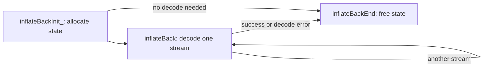

# Callback decompression

[API manual](README.md) · [Shared stream rules](streams.md) · [Stream decompression](inflate-stream.md)

The callback interface lets a caller supply input chunks and receive decoded output directly
from its window. Start with [inflateBackInit_](#inflatebackinit_), decode with
[inflateBack](#inflateback), and release state with [inflateBackEnd](#inflatebackend).
The caller's window remains caller-owned throughout.

These focused contracts follow the pinned [infback.c](../../../zlib/infback.c) and
[zlib.h](../../../zlib/zlib.h) in the default LP64 Linux build. Source readings are **to confirm**
by proof. Their restricted domains do not narrow the broader targets in
[Back.lean](../../../ZlibF/Spec/Public/Back.lean) or
[Sequences.lean](../../../ZlibF/Spec/Public/Sequences.lean). See
[contract conventions](contracts.md) for domain/effect labels and
[progress](../../progress.md) for proof status and remaining work.

`inflateBack` decodes raw DEFLATE. The caller handles any zlib/gzip header, trailer and checksum.
The caller owns a writable window of at least `2^windowBits` bytes. It is also the output buffer.
Use 15 bits and 32768 bytes for general streams; smaller windows can reject valid long distances.



The callbacks have these types:

```c
typedef unsigned (*in_func)(void FAR *, z_const unsigned char FAR * FAR *);
typedef int (*out_func)(void FAR *, unsigned char FAR *, unsigned);
```

`in(in_desc, &buf)` returns a byte count and sets `buf`; zero means no input and ignores `buf`.
`out(out_desc, buf, len)` receives up to one window of bytes; zero means success.
Descriptors may be NULL if the callback supports that value.

## inflateBackInit_

```c
int ZEXPORT inflateBackInit_(z_streamp strm, int windowBits, unsigned char FAR *window,
                             const char *version, int stream_size);
```

**Purpose.** Allocate decoder state and attach the caller's window.
The `inflateBackInit` macro supplies `version` and `stream_size`.

### Return values and next calls {#api-inflatebackinit_-returns}

**Return type.** `int` — zlib status code

The result says whether callback decoder state was created and attached to the caller’s window.

| Returned value | Meaning and conditions | Caller’s next step |
| --- | --- | --- |
| `Z_OK`<br>**Callback decoder created** | The version and stream size match, 8 <= windowBits <= 15, the window is non-NULL, and state allocation succeeded. | Keep the window alive and decode with inflateBack; eventually call inflateBackEnd. |
| `Z_VERSION_ERROR`<br>**Version or structure size mismatch** | version is NULL, its major-version byte differs, or stream_size is wrong; this returns before stream access. | Correct the version and structure size before initializing again; this failure needs no end call. |
| `Z_STREAM_ERROR`<br>**Stream, window or bit count refused** | strm or window is NULL, or windowBits is outside 8..15. | Provide a valid inactive stream, window and bit count before initializing again; this failure needs no end call. |
| `Z_MEM_ERROR`<br>**State allocation failed** | State allocation failed; msg and default allocator fields may change, while the old state field is retained. | Initialization may be tried again when resources are available; no new allocation was retained and this failure needs no inflateBackEnd. |

**Reading the result.**

- The window remains caller-owned; this function creates callback API state, not state for ordinary inflate.

### Calling conditions and effects {#api-inflatebackinit_-contract}

**Domain.** Restricted domain: valid caller memory, an inactive stream and default allocation.

**Pre.** A non-NULL `strm` points to a writable `z_stream` with initialized `zalloc`, `zfree`
and `opaque`. Use NULL or the default allocator/free pair; do not overwrite live library state.
A non-NULL `version` has a readable first byte. On the initialization path, `window` provides
`2^windowBits` writable bytes separate from the stream. Keep that slice alive until end.

**Effects.** May initialize allocator fields and `opaque`, clear `msg` and allocate one state.
The window remains caller-owned and is not allocated, cleared or freed here.

<details markdown="1" class="ar-return-exact" data-return-exact="inflateBackInit_"><summary>Complete return conditions and boundaries</summary>

**Post.** `Z_OK` attaches fresh state for `inflateBack` with `8 <= windowBits <= 15`.
Input/output pointers, availability counters, totals, `adler` and `data_type` are unchanged.
Only selected state fields are initialized; use this state with the callback API.

**Errors.** A NULL version, different major-version byte or wrong stream size gives
`Z_VERSION_ERROR` before stream access. NULL `strm`/`window`, or bits outside 8..15, gives
`Z_STREAM_ERROR`. Allocation failure gives `Z_MEM_ERROR`: `msg` and allocator defaults may
have changed, but the old `state` field is retained. No state was allocated, so no end call
is needed after failed init in this inactive-stream domain.

</details>

## inflateBack

```c
int ZEXPORT inflateBack(z_streamp strm, in_func in, void FAR *in_desc,
                        out_func out, void FAR *out_desc);
```

**Purpose.** Decode one complete raw stream through the input and output callbacks.

### Return values and next calls {#api-inflateback-returns}

**Return type.** `int` — zlib status code

The result covers callback decoding of one complete raw stream. This function never returns Z_OK, and every call starts a fresh stream.

| Returned value | Meaning and conditions | Caller’s next step |
| --- | --- | --- |
| `Z_STREAM_END`<br>**Raw stream and output complete** | A complete raw DEFLATE stream was decoded and every output callback returned zero. | Preserve the unread suffix in next_in/avail_in; decode another independent stream or call inflateBackEnd. |
| `Z_BUF_ERROR`<br>**Input callback had no more data** | next_in is NULL on return; the input callback returned zero and input was exhausted. | The current decode is incomplete; end it, or prepare complete input and start a fresh decode from the beginning rather than resuming a pause. |
| `Z_BUF_ERROR`<br>**Output callback failed** | next_in is non-NULL on return; an output callback returned nonzero. A final output failure changes an otherwise Z_STREAM_END result to this value. | Handle the caller’s output failure; end the decoder or start an independent decode from the beginning, without ordinary inflate-style continuation. |
| `Z_DATA_ERROR`<br>**Malformed DEFLATE** | Malformed raw DEFLATE was found and msg set; output may already have been delivered, and a final output failure does not replace this error. | Call inflateBackEnd, or prepare input again for a new stream on the next inflateBack call. |
| `Z_STREAM_ERROR`<br>**Stream or state missing** | strm or state is NULL; no callbacks are invoked. | First create a valid callback decoder with inflateBackInit_; ordinary inflate state cannot be used with this interface. |

**Reading the result.**

- For Z_BUF_ERROR, distinguish input exhaustion from output failure by whether next_in is NULL; this is not ordinary inflate’s buffer-retry protocol.
- The input callback returns a byte count, with zero meaning no input; the output callback returns zero for success. Output can be delivered before errors and on the final error path.

### Calling conditions and effects {#api-inflateback-contract}

**Domain.** Restricted domain: a live callback decoder, valid separated slices and a finite,
returning callback protocol. Arbitrary malformed input bytes are included.

**Pre.** Init succeeded and end has not run. Keep the stream, state and window live.
Initialize `next_in`; NULL requests callback input immediately and ignores `avail_in`.
Otherwise initialize `avail_in` and provide that many readable bytes at `next_in`.
Initial and callback-provided input slices do not overlap the window, stream or private state.
Neither callback is NULL. Every callback returns safely and the total input supplied is bounded.

Callbacks may read only the input/output bytes supplied to them and their own valid objects.
They may update, allocate or free their own memory, but preserve the stream, private state and
window slice. An input chunk remains readable and unchanged until the next input callback or
return, including across output callbacks. Output callbacks read at most `len` window bytes.
Callback storage and the window may share an allocation when their used byte slices do not overlap.
No concurrent or re-entrant access to this stream is allowed.

**Effects.** Reset decoding for a new stream, consume input, write the window and invoke callbacks.
Full windows and a final nonempty partial window are delivered to `out`, including on error.
Callbacks may therefore observe output before a later format or input failure.
The library allocates and frees nothing; callback allocations remain the caller's responsibility.

<details markdown="1" class="ar-return-exact" data-return-exact="inflateBack"><summary>Complete return conditions and boundaries</summary>

**Post.** `Z_STREAM_END` means the complete raw stream was decoded and every output call succeeded.
The concatenated chunks are its uncompressed bytes, with no preset dictionary.
`next_in`/`avail_in` identify the unread suffix of the initial or last callback chunk.
After input exhaustion they are NULL/zero; otherwise the pointer advances by the consumed bytes.
Totals, `adler` and `data_type` are unchanged; `next_out`/`avail_out` are not the output interface.
The stream retains its state and window for another independent decode or end.

**Errors.** `Z_BUF_ERROR` means input exhaustion or a nonzero output result; it never returns `Z_OK`.
For `Z_BUF_ERROR`, NULL `next_in` identifies input exhaustion; non-NULL identifies output failure.
`Z_DATA_ERROR` means malformed DEFLATE and sets `msg`. A final output failure changes
`Z_STREAM_END` to `Z_BUF_ERROR`; it does not replace another error already selected.
NULL `strm` or NULL state gives `Z_STREAM_ERROR` without callbacks. Other invalid states are
outside this domain: a state from ordinary `inflateInit_` is not a callback decoder.
After a decode error, end still releases the state; another call starts a fresh stream.

</details>

## inflateBackEnd

```c
int ZEXPORT inflateBackEnd(z_streamp strm);
```

**Purpose.** Release the state allocated by callback init.

### Return values and next calls {#api-inflatebackend-returns}

**Return type.** `int` — zlib status code

The result says whether internal callback state was released; the caller always manages its window.

| Returned value | Meaning and conditions | Caller’s next step |
| --- | --- | --- |
| `Z_OK`<br>**Internal state released** | The valid callback decoder’s internal state was freed and state set to NULL; the window and other fields are unchanged. | The caller’s window may now be released or reused; reinitialize before decoding again. |
| `Z_STREAM_ERROR`<br>**No release performed** | strm, state or zfree is NULL; no memory is freed. | Check the lifetime and matching free function; these checks do not establish that an arbitrary non-NULL state is valid. |

### Calling conditions and effects {#api-inflatebackend-contract}

**Domain.** Restricted domain: a live callback decoder with valid default free, plus the checked
NULL-stream, NULL-state and NULL-free refusal cases.

**Pre.** For cleanup, init succeeded, end has not run and no decode or callback is active.
The stream and attached state remain valid; retain the matching `zfree` and `opaque`.
Cleanup is permitted after successful decoding and after any decode error.

**Effects.** Free exactly the internal state and clear `state`.

<details markdown="1" class="ar-return-exact" data-return-exact="inflateBackEnd"><summary>Complete return conditions and boundaries</summary>

**Post.** `Z_OK` leaves `state` NULL. The caller's window and all other stream fields are unchanged.
The caller may now release or reuse its window; the library never frees it.

**Errors.** NULL `strm`, NULL state or NULL `zfree` gives `Z_STREAM_ERROR` and frees nothing.
These checks do not validate an arbitrary non-NULL state or detect ownership mistakes.

[Back to the API manual](README.md) · [Contract conventions](contracts.md)

</details>
