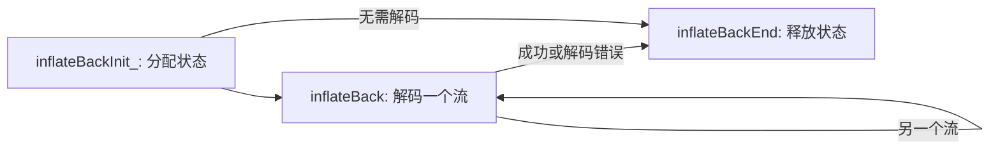

<!-- source-sha256: c361e306c50783f58296138d0d15a04cbd76fad090fab006aca728899bf71555 -->

# 回调解压

[API 手册](README.md) · [共享流规则](streams.md) · [流式解压](inflate-stream.md)

回调接口允许调用者提供输入块，并直接从窗口接收解码输出。
先用 [inflateBackInit_](#inflatebackinit_) 初始化，再用 [inflateBack](#inflateback) 解码，
最后用 [inflateBackEnd](#inflatebackend) 释放状态。窗口始终由调用者拥有。

这些聚焦契约对应固定版本的 [infback.c](../../../zlib/infback.c) 和
[zlib.h](../../../zlib/zlib.h)，针对默认 LP64 Linux 构建。
本页的受限定义域不会缩小
[Back.lean](../../../ZlibF/Spec/Public/Back.lean) 或
[Sequences.lean](../../../ZlibF/Spec/Public/Sequences.lean) 中更宽的目标。
定义域和效果标签见[契约约定](contracts.md)；证明状态和剩余工作见[进度](../../progress.md)。
超出聚焦前提只表示本契约不作保证，不自动等于 C 未定义行为（UB），也不保证一定返回错误码。

`inflateBack` 解码 raw DEFLATE。任何 zlib/gzip 头部、尾部和校验和都由调用者处理。
调用者拥有一个至少 `2^windowBits` 字节的可写窗口，它同时也是输出缓冲区。
`windowBits` 是窗口字节数的二进制指数：15 表示 `2^15 = 32768` 字节。对一般流使用这个配置；更小窗口可能拒绝有效的长距离引用。



回调让库在需要数据时主动调用应用代码。输入回调的参数 `in_desc` 是应用自己的上下文；`buf` 接收下一块输入的起始指针，返回值给出这块输入的字节数。输出回调的 `out_desc` 也是应用上下文；`buf` 和 `len` 给出本次可以读取的输出范围，`len` 以字节计。库把指针和长度交给回调，不转移窗口的所有权。

回调类型如下：

```c
typedef unsigned (*in_func)(void FAR *, z_const unsigned char FAR * FAR *);
typedef int (*out_func)(void FAR *, unsigned char FAR *, unsigned);
```

`in(in_desc, &buf)` 返回字节数并设置 `buf`；零表示没有输入，此时忽略 `buf`。
`out(out_desc, buf, len)` 接收至多一个窗口的字节；零表示成功。
若回调支持 NULL，描述参数可以为 NULL。

## inflateBackInit_

```c
int ZEXPORT inflateBackInit_(z_streamp strm, int windowBits, unsigned char FAR *window,
                             const char *version, int stream_size);
```

**用途。** 分配解码器状态并关联调用者的窗口。
`inflateBackInit` 宏提供 `version` 和 `stream_size`。

**定义域。** 受限定义域：有效调用者内存、未活动的流和默认分配器。

**前置条件。** 非 NULL 的 `strm` 指向可写 `z_stream`，其 `zalloc`、`zfree` 和
`opaque` 已初始化。使用 NULL 或默认分配／释放函数对；不得覆盖仍活跃的库状态。
非 NULL 的 `version` 的首字节可读。在初始化路径上，`window` 提供与流分离的
`2^windowBits` 个可写字节。该切片须保持存活直到结束操作。

**效果。** 可能初始化分配器字段和 `opaque`，清除 `msg`，并分配一个状态。
窗口仍由调用者拥有，此处不分配、不清空，也不释放窗口。

**后置条件。** `Z_OK` 关联供 `inflateBack` 使用的新状态，且 `8 <= windowBits <= 15`。
输入／输出指针、可用计数、累计计数、`adler` 和 `data_type` 不变。
只初始化指定的状态字段；该状态须用于回调 API。

**错误。** NULL 版本、主版本字节不同或流大小错误，会在访问流前返回 `Z_VERSION_ERROR`。
NULL `strm`／`window`，或位数不在 8..15 内，返回 `Z_STREAM_ERROR`。
分配失败返回 `Z_MEM_ERROR`：`msg` 和默认分配器字段可能已改变，但保留原 `state` 字段。
没有分配状态，因此在此未活动流定义域内，初始化失败后不需要结束调用。

## inflateBack

```c
int ZEXPORT inflateBack(z_streamp strm, in_func in, void FAR *in_desc,
                        out_func out, void FAR *out_desc);
```

**用途。** 通过输入和输出回调解码一个完整 raw 流。

**定义域。** 受限定义域：活跃的回调解码器、有效且分离的切片，以及有限、会返回的
回调协议。包括任意畸形输入字节。

**前置条件。** 初始化成功且尚未结束。保持流、状态和窗口存活。
初始化 `next_in`；NULL 表示立即请求回调输入，并忽略 `avail_in`。
否则初始化 `avail_in`，并在 `next_in` 提供相应数量的可读字节。
初始输入切片和回调提供的输入切片均不与窗口、流或私有状态重叠。
两个回调均非 NULL。每次回调都安全返回，且提供的输入总量有界。

回调只能读取收到的输入／输出字节以及自身的有效对象。
可以修改、分配或释放自身内存，但须保持流、私有状态和窗口切片不变。
输入块在下一次输入回调或函数返回前须持续可读且不变，包括跨越输出回调时。
输出回调最多读取 `len` 个窗口字节。
若所用字节切片不重叠，回调存储与窗口可共用一次分配。
禁止对该流进行并发或重入访问。

**效果。** 重置解码以处理新流，消费输入、写窗口并调用回调。
完整窗口和最终非空的部分窗口均交给 `out`，包括错误路径。
因此回调可能在后续格式或输入失败之前已观察到输出。
库本身不分配或释放内存；回调分配的内存仍由调用者负责。

**后置条件。** `Z_STREAM_END` 表示完整 raw 流已解码，且每次输出调用都成功。
拼接各块得到其未压缩字节，不使用预置字典。
`next_in`／`avail_in` 指出初始输入块或最后一个回调块的未读后缀。
输入耗尽后两者为 NULL／零；否则指针按已消费字节数前移。
累计计数、`adler` 和 `data_type` 不变；`next_out`／`avail_out` 不用于输出接口。
流保留状态和窗口，可供下次独立解码或结束操作使用。

**错误。** `Z_BUF_ERROR` 表示输入耗尽或输出结果非零；本函数从不返回 `Z_OK`。
对 `Z_BUF_ERROR`，NULL `next_in` 表示输入耗尽，非 NULL 表示输出失败。
`Z_DATA_ERROR` 表示畸形 DEFLATE，并设置 `msg`。
最终输出失败会将 `Z_STREAM_END` 改为 `Z_BUF_ERROR`，但不替换此前已选定的其他错误。
NULL `strm` 或 NULL 状态返回 `Z_STREAM_ERROR`，不调用回调。
其他无效状态不在本定义域内：普通 `inflateInit_` 产生的状态不是回调解码器。
解码错误后，结束操作仍释放状态；再次调用则从一个新流开始。

## inflateBackEnd

```c
int ZEXPORT inflateBackEnd(z_streamp strm);
```

**用途。** 释放回调初始化所分配的状态。

**定义域。** 受限定义域：使用有效默认释放函数的活跃回调解码器，另包括经检查的
NULL 流、NULL 状态和 NULL 释放函数拒绝情形。

**前置条件。** 清理时初始化已成功、尚未结束，且没有解码或回调正在活动。
流和所关联状态仍有效；保留匹配的 `zfree` 和 `opaque`。
成功解码或任何解码错误后均允许清理。

**效果。** 恰好释放内部状态，并清除 `state`。

**后置条件。** `Z_OK` 使 `state` 为 NULL。调用者的窗口及其他所有流字段不变。
调用者此时可释放或复用窗口；库从不释放它。

**错误。** NULL `strm`、NULL 状态或 NULL `zfree` 返回 `Z_STREAM_ERROR`，不释放任何内存。
这些检查不会验证任意非 NULL 状态，也不会检测所有权错误。

[返回 API 手册](README.md) · [契约约定](contracts.md)
