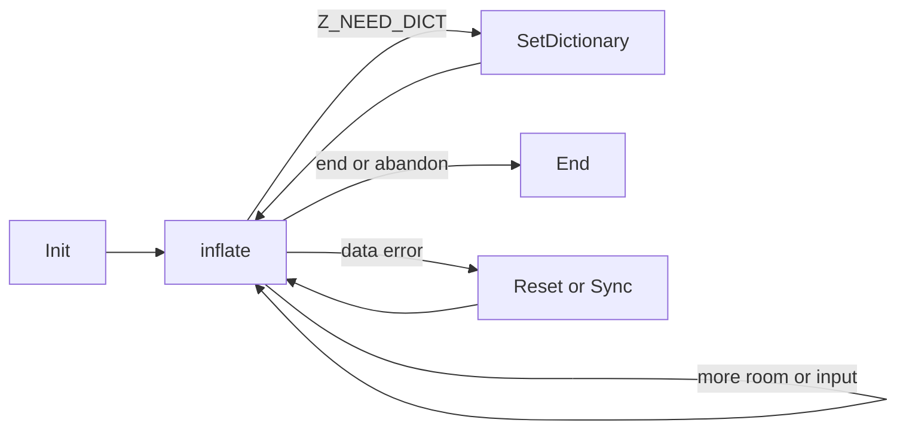

# Stream decompression

[API manual](README.md) · [Shared stream rules](streams.md) · [Stream compression](deflate-stream.md)

Use an `inflate` stream to decode input in pieces while controlling output space. Select zlib,
gzip or raw DEFLATE at initialization, then continue with more input or room until completion,
a dictionary request or an error. End releases the decoder after any of those outcomes.
For whole-buffer zlib decoding, see [uncompress](utility.md#uncompress2_z).

| Task | Entries |
| --- | --- |
| Start or reuse | [Init](#inflateinit_), [configured init](#inflateinit2_), [reset](#inflatereset), [new configuration](#inflatereset2), [keep history](#inflateresetkeep) |
| Decode or provide metadata | [Inflate](#inflate), [set dictionary](#inflatesetdictionary), [read history](#inflategetdictionary), [gzip header](#inflategetheader) |
| Recover or inspect | [Sync search](#inflatesync), [sync point](#inflatesyncpoint), [mark](#inflatemark), [table use](#inflatecodesused) |
| Adjust or branch | [Prime bits](#inflateprime), [validation](#inflatevalidate), [distance option](#inflateundermine), [copy](#inflatecopy) |
| Release storage | [End](#inflateend) |

The focused contracts follow the pinned `inflate.c` and `zlib.h` in the default LP64 Linux
build, with gzip enabled and without optional invalid-distance or strict-distance modes.
Source readings are **to confirm** by proof. The broader [registered public goals](../../checking/goals.md)
retain their domains. See [contract conventions](contracts.md) for terminology and
[progress](../../progress.md) for proof status and remaining work.

## Common conditions

All contracts below have a **Restricted domain**. A C pointer type alone does not
supply the storage, lifetime or call history required here.

- A **live stream** was successfully initialised or copied, has not been ended,
  retains its library-owned state, and is used without concurrent calls. Use the
  default allocator and free function. Init takes a writable, non-live stream with
  allocator fields set to NULL or the default functions.
- A readable or writable range has the stated capacity for the whole call. Caller
  ranges are separate from the stream and its owned storage. Input and output
  ranges do not overlap. Dictionary destinations, the registered header record
  and its destination buffers are separate from each other and from the stream.
  Registered header storage is also separate from input/output ranges on calls
  using it. These are explicit focused-domain restrictions.
- The caller owns its stream object and buffers. The library owns the state and
  optional window. A call changes only its stream, owned storage, stated output
  ranges and any registered header destination. It never frees caller buffers.
- A rejected **stream check** returns `Z_STREAM_ERROR` without changes, unless a
  query or copy contract says otherwise. This covers NULL and safely readable
  records rejected by the check; it does not cover dangling or arbitrary pointers.
  The check requires allocators, state, the state's back-pointer and a valid mode.
- Counters use the C unsigned widths and wrap. No contract assumes allocation
  succeeds. End remains available after decoding, dictionary or allocation errors.



## inflateResetKeep

```c
int ZEXPORT inflateResetKeep(z_streamp strm);
```

Restart decoding while retaining history. This is an undocumented entry point.

### Return values and next calls {#api-inflateresetkeep-returns}

**Return type.** `int` — zlib status code

The result says whether decoding restarted while retaining the existing history.

| Returned value | Meaning and conditions | Caller’s next step |
| --- | --- | --- |
| `Z_OK`<br>**Restarted with history retained** | The live stream passed the check; counters, buffered bits and header registration are cleared while window history remains. | Continue when retained history is intended; use inflateReset for an independent stream. |
| `Z_STREAM_ERROR`<br>**Stream check failed** | The common stream check failed; nothing changes. | Establish a valid stream and its ownership before further operations. |

### Calling conditions and effects {#api-inflateresetkeep-contract}

**Domain.** Restricted domain: live streams in any mode.

**Effects.** Mutates state, no allocation or free.

**Pre.** The common live-stream conditions hold. The caller deliberately wants the
old window to remain usable by the next stream.

<details markdown="1" class="ar-return-exact" data-return-exact="inflateResetKeep"><summary>Complete return conditions and boundaries</summary>

**Post.** Returns `Z_OK`. Clears totals, message, `data_type`, buffered bits,
dictionary-set status and header registration. Restarts header/block decoding with
the current wrapper, retaining the window and its history. For a wrapper, `adler`
is 1 if zlib is accepted, otherwise 0; raw leaves `adler` unchanged.

**Edges.** Does not restore wrapper settings changed by recovery. A failed stream
check changes nothing. Use `inflateReset` to discard history.

</details>

## inflateReset

```c
int ZEXPORT inflateReset(z_streamp strm);
```

Start a new independent compressed stream using the existing configuration.

### Return values and next calls {#api-inflatereset-returns}

**Return type.** `int` — zlib status code

The result says whether the existing configuration is ready for a new independent stream.

| Returned value | Meaning and conditions | Caller’s next step |
| --- | --- | --- |
| `Z_OK`<br>**Ready for a new stream** | The live stream was reset; history and header registration are discarded and the requested wrapper and window size restored. | Set up the new input and output ranges and continue with inflate; eventually call inflateEnd. |
| `Z_STREAM_ERROR`<br>**Stream check failed** | The common stream check failed; nothing changes. | Establish a valid stream and its ownership before further operations. |

**Reading the result.**

- Input/output pointers and available counts stay unchanged; the validation choice from inflateValidate is retained.

### Calling conditions and effects {#api-inflatereset-contract}

**Domain.** Restricted domain: live streams, including completed or failed ones.

**Effects.** Mutates state and may free the window, never allocates.

**Pre.** The common live-stream conditions hold.

<details markdown="1" class="ar-return-exact" data-return-exact="inflateReset"><summary>Complete return conditions and boundaries</summary>

**Post.** Returns `Z_OK`. Restores the requested wrapper and window size, discards
history, then performs the reset described by `inflateResetKeep`. Input/output
pointers and available counts stay unchanged. A window of the same size may remain
allocated; an incompatible window is freed.

**Edges.** Clears header registration. Keeps the validation setting selected by
`inflateValidate`, while undoing temporary recovery wrapper changes. A failed
stream check changes nothing.

</details>

## inflateReset2

```c
int ZEXPORT inflateReset2(z_streamp strm, int windowBits);
```

Reset and select a new wrapper and maximum window size.

### Return values and next calls {#api-inflatereset2-returns}

**Return type.** `int` — zlib status code

The result says whether a new wrapper and window configuration took effect for a fresh decode.

| Returned value | Meaning and conditions | Caller’s next step |
| --- | --- | --- |
| `Z_OK`<br>**New configuration applied** | The stream check passed and windowBits was accepted; decoding resets, history and header registration are discarded, and validation is enabled for the new wrapper. | Provide input and output ranges for the new format, then call inflate. |
| `Z_STREAM_ERROR`<br>**Configuration or stream refused** | windowBits is invalid or the stream check failed; nothing changes. | If the original stream is valid, choose an accepted configuration; resolve invalid stream use before proceeding. |

**Reading the result.**

- Accepted values are -15..-8, 0, 8..15, 16, 24..31, 32 and 40..47; the full contract gives their wrapper meanings.

### Calling conditions and effects {#api-inflatereset2-contract}

**Domain.** Restricted domain: live streams and every signed `windowBits` value.

**Effects.** Mutates state and may free the window, never allocates.

**Pre.** The common live-stream conditions hold. Old decoding is being abandoned.

<details markdown="1" class="ar-return-exact" data-return-exact="inflateReset2"><summary>Complete return conditions and boundaries</summary>

**Post.** For an accepted value, returns `Z_OK` and has the effect of `inflateReset`
with the new request. Accepted values and meanings are listed under `inflateInit2_`.
Validation is enabled for the new wrapper request.

**Edges.** Invalid values return `Z_STREAM_ERROR` before changing anything. Changing
the requested size frees an incompatible window. Pending header registration and
history are discarded, even if the size stays the same.

</details>

## inflateInit2_

```c
int ZEXPORT inflateInit2_(z_streamp strm, int windowBits, const char *version, int stream_size);
```

Create a decoder with a selected wrapper and window.

### Return values and next calls {#api-inflateinit2_-returns}

**Return type.** `int` — zlib status code

The result says whether a decoder with the requested format was created. Only successful initialization requires a later end call.

| Returned value | Meaning and conditions | Caller’s next step |
| --- | --- | --- |
| `Z_OK`<br>**Decoder created** | The version and stream size match, state allocation succeeded, and windowBits was accepted. | Supply input and output ranges, call inflate, then call inflateEnd when finished or abandoning decoding. |
| `Z_VERSION_ERROR`<br>**Version or structure size mismatch** | version is NULL, its first byte mismatches, or stream_size is wrong; this returns before inspecting strm and changes nothing. | Correct the version and structure size before initializing again; this failed attempt needs no inflateEnd. |
| `Z_STREAM_ERROR`<br>**Stream or window request refused** | After the version check, strm is NULL; or state allocation succeeds but windowBits is invalid, so that state is freed and state becomes NULL. | Provide a writable inactive stream and accepted windowBits before initializing again; this failed attempt needs no end call. |
| `Z_MEM_ERROR`<br>**State allocation failed** | State allocation failed and the old state field is retained; msg is cleared and required default allocator fields may have been installed. | Initialization may be tried again when resources are available; this failure retained no new allocation and needs no inflateEnd. |

**Reading the result.**

- State allocation precedes the windowBits check; even an invalid windowBits can therefore first produce Z_MEM_ERROR.

### Calling conditions and effects {#api-inflateinit2_-contract}

**Domain.** Restricted domain: fresh writable stream storage, default allocator,
and NULL or readable version pointer; all signed scalar arguments.

**Effects.** Allocates state.

**Pre.** The stream is not live. Allocator fields follow the common convention.
Only the first version byte must be readable; a whole string is not inspected.

<details markdown="1" class="ar-return-exact" data-return-exact="inflateInit2_"><summary>Complete return conditions and boundaries</summary>

**Post.** On `Z_OK`, the stream is live with zero totals, NULL message, zero
`data_type`, no window, history, buffered bits or header registration. Wrapper
`adler` starts at 1 for zlib/automatic detection and 0 for gzip-only; raw preserves
it. Buffer pointers and available counts are unchanged.

Accepted `windowBits` values are:

| Values | Decoder request |
| --- | --- |
| -15 through -8 | Raw DEFLATE, window bits equal to the magnitude |
| 0; 8 through 15 | Zlib; header-selected size for 0, otherwise that maximum |
| 16; 24 through 31 | Gzip only; default size for 16, otherwise value minus 16 |
| 32; 40 through 47 | Zlib/gzip detection; header/default size for 32, otherwise value minus 32 |

**Errors.** NULL/wrong version first byte or wrong `stream_size` returns
`Z_VERSION_ERROR` without changes, before inspecting `strm`. Otherwise NULL `strm`
returns `Z_STREAM_ERROR`. State allocation is attempted before the window argument
is checked. Failure returns `Z_MEM_ERROR`, retaining the old `state` field, with
message cleared and default callbacks installed as needed. An invalid window
argument after successful allocation returns `Z_STREAM_ERROR`, frees that state
and sets `state` to NULL. No failing init retains a new allocation. Only successful
init needs a later `inflateEnd`; its window may be allocated by later calls.

</details>

## inflateInit_

```c
int ZEXPORT inflateInit_(z_streamp strm, const char *version, int stream_size);
```

Create a zlib decoder with a 32 KiB maximum window.

### Return values and next calls {#api-inflateinit_-returns}

**Return type.** `int` — zlib status code

The result says whether a zlib decoder with a maximum 32 KiB window was created.

| Returned value | Meaning and conditions | Caller’s next step |
| --- | --- | --- |
| `Z_OK`<br>**Zlib decoder created** | This is inflateInit2_ with windowBits 15, and state allocation succeeded. | Decode zlib input with inflate; call inflateEnd after completion or abandonment. |
| `Z_VERSION_ERROR`<br>**Version or structure size mismatch** | version is NULL, its first byte mismatches, or stream_size is wrong; the stream is not inspected and nothing changes. | Correct the version and structure size before initializing again; this failure needs no inflateEnd. |
| `Z_STREAM_ERROR`<br>**Stream pointer refused** | strm is NULL after the version check passed. | Provide a writable inactive stream before initializing again; this failure needs no end call. |
| `Z_MEM_ERROR`<br>**State allocation failed** | State could not be allocated; the old state remains, while msg and default allocator fields may have changed. | Initialization may be tried again when resources are available; no new allocation was retained and no inflateEnd is needed. |

### Calling conditions and effects {#api-inflateinit_-contract}

**Domain.** Restricted domain: the same storage, version and allocator domain as
`inflateInit2_`.

**Effects.** Allocates state.

**Pre.** The `inflateInit2_` preconditions hold.

<details markdown="1" class="ar-return-exact" data-return-exact="inflateInit_"><summary>Complete return conditions and boundaries</summary>

**Post.** Exactly `inflateInit2_(strm, 15, version, stream_size)`. On success it
accepts zlib streams with a window up to 32 KiB, and owns one state allocation.

**Errors.** The same version, NULL-stream and allocation failures and cleanup as
`inflateInit2_`. Gzip and raw bytes are not accepted by later decoding as zlib.

</details>

## inflatePrime

```c
int ZEXPORT inflatePrime(z_streamp strm, int bits, int value);
```

Supply bits before the next input byte, or clear buffered bits.

### Return values and next calls {#api-inflateprime-returns}

**Return type.** `int` — zlib status code

The result says whether the bit buffer accepted a clear or append request.

| Returned value | Meaning and conditions | Caller’s next step |
| --- | --- | --- |
| `Z_OK`<br>**Bit request applied** | Negative bits clears the buffer; zero leaves it unchanged; 1..16 bits that fit in the 32-bit buffer appends the low bits of value. | At the permitted raw-stream call position, continue with inflate; the supplied bits precede next_in. |
| `Z_STREAM_ERROR`<br>**Bit request or stream refused** | bits exceeds 16, bit-buffer space is insufficient, or the stream check failed; nothing changes. | For a valid stream, correct the bit request; otherwise resolve invalid stream use first. |

**Reading the result.**

- Success does not validate raw mode or call order; those remain caller preconditions.

### Calling conditions and effects {#api-inflateprime-contract}

**Domain.** Restricted domain: live raw streams before first decoding or at a
reported block/header boundary; every signed `bits` and `value`.

**Effects.** Mutates state only.

**Pre.** The common live-stream conditions and the stated priming call order hold.

<details markdown="1" class="ar-return-exact" data-return-exact="inflatePrime"><summary>Complete return conditions and boundaries</summary>

**Post.** Zero bits returns `Z_OK` unchanged. Negative bits empties the bit buffer.
For 1 through 16 bits that fit within the 32-bit buffer, returns `Z_OK`, appending
the low `bits` bits of `value` above existing bits. These bits precede `next_in`.

**Errors.** More than 16 bits, insufficient bit-buffer space or a failed stream
check returns `Z_STREAM_ERROR` unchanged. Does not update `data_type`. The C does
not enforce the raw-stream or call-order restriction.

</details>

## inflate

```c
int ZEXPORT inflate(z_streamp strm, int flush);
```

Consume compressed bytes and write decoded bytes, preserving state across calls.

### Return values and next calls {#api-inflate-returns}

**Return type.** `int` — zlib status code

The result distinguishes progress, completion of one stream, a dictionary request and errors; progress does not mean decoding is finished.

| Returned value | Meaning and conditions | Caller’s next step |
| --- | --- | --- |
| `Z_OK`<br>**Progress, not completion** | Input was consumed or output produced, but one stream is not yet complete; a requested block/header boundary can also stop the call. | Continue inflate with more input or output space as needed. |
| `Z_STREAM_END`<br>**One stream or member complete** | One stream of the selected format is complete, including enabled trailer checks; repeated calls on a completed stream also return this value. | Preserve unread trailing input; call inflateEnd, or reset before decoding the next gzip member. |
| `Z_NEED_DICT`<br>**Zlib dictionary required** | The zlib header requests a preset dictionary; strm->adler gives its identifier. | Supply the correct dictionary with inflateSetDictionary and continue after success; call inflateEnd if abandoning decoding. |
| `Z_BUF_ERROR`<br>**Required progress or completion unavailable** | The call made no input/output progress, or a Z_FINISH request could not complete; Z_FINISH changes an otherwise Z_OK result to this value. | Continue with input or output space as needed; this value alone does not establish corrupt data. |
| `Z_DATA_ERROR`<br>**Data error detected** | A format error or enabled checksum/length error was detected, possibly after output; the data-error state is sticky. | Abandon the current stream with inflateReset, attempt recovery with inflateSync, or call inflateEnd. |
| `Z_MEM_ERROR`<br>**History-window allocation failed** | Window allocation failed; input may already have been consumed or output written, and the error state is sticky. | Observe the updated pointers and available counts; reset before starting again, or call inflateEnd. |
| `Z_STREAM_ERROR`<br>**Stream or buffer conditions failed** | A stream/buffer check failed, or an inflateSync recovery search remains unfinished. | Correct buffer arguments for a valid stream; continue inflateSync for an unfinished recovery search; otherwise establish a valid stream first. |

**Reading the result.**

- Normal returns account for consumed/produced bytes in totals and enabled checksums; Z_NEED_DICT retains the dictionary identifier.
- A late Z_MEM_ERROR skips normal final totals, checksum and data_type accounting; it does not mean output was unchanged.
- On normal returns, data_type combines unused-bit count with 64 for the last block, 128 at a header/block boundary, or 256 after a block header.

### Calling conditions and effects {#api-inflate-contract}

**Domain.** Restricted domain: live streams with common buffer/header lifetimes;
arbitrary compressed bytes, input/output splits and signed `flush` values.

**Effects.** Mutates
stream, output and registered header storage; may allocate the history window.

**Pre.** `next_in` describes `avail_in` readable bytes and may be NULL only when
that count is zero. `next_out` is non-NULL even for zero `avail_out`, and describes
that many writable bytes. A registered header and its buffers remain writable.
Calls may continue with more input/room, supply a requested dictionary, or follow
successful reset/recovery. Terminal/error repeats have the behavior below.

**Accounting.** Normal returns, including data and buffer errors, update totals by
consumed/produced bytes and update the enabled output checksum. `Z_NEED_DICT`
accounts for consumed header bytes and leaves `adler` as the dictionary identifier.
A late window-allocation failure can follow input consumption and output writes:
pointers/counts already reflect them, but normal final total/checksum/`data_type`
accounting is skipped. Do not treat `Z_MEM_ERROR` as an unchanged-output result.

**Ownership.** New window storage belongs to the stream and remains available for
reset/end, including after errors. A one-call `Z_FINISH` completion may need no
window. Concatenated gzip members require reset between members. Error messages
are borrowed static strings. Buffer and stream check refusals change nothing.

<details markdown="1" class="ar-return-exact" data-return-exact="inflate"><summary>Complete return conditions and boundaries</summary>

**Post.** Reads/writes within the stated ranges. Advances pointers and reduces
available counts by bytes consumed/produced. In an ordinary run from init/reset,
with a valid selected format and the correct dictionary, accumulated output is a
prefix of the decoded data and equals it at `Z_STREAM_END`. Malformed bytes are
part of the domain: detected format or enabled checksum/length failures return
`Z_DATA_ERROR`, possibly after output. Incomplete input alone needs more input;
it need not be reported as a data error.

| Result | Meaning and next action |
| --- | --- |
| `Z_OK` | Made input or output progress; continue with available input/room |
| `Z_STREAM_END` | Finished one stream/member, including enabled trailer checks; trailing input remains |
| `Z_NEED_DICT` | Zlib dictionary required; `adler` is its identifier; set the dictionary |
| `Z_BUF_ERROR` | No progress, or `Z_FINISH` could not complete; provide input/room |
| `Z_DATA_ERROR` | Detected malformed data; reset, recover or end |
| `Z_MEM_ERROR` | Window allocation failed; reset or end |
| `Z_STREAM_ERROR` | Stream/buffer check failed, or recovery search is unfinished |

**Edges.** Zero input or output room is allowed. `Z_BLOCK` stops at a header or
block boundary; `Z_TREES` also stops after block descriptions. `Z_FINISH` changes an
otherwise `Z_OK` result to `Z_BUF_ERROR`. Other signed flush values are accepted
and behave like `Z_NO_FLUSH`. `data_type` on normal returns records unused bits,
plus 64 for the last block, 128 at a header/block boundary, and 256 after a block
header. Data and memory errors are sticky; completed streams repeat `Z_STREAM_END`.

</details>

## inflateEnd

```c
int ZEXPORT inflateEnd(z_streamp strm);
```

Release decoder storage, including when decoding was abandoned or failed.

### Return values and next calls {#api-inflateend-returns}

**Return type.** `int` — zlib status code

The result says whether decoder-owned state and window were released; decoding need not have completed.

| Returned value | Meaning and conditions | Caller’s next step |
| --- | --- | --- |
| `Z_OK`<br>**Decoder released** | The live stream passed the check; its optional window and state are freed exactly once and state becomes NULL. | Caller buffers may be released; reinitialize before using the stream again. |
| `Z_STREAM_ERROR`<br>**No release performed** | The stream check failed, including an already ended stream; nothing is freed. | Check the stream lifetime and ownership; do not end an already ended stream again. |

### Calling conditions and effects {#api-inflateend-contract}

**Domain.** Restricted domain: live streams in every mode, including after
allocation/data errors.

**Effects.** Mutates the stream and frees owned storage.

**Pre.** The common live-stream conditions hold.

<details markdown="1" class="ar-return-exact" data-return-exact="inflateEnd"><summary>Complete return conditions and boundaries</summary>

**Post.** Returns `Z_OK`, frees the optional window and state exactly once, and
sets `state` to NULL. Other stream fields and caller buffers are unchanged. This
allocates nothing and cannot return `Z_MEM_ERROR` with the default free function.

**Edges.** Does not require stream completion or report incomplete data as an
error. A failed stream check, including an already ended stream, returns
`Z_STREAM_ERROR` without freeing anything. Reinitialise before using it again.

</details>

## inflateGetDictionary

```c
int ZEXPORT inflateGetDictionary(z_streamp strm, Bytef *dictionary, uInt *dictLength);
```

Read the retained sliding history, oldest byte first.

### Return values and next calls {#api-inflategetdictionary-returns}

**Return type.** `int` — zlib status code

The return value reports query status; the history size is written to dictLength rather than returned.

| Returned value | Meaning and conditions | Caller’s next step |
| --- | --- | --- |
| `Z_OK`<br>**History query succeeded** | The stream check passed; non-NULL dictionary receives oldest-to-newest history and non-NULL dictLength receives its byte count. | Use the requested destination results; the stream remains usable, and empty history is valid. |
| `Z_STREAM_ERROR`<br>**Query refused** | The stream check failed; no destination is written. | Do not treat previous destination contents as this call’s result; establish a valid stream first. |

**Reading the result.**

- Either destination may be NULL. A completed stream that never allocated a window may report zero history bytes despite having produced output.

### Calling conditions and effects {#api-inflategetdictionary-contract}

**Domain.** Restricted domain: live streams with optional writable dictionary
and length destinations.

**Effects.** Observes state and writes only those destinations.

**Pre.** A non-NULL dictionary has room for the retained history; 32768 bytes is
always enough. Non-NULL `dictLength` points to writable `uInt` storage.

<details markdown="1" class="ar-return-exact" data-return-exact="inflateGetDictionary"><summary>Complete return conditions and boundaries</summary>

**Post.** Returns `Z_OK`. Copies the history if `dictionary` is non-NULL and stores
its size if `dictLength` is non-NULL. Allocates/frees nothing; leaves stream unchanged.

**Edges.** Either destination may be NULL. Fresh history is empty. A stream
finished without allocating a window can also have empty history despite having
produced output. A failed stream check writes nothing.

</details>

## inflateSetDictionary

```c
int ZEXPORT inflateSetDictionary(z_streamp strm, const Bytef *dictionary, uInt dictLength);
```

Install or amend the bytes available for backward matches.

### Return values and next calls {#api-inflatesetdictionary-returns}

**Return type.** `int` — zlib status code

The result distinguishes successful dictionary installation, an identifier mismatch, and stream or memory errors.

| Returned value | Meaning and conditions | Caller’s next step |
| --- | --- | --- |
| `Z_OK`<br>**Dictionary installed** | A raw stream accepted the dictionary, or a waiting zlib stream’s identifier matched; the usable window suffix is retained. | Continue inflate; input/output pointers and totals have not advanced. |
| `Z_DATA_ERROR`<br>**Zlib dictionary identifier mismatch** | The supplied dictionary’s full Adler identifier differs from the required identifier; the stream is unchanged. | Try another dictionary, or call inflateEnd if abandoning decoding. |
| `Z_STREAM_ERROR`<br>**Dictionary request refused** | dictionary is NULL, the stream check failed, or a wrapped stream is not awaiting a dictionary. | Provide a non-NULL dictionary under the contract only for a valid raw stream or a zlib stream awaiting one. |
| `Z_MEM_ERROR`<br>**Window allocation failed** | History-window allocation failed and the stream enters memory-error mode. | Reset before starting a new decode, or call inflateEnd to release state. |

**Reading the result.**

- Raw mode does not check a dictionary identifier; Z_OK does not guarantee correct output when the wrong dictionary is supplied.

### Calling conditions and effects {#api-inflatesetdictionary-contract}

**Domain.** Restricted domain: live zlib streams waiting after `Z_NEED_DICT`, or
live raw streams at any call boundary.

**Effects.** Mutates history and may allocate its window.

**Pre.** `dictionary` is non-NULL and describes `dictLength` readable bytes, even
when the length is zero. For correct output it matches the compressor's dictionary.

<details markdown="1" class="ar-return-exact" data-return-exact="inflateSetDictionary"><summary>Complete return conditions and boundaries</summary>

**Post.** Returns `Z_OK` after retaining the last window-sized suffix of old
history followed by the new dictionary. The whole supplied dictionary is checked
against the zlib identifier. Caller bytes are copied, not retained or freed.

**Errors.** A wrong zlib identifier returns `Z_DATA_ERROR` unchanged; another
dictionary can be tried. NULL dictionary, failed stream check or wrapped stream
not awaiting a dictionary returns `Z_STREAM_ERROR`. Allocation failure returns
`Z_MEM_ERROR` and leaves the stream in the memory-error mode, still endable.

**Edges.** Gzip has no preset-dictionary path. Raw mode has no identifier check;
a wrong dictionary can produce wrong output or a later error. Zero-length raw
dictionaries are accepted. No input/output pointers or totals are advanced.

</details>

## inflateGetHeader

```c
int ZEXPORT inflateGetHeader(z_streamp strm, gz_headerp head);
```

Register caller storage for the next gzip header.

### Return values and next calls {#api-inflategetheader-returns}

**Return type.** `int` — zlib status code

The return value only says whether header storage was registered; head->done later reports parsing progress.

| Returned value | Meaning and conditions | Caller’s next step |
| --- | --- | --- |
| `Z_OK`<br>**Header storage registered** | The valid stream supports gzip; head is registered and head->done is set to 0, without parsing the header yet. | Keep all registered storage valid and call inflate; inspect done for the later outcome. |
| `Z_STREAM_ERROR`<br>**Registration refused** | The stream check failed or the request lacks gzip support; nothing changes. | Establish a valid gzip-capable stream, then register storage before decoding. |

**Reading the result.**

- Later, done is 1 for a completed gzip header or -1 when automatic detection identifies zlib; neither is this function’s return code.
- head must be non-NULL for an accepted registration; NULL is not a guaranteed clean-error case.

### Calling conditions and effects {#api-inflategetheader-contract}

**Domain.** Restricted domain: live gzip-capable streams after init/reset and
before decoding.

**Effects.** Registers borrowed storage and writes `head->done`.

**Pre.** `head` is non-NULL and writable. Its `extra`, `name`, `comment` pointers
are NULL or have writable capacities `extra_max`, `name_max`, `comm_max`. Keep all
registered storage valid until header parsing ends or the request is cleared.
The header record and its destination buffers stay separate from each other,
the stream and its owned storage, and the input/output ranges of calls using them.

<details markdown="1" class="ar-return-exact" data-return-exact="inflateGetHeader"><summary>Complete return conditions and boundaries</summary>

**Post.** Returns `Z_OK`, retains the pointer and sets `done` to 0. Later `inflate`
calls fill scalar fields and available buffer prefixes. With an extra field,
`extra_len` is its actual length; without one, `extra` becomes NULL and `extra_len`
is unchanged. Names/comments are terminated only if the terminator fits.
Absent optional fields set the corresponding pointer to NULL. Completion sets
`done` to 1; automatic detection of zlib sets it to -1.

**Edges.** No allocation or ownership transfer. Reset clears registration. A
failed stream check or request without gzip support returns `Z_STREAM_ERROR`
unchanged. NULL `head` on an accepted request is outside this contract and is
dereferenced by the C; it is not a clean-error case.

</details>

## inflateSync

```c
int ZEXPORT inflateSync(z_streamp strm);
```

Search for a possible full-flush boundary after damaged input.

### Return values and next calls {#api-inflatesync-returns}

**Return type.** `int` — zlib status code

The result says whether recovery search found a candidate boundary; finding the pattern does not establish correct recovered data.

| Returned value | Meaning and conditions | Caller’s next step |
| --- | --- | --- |
| `Z_OK`<br>**Candidate boundary found** | The pattern 00 00 ff ff was found in buffered whole bytes or input; history and header registration reset while totals are preserved. | Resume inflate at the following block; do not infer a valid suffix or restored validation. |
| `Z_DATA_ERROR`<br>**Not found; search continues** | The available searchable bytes did not yield the complete pattern; partial matches persist across calls. | Provide more input and continue inflateSync; ordinary inflate returns Z_STREAM_ERROR while this search is unfinished. |
| `Z_BUF_ERROR`<br>**No searchable byte available** | There is no input and fewer than eight buffered bits; nothing changes. | Provide more input and continue inflateSync, or abandon with inflateEnd. |
| `Z_STREAM_ERROR`<br>**Stream check failed** | The common stream check failed; nothing changes. | Establish a valid stream and its ownership before further operations. |

**Reading the result.**

- The candidate may not be a real full-flush point and may still need old history; recovery does not promise checksum checking.

### Calling conditions and effects {#api-inflatesync-contract}

**Domain.** Restricted domain: live streams after a data error or during a
recovery search, with readable input.

**Effects.** Consumes input, mutates state, may free a window.

**Pre.** `next_in` and `avail_in` describe a readable range. Output is not used.

<details markdown="1" class="ar-return-exact" data-return-exact="inflateSync"><summary>Complete return conditions and boundaries</summary>

**Post.** Searches buffered whole bytes and then input for `00 00 ff ff`, retaining
partial matches across calls. Input pointers/counts and `total_in` advance by the
input searched. No output is produced and `total_out` is preserved.
**Results.** `Z_OK` means a pattern was found: history and header registration are
reset, totals are preserved, decoding can resume at the following block. If no
header had been read, recovery uses raw mode; otherwise it disables trailer
validation. A still unknown window size becomes 15. `Z_DATA_ERROR` means continue
searching; ordinary `inflate` returns `Z_STREAM_ERROR` during that search.

**Edges.** No input and fewer than eight buffered bits returns `Z_BUF_ERROR`
unchanged. A failed stream check changes nothing. A found pattern need not be a
real flush point; even a sync-flush boundary can need earlier history. Recovery
does not promise a valid suffix or restored checksum checking. No allocation.

</details>

## inflateSyncPoint

```c
int ZEXPORT inflateSyncPoint(z_streamp strm);
```

Test whether stored-block length bytes are the next thing expected.

### Return values and next calls {#api-inflatesyncpoint-returns}

**Return type.** `int` — State query value or error code

This is a state query with an error code; distinguish 1, 0 and the negative error.

| Returned value | Meaning and conditions | Caller’s next step |
| --- | --- | --- |
| `1`<br>**Waiting for stored-block lengths** | The valid stream is waiting for stored-block length bytes with an empty bit buffer. | Interpret the query as this state and continue using the valid stream. |
| `0`<br>**Not at that state** | The valid stream is not both waiting for stored-block lengths and holding an empty bit buffer. | Treat this as not being at that point; it does not report a decode error. |
| `Z_STREAM_ERROR`<br>**Query refused** | The stream check failed; nothing changes. | Establish a valid stream; do not treat the negative error code as “yes”. |

**Reading the result.**

- Test result == 1 for a match; negative error codes are also true in C. This function does not search for a marker.

### Calling conditions and effects {#api-inflatesyncpoint-contract}

**Domain.** Restricted domain: live streams in any mode.

**Effects.** Read-only query.

**Pre.** The common live-stream conditions hold.

<details markdown="1" class="ar-return-exact" data-return-exact="inflateSyncPoint"><summary>Complete return conditions and boundaries</summary>

**Post.** Returns 1 exactly when waiting for stored-block lengths with an empty
bit buffer, otherwise 0. Allocates/frees nothing and changes nothing.

**Edges.** Returns `Z_STREAM_ERROR` on a failed stream check. Test `== 1`, since
the negative error code also counts as true in C. This is not a search for a marker.

</details>

## inflateCopy

```c
int ZEXPORT inflateCopy(z_streamp dest, z_streamp source);
```

Create a decoder that can resume from the source position.

### Return values and next calls {#api-inflatecopy-returns}

**Return type.** `int` — zlib status code

The result says whether the destination acquired an independently endable decoder copy.

| Returned value | Meaning and conditions | Caller’s next step |
| --- | --- | --- |
| `Z_OK`<br>**Decoder state copied** | The valid source was copied to a distinct inactive destination; the destination owns independent state and any required window, and the source is unchanged. | Eventually call inflateEnd on both streams; provide separate writable destinations before continuing and preserve shared pointer lifetimes. |
| `Z_STREAM_ERROR`<br>**Copy request refused** | dest is NULL or the source stream check failed; a non-NULL dest has state cleared and other fields unchanged, and the source is unchanged. | Correct source and destination before copying again; this failure created no destination stream requiring end. |
| `Z_MEM_ERROR`<br>**Copy allocation failed** | State or window allocation failed; all allocations from this attempt are freed, destination state is NULL, and source is unchanged. | Copy may be tried again when resources are available; the failed destination needs no inflateEnd, while the source still needs normal cleanup. |

**Reading the result.**

- Caller buffer, message and registered header pointers remain shared; self-copy is outside the contract.

### Calling conditions and effects {#api-inflatecopy-contract}

**Domain.** Restricted domain: live source, distinct writable non-live
destination.

**Effects.** Allocates independent state and, if present, a window.

**Pre.** The common conditions hold for source. Destination does not overlap
source or its owned storage. Shared input/output and header pointers retain their
caller lifetimes; give the streams separate writable destinations before use.

<details markdown="1" class="ar-return-exact" data-return-exact="inflateCopy"><summary>Complete return conditions and boundaries</summary>

**Post.** `Z_OK` copies decoding position, history and stream fields. Both streams
own their state/window independently and must be ended. Source is unchanged.
Caller buffer pointers, message and any registered header pointer are shared,
not deep-copied. No caller data is consumed or produced.

**Errors.** NULL `dest` returns `Z_STREAM_ERROR`. For other refusals, non-NULL
`dest` has `state` cleared and is otherwise unchanged. Allocation failure returns
`Z_MEM_ERROR` and frees all allocations made by this attempt. Source is unchanged.

**Edges.** Self-copy is excluded explicitly: the C overwrites the original state
pointer, so the ownership consequence remains **to confirm**, not a clean refusal.

</details>

## inflateUndermine

```c
int ZEXPORT inflateUndermine(z_streamp strm, int subvert);
```

Request the optional permissive-distance mode. This is an undocumented entry point.

### Return values and next calls {#api-inflateundermine-returns}

**Return type.** `int` — zlib status code

In the default build, the return value reports refusal of permissive distance mode; Z_DATA_ERROR here does not mean decoding failed.

| Returned value | Meaning and conditions | Caller’s next step |
| --- | --- | --- |
| `Z_DATA_ERROR`<br>**Normal distance checking enabled** | For a valid stream, the default build enables normal distance checking and returns this value for every subvert. | Normal decoding may continue; this return did not put the stream into data-error mode. |
| `Z_STREAM_ERROR`<br>**Stream check failed** | The stream check failed; nothing changes. | Establish a valid stream before further operations. |

### Calling conditions and effects {#api-inflateundermine-contract}

**Domain.** Restricted domain: live streams and every signed `subvert`.

**Effects.** Mutates state only.

**Pre.** The common live-stream conditions hold.

<details markdown="1" class="ar-return-exact" data-return-exact="inflateUndermine"><summary>Complete return conditions and boundaries</summary>

**Post.** In the default build, returns `Z_DATA_ERROR` and enables normal distance
checking, regardless of `subvert`. Allocates/frees nothing.

**Edges.** This return does not place the decoder in data-error mode. A failed
stream check returns `Z_STREAM_ERROR` unchanged. The optional permissive build is
outside this page's scope.

</details>

## inflateValidate

```c
int ZEXPORT inflateValidate(z_streamp strm, int check);
```

Enable or disable wrapper checksum and gzip length validation.

### Return values and next calls {#api-inflatevalidate-returns}

**Return type.** `int` — zlib status code

The result says whether wrapper validation settings were updated.

| Returned value | Meaning and conditions | Caller’s next step |
| --- | --- | --- |
| `Z_OK`<br>**Validation setting updated** | The valid stream accepted the setting before decoding: zero check disables validation and nonzero enables it for wrapped streams; raw streams remain raw. | Continue inflate with this setting; disabling checks stops output checksum maintenance and may accept bad trailers. |
| `Z_STREAM_ERROR`<br>**Stream check failed** | The stream check failed; nothing changes. | Establish a valid stream and the required pre-decode call order before configuring it. |

**Reading the result.**

- inflateReset preserves this choice; inflateReset2 replaces it with the new wrapper setting.

### Calling conditions and effects {#api-inflatevalidate-contract}

**Domain.** Restricted domain: live streams before decoding and every signed
`check`.

**Effects.** Mutates configuration only.

**Pre.** The common live-stream conditions and the stated call order hold.

<details markdown="1" class="ar-return-exact" data-return-exact="inflateValidate"><summary>Complete return conditions and boundaries</summary>

**Post.** Returns `Z_OK`. Zero disables checks; nonzero enables them for wrapped
streams. Changes both current and requested settings. Raw streams stay raw.
No allocation/free or buffer access occurs.

**Edges.** Disabled checking permits otherwise bad trailers and does not maintain
the output checksum. `inflateReset` preserves this choice; `inflateReset2` replaces
it. A failed stream check returns `Z_STREAM_ERROR` unchanged.

</details>

## inflateMark

```c
long ZEXPORT inflateMark(z_streamp strm);
```

Report the current code position for indexing.

### Return values and next calls {#api-inflatemark-returns}

**Return type.** `long` — Packed position and progress, or an overlapping error sentinel

This returns a packed position value rather than a zlib status code. Its error sentinel overlaps a valid position value.

| Returned value | Meaning and conditions | Caller’s next step |
| --- | --- | --- |
| `back * 65536 + progress`<br>**Packed code position** | For a valid stream, back is the number of bits back to the current code; between codes, in a header or in a stored block it is -1. progress is remaining stored-block bytes, emitted match bytes, or zero otherwise. | Interpret the two parts in bits and bytes respectively; the query does not change the stream. |
| `-65536`<br>**Stream-check failure sentinel** | A failed stream check returns -65536; a valid stream with back -1 and progress zero returns the same value. | This value alone cannot distinguish an error; interpret it using the stream’s validity. |

**Reading the result.**

- 65536 is 2^16 and combines position and progress in one integer; it is not a window size.

### Calling conditions and effects {#api-inflatemark-contract}

**Domain.** Restricted domain: live streams in any mode.

**Effects.** Read-only query.

**Pre.** The common live-stream conditions hold.

<details markdown="1" class="ar-return-exact" data-return-exact="inflateMark"><summary>Complete return conditions and boundaries</summary>

**Post.** Returns `back * 65536 + progress`: `back` is the bits back to the current
code, or -1 between codes/in a header or stored block. `progress` is remaining
stored-block bytes, emitted match bytes, or zero otherwise. Changes nothing and
allocates/frees nothing.

**Edges.** A failed stream check returns -65536. That value also occurs on valid
streams, so it does not by itself identify an error.

</details>

## inflateCodesUsed

```c
unsigned long ZEXPORT inflateCodesUsed(z_streamp strm);
```

Report the decoding-table entries used so far. This is an undocumented entry point.

### Return values and next calls {#api-inflatecodesused-returns}

**Return type.** `unsigned long` — Decoding-table entry count or error sentinel

This returns a count of embedded decoding-table entries, not bytes or a status code.

| Returned value | Meaning and conditions | Caller’s next step |
| --- | --- | --- |
| `0..1444`<br>**Embedded-table usage** | A valid stream returns the entry count from the embedded table area’s beginning to its next free entry; a fresh or reset stream gives zero. | Interpret the result as an entry count; zero is valid, and fixed blocks may use static tables without changing it. |
| `(unsigned long)-1`<br>**Stream-check failure sentinel** | The stream check failed and returns the maximum unsigned long value. | Recognize this sentinel before using the count; establish a valid stream before querying again. |

### Calling conditions and effects {#api-inflatecodesused-contract}

**Domain.** Restricted domain: live streams in any mode.

**Effects.** Read-only query.

**Pre.** The common live-stream conditions hold.

<details markdown="1" class="ar-return-exact" data-return-exact="inflateCodesUsed"><summary>Complete return conditions and boundaries</summary>

**Post.** Returns the number of entries from the embedded table area's beginning
to its next free entry, between 0 and 1444. A fresh/reset stream gives zero. Fixed
blocks use static tables and need not change this count. No changes or allocation/free.

**Edges.** A failed stream check returns `(unsigned long)-1`, the unsigned maximum.

[Back to the API manual](README.md) · [Contract conventions](contracts.md)

</details>
