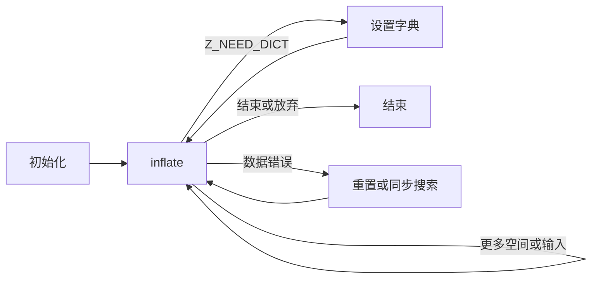

<!-- source-sha256: 1da7cdff30baecfcaba99cc269816af199ee84ee9b70f012833e5345528f13e3 -->

# 流式解压

[API 手册](README.md) · [共享流规则](streams.md) · [流式压缩](deflate-stream.md)

使用 `inflate` 流分批解码输入，同时控制输出空间。初始化时选择 zlib、gzip 或不带封装的 raw DEFLATE，随后提供更多输入或空间继续，直到完成、请求字典或发生错误。无论出现哪种结果，`inflateEnd` 都可释放解码器。整块缓冲区的 zlib 解码见 [uncompress](utility.md#uncompress2_z)。

| 任务 | 条目 |
| --- | --- |
| 开始或复用 | [初始化](#inflateinit_)、[配置初始化](#inflateinit2_)、[重置](#inflatereset)、[新配置](#inflatereset2)、[保留历史](#inflateresetkeep) |
| 解码或提供元数据 | [解压](#inflate)、[设置字典](#inflatesetdictionary)、[读取历史](#inflategetdictionary)、[gzip 头](#inflategetheader) |
| 恢复或检查 | [同步搜索](#inflatesync)、[同步点](#inflatesyncpoint)、[位置标记](#inflatemark)、[表使用量](#inflatecodesused) |
| 调整或分支 | [预置位](#inflateprime)、[校验](#inflatevalidate)、[距离选项](#inflateundermine)、[复制](#inflatecopy) |
| 释放存储 | [结束](#inflateend) |

聚焦契约遵循固定版本的 `inflate.c` 和 `zlib.h`，采用默认 LP64 Linux 构建，启用 gzip，不启用可选的无效距离或严格距离模式。范围更广的[已登记公开目标](../../checking/goals.md)保持各自定义域。术语见[契约约定](contracts.md)，证明状态和剩余工作见[进度](../../progress.md)。

## 公共条件

调用者与解码器各自保留不同的内容。调用者提供本轮输入和输出缓冲区；解码器保留当前解析阶段、尚未用完的位，以及可能供后续复制使用的历史。更换调用者的输出数组，并不会开始一个新解码任务。

`next_in` 是本轮未读输入的起点，`avail_in` 是可读字节数；`next_out` 是下一个输出位置，`avail_out` 是从这里开始的剩余可写字节数。例如一块 5 字节输出数组返回时剩余 2 字节空间，就说明本轮写入了 3 字节。先接走这些结果，再把指针和容量设置为下一块可写区域。

下列所有契约都有**受限定义域**。仅凭 C 指针类型，不能提供这里要求的存储、生命周期或调用历史。

- **有效流**已成功初始化或复制，尚未结束，保留库拥有的状态，且不发生并发调用。使用默认分配器和释放函数。初始化调用接收可写、尚未有效初始化为流的对象，分配器字段为 NULL 或默认函数。
- 可读或可写范围在整个调用期间都具有所述容量。调用者范围与流及流拥有的存储分离。输入与输出范围不重叠。字典目标、已登记头部记录及其目标缓冲区彼此分离，也与流分离。使用已登记头部存储的调用还要求它与输入/输出范围分离。这些是聚焦定义域的显式限制。
- 调用者拥有流对象及缓冲区。库拥有状态和可选窗口。调用只改变自己的流、拥有的存储、所述输出范围和任何已登记头部目标。它绝不释放调用者缓冲区。
- **流检查**拒绝时返回 `Z_STREAM_ERROR`，不发生变化，除非查询或复制契约另有说明。这覆盖 NULL 和可安全读取但未通过检查的记录，不覆盖悬空或任意指针。检查要求分配器、状态、状态的回指针和有效模式满足条件。
- 计数器使用 C 无符号位宽并回绕。没有契约假设分配成功。解码、字典或分配错误之后，仍可调用 `inflateEnd`。



## inflateResetKeep

```c
int ZEXPORT inflateResetKeep(z_streamp strm);
```

重新开始解码，同时保留历史。这是未公开文档化的入口。

### 返回值与后续调用 {#api-inflateresetkeep-returns}

**返回值类型。** `int` — zlib 状态码

结果说明解码是否已重启，同时保留原有历史。

| 返回值 | 含义与出现条件 | 调用者接下来 |
| --- | --- | --- |
| `Z_OK`<br>**已重启并保留历史** | 有效流通过检查；清空计数、缓冲位和头部登记，保留窗口历史。 | 仅在有意沿用历史时继续；独立流应使用 inflateReset。 |
| `Z_STREAM_ERROR`<br>**流检查未通过** | 流未通过公共流检查；内容不变。 | 先确认有效流及其所有权，再进行后续操作。 |

### 调用条件与状态效果 {#api-inflateresetkeep-contract}

**定义域。** 受限定义域：任意模式的有效流。

**影响。** 修改状态，不分配或释放。

**前置条件。** 满足公共有效流条件。调用者有意让旧窗口继续供下一个流使用。

<details markdown="1" class="ar-return-exact" data-return-exact="inflateResetKeep"><summary>完整返回条件与边界</summary>

**后置条件。** 返回 `Z_OK`。清空总计数、消息、`data_type`、缓冲位、字典已设置状态和头部登记。使用当前包装重新开始头部/块解码，保留窗口及其历史。使用包装时，若接受 zlib，`adler` 为 1，否则为 0；raw 保持 `adler` 不变。

**边界情况。** 不恢复被恢复操作改变的包装设置。流检查失败不改变任何内容。用 `inflateReset` 丢弃历史。

</details>

## inflateReset

```c
int ZEXPORT inflateReset(z_streamp strm);
```

使用现有配置开始新的独立压缩数据流。

### 返回值与后续调用 {#api-inflatereset-returns}

**返回值类型。** `int` — zlib 状态码

结果说明是否已准备好用原配置解码一个独立的新流。

| 返回值 | 含义与出现条件 | 调用者接下来 |
| --- | --- | --- |
| `Z_OK`<br>**新流已就绪** | 有效流已重置；历史和头部登记被清空，请求的包装及窗口大小被恢复。 | 设置新输入和输出范围后继续 inflate；最终仍须 inflateEnd。 |
| `Z_STREAM_ERROR`<br>**流检查未通过** | 流未通过公共流检查；内容不变。 | 先确认有效流及其所有权，再进行后续操作。 |

**判读要点。**

- 输入/输出指针及可用计数不变；inflateValidate 选择的校验设置会保留。

### 调用条件与状态效果 {#api-inflatereset-contract}

**定义域。** 受限定义域：有效流，包括已完成或失败的流。

**影响。** 修改状态，可能释放窗口，绝不分配。

**前置条件。** 满足公共有效流条件。

<details markdown="1" class="ar-return-exact" data-return-exact="inflateReset"><summary>完整返回条件与边界</summary>

**后置条件。** 返回 `Z_OK`。恢复请求的包装和窗口大小，丢弃历史，然后执行 `inflateResetKeep` 所述重置。输入/输出指针和可用计数不变。相同大小的窗口可以保持已分配；不兼容窗口被释放。

**边界情况。** 清空头部登记。保留 `inflateValidate` 选择的校验设置，同时撤销恢复过程临时改变的包装设置。流检查失败不改变任何内容。

</details>

## inflateReset2

```c
int ZEXPORT inflateReset2(z_streamp strm, int windowBits);
```

重置并选择新的包装和最大窗口大小。

### 返回值与后续调用 {#api-inflatereset2-returns}

**返回值类型。** `int` — zlib 状态码

结果说明新包装和窗口配置是否已生效，并开始新的解码。

| 返回值 | 含义与出现条件 | 调用者接下来 |
| --- | --- | --- |
| `Z_OK`<br>**新配置已生效** | 流检查通过且 windowBits 被接受；重置解码、丢弃历史和头部登记，为新包装启用校验。 | 按新格式提供输入和输出范围，然后调用 inflate。 |
| `Z_STREAM_ERROR`<br>**配置或流被拒绝** | windowBits 无效或流检查失败；内容不变。 | 若原流有效，选择可接受配置；流检查失败时先修正流的使用。 |

**判读要点。**

- 接受 -15..-8、0、8..15、16、24..31、32、40..47；具体包装含义见完整契约。

### 调用条件与状态效果 {#api-inflatereset2-contract}

**定义域。** 受限定义域：有效流和每个有符号 `windowBits` 值。

**影响。** 修改状态，可能释放窗口，绝不分配。

**前置条件。** 满足公共有效流条件。放弃旧的解码过程。

<details markdown="1" class="ar-return-exact" data-return-exact="inflateReset2"><summary>完整返回条件与边界</summary>

**后置条件。** 对可接受值返回 `Z_OK`，效果等于使用新请求执行 `inflateReset`。可接受值及含义列于 `inflateInit2_`。为新包装请求启用校验。

**边界情况。** 无效值在任何变化之前返回 `Z_STREAM_ERROR`。改变请求大小会释放不兼容窗口。即使大小相同，待处理头部登记和历史也会丢弃。

</details>

## inflateInit2_

```c
int ZEXPORT inflateInit2_(z_streamp strm, int windowBits, const char *version, int stream_size);
```

创建采用所选封装和窗口的解码器。

窗口保存近期已经解出的字节，长度／距离引用从中取回旧内容。表中的“窗口位数”是尺度指数 b，表示最多 `2^b` 字节：例如 15 对应 32768 字节。`windowBits` 还用符号或附加值选择 raw、zlib、gzip 或自动检测；不能把参数数值直接当成字节数。请求 0、16、32 把大小选择交给头部或默认规则，具体含义见表。

### 返回值与后续调用 {#api-inflateinit2_-returns}

**返回值类型。** `int` — zlib 状态码

结果说明是否已建立带指定格式的新解码器。仅成功初始化才需要后续结束操作。

| 返回值 | 含义与出现条件 | 调用者接下来 |
| --- | --- | --- |
| `Z_OK`<br>**解码器已建立** | 版本及流大小匹配，状态分配成功且 windowBits 被接受。 | 提供输入和输出范围后调用 inflate；完成或放弃时调用 inflateEnd。 |
| `Z_VERSION_ERROR`<br>**版本或结构大小不匹配** | version 为 NULL、首字节不匹配或 stream_size 错误；在检查 strm 前返回，内容不变。 | 修正版本和结构大小后重新初始化；本次失败无需 inflateEnd。 |
| `Z_STREAM_ERROR`<br>**流或窗口请求被拒绝** | 版本检查通过后 strm 为 NULL；或成功分配状态后发现 windowBits 无效，释放该状态并将 state 置为 NULL。 | 提供可写的非活跃流和可接受的 windowBits 后重新初始化；本次失败无需结束。 |
| `Z_MEM_ERROR`<br>**状态分配失败** | 状态分配失败，保留旧 state 字段；msg 已清空，所需默认分配器字段可能已设置。 | 在资源可用时可重新初始化；本次失败未保留新分配，无需 inflateEnd。 |

**判读要点。**

- 状态分配发生在 windowBits 检查之前；即使 windowBits 无效，也可能先返回 Z_MEM_ERROR。

### 调用条件与状态效果 {#api-inflateinit2_-contract}

**定义域。** 受限定义域：新的可写流存储、默认分配器，以及 NULL 或可读版本指针；覆盖所有有符号标量参数。

**影响。** 分配状态。

**前置条件。** 流尚未有效初始化。分配器字段遵循公共约定。只要求版本首字节可读；不检查整个字符串。

<details markdown="1" class="ar-return-exact" data-return-exact="inflateInit2_"><summary>完整返回条件与边界</summary>

**后置条件。** 返回 `Z_OK` 时，流有效，总计数为零，消息为 NULL，`data_type` 为零，没有窗口、历史、缓冲位或头部登记。zlib/自动检测包装的 `adler` 初始为 1，仅 gzip 的为 0；raw 保持它不变。缓冲区指针和可用计数不变。

可接受的 `windowBits` 值为：

| 值 | 解码器请求 |
| --- | --- |
| -15 至 -8 | 不带封装的 raw DEFLATE，窗口位数为其绝对值 |
| 0；8 至 15 | zlib；0 从头部选择大小，否则为该最大值 |
| 16；24 至 31 | 仅 gzip；16 使用默认大小，否则减去 16 |
| 32；40 至 47 | zlib/gzip 检测；32 使用头部/默认大小，否则减去 32 |

**错误。** 版本为 NULL/首字节错误，或 `stream_size` 错误时，在检查 `strm` 前返回 `Z_VERSION_ERROR`，不发生变化。否则，NULL `strm` 返回 `Z_STREAM_ERROR`。窗口参数检查前先尝试分配状态。分配失败返回 `Z_MEM_ERROR`，保留旧 `state` 字段，清空消息，并按需安装默认回调。分配成功后发现无效窗口参数，则返回 `Z_STREAM_ERROR`，释放该状态，将 `state` 置为 NULL。任何失败初始化都不保留新分配。只有成功初始化才需要后续 `inflateEnd`；其窗口可能由后续调用分配。

</details>

## inflateInit_

```c
int ZEXPORT inflateInit_(z_streamp strm, const char *version, int stream_size);
```

创建最大窗口为 32 KiB 的 zlib 解码器。

### 返回值与后续调用 {#api-inflateinit_-returns}

**返回值类型。** `int` — zlib 状态码

结果说明是否已建立最大窗口为 32 KiB 的 zlib 解码器。

| 返回值 | 含义与出现条件 | 调用者接下来 |
| --- | --- | --- |
| `Z_OK`<br>**zlib 解码器已建立** | 等价于 windowBits 为 15 的 inflateInit2_，状态分配成功。 | 用 inflate 解码 zlib 输入；完成或放弃后调用 inflateEnd。 |
| `Z_VERSION_ERROR`<br>**版本或结构大小不匹配** | version 为 NULL、首字节不匹配或 stream_size 错误；不检查流且内容不变。 | 修正版本及结构大小后重新初始化；本次失败无需 inflateEnd。 |
| `Z_STREAM_ERROR`<br>**流指针被拒绝** | 版本检查通过后 strm 为 NULL。 | 提供可写的非活跃流后重新初始化；本次失败无需结束。 |
| `Z_MEM_ERROR`<br>**状态分配失败** | 未能分配状态；保留旧 state，msg 和默认分配器字段可能已改变。 | 资源可用时可重新初始化；本次失败未保留新分配，无需 inflateEnd。 |

### 调用条件与状态效果 {#api-inflateinit_-contract}

**定义域。** 受限定义域：与 `inflateInit2_` 相同的存储、版本和分配器定义域。

**影响。** 分配状态。

**前置条件。** 满足 `inflateInit2_` 的前置条件。

<details markdown="1" class="ar-return-exact" data-return-exact="inflateInit_"><summary>完整返回条件与边界</summary>

**后置条件。** 精确等于 `inflateInit2_(strm, 15, version, stream_size)`。成功后接受窗口不超过 32 KiB 的 zlib 流，拥有一项状态分配。

**错误。** 与 `inflateInit2_` 相同的版本、NULL 流、分配失败及清理行为。后续解码不会把 gzip 或 raw 字节作为 zlib 接受。

</details>

## inflatePrime

```c
int ZEXPORT inflatePrime(z_streamp strm, int bits, int value);
```

在下一个输入字节之前提供位，或清空缓冲位。

### 返回值与后续调用 {#api-inflateprime-returns}

**返回值类型。** `int` — zlib 状态码

结果说明位缓冲区是否接受了清空或补位请求。

| 返回值 | 含义与出现条件 | 调用者接下来 |
| --- | --- | --- |
| `Z_OK`<br>**位请求已处理** | bits 为负时清空缓冲；为零时不变；为 1..16 且能放入 32 位缓冲时追加 value 的低 bits 位。 | 在契约允许的 raw 流调用位置，继续 inflate；补入的位先于 next_in。 |
| `Z_STREAM_ERROR`<br>**位请求或流被拒绝** | bits 大于 16、剩余位空间不足或流检查失败；内容不变。 | 有效流上修正补位请求；流检查失败则先修正流的使用。 |

**判读要点。**

- 成功返回不验证 raw 模式或调用顺序；这些仍是调用前提。

### 调用条件与状态效果 {#api-inflateprime-contract}

**定义域。** 受限定义域：第一次解码前，或在已报告的块/头部边界处的有效 raw 流；覆盖每个有符号 `bits` 和 `value`。

**影响。** 只修改状态。

**前置条件。** 满足公共有效流条件和所述位预置调用顺序。

<details markdown="1" class="ar-return-exact" data-return-exact="inflatePrime"><summary>完整返回条件与边界</summary>

**后置条件。** 零位返回 `Z_OK`，不发生变化。负位数清空位缓冲区。1 至 16 位且能放入 32 位 缓冲区时，返回 `Z_OK`，将 `value` 的低 `bits` 位追加到已有位之上。这些位先于 `next_in` 使用。

**错误。** 超过 16 位、位缓冲区空间不足或流检查失败，返回 `Z_STREAM_ERROR`，不发生变化。不更新 `data_type`。C 不强制检查 raw 流或调用顺序限制。

</details>

## inflate

```c
int ZEXPORT inflate(z_streamp strm, int flush);
```

消费压缩字节，写入解码字节，跨调用保留状态。

这次调用只使用当前给出的输入和输出空间。返回时先看实际推进了多少，再看返回码决定是继续、提供字典、结束还是处理错误。`flush` 请求的是停止边界或完成方式，不是压缩级别。输出空间用完不表示数据流已经解完，输入暂时不够也不等于格式损坏。

### 返回值与后续调用 {#api-inflate-returns}

**返回值类型。** `int` — zlib 状态码

结果区分本次推进、一个流的完成、字典请求和错误；推进不代表解码结束。

| 返回值 | 含义与出现条件 | 调用者接下来 |
| --- | --- | --- |
| `Z_OK`<br>**已推进，尚未完成** | 已消费输入或产生输出，但尚未完成一个流；也可能因指定的块/头部边界而停下。 | 按需提供更多输入或输出空间后继续 inflate。 |
| `Z_STREAM_END`<br>**一个流或成员已完成** | 已完成一个所选格式的流，包括启用的尾部校验；已完成流的重复调用也返回此值。 | 保留未读尾部输入；调用 inflateEnd，或在处理下一个 gzip 成员前重置。 |
| `Z_NEED_DICT`<br>**需要 zlib 字典** | zlib 头部要求预置字典；strm->adler 给出所需字典的标识。 | 用 inflateSetDictionary 提供正确字典，成功后继续；放弃则调用 inflateEnd。 |
| `Z_BUF_ERROR`<br>**本次无法完成所需推进** | 本次没有输入/输出推进，或 Z_FINISH 请求尚未完成；Z_FINISH 将本来为 Z_OK 的结果改为此值。 | 按需提供输入或输出空间后继续；不能仅凭此值判定数据损坏。 |
| `Z_DATA_ERROR`<br>**检测到数据错误** | 检测到格式错误或启用的校验和/长度错误；可能已经产生输出。数据错误状态会保持。 | 使用 inflateReset 放弃当前流，或用 inflateSync 尝试恢复，或调用 inflateEnd。 |
| `Z_MEM_ERROR`<br>**历史窗口分配失败** | 窗口分配失败；可能已经消费输入或写出数据，且错误状态会保持。 | 读取已更新的指针及可用计数；重置后再开始，或调用 inflateEnd。 |
| `Z_STREAM_ERROR`<br>**流或缓冲条件不满足** | 流/缓冲检查失败，或 inflateSync 恢复搜索尚未完成。 | 有效流的缓冲拒绝需修正参数；恢复搜索需继续 inflateSync；其他情况先确认流有效。 |

**判读要点。**

- 正常返回按实际消费/产生字节更新总计数和启用的校验和；Z_NEED_DICT 保留字典标识。
- 迟发 Z_MEM_ERROR 会跳过常规最终总计数、校验和及 data_type 记账，不能把它当作输出未变。
- 正常返回的 data_type 是组合值：未用位数，再按状态加 64（最终块）、128（头部/块边界）或 256（块头之后）。

### 调用条件与状态效果 {#api-inflate-contract}

**定义域。** 受限定义域：满足公共缓冲区/头部生命周期条件的有效流；覆盖任意压缩字节、输入/输出分块和有符号 `flush` 值。

**影响。** 修改流、输出和已登记头部存储；可能分配历史窗口。

**前置条件。** `next_in` 描述 `avail_in` 个可读字节，仅在计数为零时可为 NULL。即使 `avail_out` 为零，`next_out` 也非 NULL，并描述该数量的可写字节。已登记头部及其缓冲区保持可写。调用可以提供更多输入/空间继续，可以提供请求的字典，也可以在成功重置/恢复之后继续。终止/错误状态下的重复调用行为如下。

**记账。** 正常返回，包括数据错误和缓冲区错误，按已消费/已产生字节数更新总计数，并更新已启用的输出校验和。`Z_NEED_DICT` 记录已消费的头部字节，并让 `adler` 保持为字典标识。晚期窗口分配失败可能发生在消费输入和写入输出之后：指针/计数已经反映这些操作，但跳过正常最终总计数/校验和/`data_type` 记账。不能把 `Z_MEM_ERROR` 当作输出未变的结果。

**所有权。** 新窗口存储归流所有，仍可用于重置/结束，包括错误之后。一次调用的 `Z_FINISH` 完成可能无需窗口。拼接 gzip 成员要求成员之间重置。错误消息是借用的静态字符串。缓冲区和流检查的拒绝不改变任何内容。

<details markdown="1" class="ar-return-exact" data-return-exact="inflate"><summary>完整返回条件与边界</summary>

**后置条件。** 在所述范围内读写。按已消费/已产生字节数推进指针并减少可用计数。从初始化/重置开始的普通运行中，如果所选格式有效且字典正确，累计输出是解码数据的前缀，在 `Z_STREAM_END` 时等于完整数据。畸形字节也在定义域内：检测到格式错误，或启用的校验和/长度检查失败时，返回 `Z_DATA_ERROR`，此前可能已有输出。仅有输入不完整时需要更多输入；不必把它报告为数据错误。

| 结果 | 含义与下一步 |
| --- | --- |
| `Z_OK` | 输入或输出有所推进；利用可用输入/空间继续 |
| `Z_STREAM_END` | 完成一个流/成员，包括启用的尾部检查；尾随输入保留 |
| `Z_NEED_DICT` | 需要 zlib 字典；`adler` 为其标识；设置字典 |
| `Z_BUF_ERROR` | 没有推进，或 `Z_FINISH` 未能完成；提供输入/空间 |
| `Z_DATA_ERROR` | 检测到畸形数据；重置、恢复或结束 |
| `Z_MEM_ERROR` | 窗口分配失败；重置或结束 |
| `Z_STREAM_ERROR` | 流/缓冲区检查失败，或恢复搜索尚未完成 |

**边界情况。** 允许输入或输出空间为零。`Z_BLOCK` 在头部或块边界停止；`Z_TREES` 还在块描述之后停止。`Z_FINISH` 将本来为 `Z_OK` 的结果改为 `Z_BUF_ERROR`。其他有符号刷新值被接受，行为与 `Z_NO_FLUSH` 相同。正常返回时，`data_type` 记录未用位数；最终块再加 64，头部/块边界再加 128，块头之后再加 256。数据和内存错误会保持；完成的流重复返回 `Z_STREAM_END`。

</details>

## inflateEnd

```c
int ZEXPORT inflateEnd(z_streamp strm);
```

释放解码器存储，包括解码被放弃或失败的情况。

### 返回值与后续调用 {#api-inflateend-returns}

**返回值类型。** `int` — zlib 状态码

结果说明解码器拥有的状态和窗口是否已释放；无需先解码完成。

| 返回值 | 含义与出现条件 | 调用者接下来 |
| --- | --- | --- |
| `Z_OK`<br>**解码器已释放** | 有效流通过检查；可选窗口和状态恰好释放一次，state 置为 NULL。 | 可释放调用者缓冲区；再次使用该流须重新初始化。 |
| `Z_STREAM_ERROR`<br>**未执行释放** | 流检查失败，包括已经结束的流；不释放任何内容。 | 确认流的生命周期和所有权；不要对已结束的流再次结束。 |

### 调用条件与状态效果 {#api-inflateend-contract}

**定义域。** 受限定义域：每种模式下的有效流，包括分配/数据错误之后。

**影响。** 修改流并释放拥有的存储。

**前置条件。** 满足公共有效流条件。

<details markdown="1" class="ar-return-exact" data-return-exact="inflateEnd"><summary>完整返回条件与边界</summary>

**后置条件。** 返回 `Z_OK`，对可选窗口和状态恰好释放一次，将 `state` 置为 NULL。其他流字段和调用者缓冲区不变。不分配，使用默认释放函数时不可能返回 `Z_MEM_ERROR`。

**边界情况。** 不要求流已完成，也不把数据不完整报告为错误。流检查失败，包括流已经结束，返回 `Z_STREAM_ERROR`，不释放任何内容。再次使用前须重新初始化。

</details>

## inflateGetDictionary

```c
int ZEXPORT inflateGetDictionary(z_streamp strm, Bytef *dictionary, uInt *dictLength);
```

读取保留的滑动历史，从最旧字节开始。

### 返回值与后续调用 {#api-inflategetdictionary-returns}

**返回值类型。** `int` — zlib 状态码

返回值报告查询是否成功；历史字节数写入 dictLength，而非作为返回值。

| 返回值 | 含义与出现条件 | 调用者接下来 |
| --- | --- | --- |
| `Z_OK`<br>**历史查询成功** | 流检查通过；非 NULL dictionary 接收从旧到新的历史，非 NULL dictLength 接收其字节数。 | 使用请求的目标结果；流可继续使用，历史为空也有效。 |
| `Z_STREAM_ERROR`<br>**查询被拒绝** | 流检查失败；不写入任何目标。 | 不要把目标旧值当作本次结果；先确认有效流。 |

**判读要点。**

- 任一目标可为 NULL。没有分配过窗口的已完成流，即使产生过输出，也可能报告零字节历史。

### 调用条件与状态效果 {#api-inflategetdictionary-contract}

**定义域。** 受限定义域：有效流，可带可写字典和长度目标。

**影响。** 观察状态，只写入这些目标。

**前置条件。** 非 NULL 字典具有容纳保留历史的空间；32768 字节总是足够。非 NULL 的 `dictLength` 指向可写 `uInt` 存储。

<details markdown="1" class="ar-return-exact" data-return-exact="inflateGetDictionary"><summary>完整返回条件与边界</summary>

**后置条件。** 返回 `Z_OK`。`dictionary` 非 NULL 时复制历史，`dictLength` 非 NULL 时存入历史大小。不分配/释放；流不变。

**边界情况。** 任一目标均可为 NULL。新历史为空。若一个流完成时从未分配窗口，即使已经产生输出，它的历史也可能为空。流检查失败不写入任何内容。

</details>

## inflateSetDictionary

```c
int ZEXPORT inflateSetDictionary(z_streamp strm, const Bytef *dictionary, uInt dictLength);
```

设置或补充可供向后匹配使用的字节。

### 返回值与后续调用 {#api-inflatesetdictionary-returns}

**返回值类型。** `int` — zlib 状态码

结果区分字典安装成功、标识不匹配和流/内存错误。

| 返回值 | 含义与出现条件 | 调用者接下来 |
| --- | --- | --- |
| `Z_OK`<br>**字典已安装** | raw 流接受字典，或等待字典的 zlib 流标识匹配；已保留可用窗口后缀。 | 继续 inflate；输入/输出指针和总计数未推进。 |
| `Z_DATA_ERROR`<br>**zlib 字典标识不匹配** | 给定字典的完整 Adler 标识与所需标识不同；流不变。 | 可尝试另一个字典；放弃则调用 inflateEnd。 |
| `Z_STREAM_ERROR`<br>**字典请求被拒绝** | dictionary 为 NULL、流检查失败，或带包装的流并未等待字典。 | 仅在有效 raw 流或等待字典的 zlib 流上，按契约提供非 NULL 字典。 |
| `Z_MEM_ERROR`<br>**窗口分配失败** | 历史窗口分配失败，流进入内存错误模式。 | 先重置再开始新的解码，或调用 inflateEnd 释放状态。 |

**判读要点。**

- raw 模式不检查字典标识；Z_OK 不保证给错字典时仍能得到正确输出。

### 调用条件与状态效果 {#api-inflatesetdictionary-contract}

**定义域。** 受限定义域：在 `Z_NEED_DICT` 后等待的有效 zlib 流，或处于任意调用边界的有效 raw 流。

**影响。** 修改历史，可能分配窗口。

**前置条件。** `dictionary` 非 NULL，描述 `dictLength` 个可读字节，即使长度为零也如此。要产生正确输出，它须与压缩器字典一致。

<details markdown="1" class="ar-return-exact" data-return-exact="inflateSetDictionary"><summary>完整返回条件与边界</summary>

**后置条件。** 保留“旧历史后接新字典”这一序列的最后一个窗口大小的后缀后，返回 `Z_OK`。整个给定字典都参与 zlib 标识检查。调用者字节被复制，不保留其存储，也不释放它。

**错误。** 错误的 zlib 标识返回 `Z_DATA_ERROR`，不发生变化；可以尝试另一个字典。NULL 字典、流检查失败，或不在等待字典的包装流，返回 `Z_STREAM_ERROR`。分配失败返回 `Z_MEM_ERROR`，使流处于内存错误模式，仍可结束。

**边界情况。** gzip 没有预置字典路径。raw 模式不检查标识；错误字典可能产生错误输出或较晚的错误。接受零长度 raw 字典。不推进输入/输出指针或总计数。

</details>

## inflateGetHeader

```c
int ZEXPORT inflateGetHeader(z_streamp strm, gz_headerp head);
```

登记调用者存储，用于下一个 gzip 头。

头部可能含有扩展字节、文件名和注释。调用者分别提供这三类结果的目标地址与容量：`extra`／`extra_max`、`name`／`name_max`、`comment`／`comm_max`，容量均以字节计。登记只保存这些地址；真正解析头部并填充结果的是后续 `inflate` 调用。

### 返回值与后续调用 {#api-inflategetheader-returns}

**返回值类型。** `int` — zlib 状态码

返回值只说明头部目标是否已登记；解析进度稍后由 head->done 表示。

| 返回值 | 含义与出现条件 | 调用者接下来 |
| --- | --- | --- |
| `Z_OK`<br>**头部目标已登记** | 有效流支持 gzip，登记 head 并将 head->done 置为 0；尚未解析头部。 | 保持所有登记存储有效并调用 inflate；通过 done 查看后续结果。 |
| `Z_STREAM_ERROR`<br>**登记被拒绝** | 流检查失败或请求未启用 gzip 支持；内容不变。 | 先建立支持 gzip 的有效流，再在解码前登记存储。 |

**判读要点。**

- 后续 done 为 1 表示 gzip 头完成，为 -1 表示自动检测到 zlib；这两个值不是本函数的返回码。
- 接受登记时 head 必须非 NULL；NULL 不属于可保证返回错误的情况。

### 调用条件与状态效果 {#api-inflategetheader-contract}

**定义域。** 受限定义域：初始化/重置后、解码前，支持 gzip 的有效流。

**影响。** 登记借用存储，写入 `head->done`。

**前置条件。** `head` 非 NULL 且可写。其 `extra`、`name`、`comment` 指针为 NULL，或分别具有可写容量 `extra_max`、`name_max`、`comm_max`。所有已登记存储保持有效，直到头部解析结束或请求被清空。头部记录及其目标缓冲区彼此分离，并与流、流拥有的存储，以及使用它们的调用的输入/输出范围分离。

<details markdown="1" class="ar-return-exact" data-return-exact="inflateGetHeader"><summary>完整返回条件与边界</summary>

**后置条件。** 返回 `Z_OK`，保留指针，将 `done` 置为 0。后续 `inflate` 调用填充标量字段和可用缓冲区前缀。存在扩展字段 `extra` 时，`extra_len` 为实际长度；不存在时，`extra` 变为 NULL，`extra_len` 不变。只有终止符能放下时，名称/注释才以零终止。缺失的可选字段使对应指针变为 NULL。完成时将 `done` 置为 1；自动检测到 zlib 时置为 -1。

**边界情况。** 不分配，也不转移所有权。重置清空登记。流检查失败或请求不支持 gzip 时，返回 `Z_STREAM_ERROR`，不发生变化。对已接受的请求传入 NULL `head` 不在本契约范围内，C 会解引用它；这不是可干净返回错误的情况。

</details>

## inflateSync

```c
int ZEXPORT inflateSync(z_streamp strm);
```

输入受损后，搜索可能的完全刷新边界。

### 返回值与后续调用 {#api-inflatesync-returns}

**返回值类型。** `int` — zlib 状态码

结果说明恢复搜索是否找到候选边界；找到模式不等于数据已恢复正确。

| 返回值 | 含义与出现条件 | 调用者接下来 |
| --- | --- | --- |
| `Z_OK`<br>**找到候选边界** | 在缓冲整字节或输入中找到 00 00 ff ff；历史和头部登记重置，总计数保留。 | 可从后续块恢复 inflate；不要据此假定后缀有效或校验已恢复。 |
| `Z_DATA_ERROR`<br>**尚未找到，继续搜索** | 当前可搜索字节中未找到完整模式；部分匹配会跨调用保留。 | 提供更多输入并继续 inflateSync；搜索期间普通 inflate 返回 Z_STREAM_ERROR。 |
| `Z_BUF_ERROR`<br>**没有可搜索的字节** | 没有输入且缓冲位少于八位；内容不变。 | 提供更多输入后继续 inflateSync，或调用 inflateEnd 放弃。 |
| `Z_STREAM_ERROR`<br>**流检查未通过** | 流未通过公共流检查；内容不变。 | 先确认有效流及其所有权，再进行后续操作。 |

**判读要点。**

- 候选模式可能不是真正的完全刷新点，也可能仍依赖旧历史；恢复不承诺校验和检查。

### 调用条件与状态效果 {#api-inflatesync-contract}

**定义域。** 受限定义域：数据错误后或恢复搜索期间的有效流，输入可读。

**影响。** 消费输入、修改状态，可能释放窗口。

**前置条件。** `next_in` 和 `avail_in` 描述可读范围。不使用输出。

<details markdown="1" class="ar-return-exact" data-return-exact="inflateSync"><summary>完整返回条件与边界</summary>

**后置条件。** 先在缓冲的整字节、再在输入中搜索 `00 00 ff ff`，跨调用保留部分匹配。输入指针/计数和 `total_in` 按已搜索输入量推进。不产生输出，`total_out` 不变。
**结果。** `Z_OK` 表示找到模式：重置历史和头部登记，保留总计数，可在后续块恢复解码。如果尚未读取头部，恢复使用 raw 模式；否则关闭尾部校验。仍未知的窗口大小变为 15。`Z_DATA_ERROR` 表示继续搜索；该搜索期间，普通 `inflate` 返回 `Z_STREAM_ERROR`。

**边界情况。** 无输入且缓冲位少于八位时，返回 `Z_BUF_ERROR`，不发生变化。流检查失败不改变任何内容。找到的模式不一定是真正刷新点；即使是同步刷新边界，也可能需要此前历史。恢复不承诺有效后缀，也不承诺恢复校验和检查。不分配。

</details>

## inflateSyncPoint

```c
int ZEXPORT inflateSyncPoint(z_streamp strm);
```

检查接下来是否正在等待存储块的长度字节。

### 返回值与后续调用 {#api-inflatesyncpoint-returns}

**返回值类型。** `int` — 状态查询值或错误码

这是带错误码的状态查询；须区分 1、0 和负错误码。

| 返回值 | 含义与出现条件 | 调用者接下来 |
| --- | --- | --- |
| `1`<br>**正在等待存储块长度** | 有效流正在等待存储块长度字节，且位缓冲区为空。 | 按此状态解释查询；继续使用有效流。 |
| `0`<br>**不处于该状态** | 有效流不同时满足等待存储块长度和空位缓冲区。 | 按未到达此点处理；这不表示解码错误。 |
| `Z_STREAM_ERROR`<br>**查询被拒绝** | 流检查失败；内容不变。 | 先确认有效流；不能把负错误码当作“是”。 |

**判读要点。**

- 使用 result == 1 判断命中；C 中负错误码也为真。本函数不搜索标记。

### 调用条件与状态效果 {#api-inflatesyncpoint-contract}

**定义域。** 受限定义域：任意模式的有效流。

**影响。** 只读查询。

**前置条件。** 满足公共有效流条件。

<details markdown="1" class="ar-return-exact" data-return-exact="inflateSyncPoint"><summary>完整返回条件与边界</summary>

**后置条件。** 当且仅当正在等待存储块长度，且位缓冲区为空时返回 1，否则返回 0。不分配/释放，不改变任何内容。

**边界情况。** 流检查失败返回 `Z_STREAM_ERROR`。应检查 `== 1`，因为负错误码在 C 中也视为真。这不是搜索标记。

</details>

## inflateCopy

```c
int ZEXPORT inflateCopy(z_streamp dest, z_streamp source);
```

创建可以从源位置继续的解码器。

### 返回值与后续调用 {#api-inflatecopy-returns}

**返回值类型。** `int` — zlib 状态码

结果说明目标是否获得一个可独立结束的解码器副本。

| 返回值 | 含义与出现条件 | 调用者接下来 |
| --- | --- | --- |
| `Z_OK`<br>**解码状态已复制** | 有效源被复制到不同的非活跃目标；目标拥有独立状态和所需窗口，源不变。 | 两个流最终都须 inflateEnd；继续前提供分离的可写目标并维持共享指针的生命周期。 |
| `Z_STREAM_ERROR`<br>**复制请求被拒绝** | dest 为 NULL 或源流检查失败；非 NULL dest 的 state 清空，其他字段不变，源不变。 | 修正源和目标后再复制；本次失败未建立需结束的目标流。 |
| `Z_MEM_ERROR`<br>**副本分配失败** | 状态或窗口分配失败；本次已分配存储全部释放，目标 state 为 NULL，源不变。 | 资源可用时可重新复制；本次失败的目标无需 inflateEnd，源仍须正常结束。 |

**判读要点。**

- 调用者缓冲区、消息及已登记头部指针仍共享；自复制不在契约内。

### 调用条件与状态效果 {#api-inflatecopy-contract}

**定义域。** 受限定义域：有效源，以及不同、可写、尚未有效初始化为流的目标。

**影响。** 分配独立状态，并在源有窗口时分配窗口。

**前置条件。** 源满足公共条件。目标不与源或源拥有的存储重叠。共享的输入/输出和头部指针保留各自的调用者生命周期；使用前为流提供独立可写目标。

<details markdown="1" class="ar-return-exact" data-return-exact="inflateCopy"><summary>完整返回条件与边界</summary>

**后置条件。** `Z_OK` 复制解码位置、历史和流字段。两个流独立拥有各自状态/窗口，都必须结束。源不变。调用者缓冲区指针、消息和任何已登记头部指针共享，不做深复制。不消费或产生调用者数据。

**错误。** NULL `dest` 返回 `Z_STREAM_ERROR`。其他拒绝会清空非 NULL `dest` 的 `state`，除此以外不变。分配失败返回 `Z_MEM_ERROR`，并释放本次尝试的全部分配。源不变。

**边界情况。** 显式排除自复制：C 会覆盖原状态指针。本条不提供自复制的所有权或清理保证，也不把它描述为检查后拒绝。

</details>

## inflateUndermine

```c
int ZEXPORT inflateUndermine(z_streamp strm, int subvert);
```

请求可选的宽松距离模式。这是未公开文档化的入口。

### 返回值与后续调用 {#api-inflateundermine-returns}

**返回值类型。** `int` — zlib 状态码

默认构建用返回值表示拒绝宽松距离模式；Z_DATA_ERROR 在这里不表示解码已失败。

| 返回值 | 含义与出现条件 | 调用者接下来 |
| --- | --- | --- |
| `Z_DATA_ERROR`<br>**正常距离检查已启用** | 有效流上，无论 subvert 为何，默认构建均启用正常距离检查并返回此值。 | 可继续正常解码；本次返回未使流进入数据错误模式。 |
| `Z_STREAM_ERROR`<br>**流检查未通过** | 流检查失败；内容不变。 | 先确认有效流，再进行后续操作。 |

### 调用条件与状态效果 {#api-inflateundermine-contract}

**定义域。** 受限定义域：有效流和每个有符号 `subvert`。

**影响。** 只修改状态。

**前置条件。** 满足公共有效流条件。

<details markdown="1" class="ar-return-exact" data-return-exact="inflateUndermine"><summary>完整返回条件与边界</summary>

**后置条件。** 默认构建中，无论 `subvert` 为何，都返回 `Z_DATA_ERROR`，并启用正常距离检查。不分配/释放。

**边界情况。** 此返回不会使解码器进入数据错误模式。流检查失败返回 `Z_STREAM_ERROR`，不发生变化。可选宽松构建不在本页范围内。

</details>

## inflateValidate

```c
int ZEXPORT inflateValidate(z_streamp strm, int check);
```

启用或关闭包装校验和及 gzip 长度校验。

### 返回值与后续调用 {#api-inflatevalidate-returns}

**返回值类型。** `int` — zlib 状态码

结果说明包装校验设置是否已更新。

| 返回值 | 含义与出现条件 | 调用者接下来 |
| --- | --- | --- |
| `Z_OK`<br>**校验设置已更新** | 有效流在解码前接受设置：check 为零关闭校验，非零为带包装流启用校验；raw 流保持 raw。 | 按此设置继续 inflate；关闭校验时输出校验和不维护，坏尾部可能被接受。 |
| `Z_STREAM_ERROR`<br>**流检查未通过** | 流检查失败；内容不变。 | 先确认有效流及解码前的调用顺序，再进行设置。 |

**判读要点。**

- inflateReset 保留该选择；inflateReset2 会用新包装设置替换它。

### 调用条件与状态效果 {#api-inflatevalidate-contract}

**定义域。** 受限定义域：解码前的有效流，以及每个有符号 `check`。

**影响。** 只修改配置。

**前置条件。** 满足公共有效流条件和所述调用顺序。

<details markdown="1" class="ar-return-exact" data-return-exact="inflateValidate"><summary>完整返回条件与边界</summary>

**后置条件。** 返回 `Z_OK`。零关闭检查；非零为带包装流启用检查。同时改变当前设置和请求设置。raw 流仍为 raw。不分配/释放，也不访问缓冲区。

**边界情况。** 关闭检查会允许本来错误的尾部通过，并且不维护输出校验和。`inflateReset` 保留此选择；`inflateReset2` 替换它。流检查失败返回 `Z_STREAM_ERROR`，不发生变化。

</details>

## inflateMark

```c
long ZEXPORT inflateMark(z_streamp strm);
```

查询当前码位置，用于索引。

返回的一个整数打包了两种进度。`back` 按比特计，描述从当前位位置回到本次编码起点的距离；`progress` 按字节计，描述存储块尚未复制的量或当前匹配已经输出的量。下面的乘数 65536 即 `2^16`，用于把两部分放进同一个结果，不表示窗口大小。

### 返回值与后续调用 {#api-inflatemark-returns}

**返回值类型。** `long` — 打包的位置和进度，或重合的错误哨兵

返回一个打包的位置值，而非 zlib 状态码。错误哨兵与有效位置值重合。

| 返回值 | 含义与出现条件 | 调用者接下来 |
| --- | --- | --- |
| `back * 65536 + progress`<br>**打包的码位置** | 有效流：back 是回到当前码起点的位数；码之间、头部或存储块中为 -1。progress 是剩余存储块字节数、已输出匹配字节数，其他情况为零。 | 按位数和字节数分别解释两部分；查询不改变流。 |
| `-65536`<br>**流检查失败的哨兵** | 流检查失败时返回 -65536；有效流在 back 为 -1 且 progress 为零时也返回同一值。 | 仅凭此值无法区分错误；须根据流的有效性解释。 |

**判读要点。**

- 65536 是 2^16，用于把位置和进度放进一个整数；不表示窗口大小。

### 调用条件与状态效果 {#api-inflatemark-contract}

**定义域。** 受限定义域：任意模式的有效流。

**影响。** 只读查询。

**前置条件。** 满足公共有效流条件。

<details markdown="1" class="ar-return-exact" data-return-exact="inflateMark"><summary>完整返回条件与边界</summary>

**后置条件。** 返回 `back * 65536 + progress`：`back` 是向后回到当前码所需的位数；在码之间/头部内/存储块内为 -1。`progress` 为剩余存储块字节数、已输出匹配字节数，其他情况为零。不改变任何内容，不分配/释放。

**边界情况。** 流检查失败返回 -65536。该值也可能出现在有效流上，因此不能单凭它识别错误。

</details>

## inflateCodesUsed

```c
unsigned long ZEXPORT inflateCodesUsed(z_streamp strm);
```

查询目前使用的解码表项数。这是未公开文档化的入口。这里的单位是表项，不是比特或字节：一个表项记录一次查表所得的符号或后续操作。

### 返回值与后续调用 {#api-inflatecodesused-returns}

**返回值类型。** `unsigned long` — 解码表项计数或错误哨兵

返回的是嵌入式解码表的表项数，不是字节数或状态码。

| 返回值 | 含义与出现条件 | 调用者接下来 |
| --- | --- | --- |
| `0..1444`<br>**嵌入式表使用量** | 有效流返回从嵌入式表区域起点到下一个空闲位置的表项数；新建或重置流为零。 | 把结果按表项计数解释；零是有效结果，固定块可使用静态表而不改变此数。 |
| `(unsigned long)-1`<br>**流检查失败的哨兵** | 流检查失败，返回 unsigned long 最大值。 | 先识别该哨兵再使用计数；确认有效流后再查询。 |

### 调用条件与状态效果 {#api-inflatecodesused-contract}

**定义域。** 受限定义域：任意模式的有效流。

**影响。** 只读查询。

**前置条件。** 满足公共有效流条件。

<details markdown="1" class="ar-return-exact" data-return-exact="inflateCodesUsed"><summary>完整返回条件与边界</summary>

**后置条件。** 返回从嵌入式表区域起点到下一个空闲表项的表项数，范围为 0 至 1444。新的/已重置流返回零。固定块使用静态表，不一定改变此计数。不发生变化，也不分配/释放。

**边界情况。** 流检查失败返回 `(unsigned long)-1`，即无符号最大值。

[返回 API 手册](README.md) · [契约约定](contracts.md)

</details>
