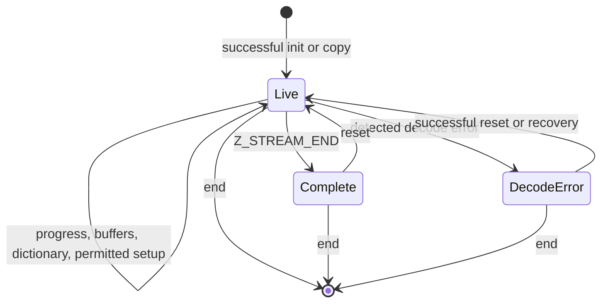

# Shared stream rules

[API manual](README.md) · [How to read a contract](contracts.md)

A stream keeps compression or decompression state between calls. The caller supplies buffers;
the library advances through them and retains the history needed for the next call. Successful
initialization starts a lifetime that ends only when the matching end function releases state.
A successful copy starts a second lifetime with its own end obligation.

This page gathers the buffer, ownership and call-order rules shared by the function entries.
It uses the default LP64 Linux build and default allocator. The pinned C and `zlib.h` supply
source readings **to confirm** by proof. These focused contracts leave the broader
[registered public goals](../../checking/goals.md) unchanged.

## Related function pages

Read the individual entry for exact accepted arguments, returns and error effects:

| Manual | Scope |
| --- | --- |
| [Stream decompression](inflate-stream.md) | Init, decode, reset, dictionaries, headers, recovery, copy, end |
| [Stream compression](deflate-stream.md) | Init, encode, flush, tuning, bounds, copy, end |
| [Callback decoding](inflate-back.md) | Caller window and input/output callbacks |
| [Buffer utilities and library information](utility.md) | Whole-buffer operations, bounds, version, flags and errors |
| [Checksums](checksums.md) | Adler-32, CRC-32 and combination |
| [Gzip files](gz-file.md) | File handles, I/O, seeking and close |

## Stream storage and ownership

The caller owns the `z_stream` and its buffers. The library owns `state` and its allocations.
`next_in`/`avail_in` describe unread input; `next_out`/`avail_out` describe output room.
The library updates totals, `msg`, `data_type` and `adler`. Counters wrap at their C unsigned
widths; `uLong` is 64 bits in this build. The caller leaves owned state and library fields alone,
except where a function contract explicitly permits a change.

| Topic | Common obligation |
| --- | --- |
| Initialization (`A-stream-init`) | Init receives writable, non-live stream storage with `zalloc`, `zfree`, `opaque` set; use NULL/default callbacks in this scope. Only successful init establishes a live stream with non-NULL `state`. Version and parameter refusals follow the function manual. |
| Input (`A-stream-in`) | When a call uses input, `next_in` covers `avail_in` readable bytes; NULL is allowed only with zero count. |
| Output (`A-stream-out`) | When a call uses output, `next_out` covers `avail_out` writable bytes. `inflate` and `deflate` require non-NULL `next_out` even with zero room; their manual states progress/refusal behavior. |
| Separation (`A-stream-disjoint`) | Focused contracts keep caller ranges separate from owned storage and the stream; input/output ranges do not overlap. Additional dictionary/header alias restrictions are explicit in the manuals. This is not a claim that every excluded overlap causes C undefined behaviour. |
| Lifetime and sequencing (`A-stream-single`) | Calls on one stream are sequential; caller storage remains valid for every call that can access it. |
| End (`A-stream-end`) | Successful end releases the state. Reinitialise before further stream work. A documented checked refusal on an ended record is distinct from a permitted live-stream call. |
| Progress accounting (`A-stream-progress`) | Consumed/produced bytes advance the matching pointer and decrease its available count by the same amount. Totals follow each function's accounting rules, including the late-memory-error exception below. |
| Deallocation and copy (`A-stream-dealloc`) | End frees each library-owned allocation once and never frees caller buffers. Copy creates separately owned state; borrowed caller pointers are not deep-copied. |
| Balanced ownership (`A-leak-free`) | Failed init/copy frees allocations made by that attempt. End removes the stream's owned blocks; unrelated live blocks remain. Across a completed lifetime, allocation and free effects balance. |

Calls change only the stream, its owned storage and the caller destinations named by their
contracts. Input bytes and unrelated heap objects are framed. Header registrations borrow
caller storage across calls; they transfer no ownership. Keep compression headers readable
while retained and decompression headers writable while parsing can access them.
Reset abandons the old data stream and retains reusable allocations as its manual describes.
ResetKeep deliberately retains history and has a separate contract.

## Decoding and errors

| Topic | Obligation |
| --- | --- |
| Wrapper and window (`A-wbits-range`) | Use the exact accepted values and wrapper meanings under [inflateInit2_](inflate-stream.md#inflateinit2_) and [deflateInit2_](deflate-stream.md#deflateinit2_). Inflate includes header/default-size requests 0, 16 and 32; a single interval is insufficient. Refusal order matters because inflate may attempt allocation before rejecting the value. |
| Decoding progress (`A-inflate-progress`) | With valid buffers, consume input and emit decoded bytes until a format/mode, buffer, requested boundary, completion or error stop. Output in an ordinary valid run is a decoded prefix and is complete at `Z_STREAM_END`; trailing input is retained. |
| Malformed input (`A-inflate-err-data`) | Arbitrary compressed bytes, including malformed data, remain in the decoder domain. Detected format or enabled integrity failures return `Z_DATA_ERROR` without a fault. An incomplete or not-yet-detected malformed prefix need not return that code immediately; no fixed detection lag is promised. |
| Decode error cleanup (`A-inflate-no-leak`) | Errors on a live stream preserve owned storage for reset/recovery/end as the manual permits. `inflateEnd` remains safe after data or window-allocation failure. |
| Header destinations (`A-header-fill`) | Registered gzip buffers receive at most `extra_max`, `name_max`, `comm_max` bytes. A name/comment terminator is written only if it fits. `done` starts at 0, becomes 1 at gzip-header completion, or -1 for detected zlib. See [inflateGetHeader](inflate-stream.md#inflategetheader). |

`Z_BUF_ERROR` can mean no progress or an unfinished `Z_FINISH`; more input/room can allow
continuation. `Z_NEED_DICT` requests the matching zlib dictionary. `inflateSync` is a separate
recovery search, not a promise that the found byte pattern starts a valid suffix.
A late window allocation failure can follow input consumption and output writes. Pointers and
available counts then reflect that progress, but normal final totals/checksum accounting is
skipped. `Z_MEM_ERROR` does not imply unchanged output.

## Compression and flushes

| Topic | Obligation |
| --- | --- |
| Compression level (`A-deflate-level`) | In this build, -1 selects 6; level 0 stores. With the ordinary strategy, levels 1..3 use fast matching and 4..9 use lazy matching. Huffman-only and run-length strategies select their own paths. |
| Strategy (`A-deflate-strategy`) | Strategies are 0 default, 1 filtered, 2 Huffman only, 3 run-length, 4 fixed codes. Their detailed output remains subject to the [format contract](../format/README.md). |
| Flush (`A-deflate-flush`) | `Z_NO_FLUSH` leaves block emission to the compressor. `Z_BLOCK` completes a block without byte padding; `Z_PARTIAL_FLUSH` adds an empty fixed block; `Z_SYNC_FLUSH` emits an aligned empty stored block. `Z_FULL_FLUSH` also discards match history after the flush completes. `Z_FINISH` completes the stream. |
| Encode error cleanup (`A-deflate-no-leak`) | Error returns on a live stream leave its allocations releasable by `deflateEnd`. End frees them even when it reports abandoned busy-state data with `Z_DATA_ERROR`; that status is not a leak. |
| Capacity bound (`A-deflate-bound`) | The capacity guarantee requires the schedule below and the [bound contract](deflate-stream.md#deflatebound_z), including configuration, header, dictionary, tuning, priming and representability conditions. It is separate from a numerical formula equality. |

If a deflate flush fills output, continue with the same flush and more room until complete.
For sync/full flush, room greater than six when the marker begins avoids repeated markers.
After the first `Z_FINISH`, supply no new input; retry with `Z_FINISH` until completion/error.
After `Z_STREAM_END`, the ordinary public protocol permits reset or end.
Zlib dictionary setup precedes compression; raw replacement requires a completed block boundary,
not merely an arbitrary call boundary. Header setup and parameter changes follow their manuals.

For a one-call bound guarantee, query after init and any header/dictionary setup, before
compression. Keep that configuration fixed. Supply all `n` input bytes and at least the returned
bound of output room to the first `deflate(Z_FINISH)`; both sizes must fit the available-count
fields and describe real buffers. The total-output guarantee also covers a clean schedule using
only `Z_NO_FLUSH` before `Z_FINISH`. Other flush schedules can exceed the bound.
A saturated bound does not establish that a buffer of that size exists. Extreme gzip extra
lengths also need care: the C computes `2 + extra_len` at unsigned-int width before adding it
to the bound, so that addition can wrap. The focused 16-bit header range does not settle the
broader registered numerical target or justify an unrestricted output-capacity claim.

## Stream lifetime

The sequence obligation (`A-sequence`) requires calls satisfying their individual Pre and
call-order rules to preserve the stream
invariant, terminate without a fault, frame unrelated storage and account for ownership.
The diagram summarises ordinary lifetimes; the manuals govern finishing, memory errors,
recovery and advanced operations. Init establishes the invariant; callee contracts are theorem
obligations, not assumptions. Every successful init/copy creates its own end obligation.
Outside a focused Pre is outside that contract, not automatically undefined C. Custom allocators
are outside this page's scope. See [overview](../../overview.md) for proof status and remaining work.
