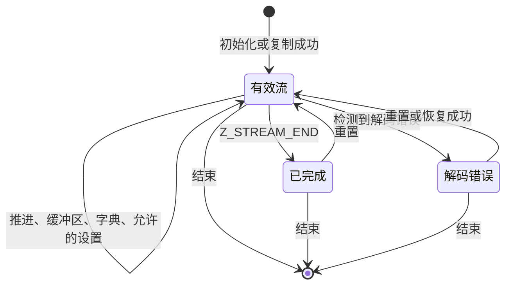

<!-- source-sha256: 1c18391d40ad28be10ee540f52901b83e97e3ca7e8004ecd5daf14d3b224b8be -->

# 共享流规则

[API 手册](README.md) · [如何阅读契约](contracts.md)

流在调用之间保留压缩或解压状态。调用者提供缓冲区；库在其中推进，并保留下一次调用所需的历史。成功初始化开始一个生命周期，只有相应的结束函数释放状态后，该生命周期才结束。成功复制会开始第二个生命周期，也有独立的结束义务。

本页汇总各函数条目共用的缓冲区、所有权和调用顺序规则，采用默认 LP64 Linux 构建和默认分配器。本页的行为依据固定版本 C 和 `zlib.h`。这些聚焦于特定范围的契约不改变范围更广的[已登记公开目标](../../checking/goals.md)。

## 相关函数页面

精确的可接受参数、返回值和错误影响见各条目：

| 手册 | 范围 |
| --- | --- |
| [流式解压](inflate-stream.md) | 初始化、解码、重置、字典、头部、恢复、复制、结束 |
| [流式压缩](deflate-stream.md) | 初始化、编码、刷新、调优、上界、复制、结束 |
| [回调解码](inflate-back.md) | 调用者窗口与输入、输出回调 |
| [缓冲区工具与库信息](utility.md) | 整块缓冲区操作、上界、版本、标志和错误 |
| [校验和](checksums.md) | Adler-32、CRC-32 及其组合 |
| [Gzip 文件](gz-file.md) | 文件句柄、I/O、定位和关闭 |

## 流存储与所有权

先区分数据指针和字节计数。例如本轮提供 100 字节输入，库消费了 30 字节，输入指针就前移 30 字节，剩余输入计数变为 70；输出也按实际写入量记账。指针说明“从哪里读写”，计数说明“还允许读写多少”，两者必须一起更新。

调用者拥有 `z_stream` 及其缓冲区。库拥有 `state` 及其分配的存储。`next_in` 指向本轮未读输入的开头，`avail_in` 是其字节数；`next_out` 指向下一处可写输出，`avail_out` 是剩余可写字节数。库还更新累计输入／输出字节数、错误消息指针 `msg`、数据类型提示 `data_type` 和校验和值 `adler`。计数器按对应的 C 无符号位宽回绕；本构建中 `uLong` 为 64 位。除函数契约明确允许的变化外，调用者不修改库拥有的状态和库字段。

| 主题 | 公共义务 |
| --- | --- |
| 初始化（`A-stream-init`） | 初始化接收可写、尚未有效初始化为流的存储，`zalloc`、`zfree`、`opaque` 已设置；本范围使用 NULL/默认回调。只有成功初始化才建立 `state` 非 NULL 的有效流。版本和参数拒绝遵循函数手册。 |
| 输入（`A-stream-in`） | 调用使用输入时，`next_in` 覆盖 `avail_in` 个可读字节；只有计数为零时才允许 NULL。 |
| 输出（`A-stream-out`） | 调用使用输出时，`next_out` 覆盖 `avail_out` 个可写字节。即使空间为零，`inflate` 和 `deflate` 也要求 `next_out` 非 NULL；推进和拒绝行为见各自手册。 |
| 分离（`A-stream-disjoint`） | 聚焦契约要求调用者范围与流及其拥有的存储分离；输入、输出范围不重叠。额外的字典/头部别名限制在手册中明确列出。这不意味着每种被排除的重叠都会导致 C 未定义行为。 |
| 生命周期与顺序（`A-stream-single`） | 同一个流的调用按顺序执行；对于可能访问调用者存储的每次调用，该存储都保持有效。 |
| 结束（`A-stream-end`） | 成功结束释放状态。进一步处理流之前须重新初始化。手册记载的、对已结束记录进行检查后拒绝的情况，与允许的有效流调用不同。 |
| 推进记账（`A-stream-progress`） | 已消费/已产生字节使对应指针前移，并使可用计数减少相同数量。总计数遵循各函数的记账规则，包括下文的晚期内存错误例外。 |
| 释放与复制（`A-stream-dealloc`） | 结束操作对库拥有的每项分配恰好释放一次，绝不释放调用者缓冲区。复制操作创建独立拥有的状态；借用的调用者指针不做深复制。 |
| 所有权平衡（`A-leak-free`） | 失败的初始化/复制会释放该次尝试所做的分配。End 移除流拥有的块；不相关的有效块保留。完整生命周期中的分配和释放影响相平衡。 |

调用只改变流、流拥有的存储，以及契约指定的调用者目标。输入字节和不相关堆对象保持不变，满足帧性质。头部登记跨调用借用调用者存储，不转移所有权。压缩头部被保留期间应保持可读；解压头部在解析可能访问它期间应保持可写。Reset 放弃旧数据流，并按手册保留可复用的分配。ResetKeep 刻意保留历史，有单独契约。

## 解码与错误

| 主题 | 义务 |
| --- | --- |
| 包装与窗口（`A-wbits-range`） | 使用 [inflateInit2_](inflate-stream.md#inflateinit2_) 和 [deflateInit2_](deflate-stream.md#deflateinit2_) 中精确的可接受值及包装含义。Inflate 包括从头部/默认值选择大小的请求 0、16、32；不能用单一区间概括。拒绝顺序很重要，因为 inflate 可能先尝试分配，再拒绝参数值。 |
| 解码推进（`A-inflate-progress`） | 在缓冲区有效时，消费输入并产生解码字节，直到因格式/模式、缓冲区、请求边界、完成或错误而停止。普通有效运行的输出是解码前缀，在 `Z_STREAM_END` 时完整；尾随输入保留。 |
| 畸形输入（`A-inflate-err-data`） | 任意压缩字节，包括畸形数据，都在解码器定义域内。检测到格式错误或启用的完整性检查失败时，返回 `Z_DATA_ERROR` 而不发生故障。不完整或尚未识别出畸形的前缀不必立即返回此代码；不保证固定的检测延迟。 |
| 解码错误清理（`A-inflate-no-leak`） | 有效流发生错误后，保留其拥有的存储，以便按手册允许的方式重置/恢复/结束。数据错误或窗口分配失败之后，`inflateEnd` 仍然安全。 |
| 头部目标（`A-header-fill`） | 已登记的 gzip 缓冲区最多接收 `extra_max`、`name_max`、`comm_max` 个字节。只有空间足够时才写入名称/注释终止符。`done` 从 0 开始，gzip 头完成时变为 1，检测到 zlib 时变为 -1。见 [inflateGetHeader](inflate-stream.md#inflategetheader)。 |

`Z_BUF_ERROR` 可以表示没有推进，或 `Z_FINISH` 尚未完成；更多输入/空间可能允许继续。`Z_NEED_DICT` 请求匹配的 zlib 字典。`inflateSync` 是单独的恢复搜索，不保证找到的字节模式就是有效后缀的起点。晚期窗口分配失败可能发生在消费输入和写入输出之后。此时指针和可用计数反映已发生的推进，但跳过正常最终总计数/校验和记账。`Z_MEM_ERROR` 不意味着输出未变。

## 压缩与刷新

| 主题 | 义务 |
| --- | --- |
| 压缩级别（`A-deflate-level`） | 本构建中 -1 选择 6；级别 0 使用存储块。普通策略下，级别 1..3 使用快速匹配，4..9 使用延迟决策：先观察下一位置是否有更好的匹配，再决定是否接受当前结果。仅 Huffman 和游程策略选择各自的路径。 |
| 策略（`A-deflate-strategy`） | 策略为 0 默认、1 过滤、2 仅 Huffman、3 游程、4 固定码。其详细输出仍受[格式契约](../format/README.md)约束。 |
| 刷新（`A-deflate-flush`） | `Z_NO_FLUSH` 由压缩器决定块输出。`Z_BLOCK` 完成一个块但不填充到字节边界；`Z_PARTIAL_FLUSH` 添加空固定块；`Z_SYNC_FLUSH` 输出对齐的空存储块。`Z_FULL_FLUSH` 还在刷新完成后丢弃匹配历史。`Z_FINISH` 完成流。 |
| 编码错误清理（`A-deflate-no-leak`） | 有效流的错误返回使其分配仍可由 `deflateEnd` 释放。即使 End 用 `Z_DATA_ERROR` 报告放弃了忙碌状态中的数据，它仍释放这些分配；该状态不是泄漏。 |
| 容量上界（`A-deflate-bound`） | 容量保证要求遵循下述调用安排和[上界契约](deflate-stream.md#deflatebound_z)，包括配置、头部、字典、调优、位预置和可表示性条件。它与数值公式相等性是不同的性质。 |

若 deflate 刷新填满输出，应使用相同刷新请求和更多空间继续，直到完成。对于同步/完全刷新，标记开始时空间大于六可避免重复标记。第一次 `Z_FINISH` 后不再提供新输入；持续以 `Z_FINISH` 重试，直到完成/错误。`Z_STREAM_END` 后，普通公开协议允许重置或结束。zlib 字典设置在压缩之前；raw 字典替换要求已完成的块边界，任意调用边界并不足够。头部设置和参数变化遵循各自手册。

对于一次调用的上界保证，在初始化及任何头部/字典设置之后、压缩之前查询。保持配置不变。向第一次 `deflate(Z_FINISH)` 提供全部 `n` 个输入字节，以及至少为返回上界的输出空间；两种大小都必须能放入可用计数字段，且对应真实缓冲区。总输出保证也覆盖在 `Z_FINISH` 之前仅使用 `Z_NO_FLUSH` 的干净调用安排。其他刷新安排可能超出上界。饱和上界不证明这样大小的缓冲区存在。极大的 gzip 额外字段长度也需谨慎：C 在无符号 int 位宽内计算 `2 + extra_len`，然后才加入上界，因此该加法可能回绕。聚焦契约中的 16 位头部长度范围，既未解决范围更广的已登记数值目标，也不能支持无限制的输出容量主张。

## 流生命周期

序列义务（`A-sequence`）要求：满足各自前置条件和调用顺序规则的调用，保持流不变量、无故障地终止、保持不相关存储不变，并记录所有权。图概括普通生命周期；完成、内存错误、恢复和高级操作以手册为准。初始化建立不变量；被调用函数的契约是需要证明的义务，而不是假设。每次成功初始化/复制都产生独立的结束义务。不满足聚焦契约的前置条件只是超出该契约，不自动意味着 C 未定义行为。自定义分配器不在本页范围内。证明状态和剩余工作见[进度](../../progress.md)。
