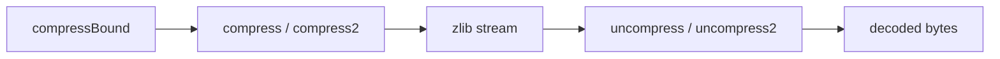

# Buffer utilities and library information

[API manual](README.md) · [Shared stream rules](streams.md) · [Checksums](checksums.md)

Use the buffer utilities when the complete input and output capacity are known at the call.
They manage a temporary stream internally. Use the stream pages when you need incremental
I/O, a different wrapper, a dictionary or explicit flush boundaries.

| Task | Entries |
| --- | --- |
| Compress a buffer | [Choose a level](#compress2_z), [default level](#compress_z), [size the destination](#compressbound_z) |
| Decompress a buffer | [Report input consumed](#uncompress2_z), [output only](#uncompress_z) |
| Inspect the library | [Version](#zlibversion), [compile flags](#zlibcompileflags), [error text](#zerror) |

The focused contracts follow `compress.c`, `uncompr.c`, `zutil.c` and `zlib.h` in the default
LP64 Linux build. `_z` forms use `z_size_t`; plain forms use `uLong`. Both are 64-bit here.
Source readings are **to confirm** by proof. They do not narrow the registered targets in
[Utilities.lean](../../../ZlibF/Spec/Public/Utilities.lean) and
[Queries.lean](../../../ZlibF/Spec/Public/Queries.lean).
[Calls.lean](../../../ZlibF/Spec/Public/Calls.lean) fixes translated arguments and results.
See [contract conventions](contracts.md) for domain/effect labels and
[progress](../../progress.md) for proof status and remaining work.

The buffer utilities create and release a local stream with the zlib wrapper and default settings.



### Common conventions

For buffer calls, the domain is restricted to valid memory:
non-NULL sources cover the stated readable input; non-NULL destinations cover the stated
writable capacity. Non-NULL length pointers name readable, writable scalar cells.
Input, output and length cells are separate, including the two length cells when both occur.
The caller keeps those objects live and does not modify them during the call.
Each entry states its allowed NULL cases. Other invalid pointers are outside this scope.
Decompression error handling needs no valid compressed-data assumption.

**Common effects.** Every in-scope call terminates without a fault. Buffer calls preserve input
and memory outside the output and length cells. They write at most the original capacity.
All internal allocations are released before return, including on allocation failure;
no local stream or owned allocation is returned. Pointer-valued queries return borrowed immutable storage.
These are contract requirements, not claims that the implementation proofs are complete.

## compress2_z

```c
int ZEXPORT compress2_z(Bytef *dest, z_size_t *destLen, const Bytef *source,
                        z_size_t sourceLen, int level);
```

Compresses the input into one complete zlib stream at the requested level.

### Return values and next calls {#api-compress2_z-returns}

**Return type.** `int` — zlib status code; output length is written separately

The status says whether the whole buffer became a complete zlib stream. The byte count is in `*destLen`.

| Returned value | Meaning and conditions | Caller’s next step |
| --- | --- | --- |
| `Z_OK`<br>**Complete compression** | The output is a complete zlib encoding; `*destLen` is the number of bytes written. | Use exactly `*destLen` bytes as the compressed result. |
| `Z_BUF_ERROR`<br>**Output capacity exhausted** | Capacity was filled with an encoding prefix; a non-NULL destination with zero capacity also returns this after successful initialization. `*destLen` reports bytes written. | For a complete retry from the original input, first restore `*destLen` to the destination capacity. Provide a larger destination and call again from the original input; this prefix is not a complete stream. |
| `Z_MEM_ERROR`<br>**Allocation failed without output** | After early argument checks and a valid level, initialization allocation fails. No output was written; `*destLen` is zero. | For a complete retry from the original input, first restore `*destLen` to the destination capacity. Make a new complete call only when resources permit; this call produced no compressed result. |
| `Z_STREAM_ERROR`<br>**Early argument rejection** | source is NULL with sourceLen > 0, or dest is NULL with positive original capacity. destLen == NULL is also checked and rejected. Existing length values are unchanged. | Correct the rejected arguments and call again with valid buffers. |
| `Z_STREAM_ERROR`<br>**Invalid compression level** | After early argument checks, level is outside -1 and 0–9; `*destLen` is zeroed before any allocation. | Choose -1 or 0–9 and reset the output capacity for a new call. |
| `Z_STREAM_ERROR`<br>**NULL destination with zero capacity** | After early argument checks and a valid level, dest == NULL with zero capacity and initialization succeeds; `*destLen` is zero. Allocation failure instead returns Z_MEM_ERROR. | Provide a valid destination and sufficient capacity, then make a new call. |

**Reading the result.**

- Before the call, `*destLen` is capacity; after return it is the written count except on early rejection. All internal allocations are released on every return path.
- destLen may be NULL for checked rejection; non-NULL length cells must be readable and writable.
- Input, destination and length cells must be separate and cover the stated ranges. Empty input is valid. Level -1 selects level 6.

### Calling conditions and effects {#api-compress2_z-contract}

**Domain.** Restricted domain.

**Pre.** Restricted buffer domain above. `source` may be NULL for zero input or checked rejection.
`destLen` may be NULL for checked rejection. `dest` may be NULL for checked rejection,
including the zero-capacity case below. Levels -1 and 0–9 are valid; -1 selects level 6.

**Effects.** Stateful; common effects apply. A NULL source with nonzero input, NULL `destLen`,
or NULL destination with nonzero capacity gives `Z_STREAM_ERROR` before any length write.
Otherwise `*destLen` is cleared before initialisation. A bad level returns `Z_STREAM_ERROR`
with length zero before any allocation. Later returns store the number of bytes written.

<details markdown="1" class="ar-return-exact" data-return-exact="compress2_z"><summary>Complete return conditions and boundaries</summary>

**Post.** `Z_OK` means the output is a complete zlib encoding of the input and `*destLen`
is its length. `Z_BUF_ERROR` means the capacity was filled with a prefix of that encoding.
`Z_MEM_ERROR` means allocation failed and no output was written.

**Edges.** NULL destination with zero capacity reaches initialisation: it returns `Z_MEM_ERROR`
if allocation fails, otherwise `Z_STREAM_ERROR`, with length zero. A non-NULL destination
with zero capacity gives `Z_BUF_ERROR` after successful initialisation. Empty input is valid.

</details>

## compress2

```c
int ZEXPORT compress2(Bytef *dest, uLongf *destLen, const Bytef *source,
                      uLong sourceLen, int level);
```

The `uLong` form of [compress2_z](#compress2_z).

### Return values and next calls {#api-compress2-returns}

**Return type.** `int` — zlib status code; output length is written separately

The status says whether the whole buffer became a complete zlib stream. The byte count is in `*destLen`.

| Returned value | Meaning and conditions | Caller’s next step |
| --- | --- | --- |
| `Z_OK`<br>**Complete compression** | The output is a complete zlib encoding; `*destLen` is the number of bytes written. | Use exactly `*destLen` bytes as the compressed result. |
| `Z_BUF_ERROR`<br>**Output capacity exhausted** | Capacity was filled with an encoding prefix; a non-NULL destination with zero capacity also returns this after successful initialization. `*destLen` reports bytes written. | For a complete retry from the original input, first restore `*destLen` to the destination capacity. Provide a larger destination and call again from the original input; this prefix is not a complete stream. |
| `Z_MEM_ERROR`<br>**Allocation failed without output** | After early argument checks and a valid level, initialization allocation fails. No output was written; `*destLen` is zero. | For a complete retry from the original input, first restore `*destLen` to the destination capacity. Make a new complete call only when resources permit; this call produced no compressed result. |
| `Z_STREAM_ERROR`<br>**Early argument rejection** | source is NULL with sourceLen > 0, or dest is NULL with positive original capacity. Existing length values are unchanged. | Correct the rejected arguments and call again with valid buffers. |
| `Z_STREAM_ERROR`<br>**Invalid compression level** | After early argument checks, level is outside -1 and 0–9; `*destLen` is zeroed before any allocation. | Choose -1 or 0–9 and reset the output capacity for a new call. |
| `Z_STREAM_ERROR`<br>**NULL destination with zero capacity** | After early argument checks and a valid level, dest == NULL with zero capacity and initialization succeeds; `*destLen` is zero. Allocation failure instead returns Z_MEM_ERROR. | Provide a valid destination and sufficient capacity, then make a new call. |

**Reading the result.**

- Before the call, `*destLen` is capacity; after return it is the written count except on early rejection. All internal allocations are released on every return path.
- The ordinary adapter first reads a non-NULL destLen cell and copies the length back on every return; NULL destLen is outside this precondition.
- Input, destination and length cells must be separate and cover the stated ranges. Empty input is valid. Level -1 selects level 6.

### Calling conditions and effects {#api-compress2-contract}

**Domain.** Restricted domain.

**Pre.** Restricted domain of `compress2_z`, with a non-NULL `destLen` cell.
The wrapper reads that cell before calling the checked `_z` entry.

**Effects.** Stateful; same buffer and cleanup effects. The wrapper copies the length back
on every return, including errors. Early argument rejection preserves its original value;
invalid level or allocation failure leaves it zero.

<details markdown="1" class="ar-return-exact" data-return-exact="compress2"><summary>Complete return conditions and boundaries</summary>

**Post.** Same encoding and return-code contract as `compress2_z`.

</details>

## compress_z

```c
int ZEXPORT compress_z(Bytef *dest, z_size_t *destLen, const Bytef *source, z_size_t sourceLen);
```

Compresses at the default level (-1, selecting level 6).

### Return values and next calls {#api-compress_z-returns}

**Return type.** `int` — zlib status code; output length is written separately

The status says whether the whole buffer became a complete zlib stream. The byte count is in `*destLen`.

| Returned value | Meaning and conditions | Caller’s next step |
| --- | --- | --- |
| `Z_OK`<br>**Complete compression** | The output is a complete zlib encoding; `*destLen` is the number of bytes written. | Use exactly `*destLen` bytes as the compressed result. |
| `Z_BUF_ERROR`<br>**Output capacity exhausted** | Capacity was filled with an encoding prefix; a non-NULL destination with zero capacity also returns this after successful initialization. `*destLen` reports bytes written. | For a complete retry from the original input, first restore `*destLen` to the destination capacity. Provide a larger destination and call again from the original input; this prefix is not a complete stream. |
| `Z_MEM_ERROR`<br>**Allocation failed without output** | After early argument checks, initialization allocation fails. No output was written; `*destLen` is zero. | For a complete retry from the original input, first restore `*destLen` to the destination capacity. Make a new complete call only when resources permit; this call produced no compressed result. |
| `Z_STREAM_ERROR`<br>**Early argument rejection** | source is NULL with sourceLen > 0, or dest is NULL with positive original capacity. destLen == NULL is also checked and rejected. Existing length values are unchanged. | Correct the rejected arguments and call again with valid buffers. |
| `Z_STREAM_ERROR`<br>**NULL destination with zero capacity** | After early argument checks, dest == NULL with zero capacity and initialization succeeds; `*destLen` is zero. Allocation failure instead returns Z_MEM_ERROR. | Provide a valid destination and sufficient capacity, then make a new call. |

**Reading the result.**

- Before the call, `*destLen` is capacity; after return it is the written count except on early rejection. All internal allocations are released on every return path.
- destLen may be NULL for checked rejection; non-NULL length cells must be readable and writable.
- Input, destination and length cells must be separate and cover the stated ranges. Empty input is valid. Uses default level -1, selecting level 6.

### Calling conditions and effects {#api-compress_z-contract}

**Domain.** Restricted domain.

**Pre.** Restricted domain of [compress2_z](#compress2_z), without a level argument.

**Effects.** Stateful; same length writes, checked NULL cases and complete cleanup.

<details markdown="1" class="ar-return-exact" data-return-exact="compress_z"><summary>Complete return conditions and boundaries</summary>

**Post.** Same as `compress2_z` at the default level.

</details>

## compress

```c
int ZEXPORT compress(Bytef *dest, uLongf *destLen, const Bytef *source, uLong sourceLen);
```

The `uLong` compressor at the default level.

### Return values and next calls {#api-compress-returns}

**Return type.** `int` — zlib status code; output length is written separately

The status says whether the whole buffer became a complete zlib stream. The byte count is in `*destLen`.

| Returned value | Meaning and conditions | Caller’s next step |
| --- | --- | --- |
| `Z_OK`<br>**Complete compression** | The output is a complete zlib encoding; `*destLen` is the number of bytes written. | Use exactly `*destLen` bytes as the compressed result. |
| `Z_BUF_ERROR`<br>**Output capacity exhausted** | Capacity was filled with an encoding prefix; a non-NULL destination with zero capacity also returns this after successful initialization. `*destLen` reports bytes written. | For a complete retry from the original input, first restore `*destLen` to the destination capacity. Provide a larger destination and call again from the original input; this prefix is not a complete stream. |
| `Z_MEM_ERROR`<br>**Allocation failed without output** | After early argument checks, initialization allocation fails. No output was written; `*destLen` is zero. | For a complete retry from the original input, first restore `*destLen` to the destination capacity. Make a new complete call only when resources permit; this call produced no compressed result. |
| `Z_STREAM_ERROR`<br>**Early argument rejection** | source is NULL with sourceLen > 0, or dest is NULL with positive original capacity. Existing length values are unchanged. | Correct the rejected arguments and call again with valid buffers. |
| `Z_STREAM_ERROR`<br>**NULL destination with zero capacity** | After early argument checks, dest == NULL with zero capacity and initialization succeeds; `*destLen` is zero. Allocation failure instead returns Z_MEM_ERROR. | Provide a valid destination and sufficient capacity, then make a new call. |

**Reading the result.**

- Before the call, `*destLen` is capacity; after return it is the written count except on early rejection. All internal allocations are released on every return path.
- The ordinary adapter first reads a non-NULL destLen cell and copies the length back on every return; NULL destLen is outside this precondition.
- Input, destination and length cells must be separate and cover the stated ranges. Empty input is valid. Uses default level -1, selecting level 6.

### Calling conditions and effects {#api-compress-contract}

**Domain.** Restricted domain.

**Pre.** Restricted domain of [compress2](#compress2); `destLen` must be non-NULL.

**Effects.** Stateful; same length writes and complete cleanup as `compress2`.

<details markdown="1" class="ar-return-exact" data-return-exact="compress"><summary>Complete return conditions and boundaries</summary>

**Post.** Same as `compress2` at level -1.

</details>

## compressBound_z

```c
z_size_t ZEXPORT compressBound_z(z_size_t sourceLen);
```

Calculates the numeric bound used to size a default zlib compression buffer.

### Return values and next calls {#api-compressbound_z-returns}

**Return type.** `z_size_t` — Saturated compression-capacity value

Computes the capacity value used for default compression settings; allocates no buffer.

| Returned value | Meaning and conditions | Caller’s next step |
| --- | --- | --- |
| `min(2^64 - 1, n + (n >> 12) + (n >> 14) + (n >> 25) + 13)`<br>**Capacity value** | n = sourceLen may be any unsigned 64-bit value; sum mathematically, then saturate at the maximum. n == 0 returns 13. | Use the value to plan valid destination capacity. |

**Reading the result.**

- This is a numeric contract with no error return. Output adequacy is a separate property scoped to default zlib wrapper, window and memory settings; it does not cover arbitrary raw or gzip settings.

### Calling conditions and effects {#api-compressbound_z-contract}

**Domain.** Full type domain.

**Pre.** Full type domain: every 64-bit `sourceLen`, including zero and the maximum.

**Effects.** Pure. No pointer access, allocation, state change or error return.

**Scope.** This contract specifies the number. Output adequacy is a separate property
for valid compression calls with the default wrapper, window and memory settings.
It gives no bound for arbitrary raw or gzip stream settings.

<details markdown="1" class="ar-return-exact" data-return-exact="compressBound_z"><summary>Complete return conditions and boundaries</summary>

**Post.** Returns `min(2^64 - 1, n + (n >> 12) + (n >> 14) + (n >> 25) + 13)`
for `n = sourceLen`, with the sum interpreted mathematically. Zero gives 13;
an overflowing sum gives the maximum value.

</details>

## compressBound

```c
uLong ZEXPORT compressBound(uLong sourceLen);
```

The `uLong` form of the numeric bound.

### Return values and next calls {#api-compressbound-returns}

**Return type.** `uLong` — Saturated compression-capacity value

Computes the capacity value used for default compression settings; allocates no buffer.

| Returned value | Meaning and conditions | Caller’s next step |
| --- | --- | --- |
| `min(2^64 - 1, n + (n >> 12) + (n >> 14) + (n >> 25) + 13)`<br>**Capacity value** | n = sourceLen may be any unsigned 64-bit value; sum mathematically, then saturate at the maximum. n == 0 returns 13. | Use the value to plan valid destination capacity. |

**Reading the result.**

- This is a numeric contract with no error return. Output adequacy is a separate property scoped to default zlib wrapper, window and memory settings; it does not cover arbitrary raw or gzip settings.

### Calling conditions and effects {#api-compressbound-contract}

**Domain.** Full type domain.

**Pre.** Full type domain: every 64-bit `sourceLen`.

**Effects.** Pure. No memory access or error return. The same output-adequacy scope applies.

<details markdown="1" class="ar-return-exact" data-return-exact="compressBound"><summary>Complete return conditions and boundaries</summary>

**Post.** Same formula and saturation as [compressBound_z](#compressbound_z) on this build.

</details>

## uncompress2_z

```c
int ZEXPORT uncompress2_z(Bytef *dest, z_size_t *destLen, const Bytef *source, z_size_t *sourceLen);
```

Decodes the first zlib stream and reports both output size and input consumption.

### Return values and next calls {#api-uncompress2_z-returns}

**Return type.** `int` — zlib status code; counts are reported through length parameters

The status says whether the first zlib stream decoded completely. Length values report output and input consumption.

| Returned value | Meaning and conditions | Caller’s next step |
| --- | --- | --- |
| `Z_OK`<br>**Complete decoding** | The first zlib stream decoded completely and passed its checks; `*destLen` reports bytes written and `*sourceLen` reports bytes consumed. Trailing input is unused. | Use exactly `*destLen` output bytes. Use `*sourceLen` to locate unused input. |
| `Z_BUF_ERROR`<br>**Output full with input remaining** | Output filled the capacity and input remains; `*destLen` reports bytes written and `*sourceLen` reports bytes consumed. Already written output remains available. | For a complete retry from the original input, first restore `*destLen` to the destination capacity and `*sourceLen` to the full original input length. For a complete result, enlarge the destination and make a new call from the original input; this utility returns no stream to resume. |
| `Z_DATA_ERROR`<br>**Data, completeness or dictionary error** | Input is malformed or incomplete, or needs a preset dictionary; raw and gzip inputs are also error cases. Empty input after successful initialization is a data error. Decoder Z_BUF_ERROR with no input remaining also maps to this code. | Do not treat partial output as a checked complete result; check the format, input completeness and dictionary requirement, then use an appropriate call. |
| `Z_MEM_ERROR`<br>**Initialization allocation failure** | Initialization fails; existing length values are unchanged and no output is written. | For a complete retry from the original input, first restore `*destLen` to the destination capacity and `*sourceLen` to the full original input length. When resources permit, make a new complete call from the original input and supply the capacity again. |
| `Z_MEM_ERROR`<br>**Allocation failure during decoding** | Allocation fails after successful initialization, possibly after partial output; `*destLen` reports bytes written and `*sourceLen` reports bytes consumed. | For a complete retry from the original input, first restore `*destLen` to the destination capacity and `*sourceLen` to the full original input length. Retain written bytes if needed; they are not a fully checked result. A new call must start from the original input with capacity reset. |
| `Z_STREAM_ERROR`<br>**Argument rejection before initialization** | NULL source for nonempty input, or NULL dest for positive capacity, or NULL destLen or NULL sourceLen is rejected before initialization; existing length values are unchanged. | Correct the rejected arguments, then make a new call. |

**Reading the result.**

- After successful initialization, every return stores actual counts, including later memory failure; written output remains readable. All internal allocations are released on every return path.
- Length pointers may be NULL for checked rejection; non-NULL cells must be readable and writable.
- Input, destination and length cells are separate. A NULL destination with zero capacity uses a private output pointer and can accept a complete empty stream. Internal Z_STREAM_END maps to Z_OK, Z_NEED_DICT to Z_DATA_ERROR, and other decoder codes are retained.

### Calling conditions and effects {#api-uncompress2_z-contract}

**Domain.** Restricted domain.

**Pre.** Restricted buffer domain above. `*sourceLen` is the available input and `*destLen`
the output capacity. Either length pointer may be NULL for checked rejection.
A NULL data pointer is allowed only with a zero corresponding length, or for checked rejection.
Malformed, truncated, raw, gzip and dictionary-dependent input are included as error cases.

**Effects.** Stateful; common effects apply. The argument checks precede initialisation:
NULL `sourceLen`, nonempty NULL source, NULL `destLen`, or positive-capacity NULL destination
returns `Z_STREAM_ERROR` with both existing length cells unchanged.
Initialisation failure also preserves both lengths and writes no output.
After initialisation, every return stores bytes consumed in `*sourceLen` and bytes produced
in `*destLen`, including later memory failure. Output already written remains available.

<details markdown="1" class="ar-return-exact" data-return-exact="uncompress2_z"><summary>Complete return conditions and boundaries</summary>

**Post.** `Z_OK` means a complete checked zlib stream decoded to the output.
Trailing input is unused. `Z_BUF_ERROR` means output filled the capacity and input remains.
`Z_DATA_ERROR` covers malformed or incomplete input and a required preset dictionary.
`Z_MEM_ERROR` means allocation failed and can follow partial output.

**Edges.** NULL destination with zero capacity is accepted using a private output pointer;
a complete empty stream can succeed. Empty input is a data error after successful initialisation.
The exact final mapping is `Z_STREAM_END` to `Z_OK`, `Z_NEED_DICT` to `Z_DATA_ERROR`,
and `Z_BUF_ERROR` to `Z_DATA_ERROR` when no input remains. Other decoder codes are retained.

</details>

## uncompress2

```c
int ZEXPORT uncompress2(Bytef *dest, uLongf *destLen, const Bytef *source, uLong *sourceLen);
```

The `uLong` decoder with an input-consumption count.

### Return values and next calls {#api-uncompress2-returns}

**Return type.** `int` — zlib status code; counts are reported through length parameters

The status says whether the first zlib stream decoded completely. Length values report output and input consumption.

| Returned value | Meaning and conditions | Caller’s next step |
| --- | --- | --- |
| `Z_OK`<br>**Complete decoding** | The first zlib stream decoded completely and passed its checks; `*destLen` reports bytes written and `*sourceLen` reports bytes consumed. Trailing input is unused. | Use exactly `*destLen` output bytes. Use `*sourceLen` to locate unused input. |
| `Z_BUF_ERROR`<br>**Output full with input remaining** | Output filled the capacity and input remains; `*destLen` reports bytes written and `*sourceLen` reports bytes consumed. Already written output remains available. | For a complete retry from the original input, first restore `*destLen` to the destination capacity and `*sourceLen` to the full original input length. For a complete result, enlarge the destination and make a new call from the original input; this utility returns no stream to resume. |
| `Z_DATA_ERROR`<br>**Data, completeness or dictionary error** | Input is malformed or incomplete, or needs a preset dictionary; raw and gzip inputs are also error cases. Empty input after successful initialization is a data error. Decoder Z_BUF_ERROR with no input remaining also maps to this code. | Do not treat partial output as a checked complete result; check the format, input completeness and dictionary requirement, then use an appropriate call. |
| `Z_MEM_ERROR`<br>**Initialization allocation failure** | Initialization fails; existing length values are unchanged and no output is written. | For a complete retry from the original input, first restore `*destLen` to the destination capacity and `*sourceLen` to the full original input length. When resources permit, make a new complete call from the original input and supply the capacity again. |
| `Z_MEM_ERROR`<br>**Allocation failure during decoding** | Allocation fails after successful initialization, possibly after partial output; `*destLen` reports bytes written and `*sourceLen` reports bytes consumed. | For a complete retry from the original input, first restore `*destLen` to the destination capacity and `*sourceLen` to the full original input length. Retain written bytes if needed; they are not a fully checked result. A new call must start from the original input with capacity reset. |
| `Z_STREAM_ERROR`<br>**Argument rejection before initialization** | NULL source for nonempty input, or NULL dest for positive capacity is rejected before initialization; existing length values are unchanged. | Correct the rejected arguments, then make a new call. |

**Reading the result.**

- After successful initialization, every return stores actual counts, including later memory failure; written output remains readable. All internal allocations are released on every return path.
- The ordinary adapter reads length cells first: destLen and sourceLen must both be non-NULL. Both are copied back on every return.
- Input, destination and length cells are separate. A NULL destination with zero capacity uses a private output pointer and can accept a complete empty stream. Internal Z_STREAM_END maps to Z_OK, Z_NEED_DICT to Z_DATA_ERROR, and other decoder codes are retained.

### Calling conditions and effects {#api-uncompress2-contract}

**Domain.** Restricted domain.

**Pre.** Restricted domain of [uncompress2_z](#uncompress2_z), with both length cells non-NULL
because the wrapper reads them before the `_z` checks.

**Effects.** Stateful; same output and cleanup effects. Both lengths are copied back on every
return, including errors. Argument rejection and initialisation failure preserve their values.

<details markdown="1" class="ar-return-exact" data-return-exact="uncompress2"><summary>Complete return conditions and boundaries</summary>

**Post.** Same decoding, return codes and consumed count as `uncompress2_z`.

</details>

## uncompress_z

```c
int ZEXPORT uncompress_z(Bytef *dest, z_size_t *destLen, const Bytef *source, z_size_t sourceLen);
```

Decodes without exposing the consumed-input count.

### Return values and next calls {#api-uncompress_z-returns}

**Return type.** `int` — zlib status code; counts are reported through length parameters

The status says whether the first zlib stream decoded completely. Length values report output, without an input-consumption count.

| Returned value | Meaning and conditions | Caller’s next step |
| --- | --- | --- |
| `Z_OK`<br>**Complete decoding** | The first zlib stream decoded completely and passed its checks; `*destLen` reports bytes written; the consumed-input count is not exposed to the caller. Trailing input is unused. | Use exactly `*destLen` output bytes. This entry gives no count for locating trailing input. |
| `Z_BUF_ERROR`<br>**Output full with input remaining** | Output filled the capacity and input remains; `*destLen` reports bytes written; the consumed-input count is not exposed to the caller. Already written output remains available. | For a complete retry from the original input, first restore `*destLen` to the destination capacity. For a complete result, enlarge the destination and make a new call from the original input; this utility returns no stream to resume. |
| `Z_DATA_ERROR`<br>**Data, completeness or dictionary error** | Input is malformed or incomplete, or needs a preset dictionary; raw and gzip inputs are also error cases. Empty input after successful initialization is a data error. Decoder Z_BUF_ERROR with no input remaining also maps to this code. | Do not treat partial output as a checked complete result; check the format, input completeness and dictionary requirement, then use an appropriate call. |
| `Z_MEM_ERROR`<br>**Initialization allocation failure** | Initialization fails; existing length values are unchanged and no output is written. | For a complete retry from the original input, first restore `*destLen` to the destination capacity. When resources permit, make a new complete call from the original input and supply the capacity again. |
| `Z_MEM_ERROR`<br>**Allocation failure during decoding** | Allocation fails after successful initialization, possibly after partial output; `*destLen` reports bytes written; the consumed-input count is not exposed to the caller. | For a complete retry from the original input, first restore `*destLen` to the destination capacity. Retain written bytes if needed; they are not a fully checked result. A new call must start from the original input with capacity reset. |
| `Z_STREAM_ERROR`<br>**Argument rejection before initialization** | NULL source for nonempty input, or NULL dest for positive capacity, or NULL destLen is rejected before initialization; existing length values are unchanged. | Correct the rejected arguments, then make a new call. |

**Reading the result.**

- After successful initialization, every return stores actual counts, including later memory failure; written output remains readable. All internal allocations are released on every return path.
- Length pointers may be NULL for checked rejection; non-NULL cells must be readable and writable.
- Input, destination and length cells are separate. A NULL destination with zero capacity uses a private output pointer and can accept a complete empty stream. Internal Z_STREAM_END maps to Z_OK, Z_NEED_DICT to Z_DATA_ERROR, and other decoder codes are retained.

### Calling conditions and effects {#api-uncompress_z-contract}

**Domain.** Restricted domain.

**Pre.** Restricted domain of [uncompress2_z](#uncompress2_z); `sourceLen` is passed by value.
`destLen` may be NULL for checked rejection.

**Effects.** Stateful; same output-length writes and complete cleanup. The consumed count is local.

<details markdown="1" class="ar-return-exact" data-return-exact="uncompress_z"><summary>Complete return conditions and boundaries</summary>

**Post.** Same output and return codes as `uncompress2_z`. Trailing bytes are ignored;
the caller receives no count with which to locate them.

</details>

## uncompress

```c
int ZEXPORT uncompress(Bytef *dest, uLongf *destLen, const Bytef *source, uLong sourceLen);
```

The `uLong` decoder without a consumed-input count.

### Return values and next calls {#api-uncompress-returns}

**Return type.** `int` — zlib status code; counts are reported through length parameters

The status says whether the first zlib stream decoded completely. Length values report output, without an input-consumption count.

| Returned value | Meaning and conditions | Caller’s next step |
| --- | --- | --- |
| `Z_OK`<br>**Complete decoding** | The first zlib stream decoded completely and passed its checks; `*destLen` reports bytes written; the consumed-input count is not exposed to the caller. Trailing input is unused. | Use exactly `*destLen` output bytes. This entry gives no count for locating trailing input. |
| `Z_BUF_ERROR`<br>**Output full with input remaining** | Output filled the capacity and input remains; `*destLen` reports bytes written; the consumed-input count is not exposed to the caller. Already written output remains available. | For a complete retry from the original input, first restore `*destLen` to the destination capacity. For a complete result, enlarge the destination and make a new call from the original input; this utility returns no stream to resume. |
| `Z_DATA_ERROR`<br>**Data, completeness or dictionary error** | Input is malformed or incomplete, or needs a preset dictionary; raw and gzip inputs are also error cases. Empty input after successful initialization is a data error. Decoder Z_BUF_ERROR with no input remaining also maps to this code. | Do not treat partial output as a checked complete result; check the format, input completeness and dictionary requirement, then use an appropriate call. |
| `Z_MEM_ERROR`<br>**Initialization allocation failure** | Initialization fails; existing length values are unchanged and no output is written. | For a complete retry from the original input, first restore `*destLen` to the destination capacity. When resources permit, make a new complete call from the original input and supply the capacity again. |
| `Z_MEM_ERROR`<br>**Allocation failure during decoding** | Allocation fails after successful initialization, possibly after partial output; `*destLen` reports bytes written; the consumed-input count is not exposed to the caller. | For a complete retry from the original input, first restore `*destLen` to the destination capacity. Retain written bytes if needed; they are not a fully checked result. A new call must start from the original input with capacity reset. |
| `Z_STREAM_ERROR`<br>**Argument rejection before initialization** | NULL source for nonempty input, or NULL dest for positive capacity is rejected before initialization; existing length values are unchanged. | Correct the rejected arguments, then make a new call. |

**Reading the result.**

- After successful initialization, every return stores actual counts, including later memory failure; written output remains readable. All internal allocations are released on every return path.
- The ordinary adapter reads length cells first: destLen must be non-NULL and is copied back on every return.
- Input, destination and length cells are separate. A NULL destination with zero capacity uses a private output pointer and can accept a complete empty stream. Internal Z_STREAM_END maps to Z_OK, Z_NEED_DICT to Z_DATA_ERROR, and other decoder codes are retained.

### Calling conditions and effects {#api-uncompress-contract}

**Domain.** Restricted domain.

**Pre.** Restricted buffer domain of [uncompress2](#uncompress2), with non-NULL `destLen`.

**Effects.** Stateful; same output-length writes, retained partial output and complete cleanup.

<details markdown="1" class="ar-return-exact" data-return-exact="uncompress"><summary>Complete return conditions and boundaries</summary>

**Post.** Same output and return codes as `uncompress2`; trailing input is ignored.

</details>

## zlibVersion

```c
const char * ZEXPORT zlibVersion(void);
```

Returns the linked library's release string.

### Return values and next calls {#api-zlibversion-returns}

**Return type.** `const char *` — Borrowed immutable version-string pointer

Returns the version string of the linked library.

| Returned value | Meaning and conditions | Caller’s next step |
| --- | --- | --- |
| `ZLIB_VERSION`<br>**Library version string** | No arguments; returns a non-NULL, NUL-terminated 1.3.2.1-motley string. | Read this static string; do not write to or free it. |

### Calling conditions and effects {#api-zlibversion-contract}

**Domain.** Full type domain.

**Pre.** Full type domain; no arguments or caller state are required.

**Effects.** Read-only. The result is borrowed immutable static storage;
the caller must neither write it nor free it. No allocation or heap change occurs.

<details markdown="1" class="ar-return-exact" data-return-exact="zlibVersion"><summary>Complete return conditions and boundaries</summary>

**Post.** Returns a non-NULL pointer to NUL-terminated `ZLIB_VERSION` (`1.3.2.1-motley`).

</details>

## zlibCompileFlags

```c
uLong ZEXPORT zlibCompileFlags(void);
```

Reports the build's type sizes and compile-time options.

### Return values and next calls {#api-zlibcompileflags-returns}

**Return type.** `uLong` — Build-information bit fields

Returns encoded type sizes and compile options for this build. The value is not a status code.

| Returned value | Meaning and conditions | Caller’s next step |
| --- | --- | --- |
| `169 (0xa9)`<br>**Selected build flags** | In this build uInt is 4 bytes; uLong, pointers and z_off_t are 8 bytes; other flags are zero. | Read the build information by fields; two-bit size fields encode 2, 4, 8 and other byte sizes as 0, 1, 2 and 3. |

### Calling conditions and effects {#api-zlibcompileflags-contract}

**Domain.** Full type domain.

**Pre.** Full type domain; no arguments or caller state are required.

**Effects.** Pure scalar query. No allocation, memory write or error return.

<details markdown="1" class="ar-return-exact" data-return-exact="zlibCompileFlags"><summary>Complete return conditions and boundaries</summary>

**Post.** Returns 169 (`0xa9`) for this build: `uInt` is 4 bytes; `uLong`, pointers
and `z_off_t` are 8 bytes. Their two-bit fields encode sizes 2, 4, 8 and other
as 0, 1, 2 and 3. Other flags are zero in the selected build.

</details>

## zError

```c
const char * ZEXPORT zError(int err);
```

Returns the text associated with a zlib result code.

### Return values and next calls {#api-zerror-returns}

**Return type.** `const char *` — Borrowed immutable error-text pointer

Maps the supplied result code to text. The function itself always returns a non-NULL string pointer.

| Returned value | Meaning and conditions | Caller’s next step |
| --- | --- | --- |
| `"need dictionary"`<br>**need dictionary text** | err == 2. | Read the borrowed static text; do not write to or free it. |
| `"stream end"`<br>**stream end text** | err == 1. | Read the borrowed static text; do not write to or free it. |
| `"file error"`<br>**file error text** | err == -1. | Read the borrowed static text; do not write to or free it. |
| `"stream error"`<br>**stream error text** | err == -2. | Read the borrowed static text; do not write to or free it. |
| `"data error"`<br>**data error text** | err == -3. | Read the borrowed static text; do not write to or free it. |
| `"insufficient memory"`<br>**insufficient memory text** | err == -4. | Read the borrowed static text; do not write to or free it. |
| `"buffer error"`<br>**buffer error text** | err == -5. | Read the borrowed static text; do not write to or free it. |
| `"incompatible version"`<br>**incompatible version text** | err == -6. | Read the borrowed static text; do not write to or free it. |
| `""`<br>**Empty text** | err == 0, or err is outside -6–2, including the minimum and maximum int. | Read the empty string as needed; this is neither a NULL pointer nor another error code. |

**Reading the result.**

- Accepts every int value; checks the range before index arithmetic. Allocates no memory and does not change the heap.

### Calling conditions and effects {#api-zerror-contract}

**Domain.** Full type domain.

**Pre.** Full type domain: every `int`, including its minimum and maximum values.

**Effects.** Read-only. The result is borrowed immutable static storage; do not write or free it.
No allocation, heap change or error return occurs. Values outside -6–2 are checked before
index arithmetic, so both scalar extremes safely return empty text.

[Back to the API manual](README.md) · [Contract conventions](contracts.md)

<details markdown="1" class="ar-return-exact" data-return-exact="zError"><summary>Complete return conditions and boundaries</summary>

**Post.** Returns a non-NULL pointer to the following NUL-terminated text.

| `err` | Text |
| --- | --- |
| 2 | `need dictionary` |
| 1 | `stream end` |
| -1 | `file error` |
| -2 | `stream error` |
| -3 | `data error` |
| -4 | `insufficient memory` |
| -5 | `buffer error` |
| -6 | `incompatible version` |
| 0 or any other value | empty string |

</details>
