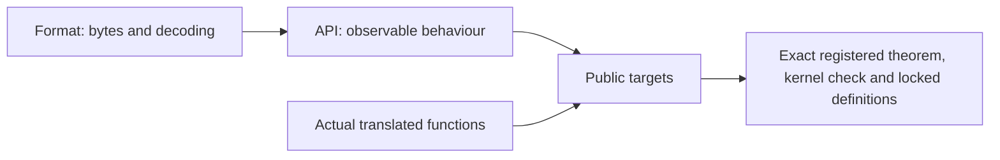

# Public contract review

The inventory fixes 95 default-build entries and eight family targets. Each names a closed
proposition about the translated implementation. No new function proof is claimed here.
Source review of a definition is separate from independent approval of the semantic baseline.

## The three specification layers

| Directory | Meaning |
| --- | --- |
| `ZlibF/Spec/Format` | Legal DEFLATE, zlib and gzip bytes, their decoding and checksums |
| `ZlibF/Spec/Api` | Heap-free models of API behaviour; some older models cover only documented call patterns |
| `ZlibF/Spec/Public` | Fixed implementation targets: actual execution, caller domain, results, frame and ownership |

A proof about the format or an abstract API model alone does not verify a public function.
The actual translated call is fixed in `Calls.lean`. The public targets cannot substitute an
empty execution relation or assume that a library callee obeys its contract.

## Review boundaries

| Group | Target modules | Properties checked in the statements |
| --- | --- | --- |
| Checksums and queries | `Checksums`, `Queries` | Null-buffer conventions, all scalar values, signed combine lengths, immutable heap and constant tables |
| Init and reset | `Initialisation`, `Lifecycle`, `Domains` | Version/error ordering, every signed parameter, default allocation failures, exact cleanup, established invariant and concrete nonempty domains |
| Stream operations | `StreamQueries`, `Streams`, `Copy` | Clean refusals, counters and partial output, dictionary windows, bit insertion, bounds, independent copied storage and failure cleanup |
| Buffer utilities | `Utilities` | Distinct compatibility wrappers, scalar-cell rules, trailing input, partial output on memory failure, exact stored lengths and temporary cleanup |
| Callback inflate | `Back` | Actual callbacks, finite returning protocol, adaptive input, shared-allocation descriptors, raw decoded output and caller-owned window |
| Gz handles | `GzState`, `GzOpen`, `GzControl`, `GzRead`, `GzWrite`, `GzClose` | Lazy allocation, inactive dangling fields, error recovery, positions, whole-item counts, borrowed messages, accepted bytes, seek zeros and descriptor cleanup |
| Lifecycles | `Sequences`, `GzTrace` | Every admitted next call returns, init-established invariants, exact live-allocation changes, end/close, ordinary byte-format epochs and complete writer output |

All source readings remain **to confirm** by implementation proofs. The public function manuals
give the parameter tables and the source-level details. Their historical run notes are evidence;
their proof-status paragraphs do not override the registry and CI on a named commit.

## Corrections made during review

`Uncompress2` now permits output before a late memory failure. It shares its data relation with
the concrete utility targets. Buffer exhaustion no longer claims that unused trailing bytes
must extend a valid compressed stream. Concrete targets distinguish unchanged init-failure
length cells from the counts stored after a later failure.

Stream queries include null and clean invalid-state refusal. Priming uses the source's zero,
negative and overflow order. Optional output cells remain independently optional.

The pinned `gz_look` initially checks four header bytes. A wrong method, wrong flags or a file
shorter than four bytes can be transparent input. Later members are sent directly to inflate.
The default gz buffer is 8192 bytes; `gzbuffer` clamps to eight and rejects doubling overflow.
Formatting refusal returns a stream error, separately from an empty or oversized result.

The header does not promise that `gzsetparams` refuses every invalid scalar argument. The
target records that source behaviour. For valid parameters a successful call must also update
the inner compressor; changing only the outer handle fields is insufficient.

Callback descriptors may share an allocation with the window. Callbacks preserve the window
slice; their observation invariant ignores only that slice. The whole-function claim is
universal over those observation invariants, so a loose invariant cannot establish the target.

## Scope of the sequence claims

Safety and cleanup cover all admitted stream operations, including reset, copy and recovery.
Ordinary data epochs connect actual accepted and produced bytes to the independent format.
Their finish claims include sufficient-room completion. Eligibility markers are computed by
trace constructors; a proof cannot choose them or clear them at will.

One initial dictionary suffices for an ordinary RFC stream. Replacing a raw decoder dictionary
midstream changes that context. The marker records that change explicitly; its per-entry
window effect and sequence safety remain required. Other advanced effects, such as priming,
header capture and recovery, retain their concrete operation targets. The target set does not
yet constitute a completed operational refinement of every advanced combination.

Gz writer histories record actual calls, accepted input and consumed seek zeros. Final close
must produce gzip members decoding to that data, or the same bytes in transparent mode.
Existing file prefixes and tails are accounted for. This prevents position-only write
contracts from being mistaken for data correctness.

## Approval

The readiness gate checks presence, compilation, fresh kernel replay and matching locks.
It does not decide semantic completeness. Independent review must approve these targets,
their representation limits and the trusted runtime before the commit becomes an authority
baseline. [../overview.md](../overview.md) is the only remaining-work list.
