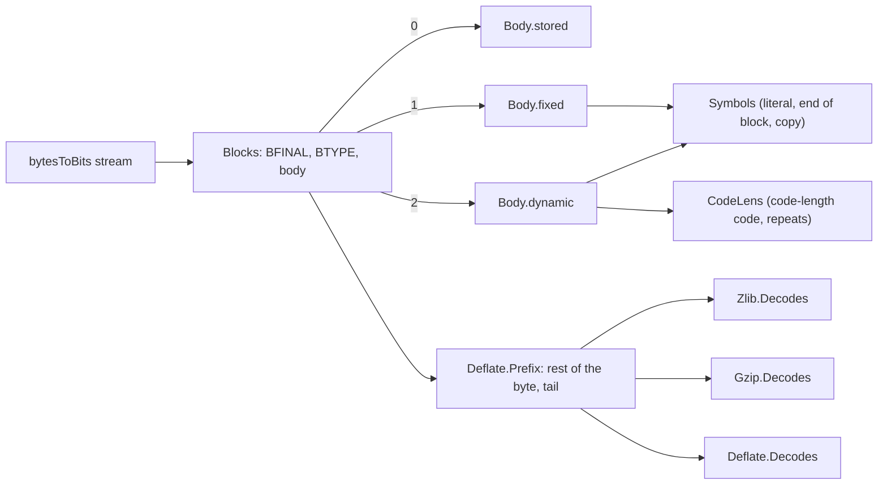

# Data format in Lean

[format.md](format.md) says what the data format is. This page says which Lean definition formalises
each rule, and what is left out. The Lean files are `ZlibF/Spec/Format.lean` and `ZlibF/Spec/Format/*.lean`.
They hold no heap, no pointer and no `sorry`. Every definition is total, and a reviewer can compare it with
the RFC line by line.

## Files

| File | Content |
| --- | --- |
| `Format/Bits.lean` | bit reading order, number readers, big and little endian bytes |
| `Format/Checksum.lean` | `adler32`, `crc32` and their incremental forms |
| `Format/Huffman.lean` | canonical codes, validity, fixed lengths, length and distance tables |
| `Format/Deflate.lean` | the relation `Deflate.Decodes` and the block predicates |
| `Format/Wrapper.lean` | `Zlib.Decodes`, `Gzip.Decodes` and the `Valid` predicates |
| `Format/Examples.lean` | the sanity examples (the only tests of the specification) |

## How the relation is built

- A reader (`readBits`, `readBytes`, `decodeSym`) takes a bit list and returns the value and the bits that are left, or `none`.
  A relation constructor says "the reader returns this". So every constructor is a statement about the next bits, and the
  relation is deterministic.
- A Huffman symbol is decoded by `decodeSym`: the first symbol whose canonical code (from the `code_start` recurrence) is
  a prefix of the input. A valid code is prefix-free, so the symbol is unique.
- The output so far is the history `h`. A copy reads `dict ++ h` (`copyBack`), one byte at a time, so it may overlap itself.
- A stored block skips `inp.length % 8` bits. This is the number of bits left in the current byte, because every relation
  is applied to the bits of a whole number of bytes (`Deflate.Prefix`).
- `Deflate.Prefix dict stream tail out`: the blocks end somewhere, the rest of that byte is skipped, and the bytes after it are
  exactly `tail`. The wrappers use it to place the trailer. `Deflate.Decodes` is the case `tail = []`.

## Table: rule to definition

| Rule | Lean definition |
| --- | --- |
| `F-bit-order` | `byteBits`, `bytesToBits`, `readBits` (numbers, least significant bit first), `natToBitsMSB` (codes, most significant bit first) |
| `F-block-type-3` | `Body` has no constructor for `BTYPE = 3` |
| `F-stored-complement` | `Body.stored` (premise `nlen = 65535 - len`) |
| `F-code-fits` | `count`, `codeStart`, `codeOf`, `Fits` |
| `F-code-complete` | `Complete`, `Acceptable` (the three cases of the table in format.md 2.4), `CodeKind` |
| `F-fixed-lengths` | `fixedLitLens`, `fixedDistLens`, `Body.fixed`; symbols 286, 287 and distances 30, 31 are rejected by the premises `s ≤ 285` and `d ≤ 29` of `Symbols.copy` |
| `F-dynamic-limits` | `DynamicCountsOK`, premise of `Body.dynamic` |
| `F-dynamic-repeat` | `CodeLens` (`rep16` needs a previous length; no repeat runs past the total) |
| `F-dynamic-eob` | `HasEndOfBlock`, premise of `Body.dynamic` |
| `F-dynamic-valid` | `Acceptable .codeLength`, `.litLen`, `.dist` as premises of `Body.dynamic` |
| (format.md 2.6, steps 1 to 4) | `Body.dynamic`, `clOrder`, `readCodeLenLens` |
| `F-length-table` | `lengthBases`, `lengthExtras`, `Symbols.copy` |
| `F-length-284` | the same tables, which are zlib's: the symbol 284 with extra value 31 is the length 258. Checked against the real library |
| `F-distance-table` | `distBases`, `distExtras`, `Symbols.copy` |
| `F-match-copy` | `copyBack` |
| `F-distance-bound` | the premise `xd + distBases.getD d 0 ≤ (dict ++ h).length` of `Symbols.copy` |
| (format.md 2.2) | `Blocks.last`, `Blocks.more` |
| `F-zlib-header` | `Zlib.HeaderOK`, `Zlib.windowSize`, `Zlib.Decodes` |
| `F-zlib-check` | the trailer `be32 (adler32 out)` in `Zlib.Decodes` |
| (format.md 4, header) | `Gzip.header`, `Gzip.Decodes` |
| `F-gzip-check` | the trailer `le32 (crc32 out) ++ le32 (out.length % 2^32)` in `Gzip.Decodes` |
| `F-adler-incremental` | `adler32Update`, theorem `adler32Update_append` |
| `F-crc-incremental` | `crc32Update`, theorem `crc32Update_append` |
| `F-deflate-valid` | `Deflate.Valid`, `Zlib.Valid`, `Zlib.ValidWith`, `Gzip.Valid` |

## Choices and deviations to review

1. **Distance and window.** `F-distance-bound` is formalised as "at most the output so far plus the dictionary". The window size of the
   header (`CINFO`) does not limit a distance. The reason: what zlib does for a distance that exceeds the window but not the output
   depends on how the caller splits the output buffer (`inflate` also counts the bytes of the current call). The distance table
   already limits a distance to 32768. **To confirm** against `inflate.c` before the proof of `inflate_correct`.
2. **Dictionary size.** For zlib with `FDICT`, only the last `2^(CINFO+8)` bytes of the dictionary can be reached, as in
   `inflateSetDictionary`. The `DICTID` is the Adler-32 of the whole dictionary given.
3. **Length 258 by symbol 284.** Symbol 284 with extra bits 31 gives length 258. format.md 2.7 lists 227-257 for symbol 284, but zlib
   accepts 258 (tested with the C library), and `lengthBases` / `lengthExtras` follow zlib. So the Lean accepts more than
   format.md says. format.md should state this (a compressor never produces it), or the specification should reject it.
4. **Code-length code, no symbol.** An all-zero code is accepted for every kind of code, as in `inflate_table` (`max == 0`).
   Decoding then fails at the first symbol.
5. **Padding.** The bits that skip to the byte boundary (stored blocks, end of data) may have any value, as in zlib.
6. **Exact streams.** `Zlib.Decodes`, `Gzip.Decodes`, `Deflate.Decodes` mean the stream is exactly the wrapper. Bytes after the trailer
   are not part of it. A statement about `inflate` that returns early with `Z_STREAM_END` needs `Deflate.Prefix` or a prefix lemma.
7. **Dictionary parameter.** `Zlib.Decodes dict` ignores `dict` if `FDICT` is clear. With `FDICT` set it requires
   `DICTID = adler32 dict`. The empty dictionary has Adler-32 1, so a stream with `DICTID = 1` is accepted with `dict = []`.
8. **Gzip fields that are not used.** The values `extra`, `name`, `comment` of a clear flag are existentially quantified but unused;
   `FTEXT`, `MTIME`, `XFL` and `OS` are free.

## Not formalised

| Item of format.md | Reason |
| --- | --- |
| The error messages of zlib (`invalid block type`, ...) | The relation says accept or reject. The mapping to `Z_DATA_ERROR` and the message belong to the API specification |
| `Z_NEED_DICT` and the order of calls | API behaviour, not data format |
| `F-deflate-matches` (match length 3 to 258, distance at most `w_size - 262`) | A property of the compressor's choices, stronger than the format. It is a fact about the `deflate` output and belongs to its specification |
| `F-deflate-flush` (sync flush ends with an empty stored block) | A property of `deflate` with a flush value, over a sequence of calls. It needs the stream API |
| gzip with several members, `windowBits` auto-detection (32 + n), raw deflate with `windowBits` below 0 | API level. `Deflate.Decodes` is the raw format and takes the dictionary directly |
| `CRC-32` and `Adler-32` combine | not in format.md |
| The `ENOUGH` table size limits of `inflate_table` | They are implementation limits that valid lengths can never exceed |
| Window size limits at output buffer boundaries (item 1 above) | see item 1 |

## Checks

`Format/Examples.lean` has the examples: positive and negative for each rule, listed there with the rule they test. They are the only
tests of the specification. They use `decide` (kernel evaluation), `rfl` and the constructors of the relations. The negative stream
examples invert the derivation with `cases`.
