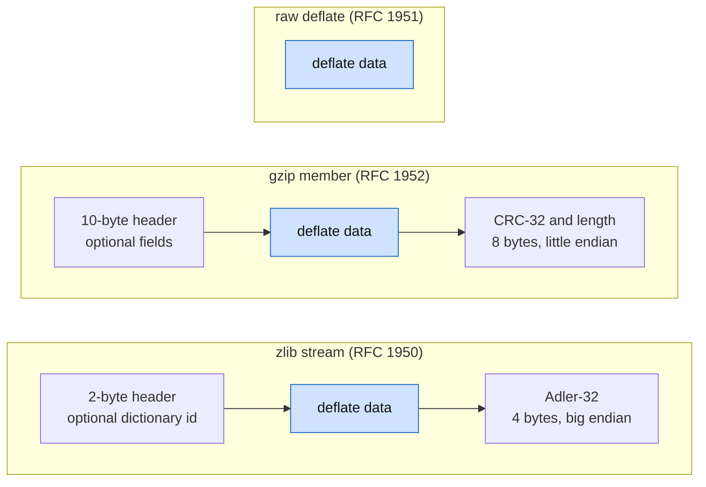

# Data format

What `inflate` accepts and `deflate` produces. Sources: RFC 1951 (deflate), RFC 1950 (zlib),
RFC 1952 (gzip). This page states the rules the proofs use. Where zlib is stricter than the RFC,
the text says so.

## 1. Three layers



`windowBits` selects the layer (see [api.md](api.md)). The deflate data is the same in all three.

## 2. Deflate data (RFC 1951)

### 2.1 Bit order

- Bits are taken from each byte starting at the **least** significant bit.
- A multi-bit number that is not a Huffman code (a length, an extra-bits value) is packed with
  its least significant bit first.
- A **Huffman code** is packed starting with its **most** significant bit. So the bit that
  `inflate` reads first is the top bit of the code.

`F-bit-order`: a decoder keeps a bit buffer, appends new bytes at the high end, and consumes
from the low end. A Huffman code of length `l` is the next `l` bits of the buffer, **reversed**.

### 2.2 Blocks

A deflate stream is a sequence of blocks. Each block begins with three bits:

| Bits | Meaning |
| --- | --- |
| first bit `BFINAL` | 1 if this is the last block |
| next two bits `BTYPE` | 0 stored, 1 fixed Huffman, 2 dynamic Huffman, 3 invalid |

`F-block-type-3`: `BTYPE = 3` is an error. zlib reports `invalid block type`.

### 2.3 Stored block (`BTYPE = 0`)

1. Skip the remaining bits of the current byte.
2. Read `LEN` (16 bits, little endian) then `NLEN` (16 bits).
3. `F-stored-complement`: `NLEN` must equal `LEN` with all bits flipped. Otherwise zlib reports
   `invalid stored block lengths`.
4. Copy `LEN` bytes to the output.

### 2.4 Huffman codes

All Huffman codes in deflate are **canonical**. A code is given by the lengths of its symbols
(0 means the symbol is unused), and the codes are derived as follows (RFC 1951, 3.2.2).

Let `count[l]` be the number of symbols of length `l`, for `l` from 1 to 15. Define

```
code_start[1] = 0
code_start[l] = (code_start[l-1] + count[l-1]) * 2        for l >= 2
```

Give the symbols of length `l`, in increasing symbol order, the consecutive values
`code_start[l]`, `code_start[l]+1`, ..., written in `l` bits.

`F-code-fits`: a set of lengths is **valid** only if no code overflows its length:
`code_start[l] + count[l] ≤ 2^l` for every `l`. This is the Kraft inequality
`sum over symbols of 2^(-length) ≤ 1`. A set that breaks it is **over-subscribed**.

`F-code-complete`: a set is **complete** if the Kraft sum is exactly 1, and **incomplete** if
it is less.

zlib's rule (`inflate_table`):

| Case | zlib |
| --- | --- |
| over-subscribed | error: `invalid code lengths set` or similar |
| incomplete | error, **except** a literal/length or distance code with exactly one symbol of length 1 |
| no symbols at all | accepted; a table that makes any decode attempt fail |

The exception follows RFC 1951: a distance code with a single symbol may have one code of one bit.
zlib applies it also to the literal/length code. The code-length code (section 2.6) never gets
the exception.

### 2.5 Fixed Huffman block (`BTYPE = 1`)

`F-fixed-lengths`: literal/length symbols 0..287 have lengths

| Symbols | Length |
| --- | --- |
| 0 to 143 | 8 |
| 144 to 255 | 9 |
| 256 to 279 | 7 |
| 280 to 287 | 8 |

and distance symbols 0..31 all have length 5. Symbols 286, 287 (length) and 30, 31 (distance)
never occur in valid data. If they are decoded, zlib reports `invalid literal/length code` or
`invalid distance code`.

### 2.6 Dynamic Huffman block (`BTYPE = 2`)

After the three header bits:

1. `HLIT` (5 bits), number of literal/length codes is `HLIT + 257`.
2. `HDIST` (5 bits), number of distance codes is `HDIST + 1`.
3. `HCLEN` (4 bits), number of code-length codes is `HCLEN + 4`.
4. `HCLEN + 4` lengths, 3 bits each, for the code-length alphabet in the order
   `16 17 18 0 8 7 9 6 10 5 11 4 12 3 13 2 14 1 15`. The other lengths are 0.
5. `HLIT + 257` literal/length lengths followed by `HDIST + 1` distance lengths, coded with the
   code-length code. Each decoded symbol means:

   | Symbol | Meaning |
   | --- | --- |
   | 0 to 15 | that length |
   | 16 | repeat the previous length 3 to 6 times (2 extra bits). Not allowed as the first |
   | 17 | repeat length 0, 3 to 10 times (3 extra bits) |
   | 18 | repeat length 0, 11 to 138 times (7 extra bits) |

   Repeats may run across from the literal/length lengths into the distance lengths, as in RFC
   1951.

`F-dynamic-limits`: zlib rejects `HLIT + 257 > 286` and `HDIST + 1 > 30`
(`too many length or distance symbols`).
`F-dynamic-repeat`: a repeat that would go past the total, or a symbol 16 with no previous
length, is an error (`invalid bit length repeat`).
`F-dynamic-eob`: the length of symbol 256 must not be 0 (`invalid code -- missing end-of-block`).
`F-dynamic-valid`: each of the three codes (code-length, literal/length, distance) must pass the
test of section 2.4 (`invalid code lengths set`, `invalid literal/lengths set`,
`invalid distances set`).

The code-length code has lengths at most 7 (3-bit fields). The other two have lengths at most 15.

### 2.7 Symbols inside a Huffman block

Decode a literal/length symbol `s`:

| `s` | Meaning |
| --- | --- |
| 0 to 255 | output the byte `s` |
| 256 | end of block |
| 257 to 285 | a match length (table below); then read a distance |
| 286, 287 | invalid |

**Length** (`F-length-table`):

| Symbols | Extra bits | Lengths |
| --- | --- | --- |
| 257 to 264 | 0 | 3, 4, 5, 6, 7, 8, 9, 10 |
| 265 to 268 | 1 | 11-12, 13-14, 15-16, 17-18 |
| 269 to 272 | 2 | 19-22, 23-26, 27-30, 31-34 |
| 273 to 276 | 3 | 35-42, 43-50, 51-58, 59-66 |
| 277 to 280 | 4 | 67-82, 83-98, 99-114, 115-130 |
| 281 to 284 | 5 | 131-162, 163-194, 195-226, 227-257 (but see `F-length-284`) |
| 285 | 0 | 258 |

`F-length-284`: zlib also accepts the symbol 284 with all five extra bits set (extra value 31). That is the length 258, which RFC 1951
gives only to the symbol 285. The RFC leaves this combination unused; zlib's table makes it valid, and the specification follows zlib.
Checked on the real library: a fixed-Huffman stream with the literal `a`, then symbol 284, extra bits 31, distance 1, decodes to 259 bytes.

**Distance** (`F-distance-table`): decode a distance symbol `d` with the distance code:

| Symbols | Extra bits | Distances |
| --- | --- | --- |
| 0 to 3 | 0 | 1, 2, 3, 4 |
| 4, 5 | 1 | 5-6, 7-8 |
| 6, 7 | 2 | 9-12, 13-16 |
| 8, 9 | 3 | 17-24, 25-32 |
| 10, 11 | 4 | 33-48, 49-64 |
| 12, 13 | 5 | 65-96, 97-128 |
| 14, 15 | 6 | 129-192, 193-256 |
| 16, 17 | 7 | 257-384, 385-512 |
| 18, 19 | 8 | 513-768, 769-1024 |
| 20, 21 | 9 | 1025-1536, 1537-2048 |
| 22, 23 | 10 | 2049-3072, 3073-4096 |
| 24, 25 | 11 | 4097-6144, 6145-8192 |
| 26, 27 | 12 | 8193-12288, 12289-16384 |
| 28, 29 | 13 | 16385-24576, 24577-32768 |

The extra bits are read after the symbol, least significant bit first, and added to the first
distance of the row entry.

`F-match-copy`: a match of length `L` and distance `D` copies `L` bytes, one at a time, from
`D` bytes back in the output. `L` may exceed `D`; the copy then overlaps itself, and the
earlier-copied bytes are used (for example `D = 1` repeats one byte `L` times).
`F-distance-bound`: `D` must not exceed the number of bytes produced so far plus the bytes that
the decoder's window still holds. Otherwise zlib reports `invalid distance too far back`.

## 3. Zlib wrapper (RFC 1950)

| Field | Size | Rule |
| --- | --- | --- |
| `CMF` | 1 byte | low 4 bits (`CM`) must be 8; high 4 bits (`CINFO`) is the window size minus 8: window `2^(CINFO+8)`, `CINFO ≤ 7` |
| `FLG` | 1 byte | `(CMF * 256 + FLG) mod 31 = 0`; bit 5 `FDICT`; bits 6-7 `FLEVEL` (a hint only) |
| `DICTID` | 4 bytes | present only if `FDICT`; big-endian Adler-32 of the preset dictionary |
| data | | deflate data |
| `ADLER32` | 4 bytes | big-endian Adler-32 of the uncompressed data |

`F-zlib-header`: zlib reports `incorrect header check`, `unknown compression method`,
`invalid window size` for the three header errors. A stream that needs a dictionary makes
`inflate` return `Z_NEED_DICT` until the caller supplies it.
`F-zlib-check`: a mismatching checksum is `incorrect data check`.

## 4. Gzip wrapper (RFC 1952)

| Field | Size | Rule |
| --- | --- | --- |
| `ID1 ID2` | 2 bytes | 31, 139 |
| `CM` | 1 byte | 8 |
| `FLG` | 1 byte | bit 0 `FTEXT`, bit 1 `FHCRC`, bit 2 `FEXTRA`, bit 3 `FNAME`, bit 4 `FCOMMENT`. Bits 5-7 must be 0 in zlib (`unknown header flags set`) |
| `MTIME` | 4 bytes | little endian |
| `XFL`, `OS` | 1 byte each | |
| extra | 2 bytes length (little endian), then that many bytes | if `FEXTRA` |
| name | zero-terminated | if `FNAME` |
| comment | zero-terminated | if `FCOMMENT` |
| header CRC | 2 bytes | if `FHCRC`: the low 16 bits of the CRC-32 of the header bytes before it |
| data | | deflate data |
| `CRC32` | 4 bytes | little endian, CRC-32 of the uncompressed data |
| `ISIZE` | 4 bytes | little endian, length of the uncompressed data modulo `2^32` |

`F-gzip-check`: a wrong CRC is `incorrect data check`, a wrong length is `incorrect length check`.

## 5. The two checksums

**Adler-32** (RFC 1950, 8.2). For a byte sequence `b_1 .. b_n`:

```
s1 = 1 + b_1 + ... + b_n           (mod 65521)
s2 = sum of the values taken by s1 after each byte   (mod 65521)
adler = s2 * 65536 + s1
```

The empty sequence gives 1. `F-adler-incremental`: feeding a sequence in pieces gives the same
result as feeding it at once, if each call continues from the previous result.

**CRC-32** (RFC 1952, 8.1.1.6.2). The polynomial `0xEDB88320` (bit-reflected), start value
`0xFFFFFFFF`, bytes processed least significant bit first, final result xor `0xFFFFFFFF`.
The empty sequence gives 0. `F-crc-incremental`: as above.

## 6. What `deflate` has to produce

`F-deflate-valid`: every byte sequence that `deflate` produces, taken as a whole stream with
`Z_FINISH`, is accepted by `inflate` of the same layer, and `inflate` returns the original
input.
`F-deflate-matches`: every match emitted has length 3 to 258 and distance 1 to
`w_size - 262`, where `w_size` is the window size (this bound is a zlib choice that is stronger
than the format).
`F-deflate-flush`: after a call with `Z_SYNC_FLUSH` or `Z_FULL_FLUSH`, the output so far is a
complete sequence of blocks ending with an empty stored block, so that a decoder has produced all
the input seen so far.

The exact bytes are **not** specified. Two valid compressors produce different data. Only the
round trip is. (This is also why lean-zip can verify a different compressor against the same
specification.)
