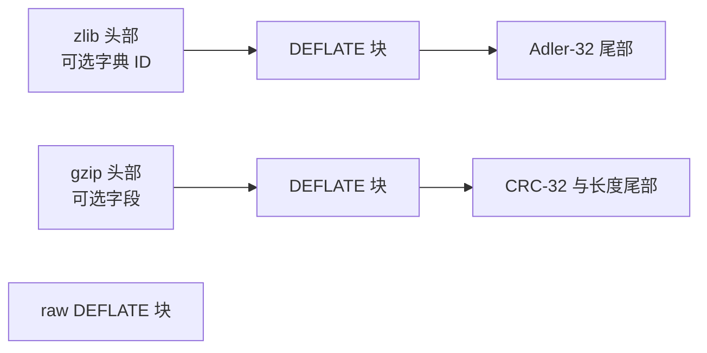

# 数据格式

[文档首页](../../README.md) · [API 指南](../api/README.md) · [Lean 模型](model.md)

DEFLATE 描述压缩字节。zlib 和 gzip 格式在这些字节外加入头部与校验和。
本指南解释 `inflate` 必须解释、`deflate` 必须产生的数据。
它陈述义务，并不宣称实现已经满足。已接受结果与剩余工作记录于[进度](../../progress.md)。

先阅读分层与位序，再阅读块和符号规则。包装部分解释字典和校验和。
[模型参考](model.md)将这些规则映射到 Lean。
缓冲区管理、返回码和合法调用序列属于[流式 API](../api/streams.md)。

格式依据为 DEFLATE 的 [RFC 1951](https://www.rfc-editor.org/rfc/rfc1951.html)、
zlib 的 [RFC 1950](https://www.rfc-editor.org/rfc/rfc1950.html)，以及
gzip 的 [RFC 1952](https://www.rfc-editor.org/rfc/rfc1952.html)。
下列规则明确保留 zlib 接受的变体与限制。
`F-*` 名称标识规范和证明文档使用的义务。

## 分层与流边界



Raw DEFLATE 没有包装校验和或字典标识。一个 zlib 流具有一个 DEFLATE 载荷。
一个 gzip 成员也具有一个 DEFLATE 载荷；gzip 文件可以拼接多个成员。
`windowBits` 选择 API 读写哪一层。

完整流在最后一个块及其包装尾部（如果存在）之后结束。
最后一个 DEFLATE 字节的未使用位可以是任意值。多余字节属于独立的尾随部分。
精确流关系要求该尾随部分为空；前缀关系则记录它。
`inflate` 调用可能在调用者缓冲区还有字节时到达 `Z_STREAM_END`，
但这不会使剩余字节成为已完成流的一部分。

## 位与块

每个字节从最低有效位向上依次放入位。普通数值字段（包括额外位的数值）先放最低有效位。
Huffman 码则在相同字节位位置顺序中，先放码字的最高有效位。

`F-bit-order`：解码器将字节追加到位缓冲区高端，从低端消费位。
要还原一个 `l` 位 Huffman 码的数值规范值，需要反转接下来的 `l` 个缓冲低位。
这种反转适用于 Huffman 码，不适用于普通字段。

每个块以一个 `BFINAL` 位和一个两位的 `BTYPE` 数值开始。
`BFINAL = 1` 标记最后一个块；否则紧接下一个块。块边界不必是字节边界。

| `BTYPE` | 主体 |
| --- | --- |
| 0 | 直接存储的字节 |
| 1 | 用固定 Huffman 码编码的符号 |
| 2 | 编码描述，随后是用这些动态 Huffman 码编码的符号 |
| 3 | 无效 |

`F-block-type-3`：拒绝块类型 3（`invalid block type`）。

### 直接存储块

直接存储块先跳到下一个字节边界。跳过的位可以是任意值。
随后是小端 16 位字段 `LEN` 和 `NLEN`，再后面恰好是 `LEN` 个未压缩字节。

`F-stored-complement`：`NLEN = 65535 - LEN`。
不匹配时拒绝（`invalid stored block lengths`）。允许长度为零的直接存储块。

## 规范 Huffman 码

编码描述为每个符号给出一个长度。长度零表示未使用。
对于字面量／长度和距离字母表，非零长度至多为 15。
规范码由这些长度和符号顺序决定，无需传输其位模式。

令 `count[l]` 统计长度为 `l` 的符号数。每种长度的第一个编码为：

```text
code_start[1] = 0
code_start[l] = (code_start[l - 1] + count[l - 1]) * 2    for l >= 2
```

在固定长度 `l` 下，按符号递增顺序，从 `code_start[l]` 开始分配连续数值。
每个值恰好写成 `l` 位。

`F-code-fits`：对 1 到 15 的每个 `l`，`code_start[l] + count[l] ≤ 2^l`。
等价地，所有已使用符号的 `2^(-length)` 之和至多为 1。
超过它即为超额订码。

`F-code-complete`：该和等于 1 时编码完整，小于 1 时不完整。
zlib 的建表器采用以下接受规则：

| 长度集合 | 是否接受 |
| --- | --- |
| 超额订码 | 拒绝 |
| 完整 | 接受 |
| 不完整，恰好一个已使用符号，长度为 1 | 字面量／长度码和距离码接受；码长编码拒绝 |
| 所有长度为零 | 接受为空表；任何解码符号的尝试都会失败 |
| 其他不完整集合 | 拒绝 |

接受空表不等于接受无法解码的块。动态字面量／长度表还必须包含块结束符。
空距离表可以服务于没有匹配的块。空码长表无法解码后续必需长度。
距离码的单符号例外由 RFC 描述；zlib 也允许字面量／长度码采用这一例外。

### 固定码

`F-fixed-lengths`：固定块使用以下字面量／长度码长：

| 符号 | 长度 |
| --- | --- |
| 0–143 | 8 |
| 144–255 | 9 |
| 256–279 | 7 |
| 280–287 | 8 |

全部 32 个距离符号的长度都是 5。
表中包含保留符号：解码字面量／长度 286 或 287，或距离 30 或 31，属于错误
（`invalid literal/length code` 或 `invalid distance code`）。
它们出现在固定表中，并不表示允许使用。

### 动态码

动态块描述三套编码：码长编码、字面量／长度编码、距离编码。
块头之后立即读取：

1. 5 位 `HLIT`：字面量／长度字母表有 `HLIT + 257` 项。
2. 5 位 `HDIST`：距离字母表有 `HDIST + 1` 项。
3. 4 位 `HCLEN`：随后有 `HCLEN + 4` 个码长项。
4. 每项 3 位，按以下符号顺序：
   `16 17 18 0 8 7 9 6 10 5 11 4 12 3 13 2 14 1 15`。
   未发送的码长项为零，因此这套编码长度至多为 7。
5. 使用该码长编码，解码合并的字面量／长度码长与距离码长。

合并列表先包含全部字面量／长度项，再包含全部距离项。码长符号按下列方式展开：

| 符号 | 展开方式 |
| --- | --- |
| 0–15 | 一个具有该长度的项 |
| 16 | 重复前一长度 `3 + x` 次；为 `x` 读取 2 个额外位 |
| 17 | 追加 `3 + x` 个零；读取 3 个额外位 |
| 18 | 追加 `11 + x` 个零；读取 7 个额外位 |

`F-dynamic-limits`：zlib 要求 `HLIT + 257 ≤ 286` 且 `HDIST + 1 ≤ 30`。
字段可以表示更大的计数，但 zlib 会拒绝（`too many length or distance symbols`）。

`F-dynamic-repeat`：符号 16 必须有前一项。任何重复都不能超过合并后的总项数
（`invalid bit length repeat`）。重复可以跨越两个字母表的分界。

`F-dynamic-eob`：字面量／长度符号 256 必须具有非零长度
（`invalid code -- missing end-of-block`）。

`F-dynamic-valid`：三套编码分别必须满足上述接受规则。
失败报告为 `invalid code lengths set`、`invalid literal/lengths set` 或 `invalid distances set`。

## 字面量、匹配与历史

Huffman 块内的字面量／长度符号有三种含义：

| 符号 | 含义 |
| --- | --- |
| 0–255 | 将该字节追加到输出 |
| 256 | 结束当前块 |
| 257–285 | 读取长度额外位、距离符号和距离额外位，然后复制一个匹配 |

每个表项的数值，是基值加额外位数值。额外位采用普通的最低有效位优先顺序。

`F-length-table`：

| 符号 | 额外位 | 按符号顺序的长度范围 |
| --- | --- | --- |
| 257–264 | 0 | 3, 4, 5, 6, 7, 8, 9, 10 |
| 265–268 | 1 | 11–12, 13–14, 15–16, 17–18 |
| 269–272 | 2 | 19–22, 23–26, 27–30, 31–34 |
| 273–276 | 3 | 35–42, 43–50, 51–58, 59–66 |
| 277–280 | 4 | 67–82, 83–98, 99–114, 115–130 |
| 281–284 | 5 | 131–162, 163–194, 195–226, 227–257；见下列例外 |
| 285 | 0 | 258 |

`F-length-284`：zlib 也接受符号 284 加额外值 31，得到长度 258。
RFC 表将长度 258 分配给符号 285，并未使用这一组合。格式模型保留 zlib 接受的组合。
一项已记录的真实库检查使用字面量 `a`，随后使用符号 284、额外值 31 和距离 1，得到 259 字节。
这是一致性证据，不是翻译后解码器的证明。

`F-distance-table`：

| 符号 | 额外位 | 按符号顺序的距离范围 |
| --- | --- | --- |
| 0–3 | 0 | 1, 2, 3, 4 |
| 4, 5 | 1 | 5–6, 7–8 |
| 6, 7 | 2 | 9–12, 13–16 |
| 8, 9 | 3 | 17–24, 25–32 |
| 10, 11 | 4 | 33–48, 49–64 |
| 12, 13 | 5 | 65–96, 97–128 |
| 14, 15 | 6 | 129–192, 193–256 |
| 16, 17 | 7 | 257–384, 385–512 |
| 18, 19 | 8 | 513–768, 769–1024 |
| 20, 21 | 9 | 1025–1536, 1537–2048 |
| 22, 23 | 10 | 2049–3072, 3073–4096 |
| 24, 25 | 11 | 4097–6144, 6145–8192 |
| 26, 27 | 12 | 8193–12288, 12289–16384 |
| 28, 29 | 13 | 16385–24576, 24577–32768 |

`F-match-copy`：长度 `L`、距离 `D` 的匹配，每次从向后 `D` 字节处复制一个字节。
每个字节在下一次复制前加入历史，因此 `L` 可以大于 `D`：距离 1 会将最近的字节重复 `L` 次。
预置字典在历史中位于输出之前，字典本身不作为输出。

`F-distance-bound`：匹配必须有足够的先前历史。
声明式模型使用 `D ≤ length(dictionary ++ output_so_far)`；距离表还强制 `D ≤ 32768`。
实际解码器还要求引用字节存在于保存的窗口或本次调用的输出中。
不可用的距离对应 `invalid distance too far back`。

配置较小窗口时，这是不同的条件。默认 C 路径可以在当前输出缓冲区中向后引用得更远，
超过保存窗口在调用间能够保留的距离。`INFLATE_STRICT` 增加相对于 zlib 头声明上限的检查。
这些条件跨输出缓冲区边界的完整细化仍**待确认**；不能将格式关系表述成任意缓冲区切分都接受同一流的保证。
参见[模型选择](model.md#model-choices-and-boundaries)和 [inflate API](../api/inflate-stream.md)。

## zlib 包装

字段按以下顺序出现：

| 字段 | 编码与规则 |
| --- | --- |
| `CMF` | 一个字节：低四位 `CM = 8`；高四位 `CINFO ≤ 7` 宣告窗口大小 `2^(CINFO + 8)` |
| `FLG` | 一个字节：`(CMF * 256 + FLG) mod 31 = 0`；第 5 位为 `FDICT`；第 6–7 位为提示性的 `FLEVEL` |
| `DICTID` | 仅在 `FDICT` 置位时出现：整个预置字典的四字节大端 Adler-32 |
| 载荷 | DEFLATE 块，在忽略填充位后于字节边界结束 |
| `ADLER32` | 未压缩输出的四字节大端 Adler-32 |

`F-zlib-header`：头部校验、方法和窗口字段必须有效。
对应错误为 `incorrect header check`、`unknown compression method` 和 `invalid window size`。
API 还会检查声明窗口是否超过配置上限。

若有 `FDICT`，调用者提供 Adler-32 匹配 `DICTID` 的字典。
仅其最后 `2^(CINFO + 8)` 字节可作为初始历史，但校验和仍针对整个所提供的字典。
若 `FDICT` 未置位，格式关系忽略字典参数。空字典的标识为 1。

`F-zlib-check`：尾部必须等于仅针对输出字节的 Adler-32。
不匹配对应 `incorrect data check`。字典不计入这个校验和。
返回 `Z_NEED_DICT` 和后续字典调用属于 [API 行为](../api/inflate-stream.md)。

## gzip 包装

以下字段描述一个成员：

| 字段 | 编码与规则 |
| --- | --- |
| `ID1`、`ID2`、`CM` | 字节 31、139、8 |
| `FLG` | 一个字节：第 0 位 `FTEXT`，第 1 位 `FHCRC`，第 2 位 `FEXTRA`，第 3 位 `FNAME`，第 4 位 `FCOMMENT`；第 5–7 位必须为零 |
| `MTIME`、`XFL`、`OS` | 四字节小端时间，再分别以一个字节表示额外标志和操作系统 |
| 额外字段 | 若有 `FEXTRA`：两字节小端长度，随后是相应数量的字节 |
| 名称 | 若有 `FNAME`：以零终止的字节 |
| 注释 | 若有 `FCOMMENT`：以零终止的字节 |
| 头部 CRC | 若有 `FHCRC`：全部先前头部字节的 CRC-32 的低 16 位，小端 |
| 载荷 | DEFLATE 块，在忽略填充位后于字节边界结束 |
| `CRC32` | 未压缩输出的四字节小端 CRC-32 |
| `ISIZE` | 输出长度模 `2^32`，四字节小端 |

可选字段按所示顺序出现。`FTEXT`、`MTIME`、`XFL` 和 `OS` 不改变解码。
拒绝保留标志（`unknown header flags set`）。Gzip 不提供预置字典标识。

`F-gzip-check`：尾部 CRC 和长度必须匹配。错误 CRC 对应 `incorrect data check`；
错误长度对应 `incorrect length check`。可选头部 CRC 单独检查。
多成员读取、透明输入和文件错误属于 [gzip 文件 API](../api/gz-file.md)。

## 校验和数学定义

Adler-32 从 `s1 = 1`、`s2 = 0` 开始。对每个字节 `b`，按此顺序更新：

```text
s1 = (s1 + b) mod 65521
s2 = (s2 + s1) mod 65521
adler = s2 * 65536 + s1
```

空序列的 Adler-32 为 1。`F-adler-incremental`：从前一片段的校验和继续处理下一片段，
等于对两者拼接计算校验和。

CRC-32 使用反射多项式 `0xEDB88320`，内部寄存器从 `0xFFFFFFFF` 开始。
每个字节按最低有效位优先处理，最后将寄存器与 `0xFFFFFFFF` 异或。
空序列的 CRC-32 为 0。`F-crc-incremental`：从已公布校验和继续处理另一片段，
也等于一次计算拼接结果。[校验和 API](../api/checksums.md)规定初始化、更新和合并调用。

## 压缩器必须建立什么

`F-deflate-valid`：收集通过 `Z_FINISH` 完成的压缩序列输出。
它必须是所选层的有效流，使用匹配字典解码时必须恰好返回输入。
这是针对完整流的往返要求，包括包装和校验和。

`F-deflate-matches`：发出的匹配长度为 3–258，距离为 1 到 `w_size - 262`，
其中 `w_size` 是压缩器窗口大小。该距离上界是 zlib 的算法选择，比格式的最大值 32768 更强。

`F-deflate-flush`：完成 `Z_SYNC_FLUSH` 或 `Z_FULL_FLUSH` 时，
发出一串完整块，以空 stored 块结束。此时解码器可以产生直到该次 flush 为止提供的全部输入。
输出空间不足的调用者必须继续，直到 flush 完成；单次调用不一定发出该边界。
[deflate API](../api/deflate-stream.md)描述这一协议及 full flush 额外的历史重置。

这些义务不指定唯一的压缩字节。不同有效编码器可以对相同输入选择不同的块、编码和匹配。
它们必须保留输入，并满足格式、安全性和 API 要求。
